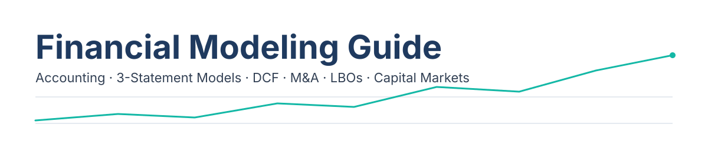
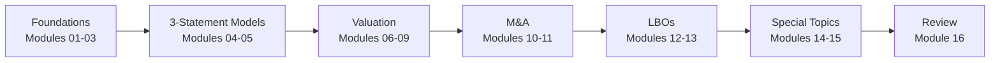

<picture>
  <source media="(prefers-color-scheme: dark)" srcset="docs/banner-dark.svg">
  
</picture>

    

A complete, self-study guide to corporate finance modeling, from accounting basics to leveraged buyouts. Each module is written as clear notes with worked examples, Mermaid diagrams, interview questions and cheat sheets, so you can read it on GitHub or open the whole folder in Obsidian.

## Table of Contents

- [Learning Path](#learning-path)
- [Curriculum](#curriculum)
- [What's in Each Module](#whats-in-each-module)
- [How to Use](#how-to-use)
- [Repository Layout](#repository-layout)
- [Disclaimer](#disclaimer)
- [License](#license)

## Learning Path

The modules build on each other. Work through the stages in order, and treat the Review stage as the place you return to before an interview or a modeling test.



## Curriculum

| # | Module | Topics | Level |
|---|--------|--------|-------|
| 01 | [Modeling Overview and Core Concepts](modules/01-modeling-overview-and-core-concepts.md) | Time value of money, discount rate and WACC, IRR vs discount rate, present value, valuing a growing perpetuity | Beginner |
| 02 | [Accounting Concepts, Part 1](modules/02-accounting-concepts-part-1.md) | Three-statement logic, receivables and payables, deferred revenue, capex and depreciation, leases, preferred stock | Beginner |
| 02 | [Accounting Concepts, Part 2](modules/02-accounting-concepts-part-2.md) | Impairments, stock-based compensation, goodwill and intangibles, US GAAP vs IFRS, linking statements, free cash flow | Beginner |
| 03 | [More Advanced Accounting](modules/03-more-advanced-accounting.md) | Debt discounts and OID, convertible bond accounting, PIK interest, equity method, noncontrolling interests | Beginner |
| 04 | [3-Statement Models](modules/04-3-statement-models.md) | SaaS revenue projections, debt schedule, tax schedule and NOLs, linking the statements, returns analysis | Beginner |
| 05 | [Advanced 3-Statement Models](modules/05-advanced-3-statement-models.md) | Revenue and expense projections, working capital, revolver and equity draws, debt and interest, key metrics | Intermediate |
| 06 | [Equity Value and Enterprise Value](modules/06-equity-value-and-enterprise-value.md) | Treasury stock method, equity value to EV bridge, income statement and cash flow multiples, LTM and forward multiples, pensions | Intermediate |
| 07 | [Valuation and DCF Analysis](modules/07-valuation-and-dcf-analysis.md) | Unlevered free cash flow, revenue and capex drivers, NOPAT, WACC and cost of equity, beta unlevering | Intermediate |
| 08 | [Advanced Valuation and DCF, Part 1](modules/08-advanced-valuation-and-dcf-part-1.md) | Drug-level revenue builds, risk-adjusted pipelines, taxes and NOPAT, public comps, comparable EV bridges | Intermediate |
| 08 | [Advanced Valuation and DCF, Part 2](modules/08-advanced-valuation-and-dcf-part-2.md) | Calendarization, cost of debt with convertibles, stub periods, mid-year convention, terminal value, football field | Intermediate |
| 09 | [Valuation Interpretation and Uses](modules/09-valuation-interpretation-and-uses.md) | Stock pitches, equity research reports, pitch books, dividend discount model, liquidation and NOL valuation, sum-of-the-parts | Intermediate |
| 10 | [Merger Models](modules/10-merger-models.md) | EPS accretion and dilution, purchase price and funding mix, sources and uses, purchase price allocation, combined balance sheet | Intermediate |
| 11 | [Advanced M&A Concepts, Part 1](modules/11-advanced-m-and-a-concepts-part-1.md) | Quarterly projections, exchange ratios and collars, stock vs asset deals, combined quarterly statements, synergies | Advanced |
| 11 | [Advanced M&A Concepts, Part 2](modules/11-advanced-m-and-a-concepts-part-2.md) | Parent and spinco separation, transaction adjustments, tax schedules and NOLs, 15-year unlevered DCF | Advanced |
| 11 | [Advanced M&A Concepts, Part 3](modules/11-advanced-m-and-a-concepts-part-3.md) | Acquirer and target rollforwards, stub periods, majority stake acquisitions, combined statements, sensitivities | Advanced |
| 12 | [LBO Concepts and Simple Models, Part 1](modules/12-lbo-concepts-and-simple-models-part-1.md) | LBO mechanics, sources and uses, debt repayment, returns and exit assumptions, paper LBOs, 60-minute LBO | Intermediate |
| 12 | [LBO Concepts and Simple Models, Part 2](modules/12-lbo-concepts-and-simple-models-part-2.md) | 90-minute and 180-minute cases, revolver and cash sweep, PIK interest, options pools, purchase price allocation | Intermediate |
| 13 | [Advanced LBOs, Part 1](modules/13-advanced-lbos-part-1.md) | Revolver and mandatory repayments, stub periods, purchase price allocation, interest circularity, three-statement linking | Advanced |
| 13 | [Advanced LBOs, Part 2](modules/13-advanced-lbos-part-2.md) | Company selection, add-on acquisitions, term loans and subordinated notes, exit multiples and returns, sensitivities | Advanced |
| 14 | [Private Companies and IPOs, Part 1](modules/14-private-companies-and-ipos-part-1.md) | Private company adjustments, venture-backed projections, private company cost of equity, terminal value, valuation summary | Advanced |
| 14 | [Private Companies and IPOs, Part 2](modules/14-private-companies-and-ipos-part-2.md) | Reverse mergers, synergies, relative contribution, exchange ratios and collars, IPO models and proceeds | Advanced |
| 15 | [Equity, Debt and Convertibles, Part 1](modules/15-equity-debt-and-convertibles-part-1.md) | Subscription revenue projections, content spending, financing scenarios, convertible bond accounting, debt schedule | Advanced |
| 15 | [Equity, Debt and Convertibles, Part 2](modules/15-equity-debt-and-convertibles-part-2.md) | Follow-on offerings, bond pricing, duration and convexity, call and make-whole provisions, Black-Scholes for convertibles | Advanced |
| 16 | [Quick Reference and Quiz Bank](modules/16-quick-reference-and-quiz-bank.md) | Working capital, leases, deferred taxes and NOLs, debt accounting, unlevered free cash flow, WACC | Reference |

## What's in Each Module

Every module follows the same structure, so you always know where to find things:

- **Overview**: what the module covers, in a few sentences.
- **Module Map**: a Mermaid diagram showing how the lessons connect.
- **Lessons**: the core material, with worked examples and step-by-step logic.
- **Diagrams and Charts**: Mermaid flowcharts and tables that explain the mechanics visually.
- **Excel Model Walkthrough**: how the same logic is built in a spreadsheet.
- **Interview Questions**: collapsible questions, so you can answer from memory before you open the answer.
- **Career Angle**: how the topic shows up in banking, corporate development, private equity and equity research.
- **Cheat Sheet**: the formulas, rules of thumb and checklists to keep open while you model.

Tips and common mistakes are called out in `TIP` and `WARNING` boxes throughout. Each module also has a collapsible contents list at the top and previous and next links at the top and bottom.

Module 16 replaces the lesson structure with a topic-by-topic quick reference and a quiz bank.

## How to Use

**Read on GitHub.** Mermaid diagrams and callouts render natively in the GitHub web view, so you can browse any module directly from the repository page.

**Open in Obsidian.** Obsidian gives you a full study environment with search, backlinks and graph view.

1. Clone the repository:

   ```bash
   git clone https://github.com/builtby-hari/FinancialModelingGuide.git
   ```

2. Open Obsidian, choose "Open folder as vault", and select the cloned folder.
3. Obsidian renders the Mermaid diagrams in reading view and live preview.

**Suggested study order.** Follow the Learning Path above. Modules 01 to 04 build the accounting and statement base that everything else depends on, so do not skip them even if you already know the material. Spend extra time on modules 07 and 10 to 13, which carry most of the modeling work.

**Self-test with the interview questions.** Each module has an Interview Questions section. Answer each question out loud or on paper before you read the answer.

**Fast review.** Use Module 16 before an interview, a modeling test or a refresher. It condenses the key formulas and quiz questions from the whole guide into one place.

## Repository Layout

```text
financial-modeling-guide/
├── README.md
├── LICENSE
├── .gitignore
├── docs/
│   ├── banner.svg
│   └── banner-dark.svg
└── modules/
    ├── 01-modeling-overview-and-core-concepts.md
    ├── 02-accounting-concepts-part-1.md
    ├── 02-accounting-concepts-part-2.md
    ├── 03-more-advanced-accounting.md
    ├── 04-3-statement-models.md
    ├── 05-advanced-3-statement-models.md
    ├── 06-equity-value-and-enterprise-value.md
    ├── 07-valuation-and-dcf-analysis.md
    ├── 08-advanced-valuation-and-dcf-part-1.md
    ├── 08-advanced-valuation-and-dcf-part-2.md
    ├── 09-valuation-interpretation-and-uses.md
    ├── 10-merger-models.md
    ├── 11-advanced-m-and-a-concepts-part-1.md
    ├── 11-advanced-m-and-a-concepts-part-2.md
    ├── 11-advanced-m-and-a-concepts-part-3.md
    ├── 12-lbo-concepts-and-simple-models-part-1.md
    ├── 12-lbo-concepts-and-simple-models-part-2.md
    ├── 13-advanced-lbos-part-1.md
    ├── 13-advanced-lbos-part-2.md
    ├── 14-private-companies-and-ipos-part-1.md
    ├── 14-private-companies-and-ipos-part-2.md
    ├── 15-equity-debt-and-convertibles-part-1.md
    ├── 15-equity-debt-and-convertibles-part-2.md
    └── 16-quick-reference-and-quiz-bank.md
```

## Disclaimer

This guide is for educational purposes only. It is a set of study notes, not professional training, accounting advice or investment advice. The numbers in the worked examples are made up for teaching and do not describe any real company. Do not use them to make financial decisions. Always check accounting treatments against current standards and the source filings before relying on them.

## License

This work is licensed under the [Creative Commons Attribution-NonCommercial-ShareAlike 4.0 International License](https://creativecommons.org/licenses/by-nc-sa/4.0/). See [LICENSE](LICENSE) for the short form.

---

Built by Hari Saravanan · [LinkedIn](https://www.linkedin.com/in/srihari-saravanan)
