# Module 01: Modeling Overview and Core Concepts

[Contents](../README.md) · [Next: Module 02, Part 1 →](02-accounting-concepts-part-1.md)

<details>
<summary><b>Contents</b></summary>

- [Overview](#overview)
- [Lessons](#lessons)
  - [1.1 Introduction and How to Use This Module](#11-introduction-and-how-to-use-this-module)
  - [1.2 What Is Financial Modeling and Why Does It Matter](#12-what-is-financial-modeling-and-why-does-it-matter)
  - [1.3 The Time Value of Money](#13-the-time-value-of-money)
  - [1.4 The Discount Rate and WACC](#14-the-discount-rate-and-wacc)
  - [1.5 Present Value vs the Asking Price](#15-present-value-vs-the-asking-price)
  - [1.6 IRR vs the Discount Rate](#16-irr-vs-the-discount-rate)
  - [1.7 IRR Practice Exercise (Capital Budgeting by Division)](#17-irr-practice-exercise-capital-budgeting-by-division)
  - [1.8 How to Value Any Company (The Growing Perpetuity)](#18-how-to-value-any-company-the-growing-perpetuity)
  - [1.9 What Makes Financial Modeling Hard](#19-what-makes-financial-modeling-hard)
- [Diagrams and Charts](#diagrams-and-charts)
- [Excel Model Walkthrough](#excel-model-walkthrough)
- [Interview Questions](#interview-questions)
- [Career Angle](#career-angle)
- [Cheat Sheet](#cheat-sheet)

</details>

## Overview

A financial model is a way to turn a view about a company or deal into numbers, and this module teaches the money math (time value of money, discount rates, WACC, PV, IRR) that every later valuation model depends on.

The module moves from the "why" to the "how". The first lesson frames modeling as a way to test a view. The next four lessons build the money math one piece at a time: a dollar today is worth more than a dollar later, that gap is captured by a discount rate, the discount rate for a company is its WACC, and IRR is the mirror image of NPV. The last two lessons put those tools to work on a whole company and explain why real models are harder than textbook examples.

## Module Map

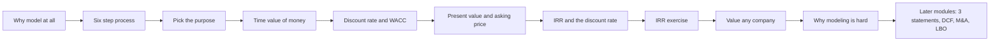

## Lessons

### 1.1 Introduction and How to Use This Module

- **What it is.** A quick start guide, not a modeling lesson. It explains how to use the module and which parts to study for a given goal.
- **Module role.** This module is "basic" material. It gives the core ideas used in all later modules: time value of money, discount rates, PV, NPV, IRR, and the growing-perpetuity formula.
- **Suggested time budget.** About 8 to 10 hours for a quick review, about 30 to 40 hours for the main path, and 60 to 70 hours with the extra optional modules.
- **Study tips.** Read the written lessons first, since reading is faster than watching a video. Do the practice quiz questions. Complete the Before and After Excel files if time allows, but skip them under time pressure. Focus on the big picture, not small input errors. Ask: "even if this one number is off, does it change the decision?"
- **Practical take.** This module is the foundation for valuation and pricing work. It is worth doing in full because the same five ideas show up in every later module and in most interview questions.

### 1.2 What Is Financial Modeling and Why Does It Matter

- **Core idea.** A financial model quantifies a view. It does not predict the future. Its job is to show whether a view is plausible, meaning what has to be true for the view to hold.
- **The disagreement test.** Suppose a stock trades at $150, you think it is worth $200, and a friend thinks it is worth $100. A model answers "what growth rate does each price require?" If $200 needs 30% sales growth a year, and $100 needs only 5%, the friend's case is more believable because companies usually slow down as they grow. Going from 10% growth to 30% growth is a much bigger leap than going from 10% down to 5%.
- **Uses.** Stock picking (buy, sell or short), M&A (does the deal add value), leveraged buyouts (can a sponsor earn a return after buying with debt), and capital raising (debt or equity).
- **What the model shows.** Earnings effect, cash flow effect and whether the combined company is worth more or less after a deal.
- **Role in a decision.** A model is like evidence in a trial. It supports one side of the argument but does not decide the case alone.

**The six-step process** (used in every case study in this guide):

1. Pick the purpose of the analysis (valuation, projections, merger, LBO).
2. Do background research (filings, investor presentations, research, management or channel checks).
3. Identify the key drivers of the business.
4. Gather data on comparable companies if needed.
5. Build the analysis.
6. Present the conclusion with numbers from the model.

**Time guide.** Choosing the purpose should take about five minutes. Background research ranges from an hour to weeks. Finding drivers takes 30 to 60 minutes for a simple company. Comparable company data can take an hour or weeks. The build can take 30 minutes for a simple model or months for a complex one. Presentation takes several hours to a week.

**Picking the purpose.** Use valuation when the question is "is this stock cheap or expensive?". Use projections of the three statements when the question is about margins, returns on capital or financial position over time. Use a merger model for an acquisition and an LBO model for a buyout with debt.

**Key drivers by industry (examples to build intuition):**

| Business | Typical drivers |
|---|---|
| Retailer | Number of stores, sales per store, cost per unit sold |
| Food and beverage | Units sold, average price, cost per unit |
| Subscription software | Monthly fee, number of customers, churn rate |
| Hotel | Number of hotels, rooms, occupancy, room rate, cost per hotel |
| Drug maker | Patients, price per patient, R&D spend, sales force cost |

**Worked example (made-up numbers).** A stock trades at $80. Your view is $120. Your model says $120 needs revenue to grow 18% a year for five years. Your friend says $60 is fair, which needs only 3% growth. Because 18% growth for five years is far above what a mature company usually does, your friend's case looks more plausible. The model did not tell you who is right. It told you which view needs the bigger leap.

| Step | What it asks | Typical time |
|---|---|---|
| 1. Purpose | What decision am I supporting? | Under 5 minutes |
| 2. Research | What do the filings and reports say? | 1 hour to weeks |
| 3. Drivers | What few things move the numbers? | 30 to 60 minutes |
| 4. Comps | Who are the peers and what do they trade at? | 1 hour to weeks |
| 5. Build | Project revenue, costs and cash flow | 30 minutes to months |
| 6. Present | What do I recommend and why? | Hours to a week |

> [!TIP]
> **Beyond the basics.** Most people in real jobs skip step 1 and go straight to Excel. That is the most common reason a model answers the wrong question. Write the decision in one sentence before you open a spreadsheet. For a pricing and valuation team, the purpose is a fair value of a portfolio at month-end, so the drivers are prepayment speed, rates and spreads, not the same drivers as an equity story.

> [!WARNING]
> **Common mistake.** In interviews, candidates often treat the model as the answer. Interviewers want to hear what the model says, how sensitive it is, and what would change your mind.

### 1.3 The Time Value of Money

- **Core idea.** A dollar today is worth more than a dollar in the future, because a dollar today can be invested and grow. The reason is not only inflation. It is the return you could earn in the meantime.
- **Opportunity cost.** The right discount rate is what you could earn on the same money in another investment with similar risk. If a similar-risk asset yields 5%, a deal yielding 3% is worse. A deal yielding 8% is better.
- **Compounding.** Future value (FV) = PV × (1 + r)^n. Present value (PV) = FV ÷ (1 + r)^n. The same formula works for any cash flow, bond, rent stream or company.
- **Breakeven.** When two options look different, find the rate where they are equal. If you can earn more than that rate elsewhere, one option wins. If not, the other option wins. In Excel this is Goal Seek (set a cell to a target value by changing one input).
- **Rule to remember.** Never compare cash flows from different dates without discounting them first.

**Worked example (made-up numbers).** Two ways to lease a space for three years:

- Option A: pay $100,000 up front, pay no rent, get the $100,000 back at the end of year 3.
- Option B: pay a $5,000 deposit, pay $10,000 rent at the end of each year, get back $5,000 at the end of year 3.

**Undiscounted, Option A looks free (nothing lost). Discounting at 8%:**

| Year | Option A cash flow | Option A PV | Option B cash flow | Option B PV |
|---|---|---|---|---|
| 0 | -100,000 | -100,000 | -5,000 | -5,000 |
| 1 | 0 | 0 | -10,000 | -9,259 |
| 2 | 0 | 0 | -10,000 | -8,573 |
| 3 | +100,000 | +79,383 | -5,000 | -3,970 |
| **Total PV** | | **-20,617** | | **-26,802** |

At 8% Option A costs less in present value, even though its undiscounted cash out looks worse. At a lower rate the gap shrinks, and at a higher rate Option B gets more attractive because the big deposit ties up money that could earn more.

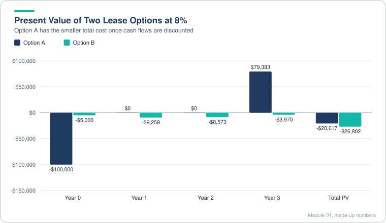

*Option A looks worse on raw cash out, but its present value cost is smaller.*

> [!WARNING]
> **Beyond the basics.** The common mistake is to compare the nominal sums (an easy trap in interviews). Also note the rate you use is a judgment: it should match the risk of the cash flow, not your personal savings rate. For bank pricing work, the same idea shows up as the spread over a benchmark curve: a mortgage bond is worth less when market yields rise because its future coupons are discounted at a higher rate.

### 1.4 The Discount Rate and WACC

- **Two ways to decide.** (1) Compare intrinsic value (what the asset is worth, from discounting its cash flows) to the asking price. Invest if the price is below value. (2) Compare the expected return to the opportunity cost. Invest if the return beats it. The two methods agree. The discount rate is the link between them.
- **Discount rate.** It is the opportunity cost, expressed as a rate. For an investor it reflects both risk and return: a higher rate means more risk and more expected return. For a company it is the cost of the money it uses.
- **Investor view vs company view.** The same number is income to the investor and cost to the company. Equity (stock) is the riskiest for investors and the most expensive for companies. Debt is safer for lenders and cheaper for companies, at least at first, because interest is tax-deductible.
- **WACC.** Weighted average cost of capital. Take each source of funding, find its after-tax cost, and weight it by its share of total capital.

  ```text
  WACC = (E / V) × Re  +  (D / V) × Rd × (1 - t)
  E = market value of equity, D = debt, V = E + D
  Re = cost of equity, Rd = pre-tax cost of debt, t = tax rate
  ```

- **Cost of equity** is often estimated from long-run returns on similar stocks or from a model (covered in later modules). **Cost of debt** is the yield the company pays today on new debt, or what similar borrowers pay.
- **Personal WACC.** The same idea works for a household. Cash, savings, bonds and stocks each earn a different rate, and your blended return is their weighted average. Going all in on the highest-return asset raises expected return but also the chance of a large loss in a bad year.

**Worked example (made-up numbers).** A company funds itself 60% with equity and 40% with debt. Cost of equity is 9%. Pre-tax cost of debt is 6% and the tax rate is 25%.

| Source | Weight | Cost | Weight × cost |
|---|---|---|---|
| Equity | 60% | 9.0% | 5.40% |
| Debt (after tax: 6% × 0.75 = 4.5%) | 40% | 4.5% | 1.80% |
| **WACC** | 100% | | **7.20%** |

**Personal WACC example (made-up mix):** 20% cash at 0.2%, 30% high-yield savings at 4%, 20% bonds and loans at 5%, 30% stocks at 9%. Blended return = 0.04 + 1.20 + 1.00 + 2.70 = **4.94%**. Moving 10 points from cash to stocks lifts the blend, but it also makes a bad year hurt more.

> [!TIP]
> **Beyond the basics.** Two things are easy to miss. First, the weights should use market values, not book values. Second, the tax shield on debt only helps if the company is paying taxes. In bank and mortgage work the "discount rate" is often not WACC at all. Cash flows are discounted at a yield or spread that matches the instrument (for example, a mortgage-backed security priced off a benchmark curve plus a spread). Keep WACC for company-level valuation and use market yields for security-level pricing. Pricing and valuation work on a mortgage portfolio is closer to the second. A common interview trap is to say debt is "cheap" without noting the risk it adds, which pushes up the cost of equity.

### 1.5 Present Value vs the Asking Price

- **Method 1 in practice.** Find the intrinsic value (PV of all future cash flows at your discount rate) and compare it to the asking price. Price below value means invest.
- **Present value (PV).** Each future cash flow is divided by (1 + r) raised to the number of periods. Compounding is built in, so the result is the amount you would need today to earn r and receive the cash flow exactly on time.
- **NPV = PV of future cash flows minus the upfront cost.** NPV above zero means invest. NPV below zero means pass.
- **Excel trap.** The NPV() function in Excel returns the PV of the cash flows, not the net present value. It also treats the first cash flow as one period out, so a year-zero cash flow has to be added separately. If the upfront cost is not subtracted, what you have is a PV, whatever the label says.
- **What flips the decision.** Lower sale value, lower cash flows (for example, a vacancy period), a higher discount rate, or a higher asking price can each turn a yes into a no. A useful habit is to find the input that flips the answer.

**Worked example (made-up numbers).** A rental property is listed at $300,000. You expect $20,000 of net cash flow a year for five years and a sale for $320,000 at the end of year 5. Discount rate 7%.

| Year | Cash flow | Discount factor at 7% | PV |
|---|---|---|---|
| 1 | 20,000 | 0.9346 | 18,692 |
| 2 | 20,000 | 0.8734 | 17,467 |
| 3 | 20,000 | 0.8163 | 16,326 |
| 4 | 20,000 | 0.7629 | 15,258 |
| 5 | 340,000 (20,000 rent + 320,000 sale) | 0.7130 | 242,420 |
| **Total PV** | | | **310,163** |

The PV of the five years is **310,163**. Against the $300,000 price, **NPV = +10,163**, so buy. At a 9% discount rate the PV falls to about 285,800, which gives an NPV of about -14,200 and flips the answer to pass. That is the sensitivity you should show.

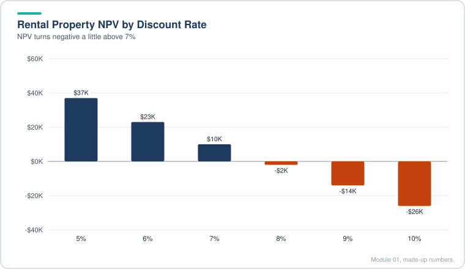

*The same property flips from buy to pass as the discount rate rises.*

> [!TIP]
> **Beyond the basics.** In practice, a single discount rate hides most of the work. A good analyst shows a small grid (discount rate by exit multiple, for example) and says where the answer changes. The same logic applies to security pricing: a bond or MBS is "cheap" or "rich" against its market price, and the answer depends on the prepayment and rate assumptions you feed in. Fair-value work on a large portfolio is this exact exercise at scale.

### 1.6 IRR vs the Discount Rate

- **IRR** is the discount rate that makes NPV equal zero. It is the return you actually get from a set of cash flows. The discount rate (WACC or your opportunity cost) is the return you are targeting. Compare the two. IRR above the target means invest.
- **How to compute.** Use IRR() when cash flows are on regular periods and XIRR() when dates are irregular. There is no closed form except for the simplest case (one outflow, one inflow): IRR = (ending value ÷ starting value)^(1/years) − 1.
- **Sign convention.** Money you pay out is negative. Money you receive is positive. Years with nothing happening must be entered as 0. Leaving a blank out shifts the timing and gives the wrong answer. In one worked example, deleting two zero years kept the IRR at 6% when it should have dropped, and entering the zeros brought it to 3.5%.
- **Two ways to read the same answer.** (a) IRR is the effective compound rate on the investment. (b) IRR is the rate where PV of inflows equals the price. With uneven cash flows, the compound-rate reading does not match exactly, because early cash flows are worth more than they look in a single compounding path.
- **Equivalence.** If NPV at WACC is positive, IRR is above WACC. If NPV is negative, IRR is below WACC. Both methods give the same yes or no. They differ in what is easier to know: a price and cash flows (use IRR) or a discount rate and cash flows (use PV).

**Worked example (made-up numbers).** You pay $1,000 for a five-year instrument that pays $100 a year and returns $1,000 of principal at the end (so the year 5 cash is $1,100).

| Year | Cash flow | PV at 8% | PV at 10% | PV at 12% |
|---|---|---|---|---|
| 0 | -1,000 | -1,000.00 | -1,000.00 | -1,000.00 |
| 1 | 100 | 92.59 | 90.91 | 89.29 |
| 2 | 100 | 85.73 | 82.64 | 79.72 |
| 3 | 100 | 79.38 | 75.13 | 71.18 |
| 4 | 100 | 73.50 | 68.30 | 63.55 |
| 5 | 1,100 | 748.67 | 683.01 | 624.18 |
| **NPV** | | **+79.87** | **0.00** | **-72.08** |

The IRR is 10%. At a target of 8% you invest. At a target of 12% you pass. Excel would show the same 10% from =IRR() on the row.

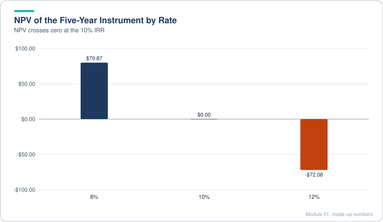

*NPV is positive below the IRR, zero at the IRR and negative above it.*

Simple case check: put in $100 and get $200 back after five years with nothing in between. IRR = 2^(1/5) − 1 = 14.87%.

> [!WARNING]
> **Beyond the basics.** Two IRR traps come up in interviews and in real deals. First, IRR assumes interim cash can be reinvested at the IRR itself. If the IRR is 25% but you can only reinvest at 6%, the true return is lower. That is why people also quote MOIC (money multiple) and modified IRR. Second, if the cash flows change sign more than once (for example, a payment in the middle of a project), there can be more than one IRR or none. Check NPV at a few rates before trusting one IRR number.

### 1.7 IRR Practice Exercise (Capital Budgeting by Division)

This lesson is a practice exercise, not new theory. The skill it tests is choosing the right hurdle rate for each project.

- **Set up the cash flows.** Upfront investment is negative in year 0. Annual cash flows are positive in years 1 to 5. Add the resale or terminal value in year 5. Enter 0 for years with nothing.
- **Compute IRR** for each project with =IRR() on that row.
- **Compare each IRR to the hurdle rate for that project's risk.** Use the division or project WACC, not the company-wide WACC, when the decision only touches one part of the business.
- **Decide.** Invest only if the project IRR beats its own hurdle. A project with a lower IRR can still be the right choice if its hurdle is lower.
- **Interpretation rule.** A company-wide WACC applies only to decisions that change the whole company's risk, such as buying a company that changes everything. Expansions inside one division should use that division's rate.

**Worked example (made-up numbers, in $ millions).** A diversified company has a company-wide WACC of 10%. It is comparing two projects.

- **Project P (new, high-risk venture).** Hurdle rate (its own WACC) 15%. Cost 800 in year 0. Cash flow 100 a year for years 1 to 5. Resale value 700 at the end of year 5 (so the year 5 total is 100 + 700 = 800).
- **Project Q (expansion of an existing line).** Hurdle rate 8%. Cost 400 in year 0. Cash flow 30 a year for years 1 to 5. Resale value 450 at the end of year 5 (year 5 total 480).

| Year | Project P | Project Q |
|---|---|---|
| 0 | -800 | -400 |
| 1 | 100 | 30 |
| 2 | 100 | 30 |
| 3 | 100 | 30 |
| 4 | 100 | 30 |
| 5 | 800 | 480 |
| **IRR** | **about 12.5%** | **about 10.7%** |
| Hurdle | 15% | 8% |
| Decision | Reject (12.5% is below 15%) | Accept (10.7% is above 8%) |

Project P has the higher IRR but fails its own hurdle, so it is rejected. The trap is to compare both IRRs to the 10% company WACC, which makes P look acceptable and Q look too low. Q is the better use of capital here because it clears its own bar. The rule is about each project beating its own opportunity cost, not about ranking by IRR alone.

> [!TIP]
> **Beyond the basics.** Real capital budgeting also looks at size. A 12% IRR on 800 creates more value than 30% on 20, so ranking by IRR alone can mislead. Compare NPV at each project's own rate when you need to pick between projects that compete for the same money. The qualitative side (people, regulation, strategy fit) matters too. A model is one input to the decision, not the decision.

### 1.8 How to Value Any Company (The Growing Perpetuity)

- **Core idea.** A company is worth the cash it will produce, discounted at what you could earn elsewhere with similar risk. With no growth, a perpetual cash flow C is worth C ÷ r. With steady growth g, it is worth C ÷ (r − g).
- **The formula.** Value today = next year's cash flow ÷ (discount rate − growth rate). The growth rate must be less than the discount rate. If g equals or exceeds r, the formula blows up or flips sign, which means your inputs are wrong, not that the company is infinitely valuable.
- **Intuition.** Higher cash flow raises value. Higher discount rate lowers value (better options elsewhere). Higher growth raises value, because you can pay more upfront and still earn the same long-run yield.
- **Implied yield.** For a growing stream, the cash yield on your purchase price is C ÷ V in year 1, and it rises every year as cash flow grows. Over the very long run the average works out close to the discount rate.
- **Real life.** Growth is not constant. Companies grow fast early and slow later, and discount rates change with risk (a young company may need 30% or more). So you project the explicit years (5 to 10 or more), then apply the perpetuity formula to the stable period, called the terminal value, and discount everything back to today.

**Worked example 1 (made-up numbers).** Next year's cash flow is 200. Compare the value at different growth rates with a 12% discount rate:

| Growth rate g | r − g | Value = 200 ÷ (r − g) | Year 1 yield on price |
|---|---|---|---|
| 0% | 12% | 1,667 | 12.0% |
| 4% | 8% | 2,500 | 8.0% |
| 8% | 4% | 5,000 | 4.0% |
| 11% | 1% | 20,000 | 1.0% |

The value explodes as growth approaches the discount rate. That is why you should be skeptical of any long-run growth rate close to the discount rate.

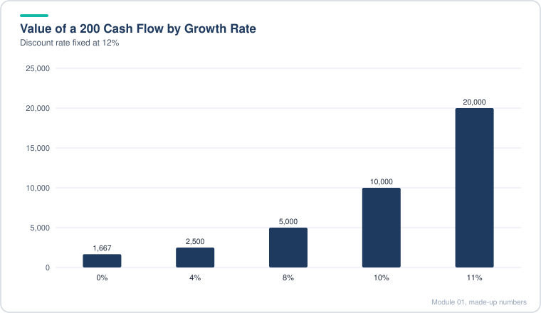

*Value climbs slowly at first, then explodes as growth nears the 12% discount rate.*

**Worked example 2 (two-stage valuation, made-up numbers).** Cash flows: 100 in year 1, 120 in year 2, 140 in year 3. After year 3 the cash flow grows at 3% forever. Discount rate 10%.

- Terminal cash flow in year 4 = 140 × 1.03 = 144.2
- Value at end of year 3 = 144.2 ÷ (10% − 3%) = 2,060
- Discount the terminal value back 3 years: 2,060 ÷ 1.331 = 1,548
- Discount the explicit years: 100/1.10 + 120/1.21 + 140/1.331 = 91 + 99 + 105 = 295
- **Total value today ≈ 1,843**

About 84% of the value sits in the terminal piece. This is the normal pattern in valuation, and it explains why the growth and discount rate assumptions matter so much.

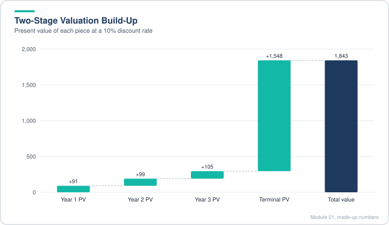

*Most of the value sits in the terminal piece, which is why the growth and discount rate assumptions matter so much.*

> [!TIP]
> **Beyond the basics.** The formula assumes cash flow is the right number. Use free cash flow to the firm or to equity, not net income, and make sure the terminal year is normal (no one-time gains, capex close to depreciation or growth-consistent). The terminal growth rate is usually set at or below long-run nominal GDP growth. A common interview question is "why can't g exceed r forever?" Answer: the company would grow to be bigger than the economy. In practice, analysts also cross-check terminal value with an exit multiple.

### 1.9 What Makes Financial Modeling Hard

- **The formula only works at stability.** Value = cash flow ÷ (r − g) assumes the discount rate and growth rate are steady. Most companies are not steady for several years, so you project them first and apply the formula later.
- **Four sources of difficulty.**
  1. **Finding the data.** No company reports "cash flow for valuation" or its discount rate. You rebuild cash flow from filings, deciding what to include and exclude. Items that do not recur (one-time gains, items only some investors can use) must be stripped out.
  2. **Projecting the drivers.** Real projections start with units, prices, per-unit costs, headcount or patients, not simple percentages. Check that trends make sense. Growth that speeds up, slows, then speeds up again usually means a mistake.
  3. **Defining "company value".** Equity value is what shareholders own. Enterprise value is the value of the whole business to all capital providers (debt, equity, and others), net of cash. You move between them constantly, and mixing them is a classic error.
  4. **Outside factors.** Buyouts are judged on IRR against a target. Mergers are judged on EPS accretion or dilution. Equity raises care about ownership dilution. Debt raises care about ability to pay (coverage and leverage ratios).
- **Why this matters for later modules.** The rest of this guide applies the same logic to real statements, real valuations, deals and credit.

**A quick checklist (summary of the four issues):**

| Question | Where it shows up | Common mistake |
|---|---|---|
| Is cash flow clean? | Accounting and DCF | Using reported net income, or keeping one-time items |
| Are growth and margins sensible? | Projections | Straight-line percentages with no link to drivers |
| Which "value" is this? | Equity vs enterprise value | Subtracting debt from the wrong number |
| What does the decision really depend on? | Deal, equity, debt analysis | Ignoring EPS or coverage metrics |

> [!WARNING]
> **Beyond the basics.** The formula is simple and the inputs are hard. In practice, most mistakes are input mistakes, not formula mistakes. In a job, spend your time on the drivers and on checking that the output makes sense against the market, a peer set and the prior year's actuals. A simple sanity check: if your implied value is 40% above or below every comparable company, find out why before presenting. Pricing teams already do this kind of tie-out (pricing exceptions, month-end checks), so the habit transfers directly.

## Diagrams and Charts

**1. Decision flow for any investment (flowchart).** Both methods lead to the same answer.

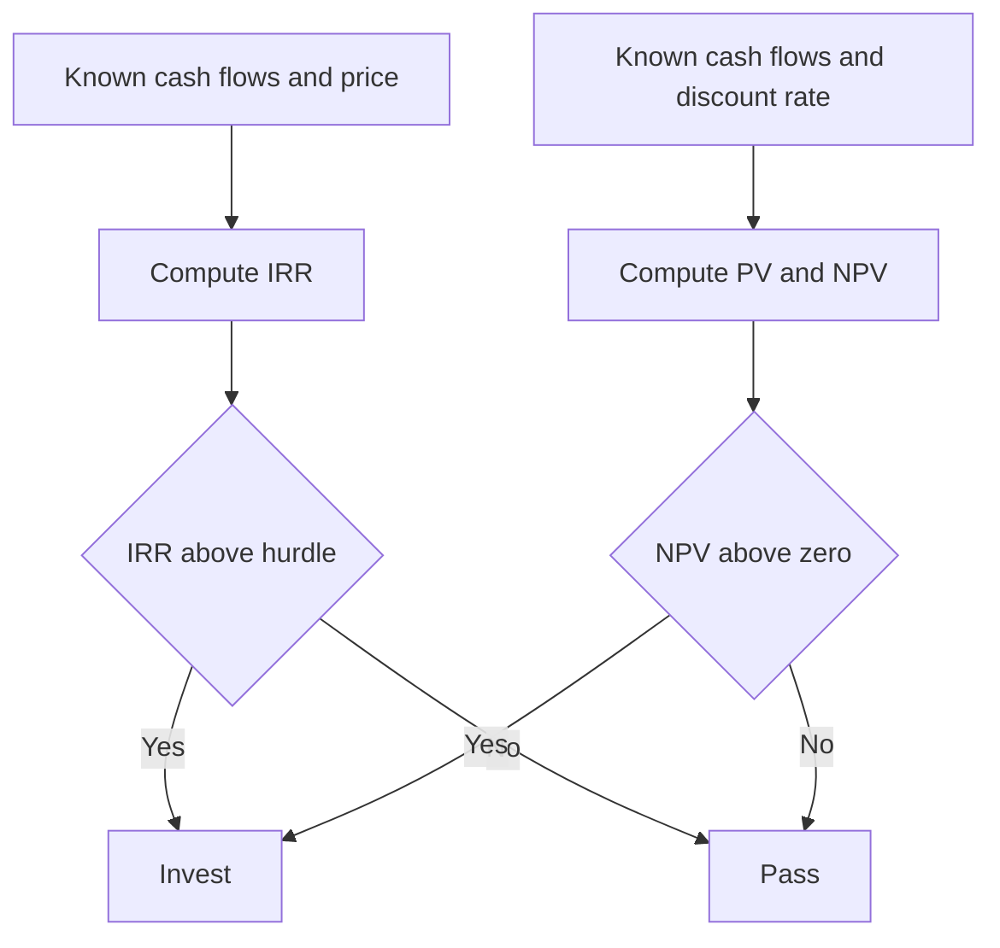

**2. NPV of the rental property against the discount rate (xychart-beta, from lesson 1.5).** NPV is positive below about 8% and negative above it. The breakeven is the rate where IRR equals the discount rate.

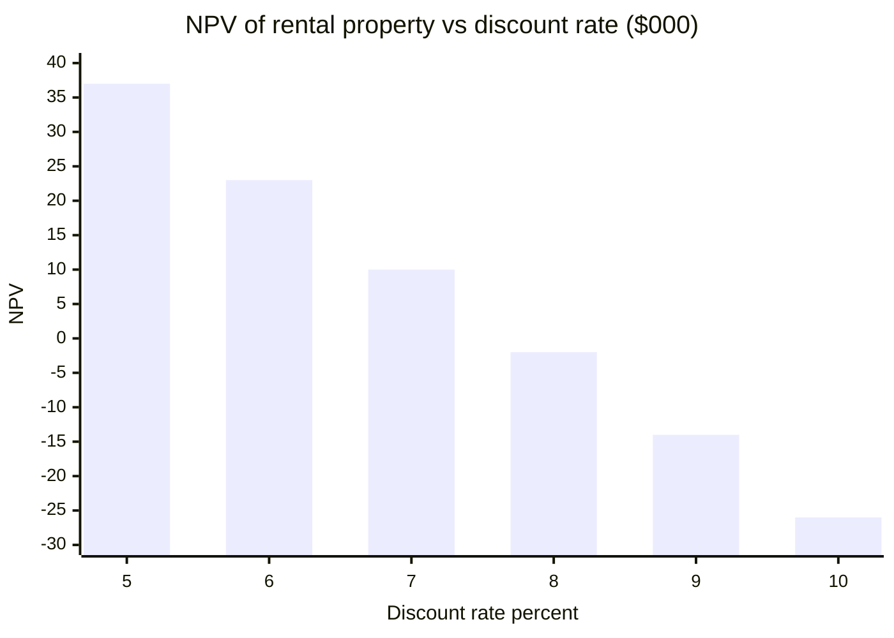

**3. Growth and value (xychart-beta, from lesson 1.8 worked example 1).** Value rises very fast as growth approaches the discount rate.

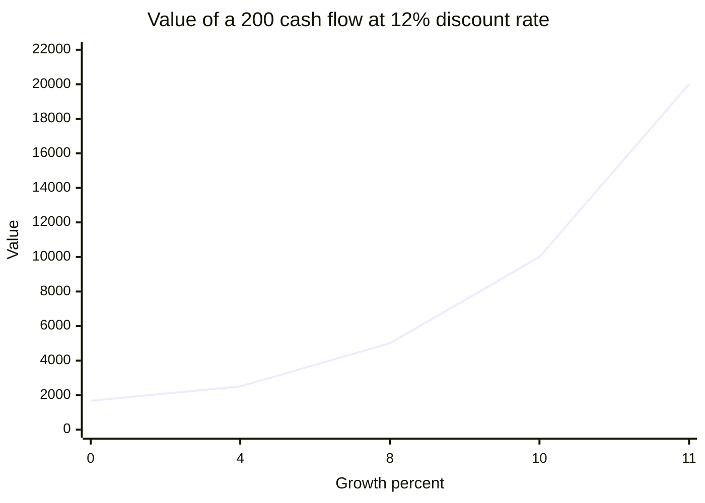

**4. WACC weights (pie, from lesson 1.4 worked example).** Equity is the bigger slice and the most expensive source.

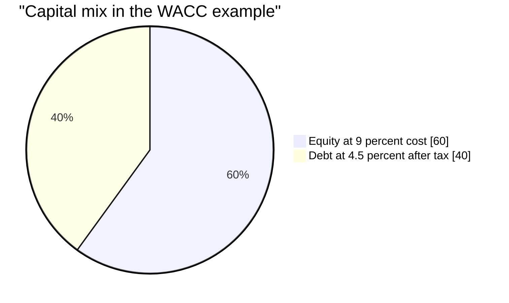

**5. How one number flows into a valuation (flowchart).** Every later module expands this chain.

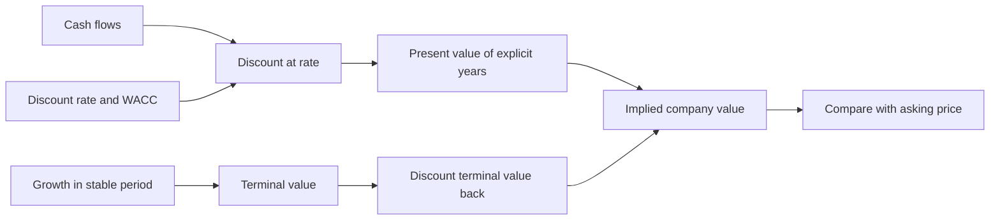

## Excel Model Walkthrough

The Excel files for this module are small, single-topic workbooks. Each lesson has a Before file (blank template to complete yourself) and an After file (the finished answer). There is also one combined file for the whole module. The layout is consistent, so here is what each one contains.

| Workbook | What it covers | Key line items | Key formulas (described) |
|---|---|---|---|
| Time value of money (Before and After) | Future and present value of a rent-versus-deposit choice | Deposit, annual rent, refund at end, opportunity cost, running cost | Breakeven rate found with Goal Seek |
| Discount rate and WACC | Personal WACC and company WACC | Source of funds, after-tax rate, percent of total funding | SUMPRODUCT of rates and weights |
| PV, NPV and asking price | Intrinsic value vs price | Asking price, annual cash flow, sale value, discount rate | NPV() for present value, then subtract the price for NPV, and an IF for the yes or no decision |
| IRR and discount rate | Return on a purchase with sale at the end | Negative purchase in year 0, zeros for empty years, sale in final year | IRR() on the full row, plus a check that NPV at the IRR is about zero |
| Value any company | Growing perpetuity with a 100-year row | Starting cash flow, growth rate, discount rate, year-by-year cash flow | Cash flow divided by (discount rate minus growth), then compare to NPV() over 100 years |
| Real-life valuation tab | Explicit stage plus terminal stage | Ten years of growth that fades, discount rate for each stage, terminal growth | NPV() for the explicit years, terminal value at year 10 divided by (r − g), then discounted back with the stage rate |
| Practice case (in the IRR workbook) | Two projects, each with its own rate | Upfront cost, annual cash flow, resale value, hurdle | IRR per project, compared with its own WACC |

**How the links work.** Inputs sit at the top or in a blue input block. Cash flows are linked to inputs with absolute references (for example, the rent cell is anchored so it copies across). Totals sum the net cash flows. The NPV check at the end of the IRR section subtracts the price and should return zero, which proves the IRR is right.

**Model habits to build.**

- One input per cell. Never type a number into a formula.
- Show zeros explicitly.
- Keep the sign convention the same on every row.
- Do a check cell (for example, NPV at IRR equals zero) so errors show up early.
- Keep the units in the title (one example here uses thousands and another uses millions).

> [!TIP]
> **Beyond the basics.** Excel's NPV() function assumes the first cash flow is one period away. In a real model, put year 0 in its own cell and add it, or use XNPV with actual dates. Also, use named ranges for the discount rate, so one change flows everywhere.

## Interview Questions

<details>
<summary><b>1. What is the time value of money?</b></summary>

A dollar today is worth more than a dollar later, because it can be invested and earn a return. The rate used to compare them should match the risk of the cash flow.

</details>

<details>
<summary><b>2. What is the difference between PV and NPV?</b></summary>

PV is the value of future cash flows discounted at the rate. NPV is PV minus the upfront cost. The Excel NPV() function actually returns PV.

</details>

<details>
<summary><b>3. What is WACC and why is it used as the discount rate?</b></summary>

It is the blended after-tax cost of all capital (equity and debt) weighted by its share in the capital structure. It is the minimum return the company's projects must earn for the whole business to create value.

</details>

<details>
<summary><b>4. Why is debt usually cheaper than equity?</b></summary>

Lenders get fixed payments and sit higher in the capital structure, so they take less risk. Interest is also tax-deductible, which lowers the after-tax cost of debt. Equity is residual and bears more risk.

</details>

<details>
<summary><b>5. How do you calculate IRR, and what does it mean?</b></summary>

IRR is the discount rate where NPV equals zero. Use Excel's IRR() with a row of cash flows, zeros for empty years and negatives for outflows.

</details>

<details>
<summary><b>6. When would you use XIRR instead of IRR?</b></summary>

When cash flows fall on irregular dates, such as an exit after 2.5 years or quarterly payments that are not on whole years.

</details>

<details>
<summary><b>7. If IRR is above WACC, what do you do?</b></summary>

Invest, since the NPV is positive at WACC. The reverse is true if IRR is below WACC.

</details>

<details>
<summary><b>8. Can an investment have a high IRR and still be a bad decision?</b></summary>

Yes. IRR ignores project size and assumes reinvestment at the IRR. A small project with a high IRR may create less value than a large project with a lower IRR. Compare NPV when choosing between projects.

</details>

<details>
<summary><b>9. Which discount rate should you use for a single division?</b></summary>

The division's own rate, reflecting its risk. Only use company-wide WACC when the decision changes the whole company's risk.

</details>

<details>
<summary><b>10. What is the formula for a growing perpetuity?</b></summary>

Value = next year's cash flow ÷ (r − g), where g is less than r.

</details>

<details>
<summary><b>11. What happens to value if the growth rate is close to the discount rate?</b></summary>

Value becomes extremely large and very sensitive. This is a sign the assumptions are not realistic for a perpetuity.

</details>

<details>
<summary><b>12. Why do you project five to ten years before using a terminal value?</b></summary>

Growth and margins change early on. The perpetuity formula needs a stable, steady state, so you value the early years explicitly and then apply the formula to the stable period.

</details>

<details>
<summary><b>13. What is the terminal value, and why is it important?</b></summary>

The value of all cash flows after the explicit forecast, usually computed with the perpetuity formula. Most of the value in a DCF is in the terminal value, so its assumptions drive the answer.

</details>

<details>
<summary><b>14. How do you know if a model is right?</b></summary>

Check the logic with simple cases, do tie-out checks (for example, NPV at IRR equals zero), test sensitivities, and compare against market data. A model shows whether a view is plausible; it does not prove it.

</details>

<details>
<summary><b>15. Equity value or enterprise value: which one comes out of a DCF?</b></summary>

A DCF of unlevered free cash flows gives enterprise value (value to all capital providers). Subtract net debt to get equity value, then divide by shares for an implied price.

</details>

<details>
<summary><b>16. Why does a higher discount rate lower value?</b></summary>

It means you have better alternatives, so you need a bigger discount on each future dollar. The present value of later cash flows falls the most.

</details>

## Career Angle

**Where these ideas show up in practice.** For an analyst on a pricing and valuation team, valuing a large portfolio at month-end and quarter-end rests on the logic in this module: future cash flows, a market rate, and a fair price. Pricing exception investigations and the monthly pricing review use the same ideas. Forecasting and CFO reporting use the same time value concepts in a different form (variance to plan, budget cash timing).

**Target roles.** Valuation and capital markets roles (pricing, fair value, portfolio valuation), corporate development (buy versus build decisions, IRR and NPV), and asset management (expected return against a hurdle rate).

**Talking points (use only after working through the module):**

1. "I studied the discount-rate framework (time value of money, WACC, PV, NPV, IRR) as a base for valuation. In my day-to-day pricing work I apply the same logic to check whether a price is in line with the market yield and the cash flow profile." This is accurate as a connection. It does not claim to run a DCF.
2. "I built a real estate investment calculator in Excel to compare rent and purchase scenarios using an opportunity-cost rate." Use this only if such a project was actually built.
3. "In interviews I can explain why IRR and NPV give the same yes or no, and why I'd use a division-level rate for a division-level decision." This is a skill that can be demonstrated on the spot.

**Do not say:** that a full DCF was built, that a company valuation was completed, or that the module was finished unless that is true.

> [!TIP]
> **Beyond the basics.** The Excel fluency interviewers value most is the check-cell habit and sensitivity tables. Python and SQL skills give an analyst a path to automating these checks, which is a good angle for a data-and-valuation role.

## Cheat Sheet

| Concept | Formula or rule |
|---|---|
| Future value | FV = PV × (1 + r)^n |
| Present value | PV = CF ÷ (1 + r)^n |
| NPV | PV of future cash flows − upfront cost |
| Decision on NPV | NPV above 0 means invest |
| IRR | Rate where NPV = 0 |
| Decision on IRR | IRR above hurdle means invest |
| WACC | (E/V) × Re + (D/V) × Rd × (1 − t) |
| Growing perpetuity | Value = CF next year ÷ (r − g), requires g below r |
| Terminal value at year N | CF(N+1) ÷ (r − g), then discount back N years |
| Simple IRR (one in, one out) | (Ending ÷ Starting)^(1 ÷ years) − 1 |
| Personal or portfolio blend | SUMPRODUCT(rates, weights) |
| Excel NPV() | Returns PV, not NPV. First cash flow is one period out |
| Excel IRR() | Enter zeros for empty years. Outflows negative |
| Use division rate | When a decision changes only one division |
| Use company WACC | When a decision changes the whole company |
| Money today | Worth more than the same money later |
| Breakeven | Rate where two options have equal PV (Goal Seek) |

**Rules of thumb:**

- Invest when the price is below value or the return is above the hurdle. Both tests give the same answer.
- Discount everything to today before comparing it. Never compare nominal amounts across dates.
- Most of a DCF's value sits in the terminal value. Sensitivity tables are not optional.
- A high IRR on a small project can create less value than a lower IRR on a big one.
- Check your model with a simple case first (one in, one out) and with a check cell.

---

[Contents](../README.md) · [Next: Module 02, Part 1 →](02-accounting-concepts-part-1.md)
