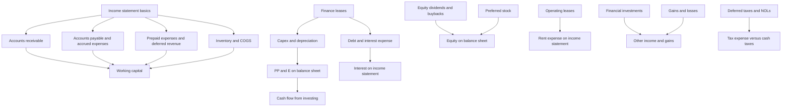
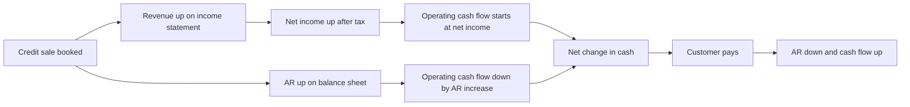
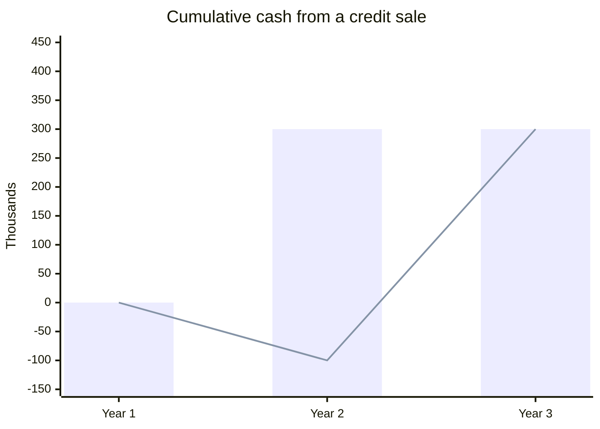
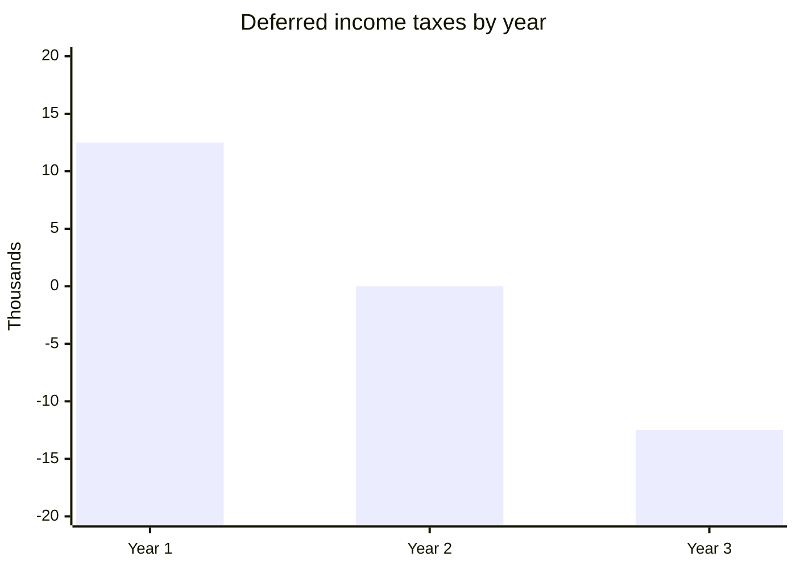
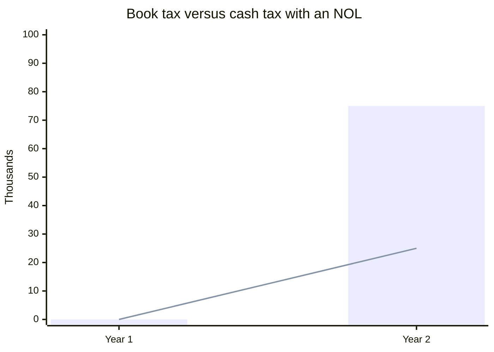
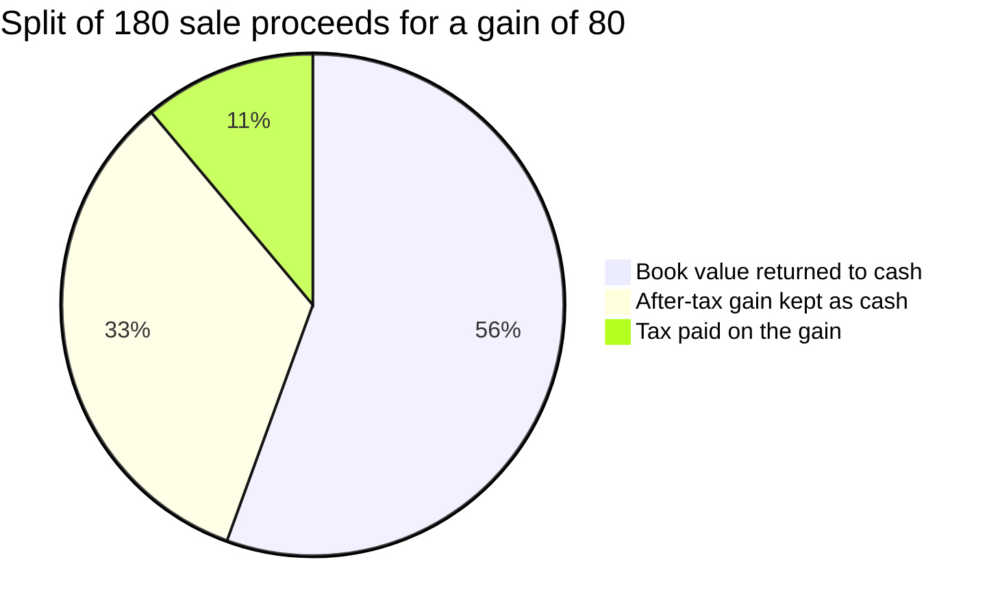

# Module 02, Part 1: Accounting Concepts

[← Previous: Module 01](01-modeling-overview-and-core-concepts.md) · [Contents](../README.md) · [Next: Module 02, Part 2 →](02-accounting-concepts-part-2.md)

<details>
<summary><b>Contents</b></summary>

- [Overview](#overview)
- [Lessons](#lessons)
  - [2.1 Why We Need the Three Statements, and the Income Statement](#21-why-we-need-the-three-statements-and-the-income-statement)
  - [2.2 Accounts Receivable](#22-accounts-receivable)
  - [2.3 Accounts Payable and Accrued Expenses](#23-accounts-payable-and-accrued-expenses)
  - [2.4 Prepaid Expenses](#24-prepaid-expenses)
  - [2.5 Deferred Revenue](#25-deferred-revenue)
  - [2.6 Inventory, COGS and Why We Need the Full Set of Statements](#26-inventory-cogs-and-why-we-need-the-full-set-of-statements)
  - [2.7 Capital Expenditures and Depreciation](#27-capital-expenditures-and-depreciation)
  - [2.8 Debt and Interest Expense](#28-debt-and-interest-expense)
  - [2.9 Common Equity: Issuance, Dividends and Buybacks](#29-common-equity-issuance-dividends-and-buybacks)
  - [2.10 Preferred Stock](#210-preferred-stock)
  - [2.11 Finance Leases (Capital Leases)](#211-finance-leases-capital-leases)
  - [2.12 Operating Leases and the US GAAP Difference](#212-operating-leases-and-the-us-gaap-difference)
  - [2.13 Financial Investments](#213-financial-investments)
  - [2.14 Book Taxes, Cash Taxes and Deferred Taxes](#214-book-taxes-cash-taxes-and-deferred-taxes)
  - [2.15 Net Operating Losses (NOLs) and Deferred Tax Assets (DTAs)](#215-net-operating-losses-nols-and-deferred-tax-assets-dtas)
  - [2.16 Gains and Losses on Asset Sales](#216-gains-and-losses-on-asset-sales)
- [Diagrams and Charts](#diagrams-and-charts)
- [Excel Model Walkthrough](#excel-model-walkthrough)
- [Interview Questions](#interview-questions)
- [Career Angle](#career-angle)
- [Cheat Sheet](#cheat-sheet)

</details>

## Overview

Every valuation starts from cash flow, and cash flow is never printed in a filing, so you have to rebuild it from the income statement, balance sheet and cash flow statement by understanding how each accounting item creates timing gaps between profit and cash.

This is Part 1 of the module. It covers lessons 2.1 through 2.16. Part 2 (lessons 2.17 onward, including the 3-statement linking, working capital, free cash flow and the case studies) is covered in [Module 02, Part 2](02-accounting-concepts-part-2.md).

The lessons build one simple business into a fuller one. Each lesson adds one kind of item, shows how it hits the three statements, and points out where cash and profit split apart. The main idea to carry through is that net income is not cash flow. Every timing difference (receivables, payables, prepaid items, deferred revenue, inventory, depreciation, deferred taxes) is a bridge between the two.

## Module Map



## Lessons

### 2.1 Why We Need the Three Statements, and the Income Statement

- **Why accounting matters for valuation.** A DCF-style value is cash flow divided by (discount rate minus growth rate). Nothing in that formula is about accounting, but no company reports "our cash flow" as one clean number. You rebuild it from the statements by deciding what to add, subtract and ignore.
- **When one statement is enough.** A business that delivers a product, gets paid in cash the moment it sells, and pays every bill in cash, only needs an income statement. Profit and cash are the same thing.
- **Why we need three statements.** Real businesses have timing gaps. You deliver now and get paid later. You get an expense now and pay it later. You buy a machine now and use it for ten years. The income statement records performance over a period, the balance sheet records what the company owns and owes at one moment, and the cash flow statement explains how cash moved between two balance sheets.
- **Income statement structure, top to bottom.** Revenue (net of refunds and returns), then cost of goods sold (COGS, fully variable with volume), then gross profit and gross margin, then operating expenses (mostly fixed: R&D, general and administrative, sales and marketing), then operating income (EBIT), then other income and interest, then pre-tax income, then taxes, then net income.
- **Two rules for what belongs on the income statement.** An item must relate only to the period shown, so you cannot book this year's sale in a past year, and a factory bought today is not an expense today (it is spread out later as depreciation). And it must affect income available to common shareholders. Anything that does not touch that bottom line does not belong there.
- **Why operating income matters most.** It shows what the core business earns before financing, side activities and taxes. Analysts focus on it when comparing companies.

**Formulas:**

```text
Gross profit        = Revenue - COGS
Gross margin        = Gross profit / Revenue
Operating income    = Gross profit - Operating expenses
Pre-tax income      = Operating income + Other income/(expense) + Interest income/(expense)
Net income          = Pre-tax income - Taxes
```

**Worked example (made-up numbers).** A small tutoring business in its first year:

| Line | Course sales | Coaching | Total |
|---|---|---|---|
| Revenue | 900 | 100 | 1,000 |
| COGS (variable) | 50 | 50 | 100 |
| Gross profit | 850 | 50 | 900 |
| Operating expenses (fixed) | | | 700 |
| Operating income | | | 200 |
| Interest and other | | | 0 |
| Pre-tax income | | | 200 |
| Tax at 25% | | | (50) |
| Net income | | | 150 |

Gross margin is 90 percent, operating margin is 20 percent and net margin is 15 percent. Course sales are high margin because the product costs almost nothing to deliver. The coaching line is low margin because a person's time is the cost.

> [!TIP]
> **Beyond the basics.** The 25 percent tax rate is a round placeholder for a blended effective rate. Real effective rates move with credits, foreign income and one-time items, so always check the tax footnote for a real company. Also, "revenue" recognition is not always this simple. Subscription and multi-year contracts often need revenue spread over time, which is where deferred revenue comes in (lesson 2.5).

### 2.2 Accounts Receivable

- **What it is.** Accounts receivable (AR) is money customers owe you for goods or services you already delivered. You book the revenue when you deliver, but the cash arrives later. AR is a balance sheet asset that sits between the sale and the collection.
- **The core idea.** Revenue and net income go up when the sale is booked, but cash does not. So in the cash flow statement you subtract the increase in AR. When AR falls, it means you collected old sales, so you add back the decrease. Net income is the starting point, and AR changes are the bridge to cash.
- **Taxes make it sharper.** Tax is usually owed on the revenue you booked, not on the cash you collected. So a credit sale can cost you cash in taxes before any money comes in.
- **Two steps over the life of a sale.** Step one is the sale: revenue up, AR up, cash flow lower than net income. Step two is the collection: AR down, no income statement effect, and cash flow picks up. Over the full cycle, cash flow catches up to the sale amount.
- **Real companies.** AR never reaches zero for a business that sells on credit. It rises and falls with sales volume and with how fast customers pay, so the gap between net income and cash flow keeps moving.

**Formulas:**

```text
Change in AR        = AR (this year) - AR (last year)
Cash flow impact    = -(Change in AR)
Ending AR           = Beginning AR + Credit sales - Cash collected
Days sales out      = AR / Revenue x 365
```

**Worked example (made-up numbers, in $ thousands).** A company books a 400 credit sale in Year 2, with a 25 percent tax rate and no other changes.

| Item | Year 1 | Year 2 (credit sale) | Year 3 (customer pays) |
|---|---|---|---|
| Revenue added | 0 | 400 | 0 |
| Net income impact | 0 | 300 | 0 |
| AR balance | 100 | 500 | 100 |
| Change in AR | | (400) | 400 |
| Cash flow from the sale | | (100) | 400 |
| Cumulative cash from the sale | | (100) | 300 |

In Year 2, net income rises by 300 but cash flow falls by 100 because AR absorbed the full 400. Cash taxes of 100 went out, and no customer money came in. When the customer pays in Year 3, AR falls by 400, cash flow rises by 400, and the cumulative cash effect is the 300 of after-tax profit.

> [!TIP]
> **Beyond the basics.** Analysts check AR against revenue using days sales outstanding (DSO). If DSO jumps from 40 to 70 days, either customers are paying slower, or the company is stuffing the channel with sales it may not collect, which is a classic red flag. Watch for AR growing faster than revenue. Also, a large customer on 90-day terms is a credit risk, so allowances for doubtful accounts (a contra asset) can matter too.

### 2.3 Accounts Payable and Accrued Expenses

- **What it is.** Accounts payable (AP) is what you owe vendors for goods or services you already received but have not paid for. Accrued expenses are similar, but they cover recurring costs that build up on a schedule, such as rent, utilities, wages and monthly insurance. Both are liabilities on the balance sheet.
- **The mirror image of receivables.** AR is cash you have not collected yet, so it drains cash flow when it grows. AP is cash you have not paid yet, so it adds to cash flow when it grows. Expense hits net income right away, but the payment comes later.
- **Where each one lands.** AP usually goes with invoice-based costs such as legal, audit, tax, marketing agencies and inventory purchases. Accrued expenses usually go with regular costs in G&A. Both raise expenses on the income statement when recorded.
- **The two steps.** Step one: receive the service, expense it, and raise the liability. Cash flow ends up above net income. Step two: pay the vendor, lower the liability, and cash flow drops back down. Once everything is paid, cash flow and net income match again for that item.
- **Tax wrinkle.** Because the expense reduces taxable income, the company also saves tax in the period it records the cost. So the cash boost from an unpaid expense is smaller than the expense itself.
- **Real companies.** AP and accrued balances never sit at zero. They rise and fall with purchasing and payment timing, so they keep moving the gap between net income and cash flow.

**Formulas:**

```text
Ending AP            = Beginning AP + New unpaid expenses - Payments made
Change in AP         = AP (this year) - AP (last year)
Cash flow impact     = +(Change in AP)
Cash flow effect of an unpaid expense = Expense x (1 - tax rate)  [in the year it is booked]
Days payable out     = AP / COGS (or purchases) x 365
```

**Worked example (made-up numbers, in $ thousands).** A marketing agency bills 200 for a quarter of work, payable in 60 days. Tax rate 25 percent.

| Item | Year 2, after booking | Year 2, after paying |
|---|---|---|
| Marketing expense | (200) | (200) |
| Tax saving | 50 | 50 |
| Net income impact | (150) | (150) |
| Change in AP in cash flow | +200 | (200) |
| Cash flow impact of the deal | +50 | (150) |
| Ending AP | 200 | 0 |
| Cumulative cash effect | +50 | (150) |

Early on, cash flow is 50 higher than net income, because the unpaid 200 is added back and the 50 tax saving is already in cash. Once the agency is paid, cash is down 150, which is the after-tax cost. Net income is 150 lower throughout.

> [!TIP]
> **Beyond the basics.** Stretching payables is one of the cheapest sources of short-term funding, but it has limits. A company that pushes DPO from 30 to 90 days may be borrowing from suppliers at a hidden high rate, and suppliers may cut them off or raise prices. In a stress test, a sudden drop in AP can be a big cash drain even when earnings look fine. Check whether AP grew because the business grew, or because the company slowed its payments.

### 2.4 Prepaid Expenses

- **What it is.** A prepaid expense is cash you pay before you receive the service or product. Until the service is delivered, the payment sits on the balance sheet as an asset, because the vendor owes you the service. Insurance, rent paid in advance and annual software licenses are common examples.
- **Asset, not expense, at first.** The cash leaves on day one, but the income statement shows nothing yet. Each month you use up part of the prepaid balance, and that usage becomes an expense on the income statement.
- **Cash flow logic.** An increase in prepaid expenses is a use of cash, so it is subtracted in the cash flow statement. A decrease is a source of cash relative to the prior period, because the expense is now flowing through net income without new cash going out.
- **Why it still hits taxes.** The expense only becomes deductible as it is recognized, so the tax shield also arrives over time. That is why the net cash hit ends up smaller than the full payment.
- **Why companies do it.** Vendors often give a discount for paying early, and the vendor gets cash sooner. The buyer gets a better rate, the seller gets working capital, and the balance keeps moving up and down.

**Formulas:**

```text
Change in prepaid    = Prepaid (this year) - Prepaid (last year)
Cash flow impact     = -(Change in prepaid)     [asset: rise uses cash, fall adds cash]
Expense recognized   = Amount used up in the period (flows through G&A or COGS)
Net cash effect of a full prepayment over its life = -Prepayment x (1 - tax rate)
```

**Worked example (made-up numbers, in $ thousands).** A company prepays a 100 annual insurance premium on January 1, with a 25 percent tax rate.

| Step | Income statement | Prepaid balance | Cash flow for the step |
|---|---|---|---|
| Pay 100 up front | No expense yet | +100 | -100 |
| Service used through the year | Expense 100, tax saving 25, net income -75 | -100 | Net income -75, plus prepaid decrease +100, equals +25 |
| Full year total | Net income -75 | 0 | -75 |

Cash out is 100 at the start, and the tax saving of 25 comes back over the year, so the total cash cost is 75. Cash flow is only down by the full 100 during the step where you pay and have not yet expensed anything.

> [!TIP]
> **Beyond the basics.** Prepaid balances are a useful place to look for "cash out early" behavior, and to spot whether a company is pulling forward spending to reach a targeted cash balance. A sudden jump in prepaids at year end can flatter or hurt operating cash flow depending on how the company reports it, so read the working capital notes before comparing two years.

### 2.5 Deferred Revenue

- **What it is.** Deferred revenue (also called unearned revenue) is cash a customer pays before you deliver the product or service. It is a liability, because you now owe the customer the delivery. Pre-sales, annual subscriptions paid up front, gift cards and airline tickets all create it.
- **Revenue follows delivery, not payment.** Cash arrives first and goes to the balance sheet. Revenue is recognized only when you deliver, and at that point the liability shrinks and revenue goes up on the income statement.
- **Cash flow direction.** A liability works like accounts payable. A rise in deferred revenue is a cash inflow in the cash flow statement, and a fall is an outflow. So cash flow runs ahead of net income while the balance builds, and then falls back to match it as delivery happens.
- **Taxes again.** The revenue is taxed when recognized, not when cash arrives, so the after-tax benefit shows up in the delivery year. Only part of the revenue ends up in net income after tax.
- **Real companies.** Deferred revenue balances keep moving as sales, subscriptions and billing schedules change. Analysts treat a fast-growing deferred revenue balance as a good sign for future revenue, because the cash is already in hand.

**Formulas:**

```text
Ending deferred revenue = Beginning + Cash collected in advance - Revenue recognized
Cash flow impact        = +(Change in deferred revenue)
Revenue recognized      = Beginning deferred revenue + New billings - Ending deferred revenue
After-tax income from recognition = Revenue recognized x (1 - tax rate)
```

**Worked example (made-up numbers, in $ thousands).** A company pre-sells 500 of an online course in Year 2 and delivers it before year end. Tax rate 25 percent. The cost to build the online course is ignored here.

| Step | Income statement | Deferred revenue | Cash flow for the step |
|---|---|---|---|
| Pre-sell 500 cash | No revenue | +500 | +500 |
| Deliver the online course | Revenue 500, tax 125, net income +375 | -500 | Net income +375, less deferred revenue decrease 500, equals -125 |
| Full year total | Net income +375 | 0 | +375 |

The first step is pure cash with no profit. The second step shows that cash flow comes back down to net income, which here is the after-tax 375. The company ends the year with 375 more cash and 375 more equity, and it has paid 125 in tax on the 500 of revenue.

> [!TIP]
> **Beyond the basics.** The simple example ignores the cost of building the product. In real life, the cost of delivering a prepaid product hits COGS later, so you should match the cost to the revenue. Also, a bad sign is when deferred revenue falls while billings stay flat, because it means revenue is being recognized faster than new orders come in. Watch for "billings" (revenue plus change in deferred revenue) as a leading metric for software companies.

### 2.6 Inventory, COGS and Why We Need the Full Set of Statements

- **What it is.** Inventory is the cost of goods you bought or made but have not sold yet. It is an asset. Cost of goods sold (COGS) is the cost of inventory that has actually left the building and been sold. Inventory stays on the balance sheet until the sale, and only then moves to the income statement as COGS.
- **Two linked changes.** Buying inventory is a cash outflow with no income statement effect. Selling it creates revenue and an equal-cost COGS charge, and the inventory balance falls. COGS and inventory move together, so when inventory falls because of a sale, COGS rises by the cost of what was sold.
- **Cash flow direction.** Like other assets, a rise in inventory reduces cash flow, and a fall adds to it. For a growing retailer, inventory usually climbs every year, so the change line is a recurring cash use.
- **Margin check.** Revenue from a sale should be well above the inventory cost, or the business is losing money on each unit. Gross margin tells you whether the cost of goods covers the sale.
- **Why the three statements are needed.** Real companies run these cycles all the time. Year-end sales on credit, stock bought ahead of demand, and cash taken in early for future orders all overlap. Looking at the income statement alone can hide large cash swings, and cash and equity tracked separately cannot tell you the full story.

**Formulas:**

```text
Inventory change        = Inventory (this year) - Inventory (last year)
Cash flow impact        = -(Change in inventory)
COGS for the period     = Beginning inventory + Purchases - Ending inventory
Gross margin            = (Revenue - COGS) / Revenue
```

**Worked example 1 (made-up numbers, in $ thousands).** The business buys 300 of supplies, turns them into printed study packs, and sells them for 500 in cash. Tax rate 25 percent.

| Step | Revenue | COGS | Net income | Cash flow from the inventory change | Cash flow for the step |
|---|---|---|---|---|---|
| Buy supplies | 0 | 0 | 0 | -300 | -300 |
| Sell packs | 500 | 300 | +150 | +300 | +450 |
| Full cycle | 500 | 300 | +150 | 0 | +150 |

The sale step shows why the inventory line matters. Net income for the sale is 200 pre-tax and 150 after tax. Cash flow for that step is 450, because the 300 of inventory that left the balance sheet is added back on top of net income. Over the full cycle, the 300 of supplies is paid out and the 300 of cost comes back as COGS, so cash flow equals net income of 150.

**Worked example 2 (made-up numbers, in $ thousands).** A year-end stress case. Receivables and inventory both rise by 100, and net income is up by 75.

| Item | Amount |
|---|---|
| Net income | +75 |
| Change in receivables | -100 |
| Change in inventory | -100 |
| Cash flow from operations | -125 |
| Gap between cash flow and net income | -200 |

Profit looks good, but cash is down 125 because the company is funding customers and stock. These timing items may not reverse until early the next year.

> [!TIP]
> **Beyond the basics.** The simple example hides the inventory cost method. Under FIFO, LIFO or weighted average, the same purchases can produce different COGS and different inventory balances. When inflation is high, LIFO tends to show higher COGS and lower taxes. Also, a "write-down" of obsolete stock is a non-cash charge that can move COGS without any cash changing hands. Keep an eye on days inventory outstanding (DIO) rising faster than sales. It is one of the earliest warning signs of slowing demand.

### 2.7 Capital Expenditures and Depreciation

- **What it is.** Capital expenditure (CapEx) is cash spent on assets that will last more than one year, such as computers, furniture, vehicles, equipment, buildings and factories. The cash goes out in the investing section of the cash flow statement, and the asset goes onto the balance sheet as property, plant and equipment (PP&E).
- **Why it is not an expense on day one.** The income statement only takes items that belong to the period. A computer bought today will be used for years, so its cost is spread out. Each year, a slice of the cost moves from the balance sheet to the income statement as depreciation.
- **Depreciation.** A simple straight-line method divides the cost by the useful life, such as 5 years for computers or 30 to 40 years for buildings. Depreciation is an operating expense on the income statement, but it is not a cash cost in the year it is booked. So it is added back in the operating section of the cash flow statement.
- **The cash effect is front-loaded.** The full CapEx hits cash in the year of purchase. Depreciation then reduces net income in later years, but the cash does not go out again. The only ongoing cash benefit is the tax shield, because depreciation lowers taxable income.
- **Where depreciation really sits.** It is often spread across COGS, G&A and a separate line. The cash flow statement shows the full total, so use that number when you need depreciation for EBITDA or free cash flow.
- **Real companies.** Growing companies spend more on CapEx each year and depreciate more of past spending, so both numbers climb with the business. CapEx is also split into maintenance (keeping the lights on) and growth (new capacity), which analysts often separate.

**Formulas:**

```text
Net PP&E (end)          = Net PP&E (begin) + CapEx - Depreciation
Depreciation (straight) = CapEx / Useful life
Cash flow from operations: Net income + Depreciation (add back) + other non-cash items +/- working capital
Cash flow from investing: -CapEx
Tax shield from depreciation = Depreciation x Tax rate
EBITDA                  = Operating income + Depreciation and amortization
```

**Worked example (made-up numbers, in $ thousands).** The company spends 400 on equipment at the end of Year 1, with a 5-year life and a 25 percent tax rate. No other changes.

| Item | Year 1 | Year 2 |
|---|---|---|
| CapEx | (400) | 0 |
| Depreciation | 0 | 80 |
| Operating income impact | 0 | (80) |
| Net income impact | 0 | (60) |
| Cash flow from operations (NI plus depreciation) | 0 | +20 |
| Cash flow from investing | (400) | 0 |
| Net PP&E, end of year | 400 | 320 |
| Cash, change vs. no-CapEx case | (400) | (380) |

The 380 gap in Year 2 is smaller than the 400 gap in Year 1 by exactly the 20 tax saving (80 times 25 percent). That is the whole story: cash is fixed at purchase, and depreciation only changes the cash result through the tax line. After five years the net PP&E is zero and the only effect left is the tax savings already banked.

> [!WARNING]
> **Beyond the basics.** A company's "true" depreciation is found in the cash flow statement, which catches all the places it hides. Another common trap is looking at EBITDA and forgetting CapEx. Two companies with the same EBITDA can have very different free cash flow if one spends much more on CapEx. Ask whether CapEx is maintenance or growth. Also, the useful life is a judgment call. Stretching lives lowers depreciation, raises reported profit, and does nothing to cash.

### 2.8 Debt and Interest Expense

- **What it is.** Debt is borrowed money that must be repaid, usually with interest, on a set schedule. Issuing debt brings cash in. The loan itself is a long-term liability on the balance sheet, and it does not touch the income statement when it is issued or repaid.
- **Where each piece lands.** The borrowing and repayment appear only in the financing section of the cash flow statement and in the debt line of the balance sheet. The interest is the part that reaches the income statement, as interest expense, and it reduces pre-tax income, taxes and net income.
- **Interest is a real cash cost.** Unlike depreciation, interest is not added back. It is cash out, though it is partly offset by the tax shield, because interest is tax deductible.
- **Principal repayments vary.** Some loans amortize, meaning a slice of principal is repaid each year. Many bonds and loans pay nothing until maturity, then repay the whole balance at once. Debt is lumpy, unlike CapEx or depreciation, which tend to grow steadily with the business.
- **Three-statement chain.** Cash rises on issuance, the debt balance rises, and nothing hits net income. Then interest reduces net income, operating cash flow and cash, and equity falls by the after-tax interest. Repayments drop cash and the debt balance together.
- **Sign convention.** Issuance is a positive cash flow, and repayment is a negative cash flow. The balance sheet debt line should be the prior balance plus issuance and minus repayments.

**Formulas:**

```text
Interest expense       = Interest rate x Debt balance
After-tax interest     = Interest expense x (1 - tax rate)
Ending debt            = Beginning debt + Issuance - Repayment
Net change in cash     = CFO + CFF + CFI
Interest coverage      = EBIT / Interest expense
```

**Worked example (made-up numbers, in $ thousands).** The company borrows 1,000 on the last day of Year 1 at 4 percent, with 10 percent of principal repaid at the end of Year 2. Tax rate 25 percent.

| Item | End of Year 1 | Year 2 |
|---|---|---|
| Debt issued | 1,000 | 0 |
| Interest expense | 0 | (40) |
| Tax saving on interest | 0 | 10 |
| Net income impact | 0 | (30) |
| Debt repaid | 0 | (100) |
| Net change in cash, Year 2 | | (130) |
| Ending debt | 1,000 | 900 |

Year 1 cash goes up by 1,000 with no income effect, so equity does not change. In Year 2, the 40 of interest costs only 30 after tax, and the 100 repayment drops cash further. Net change in cash for Year 2 is minus 30 from operations and minus 100 from financing, which is minus 130 in total.

> [!TIP]
> **Beyond the basics.** The 4 percent rate is a simplification. Real interest is computed on average debt, so a repayment during the year lowers the charge even if the year-end balance shows a different figure. Also watch the gap between book interest expense and cash interest paid, because discounts and fees are amortized and can make the two differ. Interest coverage (EBIT divided by interest) is the fast credit check that interviewers often ask about.

### 2.9 Common Equity: Issuance, Dividends and Buybacks

- **Common equity has no fixed payment.** Issuing shares brings cash in with no required interest. The cost is ownership: new shares dilute existing holders. Dividends are optional, and many high-growth companies pay none.
- **Issuance.** Cash rises on the balance sheet, equity rises by the same amount, and the share count rises by the cash raised divided by the share price. Nothing hits the income statement, because the money funds long-term activity rather than one period.
- **Dividends.** Cash paid to shareholders. They are paid out of net income, so they are not an expense and do not appear on the income statement. They sit in the financing section of the cash flow statement, cut cash and equity, and leave the share count alone.
- **Buybacks.** The company buys its own shares back. Like dividends, they are a financing use, not an expense. They cut cash and equity, and they reduce the share count. They are often done above the original issue price, and they can be used to lift earnings per share.
- **Why the income statement is clean.** Net income is the profit left for common shareholders, and dividends and buybacks come out of that number. Subtracting them again would double count.
- **Dilution.** Issuing shares at a price below intrinsic value transfers value from old holders to new ones. The model example shows the ownership math: 1,000 original shares plus 100 new shares leaves the founder with about 91 percent.

**Formulas:**

```text
New shares issued     = Cash raised / Issue price
Ownership after issue = Old shares / (Old shares + New shares)
Dividends paid        = Dividend per share x Shares outstanding
Shares repurchased    = Buyback dollars / Repurchase price
Ending equity         = Beginning equity + Net income + Issuance - Dividends - Buybacks
```

**Worked example (made-up numbers, in $ thousands, shares in thousands).** The company starts with 1,000 shares at $1.00 and 1,000 of cash and equity. It then sells 200 of new stock at $1.00, pays a $0.05 dividend per share on 1,200 shares, and buys back 50 of stock at $1.00. No net income in this example, so the cash and equity lines move together.

| Step | Cash | Equity | Shares outstanding |
|---|---|---|---|
| Start | 1,000 | 1,000 | 1,000 |
| Issue 200 of stock at $1.00 | +200 | +200 | +200 |
| Pay $0.05 dividend on 1,200 shares (60) | -60 | -60 | 0 |
| Buy back 50 of stock at $1.00 | -50 | -50 | -50 |
| End | 1,090 | 1,090 | 1,150 |

The point of the table is the pattern, not the exact units. Issuance and buybacks move both cash and share count. Dividends move cash and equity but leave the share count alone. None of the three touches net income.

> [!TIP]
> **Beyond the basics.** The "dividends out of net income" framing is a simplification. Companies can pay dividends from retained earnings or additional paid-in capital, and a dividend can be funded by new debt. In interviews, make sure you can say which of the three items changes share count (issuance and buybacks), which changes equity but not shares (dividends), and which ones show up on the income statement (none of them). Also, buybacks at a price above intrinsic value destroy per-share value for the remaining holders, even when they lift EPS.

### 2.10 Preferred Stock

- **What it is.** Preferred stock sits between debt and common equity. It is listed in the equity section, but it behaves more like debt. It usually pays a fixed coupon (the preferred dividend), it gives no voting ownership in the usual case, and it does not change the common share count.
- **Where it lands.** Issuing preferred raises cash in financing. Repaying it lowers cash. On the balance sheet it is a separate equity line, apart from common shareholders' equity. The preferred dividend is taken from the bottom of the income statement, giving "net income to common", which is the profit left for common shareholders.
- **The cost difference.** Preferred dividends are not tax deductible, and interest on debt is. So preferred costs more after tax than debt. Compared with common equity, it is cheaper, because it has a fixed coupon and does not dilute ownership.
- **Real companies.** Very few companies use plain preferred stock, because it costs more than debt and still carries a fixed payment. It usually appears when a company has already borrowed as much as lenders will take. Venture-backed startups use a different kind, which is a senior form of common stock without a fixed coupon.
- **Why it matters for valuation.** Preferred holders get paid before common holders. When you value the common equity, you usually subtract the preferred balance from enterprise value, and you use net income to common or the equity cash flows that remain after preferred dividends.

**Formulas:**

```text
Preferred dividend         = Preferred balance x Coupon rate
Net income to common       = Net income - Preferred dividends
After-tax cost of preferred = Coupon rate  (no tax shield)
After-tax cost of debt     = Interest rate x (1 - tax rate)
Cash effect of preferred dividend = -Preferred dividend  (flows through net income)
```

**Worked example (made-up numbers, in $ thousands).** The company issues 500 of preferred at an 8 percent coupon at the end of Year 1, then repays 200 at the end of Year 2. Tax rate 25 percent for reference.

| Item | End of Year 1 | Year 2 |
|---|---|---|
| Preferred issued | 500 | 0 |
| Preferred repaid | 0 | (200) |
| Preferred balance (end) | 500 | 300 |
| Preferred dividend | 0 | (40) |
| Net income to common impact | 0 | (40) |
| Cash impact from the dividend | 0 | (40) |
| Common equity impact | 0 | (40) |

Preferred dividends reduce cash and common equity, but they do not reduce the preferred balance. The 40 is paid in full, with no tax saving. A debt tranche with the same 8 percent rate would cost only 30 after tax at 25 percent, which is why debt is usually cheaper.

> [!TIP]
> **Beyond the basics.** Many preferred issues are cumulative, meaning missed dividends build up and must be paid before common holders get anything. Convertible preferred can turn into common shares, which changes the share count. In valuation work, always check whether the preferred is participating, cumulative, convertible or redeemable, because each changes the claim on value. Also, companies outside the US often put preferred dividends in other sections of the cash flow statement, so read the statement layout rather than assuming.

### 2.11 Finance Leases (Capital Leases)

- **What it is.** A finance lease is a long-term rental that works like buying the asset with borrowed money. The company gets most of the risks and rewards of ownership, for example through a purchase option at a bargain price or a transfer of title. Older texts call it a capital lease.
- **Classification tests.** Common triggers include a lease term over about 75 percent of the asset's useful life, or a present value of payments over about 90 percent of fair value. Treat these as rules of thumb, since the accounting standard decides the exact test.
- **Day one.** The company records a lease asset and a lease liability, both equal to the present value of the future payments. There is no cash effect on the day the lease is signed.
- **Each year after that.** The company books two expenses on the income statement, as if it owned the asset with debt. Depreciation is the lease asset divided by the term, so it is fixed. Interest is the discount rate times the remaining liability, so it shrinks as the liability is paid down.
- **Cash flow.** Although the company pays one fixed rent amount in cash, the split shows up as interest in operating cash flow and principal in financing. Net income is lower early in the lease and higher later, while total expense over the life equals total cash paid.
- **Balance sheet.** The lease asset falls by depreciation each year. The lease liability falls by the principal portion of each payment. Both reach zero at the end of the term.

**Formulas:**

```text
Lease asset and liability at start = PV of lease payments at the discount rate
Depreciation (per year)            = Lease asset at start / Lease term
Interest expense (year t)          = Discount rate x Lease liability at start of year t
Principal repayment (year t)       = Cash lease payment - Interest expense
Lease liability (end of year t)    = Beginning liability - Principal repayment
Cash flow impact (year t)          = -(Depreciation + Interest) x (1 - tax rate) + Depreciation - Principal repayment
```

**Worked example (made-up numbers, in $ thousands).** A 5-year finance lease with 50 of annual cash rent paid at each year end, a 5 percent discount rate, and a present value of 200 for simplicity. Tax rate 25 percent.

| Item | Year 1 | Year 2 |
|---|---|---|
| Lease asset, start | 200 | 160 |
| Depreciation (200 / 5) | 40 | 40 |
| Lease liability, start | 200 | 160 |
| Interest (5% of liability) | 10 | 8 |
| Total lease expense (depreciation plus interest) | 50 | 48 |
| Net income impact after 25% tax | (37.5) | (36) |
| Add back depreciation (non-cash) | +40 | +40 |
| Principal repayment (50 minus interest) | (40) | (42) |
| Cash flow impact | (37.5) | (38) |
| Lease liability, end | 160 | 118 |
| Lease asset, end | 160 | 120 |

Year 1 cash out is the 50 rent less a 12.5 tax saving, which is 37.5, and the same number comes out of the statements. The principal line is the real cash outflow in financing. Total expense across all five years equals total rent paid, but the front years carry more interest, so the company reports higher expense early.

> [!TIP]
> **Beyond the basics.** Under IFRS 16, almost all leases follow this finance style for the lessee, so the balance sheet shows the liability for nearly every lease. Under US GAAP, the split between finance and operating remains for the lessee. The big practical point for analysts: a finance lease is debt in substance. Lease liabilities should be treated like debt in enterprise value and leverage ratios, and the interest portion should show up in your EBITDA adjustments, since EBITDA excludes both depreciation and interest on the lease.

### 2.12 Operating Leases and the US GAAP Difference

- **What it is.** An operating lease is a rental with no ownership features. The company uses the asset and hands it back at the end. Under US GAAP, the lease stays in a different presentation than a finance lease, even though the economics are the same.
- **Under US GAAP.** The income statement shows one straight-line rent expense (the cash rent, if payments are fixed). There is no interest line and no depreciation line on the income statement. The balance sheet still records a lease asset and a lease liability at present value, and both are reduced each year.
- **Behind the scenes.** Analysts and the accounting model still split the payment. Interest is the discount rate times the liability. The "depreciation" element is the rent minus that interest. The principal element of the payment equals the depreciation element when payments are fixed, so the asset and the liability fall by the same amount each year.
- **Under IFRS.** Operating and finance leases are treated the same way, so the interest and depreciation split appears on the income statement.
- **Why it matters.** The cumulative expense over the lease life is the same under both approaches (the total rent). The timing and the line items differ. When you compare a US company with an international one, the US rent expense is roughly equal to the IFRS interest plus depreciation for a large portfolio.

**Formulas:**

```text
Lease asset and liability at signing = PV of fixed rent at the discount rate
Interest (phantom) (year t)          = Discount rate x Lease liability at start of year t
"Depreciation" element (year t)      = Rent - Interest
Principal element (year t)           = Depreciation element (fixed payments, US GAAP)
Income statement expense (US GAAP)   = Rent (straight line)
Cash flow impact (fixed payments)    = Net income impact (asset and liability changes offset)
```

**Worked example (made-up numbers, in $ thousands).** The same lease as lesson 2.11, but treated as an operating lease under US GAAP: 50 of rent a year for 5 years, 5 percent discount rate, present value of 200, tax rate 25 percent.

| Item | Year 1 | Year 2 |
|---|---|---|
| Rent expense on income statement | (50) | (50) |
| Net income impact after 25% tax | (37.5) | (37.5) |
| Phantom interest (5% of liability) | 10 | 8 |
| Phantom "depreciation" element (rent minus interest) | 40 | 42 |
| Lease liability, end | 160 | 118 |
| Lease asset, end | 160 | 118 |
| Cash flow impact | (37.5) | (37.5) |

The income statement only sees 50 of rent each year. The phantom interest and depreciation are not reported, but they explain why the asset and liability fall by the same amount each year. The cash flow impact is the same as the net income impact, because the asset decrease and the liability decrease cancel out.

> [!TIP]
> **Beyond the basics.** The US GAAP presentation makes US EBITDA look lower than IFRS EBITDA, because rent is above the EBITDA line under US GAAP and below it under IFRS. To compare the two, add back the rent to US EBITDA or use EBITDAR (EBITDA before rent) as the common base. Also, leases with variable payments (such as rent tied to sales) cannot be fixed this way. The expense is then recognized as the payments are made, and you cannot simply use the fixed-payment shortcut.

### 2.13 Financial Investments

- **What it is.** Financial investments are assets a company holds for the yield or the gain, not to make its product. Examples are stocks, bonds, deposits and investment property. They are non-operating, so they sit outside the core business.
- **Where they land.** Buying or selling them is an investing cash flow. The balance sheet asset goes up on purchase and down on sale. Neither the purchase nor the sale touches the income statement, because they do not describe the period's operations.
- **Income from them.** Interest, dividends or rent from the investments show up as other income on the income statement, below operating income. That income is taxed, and it flows into net income and cash flow like any other income.
- **Why it matters.** When valuing a company, you usually separate these investments from operating assets, because their income is not part of the core business cash flow. They can be added to the enterprise value bridge as non-operating assets.

**Formulas:**

```text
Financial investments (end)  = Beginning balance + Purchases - Sales (at cost, in this simple case)
Interest income              = Yield x Investment balance (based on the balance held during the year)
After-tax income             = Interest income x (1 - tax rate)
Cash flow from investing     = -Purchases + Sales proceeds
```

**Worked example (made-up numbers, in $ thousands).** The company buys 500 of bonds at the end of Year 1, earning a 3 percent yield. At the end of Year 2 it sells 200 of them at cost. Tax rate 25 percent.

| Item | Year 1 | Year 2 |
|---|---|---|
| Purchases | (500) | 0 |
| Sales at cost (at the end of Year 2) | 0 | 200 |
| Investment balance (end) | 500 | 300 |
| Interest income (3% of the balance held) | 0 | 15 |
| Net income impact | 0 | 11.25 |
| Cash flow from investing | (500) | 200 |
| Net change in cash, Year 2 | | 211.25 |

Buying the bonds drains cash without any income effect. The yield is only earned while the bonds are held. Because the 200 is sold at the very end of Year 2, the full 500 earned interest for the year. From Year 3 on, the yield would apply only to the remaining 300.

> [!TIP]
> **Beyond the basics.** This lesson uses the simple "at cost" case. In real filings, these holdings are marked to market or carried at amortized cost depending on how they are classified. A sale above or below book value creates a gain or loss on the income statement (see lesson 2.16), and that gain is non-cash in the operating section, because the sale proceeds are already in investing. Also, a company that holds large cash piles or securities can have a lot of non-operating assets that boost the stock's book value without adding to operating earnings. Always check what share of net income is interest income.

### 2.14 Book Taxes, Cash Taxes and Deferred Taxes

- **Two sets of books.** Companies keep book statements, which are the public ones, and tax statements, which they file with the government. The rules differ. The usual gap is depreciation: tax rules often allow faster write-offs than the straight-line method used in the books.
- **Book tax versus cash tax.** Book tax is the tax expense on the income statement, computed from book pre-tax income. Cash tax is what is actually paid, computed from taxable income. The gap is the deferred income tax line.
- **Sign logic.** If cash tax is lower than book tax, the company is temporarily paying less than its income statement implies. That adds to cash flow, and it builds a deferred tax liability (DTL), which is future tax owed. If cash tax is higher, the sign flips and the DTL shrinks.
- **Reversal.** Over the life of the asset, total book and total cash tax are the same. The early timing difference reverses in later years, when the book depreciation is larger than the tax depreciation.
- **Net income is unchanged.** Income statement tax stays at book tax. The difference appears only in the cash flow statement adjustment and on the balance sheet.

**Formulas:**

```text
Taxable income (cash)     = Book pre-tax income + Book depreciation - Tax depreciation
Cash tax                  = Taxable income x Tax rate
Deferred income taxes     = Book tax - Cash tax      (positive adds to cash flow)
DTL (end)                 = DTL (begin) + Deferred income taxes
```

**Worked example (made-up numbers, in $ thousands).** A 300 asset bought at the start of Year 1 with a 25 percent tax rate. Books: straight line, 100 a year. Tax: 150, 100, 50. Pre-tax operating profit before depreciation is 300 each year.

| Item | Year 1 | Year 2 | Year 3 | Total |
|---|---|---|---|---|
| Book depreciation | 100 | 100 | 100 | 300 |
| Tax depreciation | 150 | 100 | 50 | 300 |
| Book pre-tax income | 200 | 200 | 200 | 600 |
| Book tax (25%) | 50 | 50 | 50 | 150 |
| Taxable income | 150 | 200 | 250 | 600 |
| Cash tax (25%) | 37.5 | 50 | 62.5 | 150 |
| Deferred income taxes (book minus cash) | 12.5 | 0 | (12.5) | 0 |
| DTL, end of year | 12.5 | 12.5 | 0 | |

Year 1 shows more tax deferred, so cash flow is 12.5 higher than net income. In Year 3 the reversal takes cash back. Over three years the total cash tax equals the total book tax (150), so nothing is lost. The company only borrowed from the government on timing.

> [!TIP]
> **Beyond the basics.** A DTL that keeps growing is common for a growing company that keeps buying assets, because tax depreciation keeps getting ahead of book depreciation. Analysts often treat the DTL as quasi-equity, or as a debt-like item in some valuations, but there is no agreed rule. Check whether the deferred tax line is driven by depreciation, leases or other items. In the cash taxes section of a filing, the company often gives a cash tax paid figure that you can compare with the book tax number.

### 2.15 Net Operating Losses (NOLs) and Deferred Tax Assets (DTAs)

- **What an NOL is.** When a company has negative taxable income, the loss can be carried forward and used to shelter future profits. The unused loss is an NOL balance, and it is a future tax saving.
- **What a DTA is.** A deferred tax asset is the tax value of that future saving: NOL balance times the tax rate, roughly. It is the opposite of a DTL. A DTL means you will pay more cash tax later. A DTA means you will pay less.
- **The no-refund rule.** A loss year does not produce a cash tax refund in this simple setup. The company simply pays nothing in that year, and the DTA rises. The income statement tax line can look like a benefit, but the cash does not come back.
- **Using the NOL.** In a profitable year, the NOL offsets taxable income up to the NOL balance. Cash tax falls, and the DTA falls by the same tax value.
- **Modeling tip.** Because deferred taxes can link to only one balance sheet line, many models net the DTA and DTL into one line, a net DTA or net DTL.
- **Off the balance sheet.** The full NOL amount is usually disclosed only in the notes. The balance sheet shows just the tax-effected DTA.

**Formulas:**

```text
NOL created (year t)  = MAX(0, -Pre-tax income)
NOL used (year t)     = MIN(Beginning NOL + NOL created, MAX(0, Taxable income))
Cash tax              = (Taxable income - NOL used) x Tax rate
DTA (end)             = (NOL balance end) x Tax rate
Change in DTA         = Increase is a cash flow drag, decrease is a cash flow benefit
```

**Worked example (made-up numbers, in $ thousands).** Year 1 has a pre-tax loss of 200, and Year 2 has pre-tax income of 300. Tax rate 25 percent.

| Item | Year 1 | Year 2 |
|---|---|---|
| Pre-tax income | (200) | 300 |
| NOL created | 200 | 0 |
| NOL used | 0 | (200) |
| NOL balance, end | 200 | 0 |
| Taxable income after NOLs | 0 | 100 |
| Cash tax (25%) | 0 | (25) |
| Book tax on 300 (25%) | n/a | (75) |
| DTA, end (25% of NOL) | 50 | 0 |
| Change in DTA | +50 | (50) |
| Cash flow effect of the DTA change | (50) | +50 |

Over two years the company pays 25 in cash tax on 300 of pre-tax income, while the book tax on that profit would have been 75. The difference is the value of the 200 loss that was used up. Cash flow is down by 50 when the DTA is built and up by 50 when it is used.

> [!TIP]
> **Beyond the basics.** In the US, the rules limit how much of an NOL can be used in a year (for losses arising after 2017, the limit is a share of taxable income, and the carryforward has no fixed expiry). Ownership changes can restrict NOLs too (the Section 382 limit). Also, a DTA is only worth its face value if the company is likely to earn enough profit to use it. When doubt exists, companies record a valuation allowance that cuts the DTA. For valuation, treat the usable NOL as a source of future cash savings, not as an asset on the balance sheet. Check the notes and the valuation allowance first.

### 2.16 Gains and Losses on Asset Sales

- **What it is.** When a company sells an asset, such as surplus equipment, for more or less than its book value (cost minus accumulated depreciation), it records a gain or loss. The gain or loss sits on the income statement below operating income, so it is not part of the core business result.
- **Income statement.** A gain raises pre-tax income and net income. A loss lowers them. Taxes apply in the normal way, and there is usually no book-versus-cash timing difference on a completed sale.
- **Cash flow statement, two-step presentation.** In operating cash flow, the gain or loss is reversed, because it is not cash that happened this year. In investing cash flow, the full cash proceeds appear. The proceeds equal the book value of what was sold, plus the gain, or minus the loss. This is a reclassification: the gain moves out of operations into investing.
- **Balance sheet.** Net PP&E falls by the book value of the asset sold, not by the proceeds. Cash rises by the proceeds, less any tax on the gain, or plus the tax saving on a loss.
- **Cash effect.** Cash always rises on a sale, because the asset turns into cash. The size depends on the gain, loss and tax rate.

**Formulas:**

```text
Gain or loss          = Sale proceeds - Book value (cost minus accumulated depreciation)
Net income impact     = Gain (or loss) x (1 - tax rate)
CFO adjustment        = -(Gain or loss)
CFI proceeds          = Book value + Gain - Loss = Sale proceeds
Net PP&E (end)        = Beginning + CapEx - Depreciation - Book value sold
Total cash effect     = Book value + Gain x (1 - t)  (gain case)
                      = Book value - Loss x (1 - t)  (loss case)
```

**Worked example (made-up numbers, in $ thousands).** The company spent 400 of CapEx at the end of Year 1 and sells equipment with a book value of 100 at the end of Year 2. Tax rate 25 percent. Depreciation is ignored here.

| Item | Sale for 180 (gain of 80) | Sale for 20 (loss of 80) |
|---|---|---|
| Gain or (loss) on income statement | 80 | (80) |
| Net income impact | +60 | (60) |
| Reverse gain or loss in CFO | (80) | +80 |
| Cash flow from operations, change | (20) | +20 |
| Book value sold (in CFI) | 100 | 100 |
| Gain or (loss) in CFI | 80 | (80) |
| Proceeds in CFI | 180 | 20 |
| Net PP&E reduction | (100) | (100) |
| Total change in cash | +160 | +40 |

The gain case gives cash of 160, which is the 180 proceeds less the 20 tax on the gain. The loss case gives 40, which is the 20 proceeds plus the 20 tax saved on the loss. Cash always goes up, but a loss sale leaves less cash than the asset's book value.

> [!TIP]
> **Beyond the basics.** A gain on a sale of a business unit or real estate can make earnings look better in one year without any repeatable cash. Analysts strip these items out of EBIT and EBITDA, and they check whether the company keeps selling assets to prop up net income. A loss of 80 on a 100 asset can also be a warning sign of impairment (see the next lesson). In valuation, one-time gains are usually excluded from normalized earnings, and the cash proceeds are treated as a non-operating inflow.

## Diagrams and Charts

**How a credit sale moves through the three statements:**



**Cumulative cash effect of the 400 credit sale from lesson 2.2 (in thousands, after tax):**



**Deferred income taxes from the book versus tax depreciation example in lesson 2.14 (thousands):**



**Book tax versus cash tax for the NOL example in lesson 2.15 (thousands):**



Where the 180 of proceeds from a 100 book value asset goes (lesson 2.16), split between book value, after-tax gain and tax:



## Excel Model Walkthrough

The companion workbook is one large "Statements" sheet, working in thousands of dollars. A few tabs sit beside it (a tax and NOL schedule, and an interview-style scenario sheet), and each lesson has a "Before" and "After" version so you can see exactly which cells changed.

- **Assumptions block (top left).** Global inputs: tax rate (25 percent), share price, starting share count, starting cash, depreciation life, finance lease term and payment, lease discount rate, interest rate on debt, preferred coupon, yield on financial investments and similar. Nothing in the statements is hard-coded except the zeros that switch events off in the years where they are not allowed.
- **Event blocks (top middle and right).** Three columns of "what happens" inputs, grouped as income statement changes, operational balance sheet events (AR, prepaids, AP, accrued, deferred revenue, inventory, leases) and cash flow statement events (CapEx, debt, equity, preferred, investments, disposals). Each event has an increase row and a decrease row where it applies, so you can test a scenario by typing one number.
- **Income statement.** Revenue (cash revenue plus the AR and deferred revenue changes), COGS (linked to inventory), operating expenses (G&A linked to prepaids and accrued expenses, S&M linked to AP), depreciation, lease depreciation, lease rent, amortization and stock comp, then operating income, interest income and expense, gains and losses, impairments, pre-tax income, taxes, net income, preferred dividends and net income to common.
- **Tax schedule.** Starts from book pre-tax income, adds back book depreciation and the other book-only charges, deducts tax depreciation, and arrives at cash taxable income. It then runs an NOL roll-forward (beginning balance, created, used, ending), computes NOL-adjusted taxable income and cash taxes payable, and finally derives deferred income taxes as cash tax minus book tax.
- **Balance sheet.** Each line is the prior year balance plus the change from the event blocks. Asset lines subtract the cash flow line (so a cash flow outflow adds to the asset), and liability and equity lines add it. Net PP&E is the prior balance, less depreciation, plus CapEx, minus book value of disposals. A balance check row at the bottom must read zero.
- **Cash flow statement.** Net income, then non-cash add-backs (depreciation, lease depreciation, deferred taxes, reversal of gains and losses, stock comp), then working capital changes. The sum is cash flow from operations. Investing holds CapEx, disposal proceeds and investment purchases. Financing holds debt, leases, equity, preferred and dividends. Net change in cash is the sum of the three, and it links back to the balance sheet cash line.
- **Key sign rules.** Assets: an increase is a negative cash flow. Liabilities and equity: an increase is a positive cash flow. Expenses on the income statement are shown as negatives. Cash flow items that reverse an income statement item carry the opposite sign.

Most of the linking logic is the same pattern repeated. Once you understand one event, such as AR, you can trace each of the others through the same three places: the event input, the balance sheet line, and the cash flow line. The income statement line is the only one that changes net income.

## Interview Questions

<details>
<summary><b>1. Why is net income not the same as cash flow?</b></summary>

Because some revenue and expenses are booked before or after the cash moves (receivables, payables, prepaids, deferred revenue, inventory), and because capital spending and depreciation spread cash over years.

</details>

<details>
<summary><b>2. A company books a 100 credit sale at a 25 percent tax rate. What happens to net income and operating cash flow in that year?</b></summary>

Net income rises by 75. Operating cash flow is 75 minus the 100 increase in receivables, so it falls by 25.

</details>

<details>
<summary><b>3. Why does an increase in accounts payable add to cash flow?</b></summary>

The expense is already on the income statement, but the cash has not left yet. Adding back the increase in the liability reverses that non-cash piece.

</details>

<details>
<summary><b>4. Is a prepayment an expense when you pay it?</b></summary>

No. It is an asset (prepaid expense) until the service is used. The expense then runs through the income statement over the period of benefit.

</details>

<details>
<summary><b>5. Why is deferred revenue a liability, and what does a rise do to cash flow?</b></summary>

Cash has come in for a service not yet delivered, so the company owes the delivery. A rise adds to operating cash flow, and revenue is recognized later when delivery happens.

</details>

<details>
<summary><b>6. Why does CapEx not appear on the income statement when it is spent?</b></summary>

It buys an asset that will benefit several periods. The cost is capitalized and then expensed gradually through depreciation.

</details>

<details>
<summary><b>7. Depreciation is non-cash. Why does it still change cash?</b></summary>

Because it reduces taxable income, the company pays less tax. The benefit is the tax shield, and that is the only cash effect after the purchase.

</details>

<details>
<summary><b>8. Does taking on debt change net income?</b></summary>

Not at issuance. Interest expense afterward does reduce net income, and so does the tax saving from deducting it.

</details>

<details>
<summary><b>9. Which of interest, dividends and buybacks show up on the income statement?</b></summary>

Only interest. Dividends and buybacks are paid out of net income and sit in financing.

</details>

<details>
<summary><b>10. How do preferred dividends differ from interest?</b></summary>

They are not tax deductible, they reduce net income to common, and they do not reduce the preferred balance. Interest is deductible and is paid to lenders.

</details>

<details>
<summary><b>11. Under US GAAP, what does an operating lease look like on the income statement, and how does a finance lease differ?</b></summary>

An operating lease shows one straight-line rent expense. A finance lease shows depreciation of the lease asset and interest on the lease liability, which front-loads expense.

</details>

<details>
<summary><b>12. How does a deferred tax liability arise?</b></summary>

When book tax expense exceeds cash tax, usually because tax depreciation is faster than book depreciation. The gap is owed later and reverses as the timing difference unwinds.

</details>

<details>
<summary><b>13. What is a DTA, and does a loss year produce a tax refund?</b></summary>

A DTA is the future tax saving from losses carried forward. A loss year does not produce a cash refund in this simple model. The DTA simply rises, and cash tax is zero.

</details>

<details>
<summary><b>14. How is a gain on sale of PP&E shown on the cash flow statement?</b></summary>

The gain is removed from operating cash flow, and the full proceeds (book value plus gain, or minus loss) appear in investing cash flow.

</details>

<details>
<summary><b>15. If the book value of a sold asset is 100 and it sells for 20, what is the cash effect?</b></summary>

A loss of 80 cuts net income by 60 after a 25 percent tax rate. The loss is added back in operations, and proceeds of 20 come in investing. Cash rises by 40, which is the 20 proceeds plus the 20 tax saving.

</details>

<details>
<summary><b>16. Why would inventory growth hurt cash flow even when the business is profitable?</b></summary>

The company has paid for the stock before the sale, so cash leaves earlier than the margin is recognized.

</details>

<details>
<summary><b>17. What does a rising DSO tell you?</b></summary>

Customers are taking longer to pay, so receivables are building and cash conversion is weakening. Check whether the sales growth is real before accepting the revenue line.

</details>

<details>
<summary><b>18. What is net income to common?</b></summary>

Net income minus preferred dividends. It is the profit that belongs to common shareholders.

</details>

<details>
<summary><b>19. Why are US operating lease expenses comparable to IFRS interest plus depreciation for large companies?</b></summary>

Across a large portfolio, the timing differences average out, so the total expense is close under the two approaches.

</details>

<details>
<summary><b>20. Why does a company repurchase shares at a price above book or intrinsic value?</b></summary>

Management may believe the stock is cheap, or may want to lift earnings per share. The risk is that the buyback destroys value for the remaining holders if the price is too high.

</details>

## Career Angle

For a fixed income or valuation analyst, almost every concept in this part shows up in daily work: month-end fair values for a large MBS and whole loan book, pricing products, monthly pricing reviews and CFO-facing reporting built in Python and SQL. The accounting mechanics in this part (working capital, leases, deferred items, and the gap between profit and cash) are the vocabulary used in those reviews, so the study notes sharpen fluency more than they add a new skill set.

**Talking points that stay truthful when framed as study:**

- "Completed a financial modeling module on accounting concepts, covering how receivables, payables, prepaids, deferred revenue, inventory, CapEx, debt, leases and deferred taxes flow through the three statements, and built a worked tie-out in a linked model." Use only after completing the work, and describe it as coursework.
- "Can explain why net income and operating cash flow diverge, and how each working capital, lease or tax timing item bridges the two. This matters when reconciling reported results to cash in valuation and pricing work." Framed as knowledge, not a claim of past deliverables.
- "Studied US GAAP versus IFRS lease treatment and how it affects EBITDA comparisons across geographies, which is relevant to valuation and comps work." Honest and specific.

Do not claim the module as work experience, and do not say a company's statements were modeled professionally unless that is true. Keep fair value and pricing results to numbers that have been verified. Tie accounting concepts to real duties, not to invented ones.

Target-role fit: corporate finance and valuation roles, capital markets, and corp dev all test this exact material in interviews. Expect questions on the cash flow bridge, leases, deferred taxes and the NOL or DTA treatment in cases.

## Cheat Sheet

| Item | Balance sheet | Cash flow effect of an increase | Income statement |
|---|---|---|---|
| Accounts receivable | Asset up | Negative | Revenue when delivered |
| Prepaid expenses | Asset up | Negative (cash out first) | Expense when used |
| Inventory | Asset up | Negative | COGS when sold |
| Accounts payable and accrued | Liability up | Positive | Expense when booked |
| Deferred revenue | Liability up | Positive | Revenue when delivered |
| CapEx | Net PP&E up | Negative (investing) | None, depreciation later |
| Depreciation | Net PP&E down | Add back (positive) | Expense |
| Debt issued | Debt up | Positive (financing) | None |
| Interest expense | Cash and equity down | Net income down, not added back | Expense |
| Common stock issued | Equity up | Positive (financing) | None |
| Dividends and buybacks | Equity and cash down | Negative (financing) | None |
| Preferred dividend | Cash and common equity down | Negative via net income | Below net income: net income to common |
| Finance lease | Lease asset and liability up | Depreciation and interest split | Depreciation plus interest |
| Operating lease (US GAAP) | Asset and liability up, same decline | Net effect equals after-tax rent | Straight-line rent |
| Deferred tax liability | Liability up when book tax above cash tax | Positive | Book tax unchanged |
| DTA from NOL | Asset up when loss builds | Negative | Book tax unchanged |
| Gain on asset sale | PP&E down by book value | Gain reversed in CFO, proceeds in CFI | Gain added to pre-tax |

**Rules of thumb:**

- Cash flow equals net income plus non-cash charges, plus or minus working capital changes.
- Expenses paid later (AP) help cash. Cash paid early (prepaids, inventory, AR) hurts cash.
- Depreciation is a tax shield, not a cash cost.
- Preferred dividends are not tax deductible. Interest is.
- Dividends and buybacks are financing, not expenses.
- Lease expense across a large portfolio is roughly interest plus depreciation under IFRS, and roughly rent under US GAAP.
- A loss year builds an NOL and a DTA, with no refund.
- Cash always rises on an asset sale, but a loss gives less cash than book value.

---

[← Previous: Module 01](01-modeling-overview-and-core-concepts.md) · [Contents](../README.md) · [Next: Module 02, Part 2 →](02-accounting-concepts-part-2.md)
