# Module 02, Part 2: Accounting Concepts

[← Previous: Module 02, Part 1](02-accounting-concepts-part-1.md) · [Contents](../README.md) · [Next: Module 03 →](03-more-advanced-accounting.md)

<details>
<summary><b>Contents</b></summary>

- [Overview](#overview)
- [Lessons](#lessons)
  - [2.17 Impairments and Write-Downs](#217-impairments-and-write-downs)
  - [2.18 Stock-Based Compensation](#218-stock-based-compensation)
  - [2.19 Goodwill and Other Intangible Assets from M&A](#219-goodwill-and-other-intangible-assets-from-ma)
  - [2.20 US GAAP vs IFRS on the Financial Statements](#220-us-gaap-vs-ifrs-on-the-financial-statements)
  - [2.21 Summary of the Three Statements](#221-summary-of-the-three-statements)
  - [2.22 Linking and Projecting the Three Statements](#222-linking-and-projecting-the-three-statements)
  - [2.23 Working Capital and the Change in Working Capital](#223-working-capital-and-the-change-in-working-capital)
  - [2.24 Free Cash Flow](#224-free-cash-flow)
  - [2.25 Key Metrics and Ratios](#225-key-metrics-and-ratios)
  - [2.26 Working Capital Line Items: Scenario Drills](#226-working-capital-line-items-scenario-drills)
  - [2.27 Non-Cash Expense Drills](#227-non-cash-expense-drills)
  - [2.28 Lease Drills: Operating and Finance Leases](#228-lease-drills-operating-and-finance-leases)
  - [2.29 Multi-Step Drill: Inventory Bought on Credit, Then Sold](#229-multi-step-drill-inventory-bought-on-credit-then-sold)
  - [2.30 Multi-Step Drill: Buying Factories with Debt, Running Them, Selling Them](#230-multi-step-drill-buying-factories-with-debt-running-them-selling-them)
  - [2.31 Multi-Step Drill: Debt-Funded Stock Buybacks](#231-multi-step-drill-debt-funded-stock-buybacks)
  - [2.32 Multi-Step Drill: Acquiring a Company, Operating It, Writing Down Goodwill](#232-multi-step-drill-acquiring-a-company-operating-it-writing-down-goodwill)
- [Diagrams and Charts](#diagrams-and-charts)
- [Excel Model Walkthrough](#excel-model-walkthrough)
- [Interview Questions](#interview-questions)
- [Career Angle](#career-angle)
- [Cheat Sheet](#cheat-sheet)

</details>

## Overview

The second half of the accounting module covers the non-cash and judgment-heavy items that trip up models (impairments, stock comp, goodwill, GAAP vs IFRS), how the three statements link and project forward, and how to turn them into free cash flow, ratios and deal questions.

## Module Map

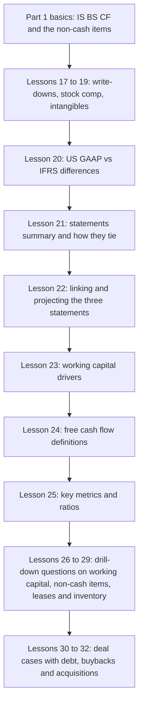

## Lessons

### 2.17 Impairments and Write-Downs

- An impairment or write-down happens when an asset is worth less than its book value and the company has to say so. The usual suspects are net PP&E, goodwill and other intangibles, but inventory, investments and receivables can also be written down.
- The trigger is a change in value that is significant and not expected to reverse. Equipment that breaks, becomes obsolete or no longer fits the business is the classic case.
- On the income statement, the charge sits below operating income, usually near interest and gains or losses. Most models put it in its own line so it is easy to strip out when you look at the operating trend.
- On the cash flow statement it is a non-cash add-back, the same as depreciation. Net income falls, then the charge is added back.
- On the balance sheet, the asset falls by the write-down amount. Equity falls by the after-tax amount.
- The tax question is what separates the two treatments. Write-downs are usually not deductible for cash taxes, because they are not regular and predictable. So the tax benefit shows up on the income statement as lower book tax, but not in cash. The gap is booked as a deferred tax asset.

**Simplified treatment (the one to lead with in an interview):**

```text
Write-down              = W
Book tax saving         = t x W          (cash goes up by this)
Net income impact       = -(1 - t) x W
Cash flow from ops      = NI + W = W x t  (cash up by the tax saving)
Net PP&E                = down by W
Assets change           = -W + t x W     = -(1 - t) x W
Equity change           = -(1 - t) x W   (balances)
```

**Correct treatment (cash tax is unchanged):**

```text
Book tax saving         = t x W
Deferred tax adjustment = -t x W         (on the cash flow statement)
Cash flow from ops      = NI + W - t x W = 0
Net deferred tax asset  = up by t x W
```

**Worked example (made-up numbers, 25% tax rate):** a company bought equipment for 500 at the end of Year 1 and then wrote down 120 of it in Year 2.

| Item | Simplified | Correct tax treatment |
|---|---|---|
| Pre-tax income impact | -120 | -120 |
| Book tax saving | +30 | +30 |
| Net income impact | -90 | -90 |
| Add back write-down (CFO) | +120 | +120 |
| Deferred tax adjustment (CFO) | 0 | -30 |
| Change in cash | +30 | 0 |
| Net PP&E | -120 | -120 |
| Net deferred tax asset | 0 | +30 |
| Equity change | -90 | -90 |

Both columns balance. In the simplified case the tax saving becomes cash. In the correct case it becomes a deferred tax asset that will reverse later.

> [!TIP]
> **The intuition check.** If taxes fall by an amount that does not feel like it should be real cash, then cash cannot move by that amount. Something else on the balance sheet has to absorb it, and in this case it is the deferred tax asset. This is a quick way to check any model that has a write-down, even without the full tax schedule.

> [!WARNING]
> **Common mistake.** Forgetting that the write-down is non-cash on the cash flow statement. People sometimes subtract it like a cash cost. It is only an accounting loss.

> [!TIP]
> For interviews, the simplified version is the safe choice unless you are very comfortable with deferred taxes. Say "the write-down is non-cash and mostly not tax-deductible, so the tax effect may not be cash" and let the interviewer ask for more.

### 2.18 Stock-Based Compensation

- Stock-based compensation (SBC) is pay in equity instead of cash. Employees get shares, restricted stock units (RSUs) or options, and the company records an expense for their value.
- It is an operating expense, just like depreciation. Most models show it as its own line so the non-cash part is easy to see. It is deducted when you calculate operating income.
- It is non-cash, so it is added back on the cash flow statement.
- On the balance sheet, the add-back flows into equity. Common equity goes up by the SBC amount and down by the net income hit.
- Why companies like it: it saves cash, and vesting schedules keep people around. Why it is tricky: in the US, the tax deduction usually comes only when employees exercise or sell, which is much later than the expense. Most models do not forecast that timing.
- Share count can change as awards vest or are exercised. A quick model divides the SBC dollars by the share price to get an estimate of new shares. That is only a rough guide, because options and warrants do not create one share per dollar.

**Simplified treatment (tax savings are treated as cash):**

```text
SBC expense             = S
Net income impact       = -(1 - t) x S
Cash flow from ops      = NI + S = t x S      (cash goes up)
Equity change           = -(1 - t) x S + S = t x S
```

**Correct treatment (no cash tax deduction yet):**

```text
Cash flow from ops      = NI + S - t x S = 0  (cash unchanged)
Net deferred tax asset  = up by t x S
Equity change           = -(1 - t) x S + S = t x S
```

**Worked example (made-up numbers, 25% tax, SBC of 200):**

| Item | Simplified | Correct tax treatment |
|---|---|---|
| Operating income impact | -200 | -200 |
| Book tax saving | +50 | +50 |
| Net income impact | -150 | -150 |
| Add back SBC (CFO) | +200 | +200 |
| Deferred tax adjustment (CFO) | 0 | -50 |
| Change in cash | +50 | 0 |
| Net deferred tax asset | 0 | +50 |
| Equity change | +50 | +50 |

The equity line goes up in both cases. Net income falls, but the SBC credit to equity is bigger.

> [!TIP]
> SBC is a real cost even though it is not cash. Many analysts argue that free cash flow should subtract it, or that dilution should be counted in the share count. A model that adds it back and ignores dilution makes the business look cheaper than it is. Always ask whether the valuation uses diluted shares that include future awards.

> [!WARNING]
> **Common mistake.** Treating the add-back as cash that was saved by the company. The cash is saved, yes, but the cost lands on shareholders through dilution. That cost is not in the cash flow line.

> [!TIP]
> Real filings often show SBC as a large number for tech companies. In a DCF, check whether the team treats it as a cash-like cost or as a non-cash add-back, and be consistent.

### 2.19 Goodwill and Other Intangible Assets from M&A

- When one company buys another, the buyer adds the target's assets and liabilities to its own, then makes adjustments. The buyer's cash goes out (or debt or stock goes up), and the target's old equity is wiped out because it is no longer a separate company.
- The price paid is rarely equal to the target's book equity. The gap is the purchase premium, and it has to be put somewhere on the balance sheet, or the balance sheet will not balance.
- Other intangible assets are identifiable things with a name and a reason they are worth money: customer relationships, patents, trademarks, technology, contracts. They get amortized over time, like PP&E gets depreciated.
- Goodwill is the leftover: the part of the premium you cannot tie to a specific asset. It is not amortized. Instead, the company tests it for impairment each year and writes it down if it is no longer worth what was paid.
- Simple models usually set intangibles as a percentage of the premium and push the rest into goodwill. Valuation specialists can value intangibles in more detail, but most banking models use the simple split.

**Purchase price allocation (the core arithmetic):**

```text
Equity purchase price       = P
Less target book equity     = E
Less target existing goodwill written off (fair value 0)
Allocable premium           = P - E + existing goodwill
Other intangibles           = i x premium
Goodwill created            = premium - intangibles
```

**Worked example (made-up numbers, all in $ thousands):**

| Item | Amount |
|---|---|
| Equity purchase price | 300 |
| Target book equity | 180 |
| Allocable premium | 120 |
| Other intangibles (25 percent of premium) | 30 |
| Goodwill created | 90 |

Acquisition cash flow of 300 is split into three buckets: other acquired assets 180, goodwill 90, and intangibles 30. The three buckets add up to the price, so the combined balance sheet still balances.

**Amortization and impairment, with the same numbers:**

```text
Annual amortization         = intangibles / useful life = 30 / 5 = 6
Goodwill impairment (Year 2) = 25  (written off against goodwill)
Pre-tax hit in Year 2       = -(6 + 25) = -31
Book tax saving at 25%      = 7.75
Net income impact           = -23.25
```

Neither amortization nor the goodwill write-down is usually deductible for cash taxes. So the cash flow statement adds both back and then subtracts the book tax saving as a deferred tax adjustment. Cash stays flat, and the deferred tax asset goes up by 7.75.

| Item in Year 2 | Amount |
|---|---|
| Net income | -23.25 |
| Add back amortization | +6 |
| Add back goodwill impairment | +25 |
| Deferred tax adjustment | -7.75 |
| Change in cash | 0 |
| Other intangibles | -6 |
| Goodwill | -25 |
| Net deferred tax asset | +7.75 |
| Equity | -23.25 |

Assets fall by 31 and rise by 7.75 through the deferred tax asset, so the net fall is 23.25. Equity also falls by 23.25. The sheet balances.

> [!TIP]
> **Intuition check.** An acquisition is like a capex purchase, but for a whole business. The cash leaves in one year, and the expense shows up later as amortization or impairment. If you see amortization or impairment in a model and cash moves, something is wrong.

> [!TIP]
> Goodwill impairments are a red flag for the buyer. They mean management overpaid, or the business underperformed after the deal. In a valuation or credit review, large goodwill on a balance sheet makes tangible book value look much smaller than book value.

> [!WARNING]
> **Common mistake.** Assuming goodwill is an asset you can use or sell. It has no separate cash value. Only the ongoing business does.

> [!TIP]
> In real filings, goodwill and intangibles can be a big share of total assets for acquisitive companies. Many analysts strip them out for a tangible book value view.

### 2.20 US GAAP vs IFRS on the Financial Statements

- The income statement and balance sheet look much the same under US GAAP and IFRS. Labels differ (revenue may be called turnover, for example), but the shape is familiar.
- Most of the real differences sit on the cash flow statement. Many IFRS reporters start the operating section from operating income or pre-tax income instead of net income. Some use the direct method, which lists cash receipts and payments instead of net income plus adjustments.
- IFRS reporters also put items in less predictable places. Dividends paid can sit in operating cash flow, interest can sit in financing, and taxes can appear in a line that does not match the income statement.
- Operating leases are the big accounting gap. Under IFRS, lessees split the lease cost into depreciation and interest. Under US GAAP, an operating lease is a single straight-line rent expense.
- Good practice: find the company's reconciliation of profit to operating cash flow (every reporter should have one). Use it to rebuild the cash flow statement in a standard format that links to the balance sheet.
- Standard rebuild: start with net income, add back non-cash items, bring in working capital changes, keep investing as is, and put dividends and interest in the right sections. Items such as restricted cash or money-market deposits belong in cash, not in investing or financing.
- When the numbers do not tie, a labeled "other adjustments" line can plug the gap. The ending cash must match, and the rest should be clearly labeled.

**Tax conversion logic (the one to remember):**

```text
Tax adjustment in CFO = book taxes - cash taxes paid
(cash taxes shown as a positive outflow)
```

If book tax is higher than the cash tax paid, the gap is a deferred tax liability build, so it is added back in operating cash flow.

**Worked example (made-up numbers, all in $ millions, IFRS-style layout):**

| Reported layout (IFRS style) | Amount |
|---|---|
| Operating profit | 300 |
| Depreciation and amortization | 80 |
| Receivables increase | -20 |
| Payables increase | 15 |
| Taxes paid | -60 |
| Interest paid | -10 |
| Dividends paid (inside operating) | -40 |
| Reported operating cash flow | 265 |

**Converted to a standard layout:**

| Converted layout (US GAAP style) | Amount |
|---|---|
| Net income (300 operating profit less 30 interest and 90 book tax) | 180 |
| Depreciation and amortization | 80 |
| Deferred taxes (book 90 less cash 60) | +30 |
| Working capital changes (-20 + 15) | -5 |
| Other adjustments (interest expense 30 less 10 paid) | +20 |
| Converted operating cash flow | 305 |
| Dividends paid (moved to financing) | -40 |

The total cash change is the same in both versions. Dividends move from operating to financing, and the tax and interest differences are shown explicitly.

> [!TIP]
> **Why this matters for valuation.** If you use a company's reported operating cash flow to compute free cash flow, a dividend inside operating cash flow will make the business look worse than it is. Interest and tax placement also changes what counts as unlevered cash flow. Always rebuild before you compare companies across borders.

> [!WARNING]
> **Common mistake.** Forgetting the deferred tax adjustment when you convert. The sign rule above prevents most errors. Check it with a quick sanity question: if book tax is bigger than cash tax, does cash need a boost?

> [!TIP]
> **A real-world point.** The lease difference matters for leverage ratios. Under IFRS, lease liabilities appear as debt and EBITDA is higher, because rent is no longer an operating expense. When you compare a US retailer with a European one, adjust one side so both are on the same basis.

### 2.21 Summary of the Three Statements

This lesson adds no new mechanics. It is a recap with the rules of thumb that make the three statements easy to read together.

**Income statement: what belongs on it.** It covers one period (a year, quarter or month) and shows revenue, expenses and taxes that belong to that period. An item goes on it if it belongs to this period and it changes the profit available to common shareholders.

- Cash versus non-cash is not the test. Depreciation is non-cash and sits on the income statement. Capital expenditure is cash and does not, because it is an asset that lasts for years.
- Some non-cash items are buried inside other lines. Depreciation and stock comp can be embedded in cost of sales or operating expenses. The cash flow statement usually shows the full amount, so check there.
- Preferred dividends are not a tax item, but they reduce the income left for common shareholders, so they appear at the bottom.

**Balance sheet: what it is.** A snapshot on one date. Assets always equal liabilities plus equity.

- An asset is something that gives future benefit: future cash, the ability to grow, value from brands or patents, or the ability to avoid future cash costs. Net deferred tax assets count because they reduce future tax payments.
- A liability is an obligation: a future cash payment, a duty to deliver a product or service, or a repayment to an outside party. Deferred revenue is a liability because cash was received before the delivery cost is paid.
- Equity is funding from owners. It grows with retained net income and new shares, and falls with dividends and buybacks.
- Equity is split into common stock, paid-in capital, retained earnings, treasury stock and other comprehensive income. For modeling, you only need the roll-forward: net income in, dividends out, stock issued and bought back.

**Cash flow statement: why it exists.** It reconciles the change in cash over the period for two reasons. Some income statement items are not cash, and some cash flows never reach the income statement (capex, dividends, debt repayments).

- Operating: starts from net income, adds back non-cash items, then changes in operating assets and liabilities. Cash itself is not listed here, because it is already the bottom line.
- Investing: capex, acquisitions, purchases and sales of investments. Roughly lines up with long-term assets.
- Financing: debt, finance lease principal, dividends, share issues and buybacks. Roughly lines up with long-term liabilities and equity.

**Rules of thumb to remember:**

| Statement or section | Rough mapping | Where it breaks |
|---|---|---|
| Income statement | One period, profit for common shareholders | Non-cash items are embedded in other lines |
| Operating cash flow | Current assets and liabilities plus non-cash items | Cash, deferred tax and some other items |
| Investing cash flow | Long-term assets | Deferred tax assets and operating lease assets |
| Financing cash flow | Long-term liabilities and equity | Operating lease liabilities |

> [!TIP]
> These are rules of thumb, not laws. The useful test in an interview is to ask "what does this item do to future cash?" If the answer is a future cash payment, it is a liability. If it is a future cash receipt or a future cash tax saving, it is an asset.

> [!WARNING]
> **Common mistake.** Placing cash on the cash flow statement's operating section as well as the bottom line. It is counted once, at the bottom.

> [!TIP]
> Buybacks are in financing, not operating, and they reduce treasury stock or equity. Dividends reduce retained earnings. Neither touches the income statement.

### 2.22 Linking and Projecting the Three Statements

- Valuation needs future cash flows, so the historical statements have to be turned into a forecast. This breaks into three jobs: simplify the statements, project the line items, then link the statements so the balance sheet balances every year.
- **Simplify first.** Keep the income statement close to the filing, but pull the full depreciation and amortization number out of cost of sales into its own line. On the balance sheet, aim for roughly 5 to 10 items per side: combine short-term and long-term debt, use one net deferred tax line, and skip the equity components. On the cash flow statement, start with net income, add back D&A, stock comp and deferred taxes, then keep the working capital section as the company reports it. Investing should center on capex. Financing should show debt, dividends, buybacks and issues.
- **Project the income statement.** Revenue grows at a rate. Gross margin, SG&A and D&A are usually a percent of revenue, often a historical average. Tax is a rate on pre-tax income. Interest is a rate on the debt balance.
- **Project operating balance sheet items.** These are the working capital lines. Tie each to the driver that moves it: inventory and payables to cost of sales, receivables and other current items to revenue, accrued expenses to SG&A. Check the sign: if revenue grows, working capital usually behaves in a consistent direction.
- **Project the rest of the cash flow statement.** Stock comp is a percent of SG&A or revenue. Deferred taxes are a share of book taxes. Capex is often a percent of the change in revenue, since growth needs investment. Dividends are often a percent of net income. Debt and buybacks follow company guidance or a simple assumption.
- **Link the balance sheet last.** Cash comes from the bottom of the cash flow statement. Assets are linked with a minus sign when the cash flow line is an outflow. Liabilities and equity are linked with a plus sign when the cash flow line is an inflow. Each cash flow line should be linked once, and each balance sheet line should be driven by one cash flow line.
- **Check, then finish.** Compare the balance check. If it is not zero, go line by line and check the signs. The last step is interest: compute it from debt (and cash, if you model interest income), then feed it back into net income. Interest creates a loop, so it is usually added after the balance check.

**Sign rules for linking (memorize these):**

```text
Asset line linked to cash flow     -> use a minus sign for the cash flow line
Liability or equity line linked    -> use a plus sign for the cash flow line
Cash flow from operations line     -> start with net income, add non-cash items, then working capital
Working capital: asset increases   -> cash flow goes down
Working capital: liability rises   -> cash flow goes up
```

**Worked example (made-up numbers in $ millions, one projection year):**

| Line | Calculation | Result |
|---|---|---|
| Revenue | 1,000 x 1.05 | 1,050 |
| Cost of sales | 1,050 x (1 - 30%) | 735 |
| Gross profit | 1,050 - 735 | 315 |
| SG&A | 1,050 x 15% | 157.5 |
| D&A | 1,050 x 3% | 31.5 |
| Operating income | 315 - 157.5 - 31.5 | 126 |
| Interest | 400 debt x 5% | 20 |
| Taxes | (126 - 20) x 21% | 22.3 |
| Net income | 106 - 22.3 | 83.7 |

**Cash flow for the same year (made-up):**

| Cash flow line | Amount |
|---|---|
| Net income | 83.7 |
| D&A | +31.5 |
| Working capital inflow | +5 |
| Cash flow from operations | 120.2 |
| Capex (2 x change in revenue of 50) | -100 |
| Cash flow from investing | -100 |
| Debt repayment | -10 |
| Dividends (40 percent of net income) | -33.5 |
| Cash flow from financing | -43.5 |
| Net change in cash | -23.3 |

Balance sheet links for the same year: cash goes down by 23.3. Net PP&E goes up by capex (100) and down by D&A (31.5), so it rises by 68.5. Debt falls by 10 because of the repayment. Equity rises by net income of 83.7 and falls by the 33.5 dividend. Each link is made once, and the sign rules above decide the direction.

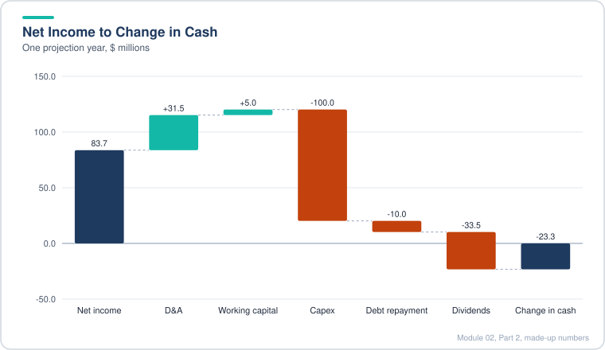

*Capex, debt repayment and dividends outweigh operating cash flow, so cash falls by 23.3.*

> [!TIP]
> Projection is where most model errors show up. The fastest diagnostic is the balance check: if it is off, the error is in a sign or a link, not in the forecast assumptions.

> [!TIP]
> Interest is circular when it is based on average balances, because cash affects interest, which affects net income, which affects cash. Many banks use prior-year balances or add a circularity switch. Know this before an interview question about it.

> [!WARNING]
> **Common mistake.** Projecting capex as a percent of revenue when the company's growth is the real driver. Capex as a percent of the change in revenue is a better fit for growing businesses, but it can be wrong for mature companies with heavy maintenance spend.

### 2.23 Working Capital and the Change in Working Capital

- Working capital is the short-term money tied up in running the business. The textbook version is current assets minus current liabilities. In practice, most analysts and companies use operating working capital: current operating assets minus current operating liabilities, which strips out cash, short-term investments and short-term debt.
- For valuation, what matters most is the change in working capital, because it is the piece that moves cash away from net income. A rising receivable or inventory absorbs cash. A rising payable or deferred revenue supplies cash.
- The cash flow statement defines the change as old minus new. If an asset rises, the change is negative because cash went out. If a liability rises, the change is positive because cash came in. Online definitions often use new minus old, which will give the wrong sign on a cash flow statement.
- Judge the change as a percent of the change in revenue, which tells you how much cash each new dollar of growth ties up. Judge it as a percent of revenue to see how big it is in the business overall.
- Historical working capital changes on a cash flow statement rarely match the balance sheet differences exactly. Reclassifications, acquisitions and accounting changes cause gaps. Use the reported cash flow numbers for history, and don't chase small differences.
- Projection: most models forecast the working capital change as a percent of the change in revenue, using an average or a trend. If the number is small and noisy, a low assumption is usually fine.

**Worked example (made-up numbers, $ millions):**

| Balance sheet item | Year 1 | Year 2 |
|---|---|---|
| Inventory | 300 | 340 |
| Other current operating assets | 100 | 110 |
| Accounts payable | 150 | 170 |
| Accrued liabilities | 50 | 60 |
| Operating working capital | 200 | 220 |

```text
Operating working capital = (inventory + other current assets) - (payables + accrued)
Year 2 change on cash flow = Old WC - New WC = 200 - 220 = -20   (cash outflow)
Revenue change              = 1,200 - 1,000 = 200
Working capital change as a percent of revenue change = -20 / 200 = -10 percent
```

**Interpreting the same answer for two business types:**

| Feature | Retailer | Subscription software |
|---|---|---|
| Main drivers | Inventory up (cash out), payables up (cash in) | Deferred revenue up (cash in) |
| Typical sign on growth | Often slightly negative or mixed | Often positive |
| What it tells you | Cash is tied up in stock | Customers pay before service is delivered |
| Model approach | Small percent of revenue change | Average percent of revenue change, often higher |

A worked comparison with the same growth: if revenue grows by 1,000 and the working capital change is 9 percent of that, cash flow is 90 higher than the same growth with no working capital effect. If the change is negative 1 percent, cash flow is 10 lower.

> [!WARNING]
> **The trap in interviews.** The term "working capital" can be defined three ways, and the answer depends on which one you mean. Always say whether it includes cash, and whether it is the level or the change.

> [!TIP]
> Negative working capital is not automatically bad. Companies that collect cash before they deliver (subscription, marketplace or some retail models) can run negative working capital that grows with the business. The question is what sits inside the number.

> [!WARNING]
> **Common mistake.** Forgetting the sign. Most model errors on this line come from putting new minus old on the cash flow statement. Use the balance sheet check: if the asset grew, the cash line must be negative.

### 2.24 Free Cash Flow

- Valuation needs a clear definition of "cash flow". The simplest working definition is free cash flow (FCF): cash flow from operations minus capital expenditures.
- FCF is the cash the business produces after it has paid for the things it must keep doing: running costs, interest, taxes and the upkeep of its assets. It is the cash that could go to debt holders, shareholders or be used for growth.
- The definition works cleanly for US GAAP companies because the operating section already starts from net income, so interest, taxes, preferred dividends and full lease costs are deducted.
- For IFRS companies, check the starting point. If operating cash flow starts from operating income or pre-tax income, you may need to deduct interest and taxes yourself. If leases are split into depreciation and interest, do not add back the depreciation part of the lease, or the lease cost disappears from FCF.
- Leave out investing items other than capex (asset sales, acquisitions, investment purchases) and all financing items (debt, dividends, buybacks). Those are not part of running the business. Including them would also hide whether the company needs outside funding.
- Positive and growing FCF is the normal goal. Negative FCF is a warning, and the question is whether it is temporary (a growth company spending heavily) or structural (losses that do not shrink as revenue grows).
- Be skeptical of growing FCF. Check where it came from: strong sales and margins are good. Falling capex, a changing working capital pattern, unusually large non-cash add-backs or one-off gains are warning signs.
- Stock-based compensation is a special case. It is added back in operating cash flow, so a company with heavy SBC can show positive FCF while losing money. Most analysts treat SBC as a real cost, or at least watch how much of FCF it represents.

**Worked example (made-up numbers, $ millions, three years):**

| Item | Year 1 | Year 2 | Year 3 |
|---|---|---|---|
| Revenue | 2,000 | 2,200 | 2,300 |
| Cash flow from operations | 600 | 660 | 690 |
| Capital expenditures | 200 | 220 | 300 |
| Free cash flow | 400 | 440 | 390 |
| FCF margin | 20.0% | 20.0% | 17.0% |
| Capex as a percent of CFO | 33% | 33% | 43% |
| FCF growth | n/a | +10% | -11% |

Reading the table: revenue grew about 5% in Year 3, but FCF fell 11%. Operating cash flow still grew (+5%), so the drop is entirely capex, which rose 36% in one year. That is a question to ask management: is this one-off investment (a plant, a system) or a higher maintenance level that will stay?

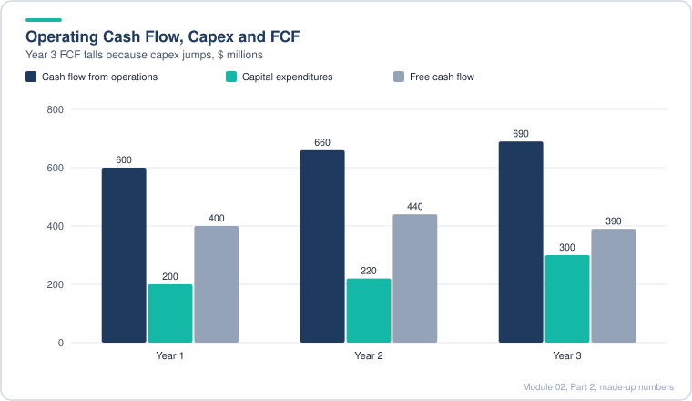

*Operating cash flow keeps growing in Year 3, but a jump in capex pulls free cash flow down.*

**A standard FCF build from net income (made-up):**

```text
Net income                       400
+ D&A                            200
+ Stock-based compensation       100
+ Deferred taxes                  20
- Working capital increase       (30)
= Cash flow from operations      690
- Capex                         (250)
= Free cash flow                 440
SBC as a share of FCF = 100 / 440 = 23%
```

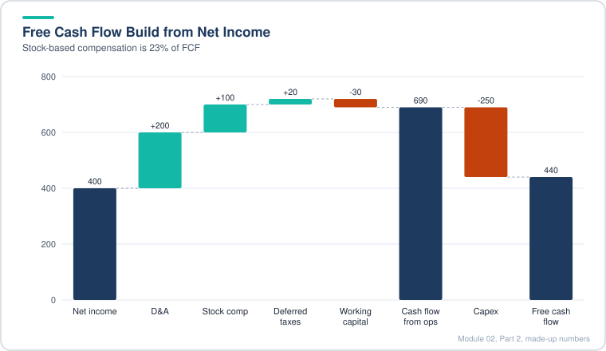

*Non-cash add-backs lift operating cash flow well above net income, and capex then takes a large share back.*

> [!TIP]
> Unlevered free cash flow is the version many valuation models use. It adds back after-tax interest, so it measures cash before the company's financing choices. Levered FCF (above) measures cash after interest, which is what equity holders can use. A DCF needs the unlevered version when it discounts at WACC.

> [!WARNING]
> **Common mistake.** Subtracting only maintenance capex and calling the rest "growth". Companies rarely split capex cleanly. Treat the whole number as a cost unless the company gives a clear breakdown, and check the history.

> [!TIP]
> **Real-world link.** For a bank or mortgage company, the standard FCF concept does not fit well. Operating cash flow at such a company includes loan originations and sales, which are part of its core business. Analysts usually use earnings, book value and return measures there, not FCF.

### 2.25 Key Metrics and Ratios

Metrics answer four questions: which company uses capital best, which relies more on debt, which can repay its debt in a downturn, and which turns sales into cash faster. Companies that do all four well usually get higher valuations, all else equal.

**Cash flow proxies.**

- EBIT is operating income with any clearly non-recurring items removed. It sits before interest and taxes. It is often close to free cash flow, because FCF subtracts capex and EBIT subtracts depreciation (a partial proxy for capex).
- EBITDA is EBIT plus depreciation and amortization. It is close to cash flow from operations, because both ignore capex and add back depreciation.
- If the gap between EBIT and FCF is wide, look at capex. A capex-heavy company will show a large gap.

**Credit metrics.**

- Leverage ratio = total debt / EBITDA. Lower means less debt for the earnings available to repay it.
- Interest coverage = EBITDA / interest expense. Higher means more buffer. A coverage ratio of 10x or more gives room even if earnings fall by half.
- Ideally use gross interest expense. If the filing gives only net interest, the ratio is an approximation.

**Return metrics.**

- ROE = net income / average common equity.
- ROA = net income / average total assets.
- ROIC = NOPAT / average invested capital, where NOPAT = EBIT x (1 - tax rate) and invested capital = equity + debt (+ preferred and other long-term funding, depending on the definition).
- Averages are used because net income is measured over a period and the balance sheet is a snapshot.
- A company that pays down debt will see ROE drift down, even if ROIC rises. Find the reason before you judge.

**Cash conversion metrics.**

- DSO = receivables / revenue x days in the year.
- DIO = inventory / cost of sales x days.
- DPO = payables / cost of sales x days.
- Cash conversion cycle = DSO + DIO - DPO. Lower is better: it means cash comes back faster.

**Worked example (made-up companies, $ millions):**

| Metric | Company A | Company B |
|---|---|---|
| Revenue | 5,000 | 3,000 |
| EBIT | 500 | 360 |
| EBITDA | 650 | 420 |
| Interest expense | 75 | 60 |
| Total debt | 1,500 | 900 |
| Leverage (debt / EBITDA) | 2.3x | 2.1x |
| Coverage (EBITDA / interest) | 8.7x | 7.0x |
| Net income (EBIT less interest, after 25% tax) | 319 | 225 |
| ROE (net income / average equity of 2,000 and 1,200) | 15.9% | 18.8% |
| ROA (net income / average assets of 6,000 and 2,500) | 5.3% | 9.0% |
| ROIC (NOPAT / invested capital of 3,500 and 2,100) | 10.7% | 12.9% |
| DSO | 29 days | 18 days |
| DIO | 63 days | 41 days |
| DPO | 52 days | 51 days |
| Cash conversion cycle | 40 days | 8 days |

Reading the table: Company B has a lower cash conversion cycle and higher returns, but it has the same leverage ratio as A. Its coverage is lower, which is worth noting even though both are comfortable. Before crediting B with better capital use, check whether a lower tax rate or a one-time item lifted its returns, as with the tax-driven jump in one of these comparisons.

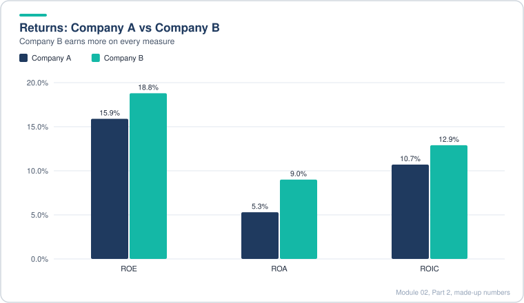

*Company B posts higher returns on equity, assets and invested capital than Company A.*

> [!TIP]
> Metrics are only as good as their definitions. Two analysts can quote different ROICs for the same company because they treat leases, cash and goodwill differently. Write the definition next to the number.

> [!TIP]
> **Rule of thumb for the cash conversion cycle.** Retailers can run near zero or negative because suppliers fund inventory. Industrials and manufacturers often run 60 to 90 days or more. Compare within an industry.

> [!TIP]
> **Interview tip.** When a company's ROE is rising fast, ask whether leverage or tax rate changed before saying management improved. Rising ROE from more debt is not the same as rising ROIC.

### 2.26 Working Capital Line Items: Scenario Drills

This lesson is practice. Each scenario has two steps: a change on January 1 and a reversal or follow-up on December 31. Work through the income statement first, then the cash flow statement, then the balance sheet, and check that the balance sheet still balances.

**The rule that drives everything.** Ask whether the company has delivered something to a customer (revenue and cost of sales hit the income statement) or received something from a supplier (an expense hits the income statement). If neither has happened, the income statement does not change. Only the balance sheet and cash move.

**The tax rule.** Once something hits pre-tax income, cash taxes change by the tax rate times that amount. So net income moves by (1 - tax rate) times the pre-tax change. Cash moves by the same net income change plus the working capital effect.

**Five drills with made-up amounts of 200 and a 25 percent tax rate:**

| Scenario | Jan 1 step (cash, income, balance sheet) | Dec 31 step | Cumulative change in cash |
|---|---|---|---|
| Receivable: sale on credit | Revenue +200, net income +150. Cash flow -200 from the receivable. Cash -50, receivables +200 | Customer pays, receivable goes back to the start. Income unchanged. Cash +200 | +150 (= net income) |
| Prepaid expense: pay in advance | No income change. Cash -200, prepaid +200 | Expense recognized: operating cost +200, net income -150. Prepaid back to start. Cash -150 | -150 (= net income) |
| Inventory: buy then sell | Cash -200, inventory +200. No income | Sell for 500: revenue +500, cost of sales +200, pre-tax +300, net income +225. Inventory back to start | +225 (= net income) |
| Payable: invoice received, paid later | Expense +200, net income -150. Payable +200. Cash +50 (tax saving comes first) | Invoice paid: cash -200, payable back to start. Income unchanged | -150 (= net income) |
| Deferred revenue: cash up front | No income. Cash +200, deferred revenue +200 | Delivered: revenue +200, net income +150. Deferred revenue back to start. Cash +150 | +150 (= net income) |

Two of the drills need a closer look.

- The receivable case: on day one, cash is down by 50. You still pay tax on revenue you have not collected. Once the customer pays, cash rises by the full 200, so the total is 150, which equals the net income.
- The payable case: the tax saving arrives before the bill is paid. Cash is up by 50 on day one because the expense lowers taxes. Then the bill is paid and cash drops by 200 more, which leaves cash down by 150 in total.

**A worked check for the inventory case:**

```text
Revenue                     500
Cost of sales               200
Pre-tax income              300
Tax at 25%                   75
Net income                  225
Cash change over the year   225  (inventory net change is zero)
```

> [!TIP]
> The timing items (receivables, payables, prepaids, deferred revenue, inventory) never change total cash in the end. They only move when cash shows up. The total cash effect over the full cycle is always the net income for the period, because the working capital reverses.

> [!TIP]
> **Interview shortcut.** Whatever the scenario, the end state is the same as if the cash and income had been recorded at once. Tell the interviewer that "over the full cycle, the cash effect equals the after-tax income effect," then fill in the timing.

> [!WARNING]
> **Common mistake.** Forgetting that a cash payment in advance (prepaid, inventory) does not touch the income statement until the item is used or sold, and that the tax effect follows the income statement, not the cash.

### 2.27 Non-Cash Expense Drills

**The pattern for every non-cash question.** A non-cash expense changes four things in a predictable order:

1. Pre-tax income falls (or rises) by the item.
2. Net income falls by the item times (1 - tax rate).
3. Cash flow adds back the item, so cash moves by the tax saving only, if the item is deductible.
4. One balance sheet line that the item relates to (PP&E, intangibles, equity, or the asset written down) moves by the item. Equity moves by net income plus any non-cash add-back for stock comp.

The tricky part is deciding what the "something else" on the balance sheet is. Depreciation hits PP&E, amortization hits intangibles, stock comp hits equity, and a write-down hits the asset it writes down.

**Made-up drills at a 25 percent tax rate:**

| Question | Income statement | Cash flow statement | Balance sheet | Cash change |
|---|---|---|---|---|
| Depreciation up by 80 | Pre-tax -80, net income -60 | Net income -60, add back +80 | Cash +20, net PP&E -80, equity -60 | +20 |
| Stock comp of 400 | Pre-tax -400, net income -300 | Net income -300, add back +400, deferred tax -100 | Cash 0, net DTA +100, equity +100 | 0 |
| PP&E write-down of 400 | Pre-tax -400, net income -300 | Net income -300, add back +400, deferred tax -100 | Cash 0, net PP&E -400, net DTA +100, assets -300, equity -300 | 0 |

**Check the balance on each row:**

- Depreciation: assets fall by 80 (PP&E) and rise by 20 (cash), so they fall by 60. Equity falls by 60. Balanced.
- Stock comp: assets rise by 100 (DTA). Equity rises by 100 (net income -300 plus stock comp add-back +400). Balanced.
- Write-down: assets fall by 400 and rise by 100 (DTA), so they fall by 300. Equity falls by 300. Balanced.

Simplified version: if the interviewer wants the simple answer, skip the deferred tax step. For depreciation, the simple answer is the same as the correct one. For stock comp and write-downs, the simple answer puts the 100 tax saving into cash instead of a DTA, so cash rises by 100 and the balance sheet still balances.

> [!TIP]
> **A quick way to answer any non-cash question.** Work through five steps. (1) Work out the pre-tax change, (2) apply the tax rate to get net income, (3) add back the item, (4) write down the balance sheet line the item belongs to, (5) make cash and equity balance. Then decide whether the item is deductible for cash taxes. If not, put the tax difference into the deferred tax asset.

> [!WARNING]
> **Common mistake.** Adding back a non-cash expense without reducing the matching asset. Depreciation reduces PP&E, not cash, and that is why it is the one non-cash expense that helps cash through taxes.

### 2.28 Lease Drills: Operating and Finance Leases

Leases went on balance sheets widely after the rule change around 2019, so interviewers now ask about them. The pattern is the same for both lease types.

**Step 1 (signing).** The company records a lease asset and a lease liability at the same amount. No cash moves, the income statement does not change, and the balance sheet stays in balance.

**Step 2 (each year).** The income statement picks up the lease cost. What it shows depends on the lease type:

- US GAAP operating lease: one straight-line rent expense. Interest and depreciation are calculated in the background only.
- Finance lease (and IFRS leases): depreciation and interest appear separately on the income statement.

**The lease arithmetic.**

```text
Interest                          = discount rate x lease liability
Finance lease depreciation        = lease asset / lease term
Finance lease principal repaid    = cash rent - interest
US GAAP operating lease:
  Lease cost (rent)               = straight-line cash rent (on the income statement)
  Depreciation (background)       = rent - interest
  Principal (background)          = rent - interest
```

**Drill 1 (made-up):** an operating lease with a liability and asset of 900 signed on January 1, annual rent of 120, a 6 percent discount rate, and a 10-year term. Assume a 25 percent tax rate.

| Item | Amount |
|---|---|
| Interest (6% x 900) | 54 |
| Rent expense on the income statement | 120 |
| Background depreciation (120 - 54) | 66 |
| Background principal (120 - 54) | 66 |
| Pre-tax income | -120 |
| Net income | -90 |
| Cash change (net income only, lease changes offset) | -90 |
| Lease asset (900 - 66) | +834 |
| Lease liability (900 - 66) | +834 |
| Total assets change (834 - 90) | +744 |
| Liabilities and equity change (834 - 90) | +744 |

**Drill 2 (made-up):** a finance lease of 1,000 signed on January 1, a 10-year term, cash rent of 150 a year, and a 6 percent discount rate. Assume a 25 percent tax rate.

| Item | Amount |
|---|---|
| Depreciation (1,000 / 10) | 100 |
| Interest (6% x 1,000) | 60 |
| Pre-tax income | -160 |
| Net income | -120 |
| Cash flow: net income plus depreciation add-back | -20 |
| Principal repayment (150 - 60) | -90 |
| Change in cash | -110 |
| Finance lease asset (1,000 - 100) | +900 |
| Total assets change (900 - 110) | +790 |
| Finance lease liability (1,000 - 90) | +910 |
| Equity change (net income) | -120 |
| Total liabilities and equity change (910 - 120) | +790 |

Key difference to say out loud in an interview: an operating lease gives one rent line, so the expense is a single number. A finance lease gives two lines, depreciation and interest, so EBIT and EBITDA look different between the two types even when the cash rent is the same.

> [!TIP]
> **Analyst angle.** The same cash rent can produce different EBITDA. A finance lease pushes part of the cost below EBITDA (depreciation and interest), so EBITDA looks higher. Analysts adjust leases to compare companies on a like-for-like basis, which later lessons cover.

> [!WARNING]
> **Common mistake.** Using the cash rent as interest. Interest is always the discount rate times the liability. The rest of the cash payment is principal.

### 2.29 Multi-Step Drill: Inventory Bought on Credit, Then Sold

This is the first multi-step scenario in the set. Several items change over time instead of at one point, so it teaches two habits:

1. Ask the interviewer whether they want cumulative changes (step 2 includes step 1) or each step on its own. For short scenarios, cumulative is clearer. For long or complex ones, split the steps.
2. Translate the story into line items. "Buying inventory on credit" means inventory and payables both rise. Payables are not always linked to operating expenses, so the model's link has to be changed for this case.

**Made-up drill:** the company buys 150 of inventory on credit on January 1, turns it into products and sells them for 400 over the year, and pays the supplier from the sale proceeds on December 31. Tax rate 25 percent.

| Line | Step 1 (January 1, on credit) | Step 2 (sale and payment) | Cumulative |
|---|---|---|---|
| Revenue | 0 | +400 | +400 |
| Cost of sales | 0 | +150 | +150 |
| Pre-tax income | 0 | +250 | +250 |
| Net income (at 25%) | 0 | +187.5 | +187.5 |
| Inventory | +150 | -150 | 0 |
| Accounts payable | +150 | -150 | 0 |
| Change in cash | 0 | +187.5 | +187.5 |
| Total assets change | +150 | +37.5 | +187.5 |
| Equity change | 0 | +187.5 | +187.5 |

The two working capital lines reverse, so their net effect on cash is zero. Cash changes only by net income. The balance sheet check: total assets rise by 187.5 from cash, and equity rises by 187.5 from net income. Balanced.

The intuition: if you ignore the timing in the middle, this is a simple sale with 250 of profit before tax, and the tax on it is 62.5. Cash goes up by 187.5.

> [!TIP]
> **Why the step 1 check matters.** At the end of January 1, the balance sheet shows inventory of 150 and payables of 150, so cash is unchanged and equity is unchanged. Many candidates forget that buying on credit does not reduce cash.

> [!TIP]
> **Interview tip.** When the answer will be long, say the steps out loud and write the cumulative table. The interviewer usually cares about whether you know the sign of each item and the tax effect, not the arithmetic.

### 2.30 Multi-Step Drill: Buying Factories with Debt, Running Them, Selling Them

This is one of the hardest interview formats. A company buys an asset with debt, runs it for a year, then sells it. There are too many moving parts to track cumulatively, so the best approach is to take each step in isolation, and only carry forward the balances you need (the ending PP&E and debt).

**Made-up drill:** the company buys factories for 500 with debt on January 1. Depreciation is 10 percent of the starting cost per year. Interest is 8 percent of the starting debt. Principal repayment is 5 percent of the starting debt. There are no other operating effects. At the end of the year the company sells the factories for 560 and repays the remaining debt. Tax rate 25 percent.

**Step 1: buy with debt (January 1).**

| Line | Change |
|---|---|
| Capex (cash flow from investing) | -500 |
| Debt issuance (cash flow from financing) | +500 |
| Change in cash | 0 |
| Net PP&E | +500 |
| Debt | +500 |

No income statement effect. Both sides rise by 500.

**Step 2: run for the year, in isolation.**

| Line | Amount |
|---|---|
| Depreciation (10% x 500) | 50 |
| Interest (8% x 500) | 40 |
| Pre-tax income | -90 |
| Net income (at 25%) | -67.5 |
| Cash flow: net income plus depreciation | -17.5 |
| Principal repayment (5% x 500) | -25 |
| Change in cash | -42.5 |
| Net PP&E (500 - 50) | -50 |
| Debt (500 - 25) | -25 |
| Equity | -67.5 |

Check: assets fall by 92.5 (PP&E -50, cash -42.5) and the liabilities and equity side falls by 92.5 (debt -25, equity -67.5). Balanced.

**Step 3: sell for 560 and repay the rest of the debt (December 31).** The factories now sit on the balance sheet at 450 (500 less 50 of depreciation), and debt is 475 (500 less 25). The gain is 560 - 450 = 110.

| Line | Amount |
|---|---|
| Gain on sale | 110 |
| Pre-tax income | +110 |
| Net income (at 25%) | +82.5 |
| Cash flow from operations: net income less the gain (reclassified) | -27.5 |
| Cash flow from investing: sale proceeds | +560 |
| Cash flow from financing: debt repaid | -475 |
| Change in cash | +57.5 |
| Net PP&E | -450 |
| Debt | -475 |
| Equity | +82.5 |

Check: assets fall by 392.5 (cash +57.5, PP&E -450). Liabilities and equity fall by 392.5 (debt -475, equity +82.5). Balanced.

**Cumulative after all three steps.** Cash is up 15 (-42.5 + 57.5). Debt is zero (500 - 25 - 475). Net PP&E is zero. Equity is up 15 (-67.5 + 82.5). The cash left over is the sale price less the original cost (560 less 500 = 60), less one year of interest (40), less tax on the net profit of the whole project (20 pre-tax, so 5). That gives 15, which matches the equity change. Both sides match at +15.

> [!TIP]
> **Why the gain is taken out of operating cash flow.** A sale of a factory is an investing event, so the gain is moved into investing. Only the sale proceeds go there. If you leave the gain in operating cash flow and also count the full proceeds in investing, you double-count the cash.

> [!WARNING]
> **Common mistake.** Repaying the original debt amount (500) instead of the balance left at the time of sale (475). Principal repayments reduce the balance, so only the remaining amount is repaid at sale.

> [!TIP]
> **Real-world link.** Leveraged asset purchases look profitable when the sale price beats book value, but the interest and depreciation during the holding period are the real cost. The sale gain has to cover those costs before the deal creates value.

### 2.31 Multi-Step Drill: Debt-Funded Stock Buybacks

A company borrows to buy back its own shares. This is a cumulative question, so each step builds on the last. It also asks about earnings per share, which the earlier drills ignored.

**Made-up drill:** the company raises 300 of new debt at 5 percent and uses it to buy back stock at 2.00 a share, which is 150 shares. Before the deal, the company had 2,000 shares and net income of 400, so EPS was 0.20. Tax rate 25 percent.

**Step 1: borrow and repurchase (January 1).**

| Line | Change |
|---|---|
| Debt issuance (financing) | +300 |
| Share repurchase (financing) | -300 |
| Change in cash | 0 |
| Debt | +300 |
| Common equity | -300 |
| Share count | -150 (2,000 to 1,850) |
| Net income | 0 |

Both sides of the balance sheet stay balanced. Cash does not change, and the debt and equity move in opposite directions.

**Step 2: a full year with interest, cumulative.**

| Line | Change |
|---|---|
| Interest expense (5% x 300) | 15 |
| Net income impact (at 25%) | -11.25 |
| Change in cash | -11.25 |
| Debt | still +300 |
| Common equity | -300 from the buyback, -11.25 from net income |
| Share count | still 1,850 |

Check: cash falls by 11.25, assets fall by 11.25. Equity falls by 11.25 from net income. Balanced.

**EPS before and after (cumulative).**

```text
EPS before  = 400 / 2,000             = 0.200
EPS after   = (400 - 11.25) / 1,850   = 388.75 / 1,850 = 0.210
Change      = +5 percent approximately
```

Why EPS rose: shares fell by 7.5 percent (150 out of 2,000), while net income fell by about 2.8 percent (11.25 out of 400). The denominator fell faster than the numerator.

A quick accretion test: a debt-funded buyback raises EPS when the after-tax cost of the debt is lower than the earnings yield of the stock you buy. Here, the stock costs 2.00 on EPS of 0.20, so the earnings yield is 10 percent (the P/E is 10). The after-tax cost of debt is 5 x 0.75 = 3.75 percent. Since 3.75 is less than 10, the buyback is accretive.

> [!TIP]
> The answer depends on the numbers. If the starting net income were tiny compared with the share count, or the buyback price were high relative to earnings, the same deal could lower EPS. Always get the starting share count and EPS before saying "it increases EPS."

> [!WARNING]
> **Common mistake.** Forgetting that the buyback itself does not touch net income. Only the interest does. A buyback changes EPS through the share count, not through the income statement.

> [!TIP]
> **Balance sheet risk.** Buybacks funded with debt raise leverage (debt / EBITDA) and reduce equity. A company that does this repeatedly can shrink its equity base until it has negative book equity. Check leverage and coverage after the deal, not just EPS.

### 2.32 Multi-Step Drill: Acquiring a Company, Operating It, Writing Down Goodwill

The last drill in the set combines the M&A mechanics from lesson 2.19 with the interest, amortization and impairment effects from earlier lessons. Each of the three steps is done separately, as the question asks, so you do not carry the earlier steps forward.

**Made-up drill:** the company buys another business for 800, funded 40 percent with debt (at 6 percent) and 60 percent with new stock. Of the price, 480 goes to the acquired assets, 160 to goodwill and 160 to other intangible assets. The target earns 300 of revenue and has 150 of operating expenses in the first year. The intangibles have a 4-year life. At the end of Year 1, all of the goodwill (160) is written down on December 31. Tax rate 25 percent.

**Step 1: the deal closes on January 1.**

| Line | Change |
|---|---|
| Acquisitions (investing) | -800 |
| Debt issued (financing) | +320 |
| New common shares issued (financing) | +480 |
| Change in cash | 0 |
| Acquired assets | +480 |
| Goodwill | +160 |
| Other intangibles | +160 |
| Debt | +320 |
| Common equity | +480 |

Both sides rise by 800. Cash does not move, because the cash paid is matched by the debt and stock raised.

**Step 2: a full year of operations, in isolation.**

| Line | Amount |
|---|---|
| Extra revenue | +300 |
| Extra operating expenses | -150 |
| Amortization (160 / 4) | -40 |
| Interest (6% x 320) | -19.2 |
| Pre-tax income | +90.8 |
| Net income (at 25%) | +68.1 |
| Add back amortization (non-cash) | +40 |
| Deferred tax adjustment (tax saved on amortization, not real cash) | -10 |
| Change in cash | +98.1 |
| Other intangibles (160 - 40) | -40 |
| Deferred tax asset | +10 |
| Common equity | +68.1 |

Cash check: 150 of operating profit, less 19.2 interest, less about 32.7 of cash tax (25% of the 130.8 taxable amount, since amortization is not deductible) gives 98.1. Balance: assets rise by 98.1 - 40 + 10 = 68.1, equity rises by 68.1. Balanced.

Only the interest is tax-deductible in this step. The amortization is not, so its tax saving becomes a deferred tax asset instead of cash.

**Step 3: write down all 160 of goodwill on December 31, by itself.**

| Line | Amount |
|---|---|
| Goodwill impairment | -160 |
| Pre-tax income | -160 |
| Net income (at 25%) | -120 |
| Add back impairment (non-cash) | +160 |
| Deferred tax adjustment (tax saving not realized) | -40 |
| Change in cash | 0 |
| Goodwill | -160 |
| Deferred tax asset | +40 |
| Common equity | -120 |

Balance: assets fall 120 (goodwill -160, DTA +40), equity falls 120. Balanced. Cash does not move.

Quick sanity check on the three steps taken together (not required by the question, but useful): the business adds about 68 of net income in Year 1 and gives up about 120 of net income to the goodwill write-down, so the net income effect for the year is about minus 52, and equity ends the year about 52 lower than it would have been with the operating result alone. The cash balance is up 98 from operations, and the deal itself was cash neutral.

> [!TIP]
> **Interview habit.** When the question says "by itself," clear everything from earlier steps before you start. When it says "cumulative," keep them. Many candidates lose points by mixing the two.

> [!TIP]
> **Key idea across all the drills.** The cash flow effect of an item that is non-deductible for tax is only the pre-tax cash item. The non-cash expenses (amortization, impairments, stock comp) affect net income and equity, and the tax difference goes to a deferred tax asset.

> [!TIP]
> **Real-world link.** Goodwill write-downs usually show up after an acquisition has underperformed, so they can be a leading signal of weak deal returns. Watch for them in the year after a large acquisition.

## Diagrams and Charts

**How a non-cash charge moves through the statements.** Use this for impairments, stock comp and amortization. The deciding question is whether the charge is deductible for cash tax.

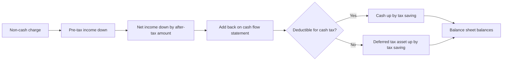

**How the three statements connect in a projection.** The order matters: the balance sheet check only works once every link is in.

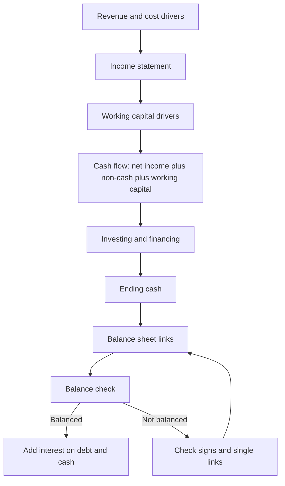

**Goodwill and intangibles split for the 800 acquisition** (made-up, from lesson 2.32).

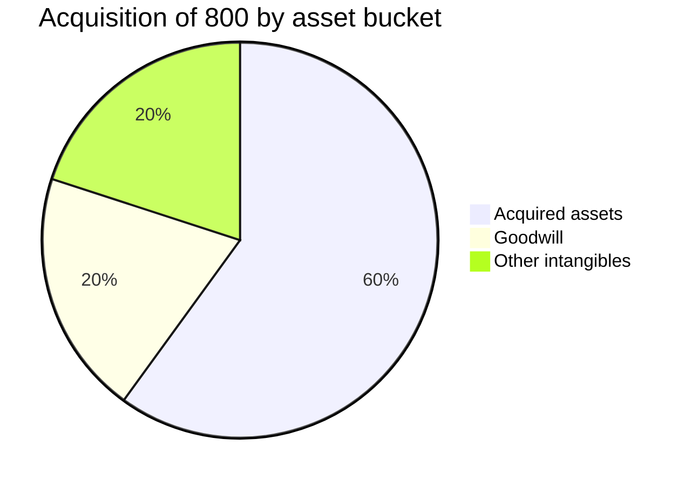

**Free cash flow over three years** (made-up numbers from lesson 2.24, in $ millions).

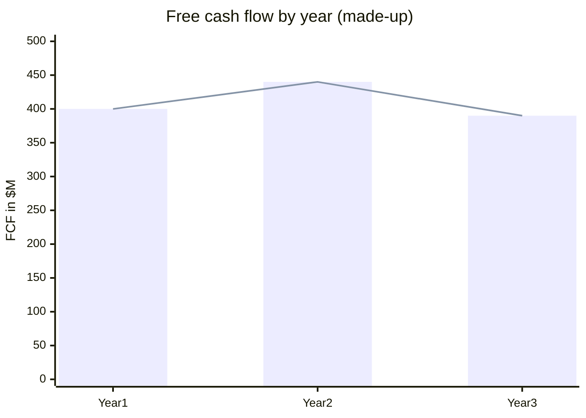

**Cash conversion cycle of the two made-up companies** (lesson 2.25).

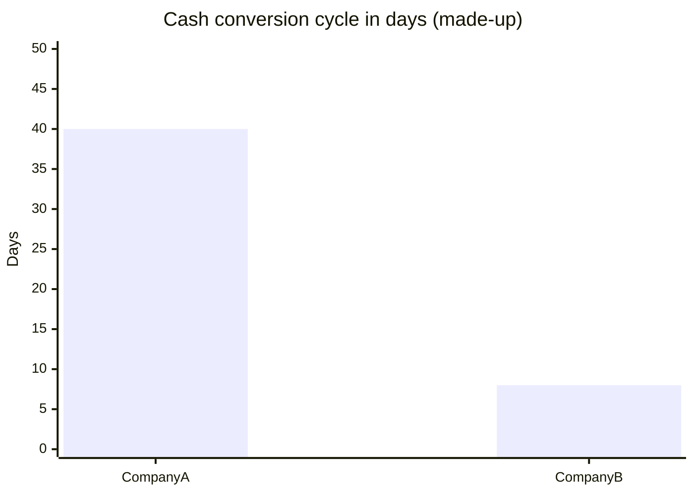

**Two-step buyback test** (lesson 2.31): share count and EPS move in opposite directions, and the answer depends on the size of each change.

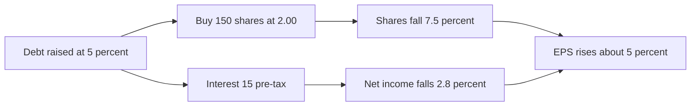

## Excel Model Walkthrough

The lessons use a set of Excel files, each with a clear layout. The files for this part are the scenario sheets and the statement sheets. Model structure (described, not copied):

**The main statements sheet (lessons 2.17 to 2.25 and the complete model).** It has three panels:

| Panel | What it holds |
|---|---|
| Starting assumptions | Tax rate, share price, shares outstanding, starting cash, and the NOL part of the starting deferred tax asset |
| Income statement changes | Revenue, operating expenses, depreciation, amortization, impairments, gains, interest, and the one-off items for each scenario |
| Operational balance sheet and cash flow events | Receivables, prepaids, inventory, payables, deferred revenue, capex, acquisitions, debt, buybacks, dividends, and the lease items |

Below these, the three statements are shown in Year 1 and Year 2 (before and after changes).

**Key formulas and links:**

- Receivables linked to revenue, prepaids linked to G&A, inventory linked to cost of goods sold, payables linked to cost of goods sold or operating expenses (this link is removed for the credit purchase scenario in lesson 2.29).
- Depreciation = capex divided by the depreciation period, wrapped in an IF test so it only runs when there is capex to depreciate.
- Finance lease depreciation = lease asset divided by lease term. Finance lease interest = discount rate times the lease liability.
- Operating lease depreciation (background) = cash rent minus interest, and the principal repayment equals it.
- Deferred taxes come from the non-deductible items, and their sign is flipped on the cash flow statement.
- Equity = prior equity plus net income, plus stock comp, plus stock issued, less buybacks and dividends.
- Balance sheet check at the bottom: assets less liabilities and equity should be zero.

**The Target linking exercise (lesson 2.22).** The sheet holds three years of history and five projected years. It is a practice model with a checklist of steps (simplify, project the income statement, project operating balance sheet items, project cash flow items, link to the balance sheet, check balance, add interest). Each projected line has a visible driver: a growth rate, a margin, a percent of revenue or cost of sales, or the change in revenue for capex.

**The interview scenario sheet (lessons 2.26 to 2.32).** This is the most useful tab for drills. It has:

- A small assumptions block (tax rate, share price, shares outstanding, starting cash).
- Input cells for each scenario, grouped by statement (income statement, operational balance sheet, cash flow).
- A "what happens on the statements" check panel that reports the change in cash, equity, net income, assets and liabilities plus equity, and a balance check flag.
- Before and after columns so you can see the cumulative effect.

The Excel files for lessons 2.26 to 2.32 each use this same Accounting_Interviews sheet layout, with the inputs changed for each drill. Use the check panel first. If the balance flag fails, the sign or link is wrong, not the logic.

**Workbook for the full case (the financial statements case study and complete workbook).** A single statements sheet with the same panel layout, used for the three-statement build that the module leads into.

## Interview Questions

<details>
<summary><b>1. Walk me through what happens to the three statements when depreciation goes up by 20 (tax 25 percent).</b></summary>

Pre-tax income and net income fall (net income by 15), cash rises by 5 (net income down 15, plus the 20 add-back), PP&E falls by 20, equity falls by 15. Balanced.

</details>

<details>
<summary><b>2. What is the difference between an impairment and depreciation?</b></summary>

Both are non-cash charges that reduce PP&E. Depreciation is regular and predictable and usually deductible. Impairments are one-off write-downs and are usually not deductible, so the tax saving goes to a deferred tax asset.

</details>

<details>
<summary><b>3. Why does stock-based compensation increase equity even though it reduces net income?</b></summary>

The expense cuts net income by (1 - t) x S, but the non-cash add-back of S is credited to equity. Net effect in the simple view: equity rises by t x S.

</details>

<details>
<summary><b>4. Walk through an acquisition. Why do goodwill and other intangibles get created?</b></summary>

The price paid exceeds the target's book equity. Identifiable intangibles are set as a percent of the premium, and the rest is goodwill, so the combined balance sheet balances.

</details>

<details>
<summary><b>5. Does goodwill amortize?</b></summary>

Under US GAAP, no. It is tested for impairment each year and written down if its value falls. Other intangibles do amortize.

</details>

<details>
<summary><b>6. What is the sign of a change in working capital on the cash flow statement?</b></summary>

Old minus new. An increase in an asset reduces cash, and an increase in a liability increases cash.

</details>

<details>
<summary><b>7. Why is deferred revenue a liability?</b></summary>

The company has been paid but still owes the product or service. Revenue is recognized when delivered.

</details>

<details>
<summary><b>8. How does a $100 prepaid expense affect the statements?</b></summary>

On day one, cash falls by 100 and prepaid rises by 100. No income effect. When it is used, expense rises by 100, net income falls by 75 at 25 percent, and cash falls by 75 in total.

</details>

<details>
<summary><b>9. Walk through a debt-funded buyback. What happens to EPS?</b></summary>

The share count falls and interest reduces net income. EPS rises when the after-tax cost of debt is below the earnings yield of the stock. Cash and assets do not change at the purchase.

</details>

<details>
<summary><b>10. What is free cash flow, and why does it matter?</b></summary>

Cash flow from operations minus capex. It is cash after running costs, interest and taxes, and it shows whether the business can fund itself.

</details>

<details>
<summary><b>11. Why might a company with negative net income have positive FCF?</b></summary>

Non-cash charges such as stock comp and D&A are added back in operating cash flow. Check how much of FCF comes from SBC.

</details>

<details>
<summary><b>12. What is the cash conversion cycle, and what is a good value?</b></summary>

DSO plus DIO minus DPO. Lower is better. Retailers often run low or negative, and industrial companies often run much higher. Compare within an industry.

</details>

<details>
<summary><b>13. Under IFRS, how does a lease differ from US GAAP?</b></summary>

Lessees split operating lease cost into depreciation and interest, so EBITDA is higher. US GAAP keeps a single straight-line rent expense for operating leases.

</details>

<details>
<summary><b>14. In a finance lease, what hits the income statement and what hits cash?</b></summary>

Depreciation and interest hit the income statement. Cash pays the full rent: interest is part of the cash rent and principal is the rest, which reduces the liability.

</details>

<details>
<summary><b>15. A company writes down a factory bought with debt. What happens to cash?</b></summary>

A write-down is non-cash, so cash does not change. Net income falls by the after-tax amount, and the deferred tax asset rises by the tax saving, because the write-down is usually not deductible.

</details>

<details>
<summary><b>16. How do you check a three-statement projection?</b></summary>

The balance sheet must balance every year. If it does not, check signs on each link, that each change is linked once, and that the cash flow ending cash matches the balance sheet.

</details>

## Career Angle

**How the module maps to real work** (described as studied, not as experience):

| Module topic | Where it shows up in practice |
|---|---|
| Fair value and valuation logic | Fair value and pricing on a capital markets pricing and valuation team. Valuation work in capital markets and corp dev roles uses the same cash flow logic. |
| Working capital and cash conversion | CFO reporting analysis and the balance sheet drivers behind monthly reporting. |
| Linking and projecting the three statements | FP&A forecasting work, which involves forecasts, variance analysis and budget models. |
| Free cash flow, leverage and coverage | Credit and capital markets roles, and valuation roles that screen companies on cash generation. |
| Buybacks, goodwill and acquisitions | Corp dev, strategy and M&A roles, and PE and private credit interviews. |

**Truthful talking points (framed as study):**

1. "I worked through an accounting and three-statement module, including impairments, stock comp, goodwill and debt-funded deals, and I can walk through how each one hits cash versus book income."
2. "I practiced multi-step accounting drills, such as a debt-funded asset purchase and sale, and I can explain why the gain is reclassified out of operating cash flow."
3. "On the job, I work with fair value and pricing and with forecasting, and the three-statement and working capital logic from my studies is the same logic I use when I check that a model balances."

Do not claim a deal, a valuation, a model build or a write-down that was not done. If asked about the module, say which lessons were studied and what the drills showed.

## Cheat Sheet

| Item | Rule |
|---|---|
| Impairment or write-down | Net income falls by (1 - t) x W. Cash moves only if the item is deductible. Usually not, so DTA rises by t x W. |
| Stock comp | Add back SBC in cash flow. Equity rises by t x S (simple view). Cash moves only if deductible. |
| Goodwill | Premium = price less target book equity (less existing goodwill). Not amortized. Impairment tested yearly. |
| Other intangibles | Amortize over life. Usually not deductible, so the tax saving goes to DTA. |
| Acquisition cash flow | Cash out in investing. Debt or stock in financing. Cash net zero if fully funded. |
| Change in working capital | Old minus new. Asset up means cash down. Liability up means cash up. |
| Delivery rule | No revenue or cost until delivered or received. Prepaid and inventory hit cash first. |
| FCF | CFO minus capex. Exclude investing and financing items other than capex. |
| EBIT and EBITDA | EBIT approximates FCF (capex side). EBITDA approximates CFO. |
| Leverage | Total debt / EBITDA. Lower is better. |
| Interest coverage | EBITDA / interest. Higher is better. |
| ROE / ROA / ROIC | Net income / average equity. Net income / average assets. NOPAT / average invested capital. |
| DSO / DIO / DPO | AR / revenue x days. Inventory / COGS x days. AP / COGS x days. |
| Cash conversion cycle | DSO + DIO - DPO. Lower is better. |
| Operating lease (US GAAP) | One straight-line rent expense. Background depreciation and principal = rent - interest. |
| Finance lease | Depreciation = asset / term. Interest = rate x liability. Principal = cash rent - interest. |
| Tax adjustment in CFO (IFRS rebuild) | Book taxes minus cash taxes paid. |
| Buyback EPS test | Accretive when after-tax cost of debt is below the earnings yield of the stock. |
| Balance check | Assets = liabilities + equity every year. Each link once, with the right sign. |
| Linking signs | Asset linked to CFS: subtract. Liability or equity linked to CFS: add. |

---

[← Previous: Module 02, Part 1](02-accounting-concepts-part-1.md) · [Contents](../README.md) · [Next: Module 03 →](03-more-advanced-accounting.md)
