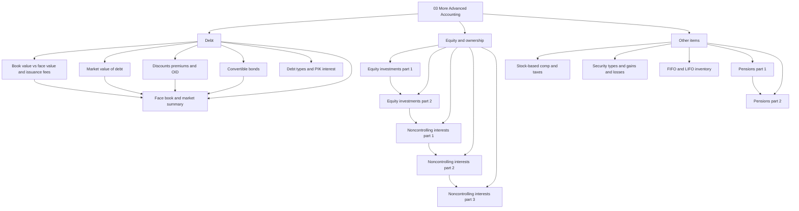
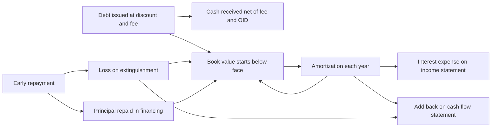
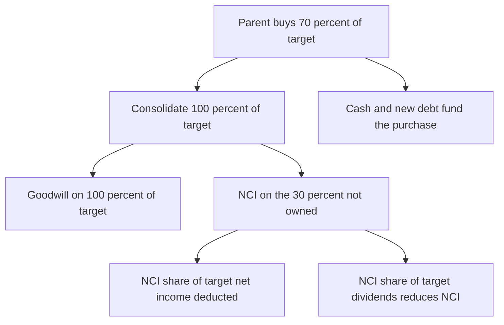
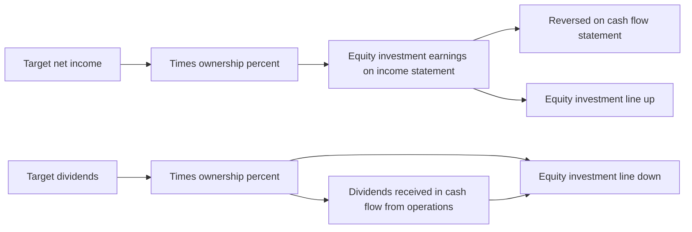
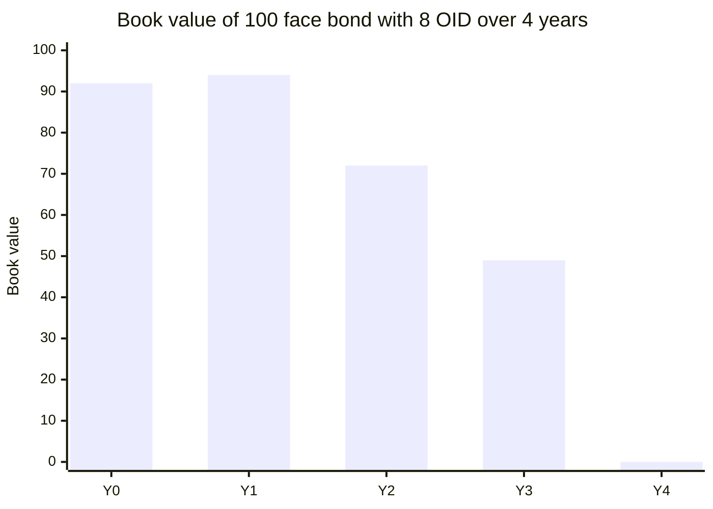
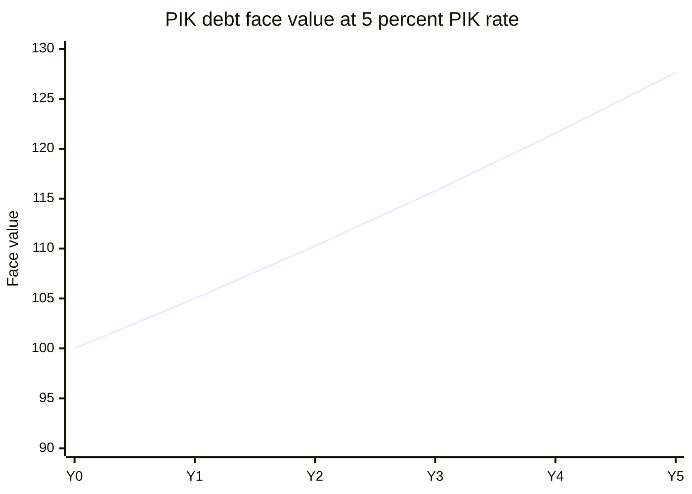
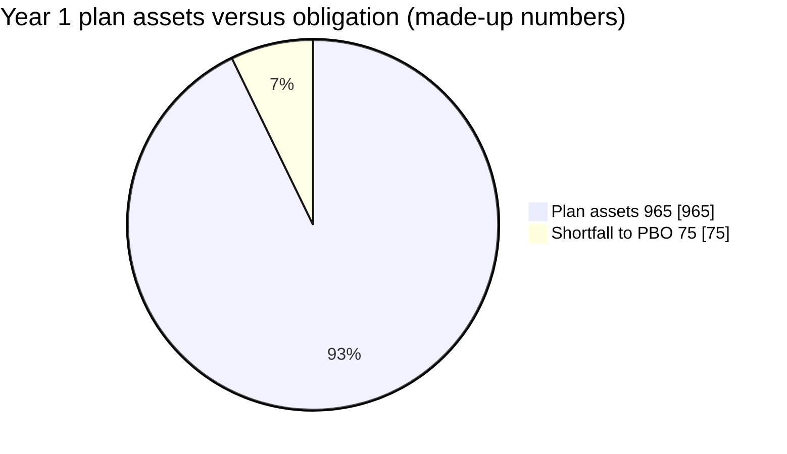

# Module 03: More Advanced Accounting

[← Previous: Module 02, Part 2](02-accounting-concepts-part-2.md) · [Contents](../README.md) · [Next: Module 04 →](04-3-statement-models.md)

<details>
<summary><b>Contents</b></summary>

- [Overview](#overview)
- [Lessons](#lessons)
  - [3.1 Book Value vs. Face Value of Debt and Issuance Fees](#31-book-value-vs-face-value-of-debt-and-issuance-fees)
  - [3.2 Market Value of Debt](#32-market-value-of-debt)
  - [3.3 Debt Discounts, Premiums and Original Issue Discount (OID)](#33-debt-discounts-premiums-and-original-issue-discount-oid)
  - [3.4 Convertible Bond Accounting](#34-convertible-bond-accounting)
  - [3.5 Types of Debt and Paid-in-Kind (PIK) Interest](#35-types-of-debt-and-paid-in-kind-pik-interest)
  - [3.6 Face Value, Book Value and Market Value: Keeping Them Straight](#36-face-value-book-value-and-market-value-keeping-them-straight)
  - [3.7 Equity Investments (Equity Method), Part 1: Net Income and Dividends](#37-equity-investments-equity-method-part-1-net-income-and-dividends)
  - [3.8 Equity Investments, Part 2: Changing the Ownership and Gains and Losses](#38-equity-investments-part-2-changing-the-ownership-and-gains-and-losses)
  - [3.9 Noncontrolling Interests (Consolidation), Part 1: Acquiring an Initial Majority Stake](#39-noncontrolling-interests-consolidation-part-1-acquiring-an-initial-majority-stake)
  - [3.10 Noncontrolling Interests, Part 2: Combining the Financials and Reflecting Net Income and Dividends](#310-noncontrolling-interests-part-2-combining-the-financials-and-reflecting-net-income-and-dividends)
  - [3.11 Noncontrolling Interests, Part 3: Selling the Stake and Deconsolidating](#311-noncontrolling-interests-part-3-selling-the-stake-and-deconsolidating)
  - [3.12 Stock-Based Compensation, Tax Benefits and Excess Tax Benefits (US GAAP and IFRS)](#312-stock-based-compensation-tax-benefits-and-excess-tax-benefits-us-gaap-and-ifrs)
  - [3.13 Security Types, Unrealized and Realized Gains and Losses](#313-security-types-unrealized-and-realized-gains-and-losses)
  - [3.14 Inventory Costing: FIFO, LIFO and Moving Average](#314-inventory-costing-fifo-lifo-and-moving-average)
  - [3.15 Pension Accounting, Part 1: Plan Assets, Obligations, Income Statement and Cash Flow (US GAAP)](#315-pension-accounting-part-1-plan-assets-obligations-income-statement-and-cash-flow-us-gaap)
  - [3.16 Pension Accounting, Part 2: Three-Statement Links and the IFRS Treatment](#316-pension-accounting-part-2-three-statement-links-and-the-ifrs-treatment)
- [Diagrams and Charts](#diagrams-and-charts)
- [Excel Model Walkthrough](#excel-model-walkthrough)
- [Interview Questions](#interview-questions)
- [Career Angle](#career-angle)
- [Cheat Sheet](#cheat-sheet)

</details>

## Overview

Module 03 goes past the basic three statements into the accounting edge cases that change how debt, investments in other companies, minority ownership, stock pay, inventory and pensions show up in the statements, and how to model each one so the balance sheet still balances.

The debt lessons come first because they set up the vocabulary (face, book, market value) that the later lessons reuse. The equity-investment and NCI lessons are the next most useful for case studies. The rest are reference material.

## Module Map



## Lessons

### 3.1 Book Value vs. Face Value of Debt and Issuance Fees

- When a company borrows, the lenders and banks that arrange the deal charge a fee, usually 1% to 3% of the amount borrowed. The fee is a real cash outflow, so it has to be recorded somewhere.
- **Face value** is the principal the company pays interest on and must repay at maturity. It only moves when debt is issued, repaid or converted into PIK interest (covered in lesson 3.5).
- **Book value** is what the balance sheet shows. It equals face value minus the unamortized issuance fees (and, later, minus unamortized discounts or plus premiums). Each year, part of the fee is amortized, which pushes book value back up toward face value.
- Before 2015, the fee sat on the asset side as a "capitalized financing fee" and was written down each year. Under the current rules (aligned between US GAAP and IFRS) the fee is netted against the debt itself.
- Interest expense is calculated on face value, not book value. The amortization of the fee is added to interest expense on the income statement, so the all-in cost of borrowing is a bit higher than the coupon alone.

**Core formulas:**

```text
Book value at issuance       = Face value x (1 - fee %)
Fee paid in cash             = Face value x fee %
Annual amortization          = Initial fee / years to maturity   (straight line)
Unamortized fee (ending)     = Prior unamortized fee - amortization
Book value (ending)          = Face value - unamortized fee
Interest expense             = Beginning face value x coupon rate + amortization
```

**Worked example (made-up numbers):** a company issues 200 of 5-year debt at a 2% fee with a 6% coupon.

| Item | Year 0 | Year 1 | Year 2 | Year 3 | Year 4 | Year 5 |
|---|---|---|---|---|---|---|
| Face value (ending) | 200 | 200 | 200 | 200 | 200 | 0 |
| Unamortized fee (ending) | 4.0 | 3.2 | 2.4 | 1.6 | 0.8 | 0 |
| Book value (ending) | 196.0 | 196.8 | 197.6 | 198.4 | 199.2 | 0 |
| Amortization of fee | | 0.8 | 0.8 | 0.8 | 0.8 | 0.8 |
| Coupon interest (6% of beginning face) | | 12.0 | 12.0 | 12.0 | 12.0 | 12.0 |
| Total interest expense | | 12.8 | 12.8 | 12.8 | 12.8 | 12.8 |

**Three statement effects:**

- **Income statement:** interest expense includes the coupon plus the amortization. Pre-tax income falls by the total.
- **Cash flow statement:** net income is lower, but the amortization is non-cash, so it is added back. The fee itself is an outflow in the year of issuance (financing section). Debt issuance and repayment go in the financing section too.
- **Balance sheet:** the debt line equals book value. Starting with the old balance, add amortization, add issuances net of fees, subtract repayments. The balance sheet still balances because the cash outflow for the fee and the lower book value offset each other at issuance.

Early repayment: if the company pays the debt off before maturity, the unamortized fee left over is written off as a **loss on extinguishment of debt** on the income statement. That loss is a non-cash add-back, and it also increases book value so that book value equals face value on the repayment date. In the model, the loss is the prior unamortized balance plus the amortization in the repayment year, and the amortization stops after the repayment year.

> [!TIP]
> The fee is small, so it rarely changes a valuation. Its real value is that it teaches you to trace one number through all three statements. Interviewers like to ask why a company's debt is shown below face value on the balance sheet. The short answer is "unamortized issuance fees."

> [!WARNING]
> A common mistake is to amortize the fee and forget to add it back on the cash flow statement, or to keep amortizing after repayment. Both errors make the balance sheet stop balancing, so the check is always to look at the balance check row.

### 3.2 Market Value of Debt

- Equity has a book value (the common shareholders' equity line) and a market value (share price times shares outstanding). Debt has the same split, but the gap is usually much smaller.
- Market value of debt is the present value of everything the bondholders expect to receive: future coupons plus principal at maturity, discounted at the rate the market currently demands for similar debt. It is not on the financial statements. Companies sometimes disclose it in footnotes, but it never changes the balance sheet or the face value that interest is paid on.
- Three inputs drive it:
  - **Discount rate (yield):** the prevailing yield on similar debt. If yields rise, the bond is worth less.
  - **Repayment probability (redemption value):** the chance the principal comes back in full. A weaker credit lowers it. A distressed issuer might be priced at 30% to 50%.
  - **Time to maturity:** the longer the wait, the more the price moves when yields move.

**Formulas:**

```text
Market value = NPV(yield, coupons and principal x repayment probability)
             = sum over t of [ Coupon_t + Principal_t x Prob ] / (1 + yield)^t
Price (per 100 face) = PRICE(settlement, maturity, coupon, yield, redemption, frequency)
```

**Worked example (made-up numbers):** 100 face, 5-year bond, 5% coupon paid annually, so the bond prices at par when the yield is 5%.

| Scenario | Yield | Repayment probability | Market value |
|---|---|---|---|
| Base | 5% | 100% | 100.0 |
| Yields rise | 6% | 100% | about 95.8 |
| Yields fall | 4% | 100% | about 104.5 |
| Credit weakens | 5% | 95% | about 96.1 |
| Maturity in 1 year, yields 6% | 6% | 100% | about 99.1 |

Two patterns to notice. First, the price moves in the opposite direction to yields. Second, the same yield change moves a long bond more than a short one.

> [!TIP]
> **Why this matters in practice.** Bloomberg and similar terminals show bond prices every day, so when you look at a company's debt you should know whether the number in its filing is book or market. Analysts use market value when they compute enterprise value or leverage on a "true" basis, especially for distressed names. The 2022 rate increases pushed many long-dated bonds well below par, which is a good real-world check on this math.

> [!WARNING]
> **Common mistake.** Mixing up the coupon rate and the yield. The coupon is fixed in the contract. The yield is what the market asks today. Only when they match does the bond trade at face value.

### 3.3 Debt Discounts, Premiums and Original Issue Discount (OID)

- An **original issue discount (OID)** happens when a company sells debt straight to investors for less than its face value. A 100 face bond sold for 92 has an OID of 8. A premium is the reverse (sold above face). A company does this when its coupon is below current market yields or when its credit has weakened.
- This is different from buying a bond later in the secondary market. The OID is set at the moment of issuance and the company receives less cash than the face value.
- Accounting mirrors issuance fees (lesson 3.1). The OID is deducted from face value to get book value. It is amortized into interest expense over the life of the debt.
- The amortization method is a **straight-line** approach that gets recalculated each year:

```text
Amortization in year t = MIN(beginning OID balance, beginning OID balance / remaining years to maturity)
Loss on repayment      = (OID left after this year's amortization) x (principal repaid this year / beginning face value)
Ending OID             = beginning OID - amortization - loss on repayment
Book value             = face value - OID (and - unamortized issuance fees, if any)
```

- The repayment percentages in the model are always a share of the **original** principal, so the formula uses beginning face value as the denominator. This keeps the schedule from over-repaying.
- If the debt is fully repaid, the remaining OID is written off as a loss. The formula needs an IFERROR guard because the denominator can hit zero once face value is gone.
- The same formulas can handle issuance fees, so you can generalize one schedule to cover both the fee and the OID.

**Worked example (made-up numbers):** 100 face, 4-year maturity, sold at 92 (OID of 8), 5% coupon on beginning face. Principal repaid early: 25 in Year 2, 25 in Year 3, and the last 50 in Year 4.

| Year | Beginning face | Repaid | Ending face | OID amortized | Loss on repayment | Ending OID | Ending book value |
|---|---|---|---|---|---|---|---|
| 0 (issue) | | | 100 | | | 8.0 | 92.0 |
| 1 | 100 | 0 | 100 | 2.0 | 0.0 | 6.0 | 94.0 |
| 2 | 100 | 25 | 75 | 2.0 | 1.0 | 3.0 | 72.0 |
| 3 | 75 | 25 | 50 | 1.5 | 0.5 | 1.0 | 49.0 |
| 4 | 50 | 50 | 0 | 1.0 | 0.0 | 0.0 | 0.0 |

Check the Year 2 loss: after normal amortization the OID is 4.0, and 25 of 100 (25%) is repaid, so 25% of 4.0 is 1.0. Year 3 works the same way: 1.5 left after amortization, and 25 of 75 (one third) is repaid, which gives a loss of 0.5.

**Statement effects:**

- **Income statement:** coupon, OID amortization and issuance-fee amortization all sit in interest expense. Losses from early repayment are usually shown on their own line.
- **Cash flow statement:** add back the non-cash items (amortization and losses). The cash received for the debt (net of OID and fees) is a financing inflow, and repayments are financing outflows.
- **Balance sheet:** debt = prior debt + amortization + losses + issuance (net of OID and fees) - repayments. When the last dollar is repaid, both face value and book value reach zero.

> [!TIP]
> Real filings often describe this as "debt discount" or "unamortized discount" without the term OID. The accounting is the same. When you read a 10-K, check the debt footnote for the face amount, the unamortized discount and the unamortized fees. Subtracting them gives the carrying value.

> [!WARNING]
> **Common mistake.** Using the repaid amount as a share of the remaining balance instead of the original balance. That over-accelerates the loss and leaves the wrong OID in the later years.

### 3.4 Convertible Bond Accounting

- A **convertible bond** is debt that the holder can swap for common shares once the stock passes a set conversion price. The company gets a lower coupon in exchange for the option. Investors get downside protection (the principal) and upside (the shares).
- Under IFRS the bond is split into two parts at issuance: a **liability component** (the present value of the coupons and principal, discounted at the rate for similar straight debt without the conversion feature) and an **equity component** (face value minus that present value). US GAAP rules differ in some cases, but most convertibles with a cash-settlement option are split in practice, so the model assumes the split.
- The equity component stays fixed on the balance sheet until conversion. It is cleared out when the bond converts, and it moves into common shareholders' equity.
- The liability component is accreted toward face value through a **debt discount** that is amortized into interest expense. The method used here is the **effective interest method**: interest expense equals beginning book value times the straight-debt rate, and cash coupon is subtracted to get the amortization.
- If the bond converts before maturity, the remaining discount is written off in that year, and the book value of the debt plus the equity component both go into common shareholders' equity. No cash moves, so the cash flow statement shows no conversion line.

```text
PV of liability    = NPV(straight rate, coupons + principal)
Equity component   = Face value - PV of liability
Interest expense   = Beginning liability book value x straight rate
Amortization       = Interest expense - cash coupon
Conversion year    = write off remaining discount; transfer debt + equity component to equity
```

**Worked example (made-up numbers):** 100 face, 5-year convertible with a 1% coupon, and straight debt of similar risk yields 4%. Conversion happens at the end of Year 4.

| Item | Year 0 | Year 1 | Year 2 | Year 3 | Year 4 (converts) |
|---|---|---|---|---|---|
| Liability (book value) | 86.6 | 89.1 | 91.7 | 94.3 | 100.0 converted |
| Remaining discount | 13.4 | 10.9 | 8.3 | 5.7 | 0 |
| Cash coupon (1% of face) | | 1.0 | 1.0 | 1.0 | 1.0 |
| Interest expense (4% of book) | | 3.5 | 3.6 | 3.7 | 5.7 accelerated write-off |
| Equity component | 13.4 | 13.4 | 13.4 | 13.4 | moved to equity |

Year 0 check: PV of 1 a year for 5 years at 4% plus 100 at Year 5 is about 86.6, so the equity component is about 13.4.

**Statement effects:**

- **Income statement:** interest expense includes the cash coupon and the discount amortization. The write-off of the remaining discount hits interest expense in the conversion year.
- **Cash flow statement:** only the issuance (100 of cash in, no fee in this example), repayments and fees are cash. The amortization is added back as non-cash.
- **Balance sheet:** the liability line grows each year. In the conversion year it goes to zero, and the equity component plus the liability carrying value both land in common equity. The lower net income from amortization is what keeps the total from double counting.

> [!TIP]
> The IFRS and US GAAP treatments differ in how the split is done and how conversions are recorded. The big picture matters more than every formula, and most analysts only need to know that the bond shows up partly as debt and partly as equity.

> [!TIP]
> **Why companies issue convertibles.** A lower coupon, plus a conversion price set above the current share price. The cost shows up later as dilution. In a valuation, a convertible is usually treated as debt if the stock is below the conversion price and as shares if it is above (the if-converted method for diluted share count).

> [!WARNING]
> **Common mistake.** Adding the equity component back to debt, or leaving the remaining discount on the balance sheet after conversion. Both break the balance check.

### 3.5 Types of Debt and Paid-in-Kind (PIK) Interest

- **Secured debt** is backed by collateral, so lenders can seize it if the borrower defaults. Revolvers and term loans (A, B and sometimes C) are the usual forms. **Unsecured debt** has no collateral and carries more risk. Senior notes, subordinated notes, mezzanine debt and shareholder loans fall here.
- The riskier the debt, the higher the rate and the longer the tenor. Safer debt often floats with a benchmark rate. Riskier debt is usually fixed.
- Repayment patterns also differ. Term loans often amortize on a schedule. Unsecured notes are usually **bullet** deals, meaning all principal is due at maturity.
- **PIK interest** (paid-in-kind, also called accrued interest) is interest that is not paid in cash. It is added to the principal each year. It is common on mezzanine and other high-risk debt. A useful real-world parallel is student loans during school, where interest accrues to the balance until repayment starts.
- The trade-off: PIK saves cash now, but the company owes more at maturity because the balance has compounded.

**Mechanics:**

```text
PIK interest in year t  = Beginning face value x PIK rate
Ending face value        = Beginning face value + PIK interest - repayments
Interest expense         = Beginning face value x coupon (cash or PIK, same expense line)
Cash flow add back       = PIK interest (non-cash)
Repayment at maturity    = Beginning face value + PIK accrued in the year
```

**Worked example (made-up numbers):** 100 face, 5% PIK on beginning face, bullet maturity in Year 5.

| Year | Beginning face | PIK accrued | Ending face |
|---|---|---|---|
| 1 | 100.00 | 5.00 | 105.00 |
| 2 | 105.00 | 5.25 | 110.25 |
| 3 | 110.25 | 5.51 | 115.76 |
| 4 | 115.76 | 5.79 | 121.55 |
| 5 | 121.55 | 6.08 | 127.63 (repaid) |

The company repays about 127.6 on a 100 loan. The compounding is the cost.

**Statement effects:**

- **Income statement:** the PIK interest is part of interest expense and reduces pre-tax income, the same as cash interest. The expense line does not change based on whether interest is cash or PIK.
- **Cash flow statement:** PIK is added back as a non-cash item. Repayment includes the accrued PIK.
- **Balance sheet:** debt grows each year by PIK. Repayments at maturity include the accrued balance. The earlier mechanics for OID and issuance fees do not change.

> [!TIP]
> PIK debt is a red flag in credit analysis. Interest coverage based on cash interest looks healthier than it is, because the unpaid interest is still owed and compounding. When you model leveraged buyouts or distressed companies, always check whether any interest is PIK, and count it in leverage.

> [!WARNING]
> **Common mistake.** Forgetting to add accrued PIK to the repayment in the maturity year. The balance sheet will then show debt that never gets to zero.

### 3.6 Face Value, Book Value and Market Value: Keeping Them Straight

This is the wrap-up for the debt lessons. It also shows how to model debt with a simpler setup, so the full three-statement model does not need dozens of extra rows.

| Measure | What it is | What moves it | Where it shows up |
|---|---|---|---|
| Face value | The principal the company pays interest on and must repay | New issuances, repayments, PIK interest | Debt schedule, interest calculation |
| Book value | The balance sheet debt line | Face value, minus fees and discounts, plus their amortization, plus losses from early repayment | Balance sheet |
| Market value | What a buyer would pay for the bond today | Yields on similar debt, credit quality, time to maturity | Footnotes, analysis, valuation |

**Simplified modeling approach (from the two examples in this lesson):**

- **Bonds with new issuance each year:** track one blended issuance fee. Amortize the fees over an average life (for example 10 years) and keep the amortization going past the projection period. Book value = face value minus unamortized fees. Interest = beginning face x weighted average rate + fee amortization.
- **Convertible bonds:** the debt component's book value = face - unamortized fees - debt discount. The discount is the gap between the face value and the present value of the debt component, discounted at the straight-debt rate. Amortize the discount with the effective interest method so that book value climbs toward face value at maturity.
- **Market value of the debt component:** NPV of the coupons and principal at the straight-debt rate. The equity piece of a convertible needs option pricing (Black-Scholes), so it is out of scope here.

**Worked example (made-up numbers):** 100 face, 6% coupon, 5 years, 2% issuance fee, market yield now 7%.

```text
Fee                      = 100 x 2%         = 2.0
Book value at issue      = 100 - 2.0        = 98.0
Market value of bond     = 6 x annuity(7%,5) + 100 / 1.07^5
                         = 6 x 4.100 + 71.30 = 95.9
```

| Measure at issue | Value |
|---|---|
| Face value | 100.0 |
| Book value (after fee) | 98.0 |
| Market value (at 7% yield) | 95.9 |

The book value is above the market value here because the fee is small. The bond trades below face because the market wants 7% and the coupon is 6%. Neither book nor market value changes the interest payments, which always come from face value.

> [!TIP]
> For valuation, the common rule is to use market value of debt when you compute enterprise value on a "true" basis (for example in a leveraged or distressed case). For credit ratios and most public comp sets, analysts use book value or face value because that is what the filings give. Check which one the case or comp set uses and say so in the answer.

> [!WARNING]
> **Common mistake.** Using book value as the debt number in an interview valuation without mentioning the difference. The interviewer may be testing whether you know that book value is lower than face value because of fees and discounts.

### 3.7 Equity Investments (Equity Method), Part 1: Net Income and Dividends

- The **equity method** applies when one company has **significant influence** over another, usually a 20% to 50% stake in the other company's common shares. Above 50% the company controls the target and must consolidate it (see lessons 3.9 to 3.11). Below about 20% the stake is usually treated as a financial investment, which has different rules (lesson 3.13).
- The investor does not add the target's revenue, costs or EBIT. It records its ownership share of the target's net income as one line below operating income, usually called "equity investment earnings." So net income goes up, but EBIT, EBITDA and revenue do not change.
- The stake starts on the balance sheet at cost, which is the target's equity value times the ownership percentage at purchase.
- Cash works differently from earnings. The investor does not receive the target's profit in cash. It receives only the **dividends** it is paid, which is its percentage of the target's dividends. So on the cash flow statement, equity earnings are subtracted (reversed) and dividends received are added.
- Unrealized gains or losses from changes in the target's market value generally do not hit the income statement under the equity method. Only realized gains or losses from a sale do (covered in lesson 3.8).

**Core formulas:**

```text
Initial stake                = Target equity value x ownership %
Equity investment earnings   = Ownership % (during the period) x target net income
Dividends received           = Ownership % x target common dividends paid
Ending stake                 = Beginning stake + earnings - dividends + purchases - sales
Cash flow adjustment         = - equity earnings + dividends received
```

Note on timing: ownership used for a year's income is the ownership at the end of the prior year. A stake bought on December 31 of Year 2 earns nothing in Year 2.

**Worked example (made-up numbers):** a parent buys 30% of an associate whose equity value is 100 at the end of Year 2. The associate earns 7 in Year 3, 8 in Year 4 and 9 in Year 5, and pays 40% of earnings as dividends.

| Item | Year 3 | Year 4 | Year 5 |
|---|---|---|---|
| Ownership during year | 30% | 30% | 30% |
| Associate net income | 7.0 | 8.0 | 9.0 |
| Equity investment earnings | 2.1 | 2.4 | 2.7 |
| Associate dividends (40% of NI) | 2.8 | 3.2 | 3.6 |
| Dividends received (30%) | 0.84 | 0.96 | 1.08 |
| Ending stake (starting at 30.0) | 31.26 | 32.70 | 34.32 |

Check Year 3: 30.0 + 2.1 - 0.84 = 31.26. The stake behaves like a mini equity account: it grows with the share of profit kept by the target and shrinks by the dividends paid out.

Funding the purchase: a 50% cash and 50% debt split is a common assumption. Debt issuance is the stake's price times the debt share, but only when the stake grows (use MAX of zero so a sale does not create a debt draw).

**Statement effects:**

- **Income statement:** equity earnings sit below operating income and raise net income to parent.
- **Cash flow statement:** the purchase is an investing outflow. Earnings are reversed (non-cash). Dividends received are an inflow in operating activities (IFRS allows other places, but they must be shown somewhere).
- **Balance sheet:** a new asset line, equity investments, rises with earnings and falls with dividends, plus purchases and sales.

> [!WARNING]
> **Why investors like the equity method for big stakes.** The profit shows up even if no cash arrives. It is a timing issue and a known trap for analysts. A company with large equity investments can show strong net income while cash flow looks weak. Always check the gap between equity earnings and dividends received.

> [!WARNING]
> **Common mistake.** Adding the equity earnings to EBITDA or using them as operating income in a valuation. Treat the stake separately, value it at market or at its book value, and add it in the bridge from enterprise value to equity value.

### 3.8 Equity Investments, Part 2: Changing the Ownership and Gains and Losses

- **Buying more** of a stake (while staying below 50%) is simple. The purchase is an investing outflow at the target's current market value times the percentage bought. No gain or loss is recorded.
- **Selling** part of a stake creates a **realized gain or loss**. The gain is based on the proceeds of the sold shares versus their cost basis, not on the change in the target's market value over one year.
- The cost basis is cumulative. Each purchase adds its cost. The basis also moves with earnings and dividends (the stake acts like a mini equity account). The model calculates the basis before any change in the year as last year's stake, plus this year's equity earnings, minus this year's dividends received.
- Because the sale might be only a slice of the stake, the gain is scaled by the fraction sold.

**Core formulas:**

```text
Basis before change     = prior-year equity investment + equity earnings - dividends received
Fraction sold           = -(change in ownership %) / prior-year ownership %
Realized gain or loss   = (target market cap x prior ownership %  -  basis before change) x fraction sold
```

The first term is what the sold portion would fetch at today's price. Subtracting the basis gives the gain. Scaling by the fraction sold keeps it to the part actually sold.

**Worked example (made-up numbers):** the stake is 30% at a 100 market cap in Year 1 (cost 30). In Year 3 the parent buys 10 more points at a market cap of 110 (cost 11), so the cumulative basis is 41 and ownership is 40%. In Year 4 the market cap is 125 and the parent sells half the stake, down to 20%. Earnings and dividends are ignored here to keep the numbers simple.

| Step | Calculation | Result |
|---|---|---|
| Basis before the sale | 30 + 11 | 41.0 |
| Value of the 40% stake | 125 x 40% | 50.0 |
| Fraction sold | 20 / 40 | 50% |
| Sale proceeds | 125 x 20% | 25.0 |
| Cost of the sold half | 41 x 50% | 20.5 |
| Realized gain | 25.0 - 20.5 | 4.5 |

Cross-check with the model formula: (125 x 40% - 41) x 50% = (50 - 41) x 50% = 4.5. The gain is realized in Year 4. The remaining 4.5 of unrealized gain on the 20 percent left over stays off the income statement.

**Model limits (useful when you build or audit one):**

- Ownership should stay between 0% and 49%, since above 50% the company is consolidated instead.
- Changes in ownership happen only at year end, so ownership used for income is the prior year's ending figure.
- The target's market cap must be positive.
- Cash and debt funding must sum to 100%.

**Statement effects:**

- **Income statement:** realized gains or losses on sales sit below operating income, with equity earnings.
- **Cash flow statement:** the gain is reversed (it is a non-cash line in operations) and the sale proceeds are an investing inflow.
- **Balance sheet:** the equity investment line falls by the cost basis of the sold portion, not by the proceeds. The gain or loss is the difference and flows through retained earnings.

> [!WARNING]
> The easiest mistake is to compare the sale price with the market cap a year earlier, or with the cost of only the latest purchase. Always build the cumulative basis, because a stake bought in pieces at different prices has several cost layers.

> [!TIP]
> **Real-world note.** Companies with equity-method stakes often report large "gains on sale" in years when they sell a partial stake to a strategic partner. Read these as one-time items in a valuation and strip them out of normalized earnings.

### 3.9 Noncontrolling Interests (Consolidation), Part 1: Acquiring an Initial Majority Stake

- At 50% or more, the parent **controls** the target, so the financial statements are **consolidated**. That means the parent adds 100% of the target's revenue, costs, assets and liabilities to its own, even if it owns only 70%.
- The share the parent does not own is the **noncontrolling interest (NCI)**. It is shown on the balance sheet in equity, and its share of net income is deducted at the bottom of the income statement to get "net income attributable to parent."
- The NCI adjustment is always the target's net income times (1 minus the parent's ownership). In cash flow terms, the NCI deduction is reversed because the cash is consolidated and belongs to the group.
- Dividends are handled differently. Dividends paid to the parent by a consolidated subsidiary are eliminated, and dividends paid to outside holders show up as NCI distributions.
- Before control is reached, the stake was accounted for under the equity method (lesson 3.7). The step-up from equity method to consolidation is where the goodwill comes in (lessons 3.10 and 3.11).

**Core formulas:**

```text
Consolidated net income      = parent NI + 100% of target NI
NCI share of net income      = target NI x (1 - parent ownership %)
Net income to parent         = consolidated NI - NCI share
NCI on the balance sheet     = target equity value x (1 - parent ownership %) at deal date
Goodwill                     = purchase price for 100% of target - target book equity (adjusted)
Cash paid for additional stake = (target value x new % - target value x old %) x funding mix
```

**Worked example (made-up numbers):** a target with a 100 equity value. The parent holds 30% (cost 15 at a 50 value) and buys another 40 points, reaching 70%.

| Item | Value |
|---|---|
| Target equity value at deal | 100 |
| Purchase price for the extra 40 points | 40 x 100 = 40 |
| Funding | 50% cash (20), 50% new debt (20) |
| NCI created at deal (30% x 100) | 30 |
| Existing 30% stake, carrying value | 16 (after prior earnings and dividends) |
| Existing stake, value at new market cap | 30% x 100 = 30 |
| Remeasurement on the old stake | about 14 |

Income example: parent net income 45, target net income 15, parent owns 70%. Consolidated NI = 45 + 15 = 60. NCI share = 15 x 30% = 4.5. Net income to parent = 60 - 4.5 = 55.5.

Goodwill is based on 100% of the target, even though the parent bought 70%. If the target's book equity is 60 and it has no goodwill to write off, goodwill = 100 - 60 = 40. This is the key idea: once you control a company, you book goodwill on the whole company, and the NCI carries its share at fair value at the deal date.

**Statement effects in this stage:**

- **Income statement:** combined lines (revenue down to pre-tax income) add both companies together. The bottom shows the NCI deduction.
- **Cash flow statement:** the NCI deduction is reversed as a non-cash item. Dividends from partly owned companies are shown at the parent's percentage.
- **Balance sheet:** the old equity investment is written off and replaced by the target's assets and liabilities, new goodwill, new transaction debt, and the NCI. Common equity is the plug to make it balance in the model.

> [!TIP]
> **Why goodwill on 100% when you own 70%.** Under the consolidation method the buyer records the full fair value of the business, and the other 30% is shown as NCI on the same balance sheet. A common interview question is "what happens to goodwill if you buy 70% versus 100%?" The answer is that the goodwill is the same measure in both cases if the price per share is the same. Only the NCI changes.

> [!WARNING]
> **Common mistake.** Using 70% of book equity when computing goodwill, or forgetting that the old equity-method stake disappears on consolidation.

### 3.10 Noncontrolling Interests, Part 2: Combining the Financials and Reflecting Net Income and Dividends

- Once the parent is above 50%, the combined financials add 100% of the subsidiary's revenue, costs, interest and taxes to the parent's. The NCI is then pulled out at the bottom of the income statement.
- In a simple model the ownership percentage is held constant during the projection period. Changing it mid-stream adds columns everywhere, so the model in this lesson keeps it fixed.
- New acquisition debt adds interest expense on the combined income statement, using the transaction debt balance times its rate.
- Goodwill is not impaired in the base case, so the impairment line stays at zero.
- On the combined cash flow statement, net income to parent starts the operating section. Depreciation and amortization, deferred taxes and working capital come from the combined statements. The NCI deduction is reversed because the cash belongs to the group.
- Dividends are shown in two lines: the parent's dividends (which go to common equity) and the subsidiary's dividends (which go to NCI). Splitting them makes linking easier.
- The NCI balance rolls forward. It goes up by the NCI share of subsidiary net income and goes down by the NCI share of subsidiary dividends.

**Core formulas:**

```text
NCI net income share           = subsidiary NI x (1 - ownership %)
NCI roll-forward               = beginning NCI + NCI net income - NCI share of sub dividends
NCI share of sub dividends     = subsidiary dividends x (1 - ownership %)
Dividends to parent            = subsidiary dividends x ownership %
Equity investments (if above 50%) = 0, since the stake is consolidated
```

**Worked example (made-up numbers):** subsidiary net income is 20 and it pays 10 of dividends. The parent owns 70%. Beginning NCI is 30.

| Item | Amount |
|---|---|
| Beginning NCI | 30.0 |
| Add NCI share of net income (20 x 30%) | +6.0 |
| Less NCI share of dividends (10 x 30%) | -3.0 |
| Ending NCI | 33.0 |
| Dividends received by parent (10 x 70%) | 7.0 |

The parent's 7.0 is cash inside the group, so it cancels out in consolidation. The 3.0 paid to outside holders is a real cash outflow to NCI. This is why the NCI line moves with the outsiders' share of profit and dividends, the same way common equity moves with the parent's share.

> [!TIP]
> **A useful mental model.** NCI is a mini shareholders' equity for the slice of the subsidiary you do not own. The same logic as equity-method stakes (lesson 3.7), just applied to a consolidated sub.

> [!WARNING]
> **Common mistake.** Adding 100% of subsidiary dividends to the NCI roll-forward instead of the outsiders' share, or failing to reverse the NCI deduction in the cash flow statement. Both make the balance check fail.

### 3.11 Noncontrolling Interests, Part 3: Selling the Stake and Deconsolidating

- The reverse case: the parent sells part of its majority stake and drops below 50%. The subsidiary is **deconsolidated**. Its assets, liabilities and goodwill come off the combined balance sheet, the NCI disappears, and a new equity investment line appears for the remaining stake.
- The hard part is the **gain or loss on the stake sold**. It is not just market value minus book value, because the company holds two different values at once: the market value of the stake being sold and the book value of the NCI it keeps.
- Once the gain is known, tax is applied to it (a gain costs tax, a loss saves tax). The cash received is the market value of the stake sold, less the non-cash gain, plus the after-tax gain. In practice that equals the sale proceeds less the tax on the gain.
- The gain or loss goes to common shareholders' equity (after tax), and the NCI is removed.

**Core formulas:**

```text
Percent sold                 = prior ownership % - new ownership %
Market value of stake sold   = percent sold x market cap at sale
New equity investment        = new ownership % x market cap at sale
Gain or loss (pre-tax)       = (market value sold + new equity investment)
                               - NCI book value
                               - subsidiary net assets (assets including goodwill, less liabilities)
After-tax gain or loss       = pre-tax gain x (1 - parent tax rate)
Cash proceeds                = market value sold - pre-tax gain + after-tax gain
```

**Worked example (made-up numbers):** the parent goes from 70% to 40% at the end of Year 4. The subsidiary's market cap is 150. The subsidiary has total assets (including goodwill from the earlier deal) of 140 and liabilities of 70, so net assets are 70. The NCI book value on the balance sheet is 21. Tax rate is 25%.

| Item | Value |
|---|---|
| Percent sold (70% - 40%) | 30% |
| Market value of stake sold (30% x 150) | 45.0 |
| New equity investment (40% x 150) | 60.0 |
| Less NCI book value | -21.0 |
| Less subsidiary net assets | -70.0 |
| Pre-tax gain | 14.0 |
| Tax on gain (25%) | 3.5 |
| After-tax gain | 10.5 |
| Cash proceeds (45.0 - 14.0 + 10.5) | 41.5 |

Check: 45.0 of sale value less 3.5 of tax is 41.5, which matches. The new equity investment of 60.0 becomes the "remaining stake" line on the balance sheet.

**Balance sheet adjustments on deconsolidation:**

- **Assets:** remove the subsidiary's cash, receivables, inventory, PP&E and leases. Write off the old goodwill. Add cash proceeds, and add the new equity investment.
- **Liabilities:** remove the subsidiary's payables, debt, lease liabilities and deferred taxes. The acquisition debt from the earlier deal stays, because the model assumes the parent still owes it.
- **Equity:** add the after-tax gain to common equity and remove the NCI.

Year 5 (back to a minority stake): the parent's numbers drive the income statement again. Equity investment earnings come back at 40% of the subsidiary's net income. NCI and the consolidated dividends go to zero, and the dividends the parent receives flow through as before.

> [!TIP]
> **Why the gain uses book value for the NCI and the net assets.** The balance sheet has to balance, and the formula makes the parent's gain equal to the amount it receives for the stake sold, over the net asset basis of the whole subsidiary. Think of it as "what did we get for the piece we sold, plus what the piece we kept is worth, against what the whole company was carried at on our books."

> [!TIP]
> **Real-world note.** This is how a company can report a large gain when it sells a stake in a subsidiary (for example in a partial IPO or a sale to a partner). Those gains are one-time items in valuation and should be removed when you normalize earnings.

> [!WARNING]
> **Common mistake.** Using the NCI market value instead of book value, or forgetting to write off the old goodwill. Either one breaks the balance check.

### 3.12 Stock-Based Compensation, Tax Benefits and Excess Tax Benefits (US GAAP and IFRS)

- Stock-based compensation (SBC) is an operating expense on the income statement, but it is usually **not tax deductible when granted**. The company only gets a tax deduction later, when the employee exercises options or receives the shares.
- At grant, the expected future deduction creates a **deferred tax asset (DTA)** equal to the grant value times the tax rate. The DTA is the company's claim on a future tax saving.
- At exercise, the deduction equals the value of the shares at that date. The part equal to the original grant value uses up the DTA. Any value above the grant value gives an **excess tax benefit**, which reduces income tax expense on the income statement. A value below the grant value gives an **excess tax deficiency**, which increases tax expense.
- This is why a company can show income tax expense that is negative (a benefit) or even net income above pre-tax income in a year when the stock price has risen a lot.

**Core formulas (US GAAP, simplified):**

```text
Initial DTA                  = SBC granted x tax rate
Deduction at exercise        = SBC value at exercise
Reversal of DTA              = min(grant value, exercise value) x tax rate
Excess tax benefit           = max(exercise value - grant value, 0) x tax rate
Excess tax deficiency        = max(grant value - exercise value, 0) x tax rate
Cash taxable income          = book pre-tax income + SBC granted - deduction at exercise
```

**Worked example (made-up numbers):** a company grants 40 of SBC in Year 1, tax rate 25%. The shares are exercised in Year 4 when they are worth 100.

| Year | Event | Book SBC expense | DTA (ending) | Excess tax benefit (income statement) |
|---|---|---|---|---|
| 1 | Grant of 40 | 40 | 10.0 (40 x 25%) | 0 |
| 2 | Value 55 | 40 | 10.0 | 0 (no exercise yet) |
| 4 | Exercise at 100 | 40 | 0.0 | 15.0 ((100 - 40) x 25%) |

In Year 4, the deduction of 100 reverses the 10.0 DTA and produces a 15.0 excess tax benefit. Tax expense on the income statement falls by the excess benefit, which is why net income can look strong in that year.

**Statement effects (US GAAP):**

- **Income statement:** SBC is an expense. Excess tax benefits or deficiencies appear in income tax expense.
- **Cash flow statement:** SBC is added back as non-cash. The cash tax schedule starts from book pre-tax income, adds back SBC, and subtracts the exercise deduction. Deferred taxes are the difference between cash taxes and book taxes (excluding the excess benefit).
- **Balance sheet:** common equity rises by SBC. The DTA is reduced by the deferred tax movement.

**IFRS differences (these are more complicated):**

- The DTA is revalued each period as the SBC fair value changes. The offset goes to APIC in equity (the "excess tax benefit recognized in equity").
- Tax benefits can be recognized on the income statement once the value reaches the grant value, before anyone exercises.
- Falls in value are reported as tax deficiencies on the income statement.
- At exercise the full deduction still applies, so the DTA ends at zero.

> [!TIP]
> **Why most models ignore this.** The cash effect is in the tax line, and most valuation models use cash taxes as a percentage of operating income. But when you read a 10-K for a company with a big share price rise, look for "excess tax benefit" in the tax footnote. It explains a low or negative tax rate that would otherwise look like an error.

> [!WARNING]
> **Common mistake.** Deducting SBC from cash taxes at grant (it is not deductible yet), or putting the excess benefit into cash flow from operations rather than the tax line in the US GAAP case.

### 3.13 Security Types, Unrealized and Realized Gains and Losses

- This lesson covers small financial investments where the company has **no significant influence or control** (for example a few bonds or a small block of shares). Larger stakes use the equity method or consolidation (lessons 3.7 to 3.11).
- There are three buckets for securities. How a gain is recorded depends on the bucket, not on the asset itself:

| Category | Used for | Unrealized gain or loss | Realized gain or loss | Interest and dividends |
|---|---|---|---|---|
| Trading (FVPL) | All equity securities, and bonds held for short-term trading | Income statement, with deferred tax effect | Income statement | Income statement |
| Available-for-sale (FVOCI) | Bonds that fit neither other bucket (the default for bonds) | Other comprehensive income in equity, no tax or income statement effect | Income statement | Income statement |
| Held-to-maturity (amortized cost) | Bonds or loans the company plans to hold to maturity | Not recorded | Income statement | Income statement |

- Rule changes (ASU 2016-01 in US GAAP and IFRS 9 under IFRS, phased in around 2018 to 2019) narrowed the choices for equities. Effectively all equity holdings are now trading (FVPL). The three-way split still applies to bonds and loans.
- Realized gains and losses come from a sale: proceeds minus carrying value. They are reversed in operating cash flow and the full proceeds are shown as an investing inflow.

**Worked example (made-up numbers, 25% tax rate):**

**Trading equity, unrealized gain of 40.** The income statement rises by 40. Because the gain is not taxed until sold, the company records a deferred tax liability of 10 (40 x 25%), so net income is 30. On the cash flow statement, net income is 30, the gain of 40 is reversed, and deferred taxes of 10 are added back, so cash is unchanged. The asset rises by 40, the deferred tax line moves by 10 and equity rises by 30. The balance sheet balances.

**AFS bond, unrealized gain of 12.** The asset rises by 12, and accumulated other comprehensive income in equity rises by 12. Nothing hits the income statement, the tax schedule or cash flow.

**HTM bond, unrealized gain.** Nothing is recorded. The bond is carried at amortized cost. Market price moves do not matter if the company will collect the principal at maturity.

**HTM bond, amortization and sale.** Start with a carrying value of 100. Principal repaid of 10 reduces the carrying value to 90, and the 10 is cash in. Then the whole remaining position is sold for 96:

| Step | Effect |
|---|---|
| Realized gain (96 - 90) | 6.0 on the income statement |
| Tax at 25% | 1.5 cash tax |
| Net income effect | +4.5 |
| Cash flow from operations | net income 4.5, less the gain 6.0 = -1.5 |
| Cash flow from investing | principal repaid 10 plus sale proceeds 96 |
| Change in cash | 10 + 96 - 1.5 = +104.5 |
| Balance sheet change | cash +104.5, HTM asset -100, equity +4.5 |

The balance sheet balances, and the 4.5 after-tax gain shows up in equity.

> [!TIP]
> **Why this matters for analysis.** A company's "other comprehensive income" can move a lot when rates change, without touching net income. Look at the accumulated OCI line on the balance sheet, and check the footnotes for which bucket each bond sits in. A large AFS portfolio can hide losses from rate moves in equity, which is what caused several bank problems in 2023.

> [!WARNING]
> **Common mistake.** Treating every security as trading, or recording unrealized gains on HTM bonds. Classification decides the answer, so check the bucket first.

### 3.14 Inventory Costing: FIFO, LIFO and Moving Average

- When inventory costs change over time, the company has to decide which cost goes to cost of goods sold (COGS) and which cost stays in ending inventory. Three methods do this:
  - **FIFO (first in, first out):** the oldest costs go to COGS. Ending inventory carries the newest costs.
  - **LIFO (last in, first out):** the newest costs go to COGS. Ending inventory carries the oldest costs. **Allowed under US GAAP only, not under IFRS.**
  - **Moving average (weighted average):** recompute the average unit cost after each purchase. A sale uses the latest average.
- Purchases and total inventory bought are the same under all methods. Only the split between COGS and ending inventory changes. Revenue is also the same.
- Balance sheet logic: beginning inventory + purchases - COGS = ending inventory. The change in inventory is a cash flow item (an increase uses cash).

**Worked example (made-up numbers):** the company starts with no inventory. It buys 10 units in each quarter, and unit cost rises each quarter (10, 12, 14, 16). Total purchases are 40 units for 520. On January 1 of the next year it sells 20 units at 30 each, so revenue is 600.

| Method | Cost of the 20 units sold | COGS | Gross profit | Ending inventory |
|---|---|---|---|---|
| FIFO | First 20 bought: 10 x 10 + 10 x 12 | 220 | 380 | 300 (20 newest units) |
| Moving average | Average unit cost 520 / 40 = 13.0, times 20 | 260 | 340 | 260 |
| LIFO | Last 20 bought: 10 x 16 + 10 x 14 | 300 | 300 | 220 (20 oldest units) |

Check: COGS plus ending inventory always equals the 520 purchased. Under rising costs, LIFO gives the highest COGS and lowest profit, and FIFO gives the lowest COGS and highest profit. Moving average sits in between.

**Effects when costs are rising:**

- **LIFO:** higher COGS, lower net income, lower ending inventory on the balance sheet, lower tax bill, higher operating cash flow.
- **FIFO:** lower COGS, higher net income, higher ending inventory, higher tax bill, lower operating cash flow.
- **Moving average:** in between on all of these.

When costs are falling, every effect reverses.

> [!TIP]
> **Why the tax effect matters.** The method does not change the economics of the business, but LIFO defers taxes while costs keep rising. That is why US companies with rising costs sometimes use LIFO, and why IFRS bans it. Analysts sometimes use the LIFO reserve (a footnote) to convert LIFO results to FIFO for comparison.

> [!TIP]
> **Practical takeaway.** You usually cannot rebuild a company's inventory costs from public filings. If two comparable companies use different methods, treat any valuation gap as partly a method difference, not only a business difference.

> [!WARNING]
> **Common mistake.** Using the wrong direction when costs fall. Check the cost trend first, then work out which method gives higher or lower COGS.

### 3.15 Pension Accounting, Part 1: Plan Assets, Obligations, Income Statement and Cash Flow (US GAAP)

- A **defined-contribution (DC)** plan (such as a 401(k)) is simple. The employee decides how much to put in and where it goes. The company's match is just an operating expense when paid. Nothing sits on the balance sheet.
- A **defined-benefit (DB)** plan promises a fixed payout in retirement, usually based on years of service and salary. The company bears the investment risk. It is common at older, larger companies and rare at new ones.
- A DB plan has two balance sheet items:
  - **Plan assets:** the investments set aside to pay benefits. They rise with returns and contributions, and fall with benefit payments.
  - **Projected benefit obligation (PBO):** the present value of promised future payments. It rises with service cost and interest cost, and falls with benefit payments.
- **Funded status** = plan assets - PBO. A negative number means the plan is underfunded, which is common and matters for debt-like adjustments in valuation.
- The income statement shows several pieces. Service cost goes to operating expenses. Interest cost, expected return on assets, and amortization of gains and losses sit below operating income in other items. Under US GAAP, companies use the expected return instead of the actual return to smooth earnings, and they amortize the gap over time.

**Core formulas:**

```text
PBO end            = PBO beginning + service cost + interest cost + actuarial loss
                     + participant contributions - benefit payments
Plan assets end    = assets beginning + actual return + employer contributions
                     + participant contributions - benefit payments
Interest cost      = PBO beginning x discount rate
Expected return    = plan assets beginning x expected return rate
Net periodic cost  = service cost + interest cost - expected return
                     + amortization of losses and prior service costs + settlements
```

**Worked example (made-up numbers):** the discount rate is 5% and the expected return is 6.5%. Start with PBO of 1,000 and plan assets of 900 (underfunded by 100). In Year 1:

| Item | Amount | Notes |
|---|---|---|
| Service cost | 30 | Operating expense; a simple percent of revenue in the model |
| Interest cost (5% x 1,000) | 50 | Other expense; the PBO grows as payouts get closer |
| Expected return (6.5% x 900) | -58.5 | Income; uses the expected rate, not the actual return |
| Amortization of losses | 2 | Smoothing of past differences between expected and actual |
| Net periodic pension cost | 23.5 | Total book expense |
| Actual return on assets | 70 | Raises assets, not in the expense |
| Employer contributions | 35 | Cash out; raises assets |
| Benefit payments | -40 | Reduces both assets and PBO |

**Ending balances:**

- PBO end = 1,000 + 30 + 50 - 40 = 1,040
- Plan assets end = 900 + 70 + 35 - 40 = 965
- Funded status = 965 - 1,040 = -75 (still underfunded)

Cash flow view: the 23.5 pension expense is non-cash, so it is added back. Contributions of 35 are the cash outflow. Contributions are tax deductible when paid, but the book expense is not the same as the tax deduction. The difference (35 - 23.5 = 11.5) creates a deferred tax item. At a 25% rate that is about 2.9. Net cash effect of the pension in operating cash flow is about -8.6 (= -35 + 23.5 + 2.9).

**Projection approach:**

- Service cost, employer contributions, participant contributions and benefit payments: percent of revenue, based on recent averages.
- Interest cost: percent of beginning PBO.
- Expected return: expected rate times beginning plan assets.
- Actual return and actuarial gains or losses: assumed, since they cannot be forecast.
- Amortization of gains or losses: moves with the difference between expected and actual returns.

> [!TIP]
> The income statement effect is usually small compared with the balance sheet. Many items offset each other (expected return often covers interest cost), so the net pension expense can look tiny even when the funded status is large. For valuation, the funded status (the deficit) is the part that matters, and many analysts treat an underfunded pension as debt-like in the enterprise value bridge, after tax.

> [!WARNING]
> **Common mistake.** Adding the actual return to the income statement instead of the expected return, or forgetting that participant contributions raise both assets and the PBO while employer contributions raise only assets.

### 3.16 Pension Accounting, Part 2: Three-Statement Links and the IFRS Treatment

- In a full model, simplify the pension line to two income statement items: **service cost** (operating) and **interest or finance cost** (non-operating). Ignore small items such as expected returns and smoothing amortization unless the plan is large.
- On the cash flow statement, add back the whole pension expense (both pieces are non-cash) and subtract only the **cash contributions**. Deferred taxes are the tax timing difference between the expense and the deduction.
- On the balance sheet, the plan asset rises with contributions and actual returns and falls with benefit payments. The plan liability rises with service and interest cost and falls with benefit payments. Unrealized gains and losses on the assets go to the other side through AOCI, so the balance sheet balances.
- Under IFRS the same ideas apply with three main differences: the income statement placement is less standard, the amortization of gains and losses is not run through the income statement (the actual vs. expected difference goes straight to AOCI), and the tax deductibility can be the reverse of US GAAP.

**Worked example (made-up numbers, 25% tax rate):** service cost 20, interest cost 20, benefit payments 50, unrealized gain on plan assets 40, employer contributions 100. The plan asset is initially about 300.

| Effect | Income statement | Cash flow | Balance sheet |
|---|---|---|---|
| Service cost | Operating expense -20 | Added back +20 | Liability +20 |
| Interest cost | Other expense -20 | Added back +20; treated as not tax deductible | Liability +20 |
| Pre-tax income | -40 | | |
| Net income | -30 (after 25% tax) | | |
| Contributions | Not on the income statement | Outflow -100 | Plan asset +100 |
| Tax deduction on contributions | Deferred tax about +20 | | |
| Benefit payments | Not on the income statement | None | Asset -50, liability -50 |
| Unrealized gain | Not on the income statement | None | Asset +40, AOCI +40 |

Reading the table: the company's pre-tax income falls by 40, but the 100 contribution is deductible for cash tax, so the cash tax saving is larger than the book tax saving. The net effect on cash is a large drop, driven by the contribution, not by the expense.

**Checks on a model:**

- The plan asset roll-forward: beginning + contributions + actual return - benefit payments = ending.
- The liability roll-forward: beginning + service cost + interest cost - benefit payments = ending (plus actuarial items).
- AOCI moves with the unrealized or actuarial items so the balance sheet still balances.

> [!TIP]
> **Why analysts care about the funded status.** An underfunded plan is a claim on future cash, much like debt. A large contribution in one year can cut cash flow sharply, so check the footnote, the expected contributions for the next year, and the discount rate used for the liability. A small change in the discount rate can move the liability a lot.

> [!TIP]
> **Where to look for metrics.** For EBIT or EBITDA, make sure you take out only the service cost (operating) and not the interest or finance piece. Under IFRS the lines are often lumped together, so read the footnotes to split them.

> [!WARNING]
> **Common mistake.** Subtracting the full contribution on the income statement (it is not an expense there), or treating benefit payments as a cash outflow for the company. Benefit payments come out of the plan, so they reduce both sides of the plan and do not hit company cash directly.

## Diagrams and Charts

### How a Change Flows Through the Statements (Debt with Fees and Discount)



### Deal Structure for a Majority Stake



### Equity Investment Earnings and Cash



### Illustrative Chart: Book Value of a 100 Face Bond Accreting to Face



Note: the Year 2 to Year 4 drops in the chart reflect the early repayments in lesson 3.3. Read the chart as "book value of the remaining debt," not as a smooth accretion.

### Illustrative Chart: PIK Balance Growing at 5 Percent



### Illustrative Chart: Pension Funded Status Over Year 1



## Excel Model Walkthrough

The module has one Excel file per lesson, in two versions. The "Before" file is the starting template, with the formulas removed. The "After" file is the finished model.

| Lesson | Tab (sheet) | What it models |
|---|---|---|
| 1 | Debt_Fees | Face value, book value, issuance fee, fee amortization, early repayment loss, three-statement links |
| 2 | Market_Value | Debt cash flows discounted with NPV and PRICE; repayment probability |
| 3 | Debt_Discounts | OID balance, OID amortization, loss on OID upon repayment, generalized fee schedule |
| 4 | Convertibles | Liability and equity split, conversion year, effective-interest amortization, equity transfer on conversion, balance check |
| 5 | PIK_Interest | PIK toggle, PIK accrual on beginning face, repayment including accrued PIK |
| 6 | BV_FV_Debt | Blended fee schedule for new issuance, convertible debt component market value |
| 7 and 8 | Intro, Parent, Sub, Combined | Equity method stake: ownership by period, cost basis, equity earnings, dividends, gain on sale |
| 9 to 11 | Intro, Parent, Sub, Combined | Consolidation: 100 percent combined statements, NCI, goodwill, transaction assumptions, deconsolidation |
| 12 | SBC_US_GAAP, SBC_IFRS | Grant value versus exercise value, DTA, excess tax benefits and deficiencies, cash tax schedule |
| 13 | Unrealized_Gains_Losses | Trading, AFS and HTM rows, buy and sell inputs, realized gain on HTM sale |
| 14 | LIFO_FIFO | Purchases by quarter, unit cost, average unit cost, COGS under three methods |
| 15 | Pension_Acct | Plan asset and PBO roll-forwards, expected return, interest and service cost, loss amortization |
| 16 | IFRS_Pensions, Interview_Model | Simplified interview model with pension links, and the IFRS AOCI approach |

**Key links and formulas (described, not copied):**

- **Debt schedules:** the year counter in the header drives everything. Each row checks "is this the repayment year?" with an IF. Early repayment uses data validation so the user can pick a year from 1 to 5.
- **Amortization:** a MIN of beginning balance and beginning balance divided by remaining years. This handles straight-line and accelerated amortization in one formula. The IFERROR guard covers a zero denominator after full repayment.
- **Loss on repayment:** the remaining balance after amortization, times the share of original face repaid. Share is always relative to original face (anchor the cell).
- **Convertibles:** the liability is the NPV of coupons and principal at the straight-debt rate. A MIN check prevents both a conversion and a maturity being counted in the same year. The equity component is held flat until conversion. A flag row, then IF statements, transfer the balance to equity on conversion.
- **Equity method:** ownership is pulled from the prior year's ending figure, so changes take effect the following year. Cash flow reversals use negative signs on the income statement lines.
- **Consolidation:** a 50 percent threshold cell drives IF checks for equity earnings, NCI, dividend linking and the equity investment line. Changing ownership to a value below 50 flips the model to equity method automatically.
- **Gain on sale:** the cumulative cost basis is last year's stake plus earnings minus dividends. The gain multiplies the difference between market value of the sold share and basis by the fraction sold.
- **SBC:** a grant value row and an exercise value row. Excess benefits are computed with MIN and MAX so they only appear in the right direction.
- **LIFO vs FIFO:** SUMPRODUCT builds the purchase cost and divides by total units for the moving average. LIFO and FIFO COGS are different ranges of the same purchase layers.
- **Pensions:** the PBO and plan asset roll-forwards start from the prior year and add or subtract the lines from the income statement and cash flow. A balance check confirms they tie.
- **Balance checks:** each sheet ends with a balance check row. If it is not zero, the first thing to check is the sign on the cash flow link.

## Interview Questions

<details>
<summary><b>1. Why is debt on the balance sheet below its face value?</b></summary>

Because unamortized issuance fees and any original issue discount are deducted from face value to get book value. They are amortized into interest expense over time, so book value climbs toward face value at maturity.

</details>

<details>
<summary><b>2. Does market value of debt appear on the financial statements?</b></summary>

No. It is disclosed in footnotes or calculated for analysis. The statements use book value, and interest is paid on face value.

</details>

<details>
<summary><b>3. How do you split a convertible bond?</b></summary>

Discount the coupons and principal at the straight-debt rate to get the liability. The equity component is face value minus that present value.

</details>

<details>
<summary><b>4. What happens to a convertible bond that converts into shares early?</b></summary>

The unamortized discount is written off in the conversion year. The debt book value and the equity component both move into common equity. No cash moves.

</details>

<details>
<summary><b>5. How does PIK interest flow through the model?</b></summary>

It is an expense on the income statement, added back as non-cash on the cash flow statement, and added to face and book value of debt. Repayment at maturity includes the accrued PIK.

</details>

<details>
<summary><b>6. Which way does the equity method push net income, EBIT and cash?</b></summary>

Net income goes up by the ownership share of the target's net income. EBIT and EBITDA are unchanged. Cash only rises by dividends received, so the earnings are reversed in operating cash flow.

</details>

<details>
<summary><b>7. When does a stake move from equity method to consolidation?</b></summary>

At more than 50 percent ownership, which means control. Consolidation adds 100 percent of the target's financials and records NCI for the rest.

</details>

<details>
<summary><b>8. Why is goodwill based on 100 percent of the target when you buy 70 percent?</b></summary>

Under consolidation the buyer records the full fair value of the business, and the minority share shows up as NCI. Goodwill is therefore calculated on the whole company.

</details>

<details>
<summary><b>9. How do you compute the gain when you sell part of an equity stake?</b></summary>

Compare the sale proceeds (market value of the shares sold) with their share of the cumulative cost basis, which includes earlier purchases plus earnings minus dividends. Scale by the fraction of the stake sold.

</details>

<details>
<summary><b>10. How are unrealized gains treated for trading, AFS and HTM securities?</b></summary>

Trading (FVPL): income statement, with a deferred tax effect. AFS (FVOCI): equity through other comprehensive income. HTM (amortized cost): no effect until sale or repayment.

</details>

<details>
<summary><b>11. Why does LIFO reduce taxes when prices rise?</b></summary>

It puts the most recent, higher costs into COGS, which lowers taxable income. The method is banned under IFRS for that reason.

</details>

<details>
<summary><b>12. What is the difference between service cost and interest cost in a pension?</b></summary>

Service cost is the growth in obligation from another year of employee service and goes in operating expense. Interest cost is the unwinding of the discount on the obligation and sits in a financing or other line.

</details>

<details>
<summary><b>13. Why is pension expense usually not the same as cash paid?</b></summary>

Expense is an accounting measure. Cash is the employer contribution. The difference creates a deferred tax item and changes the funded status.

</details>

<details>
<summary><b>14. Why would a company show income tax below zero with positive pre-tax income?</b></summary>

Stock-based compensation can produce excess tax benefits when the shares are worth more than the grant value at exercise. The benefit lowers income tax expense on the income statement.

</details>

<details>
<summary><b>15. How do you handle an early repayment of debt with unamortized fees?</b></summary>

Write off the remaining unamortized fee as a loss on extinguishment. The write-off increases book value so that book value equals face value on the repayment date. The loss is a non-cash add-back.

</details>

<details>
<summary><b>16. Why does an underfunded pension matter in valuation?</b></summary>

The funded status is a claim on future cash, similar to debt. Many analysts add the after-tax deficit to net debt in the enterprise value bridge.

</details>

<details>
<summary><b>17. What changes when a company uses LIFO versus FIFO in a comparison?</b></summary>

Earnings, inventory and taxes differ even with identical operations. You can adjust using the LIFO reserve in the footnotes, or treat a valuation gap between the two as partly a method difference.

</details>

<details>
<summary><b>18. What does the market value of a bond depend on?</b></summary>

The present value of coupons and principal at the current market yield, adjusted for the probability of full repayment. When yields rise, price falls. Longer maturities move more.

</details>

## Career Angle

**Where this maps to practice:**

- **Fair value on a pricing and valuation team.** The market value of debt lesson is the same discounting logic used to value MBS and other instruments. Fair-valuing a large portfolio at month-end is the real-world version of the market value work in lessons 3.2 and 3.6.
- **MBS and fixed income.** The debt, premium, discount and PIK lessons give the vocabulary for how bonds are carried on the balance sheet, which is useful when reading investment-portfolio disclosures.
- **FP&A and CFO reporting.** The three-statement links (every change hits all three statements and the balance sheet must balance) are the same checks used when a forecast flows through the statements. These are everyday forecasting tasks, and this module adds the accounting edge cases behind them.
- **Target roles.** Valuation (market vs book value of debt, NCI and equity stakes in the EV bridge), capital markets (convertibles, PIK and fixed income), corp dev (equity stakes, consolidation and goodwill in deals).

**Talking points that stay truthful when framed as study:**

1. "In my studies I built three-statement links for convertible bonds, PIK debt and original issue discount, and checked that the balance sheet balanced after each change. I can explain where each line shows up and why book value differs from face value."
2. "I studied how equity stakes and majority ownership change the statements. Below 50 percent the stake is an equity investment, and above 50 percent it is consolidated with NCI and goodwill on 100 percent of the target. I can walk through how a partial sale creates a gain."
3. "I worked through pension and stock-comp accounting under US GAAP and IFRS, and I can explain why a company can show a tax benefit or a pension cash outflow that looks odd on the income statement."

**Guardrails.** Say "studied" or "built as practice." Do not say the practice work was professional experience, and do not claim M&A deal work. Do not imply that consolidation or purchase-accounting work was done on the job. Most of this module is unlikely to come up in interviews. The debt-with-fees and equity-method sections are the most useful to know, and the rest is reference.

## Cheat Sheet

| Topic | Rule of thumb |
|---|---|
| Face value | What interest is paid on and what gets repaid. Moves only with issuance, repayment and PIK |
| Book value | Face minus unamortized fees and discount. Climbs toward face over time |
| Market value | PV of coupons and principal at the market yield, times repayment probability. Not on the statements |
| Issuance fee | Cash out at issue. Amortized into interest expense. Early repayment writes off the remainder |
| OID | Debt sold below face. Same treatment as fees. Repayment share is of original face |
| Convertible | Liability = PV at straight-debt rate. Equity = face - PV. Conversion moves both to equity |
| PIK | Accrues to face each year. Expense on the income statement. Add back on cash flow. Repay face plus accrued PIK |
| Equity method (20 to 50 percent) | Earnings = ownership x target NI. Dividends received in cash. Earnings reversed in CFO |
| Financial investment (below 20 percent) | Trading (FVPL), AFS (FVOCI, OCI) or HTM (amortized cost). Equities are trading |
| Consolidation (above 50 percent) | 100 percent of target in combined. NCI = (1 - ownership) x target NI. Goodwill on 100 percent |
| Sale of stake | Gain = (market value sold - cumulative basis of sold share). Tax on gain. Cash = proceeds less tax |
| SBC | Expense on income statement, DTA at grant. Excess benefit = (exercise value - grant) x tax rate |
| LIFO vs FIFO | Rising costs: LIFO = higher COGS, lower NI, lower tax, lower inventory. Reverse for FIFO |
| Pension expense | Service cost (operating) + interest cost - expected return + amortization |
| Funded status | Plan assets - PBO. Negative = underfunded, a debt-like item |
| Balance check | Assets must equal liabilities plus equity after every link. If not, check the cash flow sign first |

---

[← Previous: Module 02, Part 2](02-accounting-concepts-part-2.md) · [Contents](../README.md) · [Next: Module 04 →](04-3-statement-models.md)
