# Module 04: 3-Statement Models

[← Previous: Module 03](03-more-advanced-accounting.md) · [Contents](../README.md) · [Next: Module 05 →](05-advanced-3-statement-models.md)

<details>
<summary><b>Contents</b></summary>

- [Overview](#overview)
- [Module Map](#module-map)
- [Lessons](#lessons)
  - [4.1 Why 3-Statement Models Exist, and the Income Statement and Balance Sheet (Part 1)](#41-why-3-statement-models-exist-and-the-income-statement-and-balance-sheet-part-1)
  - [4.2 Cash Flow Drivers, the Debt Schedule and Answering the Case Questions (Part 2)](#42-cash-flow-drivers-the-debt-schedule-and-answering-the-case-questions-part-2)
  - [4.3 The Two-Hour Growth Equity Case and How to Simplify Real Filings (Atlassian Overview)](#43-the-two-hour-growth-equity-case-and-how-to-simplify-real-filings-atlassian-overview)
  - [4.4 Projecting Subscription Revenue (SaaS)](#44-projecting-subscription-revenue-saas)
  - [4.5 Perpetual License, Maintenance and Other Revenue](#45-perpetual-license-maintenance-and-other-revenue)
  - [4.6 Projecting Operating Expenses](#46-projecting-operating-expenses)
  - [4.7 Balance Sheet and Cash Flow Drivers for a Subscription Company](#47-balance-sheet-and-cash-flow-drivers-for-a-subscription-company)
  - [4.8 Projecting Add-On Acquisitions](#48-projecting-add-on-acquisitions)
  - [4.9 The Debt Schedule, Face Value Versus Book Value, and a Convertible Bond](#49-the-debt-schedule-face-value-versus-book-value-and-a-convertible-bond)
  - [4.10 The Tax Schedule and Net Operating Losses](#410-the-tax-schedule-and-net-operating-losses)
  - [4.11 Linking the Statements and Summarizing the Model](#411-linking-the-statements-and-summarizing-the-model)
  - [4.12 Returns Analysis and Sensitivity Tables](#412-returns-analysis-and-sensitivity-tables)
  - [4.13 Case Answers and the Investment Recommendation](#413-case-answers-and-the-investment-recommendation)
- [Diagrams and Charts](#diagrams-and-charts)
- [Excel Model Walkthrough](#excel-model-walkthrough)
- [Interview Questions](#interview-questions)
- [Career Angle](#career-angle)
- [Cheat Sheet](#cheat-sheet)

</details>

## Overview

Build a linked income statement, balance sheet and cash flow statement that move together, then add a debt schedule, a tax schedule, acquisition effects and returns analysis on top, the way a banker or buy-side analyst does in a 60-minute or 2-hour case.

The module moves in one direction. Each lesson adds a block to the same model, and each block feeds the three statements. The early lessons are about getting the mechanics right on one company. The later lessons add the hard parts: deals, debt, taxes and returns.

## Module Map

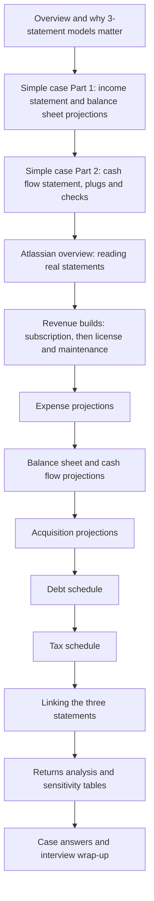

## Lessons

### 4.1 Why 3-Statement Models Exist, and the Income Statement and Balance Sheet (Part 1)

- **Why we build them.** The point of a projection model is to estimate a company's future cash flow, how fast that cash flow grows, and how its cash and debt balances change over time. Those three things feed the cash flow formula used everywhere in valuation: value is roughly cash flow divided by (discount rate minus growth rate), and the growth rate has to stay below the discount rate for the formula to make sense.
- **You can skip the full model.** For many tasks, you only need the income statement, a short version of the cash flow statement and a running cash and debt tally. Working capital items such as receivables, inventory, payables and prepaid expenses show up on the cash flow statement as changes, so a full balance sheet is often unnecessary. This is worth saying out loud in an interview because it shows you know the difference between a model that is needed and one that is conventional.
- **Why we still learn it.** Interviewers ask for it, senior bankers and MDs often expect to see one, and some decisions (such as whether to raise debt or equity) need the balance sheet and cash flow to interact properly.
- **The case in this lesson.** A manufacturer of lawn and irrigation equipment, split into a professional segment (property owners and managers) and a residential segment, plus a small "other" bucket. The exercise is a 60-minute speed test. The goal is to decide whether the company can afford higher dividends and buybacks. The case gives rough guardrails: revenue growth in the mid single digits, operating margin drifting down toward the low teens, and an effective tax rate in the mid 20s to upper 20s.

**Method for the income statement.**

1. Start with assumptions, not formulas. Set growth rates for each revenue line first. A mature line usually decelerates, so you step the growth rate down a little each year rather than holding it flat.
2. Check the aggregate. Multiply each segment by one plus its growth rate, sum the segments, and confirm total growth lands in the range the case requires.
3. Project costs as a percent of the thing they follow. Cost of sales and gross margin are usually tied to revenue. SG&A is also tied to revenue for a simple case, unless history shows it is fixed or clearly stepping up.
4. Use averages when history is noisy. If a ratio has jumped around, use its average. If it has a clear trend, extend the trend.
5. Leave placeholders for items you have not built yet, such as depreciation or interest, so you do not forget to link them later.

**Balance sheet drivers.** The rule of thumb is simple. If a balance sheet item moves with sales, link it to revenue. Receivables and deferred revenue are the usual examples. If it moves with the cost of making and buying product, link it to cost of sales. Inventory and payables are the usual examples. Accrued expenses and prepaid items often link to SG&A or total operating expenses. There is no single right answer. What matters is that each item moves the way it would in the real business as the company grows.

Days-based metrics (days sales outstanding, days inventory, days payable) are just a second way to express the same ratio. Convert a percent of revenue or cost into days by multiplying by the number of days in the year. Use the exact day count (365 or 366) when you are building the timeline, because that avoids small errors in leap years.

**Worked example (made-up numbers).** Suppose a company has revenue of 1,000 this year and receivables of 150. Receivables are 15% of revenue, which is about 55 days (0.15 times 365). If management expects collections to slow to 16% next year and revenue grows to 1,060:

| Item | This year | Next year |
|---|---|---|
| Revenue | 1,000 | 1,060 |
| Receivables % of revenue | 15.0% | 16.0% |
| Receivables | 150 | 170 |
| Days sales outstanding | 55 | 58 |
| Change in receivables (cash impact) | | minus 20 |

The jump from 150 to 170 is a cash drain of 20 even though the company is profitable. That single number is why working capital matters in a model that otherwise looks healthy.

**Checks you should run before moving on.**

- The change in working capital, as a percent of the change in revenue, should look sensible. If it swings wildly from year to year, a driver is probably wrong.
- Operating liabilities (payables, accruals, deferred revenue) should usually help cash flow as the company grows. Operating assets (receivables, inventory) usually hurt it.
- The balance sheet should look like a continuation of history, not a jump.

> [!TIP]
> **Going further.** In the real world, a banker or analyst would usually build the revenue line from segments, volumes and prices, or from customer counts. A top-down growth rate is a quick placeholder. Also, "percent of SG&A" is often a weak driver because SG&A includes both fixed and variable costs. In a model you would prefer to split the cost base if the filings give you enough detail. The most common mistake in junior models is linking an item to the wrong base (for example, linking inventory to revenue) and then having the working capital line swing in the wrong direction. Always ask "what physically drives this balance?" before you pick the base.

### 4.2 Cash Flow Drivers, the Debt Schedule and Answering the Case Questions (Part 2)

- **Order of work matters.** Fill in the cash flow drivers first, then the cash flow statement, then link the balance sheet to it. Only after that do you build the debt schedule, because the debt schedule decides how much the company must borrow, and that depends on cash. If you try to build the debt piece before cash is linked, you cannot check whether the model balances.
- **Capital expenditures are tied to growth.** For a physical product company, capex should move with the change in revenue, not with the level of revenue. A common approach is capex as a percent of the revenue increase. The filing may state a near-term capex plan, which you can use to calibrate the first year. If capex does not link to growth in some way, the assumption is probably wrong.
- **Depreciation has two layers.** Existing net PP&E keeps depreciating on a declining schedule, because most of it was bought years ago. New capex is depreciated straight line over its useful life, usually ten years for this type of asset. Each year's new capex gets its own row, so each vintage follows its own path. A good sanity check is depreciation as a percent of revenue, which should stay near its historical range.
- **Payout and buyback policy.** Dividends are usually modeled as a payout ratio times net income. Buybacks are often a fixed dollar figure that steps up or down each year, because they are a management decision rather than a function of earnings.
- **Small items.** Stock compensation, deferred taxes, affiliate income and FX effects are small for many companies. Use an average or hold them flat. Deferred taxes in particular should fade in later years, since they are often one-time timing items.
- **Minimum cash and the revolver logic.** Most companies need a minimum cash balance to run the business. Here it is set as a percent of cost of sales plus SG&A. Each year, you take the cash balance before any new borrowing and compare it with the minimum. If it is below the minimum, the model borrows the shortfall. If it is above, nothing is borrowed. Written as a formula, new borrowing equals the negative of the smaller of (cash before borrowing minus minimum cash) and zero.
- **Face value versus book value of debt.** Face value is the principal on which interest is paid. It changes only with issuances, repayments and maturities. Book value is what sits on the balance sheet. It is reduced by issuance fees, which are then amortized back up over the life of the debt. The fee amortization is non-cash, but it usually sits inside interest expense on the income statement, and it has to be added back on the cash flow statement.
- **Avoid circular references.** Calculate interest on the beginning balance rather than the average. The difference is usually tiny, and it avoids a loop where interest depends on borrowing, which depends on cash, which depends on interest.
- **Linking the statements.** Net income starts the cash flow statement. Non-cash items (depreciation, amortization, stock comp, deferred taxes) are added back. Working capital changes come from the balance sheet. Capex, acquisitions and other investing items are then subtracted. Financing flows (dividends, buybacks, debt) come last. The ending cash balance goes back to the balance sheet, and the balance sheet should then balance.

**Worked example (made-up numbers).** Suppose this year's cost of sales plus SG&A is 800 and the minimum cash rule is 8% of that, so the minimum is 64. Before any new borrowing, the company ends the year with 40 of cash after paying dividends and buybacks. The shortfall is 24, so the model borrows 24. A 2% issuance fee on that borrowing is 0.48, which reduces book debt but not face debt. Interest is then charged on the beginning face balance, not the new one, so this year's interest does not change because of the borrowing.

| Line | Amount |
|---|---|
| Cash before new borrowing | 40 |
| Minimum cash (8% of 800) | 64 |
| Shortfall (new borrowing) | 24 |
| Issuance fee (2% of 24) | 0.48 |
| Face value change | +24 |
| Book value change (24 minus 0.48, plus amortization) | +23.52 |

**Answering the case questions.** Case questions are about judgment, not formulas. A structure that works well in an interview:

1. Give a direct answer first, such as "No, the plan as stated would force new debt."
2. Show the mechanism: the model says the company must borrow in certain years to fund payouts.
3. Offer a fix you can test quickly, such as a lower payout ratio or a buyback that rises more slowly, and say how it changes borrowing.
4. Raise second-order issues: margins, acquisitions that do not tie to growth, and high legacy interest rates that refinancing could lower.
5. Close with the financing choice (debt versus equity). Compare after-tax cost of debt with the cost of equity, and note that free cash flow may be enough to avoid outside funding entirely.

> [!TIP]
> **Going further.** The minimum cash formula here is simple. In practice, analysts often separate operating cash from excess cash, and they model a revolving credit facility with a fixed commitment and a commitment fee, not an unlimited line. A revolver is also repaid first from excess cash, so the simple "borrow whatever is short" rule can overstate borrowing if you do not also model repayments. The fee amortization shortcut used here (dividing by average remaining maturity) is fine for a quick case but breaks if maturity changes. In a real model you would build a waterfall. The strongest interview answers always mention cost of debt after tax, not just the headline rate.

### 4.3 The Two-Hour Growth Equity Case and How to Simplify Real Filings (Atlassian Overview)

- **What this case is.** A growth equity case sits between venture capital and buyout investing. The target already has revenue and cash flow, but it is not mature. The investor puts in a minority equity check and wants to see whether the money can turn into a much larger value in about four years. The test is simple in spirit: each dollar invested should produce a predictable increase in EBITDA or cash flow.
- **Where the money goes.** Growth capital can go to sales and marketing, to acquisitions, or into new products and new regions. In this case the company spends little on sales and marketing because it grows through its website and word of mouth. So the investor's question is whether buying smaller software companies can add enough revenue and profit to meet return targets.
- **Return targets.** The case gives a target IRR range for the base case, a higher range for upside cases and a floor for downside cases. Know how to convert between IRR and a multiple of money over a holding period. A rough rule: 2.0x over four years is about 19%, 2.4x is about 25%, and 3.0x is about 32%.
- **Business model shift.** The company was moving from one-time license sales (plus optional maintenance) to annual subscriptions. Under that model, revenue is recognized over time, not at the point of sale, and the key operating metrics become customer counts, renewal rates and the growth of recurring revenue. Contracts here are mostly one year or less, which keeps the revenue model simple.
- **Reading the filings.** For a foreign company listed in the US, the annual report is a 20-F rather than a 10-K. The content is similar. Do not read the whole document. Use the key extracts, the financial statements and the sections on acquisitions, tax and useful lives.

**How to simplify a real filing before modeling.** The filing is built for external readers, not for modeling. Four rules guide the cleanup:

1. Show depreciation and amortization as separate lines on the income statement. The filing buries them inside cost of revenue and sales and marketing. The footnotes usually say how much amortization sits in each line, so you can move it out.
2. Keep each side of the balance sheet to roughly five to ten lines, ideally fewer. Combine small items into a single "other" line. Keep receivables and cash separate if cash has a special role in the model.
3. Use one net deferred tax line. Net the deferred tax asset against the deferred tax liability and show a single number. Do not carry current and non-current splits for items such as debt, deferred revenue and provisions. One line for each is easier to link.
4. Start the cash flow statement with net income, not pre-tax income. Foreign filers often start from pre-tax income and then show cash taxes separately. Moving to net income with a deferred tax line that represents the gap between book and cash taxes is cleaner and does not change the cash flow.

**Worked example (made-up numbers).** Suppose a filing shows current receivables of 40, current prepaid items of 3, and current tax receivables of 2. In the model, you would show receivables of 40 and one combined line of 5 for prepaid and tax items. Net deferred tax assets of 12 are shown as a single asset line after netting a deferred tax liability of 4 from the liability side. Total assets do not change, but the model has fewer lines to link.

| Filing presentation | Modeling presentation |
|---|---|
| Current and non-current deferred revenue | One deferred revenue line |
| Deferred tax asset and liability | One net deferred tax line |
| Pre-tax income at the top of the cash flow | Net income at the top, tax gap shown separately |
| Many investing line items | Capex, acquisitions and one "other investments" line |

> [!TIP]
> **Going further.** The 20 to 25 percent IRR target sounds easy to hit with a big acquisition program, but the math is harsh. Most of a growth equity return comes from the exit multiple, not from operating growth. If the exit multiple falls from 20x revenue to 10x, the return can disappear even if the business grew as planned. Always test exit multiple separately from growth. Also, buying a small stake gives you little control. You cannot force the board to spend the money the way your model assumes, so "use of proceeds" risk is real. In interviews, saying this out loud is a strong signal.

### 4.4 Projecting Subscription Revenue (SaaS)

- **Billings versus revenue.** In this module, billings means cash sold and collected in a period under a contract. Revenue is what is earned in the period. For a one-year contract signed midway through the year, roughly half of the billing is revenue this year and the rest sits in deferred revenue and becomes revenue next year. Multi-year prepaid contracts add more timing gaps, but here all contracts are one year or less.
- **Two engines of subscription revenue.** Revenue in any year comes from two sources. The first is billings from new customers and renewals that are recognized in the same year. The second is the deferred revenue from last year's billings, which is recognized now because the contracts have run their course. Model both separately, then add them up.
- **Splitting billings into new and renewal.** The company does not disclose this split, so you estimate it. A workable method: renewal billings equal last year's billings times the renewal rate times (1 plus the average price increase). New customer billings are whatever is left over from total billings. This lets you watch new customer growth separately from the health of the existing base.
- **Share of billings recognized in the year.** Because contracts are short, the share of each year's billings recognized in that same year is fairly stable and often sits in the mid 60 percent range. As contracts get longer or more of the base is annual and billed up front, this share goes up. Use the historical share as the anchor and step it up only if the case says so.
- **Key drivers.** New customer billings growth (stepping down each year), renewal rate (which tends to fall after a big price increase), average price increase (which lifts renewal billings), and the recognition share (which rises over time in the case).
- **Check your work.** Billings should stay ahead of revenue for a company that is growing and bills in advance. If revenue ever runs ahead of billings for a growing subscription company, you have probably made an error in the deferred revenue roll-forward.

**Formula summary.**

```
Renewal billings(t) = Total billings(t-1) x Renewal rate x (1 + Price increase)
New customer billings(t) = Total billings(t) - Renewal billings(t)
Revenue(t) = Billings(t) x Recognition share + Deferred revenue from (t-1)
Deferred revenue(t) = Billings(t) x (1 - Recognition share)
```

**Worked example (made-up numbers).** Suppose last year's total subscription billings were 500, the renewal rate is 90% and the average price increase is 5%.

| Step | Calculation | Result |
|---|---|---|
| Renewal billings | 500 x 90% x 1.05 | 472.5 |
| New customer billings growth | new billings up 50% from 100 | 150 |
| Total billings this year | 472.5 + 150 | 622.5 |
| Recognized this year (66%) | 622.5 x 66% | 410.9 |
| Deferred to next year (34%) | 622.5 x 34% | 211.6 |
| Revenue from last year's deferred balance | from last year | 150 (assumed) |
| Total subscription revenue | 410.9 + 150 | 560.9 |

The mechanics are the point. Note that revenue grows more slowly than billings in a fast-growing business, because a large part of this year's billings is not yet revenue.

> [!TIP]
> **Going further.** Real SaaS companies report remaining performance obligations, net revenue retention and customer cohorts. These are better drivers than the rough split used here. Net revenue retention (current revenue from last year's customers divided by last year's revenue from the same customers) tells you whether growth is coming from expansion, renewals or new logos. A renewal rate above 90 percent is good for a horizontal product, but a company that depends on price increases to grow may face churn later. Watch for this: a high renewal rate can hide a price-driven plan that eventually breaks.

### 4.5 Perpetual License, Maintenance and Other Revenue

- **The old model.** Enterprise software used to be sold as a one-time perpetual license, usually installed on the customer's own servers. The customer could then buy an annual maintenance and support plan, typically a fixed percentage of the license price. Many companies have moved to subscriptions, but some still run this model, so you need to be able to model both.
- **License revenue is simple.** A perpetual license is a one-time sale. The honest approach is to grow it at an assumed rate that steps down over time. A bottom-up build (customers times average deal size) is nicer but needs data that companies often do not disclose by product line.
- **Maintenance is built from license sales.** New maintenance billings are a share of the license revenue in the same year. If half the new license customers also buy maintenance and each pays a fixed share of the license price, maintenance billings from new customers are a fixed fraction of license revenue. Then add the renewal billings from last year's maintenance base, with a renewal rate and a price increase.
- **Other revenue** (marketplace, third-party apps and services) is usually small. Project it with a growth rate that fades. It is worth a line because it is easy to forget.
- **Same billing and recognition logic as subscriptions.** Maintenance contracts here run a year or less, so the recognized share of each year's billings is the same kind of driver: the part recognized now, plus last year's deferred balance recognized now. The part not recognized is deferred.
- **Perpetual license has no deferral.** A license is delivered at sale, so billing and revenue match (ignoring a small timing gap in cash collection).
- **Practical point.** Historical maintenance billings were not clean enough to rebuild from the filings. When the historical data will not tie out, say so, use the case assumptions, and move on. Spending hours on a reconciliation that cannot be done is a common time trap in a timed case.

**Formula summary.**

```
New maintenance billings(t) = License revenue(t) x Share of new licenses buying maintenance
Renewal maintenance billings(t) = Total maintenance billings(t-1) x Renewal rate x (1 + Price increase)
Total maintenance billings(t) = New + Renewal
Maintenance revenue(t) = Billings(t) x Recognition share + Deferred from (t-1)
```

**Worked example (made-up numbers).** Suppose license revenue is 200 this year and 50% of new license buyers also take maintenance, with each paying 50% of the license price. That makes new maintenance billings equal to 200 x 50% x 50%, which is 50 for the year. Last year's maintenance billings were 120. With a 90% renewal rate and a 2.5% price increase, renewals are 120 x 90% x 1.025, or about 110.7. Total maintenance billings are about 160.7. If 46% are recognized this year, revenue from new billings is about 73.9, and the rest (about 86.8) is deferred. Revenue also includes last year's deferred balance.

> [!TIP]
> **Going further.** When a software company moves from license to subscription, reported revenue often falls even while billings and cash rise. A perpetual license pulls a multi-year customer value into one year, so the switch makes the first few years look weaker. Analysts therefore track billings, annual recurring revenue and remaining performance obligations, not just reported revenue. The case's "license growth fading to 10 percent" is an example of a company that already planned for that trade-off. In an interview, mention the transition drag. It shows you understand why the revenue line can look soft even when the business is healthy.

### 4.6 Projecting Operating Expenses

- **Use the right base for each cost.** Cost of revenue follows standalone revenue (the company's own revenue, before acquisitions). Acquired companies carry their own costs, so keep them in separate lines. Mixing the two bases is the most common error in an acquisition model.
- **Sales and marketing follows bookings, not reported revenue.** Revenue recognized this year from last year's deals costs little to earn, because the selling happened last year. So sales and marketing is better tied to the amount of new business sold (billings plus new license revenue) than to revenue. Model it as a percent of that base and let the percent drift down as the company gets more efficient.
- **G&A is the default percent-of-revenue cost.** When there is no better driver, a percent of revenue is a reasonable default. Overhead usually grows more slowly than revenue, so the percent can step down. Be cautious if a recent year is abnormal and do not extrapolate it.
- **R&D is built from people.** Model R&D as headcount times fully loaded cost per person. Fully loaded means salary plus benefits, taxes, equipment and space, so it can be one and a half to two times cash pay. Headcount is driven by revenue per employee, which can rise as the company scales. Cost per head rises with wage inflation and mix.
- **Check the result against history.** R&D as a percent of standalone revenue is a useful sanity check. Be wary of a model that assumes a sharp swing in margin without a clear reason. If the case instructions require it, follow them, but say what would have to be true.
- **Tax.** A cash-tax or book-tax rate is applied to pre-tax income. When the historical rate is noisy because of one-off items, use the statutory rate of the country where the company is incorporated, if the case says so.
- **Exclude one-offs.** A single large non-recurring item (for example, a legal or restructuring charge) can distort the base year. Exclude it from the average and say so in a cell note.

**Worked example (made-up numbers).** Suppose standalone revenue is 400 and the company has 500 R&D staff. Revenue per R&D employee is 400 divided by 500, or 0.8 (800k in the units of the model). Management wants this to rise to 1.0 over a few years, so headcount needed for the same revenue shrinks, but total headcount still grows because revenue grows faster.

| Year | Standalone revenue | Revenue per R&D head (000s) | R&D heads | Loaded cost per head (000s) | R&D expense |
|---|---|---|---|---|---|
| 0 | 400 | 800 | 500 | 200 | 100 |
| 1 | 470 | 850 | 553 | 210 | 116 |
| 2 | 550 | 900 | 611 | 220 | 134 |

The point is the two levers. Headcount grows with revenue divided by productivity, and expense grows with headcount times cost per head. Both levers need an explicit assumption.

> [!TIP]
> **Going further.** Real analysts usually cross-check R&D per engineer against market salaries and against peer companies, and they ask whether R&D is growth spend (which should keep rising) or maintenance spend (which should flatten). Sales and marketing payback is another useful lens: how much gross profit each dollar of S&M buys over the life of the customer. Operating leverage is the most important judgment in this lesson. The model can show margin expanding from negative to mid teens, but the real question is which costs are truly fixed and which grow with customers. A common mistake is to assume all costs scale with revenue, which hides the upside. A second mistake is to assume all costs are fixed, which overstates it.

### 4.7 Balance Sheet and Cash Flow Drivers for a Subscription Company

- **Few balance sheet items matter.** For a software company, deferred revenue is the big one, and it is already projected from the revenue build. Receivables, prepaid items, payables and provisions are small. Do not spend time perfecting them. Pick a sensible base and a trend, then move on.
- **Pick the base on purpose.** Receivables should use total revenue, including acquired revenue, because acquired businesses bring receivables with them. Operating expense bases for prepaid items and payables should exclude depreciation and amortization, since those relate to long-term investment, not daily spending.
- **Days sales outstanding (DSO) is a convert-to-percent trick.** Model DSO in days, then convert to a percent of revenue by dividing by the days in the year. Stepping DSO up a day or two a year is a simple way to show slower collections.
- **Capex and depreciation are percent-of-revenue lines here.** A software company needs servers and offices, but not factories. Capex is a small percent of revenue. Set depreciation slightly below capex so the asset base grows when the company grows.
- **Cash and investments.** A company holding a large cash pile earning little can sell down some of its investments to fund deals. This is a real lever. It is a cash inflow, not an operating item, and it should be shown on its own line.
- **Stock-based compensation: keep it zero in a stake model.** If you add stock compensation as a non-cash expense, it implies new shares issued to employees, which dilutes the investor's stake. For a minority equity return model, the simple choice is to set it to zero and state the simplification. In a financing model where you do not track ownership, the treatment matters less.
- **Equity proceeds.** An initial equity investment shows up as a single cash inflow in the period it closes. Mind the fiscal year-end. Many non-US companies have year ends that are not on December 31.
- **Sanity check the working capital ratio.** Compare the change in working capital to the change in revenue. For a subscription company it is usually a meaningful positive number, because deferred revenue grows fastest. Make sure the sign and size match the business model over time.

**Worked example (made-up numbers).** Suppose revenue rises from 1,000 to 1,200 and deferred revenue rises from 300 to 350. Receivables go from 150 to 170 (DSO up two days). Payables and provisions rise from 40 to 46.

| Item | Change | Cash impact |
|---|---|---|
| Deferred revenue | +50 | +50 |
| Receivables | +20 | -20 |
| Payables and provisions | +6 | +6 |
| Total working capital | | +36 |

Change in revenue is 200, so working capital contributes 18% of the change in revenue to cash flow. A subscription company that bills in advance can show a number like this for a long time. The thing to ask is whether the number is driven by a real business pattern, not whether each line is exactly right.

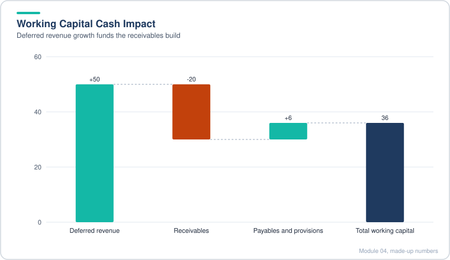

*Deferred revenue growth more than covers the receivables build, so working capital adds 36 of cash.*

> [!TIP]
> **Going further.** The cash flow effect of deferred revenue is only "free" as long as the company keeps growing. If growth stops, deferred revenue stops rising and the cash benefit reverses. Analysts often run a downside case where billings fall and check how much cash the working capital reversal takes away. Also, in a real filing, operating lease liabilities, capitalized commissions and contract assets can be large. Missing them is a common mistake when you move from a case model to a real company. Treat the yield on cash as a check: if a company earns almost nothing on a big cash pile, asking why is a good interview question.

### 4.8 Projecting Add-On Acquisitions

- **Where the inputs come from.** Acquisition assumptions are built from public deal disclosures: the purchase price, the revenue the target is said to have, the purchase price allocation in the acquirer's filings, and the useful lives used for acquired intangibles. A good model documents the source of each input so a reviewer can trace it.
- **Revenue multiples are very high in software.** Buyers often pay many times revenue for fast-growing software targets, far above what a mature business would fetch. This matters because the acquired revenue has to grow a lot to justify the price, and the margin on it is often low at first.
- **Purchase price allocation.** When a company buys another, the price is split into net assets, identifiable intangibles (customer relationships, technology, brand) and goodwill, which is the remainder. For tech targets with few physical assets, most of the price ends up as goodwill and intangibles. Goodwill is not amortized in the model here, but intangibles are.
- **Amortization schedule.** Take the intangible share of each year's acquisition spending, multiply by an assumed useful life (here, straight line over about three years), and add the amortization from each prior vintage. Keep the starting balance of intangibles on its own row with its own remaining life, because existing intangibles run off on their own schedule.
- **Revenue from acquisitions.** In the first year, acquired revenue equals acquisition spending divided by the revenue multiple. After that, grow each vintage at its own growth rate, which fades each year. Build it as a diagonal grid so each acquisition year has its own row.
- **Margin on acquired revenue.** EBIT margin on acquired revenue starts low and rises by a fixed step each year. Acquired companies are often unprofitable at first, because the acquirer is still investing in them.
- **Linking to the statements.** On the income statement, show acquired revenue as its own line. Show acquired expenses as a separate line, computed as acquired revenue minus acquired EBIT. Amortization of acquired intangibles goes in its own operating line. On the cash flow statement, add back amortization as a non-cash charge and show acquisition spending in investing.

**Worked example (made-up numbers).** Suppose the company spends 100 on an acquisition with a revenue multiple of 25x, so first-year revenue is 4. Assume 30% of the price goes to intangibles, with a three-year straight-line life. Amortization is 30 divided by 3, or 10 a year for three years.

| Year | Acquired revenue (this vintage) | Growth | EBIT margin | Acquired EBIT | Intangible amortization |
|---|---|---|---|---|---|
| 1 | 4.0 | n/a | 10.0% | 0.40 | 10.0 |
| 2 | 7.6 | 90% | 12.5% | 0.95 | 10.0 |
| 3 | 13.7 | 80% | 15.0% | 2.06 | 10.0 |

Acquired expenses in year 2 are 7.6 minus 0.95, or about 6.65. Notice that the amortization (10 a year) is much larger than the acquired EBIT. On a GAAP basis, the deal looks like a loss even if the business is working. This is why analysts look at EBITA or adjusted EBITDA when judging acquisitions.

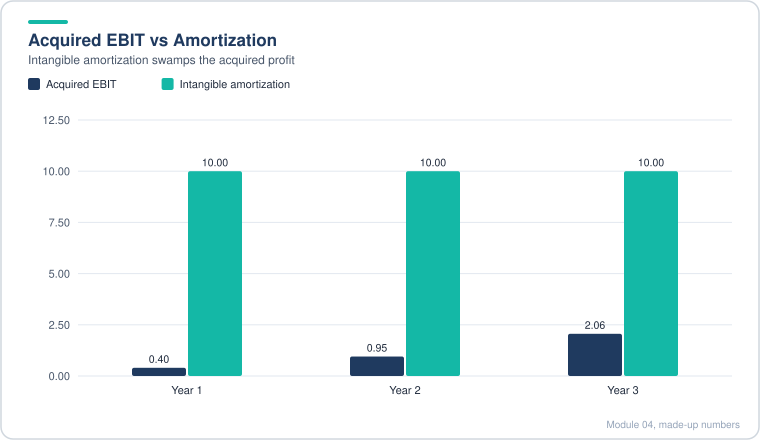

*The 10 a year of amortization dwarfs the acquired EBIT in every year, which is why GAAP makes the deal look like a loss.*

> [!TIP]
> **Going further.** Real acquisition models usually add integration costs, synergies (revenue and cost), deal fees, and the purchase of cash at close. They also check whether the buyer is paying more than the target could reasonably earn in its own right, which is the core of "will the math work?" A useful interview habit is to state the implied payback period: at a 25x revenue multiple and a 10 percent margin, it takes decades to earn back the price from the target alone. The returns must come from growth, cross-selling and a higher exit multiple. Without those, acquisitions destroy value even when they look good on revenue.

### 4.9 The Debt Schedule, Face Value Versus Book Value, and a Convertible Bond

- **No revolver here.** The company has a large cash pile and strong cash flow, so the model does not allow new borrowing. Always check this assumption before you turn off a revolver: if cash could fall below a minimum, you need the borrowing logic from the earlier Toro case.
- **Face value.** Face value is the principal the company pays interest on. It changes only when debt is issued, repaid or matures. Build it as a roll-forward: beginning balance, plus issuances, minus repayments. A maturity year can be driven by a simple test that compares the current year to the issue year plus the term. When the test is true, repay the full face value.
- **Book value.** Book value is what the balance sheet shows. It equals face value minus unamortized discounts and issuance fees. Over time, those reductions unwind, so book value rises toward face value until maturity.
- **Convertible bonds.** A convertible lets the holder swap the bond for shares if the stock price reaches a set level. Because the holder gets that option, the coupon is low. Under accounting rules, the company splits the proceeds into a debt piece and an equity piece. The gap between face and the debt piece is a discount, which is amortized into interest expense over the life of the bond.
- **Interest expense has cash and non-cash parts.** Cash interest is the coupon times face value. Non-cash interest is the amortization of the issuance fee and the debt discount. Both go to interest expense on the income statement, and both get added back on the cash flow statement.
- **Discount amortization.** A reasonable method: take beginning book debt excluding issuance fees, multiply by the effective rate the company would pay on ordinary debt, then subtract the cash coupon. The result is the extra non-cash interest each year. Straight-line is an acceptable shortcut in a timed case.
- **Interest income.** Interest earned on cash and investments is modeled as a yield on the prior year's balance. Using the prior balance avoids a circular reference. In this case, the yield is small, so the interest income line is small too.

**Worked example (made-up numbers).** Suppose a company has 1,000 of face value debt at a 1% coupon, a 40 discount and 10 of issuance fees, with five years to maturity.

| Item | Year 1 | Notes |
|---|---|---|
| Face value, beginning | 1,000 | Unchanged until maturity |
| Cash coupon (1% of face) | 10.0 | Paid in cash |
| Book debt, excluding issuance fees | 960 | Face minus discount |
| Effective rate (ordinary debt, 6%) | 6% | Assumed |
| Effective interest | 57.6 | 960 times 6% |
| Discount amortization (57.6 minus 10) | 47.6 | Non-cash |
| Issuance fee amortization (10 divided by 5) | 2.0 | Non-cash |
| Total interest expense | 59.6 | 10 cash plus 49.6 non-cash |

Notice that the non-cash piece is most of the expense. Anyone who reads only the income statement would overestimate the company's cash interest burden. That is why the cash flow statement adds it back.

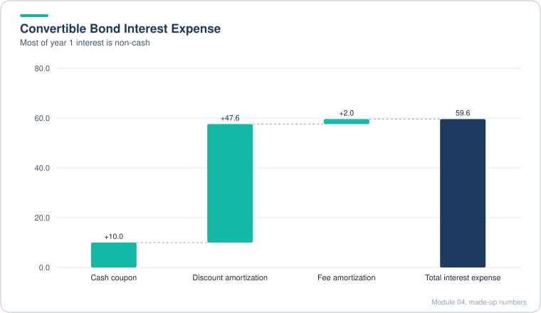

*Only 10 of the 59.6 total interest is paid in cash, and the rest is non-cash amortization.*

> [!TIP]
> **Going further.** The accounting treatment of convertibles changed in recent years, and under the newer rules many issuers no longer split out an equity component for convertibles, so the discount amortization disappears. Check which rule applies to the filing you are modeling. Also, an in-the-money convertible can be converted into shares, which dilutes existing shareholders, so the "debt" you see on the balance sheet may not stay as debt. In a real deal model you would test the conversion price against your exit value and show the dilution case. Interviewers like it when you raise that issue without being asked.

### 4.10 The Tax Schedule and Net Operating Losses

- **Book tax versus cash tax.** The income statement shows book tax expense, which follows accounting rules. The cash flow statement shows cash tax paid, which follows the tax code. The gap between the two is the deferred tax line, and it is the mechanism that links the tax schedule to the financial statements.
- **Net operating losses (NOLs).** If a company has taxable losses, it can carry them forward and use them to offset future taxable income. A carryforward balance reduces cash taxes until it runs out. New losses add to the balance. Because NOLs shelter cash taxes, they have real value even though they do not appear on the income statement as a tax benefit in the simplest case.
- **Taxable income is not book income.** Start with pre-tax income, then adjust for items the tax code does not allow as deductions. Common add-backs in this case are part of stock compensation and amortization of acquired intangibles. Once those are added back, taxable income can be positive even when book pre-tax income is negative.
- **NOL roll-forward.** Beginning balance, plus NOLs created this year, minus NOLs used this year, gives the ending balance. NOLs created equal the negative of taxable income when it is negative. NOLs used equal the smaller of the running balance and positive taxable income.
- **Cash taxes.** Take taxable income after NOLs used, multiply by the effective tax rate, and floor the result at zero. Cash taxes can be zero in a year with a large NOL balance.
- **Deferred taxes.** Deferred taxes are the gap between cash taxes and book taxes. The model's convention is cash taxes minus book taxes. If cash tax is below book tax, the result is negative, and the cash flow statement must add back the difference, because the company kept cash it did not pay out. Mixing up this sign is the most common error in the tax schedule, so test it with one number.

**Worked example (made-up numbers).** A company starts with a 150 NOL balance at a 25% tax rate. Its taxable income (after adding back non-deductible items) is shown below. NOLs used are the smaller of the running balance and positive taxable income.

| Year | Beginning NOL | Created | Used | Ending NOL | Taxable income | Cash tax at 25% |
|---|---|---|---|---|---|---|
| 1 | 150 | 0 | 10 | 140 | 10 | 0 |
| 2 | 140 | 0 | 40 | 100 | 40 | 0 |
| 3 | 100 | 0 | 40 | 60 | 80 | 10 |
| 4 | 60 | 0 | 60 | 0 | 90 | 7.5 |

In years 1 and 2, the NOL shelters all taxable income, so cash tax is zero. In year 3, 40 of taxable income is still exposed after NOLs, giving 10 of cash tax. In year 4 the NOL runs out, and the remaining 30 of taxable income is taxed at 25%, which gives 7.5 of cash tax. Suppose book tax in year 4 is 22.5 on the income statement. Cash tax minus book tax is 7.5 minus 22.5, or negative 15. The company paid 15 less cash than its book tax charge, so the cash flow statement adds 15 back as a non-cash item.

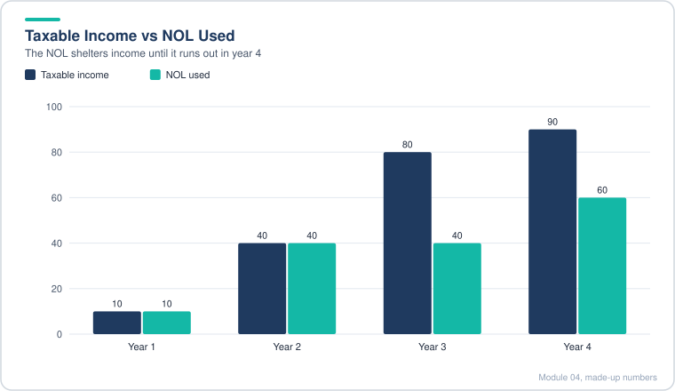

*Taxable income grows faster than the NOL can absorb it, so cash tax only appears once the balance is gone.*

> [!TIP]
> **Going further.** A real tax model needs several extras: NOLs that expire or are limited after an ownership change (a rule that can wipe out NOLs after an acquisition or large share issuance), different tax rates by country, and a valuation allowance when the company is unlikely to use its deferred tax assets. Cross-border companies (incorporated in one country, operating in another) often have a messy effective tax rate, and analysts reconcile it using the rate reconciliation in the filing. In an interview, two points score well: NOLs have value only if the company will earn taxable income, and book tax and cash tax are different lines for a reason.

### 4.11 Linking the Statements and Summarizing the Model

- **Link in the right order.** Start with the cash flow statement, because most of its inputs already sit on the income statement or in schedules (net income, depreciation, debt amortization, deferred taxes, debt flows). Then link the balance sheet: each asset and liability rolls forward from its prior balance plus or minus the matching cash flow line. Only then is the balance check meaningful.
- **Cash is the plug that comes from the bottom of the cash flow.** Ending cash on the balance sheet should equal ending cash from the cash flow statement. If it does not, the error is in a link, not in the cash flow itself.
- **Keep cash and investments separate when they move differently.** If investments run down by a set amount each year, combining them with cash makes the historical tie-out and the net change in cash harder to explain. Separate lines are easier to audit.
- **Acquisitions hit several balance sheet lines.** Spend cash on a deal and it goes into the acquired net assets, goodwill and intangibles. Intangibles are reduced by their amortization each year. A simplifying assumption (purchase equity value equals purchase enterprise value, so no debt or cash is acquired) keeps the allocation simple.
- **Deferred tax assets and liabilities.** A deal often creates a deferred tax liability because written-up assets are not deductible for tax. Here it is modeled as a net asset that shrinks instead. Either sign works if the balance sheet balances, but say which one you chose.
- **Debt on the balance sheet is book value.** Add the non-cash amortization of discounts and fees to book debt, plus the cash borrowing and repayments.
- **Equity roll-forward.** Beginning equity plus net income, plus stock compensation, plus equity issued, plus or minus other items (losses, gains, FX). With stock comp set to zero for this model, this line is simpler.

**Credit and summary metrics.** Build the summary near the top of the model so you can see the answer before you read the statements.

| Metric | Definition | What it tells you |
|---|---|---|
| Revenue growth | Revenue divided by prior year minus 1 | Is growth holding up? |
| EBITDA margin | EBITDA divided by revenue | Is the business getting more profitable? |
| EBITDA to interest | EBITDA divided by total interest expense | Can the company cover its interest? |
| EBITDA to cash interest | EBITDA divided by cash coupon | A stricter version, using only cash interest |
| Total debt to EBITDA | Face value of debt divided by EBITDA | How many years of EBITDA would repay the debt |
| Net debt to EBITDA | (Total debt minus cash and investments) divided by EBITDA | Net leverage after cash on hand |

**Worked example (made-up numbers).** Suppose EBITDA is 120, face debt is 600, cash plus investments is 900, and cash interest is 12.

| Metric | Calculation | Result |
|---|---|---|
| Total debt to EBITDA | 600 / 120 | 5.0x |
| Net debt to EBITDA | (600 - 900) / 120 | negative 2.5x |
| EBITDA to cash interest | 120 / 12 | 10.0x |

The gross leverage looks high, but net leverage is negative, meaning the company has more cash than debt. A reader should check both numbers, because the net figure shows whether the debt is a real problem.

> [!TIP]
> **Going further.** EBITDA is a convenient metric but has traps. Do not add back amortization of debt discounts and fees, because those sit below operating income. Analysts also check whether one-time items are being added back, and they usually prefer EBITDA less stock compensation or EBITA when stock comp is large, since it is a real cost. For leverage, lenders often prefer net debt and use EBITDA with adjustments in their credit agreements, so the number on your model may not match the covenant calculation. Be ready to explain why you chose face over book debt: face is what must be repaid, and it is the more conservative choice.

### 4.12 Returns Analysis and Sensitivity Tables

- **Exit value, built backwards.** Pick an exit year, multiply that year's revenue by an exit multiple to get exit enterprise value, then subtract net debt (debt minus cash and investments) to get exit equity value. Enterprise value belongs to all capital providers. Equity value belongs to shareholders only. Since the investor owns shares, the equity value is what matters.
- **Exit multiple should follow growth.** A slower-growing company usually trades at a lower revenue multiple. A common assumption is that the multiple falls each year as growth decelerates. Check the assumed multiple against the company's own trading history and its peers, not just against the entry price.
- **From equity to investor proceeds.** Multiply exit equity value by the ownership stake. Stake is the investment divided by the market value at entry. Assuming no new shares, no dividends and no buybacks keeps the math simple, but say so in the write-up.
- **Money multiple and IRR.** Money multiple is proceeds divided by invested capital. IRR for a single cash-in and cash-out is the multiple raised to the power of one over the number of years, minus one. Holding period matters a lot, so show returns for each possible exit year.
- **Sensitivity tables.** A data table varies two inputs and shows the output (usually IRR) in each cell. The row and column headers must be hard-coded values, not links to the model, or the table will not recalculate correctly. Put the output formula in the top-left corner. Choose ranges that bracket the base case with a meaningful spread, and set calculation to automatic while you build them.

**Worked example (made-up numbers).** Suppose the company invests 500 for a stake of 10%, and in year 4 revenue is 1,000 with an exit multiple of 12x and net debt of negative 200 (net cash of 200).

| Step | Calculation | Result |
|---|---|---|
| Exit enterprise value | 1,000 x 12 | 12,000 |
| Exit equity value | 12,000 minus net debt (negative 200) | 12,200 |
| Investor proceeds | 12,200 x 10% | 1,220 |
| Money multiple | 1,220 / 500 | 2.44x |
| IRR over 4 years | 2.44^(1/4) minus 1 | about 25% |

Now lower the exit multiple to 8x. Exit equity value becomes 8,200, proceeds become 820, the money multiple is 1.64x, and IRR is about 13%. A 33 percent drop in the exit multiple cut the IRR roughly in half. This is the key sensitivity in a growth equity deal.

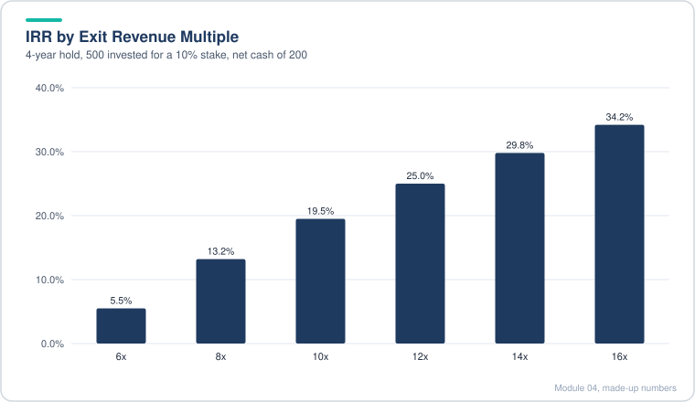

*IRR climbs steeply with the exit multiple, so the return depends heavily on the market and not only on operations.*

> [!TIP]
> **Going further.** Real returns models include a fund's fees, a preferred return structure, and the exact timing of cash flows (IRR needs them, not just a start and end date). Ownership changes when new shares are issued. A stake bought at a high price can be washed out by later dilution. In an interview, the best answer to "what drives the return?" usually names the exit multiple first, then growth, then leverage. Acquisitions that earn low margins rarely move the answer much, as this model showed.

### 4.13 Case Answers and the Investment Recommendation

- **One question, one yes or no.** A growth equity case usually boils down to: would we invest, at this price, with these projections? Lead with the answer, then give three to five reasons, the main risk, and a mitigation. A one-page limit means you must rank points, not list everything.
- **Base case versus upside and downside.** Map the model's outputs to the firm's targets. A base-case IRR in the target band supports a yes. A downside case that still clears a floor return shows the investment protects capital. Compare each case to the target, not to an arbitrary number.
- **Read the sensitivity tables as a risk map.** The table that matters most is usually the exit multiple against growth. If the answer only works at high multiples, the deal depends on the market, not the operations.
- **Multiple contraction is the main risk.** When a high growth company trades far above its historical multiple and peers, a fall back toward the historical range can wipe out returns. Say this clearly and quantify it: find the exit multiple where IRR drops below the floor.
- **Structure as a mitigation.** A convertible instrument can protect the downside (return of principal plus interest) while keeping upside through conversion. Name the trade-off: a lower coupon or a higher conversion price changes the return.
- **Strategy changes can be a recommendation.** Instead of buying fast-growing, expensive targets, the investor could push the company toward slower-growing, higher-margin acquisitions. This may lower the headline growth but protects the margin and may cut the required capital. Always test the change in the model before you claim it helps.
- **A no is also valid.** If acquisitions barely move returns, the case for investing rests on the core business. A reasonable reviewer could say the core is good but the plan adds little, and decline. Both answers are defensible if the reasoning follows from the model.

**Writing template (one page).**

1. Recommendation: yes or no, and the price or structure.
2. Base, upside and downside returns versus the targets.
3. Why it works: growth, retention, cash generation, margin expansion.
4. Main risk: exit multiple, with the breakeven multiple.
5. Mitigation: structure, or a change in use of proceeds.
6. What would change our mind.

> [!TIP]
> **Going further.** Real investment committees ask a few questions this case does not force. What is the entry valuation relative to the public market (a control premium or a minority discount)? What are the governance rights (board seat, information rights, protective provisions)? How does liquidity work, since a minority stake in a public company can usually be sold in the market, but a private one needs a path to exit? Also, a 20 to 25 percent IRR target applied to a public-stock stake is a high bar: check what the index delivers with far less risk. A strong answer shows the investor knows the target is only worth it if the operating plan is credible.

## Diagrams and Charts

### Flow of a Change Through the Three Statements

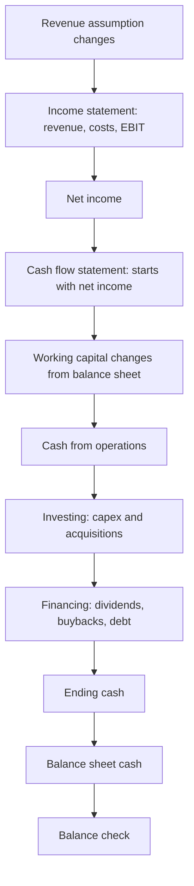

### Free Cash Flow Over Five Years (Illustrative, Made-Up)

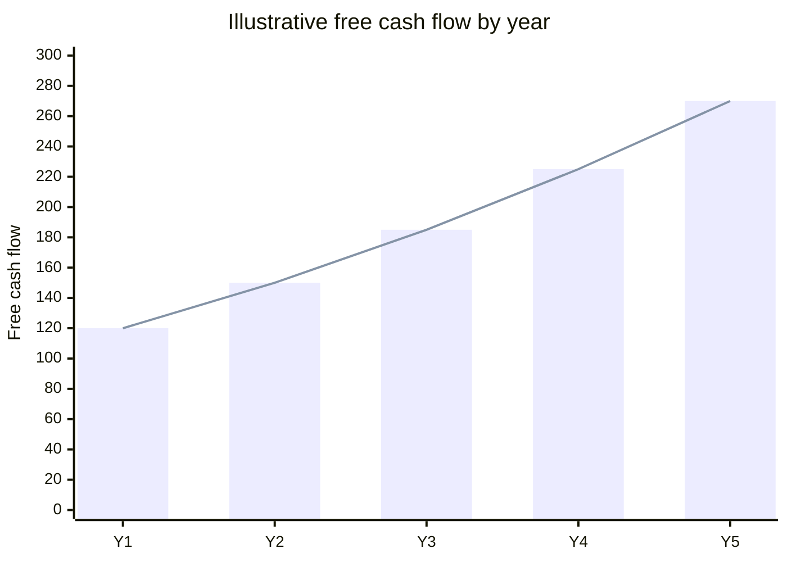

### Money Multiple Versus Exit Multiple (Illustrative, Made-Up, 4-Year Hold)

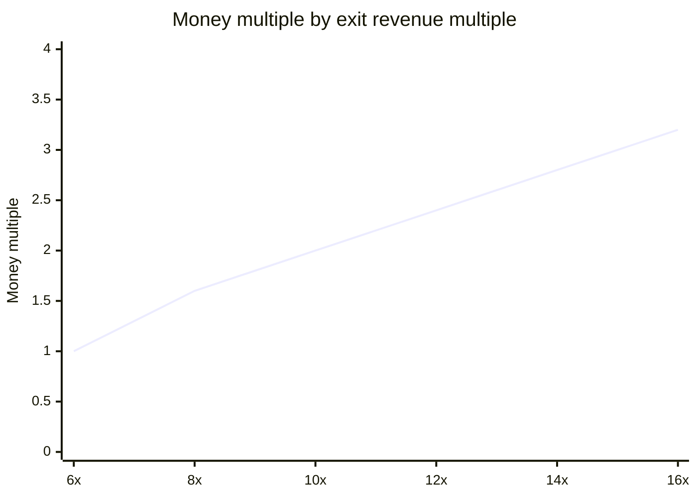

### Share of a Deal Explained by Each Driver (Illustrative)

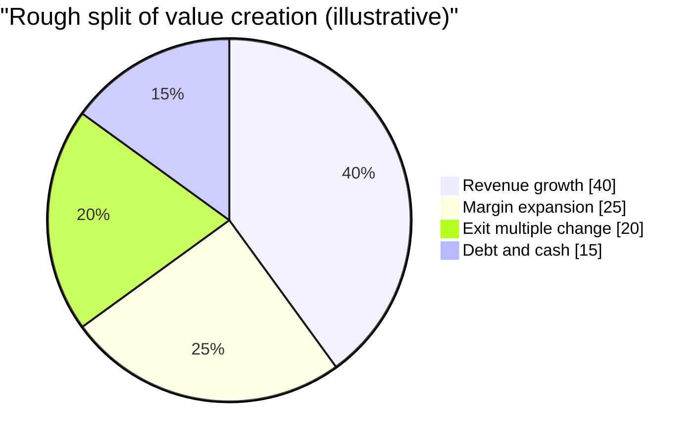

### Sequence: A Year of Activity in a Growth Equity Model

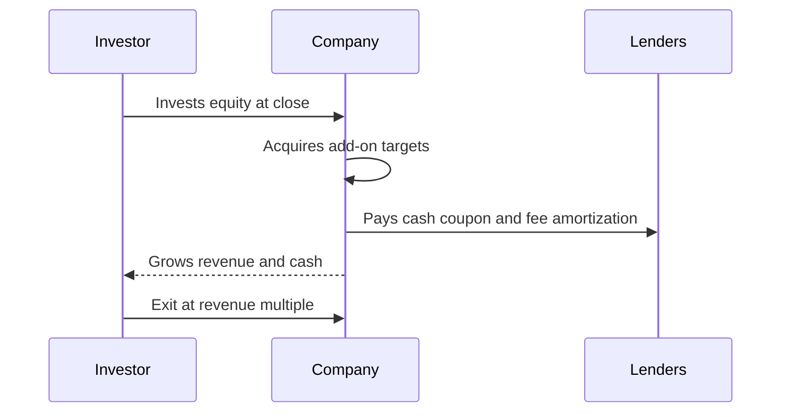

## Excel Model Walkthrough

**Toro (60-minute case).** The layout follows the build order: assumptions first, then the income statement drivers, balance sheet drivers, cash flow drivers, the debt schedule, and finally the three statements with their links. Key pieces:

- *Income statement drivers:* segment revenue growth, gross margin, SG&A as a percent of revenue, D&A from the PP&E waterfall, tax rate, interest income on the prior balance.
- *Balance sheet drivers:* receivables on revenue, inventory and payables on cost of sales, prepaid and accruals on SG&A, deferred revenue on revenue, expressed as percent or days.
- *Cash flow drivers:* capex as a share of the revenue increase, dividend payout ratio, buyback dollars, acquisitions, and FX.
- *Debt schedule:* minimum cash (a percent of cost of sales plus SG&A), a borrowing formula that is zero unless cash falls below the minimum, face and book value rows, issuance fees, and fee amortization.
- *Links:* cash flow ends in cash on the balance sheet; the balance check should be zero every year.

**Atlassian (2-hour case).** A larger model with a clear stack from top to bottom:

1. Returns block at the top (entry stake, exit multiple, exit equity value, money multiple, IRR).
2. Revenue drivers: subscription (new customer billings, renewal rate, price increase, recognition share, deferred revenue roll-forward), then perpetual license, maintenance (same logic, tied to license revenue) and other.
3. Expense drivers: cost of revenue, sales and marketing (tied to bookings), G&A, R&D (headcount times loaded cost per head), tax rate.
4. Balance sheet and cash flow drivers.
5. Acquisitions block: spend, purchase price allocation, intangible amortization by vintage, acquired revenue and EBIT by vintage.
6. Debt schedule (convertible with discount and fee amortization) and tax schedule (NOL roll-forward, cash tax, deferred tax).
7. Three statements, linked. Check row at the bottom.
8. Sensitivity tables (data tables) on exit multiple, growth and market cap.

Key links: acquired revenue and expenses flow into the income statement as separate lines; acquisition spend goes to investing and to goodwill and intangibles; deferred taxes come from the tax schedule; interest uses the prior period's face value to avoid circularity.

## Interview Questions

<details>
<summary><b>1. Why build a 3-statement model if you can project cash flow directly?</b></summary>

Because it forces consistency between the statements and shows how cash, debt and working capital interact. Simpler projections can be enough for a valuation, but interviewers and senior people often expect the full model.

</details>

<details>
<summary><b>2. How do you link working capital to the business?</b></summary>

Link receivables and deferred revenue to revenue or billings, and inventory and payables to cost of sales. Check the change in working capital as a percent of the change in revenue.

</details>

<details>
<summary><b>3. Why does depreciation not go straight to the balance sheet?</b></summary>

It reduces net PP&E on the balance sheet and reduces net income on the income statement. It is added back on the cash flow statement because it is non-cash, so its only real cash effect is the tax shield it creates.

</details>

<details>
<summary><b>4. What is the difference between face value and book value of debt?</b></summary>

Face value is the principal that carries interest. Book value is the balance sheet number, reduced by unamortized fees and discounts that unwind over time.

</details>

<details>
<summary><b>5. How do you avoid circular references in interest?</b></summary>

Calculate interest on the beginning balance, or on the prior period's cash, rather than on average balances that depend on the current period's borrowing.

</details>

<details>
<summary><b>6. What is a minimum cash balance and how does it affect borrowing?</b></summary>

If cash before new borrowing falls below the minimum, the model borrows the shortfall. Above the minimum, it borrows nothing.

</details>

<details>
<summary><b>7. Why does stock-based compensation matter in a growth equity model?</b></summary>

If treated as non-cash, it implies new shares and dilutes the investor's stake. Many simple models set it to zero for that reason.

</details>

<details>
<summary><b>8. What is an NOL and how does it affect the model?</b></summary>

A carryforward of past tax losses that shelters future taxable income. Cash taxes fall to zero while the balance lasts, and the deferred tax line captures the gap with book tax.

</details>

<details>
<summary><b>9. Why are cash taxes different from book taxes?</b></summary>

Book tax follows accounting rules. Cash tax follows the tax code, which may disallow some deductions (such as part of stock comp or acquired intangible amortization) and allows NOLs.

</details>

<details>
<summary><b>10. How do you value an acquisition in a model?</b></summary>

Revenue multiple times acquired revenue gives the price, then allocate the price across net assets, intangibles and goodwill. Model acquired revenue growth and margin by vintage.

</details>

<details>
<summary><b>11. Why is the revenue multiple for software deals so high?</b></summary>

Buyers pay for growth, retention and future margin, not current earnings. That is why returns depend so heavily on keeping the exit multiple high.

</details>

<details>
<summary><b>12. Why use face value of debt for leverage ratios?</b></summary>

Face is what must be repaid and what interest is paid on. It is the more conservative number. Book value can understate the repayment obligation.

</details>

<details>
<summary><b>13. What is net debt and why look at it?</b></summary>

Total debt minus cash and investments. A company with high gross debt but more cash may be less risky than the gross number suggests.

</details>

<details>
<summary><b>14. How do you convert from enterprise value to equity value?</b></summary>

Subtract net debt (debt minus cash and investments). Equity value is what common shareholders own.

</details>

<details>
<summary><b>15. What is a money multiple and how does it relate to IRR?</b></summary>

Money multiple is total proceeds divided by invested capital. For a single cash-in and cash-out, IRR is the multiple to the power of one over the years, minus one.

</details>

<details>
<summary><b>16. What drives IRR the most in a growth equity deal?</b></summary>

Usually the exit multiple, then growth, then leverage. Acquisitions with low margins often matter less than expected.

</details>

<details>
<summary><b>17. How would you mitigate exit multiple risk?</b></summary>

Use structure (convertible instruments with a preference), negotiate a lower entry price, or change the business plan so the return depends less on the multiple.

</details>

<details>
<summary><b>18. What is a sensitivity table and how do you build one?</b></summary>

A two-variable data table that shows an output for each pair of inputs. Headers must be hard-coded values, and the output formula sits in the corner.

</details>

<details>
<summary><b>19. Why does depreciation stay behind capex in a growing company?</b></summary>

The asset base grows when capex exceeds depreciation, which is what a growing company should do.

</details>

<details>
<summary><b>20. How do you check a 3-statement model is working?</b></summary>

The balance sheet balances every year, ending cash on the balance sheet matches the cash flow statement, and the working capital and margin trends make business sense.

</details>

## Career Angle

For a finance analyst, the skills in this module map closely to day-to-day work. The skills to name are the ones used on the job, not the module title.

| Module skill | Real work it supports | Target roles |
|---|---|---|
| Linking the three statements and checking balances | Month-end fair value of about $550B of assets, with pricing exceptions investigated before sign-off | Capital markets, valuation |
| Working capital and receivables drivers | Single-Family CFO reporting, including serious delinquency and remittance reporting | FP&A, corporate finance |
| Debt, face versus book value and fee amortization | An Excel MBS valuation model built during an internship, plus fair value work | Capital markets, structuring |
| Revenue builds and billings or bookings logic | Forecasting and flash reporting in FP&A | Corp dev, strategy, FP&A |
| Acquisition modeling and purchase price allocation | Coursework only; no deal experience claimed | Corp dev, growth equity |
| Returns and sensitivity tables | Structured option analysis for a rotation choice, scored against stated criteria | PE, growth equity, valuation |

**Talking points (truthful, framed as studied or coursework).**

1. "I studied full three-statement models for a SaaS company and a manufacturer, including a debt schedule with a minimum cash rule and a convertible bond. I can walk through how each statement links and how I check the balance sheet every year."
2. "In coursework I built a growth equity returns model with IRR and sensitivity tables. The exit multiple moved the answer more than anything else, so I now test that assumption first in any valuation."
3. "My current rotation covers month-end fair value work for about $550B of assets. Tying each balance to what drives it and checking its cash effect is a habit this module reinforces, and it carries over to the pricing and reporting work I do."

A candidate should not claim to have led an acquisition model, run a deal or built a live LBO. Keep the framing to "studied" or "built in coursework", and link examples to real work only where the skill truly overlaps.

## Cheat Sheet

- **Value link:** value = cash flow / (discount rate minus growth rate), growth below discount rate.
- **Build order:** IS drivers, BS drivers, CF drivers, debt (min cash logic), link CF, link BS, check balance.
- **Working capital base:** receivables and deferred revenue on revenue or billings; inventory and payables on cost of sales; accruals and prepaids on SG&A or opex.
- **Days to percent:** percent = days / days in year. Use EOMONTH or date differences for the year count.
- **Revolver-style borrowing:** new debt = max(0, minimum cash minus cash before borrowing).
- **Face versus book:** face drives interest and repayment; book = face minus unamortized fees and discounts.
- **Avoid circularity:** interest on beginning balance or prior-period cash.
- **Fee amortization:** total issuance fee divided by term; non-cash, added back on CF.
- **Deferred taxes:** cash tax minus book tax (model convention); check the CF sign with one number.
- **NOLs:** created = max(0, negative taxable income); used = min(running balance, max(0, taxable income)); cash tax = max(0, taxable income after NOLs) times rate.
- **Subscription revenue:** billings = recognized share plus deferred; revenue = current recognized share plus last year's deferred.
- **Renewal billings:** prior billings times renewal rate times (1 plus price increase).
- **Acquisitions:** first-year revenue = spend / revenue multiple; then grow by vintage; EBIT = revenue times margin; amortization = intangible share / life.
- **Credit metrics:** total debt to EBITDA (face), net debt to EBITDA, EBITDA to cash interest. EBITDA = operating income plus D&A (not debt discount amortization).
- **Enterprise to equity:** equity value = enterprise value minus net debt.
- **Returns:** money multiple = proceeds / invested; IRR = multiple^(1/years) minus 1.
- **Sensitivity tables:** hard-coded headers, output in corner, data table, automatic calc.
- **Rules of thumb:** keep each balance sheet side to 5 to 10 lines; check working capital as percent of revenue change; use averages for noisy ratios; state every simplification.

---

[← Previous: Module 03](03-more-advanced-accounting.md) · [Contents](../README.md) · [Next: Module 05 →](05-advanced-3-statement-models.md)
