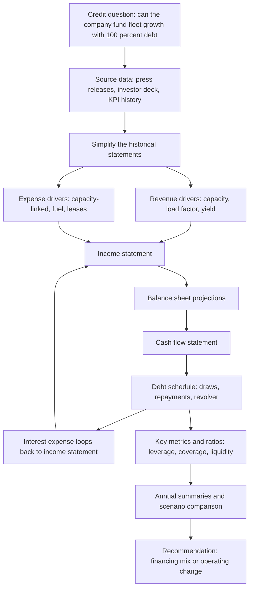
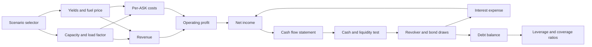
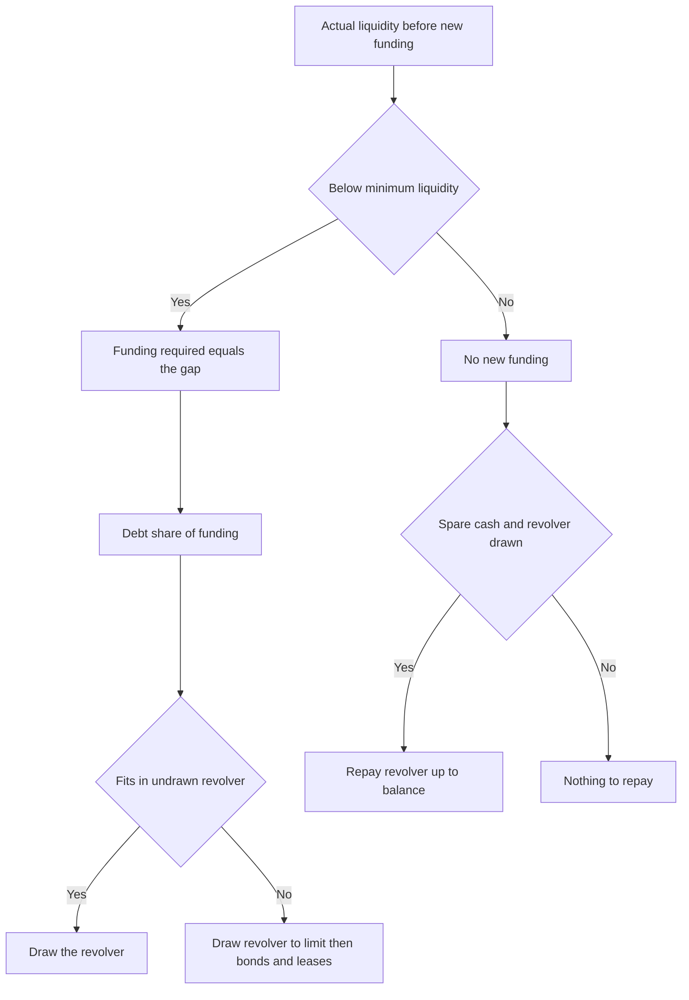
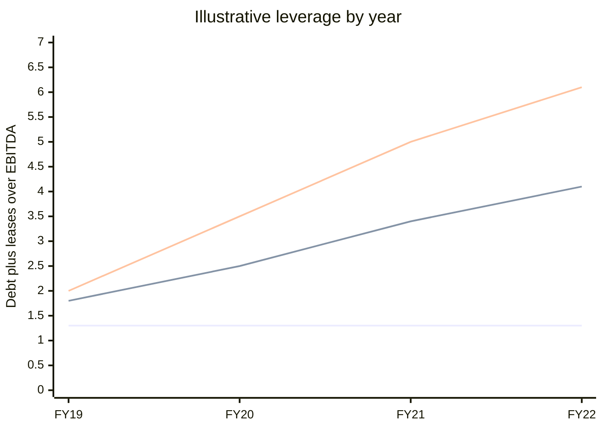
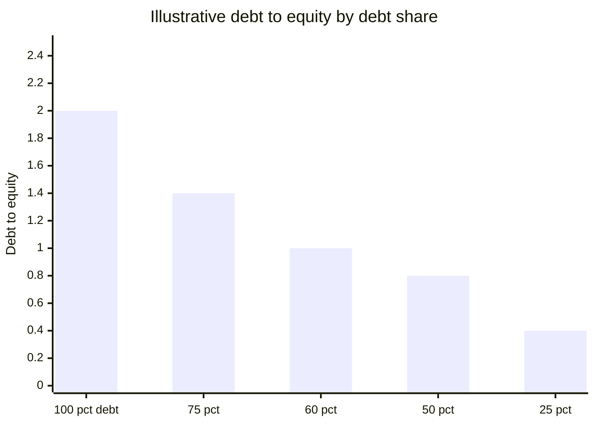
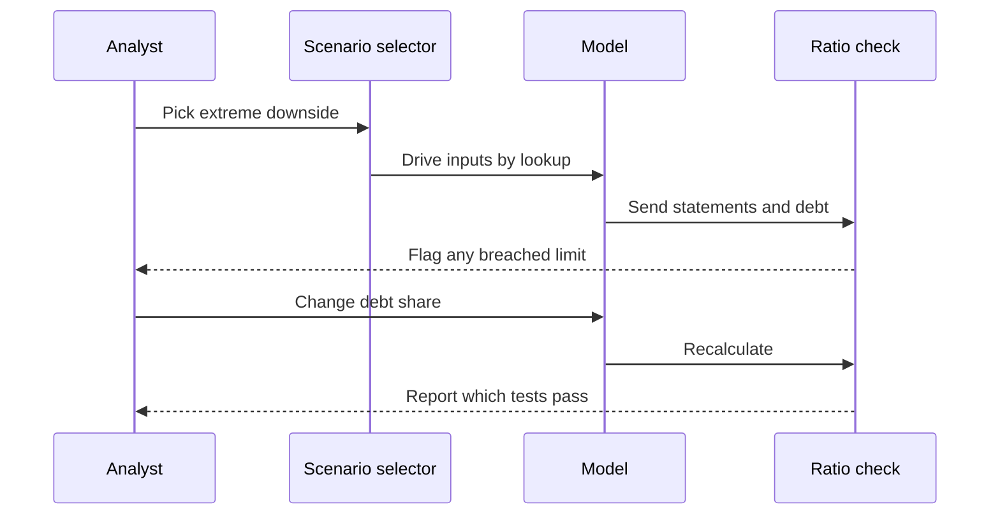

# Module 05: Advanced 3-Statement Models

[← Previous: Module 04](04-3-statement-models.md) · [Contents](../README.md) · [Next: Module 06 →](06-equity-value-and-enterprise-value.md)

<b>Contents</b>

- [Overview](#overview)
- [Module Map](#module-map)
- [Lessons](#lessons)
  - [5.1 Overview and Financial Statements](#51-overview-and-financial-statements)
  - [5.2 Revenue Projections](#52-revenue-projections)
  - [5.3 Expense Projections](#53-expense-projections)
  - [5.4 Balance Sheet Projections (Working Capital)](#54-balance-sheet-projections-working-capital)
  - [5.5 Cash Flow Statement Projections and Balance Sheet Links](#55-cash-flow-statement-projections-and-balance-sheet-links)
  - [5.6 Debt and Equity Schedule, Draws and Revolver](#56-debt-and-equity-schedule-draws-and-revolver)
  - [5.7 Debt Schedule, Interest and Linking the Statements](#57-debt-schedule-interest-and-linking-the-statements)
  - [5.8 Key Metrics and Ratios](#58-key-metrics-and-ratios)
  - [5.9 Annual Summaries](#59-annual-summaries)
  - [5.10 Case Study Answers](#510-case-study-answers)
- [Diagrams and Charts](#diagrams-and-charts)
- [Excel Model Walkthrough](#excel-model-walkthrough)
- [Interview Questions](#interview-questions)
- [Career Angle](#career-angle)
- [Cheat Sheet](#cheat-sheet)

## Overview

Build a more realistic three-statement model for a seasonal, capital-hungry airline, with half-year projections, a debt schedule that draws and repays a revolver, interest that links back into the income statement, and credit ratios that decide whether the plan is safe to finance with debt.

The module is one long model built in layers. Each layer depends on the one before it, and the debt schedule is the only place where the model has a circular loop (interest depends on debt, and debt depends on cash, which depends on interest). Most of the learning is about keeping that loop under control.

## Module Map

## Lessons

### 5.1 Overview and Financial Statements

**The question.** This is a credit case, not an equity case. A lender earns a fixed interest rate and gets its principal back, so the upside is capped. The real question is how likely the borrower is to fail to pay. That changes what you model: you care most about the downside, liquidity and covenant compliance, not the blue-sky growth case.

- The company is a mature, low-cost airline with moderate growth (roughly 5 to 10 percent a year) and profits that swing with the season.
- Revenue and profit are much higher in the second half of the fiscal year. Operating cash flow is always positive but is usually stronger in the first half, which is the opposite of profit. That gap matters later when you build the revolver.
- Airlines commit cash years ahead through aircraft purchases and operating leases, before they know how a route or a new plane will perform. Demand shocks hit fast, so lenders focus on maintaining ratios, holding cash and keeping unused borrowing capacity.
- The decision: fund a large fleet expansion with 100 percent debt, or mix in equity, or change the operating plan (sell assets, slow growth, improve yields and load factors on existing routes).

**Data sources.** Press releases are preferred to full annual reports because they are shorter and carry the statements you need. Investor presentations supply plan details such as the fleet range. Third-party databases supply long-run operating KPIs (cost per seat-kilometer, load factor, yield).

**How the statements were simplified.** The company's own statements are not laid out the way a modeler wants. The model changes them in four main ways:

| Area | Company layout | Modeling layout | Why |
|---|---|---|---|
| Income statement | Many cost lines | Grouped by driver (capacity-linked, fuel, leases) | Same drivers, fewer lines |
| Balance sheet | Split items (restricted cash, money market deposits) | Merged into one line each | One concept, one line |
| Balance sheet | Derivatives on both sides | Netted into one current line | Avoids duplicate concepts |
| Cash flow | Starts from operating profit, dividends in operations | Starts from net income, dividends in financing | Standard layout that ties to the income statement |

**IFRS 16 treatment.** Under the newer lease standard, long leases go on the balance sheet. A lease expense that used to sit in one operating line is split into a depreciation piece and an interest piece. The company gives an estimate of the interest share in its investor deck, and the model applies that percentage to a broader base (leases plus maintenance) so that pretax income does not change, only its presentation does.

Worked example with made-up numbers:

| Item | Before | After |
|---|---|---|
| Lease plus maintenance expense | 100 | 100 |
| Interest share (assumed 30 percent) | not shown | 30 |
| Depreciation on right-of-use asset | not shown | 70 |
| Pretax income effect | 0 | 0 |

The lease liability becomes a debt-like line. The asset and liability both go up over time, and the model is set up so that the cash flow effect of the reclassification nets to zero.

**Cash flow method, in short.**

- Start from net income, then add back non-cash items and working capital changes, as in most US-style models.
- Deferred taxes are the gap between cash taxes paid (from the cash flow note) and the book tax on the income statement. Formula used in this model: deferred tax line = negative cash taxes paid, minus the book tax figure as shown. Made-up example: cash taxes paid 40 and a book tax credit of 10 give a deferred line of -40 - 10 = -50.
- Right-of-use additions and lease principal repayments are shown in investing and financing, then reversed so no net cash moves.

> [!TIP]
> The model admits that the lease adjustments undercount real lease cash outflows, because only the interest piece is treated as a cash cost. Treat any model with a reclassification like this as a presentation tool, and always reconcile the totals back to the reported figures. In a real job you would pull a clean dataset from a terminal such as Capital IQ or FactSet rather than rebuild it by hand, but you still need to know why each adjustment exists so you can defend it.

> [!TIP]
> The "credit" framing is worth carrying into interviews. Equity analysts ask "how much can this go up?" Credit analysts ask "how does this go wrong, and when?" Pricing work on mortgage assets sits closer to the second question, because the value of a mortgage asset is driven by what happens in bad scenarios as well as good ones.

### 5.2 Revenue Projections

**The airline revenue chain.** Start with capacity, then utilization, then price. Every airline revenue model follows the same chain:

1. Available Seat Kilometers (ASK): seats offered times kilometers flown. This is capacity.
2. Passenger Load Factor: revenue passenger kilometers (RPK) divided by ASK. This is utilization.
3. Revenue Passenger Kilometers (RPK): paying passengers times kilometers flown.
4. Passenger Yield: passenger revenue per RPK. This is price per unit of use.
5. Passenger Revenue = RPK times yield.

Capacity comes first because aircraft, leases and crew are bought before any seat is sold. A fleet can grow fast while revenue lags if the planes are not full. This is why capacity and load factor are the two numbers analysts watch most closely.

**Worked example with made-up numbers.**

| Step | Calculation | Result |
|---|---|---|
| Seats on one flight | given | 200 |
| Distance | given | 800 km |
| ASK for the flight | 200 times 800 | 160,000 |
| Paying passengers | given | 150 |
| RPK | 150 times 800 | 120,000 |
| Load factor | 120,000 divided by 160,000 | 75 percent |
| Average fare paid | given | 40 pounds |
| Yield per RPK | 40 pounds divided by 800 km | 5 pence |
| Passenger revenue | 120,000 times 0.05 pounds | 6,000 pounds |

The yield is tiny per kilometer because a short ticket is spread over many kilometers. A low-cost carrier has low yields and high load factors, which is the trade it makes.

**Step 1: Capacity (ASK) growth.** Capacity is driven by the company's fleet plan and by what it has already contracted. Near-term growth is almost locked in, because routes and aircraft are committed months in advance. Later periods are more flexible, so they are where scenarios differ.

- Year-over-year growth is calculated for each half-year, not just annually, because the business is seasonal and half-year comparisons are the honest ones.
- The case gives a target cumulative rise over four years for each scenario (base, downside, extreme downside). The modeler sets half-year growth rates until the cumulative result lands near the target.
- The first half of the next year has guided growth, so that number is entered directly. The second half is set a bit lower because the guidance averages out to the full-year figure.
- A scenario selector (a cell with the case name) drives the inputs. Lookup functions (MATCH to find the row, INDEX to pull the value) pick the right row for the chosen case. Anchored references keep the lookup range fixed when the formula is copied across.
- Downside cases can show flat or negative growth in later periods, because the company can slow fleet additions. The model adjusts the path until the cumulative figure is close, not exact.

**Step 2: Load factor.** Here the guidance gives the load factor directly for each case and period, so the modeler enters it and calculates RPK as ASK times load factor. It is also worth noting that a computed load factor from RPK and ASK may differ slightly from the reported one, because companies measure passengers and seats in slightly different ways.

Historically, this load factor has moved in a band of roughly 84 to 90-plus percent. The scenario ranges are built to sit inside that band, which is a useful sanity check: a projection outside the historical range needs a strong reason.

**Step 3: Yields.** Yield is the variable that depends most on the market. Passenger yield is calculated historically as passenger revenue divided by RPK, then converted to pence. Projected yield growth rates are then set per period so that the yield ends near the scenario target. Typical shapes:

| Case | Yield path | Why |
|---|---|---|
| Base | Growth that slows from about 5 percent to about 2 percent | Pricing power fades as the market matures |
| Downside | Small declines, then partial recovery | Competition or weak demand |
| Extreme downside | Sharper declines, then a recovery | A shock such as a recession, then normalization |

Ancillary revenue (extra fees for seats, bags, food and onboard items) is modeled the same way: ancillary yield per passenger times passengers, with a growth path per case. Low-cost carriers depend on it more than legacy airlines do.

> [!TIP]
> The shape of the path matters less than where it ends. A dip-then-recovery path and a slow-decline path can reach the same end yield. If two shapes reach the same end point, the choice should come from what you know about the market, not from the spreadsheet.

**Step 4: Annual summaries and links.** Half-year results are rolled up to fiscal years with SUMIF functions, which add up the values that match a given fiscal year label. Annual load factor and yield are then recalculated from the annual totals, not averaged, because averaging ratios gives the wrong answer when volumes differ. Passenger and ancillary revenue link into the income statement.

Reading the annual result in the base case: capacity grows about 9 to 10 percent a year early, then slows to the 3 to 4 percent range. Load factors stay stable. Yields rise quickly at first and then track inflation.

> [!WARNING]
> Common mistakes to avoid:
> - Averaging half-year load factors instead of dividing total RPK by total ASK.
> - Forgetting that the second half of the year is seasonally stronger, so a flat half-year growth rate can hide a seasonal swing.
> - Hard-coding a scenario number instead of letting the selector drive it, which breaks the scenario comparison later.

### 5.3 Expense Projections

**The big idea.** Most airline costs scale with capacity (ASK), so they are modeled as cost per ASK times ASK. Fuel is the exception, because its cost moves with fuel efficiency and the oil price as well as with flying. Everything else is a per-unit rate that drifts with inflation, which keeps the model simple.

**Per-ASK expenses.** Each non-fuel cost is converted into a historical rate (cost divided by ASK, then multiplied by a units factor to get pence per ASK). The projection then sets the rate path and multiplies back by ASK:

- Non-fuel operating costs (staff, airports, navigation, sales and marketing, and so on) rise slowly, roughly with inflation.
- Depreciation on owned aircraft and right-of-use depreciation on leased aircraft have their own per-ASK paths.
- The interest element of lease payments is also a per-ASK rate.

The model deliberately avoids building a full PP&E or intangibles schedule here. Those costs are small relative to the total, and the time is better spent on the financing questions. Amortization of intangibles is simplified to a percentage of the prior period's balance.

> [!TIP]
> A useful check: non-fuel costs per ASK kept rising during the 2008 to 2009 recession, even as revenue fell. Costs are sticky. Cost per unit often rises in a downturn because fixed costs are spread over fewer passengers, so the model should not assume costs fall in lockstep with revenue.

**Fuel expense, step by step.**

1. Fuel expense on the income statement, divided by the effective fuel price per metric tonne, gives metric tonnes burned.
2. Metric tonnes burned divided by ASK gives fuel intensity (tonnes per million ASK).
3. Project fuel intensity, which falls each year as the fleet gets more efficient.
4. Projected fuel cost = projected tonnes times the projected price per tonne, converted back to millions.

Fuel is seasonal too, so the half-year split matters. Made-up numbers to show the logic:

| Item | Formula | Example |
|---|---|---|
| Fuel expense (millions) | given | 900 |
| Price per tonne (pounds) | given | 400 |
| Tonnes burned (thousands) | 900 times 1,000 divided by 400 | 2,250 |
| ASK (millions) | given | 50,000 |
| Intensity | tonnes divided by ASK | 0.045 tonnes per million ASK |
| Next year intensity at 3 percent efficiency gain | 0.045 times 0.97 | 0.04365 |

Note that the company's intensity had not improved over the history shown, even though the fleet was being modernized. Projecting an efficiency gain is therefore an assumption to defend, not a fact.

**Scenario logic for fuel.** The scenarios differ on the fuel price path. The base case has the price rising steadily. The downside case is roughly flat. The extreme downside case has the price falling. A recession can cut fuel costs, so the extreme downside case is not a pure "everything bad" case for every line. That is why a model should show the full income statement under each case rather than assume the worst on every input.

**Income statement links.** Fuel, per-ASK costs and lump-sum costs link into the income statement. Operating profit is revenue less operating expenses. The lease interest element is shown in the finance area even though it is an operating cost in substance, which matches the presentation from the previous lesson. Interest on real debt stays blank until the debt schedule exists. Tax is the effective rate times pretax income. Earnings per share is left for later, because it depends on share issuance from the cash flow statement.

**Effective tax rate.** Historically the company's effective rate sat in a narrow band (roughly 14 to 20 percent). The case gives the forward rates, which step down with a change in the statutory rate.

**Results across scenarios.** In the base case, half-year revenue grows strongly and operating income rises substantially by the final year. In the downside case, revenue barely grows and operating income slips a little. In the extreme downside case, revenue is roughly flat and operating income falls sharply, which is the kind of outcome lenders are worried about.

| Case | Revenue trend | Operating income trend | Read-across for lenders |
|---|---|---|---|
| Base | Strong growth | Strong growth | Ratios comfortable |
| Downside | Modest growth | Slightly lower | Thinner cushion |
| Extreme downside | Flat | Sharply lower | Covenant risk |

> [!TIP]
> In an interview, the point to make is that the scenarios are not just different revenue lines. The cost lines respond differently too: fuel can fall in a recession while per-ASK labor and overhead keep rising. That mismatch is what squeezes margins.

### 5.4 Balance Sheet Projections (Working Capital)

**Scope.** This lesson covers the working capital lines at the top of the balance sheet and their mirror rows on the cash flow statement. The case gives no guidance on working capital, so every percentage here is a judgment call, anchored in the history and the trend. The lesson's real point is the method, not the exact percentages.

**The core rule.** Link each working capital item to the driver that causes it:

| Balance sheet item | Driver | Why |
|---|---|---|
| Accounts receivable | Revenue | Customers pay with a lag, so the balance follows sales |
| Deferred revenue | Revenue | Tickets are bought ahead of travel, so cash arrives before revenue is earned |
| Net derivatives | Fuel expense | Fuel hedges grow when fuel exposure grows |
| Other long-term assets | Revenue | Small, no better driver, so revenue is the default |
| Accounts payable | Fuel plus non-fuel operating costs | Suppliers are paid on the cash cost base, not on depreciation |
| Provisions and other payables | Fuel plus non-fuel operating costs | Same cash cost logic |

Two method points matter for any half-year model:

- **Use trailing twelve months (LTM) figures for the driver.** Balance sheet items are cumulative balances at a point in time, so they should be divided by the last twelve months of flow, not by the most recent six months. For a first-half period, LTM equals the prior second half plus the current first half. Annualizing one half (multiplying by two) is an alternative, but this model uses LTM.
- **Use cash operating costs for payables.** Depreciation and amortization have nothing to do with what the company owes its suppliers, so they are left out of the base.

**Worked example with made-up numbers.** Suppose a company has LTM revenue of 10,000 and accounts receivable of 800 at the period end. The receivable percentage is 800 divided by 10,000, or 8 percent. If next period's LTM revenue is 11,000, receivables become 8 percent times 11,000, or 880. The increase of 80 is a use of cash, so the cash flow line is the old balance minus the new balance, which is -80.

**Sign rules for the cash flow statement.**

- Asset lines: cash flow = old balance minus new balance. A growing asset is a cash outflow.
- Liability lines: cash flow = new balance minus old balance. A growing liability is a cash inflow.

> [!WARNING]
> Sign errors are the most common mistake in this section. A quick sanity check: if revenue grows and working capital is a net use of cash, the total change should be negative. If the company is a subscription business that collects cash before it earns it, the total should be positive.

**Choosing percentages.** The approach here is to look at the historical percentage in each half-year, then follow the visible trend. Practical rules:

- If there is a clear trend (receivables rising, payables rising), extend it at a modest step each period.
- If one historical period is a clear outlier, drop it from the average instead of letting it drive the forecast.
- If there is no trend, use a simple average.
- Keep the step size small. A jump of several points in one period is a red flag.

Half-year seasonality matters a lot. Deferred revenue is high in the first half and drops in the second, so you should keep each half's percentage separate instead of averaging them together.

**Checking the result.** Sum the total change in working capital and divide by the change in revenue. For a seasonal airline, this ratio is strongly negative in the first half, when revenue is rising from a low base and customers have prepaid, and less negative in the second half. On an annual basis the same company shows a positive working capital contribution, because the prepayments land in cash before the revenue is recognized. Projected ratios should follow the same pattern as the history. If they do not, one of the percentages is off.

> [!TIP]
> The lesson's broader point: the working capital percentages do not matter that much for valuation in isolation, but the sign and the seasonal pattern do. A model that shows a company's working capital as a steady cash drain when the business is funded by customer prepayments will understate its cash generation and overstate its need for a revolver.

> [!TIP]
> Analyst link: in fair value and reporting work, the equivalent discipline is checking that a balance (for example a receivable, a fair-value adjustment or an accrual) moves with the right driver and that the sign in the cash flow matches the direction of the balance. Reconciling a balance to its driver each period is the same habit.

### 5.5 Cash Flow Statement Projections and Balance Sheet Links

**The goal.** Fill in the rest of the cash flow statement, then link it to the balance sheet so the two statements tie. The model balances before the debt and equity schedule is finished, but only because the financing lines that matter most are still blank. Treat that as a checkpoint, not a finished model.

**Drivers and what each one is tied to.**

| Cash flow line | Driver | Reasoning |
|---|---|---|
| Deferred income taxes | Percent of book tax | Gap between cash and book tax; large in the first half, small in the second |
| Stock-based compensation | Percent of non-fuel operating costs | Staff pay is non-fuel; fuel cannot be paid in stock |
| CapEx | Per ASK | Aircraft and fleet spending scales with flying |
| Additions to right-of-use assets | Per ASK | New leased aircraft scale with flying |
| Purchases of intangibles | Percent of revenue | Small item, no better driver |
| FX rate effects | Percent of revenue | Small, can be positive or negative |
| Ordinary dividends | Percent of LTM net income | Paid once a year, in the first half, but based on the full prior year |

**Driver choices that matter.**

- Deferred taxes: the case gives a split by half-year (a high share of book tax in the first half, a low share in the second). The model treats this as a guide and does not push it higher, since deferred taxes should not be a major cash item for a maturing company.
- CapEx per ASK: the history shows a rising rate, but CapEx in pounds only grows moderately because capacity grows too. The model checks the implied totals against the rough guidance (about 1.0 to 1.2 billion over the forecast, depending on the case). The point is that CapEx per unit of capacity should rise only gently. If the per-ASK path is steep, the total CapEx overshoots.
- Right-of-use additions: these are set so that the leased-aircraft asset grows in step with the case guidance.
- Dividends: the company targets a payout as a share of headline earnings. The model uses a lower percentage because the model excludes one-off charges, and it pays the whole year's dividend in the first half.

> [!TIP]
> Why dividends use LTM net income and nothing else does: most cash flow lines describe a period, so they can be matched to that period's income. A dividend is paid in one half but reflects a full year of profit. Matching the timing is the reason to use the LTM figure here.

**Income statement links.** Net income, depreciation, right-of-use depreciation and amortization come straight from the income statement. Gains and losses are set to zero because the case gives no information and they are non-recurring. Stock-based compensation and deferred taxes are calculated as a percent of the relevant expense.

**Lease treatment in cash flow.** The lease logic is designed so that the only real cash effect from leases is the interest element. The increase in lease liabilities is set equal to the increase in right-of-use assets. The principal payment is set equal to right-of-use depreciation. Those two pairs offset, so net cash from leases is just the interest, which is already in operating costs. This is a simplification.

**Balance sheet links.** Each balance sheet line rolls forward from the prior period using the cash flow lines:

- Cash = prior cash plus net change in cash, where net change = operating plus investing plus financing plus FX effects. Beginning cash for each period is the prior period's ending cash.
- Net PP&E = prior balance, minus depreciation, minus CapEx (sign depends on convention), plus or minus gains and losses and sale-and-leaseback proceeds. Losses and gains are treated as sales of PP&E.
- Right-of-use assets = prior balance, minus right-of-use depreciation, plus additions.
- Goodwill and intangibles = prior balance, minus amortization, plus purchases.
- Lease liabilities = prior balance, plus increases, minus principal payments.
- Total debt = prior balance, plus net proceeds, minus repayments. Left partly blank until the debt schedule.
- Net deferred tax liability = prior balance, plus deferred income taxes.
- Equity = prior balance, plus net income, plus stock compensation, plus share issuance or repurchases, minus dividends, plus FX effects.

**Balance check.** After linking, total assets should equal total liabilities plus equity in every period. The model gets a balance check that passes even with debt held flat, which is a useful reminder that a balancing model can still be economically wrong. Debt flat and cash flat are not realistic for this company, so the next lessons must fix them.

**Sign conventions to remember.**

- Assets: a cash outflow increases the asset's balance in the cash flow, so the balance sheet link uses the opposite sign.
- Liabilities and equity: a cash inflow increases the balance, so the link is a plus.
- Use the same convention for every row in a section so errors are easy to spot.

> [!WARNING]
> Common mistakes:
> - Forgetting the lease sign flip, so right-of-use assets fall when they should rise.
> - Using the full balance for dividends instead of the LTM basis that the case uses.
> - Linking debt to a blank cell, which silently holds debt at zero and makes cash look too high. Check that blank inputs are flagged.

### 5.6 Debt and Equity Schedule, Draws and Revolver

**Why this schedule exists.** The income statement and cash flow statement tell you what the company earns and spends. The debt schedule answers the financing question: when cash runs short, where does the money come from, and how much of it is debt versus equity? Lenders care most about this schedule, because it shows whether the plan can survive a bad year.

**Minimum liquidity instead of minimum cash.** Many models set a minimum cash balance as a percentage of costs or revenue. This company uses a different rule: minimum liquidity per seat flown, which is a fixed amount for each passenger seat in the period. Liquidity counts two things:

- Cash and short-term investments on hand.
- Undrawn capacity on the revolving credit facility, which is a borrowing line the company can draw on at short notice.

Made-up example: 100 million seats flown and a requirement of 10 per seat means 1,000 million of minimum liquidity. If cash is 600 and the undrawn revolver is 500, actual liquidity is 1,100, which clears the bar with 100 to spare. If the revolver is fully drawn, undrawn capacity is zero, and actual liquidity is only 600, which is 400 short. That shortfall is the funding need.

**Step-by-step logic.**

1. ASK per seat = ASK divided by seats flown. Seats flown can be backed out of ASK when the per-seat trip length is given: seats flown = ASK divided by ASK per seat. Trip length per seat is trending up because aircraft fly more often and routes are longer.
2. Minimum liquidity = seats flown times minimum liquidity per seat. The per-seat requirement rises over time in the case.
3. Actual liquidity before new funding = prior ending cash + prior undrawn revolver + this period's cash flows, excluding the lines the schedule itself controls (equity issuance, debt proceeds, revolver repayments). Using prior-period balances avoids a circular reference here.
4. Funding required = the greater of (minimum liquidity minus actual liquidity) and zero.
5. Split the funding between debt and equity using an input percentage. The case uses 100 percent debt, so equity is one minus the debt share.
6. Revolver borrowing = the smaller of funding required and undrawn revolver from the prior period. The revolver can never be overdrawn.
7. Any funding above the revolver limit goes to a longer-term debt line (bonds and finance leases in this case).
8. Revolver repayment is only possible when there is no borrowing in the same period. Repayment = the smaller of the prior drawn balance and the cash flow available, with a negative sign.

**Cash flow available for revolver repayment.** This model uses a deliberately conservative definition: operating and investing cash flow, less dividends, lease liability changes, FX effects and fixed bond repayments, floored at zero. A standard "ending cash minus minimum cash" definition would double-count the undrawn revolver and could let the model repay the revolver and then breach the liquidity test. A conservative definition is a better design choice when the minimum itself is a blend of cash and borrowing capacity.

**Undrawn revolver roll-forward.** Undrawn balance = prior undrawn, minus new borrowing, plus repayments. Repayments are entered as negatives, so the sign reverses on the way in.

**Scenario behavior.**

- Base case: liquidity stays above the minimum in every period, so the revolver is barely used.
- Downside case: liquidity turns negative at some points, the revolver is drawn to its full size, then stays drawn. The bond and finance lease balance climbs several billion over the forecast.
- Extreme downside case: revolver draws start earlier and the long-term debt balance roughly reaches the high single-digit billions by the end.

> [!TIP]
> Important caveat: the scenario debt balances look worse than they will be, because the cash flow statement does not yet include the cash from new borrowing. Once debt proceeds are linked in and interest is added, the picture changes. Do not read a debt number off a half-linked schedule.

> [!TIP]
> Modeling insight: a revolver is a liquidity backstop, not free money. A fully drawn revolver means the company has used its cushion and any further shortfall must come from more expensive or harder-to-raise financing, such as bonds. Lenders watch the undrawn amount closely for exactly this reason.

> [!WARNING]
> Common mistakes:
> - Letting the revolver draw exceed its limit. Always cap borrowing with a MIN against undrawn capacity.
> - Borrowing and repaying in the same period. The IF test for "no borrowing" prevents this.
> - Forgetting the TRUE/FALSE trap: a formula left without its final zero argument returns FALSE, which then flows into sums as zero but breaks logic that expects a number. Check for stray booleans.

### 5.7 Debt Schedule, Interest and Linking the Statements

**Interest rate build-up.** Every rate in the schedule is a benchmark plus a spread:

- Benchmark rate: the market reference rate. It is not named in the model; the case supplies a path for it, rising slowly over the forecast.
- Spread: the extra margin the company pays over the benchmark, held at the historical level.
- All-in rate = benchmark plus spread.

Historical rates are backed out from interest expense divided by the opening debt balance. Half-year rates are annualized by multiplying by the number of periods in a year (two here). When an interest income figure is used, the same logic applies to cash.

**Beginning balances, not average balances.** Interest is calculated on the opening balance of each period. An average balance would make interest depend on ending debt, which depends on cash flow, which depends on interest: a circular reference. Opening balances avoid it, at the cost of a small timing error. Note that a rate built from opening balances must be used consistently, or the historical and projected rates will not be comparable.

**The revolver rate is a guess.** The company does not disclose what it pays on its undrawn revolver, and the revolver has been undrawn historically. The model assumes a spread below the bonds, since revolver borrowing is temporary and usually cheaper. Interest is charged only on the drawn balance. Commitment fees on the undrawn balance exist in real life but are not modeled here because the case gives no data.

> [!TIP]
> Limitation to flag: in real life, the marginal cost of debt rises once a company goes past its cheapest source. The model charges the same spread on the bonds regardless of how much is borrowed. A better model would step up the rate as borrowing rises, which is hard to build cleanly in a short case.

**Linking the schedule to the statements.**

- Income statement: interest income comes from the debt schedule's cash interest; interest expense comes from the bond and revolver interest lines.
- Shares: basic shares grow by stock compensation converted into shares at the current price, plus equity issued converted at the same price. Repurchases are zero because the company cannot afford them. EPS = net income divided by basic shares, scaled to pence.
- Cash flow statement: equity issued links to share issuance; net debt proceeds = revolver borrowing plus new bonds and leases; repayments = revolver repayment plus fixed bond and lease maturities.

**Scenario read-across.**

| Case | Revolver use | Debt plus lease balance by end | Interest expense |
|---|---|---|---|
| Base | Small draw at the very end, roughly a quarter to a half of the facility | Modest rise from about 1.5 to 2.5 billion | Varies but no red flag |
| Downside | Starts early, around 2020 | Around 5 billion | Rises sharply by the final year |
| Extreme downside | Drawn early and held | Close to 6 billion | Steep rise, and debt grows faster than EBITDA |

The key observation: in the extreme case, debt rises faster than EBITDA. That is the signal that the leverage ratio will be the binding constraint.

**Which ratio binds?** The model expects the leverage ratio (total debt plus lease liabilities, divided by EBITDA) to bind first, with interest coverage and debt to equity as secondary constraints in the worst case. The next lesson tests this against the covenant-style targets in the case.

> [!WARNING]
> Common mistakes:
> - Dividing interest by the number of periods twice, or forgetting to divide the annualized rate. Interest that looks two times too high is almost always this.
> - Using ending debt for interest and creating a circular reference without enabling iterative calculation.
> - Charging interest on total revolver size instead of the drawn balance.

### 5.8 Key Metrics and Ratios

**Build the metrics, then read them.** The lesson calculates a set of credit and return metrics and then interprets them against the targets in the case. Each metric has a rule for which numbers to use, and most of the errors come from mixing an income statement figure with a balance sheet figure the wrong way.

**Core definitions used.**

| Metric | Definition used in this model | Notes |
|---|---|---|
| EBITDA | Operating income plus depreciation and amortization from the cash flow statement | Only add back items that were deducted above operating income |
| Interest expense | Interest on debt plus the interest element of operating leases | Leases are debt-like under the new standard |
| Total debt plus leases | Lease liabilities plus total debt | Replaces the old "7x rent" shortcut |
| Net debt plus leases | Total debt plus leases, minus cash | Shows the cushion cash provides |
| Capital employed | Lease liabilities plus debt plus equity, minus cash and investments | Same total whether capital came from debt, leases or equity |
| NOPAT | Operating income times (1 minus tax rate) | No adjustment needed, because the lease interest is already below operating income |
| ROCE | NOPAT divided by average capital employed | Average because NOPAT is a flow and capital employed is a snapshot |

**Pairing rules.** This is the most useful takeaway from the lesson:

- An income statement flow over a full year (for example LTM EBITDA) can be divided by a balance sheet snapshot at period end. That is fine.
- An income statement flow over a single half-year must be paired with an average of opening and closing balance sheet figures.
- Margins and growth rates use only income statement figures, so they use the half-year numbers directly.
- Year-over-year growth should compare the same half against the same half the prior year. Half-on-half growth is meaningless for a seasonal business.

Worked example with made-up numbers: operating income 300 plus D&A 200 gives EBITDA of 500. Total debt plus leases of 1,500 gives a leverage ratio of 3.0 times. If the interest expense is 150, EBITDA divided by interest is 3.3 times. Equity of 1,000 gives a debt to equity ratio of 1.5 times. Those three numbers are what covenants test.

**Gross versus net.** A company with a large cash balance can look highly levered on a gross basis but much safer on a net basis. The model looks at both, which is standard practice for credit analysis.

**Interpreting against the case targets.**

| Metric | Base target | Base result (approx.) | Downside result | Extreme downside result |
|---|---|---|---|---|
| ROCE | above 15 percent | Above target, slipping late | Lower, around 5 percent | Positive but weak |
| Leverage (debt plus leases over EBITDA) | below 2.0x | 1.2 to 1.3x | Slightly above 4x, limit below 4x | Above 5x in later years |
| Interest coverage (EBITDA over interest) | above 5x | About 5x, dipping to 5.7x | Below target toward the end | Below 3x |
| Debt to equity | below 0.6x | About 0.5x | Above 1x, limit 0.75x | Almost 2x, limit below 1x |

**The binding constraint.** Before the full analysis, the expectation was that leverage would be the key problem. The results show debt to equity is the binding constraint in the downside and extreme downside cases. That matters because it is hard to fix. Interest coverage can be helped by a lower rate or lower debt. Debt to equity can only be fixed by changing the funding mix: adding equity or cutting debt and leases. That leads directly to the financing question the case asks.

> [!TIP]
> Key idea for interviews: when the binding ratio is one you can only fix with the funding mix, the answer is an equity-debt split, not an operating tweak. Identify the ratio that is hardest to fix, then design around it.

> [!TIP]
> Trade-off to mention: equity is more expensive than debt, so a higher equity share makes the company safer but lowers returns per share. The right mix is the one that clears every covenant with the least expensive capital. Staying just inside the tightest ratio is usually the goal, not maximizing the cushion.

> [!WARNING]
> Common mistakes: using a half-year operating profit for ROCE without averaging capital employed; adding back amortization of financing fees, which sits in interest, not operating costs; and comparing half-on-half revenue growth in a seasonal business.

### 5.9 Annual Summaries

**Why build annual views.** The half-year model is correct but hard to read, because the seasonal swings hide the trend. Annual summaries let you see the company's direction. Build them in a specific order: income statement first, then balance sheet, then cash flow, then the drivers, then the debt schedule, then the metrics. The metrics depend on the summarized statements, so they come last.

**Which lookup function for which line.**

| Line type | Function | Why |
|---|---|---|
| Flows (revenue, costs, interest, cash flows) | SUMIF on the fiscal year label | A year is the sum of its two halves |
| Share count | AVERAGEIF | A share count is a level, so average the halves |
| Balances (cash, debt, equity, lease liabilities) | INDEX and MATCH on the period-end date | Balances are snapshots, so never add them |
| Ratios and margins | Recalculate from the annual totals | Averaging ratios gives wrong answers |

Worked example with made-up numbers: first-half revenue 400 and second-half revenue 600 give annual revenue of 1,000 via SUMIF. First-half cash 150 and second-half cash 220 give a year-end balance of 220, not 370. Using SUMIF on a balance is a classic error.

**Checks built in.** The cash flow summary must start with the prior year's ending cash, and the annual ending cash must match the last half's balance. The annual balance sheet must still balance. Those two checks catch most summary errors.

**Drivers and metrics on an annual basis.** The LTM formulas are replaced with plain annual sums. The notable exception is operating profit after tax: the company reports that on a half-year basis, so summing the halves gives a slightly different result from applying the annual figure, and this model sums the halves. Dividends look far more variable annually than half-yearly, because the payout depends on how each half's profits land.

> [!TIP]
> Rule of thumb: when a metric is defined by a company on a shorter period, rebuild it from the shorter periods before summing, not from the annual line. Small definitional differences change ratios enough to matter.

> [!TIP]
> Modeling hygiene: keep the summary formulas consistent across columns so the same formula can be copied. Mixed formulas in one row are the usual source of wrong annual numbers.

### 5.10 Case Study Answers

This lesson walks through the case questions with the model rather than just giving answers. The method is the useful part: solve for the hardest scenario first, then check the easier ones.

**Question 1: can 100 percent debt meet the targets?** Test each scenario against its covenant-style limits.

- Base case: all targets met with room to spare.
- Downside case: return on capital is still acceptable, but leverage edges above its limit in the last year, interest coverage dips below its floor in the later years, and debt to equity breaks its limit in the final two years.
- Extreme downside case: leverage breaks its limit in the last two years, interest coverage falls below its floor in the last three years, and debt to equity nears twice its limit.

Answer: no. 100 percent debt works in the base case only. The fixes are more equity, lower liquidity needs, more committed credit, or a different operating plan.

**Question 2: what mix of debt and equity?** Solve for the most constraining case (extreme downside), because a mix that works there will work in the milder cases.

- Return on capital employed does not change with the funding mix, since operating profit and capital employed are both independent of how the capital was raised. It is not a useful constraint for this question.
- Start at 50 percent debt and adjust. At 50 percent, all three funding-sensitive tests pass in the extreme case except one year of interest coverage, which is unavoidable because the dip happens even at 100 percent equity.
- At 60 to 70 percent debt, the tests technically pass but with almost no cushion. A small operating miss would breach them.
- Recommendation: 50 percent debt and 50 percent equity, which gives the best trade between safety and cost.

**Question 3: other levers.**

| Lever | Effect in the model | Verdict |
|---|---|---|
| Bigger revolver (1.5 billion instead of 750 million) | Delays bond issuance to the last year; leverage improves; interest coverage and debt to equity still weak | Helps, but costs more interest because a larger facility is priced higher |
| Lower liquidity per seat | Leverage improves slightly; interest coverage worsens; debt to equity still breaches | Weak, and lenders would charge more for the added risk |
| Smaller fleet with higher yields and load factors | Capacity already falls in the extreme case and yields already recover | Mostly already in the model; hard to push further without hurting a recession case |

> [!TIP]
> The lesson's general point: a financing fix and an operating fix are not separate. Each lever changes the risk the lender sees, and that changes the price of the debt. Good answers name the trade-off, not just the lever.

## Diagrams and Charts

**1. How a change flows through the model.**

**2. Revolver decision logic.**

**3. Illustrative leverage path by scenario (rounded, for shape only).**

Read the three lines as Base, Downside and Extreme downside. The base case never comes close to its limit. The downside case crosses its limit in the last year. The extreme case breaks the limit in the last two years. The numbers are illustrative, rounded from the lesson's results.

**4. Illustrative debt to equity by funding mix (shape only).**

Illustrative only. It shows the direction the analysis describes: each step toward equity lowers debt to equity, and the extreme-case limit is about 1.0 times, so a mix near 60 percent debt sits right at the edge.

**5. Sequence of a scenario run.**

## Excel Model Walkthrough

The workbook is one sheet with the model stacked in sections, plus a parallel annual summary on the right. Each half-year is a column, and the annual summary aggregates them.

| Section | What it holds | Key line items | How it links |
|---|---|---|---|
| Scenario inputs | Case selector and each driver's case path | Capacity growth, load factor, yield growth, fuel price, debt share | A MATCH on the case name feeds an INDEX into each driver row |
| Revenue drivers | Capacity and volume | ASK, load factor, RPK, yield, passenger revenue, ancillary revenue | ASK times load factor gives RPK; RPK times yield gives revenue |
| Expense drivers | Per-ASK costs and fuel | Fuel price, tonnes per million ASK, non-fuel cost per ASK, depreciation per ASK, tax rate | Each per-ASK rate times ASK gives the cost line |
| Balance sheet drivers | Working capital percentages | Receivables and deferred revenue as percent of LTM revenue, payables as percent of LTM cash costs | Percent times LTM driver gives the balance |
| Cash flow drivers | Non-working-capital ratios | Stock compensation, CapEx per ASK, lease additions, dividend payout | Each ratio times its base gives the cash line |
| Income statement | Full P and L | Revenue, operating costs, operating profit, interest, tax, net income, EPS | Links to drivers and the debt schedule |
| Balance sheet | Full position | Cash, PP&E, lease assets, debt, lease liabilities, equity | Rolls forward from prior period using cash flow lines |
| Cash flow statement | Operating, investing, financing | Net income, non-cash items, working capital, CapEx, debt draws, dividends | Net change in cash feeds cash on the balance sheet |
| Debt and equity schedule | Liquidity test and funding | Seats, ASK per seat, minimum liquidity, actual liquidity, revolver draws and repayments, bonds and leases | Draws flow to cash flow and interest |
| Key metrics | Credit and return ratios | EBITDA, leverage, coverage, debt to equity, ROCE | Pulls from statements and schedule |
| Annual summaries | Fiscal-year view | SUMIF for flows, INDEX and MATCH for balances, AVERAGEIF for shares | Feeds the case answers |

**Key formulas, described.**

- Passenger revenue = ASK times load factor times yield, with unit conversions.
- Fuel cost = tonnes burned times price per tonne, where tonnes equal intensity times ASK.
- Revolver draw = the smaller of funding required and prior undrawn capacity.
- Revolver repayment = the negative of the smaller of prior drawn balance and cash available, only when there is no draw in the same period.
- Interest = rate times opening balance, with the rate annualized for half-year periods and the drawn revolver only.
- Balance check = total assets minus total liabilities and equity, which should be zero in every period.

## Interview Questions

<b>1. Walk me through a three-statement model.</b>

Income statement drives net income; cash flow starts from net income and adds back non-cash items and working capital; the balance sheet rolls forward from the cash flow; the balance check confirms it ties.

<b>2. Why use beginning balances for interest?</b>

Average balances create a circular reference because debt depends on cash flow, which depends on interest. Opening balances avoid it at a small cost in accuracy.

<b>3. How do you project working capital?</b>

Link each item to its driver (revenue or cash costs), use LTM figures in half-year models, and check the total change against the change in revenue for sign and seasonality.

<b>4. What does IFRS 16 change in a model?</b>

Long leases move onto the balance sheet as an asset and a liability. Lease cost splits into depreciation and interest. Debt-like metrics should include lease liabilities.

<b>5. Why is EBITDA plus leases used in leverage?</b>

Under the new standard, leases are debt-like. Excluding them understates leverage for lease-heavy companies.

<b>6. What is the difference between ROCE and ROE?</b>

ROCE measures return on all capital, debt and leases included, before financing costs. ROE measures return to equity holders after interest.

<b>7. Why would a model show a balance sheet that balances but is still wrong?</b>

Balancing only proves the links are consistent. Flat debt or a broken driver can still balance. Check economics separately.

<b>8. How do you set up a revolver?</b>

Compute the funding gap against a liquidity target, cap the draw at undrawn capacity, prevent draws and repayments in the same period, and track the undrawn balance.

<b>9. Which ratio is hardest to fix once a plan is set?</b>

The one that depends only on the funding mix. Interest coverage can improve through rates; debt to equity only moves through equity or lower debt.

<b>10. What makes a downside case useful?</b>

It shows when covenants break, not just how much the base case earns. Lenders underwrite the downside.

<b>11. Why solve for the most constraining scenario first?</b>

A mix that clears the worst case clears the others, so you save time and avoid false comfort.

<b>12. How do you handle seasonality in a half-year model?</b>

Compare each half to the same half last year, use LTM for balances, and annualize with sums and averages as appropriate.

<b>13. What is the difference between a SUMIF and INDEX MATCH in an annual summary?</b>

SUMIF adds flows across the year. INDEX MATCH picks a balance at a date. Summing a balance is wrong.

<b>14. Why is fuel modeled separately from other costs?</b>

It depends on price and efficiency as well as capacity, and it can move opposite to revenue in a downturn.

<b>15. What is a sensible range for debt to equity in a stable company?</b>

There is no universal number; the answer depends on the sector, cash flow stability and covenants. Benchmark against peers and the company's own limits.

<b>16. How do you check a model before you trust it?</b>

Balance check, cash roll-forward tie-out, sign review, scenario toggles that move the right lines, and spot checks against reported figures.

<b>17. How does a higher debt share change the cost of capital?</b>

Debt is cheaper but adds risk, so beyond a point its cost rises and it stops being cheap. The optimum sits below the point of covenant breach.

<b>18. What do you do if a model shows negative cash?</b>

A revolver or new debt must fund the gap. If the gap exceeds available capacity, the model should show a breach rather than hide it.

## Career Angle

**Where the skills map.**

- For a fair value analyst, work on about 550 billion of MBS, whole loans and derivatives relies on driver-based cash flow logic and sign discipline like the working capital and debt roll-forward work here.
- For an FP&A analyst, forecasting rests on capacity-times-rate builds, scenario toggles and variance checks, which mirror the revenue and cost drivers in this module.
- For CFO reporting and board materials, consistent annual and half-year views are essential, which is exactly what the annual summary work covers.
- Liquidity and covenant thinking matches the mortgage and capital markets work on funding, risk limits and downside scenarios.

**Target roles.** Valuation, capital markets, corporate development and credit-oriented roles all test three-statement modeling, debt schedules and ratio analysis. This module is a strong study path for those interviews.

**Talking points that can be used truthfully (framed as coursework).**

1. "I studied and rebuilt an advanced three-statement model with a half-year debt schedule, a revolver with liquidity tests, and interest linked back to the income statement, in coursework."
2. "I tested a case study against base, downside and extreme downside scenarios and used the leverage and debt to equity constraints to recommend a funding mix."
3. "I can explain why interest uses opening balances to avoid a circular reference, and how IFRS 16 changes leverage metrics."

A candidate should not present the case model as work experience. Use "studied" or "built in coursework".

## Cheat Sheet

- Airline revenue: ASK times load factor times yield.
- Load factor: RPK divided by ASK.
- Working capital: asset cash flow = old minus new; liability cash flow = new minus old.
- Drive working capital from LTM figures in half-year models.
- Leases under IFRS 16: depreciation plus lease interest; lease liability is debt-like.
- Deferred tax line: negative cash tax, minus book tax as shown.
- Interest = rate times opening balance; annualize half-year rates; revolver interest on drawn balance only.
- Revolver draw = MIN of funding need and undrawn capacity; no draw and repay in the same period.
- Revolver repayment = negative MIN of prior drawn balance and cash available.
- EBITDA = operating profit plus D&A from the cash flow statement.
- Leverage = total debt plus leases over EBITDA.
- Interest coverage = EBITDA over interest (include lease interest).
- Debt to equity = debt plus leases over equity.
- ROCE = NOPAT over average capital employed; average when pairing with a flow.
- Capital employed = debt plus leases plus equity minus cash and investments.
- Growth: compare same half to same half, never half to half in a seasonal business.
- Annual summary: SUMIF for flows, INDEX MATCH for balances, AVERAGEIF for share counts.
- Solve for the worst case first; the binding ratio is the one only the funding mix can fix.
- Balance check = 0 in every period. A balancing model can still be economically wrong.

---

[← Previous: Module 04](04-3-statement-models.md) · [Contents](../README.md) · [Next: Module 06 →](06-equity-value-and-enterprise-value.md)
