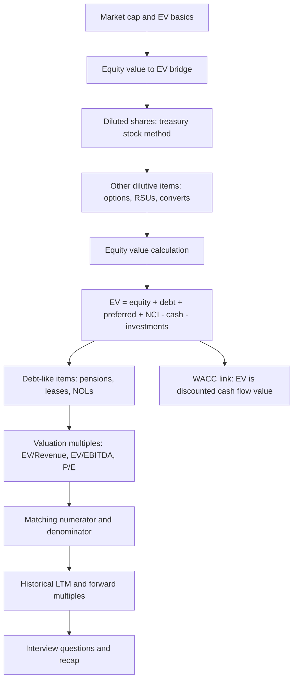
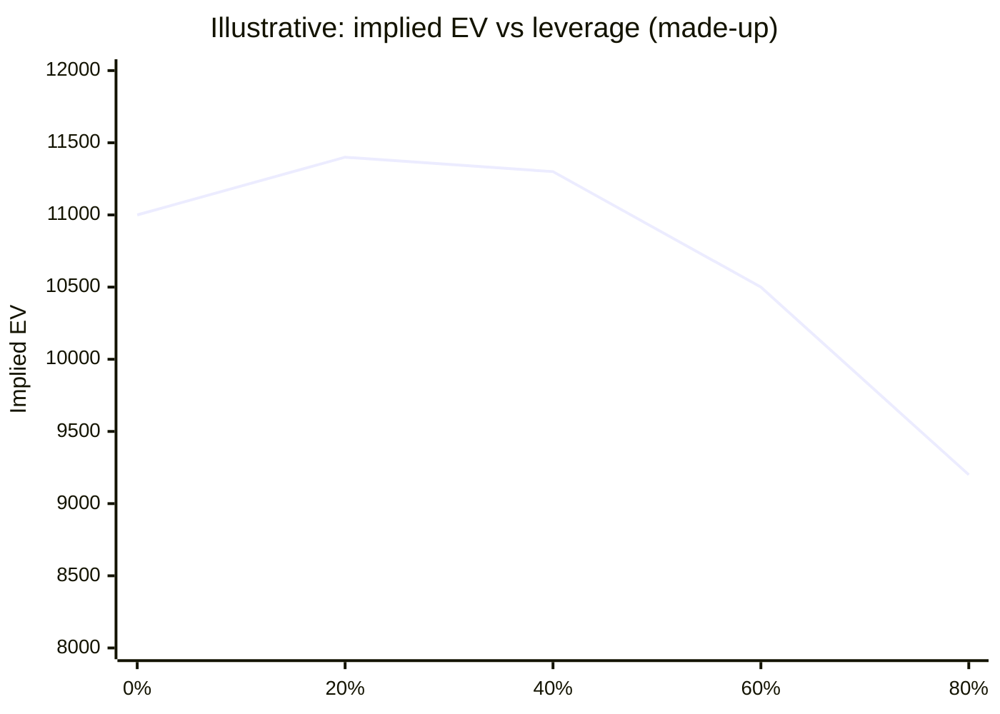
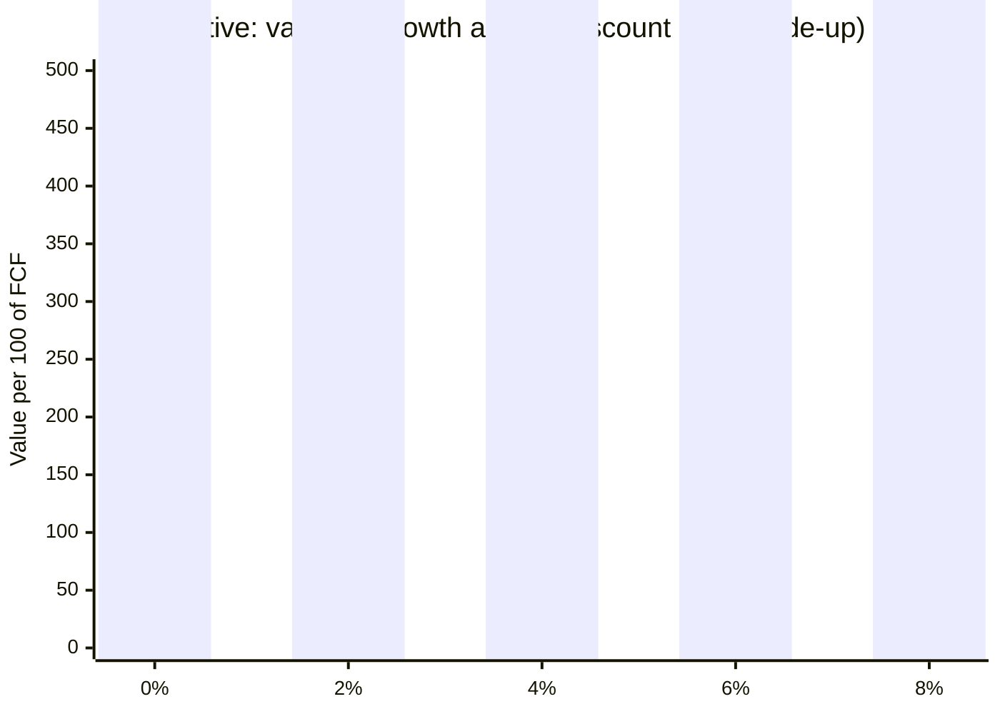
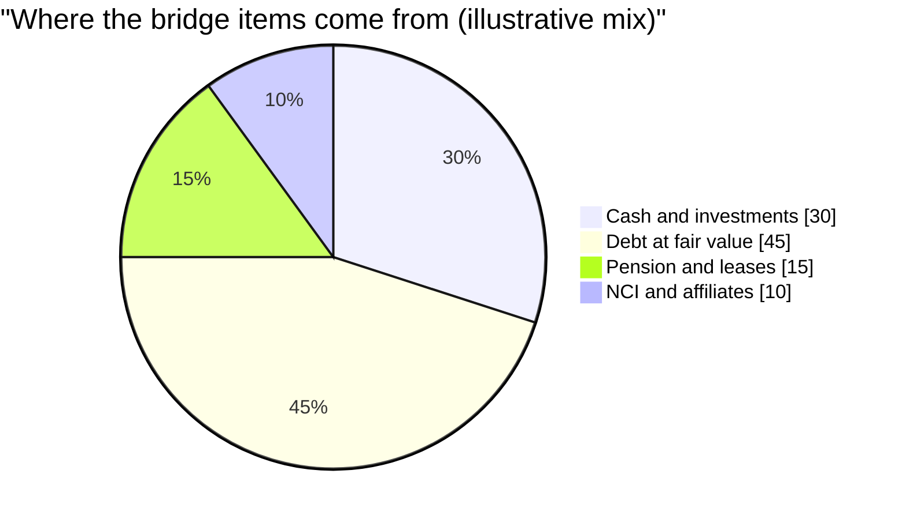
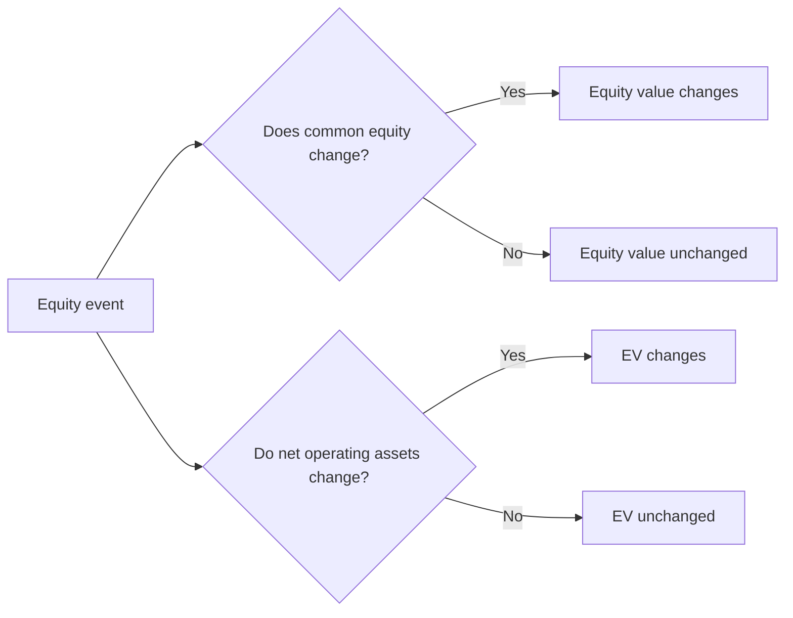

# Module 06: Equity Value and Enterprise Value

[← Previous: Module 05](05-advanced-3-statement-models.md) · [Contents](../README.md) · [Next: Module 07 →](07-valuation-and-dcf-analysis.md)

<details>
<summary><b>Contents</b></summary>

- [Overview](#overview)
- [Module Map](#module-map)
- [Lessons](#lessons)
  - [6.1 Equity Value and Enterprise Value, Meaning and Calculations](#61-equity-value-and-enterprise-value-meaning-and-calculations)
  - [6.2 How Events Change Equity Value and Enterprise Value](#62-how-events-change-equity-value-and-enterprise-value)
  - [6.3 Why Enterprise Value Is Not Truly Capital Structure Neutral](#63-why-enterprise-value-is-not-truly-capital-structure-neutral)
  - [6.4 The Equity Value Calculation, Diluted Shares and the Treasury Stock Method](#64-the-equity-value-calculation-diluted-shares-and-the-treasury-stock-method)
  - [6.5 Other Dilutive Items, Restricted Stock, RSUs, Performance Shares and Convertible Bonds](#65-other-dilutive-items-restricted-stock-rsus-performance-shares-and-convertible-bonds)
  - [6.6 The Equity Value to Enterprise Value Bridge](#66-the-equity-value-to-enterprise-value-bridge)
  - [6.7 Income Statement Valuation Metrics (Revenue, EBIT, EBITDA, EBITDAR, Net Income)](#67-income-statement-valuation-metrics-revenue-ebit-ebitda-ebitdar-net-income)
  - [6.8 Cash Flow Valuation Metrics (Free Cash Flow, Unlevered and Levered)](#68-cash-flow-valuation-metrics-free-cash-flow-unlevered-and-levered)
  - [6.9 How to Pair Valuation Metrics with Enterprise Value and Equity Value](#69-how-to-pair-valuation-metrics-with-enterprise-value-and-equity-value)
  - [6.10 Historical, LTM and Forward Multiples](#610-historical-ltm-and-forward-multiples)
  - [6.11 Equity Investments and Noncontrolling Interests](#611-equity-investments-and-noncontrolling-interests)
  - [6.12 Pensions](#612-pensions)
  - [6.13 Operating Leases and Capital Leases](#613-operating-leases-and-capital-leases)
  - [6.14 Net Operating Losses and Other Items](#614-net-operating-losses-and-other-items)
  - [6.15 Summary and Interview Questions](#615-summary-and-interview-questions)
- [Diagrams and Charts](#diagrams-and-charts)
- [Excel Model Walkthrough](#excel-model-walkthrough)
- [Interview Questions](#interview-questions)
- [Career Angle](#career-angle)
- [Cheat Sheet](#cheat-sheet)

</details>

## Overview

Equity value is what the shareholders own, enterprise value is what the whole business is worth to every capital provider, and the module teaches how to move between them cleanly (diluted shares, debt-like claims, cash-like assets) so that multiples are compared on the same basis.

The module builds in a fixed order. Lessons 1 to 6 are about getting from share price to equity value and then to enterprise value. Lessons 7 to 10 are about using those two numbers in multiples. Lessons 11 to 14 cover the adjustments that most people miss: minority stakes, pensions, leases and tax assets. Lesson 15 is a recap of likely interview questions.

## Module Map



## Lessons

### 6.1 Equity Value and Enterprise Value, Meaning and Calculations

- **Starting point.** A company's worth is the cash flow it throws off divided by the gap between the discount rate and the growth rate. That gives you a value for the whole business, but "company value" is ambiguous, because equity holders, debt holders and preferred holders all have a claim on it.
- **Market value versus implied value.** Market value is what investors pay today. Implied (intrinsic) value is what your own model says the business is worth. The two often differ, and that gap is the reason valuation work exists.
- **Equity value** is what common shareholders own: total assets minus total liabilities, but only the part that belongs to them. It is also called market cap for a public company.
- **Enterprise value** is the value of the operating business to every investor: equity, debt, preferred and others. It strips out non-operating assets (mostly cash and investments) and adds back claims held by other investor groups.
- **Why two metrics.** Equity value changes when the capital structure changes, even if the business has not changed. Enterprise value is more stable, because swapping equity for debt moves value between investor groups without changing the total pie.
- **Why the pairing makes sense.** A company can create equity internally through net income, so equity can fund any asset, core or not. Debt and preferred only come from outside investors, so they are usually used for core operations. That is why debt sits with enterprise value and not with a side business.
- **Calculation methods for current equity value.** (1) Share price times diluted shares. (2) Market value of assets minus market value of liabilities, which is mostly conceptual. (3) For private companies, the latest funding round or appraisal.
- **Calculation for current enterprise value.**

```
EV = Equity value + Debt (short and long term) + Preferred stock + Noncontrolling interest - Cash - Short and long term investments
```

- **Non-operating assets** usually include cash, financial investments, non-core property or side businesses, assets held for sale, discontinued operations and equity investments in companies owned less than 50 percent. Cash is treated as non-operating for simplicity even though some of it is needed day to day.
- **Other investor claims** include debt, preferred stock, capital leases (when used to buy PP&E), noncontrolling interests, and possibly unfunded pensions and operating leases. The last two are covered in later lessons.
- **Private companies** still have a share count and share price. The problem is that the price is not observable, so you usually skip current values and work with implied values from your own valuation.

> [!TIP]
> The "why does EV ignore financing" idea is the single most useful intuition in the module. In a real deal, EV is what a buyer pays for the operating engine before deciding how to fund it. Interviewers often ask "why do we use EV for comparing companies with different debt levels?" The answer is this same logic.

> [!WARNING]
> Common mistake: treating "market cap" as "what the company is worth." Market cap is only the equity slice. Two companies with the same market cap can have very different EVs if one carries much more debt.

**Worked example (made-up numbers).** Company Alpha has a share price of 20, with 500 shares outstanding. Equity value is 20 times 500, or 10,000. It has 2,000 of short-term plus long-term debt, 300 of preferred stock, no noncontrolling interest, and 1,800 of cash plus investments.

| Line | Amount |
|---|---|
| Equity value (20 x 500) | 10,000 |
| Plus debt | 2,000 |
| Plus preferred | 300 |
| Plus noncontrolling interest | 0 |
| Less cash and investments | (1,800) |
| **Enterprise value** | **10,500** |

Alpha's EV is a bit higher than its equity value because its cash is smaller than its claims from other investors.

### 6.2 How Events Change Equity Value and Enterprise Value

- **Two rules answer almost any question.** (1) Does common shareholders' equity change? If yes, equity value changes by the same amount. (2) Do net operating assets change? Operating assets minus operating liabilities. If yes, enterprise value changes by that amount. Rule 1 is true in about 95 to 98 percent of cases, not all of them (see the preferred stock example below).
- **Cash, debt, preferred and financial investments are non-operating.** Operating items are the ones tied to running the business: receivables, inventory, PP&E, payables, deferred revenue, goodwill acquired in a deal.
- **Capital structure moves usually leave EV unchanged.**
  - Issuing stock and holding the cash: equity value up, EV unchanged (cash is non-operating).
  - Issuing stock to buy another company: equity value up, and the acquired assets and goodwill are operating, so EV also goes up by the same amount.
  - Issuing debt and holding the cash: both debt and cash rise, so EV is unchanged.
  - Debt funded buyback: equity value falls, debt rises, EV unchanged.
  - Debt used to buy financial investments: debt and financial investments both rise, EV unchanged.
  - Preferred issued to fund a common buyback: equity value falls, preferred rises, net assets are unchanged, and EV is unchanged. This is the case where net assets stay flat but equity value still moves.
- **Operating changes.**
  - CapEx paid in cash: PP&E rises, cash falls. Equity value unchanged, EV up by the CapEx.
  - Inventory bought in cash: inventory is operating, so EV rises by the purchase.
  - Buying inventory and then selling it at a profit is a two-step process. Step one: buying 100 of inventory with cash raises EV by 100. Step two: the sale at 200 removes the inventory (EV falls by 100) and the after-tax profit of 75 lands in cash and equity. Equity value goes up by 75 and EV ends unchanged. EV is only temporarily higher in the middle.
  - Deferred revenue collected in cash: cash rises and the operating liability rises, so net operating assets fall. EV falls and equity value is unchanged on day one. When revenue is recognized later, EV is restored and equity value rises.
- **Unusual income statement items.**
  - Cash windfall (for example, a gain on finding cash): pre-tax gain, after-tax net income up, cash up, equity up. Equity value goes up, EV is unchanged because the gain is not operating.
  - Goodwill impairment: a non-cash charge. Net income falls, but the add-back means cash rises by the tax saving. Equity value falls by the after-tax charge, and EV falls by the full impairment, because goodwill is an operating asset.
  - Preferred dividends: they reduce net income to common and therefore common equity. They do not reduce the preferred stock balance. Cash falls, equity value falls, EV unchanged.
- **Simplification used in the lesson.** The tutorial assumes book taxes equal cash taxes so the walkthroughs stay readable. In a real model, the deferred tax schedule would change the cash flows slightly.

> [!TIP]
> Practical test for interviews: write the bridge in your head. Equity value moves with the equity line. EV moves with operating assets and liabilities only. Anything that changes cash and debt together, or equity and cash together, usually leaves EV alone.

> [!WARNING]
> Common mistake: assuming a debt raise increases EV. It does not, unless the money is spent on operating assets. Interviewers like to ask the same question with a different funding source to see if you can separate the two rules.

**Worked example (made-up numbers).** A company starts with cash 300, inventory 200, PP&E 1,000, debt 500, and common equity 1,000. Total assets are 1,500, which equals debt plus equity.

| Event | Equity value change | EV change | Why |
|---|---|---|---|
| Issue 100 of stock, hold cash | +100 | 0 | Equity up, cash is non-operating |
| Buy 100 of PP&E with cash | 0 | +100 | Operating asset up, cash down (non-operating) |
| Buy 100 of inventory, then sell it for 200 (after-tax profit 75) | +75 | 0 at the end (+100 in the middle) | Profit goes to equity and cash, both non-operating |
| Goodwill impairment of 100, tax saving 25 | -75 | -100 | Equity falls after tax, goodwill is operating |

### 6.3 Why Enterprise Value Is Not Truly Capital Structure Neutral

- **The idealized view.** Unlevered free cash flow belongs to all investors, so it should be discounted at WACC to get enterprise value. In that view, changing the debt and equity mix does not change EV.
- **Unlevered free cash flow build.** Start from revenue, take operating income (EBIT), subtract taxes on EBIT to get NOPAT, add back non-cash items such as depreciation, adjust for working capital, and subtract CapEx. Interest, interest income, and dividends are excluded, because they are how the capital providers get paid.
- **WACC blends the costs.** It weights the after-tax cost of debt by the debt share, the cost of equity by the equity share, and includes any preferred stock. Debt cost is after tax because interest is deductible.
- **Real life breaks the neutrality.** Changing the capital structure changes risk, which changes the cost of each piece, which changes WACC. This is why EV depends on capital structure, though less than equity value does.
- **Reasons the neutrality breaks.**
  - Taxes: interest is deductible, dividends are not, so more debt can lower WACC up to a point.
  - Bankruptcy risk: debt requires fixed payments, so beyond some leverage the cost of both debt and equity rises fast.
  - Agency costs: equity wants growth and risk, lenders want their money back, so their goals conflict.
  - Inefficient markets: prices of small or thinly traded securities may not reflect all information.
- **Shape of the curve.** At low leverage WACC drifts down because cheap debt helps, then rises quickly as distress risk builds. Implied EV therefore rises a little and then falls sharply. Higher tax rates push the peak to higher leverage.
- **Where it matters most.** The effect is most important for implied EV from a DCF, where the discount rate is an assumption about the future capital structure. For current EV it matters mainly for large, long-term changes, not small ones.

> [!TIP]
> The honest answer to "is EV capital structure neutral?" is "less than equity value, but not perfectly." Say that in an interview, then explain the discount rate channel.

**Worked example (made-up numbers).** Assume a company with unlevered FCF of 100 a year growing at 2 percent, and a WACC of 9 percent. Using the value formula from Lesson 1:

```
Implied EV = FCF / (WACC - g) = 100 / (9% - 2%) = 1,429
```

If higher debt moves WACC to 10 percent, the same FCF gives 100 / 8% = 1,250. Nothing about the operating business changed, but the implied EV fell by about 180 because the discount rate rose.

### 6.4 The Equity Value Calculation, Diluted Shares and the Treasury Stock Method

- **Basic equity value** is share price times the common shares outstanding. Finance sites do this in a second. The share count comes from the front of a 10-K or 10-Q for US filers. For IFRS filers, search for "shares outstanding" and use the end-of-period figure, not the weighted average, because the count changes during the year.
- **Dilutive securities** are instruments that could create new shares: employee stock options, warrants, RSUs, restricted stock, performance shares and convertible bonds. They already exist. The question is whether you count them.
- **Why companies grant options.** They keep staff for the long term and they reduce cash pay. Options only pay if the share price rises above the strike.
- **Options outstanding versus exercisable.** For a standalone valuation use exercisable options, because unvested options cannot create shares yet. In a takeover analysis, you often assume all options vest.
- **Treasury stock method (TSM).** The convention assumes in-the-money options are exercised. The holder pays the strike, the company gets that cash, and it uses the cash to buy back shares at the current price. Only the net new shares count.

```
If strike > share price:       new shares = 0
If strike <= share price:      new shares = options - (options x strike / share price)
Diluted shares = basic shares + sum of new shares from every tranche
Diluted equity value = share price x diluted shares
```

- **Tranches.** Companies often list several grants with different strikes. Use each tranche separately because a deep in-the-money tranche and an out-of-the-money one behave very differently. Using one blended strike is acceptable as a simplification if the difference is small.
- **Warrants.** Treat employee-granted warrants with the TSM. Third-party written options and warrants traded on the market are based on existing shares, so they do not add shares and you ignore them.
- **Check your work.** The company's own "diluted shares" line in the income statement is a useful benchmark. If your estimate is within about 5 percent, you are probably on track. It can differ because that line uses the weighted average and includes other instruments.
- **Special cases.**
  - Private companies usually cannot be done this way, because there are no public filings.
  - Multiple share classes: add each class's shares times the share price.
  - Negative net income: companies do not report diluted shares, because adding shares would make the loss per share look smaller, which is anti-dilutive by definition.

> [!TIP]
> The TSM is a convention, not a cash flow. Real exercises can happen at different prices, and companies rarely buy back the exact shares. Treat it as standardization so that comparisons across companies use the same rule.

> [!WARNING]
> Common mistake: using the weighted average share count from the income statement as if it were the current share count. Always use the most recent end-of-period count for equity value.

**Worked example (made-up numbers).** A company has 500 million basic shares, a share price of 40, and two option tranches: 10 million at a strike of 25 and 5 million at a strike of 45.

| Tranche | Options (m) | Strike | In the money? | New shares (m) |
|---|---|---|---|---|
| A | 10 | 25 | Yes | 10 - (10 x 25 / 40) = 3.75 |
| B | 5 | 45 | No, strike above price | 0 |
| Total | | | | 3.75 |

Diluted shares = 500 + 3.75 = 503.75 million. Diluted equity value = 40 x 503.75 = 20,150 million, against basic equity value of 20,000 million.

### 6.5 Other Dilutive Items, Restricted Stock, RSUs, Performance Shares and Convertible Bonds

- **Accuracy target.** Public filings rarely settle every detail. Getting within about 2 percent of the company's own diluted count is good, 10 to 15 percent off means go back and check.
- **Restricted stock** (actual shares with vesting conditions) is normally already in the common share count. Check before adding, or you double count.
- **RSUs** are promises to deliver shares once a time condition is met. They are not usually in the share count, so add them in full. There is no strike to pay.
- **Performance shares** vest only if a target is hit (for example, a revenue, EBITDA or share price goal). The treatment is usually all or nothing. Count them if the goal is met or if the filing treats them as likely dilution, otherwise leave them out, and note the judgment.
- **Companies disagree on what counts.** Some filings list dilutive securities that another filing excludes. When the filing's own definition differs from your count, pick one approach, document it, and move on. A gap of about 5 percent rarely matters for early-stage work.
- **Convertible bonds use the if-converted test, not the treasury stock method.** The investors already paid for the bond, so the company gets no cash on conversion.

```
If conversion price > share price:   new shares = 0, keep the bond as debt in the EV bridge
If conversion price <= share price:  new shares = bond principal / conversion price, remove the bond from debt
```

- **Use face (principal) value, not book value.** Under current accounting, convertibles are split into a debt piece and an equity piece, with an unamortized discount. The balance sheet number understates the claim. Use the principal to compute shares, and fair value if you keep the bond as debt in the bridge.
- **Capped calls and note hedges.** Many issuers buy call options on their own stock at the conversion price, and sell warrants at a higher strike. The calls offset dilution from the bonds, up to the point where the warrants come into the money. The warrants are then handled with the treasury stock method.

```
Hedge dilution = MIN(convert shares, capped call shares) offsets the bond shares
Warrant dilution = TSM on warrants (zero if warrant strike > share price)
Net new shares = (convert shares - MIN(convert shares, call shares)) + warrant dilution
```

- **Why the hedge matters.** At low prices the company effectively has no dilution from the bond. Above the warrant strike, net dilution comes back, but at a higher price than the bond's conversion price alone would imply.

> [!TIP]
> Hedges cost money up front, so they are a way to push the effective conversion price higher. In interviews, say that the hedges "cap" the dilution in a middle price range, then explain the warrant strike.

> [!WARNING]
> Common mistake: counting a capped-call-hedged convert at full dilution and also leaving the bond in debt. Pick one: shares or debt, and check the filing for the hedge terms.

**Worked example (made-up numbers).** A convertible with principal 400 and conversion price 50. Share price 60, so the bond converts. Convert shares = 400 / 50 = 8 million. Suppose a capped call covers 8 million shares at a strike of 50 and the company also sold warrants on 8 million shares at a strike of 80.

| Share price | Convert shares | Capped call offset | Warrant TSM | Net new shares |
|---|---|---|---|---|
| 60 | 8.0 | 8.0 | 0 (strike 80 is above price) | 0.0 |
| 90 | 8.0 | 8.0 | 8 - (8 x 80 / 90) = 0.89 | 0.89 |

At 60 the hedge cancels the bond's dilution. At 90 the warrants are in the money, so a small net dilution returns.

### 6.6 The Equity Value to Enterprise Value Bridge

- **Start with the market value of equity.** Diluted shares times share price (from lessons 4 and 5).
- **Subtract non-operating assets.** Cash first, then short and long term financial investments, then equity investments in affiliates, then any other non-core assets (assets held for sale, discontinued operations) and the tax value of net operating losses.
- **Add other investor claims.** Total debt (fair value where disclosed), preferred stock, noncontrolling interests, capital leases, unfunded pensions (after tax where contributions are deductible), and operating leases only where the accounting standard requires it (see below).
- **Start from the balance sheet, then go to the notes.** Cash and investments can usually be read directly. Debt often needs the notes, because the balance sheet shows carrying value (net of discounts and issuance costs) while the fair value may be different. Use the fair value when it is disclosed.
- **Debt cannot be double counted.** Fair value of a debt line usually already includes the current portion. If you add the current portion again, you overstate debt.
- **Treat swaps and hedge adjustments as part of debt** when the filing shows them within the debt balance.
- **Deferred income taxes** are usually left out of the bridge, because they are a timing item and not a financing claim. Other non-current liabilities depend on what is in them, so read the note.
- **Unfunded pensions.** Count only the deficit (obligation above plan assets). A surplus does not offset other claims. In the US, multiply by one minus the tax rate, because contributions are deductible. Many non-US plans are not deductible, so no tax adjustment.
- **Operating leases.** Under US GAAP, do not add operating lease liabilities to the bridge if you want EBITDA-based multiples to stay consistent. Under IFRS, lease expense is split into depreciation and interest, so EBITDA excludes the whole lease cost. Then you must add the full lease liability to EV so that EV pairs with EBITDA.
- **Convertibles** are debt if out of the money, and zero if converted (in which case the shares went into the count in lesson 5).
- **Net operating losses.** Losses from prior years can shelter future taxes. The bridge deducts their value, which normally needs a valuation allowance adjustment.

> [!TIP]
> Keep a short checklist: cash, investments, equity affiliates, non-core assets, NOLs (subtract); debt at fair value, preferred, NCI, capital leases, pension deficit after tax, IFRS operating leases (add). Converts are one or the other.

> [!WARNING]
> Common mistake: taking the entire pension line or the entire lease line from the balance sheet without checking the note. Many companies have surpluses in some plans and deficits in others, and the bridge only counts the deficit.

> [!WARNING]
> Another common mistake: forgetting that "total debt" on an IFRS company might include lease liabilities, and then adding leases a second time.

**Worked example (made-up numbers).** A US company with the following figures:

| Line | Amount | Notes |
|---|---|---|
| Diluted equity value | 9,000 | Share price times diluted shares |
| Less cash | (800) | Balance sheet |
| Less marketable securities | (200) | Short and long term |
| Less equity affiliates | (150) | Balance sheet carrying value |
| Plus debt at fair value | 3,100 | Fair value disclosed in notes |
| Plus preferred | 0 | None |
| Plus noncontrolling interest | 120 | Balance sheet |
| Plus unfunded pension (deficit 200, after tax at 25 percent) | 150 | 200 x (1 - 0.25) |
| Operating leases (US GAAP) | 0 | Excluded for EBITDA consistency |
| **Enterprise value** | **11,220** | |

If the same company reported under IFRS, the operating lease liability (say 400) would be added, giving an EV of 11,620.

### 6.7 Income Statement Valuation Metrics (Revenue, EBIT, EBITDA, EBITDAR, Net Income)

- **Why metrics.** A big EV or equity value means nothing alone. Divide by a metric that measures the company's size or earnings power, and you get a multiple you can compare. A 10x multiple is cheaper than a 15x multiple, all else equal.
- **Why not cash flow first.** Unlevered FCF is the ideal numerator, but cash flow statements differ across companies and accounting systems, and cleaning them takes time. Income statement metrics are faster and more comparable, so they are the default for quick comparisons.
- **Revenue** is the top line. It ignores margins entirely, so it is useful for early or loss-making companies.
- **EBIT** is operating income, adjusted for non-recurring charges. It sits above interest and taxes, so it is independent of capital structure and tax rate.
- **EBITDA** is EBIT plus total depreciation and amortization. Take the full D&A from the cash flow statement, because some depreciation sits inside cost of sales and is not shown on its own line. Do not add back amortization of financing fees or debt discounts, since those sit in interest expense.
- **EBITDAR** is EBITDA plus rent and lease expense. Under US GAAP the operating lease cost is disclosed (often in the notes), and you should net any sublease income so that revenue and EBITDAR stay consistent.
- **Net income** should be net income to common (after preferred dividends and noncontrolling interest). Most analysts use the reported number without adjustment.
- **Non-recurring charges.** Restructuring, legal settlements, merger costs, impairments and write-downs can be added back to EBIT if they are rare. If a company has restructuring every year, it is recurring, and adding it back flatters the metric. Check both the income statement and the cash flow statement.
- **NOPAT** is EBIT times one minus the tax rate. It is a preview of the DCF.
- **Rough relationships.** For mature companies, EBIT tends to track free cash flow after CapEx, and EBITDA tracks cash from operations. The link weakens for capital-light or high-growth firms.

**Pairings you must remember.**

| Metric | Pair with | Why |
|---|---|---|
| Revenue, EBIT, EBITDA | Enterprise value | Available to all investors, before interest |
| EBITDAR | Enterprise value, with operating leases added to EV | Lease expense is removed, so leases must be in EV |
| Net income to common | Equity value | Debt and preferred have already been paid |

**Accounting trap (leases).** Since 2019 both US GAAP and IFRS show lease liabilities on the balance sheet, but the income statement differs.

- Under US GAAP, operating lease cost is a rent expense inside operating costs. EBIT and EBITDA already include it, so leave operating leases out of EV for EBIT and EBITDA multiples. For EBITDAR, add them, because the expense is removed.
- Under IFRS, lease cost is split into depreciation and interest, and the split is not always visible. EBIT only deducts part of the lease cost, so EV/EBIT is unreliable. EBITDA and EBITDAR exclude all of it, so the full lease liability must go into EV.
- Rule to remember: if the numerator includes an item, the denominator must exclude its expense.

> [!TIP]
> Quick IFRS tip: when you see "income from operations" that is higher than EBIT, the company has likely added back some depreciation or restructuring. Re-derive from the bottom up.

> [!WARNING]
> Common mistake: using the cash flow statement's starting line as EBIT under IFRS. Some companies start the cash flow statement from EBIT and skip interest and taxes, so you have to build cash from operations yourself.

**Worked example (made-up numbers).** A US retailer with the following 2030 figures (in millions):

| Line | Amount | Source |
|---|---|---|
| Revenue | 20,000 | Income statement |
| Operating income | 1,200 | Income statement |
| Restructuring (rare, added back) | 100 | Notes |
| EBIT | 1,300 | 1,200 + 100 |
| Depreciation and amortization (full) | 700 | Cash flow statement |
| EBITDA | 2,000 | 1,300 + 700 |
| Operating lease cost | 300 | Notes |
| Sublease income | (20) | Notes |
| EBITDAR | 2,280 | 2,000 + 300 - 20 |
| Tax rate | 25 percent | |
| NOPAT | 975 | 1,300 x 0.75 |
| Net income to common | 650 | Bottom line |

Multiples: if EV is 16,000, EV/Revenue is 0.8x, EV/EBIT is 12.3x, EV/EBITDA is 8.0x, and EV/EBITDAR is computed with the operating lease liability added to EV, which this example does not include.

### 6.8 Cash Flow Valuation Metrics (Free Cash Flow, Unlevered and Levered)

- **Why cash flow metrics are harder.** Definitions vary by company and standard, and the statements are messy. That makes them weak for peer comparisons, but useful for judging one company on its own.
- **Three flavors, three audiences.**

| Metric | Formula in words | Matches | Typical use |
|---|---|---|---|
| Free cash flow (FCF) | Cash from operations minus CapEx | Equity value | Ability to repay debt, pay dividends, buy back shares |
| Unlevered FCF (UFCF) | NOPAT plus D&A, plus other non-cash items, minus working capital build, minus CapEx | Enterprise value | DCF, the core valuation cash flow |
| Levered FCF (FCFE) | Net income to common plus D&A and other items, minus working capital build, minus CapEx, plus or minus net debt activity | Equity value | Equity-side analysis, with contested debt treatment |

- **FCF** starts from cash from operations, which should already have interest, preferred dividends and taxes deducted. If a company's statement starts from EBIT, or includes lease costs in a different place, you must adjust before using it.
- **UFCF** is built from NOPAT, which is EBIT times one minus the tax rate. Add back D&A and selected non-cash items, adjust working capital, subtract CapEx. Ignore interest, other income, financing flows and most investing flows.
- **Items you should not add back.** Stock-based compensation is a real cost because it dilutes shareholders. Non-recurring charges are already gone if you start from clean EBIT. Amortization of debt discounts and fees sits in interest, so it is not in EBIT at all.
- **Deferred taxes.** They can be included as a recurring item, but in projections they should stay a small share of UFCF.
- **Non-operating income.** Income from equity investments and associates is unrelated to core operations, so leave it out.
- **Levered FCF** is the hardest to pin down. The starting point is net income to common. You then add D&A, adjust working capital and CapEx, and decide how much debt to repay and whether to include new borrowing. Analysts disagree on which debt flows to include, which is why it is rarely used as a comparison metric.
- **IFRS complications.** Lease costs appear as depreciation and interest, so UFCF must deduct the interest portion of leases, and you must avoid adding back the lease amortization. The cash flow statement may start from EBIT and skip interest, so you must deduct interest and cash taxes yourself. If the numbers look nonsensical (for example, levered FCF far above unlevered FCF), the statement setup is the likely cause.

> [!TIP]
> Rule of thumb: UFCF pairs with EV, levered FCF pairs with equity value, and the difference between them is the after-tax interest plus net debt flows. If the two move in opposite directions, check your debt flows.

> [!TIP]
> In a DCF, the numbers you actually project are UFCF. Projecting levered FCF forces you to forecast debt paydown, which mixes operating and financing assumptions.

> [!WARNING]
> Common mistake: using FCF as "cash the business earned" and forgetting that FCF may still be before mandatory debt service. Read the definition used in the filing or your model before comparing.

**Worked example (made-up numbers).** A company with EBIT 1,000, tax rate 25 percent, D&A 300, a working capital increase of 100, and CapEx of 400. Net interest expense is 120 and it pays no preferred dividends.

| Line | Unlevered | Levered |
|---|---|---|
| EBIT | 1,000 | 1,000 |
| Less interest | 0 | (120) |
| Pre-tax income | 1,000 | 880 |
| Tax at 25 percent | (250) | (220) |
| NOPAT or net income | 750 | 660 |
| Plus D&A | 300 | 300 |
| Less working capital increase | (100) | (100) |
| Less CapEx | (400) | (400) |
| **Cash flow** | **550** | **460** |

Levered FCF is lower by 90, which is the after-tax interest (120 x 0.75). Unlevered FCF is the amount available to all investors, and levered FCF is what is left for shareholders.

### 6.9 How to Pair Valuation Metrics with Enterprise Value and Equity Value

- **Rule 1: follow the money down the statements.** If a metric is after net interest and preferred dividends, it is available only to common shareholders, so pair it with equity value. Net income, FCF and levered FCF all work this way. Unlevered FCF starts before interest, so it pairs with EV.
- **Rule 2: match numerator and denominator.** If the metric excludes an expense (for example, EBITDA excludes interest, EBITDAR excludes rent), the EV in the numerator must include the matching balance sheet claim (debt, operating lease liabilities). If the metric deducts the expense, do not add its balance sheet line.
- **Rule 3: no half-way measures.** Do not mix equity and EV in one number, and do not add back part of an expense. Each adjustment is all or nothing.
- **Balance sheet metrics follow the same logic.** Book value is net assets to common holders, so P/BV pairs with equity value. Net operating assets and invested capital pair with EV, and operating leases must be treated the same way on both sides.
- **IFRS twist.** EBIT is not valid for IFRS companies because it deducts lease depreciation but not lease interest. EBITDA and EBITDAR are the same under IFRS, and both pair with EV including leases. Unlevered FCF built with the full rent deducted is an exception that pairs with EV excluding leases.

| Metric (denominator) | Pair with | Numerator detail |
|---|---|---|
| Revenue | EV | Standard EV |
| EBIT (US GAAP) | EV | EV excluding operating leases |
| EBITDA (US GAAP) | EV | EV excluding operating leases |
| EBITDAR | EV | EV including operating leases |
| Net income to common | Equity value | None |
| FCF and levered FCF | Equity value | None |
| Unlevered FCF | EV | Excluding operating leases if rent is deducted |
| Book value | Equity value | Common equity only |
| Net operating assets | EV | Standard EV |

> [!TIP]
> Interview version: "Anything after interest is an equity number. Anything before interest is an EV number. Then make sure the lease and debt lines in EV match whatever expense you did or did not take out of the denominator."

**Worked example (made-up numbers).** A company with equity value 5,000, EV excluding leases 6,500, lease liability 500 (so EV including leases is 7,000), net income 400, EBITDA 900, and EBITDAR 1,000 (rent 100 added back).

| Multiple | Calculation | Result |
|---|---|---|
| P/E | 5,000 / 400 | 12.5x |
| EV/EBITDA | 6,500 / 900 | 7.2x |
| EV/EBITDAR | 7,000 / 1,000 | 7.0x (lease liability added to EV) |

### 6.10 Historical, LTM and Forward Multiples

- **Historical (trailing) multiples** use the last reported fiscal year, or the last twelve months (LTM, also called TTM) if newer quarters exist. They show what actually happened, but acquisitions, divestitures and accounting changes can distort them.
- **LTM calendarization.** LTM = last fiscal year + current year-to-date - prior year same period. Example: at mid-August with Q1 and Q2 reported, LTM = FY + (Q1 + Q2 this year) - (Q1 + Q2 last year). The same answer comes from summing the last four quarters directly.
- **Forward multiples** use consensus projections for the next one or two years. They avoid past one-off distortions but depend on forecasts that may be wrong.
- **Rule: always use the current EV (or current equity value) in every multiple,** whether the denominator is historical or projected. You never project the EV itself.
- **Use a range of multiples.** No single multiple tells the full story. Look at revenue, EBITDA, P/E and UFCF together, across LTM and forward periods.
- **Endgame: implied value from peers.** Take the peer multiple range, apply it to the target's metric, and you get an implied EV or equity value. If peers trade at 11x to 13x EBITDA and the target is at 10x, the target looks cheap, all else equal.
- **Growth explains multiples.** Under the value formula, with similar risk, a higher growth rate lifts the value by much more than it lifts the cash flow, so faster growers deserve higher multiples.

**Worked example (made-up numbers).** A company with next year's FCF of 100 and a 10 percent discount rate:

| Growth rate | Value = FCF / (r - g) | Value / FCF (x) |
|---|---|---|
| 0% | 100 / 0.10 = 1,000 | 10.0x |
| 3% | 100 / 0.07 = 1,429 | 14.3x |
| 5% | 100 / 0.05 = 2,000 | 20.0x |

FCF grows by only 5 percent between the first and last rows, but the multiple doubles. Growth matters most when it sits close to the discount rate.

**Peer comparison (made-up).** Company X has revenue growth of 5 percent, EV/EBITDA of 9x, and a peer median of 10x at 5 percent growth. X looks fairly priced. Company Y has 25 percent growth and 6x revenue, against a peer median of 12x at 20 percent growth. Y may be mispriced, but first check whether the peers are truly comparable in size, geography, margins and accounting.

> [!TIP]
> Multiples are a fast screen, not a verdict. Distortions include different accounting for leases, one-off charges, seasonal businesses and conglomerates that should be split by segment.

> [!WARNING]
> Common mistake: using the forward EBITDA with an EV from last year, or projecting EV one year out "to match" a forward metric. Keep today's EV fixed and change only the denominator.

> [!TIP]
> Data sources: a bank uses Capital IQ, FactSet or Bloomberg. Free sites such as Yahoo Finance or Finviz give consensus numbers, but check their definitions against yours, especially for leases.

### 6.11 Equity Investments and Noncontrolling Interests

- **Optional lesson.** Entry-level interviews rarely go deeper than the simple answer. Know the two-line version and the reason.
- **Equity investments (under 50 percent owned).** The stake is a single non-operating asset. Financials are not consolidated, so you only see your share of the affiliate's net income at the bottom of the income statement. Subtract the stake's value in the EV bridge, so that EBIT and EBITDA, which exclude it, match EV.
- **Noncontrolling interests (over 50 percent owned, under 100 percent).** The parent consolidates 100 percent of the subsidiary's revenue, costs and EBIT, and then deducts the NCI share of net income at the bottom. Equity value already includes only the parent's share. So add the NCI (the part not owned) to EV, which gives EV 100 percent of the subsidiary, matching the 100 percent EBIT.
- **The core logic.** Equity value captures the stake at its market value. Income statement metrics capture either 0 or 100 percent. EV has to be adjusted so that numerator and denominator reflect the same share.
- **Simplest interview answer.** Subtract equity investments because they are non-core. Add NCI because it is another investor group, with minority holders who have limited control.

**Worked example A: equity investment (made-up numbers).** Parent equity value 500, cash 80, debt 300. It owns 40 percent of an affiliate worth 150, so the stake is 60.

```
EV = 500 - 80 + 300 - 60 = 660
```

**Worked example B: NCI (made-up numbers).** Parent equity value 600, cash 60, debt 250. It owns 70 percent of a subsidiary worth 200, so equity value already includes 140. The subsidiary's NCI is 30 percent of 200, which is 60.

```
EV = 600 - 60 + 250 + 60 = 850
```

EV now reflects 100 percent of the subsidiary (140 in equity value plus 60 NCI), matching 100 percent of its EBIT in the denominator.

> [!WARNING]
> Terminology trap. "Minority interest" was renamed "noncontrolling interest." Some people still call equity investments "minority interests" too. Say "equity investment" or "associate company" for under 50 percent, and "noncontrolling interest" for the part you do not own in a consolidated subsidiary.

> [!TIP]
> Forecasting note: in a model, equity investment earnings add to net income but are reversed on the cash flow statement, with only dividends received counted as cash. NCI income reduces net income to the parent, then is added back, with only the parent's share of dividends counted as cash.

> [!WARNING]
> Common mistake: adding NCI for an equity investment (under 50 percent) or subtracting the stake for a majority-owned sub. The direction depends entirely on the ownership percentage.

### 6.12 Pensions

- **Optional lesson.** Pensions are advanced. Know the short version: add the deficit, tax-adjust if contributions are deductible, keep service cost in EBIT, and skip the rest.
- **Only defined-benefit plans matter.** A 401(k) is a defined-contribution plan. The company only matches contributions, so there is no liability on the balance sheet and nothing goes in the EV bridge.
- **Pension deficit in EV.** Deficit = projected benefit obligation minus plan assets, floored at zero. A surplus gives the company no credit. Combine all plans (qualified, nonqualified, international, retiree health) before you net.
- **Why it counts as debt.** Employees accept lower pay today in exchange for future payments. That is financing in substance, so it is a claim on the enterprise.
- **Tax adjustment.** Multiply by one minus the tax rate only where contributions are tax-deductible (typically the US). Many non-US plans are not deductible, so no adjustment.
- **Pension expense components.** Service cost is operating (earned by working this year), and belongs in EBIT and EBITDA. Interest cost, expected return on assets, amortization of gains and losses, settlements and other items are financing or non-cash, so they are excluded.
- **Watch for misplaced expense.** Some companies bury service cost in other income, or pension interest in operating costs. Find the note that says where each component is recorded and adjust if needed.
- **Assumption risk.** Discount rates and expected returns drive the deficit. Adjusting for a company's optimistic assumptions is rarely worth the effort unless the gap is huge.
- **Effect on multiples.** Small for most companies. Both the deficit adjustment and the expense adjustment usually move multiples by a fraction of a turn.
- **Flows through the statements.** Interest costs change equity value but not EV, because they are financing items and the cash effect runs through deferred taxes. Service cost can change both. Benefit payments net to zero. Contributions usually leave EV alone, unless they flip the plan from underfunded to overfunded.

**Worked example (made-up numbers).** Plan obligation 1,200, plan assets 900, so the deficit is 300. Contributions are tax deductible at a 25 percent rate.

```
Pension adjustment to EV = MAX(0, 1,200 - 900) x (1 - 0.25) = 300 x 0.75 = 225
```

If assets were 1,300 instead, the plan is in surplus, and the adjustment is MAX(0, -100) = 0.

> [!TIP]
> Interview version: "Unfunded pension is a debt-like claim. Use the deficit, tax-effect it where contributions are deductible, and keep only service cost in operating metrics."

> [!WARNING]
> Common mistake: adding a surplus. Also, a surplus is never a credit against other debt-like items. Net the plans together only to get the total deficit, and then floor that total at zero.

### 6.13 Operating Leases and Capital Leases

- **Capital leases: always debt.** They carry interest and depreciation, which are excluded from EBIT-type metrics, so their balance sheet liability goes into EV. They enter EV just like any other debt.
- **Operating leases depend on the accounting system.**
  - Pre-2019 (old rules): leases were off balance sheet, and rent was a plain operating expense. Nothing to add to EV.
  - US GAAP (since 2019): lease liabilities and right-of-use assets are on the balance sheet, but rent stays one operating expense. You can add the liability to EV, but then you must pair EV with EBITDAR. Otherwise leave it out and use EV/EBITDA and EV/EBIT.
  - IFRS 16: rent is split into depreciation (operating) and interest (financing). EBIT is unreliable, and EBITDA equals EBITDAR. Add the lease liability to EV and pair it with EBITDA.
- **The same total expense.** The rule changes presentation, not total cash cost. Net income and cash stay about the same, but IFRS shows higher EBITDA and higher cash from operations, offset by a financing line for repaying lease principal.
- **Returns metrics.** When computing ROIC with operating leases in invested capital, NOPAT must exclude the lease interest element but keep the lease depreciation. Otherwise the numerator and denominator disagree.
- **Flow through the statements (model logic).**
  - Capital lease issued and used to buy PP&E: EV rises by the asset purchase. Interest then starts to reduce net income and equity value.
  - Operating lease asset and liability rising in lockstep: under US GAAP, both are operating or non-debt items, so net operating assets and EV do not change. Under IFRS, the asset is operating and the liability is a claim, so EV moves.

**Worked example (made-up numbers).** An airline pays 100 of rent a year, and its lease liability is 800.

| Rule | EV basis | Metric pairing | Result |
|---|---|---|---|
| US GAAP, leases excluded from EV | EV without 800 | EV/EBITDA | Valid |
| US GAAP, leases included in EV | EV with 800 | EV/EBITDAR (EBITDA + 100) | Valid, must use EBITDAR |
| IFRS, leases included in EV | EV with 800 | EV/EBITDA (rent already split out) | Valid |
| IFRS, EBIT | n/a | EV/EBIT | Not valid, rent only partly deducted |

> [!TIP]
> Interview version: "Capital leases are debt. Operating leases are debt only under IFRS, or under US GAAP when you pair EV with EBITDAR. Whichever you choose, the numerator and denominator must both include or both exclude the lease."

> [!WARNING]
> Common mistake: adding operating leases to EV under US GAAP but still using EV/EBITDA. That counts the lease in the numerator but leaves its expense in the denominator.

### 6.14 Net Operating Losses and Other Items

- **Optional lesson.** The basics matter (NOLs are subtracted, goodwill is not), and the debates over provisions and deferred taxes are background.
- **NOL basics.** A tax loss creates a deferred tax asset equal to the loss times the tax rate. Future profits use it to reduce cash taxes. Model book taxes as pre-tax income times the rate, then adjust cash taxes separately.
- **NOLs in the bridge.** Subtract only the on-balance-sheet NOL piece, because it is a non-core asset that does not come from operations. Other deferred tax assets (from stock comp, PP&E, leases) stay operating.
- **Valuation allowance.** If the company expects to use only part of its NOL, it books an allowance. Scale the NOL down by the same share (an approximation when the allowance is not split by source). In a standalone case, this shrinks the NOL you subtract, because the company probably cannot use most of it.
- **M&A view.** A buyer may use the seller's NOLs, which makes them more valuable in a deal, so the treatment is a judgment call there.
- **Goodwill and other intangibles** are operating assets. They come with acquired businesses that still operate, so never subtract them.
- **Industry-specific operating assets** (for example, content libraries at media companies) are operating too.
- **Provisions.** Read the note. Pension-like or interest-bearing parts count. Restructuring, litigation and onerous contract provisions usually do not, because they have no ongoing financing payment. Count them only if one is large enough to change the company's capital structure.
- **Deferred tax liabilities** are generally excluded. They are non-interest-bearing, timing-uncertain, and not a financing source.

> [!TIP]
> Interview version: "NOLs are non-operating, so subtract them. Goodwill is operating, so don't. Provisions and deferred taxes are not investor claims, so I leave them out unless they are interest-bearing or big enough to change capital structure."

> [!WARNING]
> Common mistake: subtracting the full deferred tax asset or adding the full deferred tax liability. Only the NOL piece is in the bridge, and it is the on-balance-sheet version net of any allowance.

**Worked example (made-up numbers).** A company reports an NOL carryforward of 300 and a valuation allowance of 250. If the allowance applies proportionately, the usable NOL is 300 x (1 - 250 / 300) = 50. Subtract 50 in the bridge.

### 6.15 Summary and Interview Questions

- **Recap of the whole module.**
  - Equity value is net assets to common holders. EV is net operating assets to all investors.
  - Equity value = diluted shares x price. EV = equity value - non-operating assets + other investor claims.
  - Equity value moves when common equity moves. EV moves when net operating assets move.
  - Dilution: TSM for options and warrants, add RSUs, if-converted for convertibles, capped calls handled separately.
  - Multiples: pair income and cash flow metrics with equity value or EV using the three rules in lesson 9.
  - Historical, LTM and forward multiples each have a job. Keep the EV or equity value at today's date.
  - Peer multiples plus growth give a quick read on relative value.
- **Interview question themes from the lesson.** Basic definitions, diluted shares, how EV and equity value change for dividends, stock issuances, debt, PP&E, and the right pairing for each multiple. Obscure pension math is unlikely.

## Diagrams and Charts









Note on the charts: the first two are illustrative and use made-up numbers, not company data. The first is a stylized version of the shape in lesson 3: EV edges up at low leverage while WACC dips, then falls as distress risk builds. The second shows how the value formula amplifies growth.

## Excel Model Walkthrough

The workbooks mirror the three-statement layout from the accounting module: inputs at the top, statements or bridge below, and check rows at the bottom. Sheet names below are the ones in the model files. Company tabs (TGT, VIV, ZEN) are the same three companies used throughout the lessons, but the numbers are not reproduced here.

| Workbook (lesson) | Tabs | What it does |
|---|---|---|
| Equity value versus EV (1) | Eq-Value-Ent-Value, Simple-3-Statements | Current equity value and EV from share price, shares and balance sheet items, plus a small three-statement model for examples |
| How EV and equity value change (2) | Eq_Val_Ent_Value_Changes | Inputs for tax rate, share price, shares, starting cash and NOL component. One input row per event (stock issued, dividends, debt, buybacks, CapEx, inventory, deferred revenue, impairment, preferred dividends, pension and lease items). Output rows show the change in cash, common equity, net income, assets and liabilities and equity, plus a balance check |
| WACC and EV (3) | Debt_Equity_Enterprise_Value | Capital structure table (debt share, relevered beta, cost of debt and equity, WACC) and implied EV across a range of leverage, with a chart |
| Equity value calculation, Before and After (4) | TGT, VIV | Basic shares, option tranches, treasury stock method and diluted equity value. The "Before" file is the unfinished set-up, "After" is complete |
| Other dilutive items, Before and After (5) | TGT, VIV, ZEN, plus Dilution Mechanics (RHP) | RSUs, performance shares, convertible shares, and the capped call and warrant treasury stock method |
| EV bridge, Before and After (6) | TGT, VIV, ZEN | Non-operating assets, other investor claims, and the EV total for each company |
| Valuation metrics, income and cash flow (7, 8) | TGT, VIV, ZEN in each | EBIT, EBITDA, EBITDAR, NOPAT, net income, FCF, UFCF and levered FCF, with notes on what each one includes |
| Pairing multiples (9) | TGT, VIV, ZEN in each | Grid of metrics against EV, EV excluding leases, EV including leases and equity value |
| Historical, LTM and forward multiples (10) | Comps, TGT, VIV, ZEN | LTM calendarization by quarter, forward multiples at several valuation dates, growth versus multiple comparison, and peer medians |
| Equity investments and NCI (11) | NCI_Eq_Investments | Side-by-side adjustment for a minority stake and a majority-owned subsidiary |
| Operating and capital leases (13) | Leases | A hypothetical airline's statements under old rules, IFRS and US GAAP side by side |
| Multiples comparison table (summary) | Comparison_Table | One grid: how each metric is calculated, what it corresponds to (EV or equity value), and what it includes |

The pensions (12) and NOL (14) workbooks follow the same Before and After pattern. I did not map their tab layouts in full, so check them directly if you need the detail.

**How the pieces link.** Shares, price and balance sheet items feed equity value and EV on each company tab. Metrics tabs pull from the statements, and the pairing grid picks the correct EV variant for each metric. The comps tab takes multiples from each company's tab and compares them to the median.

**Key formulas (described).** Equity value is shares times price. Treasury stock new shares equal options minus options times strike over price, only if the strike is below the price. Convert shares equal principal over conversion price, only if in the money. Pension adjustment equals the deficit times one minus the tax rate where contributions are deductible. The lease and NOL adjustments follow the rules in lessons 13 and 14.

> [!TIP]
> Tip: build the bridge on paper with three numbers first (equity value, cash, debt). Once that works, add one adjustment at a time and check the total after each.

## Interview Questions

<details>
<summary><b>1. What is equity value?</b></summary>

Net assets to common shareholders, or diluted shares times share price for a public company.

</details>

<details>
<summary><b>2. What is enterprise value?</b></summary>

The value of net operating assets to all investors (equity, debt, preferred and other claims), calculated as equity value plus other claims minus non-operating assets.

</details>

<details>
<summary><b>3. What happens to equity value and EV if a company issues debt to fund a buyback?</b></summary>

Equity value falls by the buyback, EV is unchanged because debt rises and the operating assets are unchanged.

</details>

<details>
<summary><b>4. A company issues $100 of stock and uses it to buy PP&E. What happens?</b></summary>

Equity value rises by 100 (common equity up). EV rises by 100 (operating assets up, cash is non-operating and nets out).

</details>

<details>
<summary><b>5. A company spends $100 of cash on inventory. What happens to EV and equity value?</b></summary>

EV rises by 100 because inventory is operating and cash is subtracted. Equity value is unchanged.

</details>

<details>
<summary><b>6. A company records a $100 goodwill impairment with a 25 percent tax saving. What happens?</b></summary>

Equity value falls by 75 (after-tax charge). EV falls by 100 (goodwill is operating).

</details>

<details>
<summary><b>7. How do you calculate diluted shares?</b></summary>

Basic shares plus new shares from in-the-money options (TSM), plus RSUs and performance shares as applicable, plus convertible shares if the bond is in the money.

</details>

<details>
<summary><b>8. Walk me through the treasury stock method.</b></summary>

Options exercise at the strike, the company receives cash, and it buys back shares at the current price. Net new shares equal options minus proceeds over price. If the strike is above price, no dilution.

</details>

<details>
<summary><b>9. How do you treat a convertible bond?</b></summary>

If the share price is above the conversion price, add principal divided by conversion price as new shares and remove the bond from debt. If not, keep it as debt at fair value.

</details>

<details>
<summary><b>10. Walk me through the EV bridge.</b></summary>

Equity value, minus cash and investments and other non-core assets, plus debt, preferred, NCI, capital leases, pension deficit after tax, and operating leases if applicable.

</details>

<details>
<summary><b>11. Why do we add noncontrolling interest?</b></summary>

The subsidiary's EBIT is fully consolidated, so EV must include the 100 percent value. The equity value already has only the parent's share, so add the rest.

</details>

<details>
<summary><b>12. Why do we subtract equity investments?</b></summary>

They are non-core, the income statement does not include their revenue or EBIT, so the stake must be removed from EV.

</details>

<details>
<summary><b>13. How do pensions affect EV?</b></summary>

Add the funded deficit as a debt-like claim, after tax where contributions are deductible. Surpluses are ignored.

</details>

<details>
<summary><b>14. Are operating leases debt?</b></summary>

Under IFRS, yes, and add them to EV. Under US GAAP, only if you pair EV with EBITDAR. Capital leases are always debt.

</details>

<details>
<summary><b>15. What is EBITDAR and how does its multiple work?</b></summary>

EBITDA plus rent. Pair with EV including operating lease liabilities, because rent is removed from the denominator.

</details>

<details>
<summary><b>16. Which multiple pairs with EBITDA?</b></summary>

Enterprise value, with debt in the numerator, because EBITDA is before interest.

</details>

<details>
<summary><b>17. What is the difference between LTM and forward multiples?</b></summary>

LTM uses the last twelve months of actual results. Forward uses consensus projections for the next one or two years. Both use the current EV.

</details>

<details>
<summary><b>18. Why should NOLs be subtracted in the EV bridge?</b></summary>

They are non-operating tax assets, and only the portion the company expects to use should be counted.

</details>

<details>
<summary><b>19. Should deferred tax liabilities be added to EV?</b></summary>

Generally no. They are not interest-bearing and their timing is uncertain.

</details>

<details>
<summary><b>20. Why is EBIT not valid under IFRS for EV multiples?</b></summary>

Lease depreciation is deducted but lease interest is not, so EBIT is only partly adjusted.

</details>

## Career Angle

- **Where this applies.** For a valuation analyst on a capital markets team that fair values a large book of mortgage-related assets and liabilities at month-end, the concepts from this module (equity value versus EV, net operating assets, how debt-like items and non-core assets are treated) map onto how pricing and valuation work is framed. A candidate should describe the link in their own words and should not claim that this module's methods were used on the book.
- **FP&A forecasting and CFO reporting.** Bridge and multiples work relate to how a CFO-level report translates enterprise value and equity value into per-share and leverage views. FP&A and reporting experience gives the analyst the input side (balance sheet items, debt, cash, share counts) that the bridge requires.
- **Target roles.** Capital markets and valuation roles (EV, equity value, fair value) and corporate development or equity research roles (comps, multiples, dilution) use this exact vocabulary. Interviewers ask about the bridge and pairing rules often.

**Talking points that can be used truthfully (framed as coursework).**

1. "I studied the equity value to enterprise value bridge in depth, including the treasury stock method, convertible bonds with capped-call hedges, and debt-like items such as pensions and leases. In coursework I built the bridge in Excel for several public companies."
2. "I can explain why EV/EBITDA needs debt in the numerator, why EV/EBITDAR needs operating leases, and how IFRS 16 changes the pairing. I can walk through how a stock issuance, buyback or impairment moves equity value and EV."
3. "In coursework I built a peer comparison of growth and multiples, and I know to check that the numerator and denominator cover the same claims before drawing a conclusion."

A candidate should not claim to have valued a company or run a deal with these methods unless that is true. Do not list a course title on a resume as a certification unless it is presented as coursework.

## Cheat Sheet

| Topic | Rule |
|---|---|
| Equity value | Diluted shares x price |
| Enterprise value | Equity value - cash and investments and other non-core + debt + preferred + NCI + capital leases + pension deficit x (1 - t) where deductible + operating leases where the standard requires |
| Equity value changes when | Common shareholders' equity changes (issue, buyback, net income, dividends) |
| EV changes when | Net operating assets change (PP&E, inventory, receivables, deferred revenue, goodwill) |
| Treasury stock method | New shares = options - (options x strike / price), zero if strike > price |
| RSUs | Add in full |
| Restricted stock | Usually already in count, check first |
| Convertible | If price > conversion price: shares = principal / conversion price, remove debt; else keep as debt |
| Capped call | Offsets bond dilution up to warrant strike, then warrant TSM |
| NCI | Add the part of the subsidiary not owned at market value |
| Equity investment (under 50 percent) | Subtract the stake |
| NOL | Subtract on-balance-sheet NOL net of valuation allowance |
| Goodwill, intangibles | Operating, do not adjust |
| Deferred tax liability | Generally exclude |
| Pension | Deficit only, times (1 - t) if contributions deductible, service cost in EBIT |
| Capital leases | Always debt |
| Operating leases | US GAAP: only with EBITDAR. IFRS: include in EV |
| Revenue, EBIT, EBITDA, EBITDAR | Pair with EV (EBITDAR with EV including operating leases) |
| Net income, FCF, levered FCF | Pair with equity value |
| UFCF | Pair with EV |
| EBIT under IFRS | Not valid for EV multiples |
| LTM | FY + current YTD - prior YTD |
| Forward multiples | Use current EV, not projected EV |

**Quick formulas.**

- EV = Equity + Debt + Preferred + NCI - Cash - Investments - Equity affiliates - NOLs (adjusted)
- EBITDA = EBIT + full D&A (cash flow statement, excluding financing fee amortization)
- NOPAT = EBIT x (1 - t)
- UFCF = NOPAT + D&A + other non-cash - change in working capital - CapEx
- Levered FCF = Net income to common + D&A + other non-cash - change in working capital - CapEx + net borrowing
- Implied value = FCF / (r - g), with g below r

---

[← Previous: Module 05](05-advanced-3-statement-models.md) · [Contents](../README.md) · [Next: Module 07 →](07-valuation-and-dcf-analysis.md)
