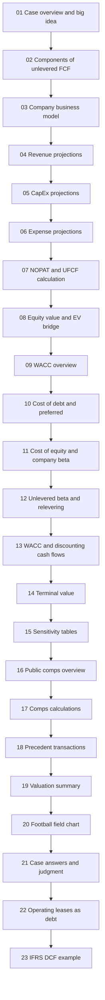
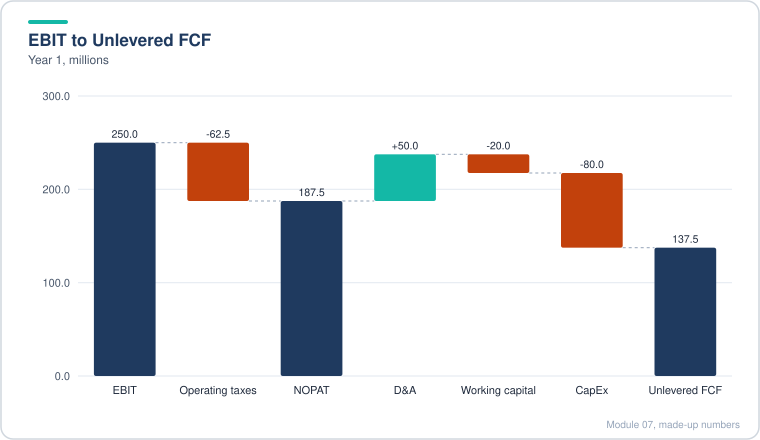
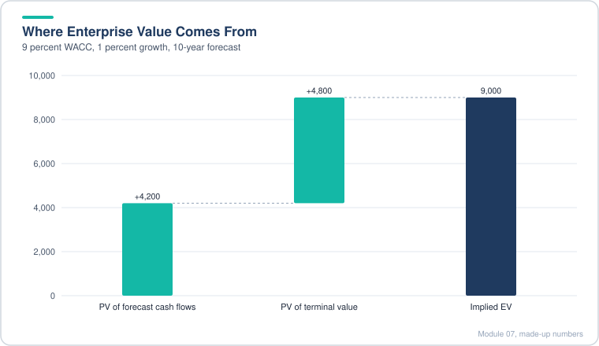
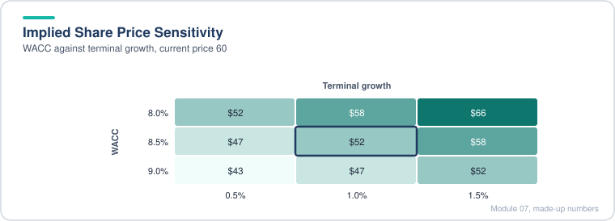
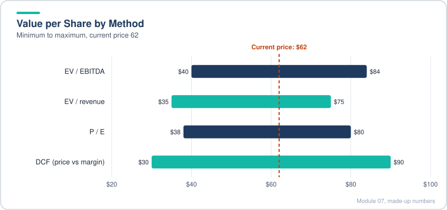
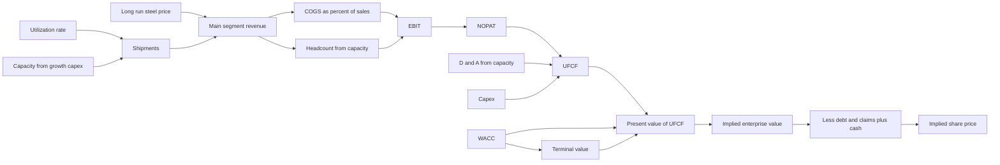
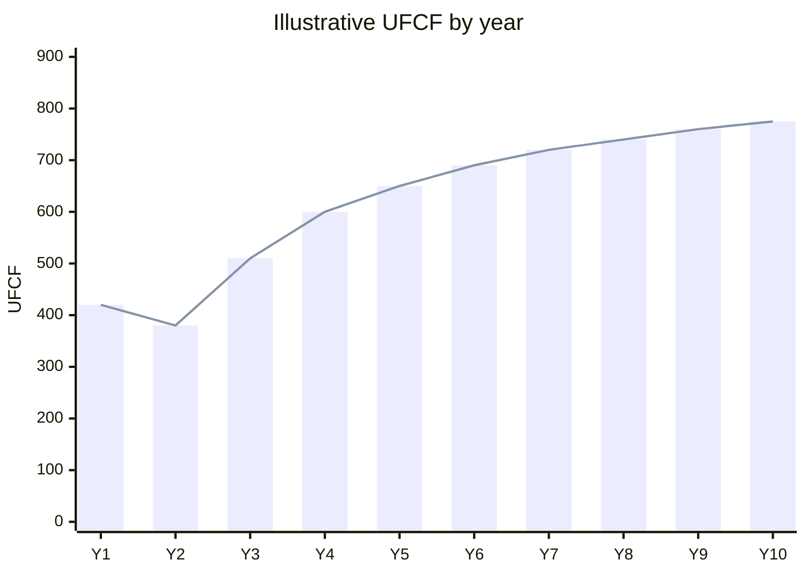
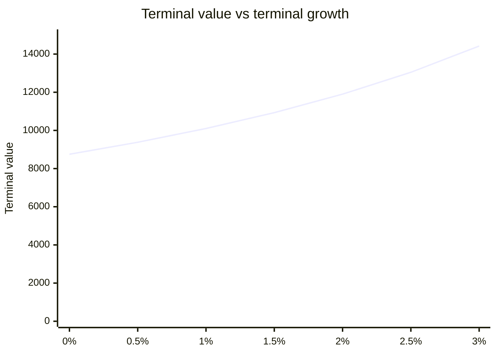
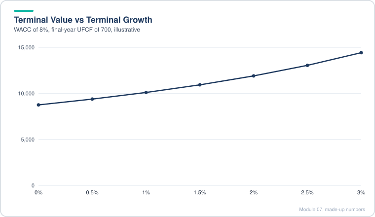
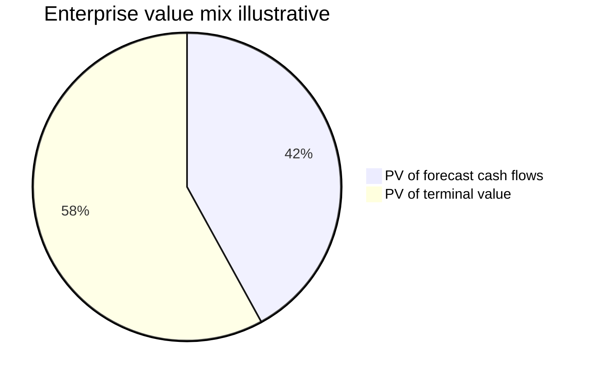

# Module 07: Valuation and DCF Analysis

[← Previous: Module 06](06-equity-value-and-enterprise-value.md) · [Contents](../README.md) · [Next: Module 08, Part 1 →](08-advanced-valuation-and-dcf-part-1.md)

<b>Contents</b>

- [Overview](#overview)
- [Module Map](#module-map)
- [Lessons](#lessons)
  - [7.1 Case Study Overview and the Big Idea Behind Valuation](#71-case-study-overview-and-the-big-idea-behind-valuation)
  - [7.2 Components of Unlevered Free Cash Flow](#72-components-of-unlevered-free-cash-flow)
  - [7.3 Understanding the Business and Setting Up the Model](#73-understanding-the-business-and-setting-up-the-model)
  - [7.4 Revenue Drivers and Projections](#74-revenue-drivers-and-projections)
  - [7.5 Maintenance and Growth Capex Projections](#75-maintenance-and-growth-capex-projections)
  - [7.6 Expense Projections](#76-expense-projections)
  - [7.7 NOPAT, Unlevered Free Cash Flow and EBITDA](#77-nopat-unlevered-free-cash-flow-and-ebitda)
  - [7.8 Equity Value to Enterprise Value Bridge and LTM Financials](#78-equity-value-to-enterprise-value-bridge-and-ltm-financials)
  - [7.9 WACC Overview, Assumptions and Quick Versus Complex Methods](#79-wacc-overview-assumptions-and-quick-versus-complex-methods)
  - [7.10 Cost of Debt and Cost of Preferred Stock](#710-cost-of-debt-and-cost-of-preferred-stock)
  - [7.11 Cost of Equity Using the Company's Own Beta](#711-cost-of-equity-using-the-companys-own-beta)
  - [7.12 Cost of Equity: Unlevering and Relevering Beta from Peers](#712-cost-of-equity-unlevering-and-relevering-beta-from-peers)
  - [7.13 Calculating WACC and Discounting the Cash Flows](#713-calculating-wacc-and-discounting-the-cash-flows)
  - [7.14 Terminal Value and the Implied Share Price](#714-terminal-value-and-the-implied-share-price)
  - [7.15 Sensitivity Tables for the DCF](#715-sensitivity-tables-for-the-dcf)
  - [7.16 Public Comparable Companies: Selection and Interpretation](#716-public-comparable-companies-selection-and-interpretation)
  - [7.17 Calculating the Public Comp Metrics and Multiples (Optional)](#717-calculating-the-public-comp-metrics-and-multiples-optional)
  - [7.18 Precedent Transactions (M&A Comps)](#718-precedent-transactions-ma-comps)
  - [7.19 Valuation Summary and Interpretation](#719-valuation-summary-and-interpretation)
  - [7.20 The Football Field Chart (Optional)](#720-the-football-field-chart-optional)
  - [7.21 Case Study Answers and the Judgment Call](#721-case-study-answers-and-the-judgment-call)
  - [7.22 Operating Leases as Debt (Optional)](#722-operating-leases-as-debt-optional)
  - [7.23 IFRS DCF Example for an Emerging-Market Steel Company (Optional)](#723-ifrs-dcf-example-for-an-emerging-market-steel-company-optional)
- [Diagrams and Charts](#diagrams-and-charts)
- [Excel Model Walkthrough](#excel-model-walkthrough)
- [Interview Questions](#interview-questions)
- [Career Angle](#career-angle)
- [Cheat Sheet](#cheat-sheet)

## Overview

Build a discounted cash flow model from a blank sheet for a steel producer, from revenue to unlevered free cash flow to WACC to terminal value, then cross-check it with trading comps, precedent deals and a football field chart, and finish with lease and IFRS variations.

The spine of the module is the intrinsic valuation: project the business, turn the projections into unlevered free cash flow, discount those cash flows at WACC, add a terminal value, and bridge enterprise value to equity value per share. Everything after lesson 14 is about checking that number against the market and against deals, and about the accounting choices (leases, IFRS) that change the inputs.

## Module Map

## Lessons

### 7.1 Case Study Overview and the Big Idea Behind Valuation

- **What the module is for.** A short case study, one page of instructions plus a company background page, with no line-by-line template. You have to make judgment calls about which numbers matter and how to project them. The model is built from a blank Excel sheet, so the lesson is as much about setup and linking as it is about the answer.
- **Two ways to value a business.**
  - Intrinsic valuation (DCF): project cash flows, discount them, and add a terminal value that stands in for everything after the projection period.
  - Relative valuation: apply multiples from comparable public companies or precedent deals to a metric such as EBITDA or revenue.
- **The core formula.** In a steady state, value equals the next year's cash flow divided by (discount rate minus growth rate). The growth rate has to be lower than the discount rate or the formula blows up.
- **Why the simple formula is not enough.** Real companies grow fast early and slow as they mature, so risk and growth both change over time. The fix is to project cash flows for 5 to 20 years and then apply a steady-state formula to the terminal period.
- **Read the output as a range.** A relative valuation gives a range from a low and a high multiple. If the current enterprise value sits below that range the company looks cheap on that method, and that is the first sentence of any valuation conclusion.
- **Who uses which.** A banker uses the range to set expectations for a sale price. An investor uses it to decide whether the stock is mispriced.

Worked example (made-up numbers):

| Item | Value |
|---|---|
| PV of projected cash flows, years 1 to 10 | 800 |
| Terminal value at end of year 10 | 1,900 |
| PV of terminal value | 1,150 |
| Implied enterprise value | 1,950 |

The terminal value is the first cash flow after the projection period divided by (discount rate minus growth), then discounted back ten years. The enterprise value is the sum of the two present values.

Relative check with the same spirit: a company with EBITDA of 150 and peer multiples of 9x to 11x implies an enterprise value of 1,350 to 1,650. If the market price implies 1,200, the stock screens as cheap on that method.

> [!WARNING]
> The module's big idea is simple, but the common mistake is treating the terminal value as a small add-on. In most DCFs the terminal value is well over half of the total enterprise value, so the assumptions behind it deserve the most scrutiny. Interviewers like to ask what share of value comes from the terminal period.

### 7.2 Components of Unlevered Free Cash Flow

- **Why unlevered.** Unlevered free cash flow (UFCF) is the cash the core business throws off before any payments to debt or equity holders. It matches enterprise value, so it should only include items that belong to all investors and that recur in the core business.
- **Why it is the default in a DCF.** You skip the debt schedule, interest rates and cash balances in the projection. The result also barely moves when the capital structure changes, because the business is the same. Capital structure still matters, but it enters through the discount rate (WACC), not the cash flows.
- **What goes in.**
  - Revenue, cost of goods sold and recurring operating expenses (SG&A, recurring amortization, profit sharing style items).
  - Taxes, but recomputed on operating income, not on the reported tax line that was reduced by interest.
  - Add back depreciation and amortization.
  - Change in working capital, with its sign taken from the cash flow statement.
  - Deferred taxes, if small and shrinking toward zero.
  - Capital expenditures, the one investing item that is always included.
- **What stays out.** Net interest, other income and expense, impairments and other one-time items, stock-based compensation (it dilutes shareholders, so it belongs with the share count), most investing lines such as short-term investments, and the whole financing section.
- **Build the rows in a clear order.** Revenue, minus COGS, minus operating expenses gives EBIT. Subtract operating taxes to get NOPAT. Add non-cash items and working capital, subtract CapEx to get UFCF. EBITDA sits below as a reference line because multiples use it later.
- **Leases, first pass.** The target company had only operating leases. Their lease cost already sits inside COGS or SG&A, so it is already deducted in UFCF. Treating leases as debt would mean adding that cost back and building a lease liability, which is saved for a later variation.
- **Modeling hygiene.** Use three years of history from the filing, link to the Excel version of the 10-K when you can, and avoid external links to other workbooks. Hard-pasted historical numbers get a different font color so they are easy to spot.

Worked example (made-up numbers, in millions):

| Line | Year 1 |
|---|---|
| Revenue | 1,000 |
| COGS | (600) |
| Operating expenses | (150) |
| EBIT | 250 |
| Operating taxes at 25% | (62.5) |
| NOPAT | 187.5 |
| D&A | 50 |
| Change in working capital | (20) |
| CapEx | (80) |
| Unlevered FCF | 137.5 |

*Taxes and capex take the largest bites between EBIT and the 137.5 of unlevered FCF.*
> [!WARNING]
> Common mistakes here: using net income as the starting point (that bakes in interest), using the reported tax expense (it reflects the interest tax shield), and adding back stock-based compensation as if it were free. A good sanity check is that UFCF should track EBITDA minus taxes minus reinvestment, and if it does not, a line is probably in the wrong place. Interviewers often ask why interest is excluded: because UFCF is paid to all capital providers before anyone is paid interest, and the interest effect is captured in WACC instead.

### 7.3 Understanding the Business and Setting Up the Model

- **Skim before you model.** Spend the first 30 minutes of a case reading the filing for numbers, not prose. Pages heavy with text (risk factors, properties, management commentary) rarely feed a model. Tables, charts and KPI pages do. The most useful pieces are the five-year summary, the segment results, the utilization history and the debt and interest disclosures.
- **Pick the driver that matters.** The company had three segments, but the main one produced about three-quarters of sales. The other segments mostly sold to the main one internally (intercompany), and their capex was small. So the model focuses on the main segment and treats the rest as a percentage of it.
- **Watch for messy units.** Shipment disclosures mixed net tons, gross tons and pounds with no clear conversion. When the KPIs do not reconcile, do not try to rebuild them. Pick the cleanest series and say why.
- **Revenue drivers.** Revenue equals shipments times average selling price. Shipments equal shipping capacity times utilization. Capacity grows with capital spending. This turns a vague commodity business into three inputs you can defend.
- **Capex split.** Separate maintenance capex (keeps the plant running) from growth capex (adds capacity). Historical maintenance capex is estimated by subtracting disclosed project spending from total capex. Maintenance capex scales with capacity, and growth capex adds capacity per dollar spent.
- **Why capex does not drive revenue directly.** For a commodity producer, a new plant only adds sales if the plant is run. Utilization can swing widely and prices move independently, so the link from capex to revenue runs through capacity and utilization, not straight through.
- **Expenses: mostly variable.** Gross margin stayed in a narrow band (roughly 15% to 20%) even as steel prices swung widely, because raw material costs follow the output price. So cost of goods sold is modeled as a percent of sales, which is the main variable cost.
- **Expenses: mostly fixed.** Operating expenses are mostly labor and benefits. They are tied to capacity (more plants need more people) rather than to short-term output. A simple way to model them is operating expense per employee times employees, with capacity per employee as a cross-check.

Worked example of the margin test (made-up numbers, in millions):

| Year | Revenue | COGS | Gross profit | Gross margin | COGS as % of sales |
|---|---|---|---|---|---|
| Year A | 5,000 | 4,150 | 850 | 17.0% | 83.0% |
| Year B | 6,200 | 5,150 | 1,050 | 16.9% | 83.1% |
| Year C | 3,900 | 3,290 | 610 | 15.6% | 84.4% |

Because the ratio is stable across very different revenue levels, a single percent-of-sales assumption is a reasonable first model.

> [!TIP]
> Real-world context: commodity producers usually sit near the bottom of the cost curve or the top of it, and the spread between price and cost is the whole business. Modeling margins as a fixed percentage hides the fact that a price shock can move margins for a year or two before costs catch up. In a real model, add a scenario where price falls faster than raw material costs. Also, for an interview, be ready to say why you chose not to model each segment: time, materiality and the intercompany overlap are the three reasons.

### 7.4 Revenue Drivers and Projections

- **Data sources, in order.** The filing gives segment sales and shipment history, the investor deck gives utilization history, the case brief gives a long-run price anchor, and the latest quarterly report gives the most recent price signal for the current year. Peer revenue growth is a sanity check, because commodity producers move together.
- **Step one, historical data.** Pull segment sales for the main segment, total sales, and then back into the "other segments and eliminations" line as total minus main segment. Compute the historical growth rates. Shipments do not always reconcile across filings, so use one consistent series and note the choice. Average selling price is main-segment revenue divided by shipments, with a units conversion.
- **Step two, the three drivers.**
  - Capacity: starts from the last actual figure and grows only when growth capex is added. In the first pass it stays flat, which is a useful test that the linkage works.
  - Utilization: starts from the most recent quarter's level, drops in the following year as the market softens, then recovers to a long-run level (about 90% here). The long-run number lives in a named input cell so it can be sensitized.
  - Price per ton: starts well above the long-run average because of a supply shock, falls below the average, then drifts back to the long-run level over four or five years.
- **Step three, the projection.**
  - Shipments equal capacity times utilization.
  - Main-segment revenue equals shipments times price per ton, with units converted so the result is in millions.
  - Other segments and eliminations equal a historical average percentage of main-segment revenue.
  - Total consolidated sales feeds the UFCF build.
- **Why the revenue path looks like a hump.** Price and utilization spike together, then reverse. A model that does this is more honest than a straight-line growth rate, because a commodity company's revenue follows the cycle.

Worked example (made-up numbers):

| Year | Capacity (k tons) | Utilization | Shipments (k tons) | Price ($/ton) | Main revenue ($M) |
|---|---|---|---|---|---|
| Hist A | 10,000 | 95% | 9,500 | 700 | 6,650 |
| Proj 1 | 10,000 | 92% | 9,200 | 1,000 | 9,200 |
| Proj 2 | 10,000 | 88% | 8,800 | 800 | 7,040 |
| Proj 3 | 10,000 | 90% | 9,000 | 780 | 7,020 |

Shipments in thousands of tons times price in dollars per ton gives thousands of dollars, so divide by 1,000 to land in millions.

> [!WARNING]
> Common mistake: forgetting the units. Shipments in thousands of tons times price per ton gives a number 1,000 times too big. Another is hard-coding the revenue line instead of building it from the drivers, which makes the sensitivity table useless later. A practical tip is to name the key input cells (for example a long-run utilization cell and a long-run price cell) so the sensitivity tables and scenario switches can point at them directly.

### 7.5 Maintenance and Growth Capex Projections

- **The company does not split capex for you.** Start from total capex in the cash flow statement. Find the growth portion in the filing (named project spending disclosed in selected financial data) and treat the rest as maintenance. If a year has no disclosed project spending, assume it was all maintenance and say so.
- **Maintenance capex is tied to capacity.** Divide historical maintenance capex by prior-year capacity to get a cost per unit of capacity. Average the ratio over the historical years because the history is noisy, then multiply by the projected prior-year capacity. The units come out in thousands of dollars per thousand tons, and the units label should say so.
- **Estimate old capacity from shipments.** When an earlier year's capacity is missing, divide the shipments from an older filing by the utilization rate for that year. This gives a rough capacity figure, which is good enough for a ratio.
- **Growth capex is a project schedule.** Take the total estimated cost of the big project, subtract what was already spent, and place the remainder in the year before it comes online. Smaller follow-on projects get their own line. Be conservative on cost estimates, since projects usually run over.
- **Growth capex after the named projects.** No public plan runs past the disclosed projects, so the model assumes a declining run rate of roughly 100 to 250 million a year. The historical record supports that, because capex was mostly maintenance for years.
- **Capacity added per dollar of growth capex.** Compute the added tons per million dollars for each named project, then average the ratios. Two data points is thin, so note it as a weak assumption. Apply the ratio to the prior year's growth capex, because a plant takes about a year to finish.
- **Check the answer as a percent of revenue.** Total capex falls from about 7 percent of revenue to about 3 percent over the projection. That is higher than the historical average, which is acceptable for a company that needs continued investment to support growth, but it should be checked against peers.

Worked example (made-up numbers, in millions unless noted):

| Year | Total capex | Named project spend | Maintenance capex | Prior-year capacity (k tons) | Maintenance per k ton |
|---|---|---|---|---|---|
| Hist A | 400 | 0 | 400 | 9,000 | 0.044 |
| Hist B | 700 | 300 | 400 | 9,400 | 0.043 |
| Proj 1 | n/a | 500 | 0.0435 x prior capacity | 9,600 | n/a |

Projected growth capex is the named project spend plus a run rate. Added capacity equals prior-year growth capex times tons per dollar.

> [!TIP]
> Real-world context: analysts often find a maintenance-capex-to-depreciation ratio useful. If maintenance capex is well above D&A for a long time, the asset base is shrinking in real terms, which is a red flag. If it is well below D&A, the company is harvesting its plants. In this case the model should be checked against D&A before it is trusted. Another common interview question is why growth capex does not translate directly into revenue for a commodity business, and the answer is utilization and price.

### 7.6 Expense Projections

- **Cost of goods sold is variable.** Historical gross margin stayed in a band of roughly 80 to 85 percent of sales, so COGS is a percent of revenue. Start near the top of the historical range, step down gradually, and settle at a long-run percent stored in a named cell. Sensitivity tables can then point at that single cell.
- **Operating expenses are mostly fixed.** Plant labor and benefits do not fall when output falls, because the plants stay open. So model operating expenses per employee times headcount, and tie headcount to shipping capacity. More capacity means more people.
- **Per-employee cost.** Start from the historical level, which had fallen, and let it drift back to a long-run figure (here about 70,000 dollars per employee) over several years. Hold it constant at the end. Sensitizing this input is not worth the time when operating expenses are a small share of the cost base.
- **Tons per employee.** Compute shipping capacity divided by headcount for each year, then average. The trend is noisy, so a flat average is the honest choice.
- **Units.** Dollars in millions for COGS and operating expenses, and dollars per employee for the per-head line. Converting thousands of tons to tons, and millions of dollars to dollars, is the most common place for a unit slip.
- **Checks before moving on.** Operating margin should stabilize, not swing between very different levels in the last few years. Revenue growth should slow toward the rate of inflation or nominal GDP by the end of the forecast. If either fails, go back to the drivers rather than patching the output.
- **Output of the lesson.** Operating income (EBIT) sits at about 11 percent margin with growth of 1 to 2 percent a year in the terminal years.

Worked example (made-up numbers, millions):

| Line | Year 1 | Year 5 |
|---|---|---|
| Revenue | 9,000 | 10,000 |
| COGS at 84% | (7,560) | (8,300) |
| Headcount (from capacity) | 8,000 | 8,400 |
| OpEx per employee ($) | 60,000 | 70,000 |
| Operating expenses | (480) | (588) |
| EBIT | 960 | 1,112 |
| EBIT margin | 10.7% | 11.1% |

Operating expenses in millions equal headcount times cost per employee divided by 1,000,000.

> [!TIP]
> Real-world context: fixed-cost bases like this make commodity businesses sensitive to operating leverage. When prices fall, the margin falls faster than revenue because labor does not shrink. In a real model you might add a downside case where headcount is sticky and COGS rises as a share of sales. Interviewers sometimes ask why COGS and operating expenses use different drivers, and the answer is that they behave differently in the real business.

### 7.7 NOPAT, Unlevered Free Cash Flow and EBITDA

- **Operating tax rate.** Use a multi-year average of the effective tax rate from the filing as a single operating tax rate. Apply it to EBIT, not to pre-tax income, so the interest tax shield stays out of UFCF. The result is close to the common 25 percent US assumption, and there is no need to go deeper on credits.
- **NOPAT** is EBIT minus operating taxes.
- **D&A is driven by capacity, not revenue.** Compute D&A per ton of capacity for history, average the last three years, and multiply by projected capacity. Depreciation follows the asset base, and the asset base follows capacity. D&A as a percent of revenue then becomes a cross-check.
- **Capex versus D&A.** For a healthy operating model, capex should stay at or above D&A in the long run, because the asset base is growing. In this case capex as a percent of revenue ran close to D&A at the end, so the maintenance capex assumption was nudged up slightly to get a visible cushion. That is a legitimate fix as long as you say why.
- **Deferred taxes.** The gap between cash taxes and book taxes comes from accelerated depreciation. Model deferred taxes as a percent of book tax expense, stepping down over time toward roughly 10 percent, and make the sign negative so it reduces UFCF when the gap is positive. A large, persistent deferral is a warning sign.
- **Working capital.** Steel producers carry heavy inventory and pay for raw materials up front, so working capital usually absorbs cash. Modeling it as a percent of the change in revenue ties the investment to growth. It was small here, so the simplest method was enough.
- **Assemble UFCF.** NOPAT plus D&A plus deferred taxes plus change in working capital minus capex gives unlevered FCF. EBITDA is EBIT plus D&A and feeds the terminal value and multiples later.
- **Checks.** Growth in UFCF should fall toward low single digits over the forecast. Capex as a percent of revenue should decline to a stable level. Compare these lines with EBITDA margin and D&A to make sure nothing is out of line.

Worked example (made-up numbers, millions):

| Line | Year 1 | Year 5 |
|---|---|---|
| EBIT | 960 | 1,112 |
| Operating tax at 24% | (230) | (267) |
| NOPAT | 730 | 845 |
| D&A | 420 | 470 |
| Deferred taxes (-15% of book tax) | (35) | (40) |
| Change in working capital (-1% of change in revenue) | (10) | (10) |
| CapEx | (560) | (520) |
| UFCF | 545 | 745 |
| EBITDA | 1,380 | 1,582 |

UFCF is NOPAT plus the non-cash add-backs, less the working capital investment and capex.

> [!WARNING]
> Common mistakes: using the reported tax line, letting D&A grow with revenue rather than with the asset base, and forgetting that deferred taxes change sign depending on whether the gap is a source or a use of cash. A useful interview point is that a company spending far more on capex than D&A for a long time is growing, while one spending far less is harvesting, and the terminal year should be a steady state where capex is at least D&A once growth is slow but positive.

### 7.8 Equity Value to Enterprise Value Bridge and LTM Financials

- **Why this is a transition lesson.** The discount rate (WACC) needs the company's capital structure, and the comparison needs peer data on the same basis. So the lesson builds the current market bridge for the target and fills in the target's row in the peer table.
- **The bridge, in order.**
  - Current equity value is share price times diluted shares.
  - Enterprise value is equity value plus debt (including finance leases), preferred stock, noncontrolling interests and unfunded pensions, minus cash and investments and minus any net operating loss asset.
  - Operating leases are shown for completeness but are zero under US GAAP because lease cost sits in operating expense.
- **Source hierarchy for the balance sheet.** Use the most recent interim filing if there is one, because the 10-K is older. Go back to the annual report only for items the interim report omits, such as the net operating loss schedule or the valuation allowance.
- **Diluted shares.** Use the weighted diluted count from the latest report. The full treasury stock method is more precise, but when dilution is small it is not worth the time in a case study.
- **Fair value of debt.** Prefer the disclosed fair value over book value when it is available, because the discount rate work later needs market values. Book value is an acceptable fallback, and the difference should be small.
- **Net operating losses.** Use the deferred tax asset as reported, which already reflects the tax rate. Do not multiply by the tax rate again.
- **Pensions.** Only count unfunded pension deficits when the company has defined benefit plans. Check before you assume.
- **LTM math.** LTM equals last fiscal year plus current year-to-date minus prior year-to-date. Apply that to revenue, EBIT, D&A and net income. EBITDA is EBIT plus D&A from the same periods.
- **Projected net income.** The model does not forecast interest, so the lesson estimates it. Take projected EBIT, subtract interest on the debt (face value times the stated coupon), multiply by one minus the tax rate. Hold debt flat. That is a rough proxy, but it is enough for a peer comparison.
- **Calendar and fiscal years.** Here they match, because the year ends on the same date. When they do not, calendarize the peers before comparing (covered later).

Worked example (made-up numbers, in millions except per share):

| Item | Value |
|---|---|
| Share price ($) | 50.00 |
| Diluted shares (M) | 200.0 |
| Equity value | 10,000 |
| Plus debt (fair value) | 3,000 |
| Plus noncontrolling interest | 150 |
| Less cash | (1,200) |
| Less NOL asset | (25) |
| Enterprise value | 11,925 |

LTM revenue (made-up): FY 9,000 plus YTD this year 5,000 minus YTD last year 4,400 equals 9,600.

> [!WARNING]
> Common mistakes: forgetting that noncontrolling interests belong in EV (the cash flows used in UFCF include the whole consolidated business), mixing book and market values without saying so, and using a stale balance sheet when a newer one exists. Interviewers often ask why you add NCI to EV: because UFCF includes the earnings attributable to minority owners, so their claim must be added to get a consistent bridge.

### 7.9 WACC Overview, Assumptions and Quick Versus Complex Methods

- **Why a discount rate.** A dollar received in the future is worth less than a dollar today, because you could invest today's dollar. The discount rate is the opportunity cost of capital for an investment with the same risk.
- **Pairing rule.** Unlevered free cash flow pairs with WACC (the blended cost of all capital). Levered free cash flow pairs with cost of equity. Using WACC with UFCF keeps the answer stable when the capital structure changes, which is why it is the default in a DCF.
- **Component costs.**
  - Cost of equity: the return shareholders expect, from price appreciation plus dividends.
  - Cost of debt: the yield on the company's debt, adjusted for any premium or discount to face value. Interest is tax deductible, so the after-tax cost is cost of debt times one minus the tax rate.
  - Cost of preferred: similar to debt in concept, but not tax deductible and usually more expensive.
- **The formula.** WACC equals cost of equity times equity weight, plus after-tax cost of debt times debt weight, plus cost of preferred times preferred weight. Weights are market values, not book values.
- **Intuition.** WACC is roughly the long-run return you would earn if you bought the whole capital structure in proportion. A structure of 80 percent equity at 10 percent and 20 percent debt at 6 percent with a 25 percent tax rate gives about 8.9 percent.
- **Leases are operating items here.** Lease cost stays in UFCF and lease liabilities stay out of the bridge and the WACC. The alternate treatment, which moves leases into debt, is covered later in the module.
- **Quick versus complex.**
  - Quick: use the current capital structure, a historical or simple cost of equity, and current yields.
  - Complex: use peer capital structures as a target, and peer betas and costs.
  - This model takes a middle path: a simple cost of equity for the target, plus peer data where it is already in the file.
- **Precision is a waste of time.** Valuation has a wide error bar, so the goal is a sensible range, not a precise point. A range of two to three percentage points is usually enough. A range of five points is too loose to be useful.

Worked example (made-up numbers):

| Input | Value |
|---|---|
| Cost of equity | 11.0% |
| Pre-tax cost of debt | 6.0% |
| Tax rate | 25% |
| Equity weight | 70% |
| Debt weight | 30% |
| After-tax cost of debt | 4.5% |
| WACC | 9.05% |

WACC = 11.0% x 70% + 4.5% x 30% = 7.70% + 1.35% = 9.05%.

> [!WARNING]
> Common mistakes: using book value weights for debt when the company's bonds trade far from par, forgetting to tax-effect debt (but not equity or preferred), and presenting WACC to two decimals as if it were known to that precision. A useful interview answer: WACC falls when the company uses more cheap debt, but the cost of equity rises as leverage rises, so the benefit of debt is partly offset. That is why there is an "optimal" structure, and why WACC is not simply lower with more debt.

### 7.10 Cost of Debt and Cost of Preferred Stock

- **Three ways to estimate the cost of debt, from quickest to most careful.**
  1. Weighted average coupon: weight each tranche's coupon by its share of total debt. This works for most healthy companies.
  2. Interest expense divided by average debt balance over the same period. Also quick, and it uses reported numbers.
  3. Yield to maturity from market prices: if the bonds trade away from par, the yield differs from the coupon. Excel's YIELD function does this, using the settlement date, maturity date, coupon, price per 100 of face value, redemption value of 100 and frequency.
- **Other fallbacks.** Risk-free rate plus a default spread based on the credit rating (useful when disclosure is thin), or the yield on peers' debt. The peer approach is accurate but slow, and the gain is small when debt is a minority of capital.
- **Preferred stock.** Same logic as debt, with the coupon or dividend yield as the rate. Do not tax-effect it, because preferred dividends are not deductible.
- **Use face value to get the rate.** When computing interest expense divided by debt, use the total debt outstanding (principal) and not net of issuance costs. The difference is tiny but the principle is clean.
- **Weighted maturity.** For a multi-tranche bond stack, a rough midpoint maturity is enough. An exact weighted-average date needs a sum-product calculation, which is rarely worth the time in a case study.
- **Materiality.** Going from a 3.2 percent coupon-based rate to a 2.2 percent market yield changes WACC by very little when debt is a small share of capital. So the simple method is usually the right one, unless the bonds trade far from par.

Worked example (made-up numbers):

| Tranche | Balance | Coupon | Weight |
|---|---|---|---|
| Notes A | 1,000 | 4.0% | 40% |
| Notes B | 1,500 | 6.0% | 60% |
| Weighted coupon | 2,500 | | 5.2% |

Interest-based check: interest expense of 130 divided by average debt of 2,600 gives 5.0%.

Market-yield check: a 5-year, 5 percent coupon bond priced at 95 per 100 of face value yields a little over 6 percent to maturity, because you collect the discount as well as the coupon.

> [!WARNING]
> Common mistakes: using the coupon when the bond trades at a large premium or discount, forgetting to tax-effect the debt cost in WACC (done in the WACC step, not here), and mixing interest on the income statement (which includes fees and amortization) with an average balance from a different date. Real-world note: the cheapest debt on a company's books is often the oldest, so the coupon can understate the cost of new borrowing. For a valuation the right question is what the company would pay today to borrow, which is the yield on a new issue, not the historical coupon.

### 7.11 Cost of Equity Using the Company's Own Beta

- **The formula.** Cost of equity equals risk-free rate plus levered beta times equity risk premium. The first term is the pay for waiting, the second is the pay for market risk, and beta scales the second term to the company.
- **Risk-free rate.** Use a long government bond yield in the same currency as the cash flows. For a US company with mostly North American sales, the 10-year Treasury yield is the standard choice. If the valuation date falls on a weekend, take the nearest trading day, or the average of the two.
- **Equity risk premium.** Expected excess return of the stock market over government bonds. Estimates vary by source, period and method (historical, implied, forward). In a case study, pick a reasonable figure from several published sources and say which. Here a range of about 5 to 6 percent was the consensus.
- **Levered beta.** A stock's sensitivity to the market, reflecting both business risk and the risk added by debt. Beta of 1.0 moves with the market, 1.5 moves half again as much. Public sites report a five-year monthly beta, which is usually good enough.
- **Result.** With a risk-free rate near 1.2 percent, a 5 to 6 percent premium and a beta near 1.45, the cost of equity lands a little above 9 percent.
- **Why do a harder method at all.** The historical beta reflects only one company's past and its current debt load. Peer betas, unlevered and relevered for the target's capital structure, give a second estimate, and comparing the two grounds the WACC range.
- **Time budget.** If time is short, use the simple formula and move on. Spending hours to compute your own equity risk premium is a poor use of a case study.

Worked example (made-up numbers):

| Input | Value |
|---|---|
| Risk-free rate | 2.0% |
| Equity risk premium | 5.5% |
| Levered beta | 1.20 |
| Cost of equity | 2.0% + 1.20 x 5.5% = 8.6% |

> [!TIP]
> Real-world context: practitioners often use a 10-year or 20-year Treasury, and the choice matters when the curve is steep. Beta measures co-movement, not total risk, so a company with a low beta can still be risky if its own cash flows are volatile. Also, a short history can mislead. A stock that recently changed its business mix or its leverage may carry a beta that no longer describes it, which is the main argument for peer betas. Interviewers often ask what a beta of 1.5 means in words and how to explain it to a client.

### 7.12 Cost of Equity: Unlevering and Relevering Beta from Peers

- **Why this method.** A stock's levered beta mixes two risks: the business risk of the operations, and the extra risk from debt and preferred stock. Peers differ in leverage, so their raw betas cannot be compared directly. Unlevering strips out the financing effect so you can compare business risk. Relevering puts the leverage back in for the company you are valuing.
- **Unlever.** Unlevered beta equals levered beta divided by [1 + (1 minus tax rate) x debt to equity + preferred to equity]. Unlevered beta is always at or below levered beta, and equals it for a debt-free company.
- **Median, not mean.** Take the median of the peer unlevered betas, which resists outliers.
- **Relever.** Levered beta equals median unlevered beta times [1 + (1 minus tax rate) x debt to equity + preferred to equity], using the target's capital structure.
- **Two capital structures.** Run it with the company's current structure and with a target (peer median) structure. The current one shows what the stock carries today. The target one shows where the company might settle over time. Present the range.
- **Make weights sum to 100 percent.** When you compute debt, preferred and equity weights separately, check that they add to one. Setting debt to one minus equity minus preferred avoids rounding gaps. This is a small fix that interviewers look for.
- **Capital structure is not free cash flow.** Unlevered beta has nothing to do with unlevered cash flow. Unlevered FCF is capital-structure neutral by design. Beta and the discount rate are not.
- **Excel mechanics.** Pull peer data with INDEX and MATCH on the ticker and column header, using exact match, and use named ranges for the data block. This keeps the model flexible when peers change.

Worked example (made-up numbers):

| Peer | Levered beta | Debt / equity | Pref / equity | Tax rate | Unlevered beta |
|---|---|---|---|---|---|
| Peer A | 1.30 | 0.40 | 0.00 | 25% | 1.30 / (1 + 0.75 x 0.40) = 1.00 |
| Peer B | 1.10 | 0.20 | 0.00 | 21% | 1.10 / (1 + 0.79 x 0.20) = 0.95 |
| Peer C | 1.60 | 0.60 | 0.00 | 25% | 1.60 / (1 + 0.75 x 0.60) = 1.10 |

Median unlevered beta is 1.00. Relevered at a target debt to equity of 0.50 and a 25 percent tax rate: 1.00 x (1 + 0.75 x 0.50) = 1.38. Cost of equity then follows from the usual formula.

> [!WARNING]
> Common mistakes: relevering with the company's own tax rate when the peers' tax rate is used in unlevering (be consistent), mixing market and book debt, and reading a low unlevered beta as "safe" when the business is actually cyclical. Interview tip: unlevered beta is the closest thing to an asset beta, and a company's business risk is often best judged by looking at the peer group's unlevered betas as a cluster.

### 7.13 Calculating WACC and Discounting the Cash Flows

- **Build several WACCs, then take a range.** Combine the two cost of equity estimates (own beta and relevered peer beta) with the two capital structures (current and peer target). That gives a small grid of WACC values. Average them for a point estimate, and use the low and high ends as the sensitivity range.
- **Why the grid lands close together.** A higher cost of equity under peer leverage is offset by a larger share of cheaper debt. Debt is cheaper than equity because it is senior in the capital structure and its interest is tax deductible. So a more leveraged structure lowers WACC, which partly cancels the higher equity cost.
- **Shortcut.** If time is short, compute WACC from the current structure and the historical beta, and stop there.
- **Discount each year's cash flow.** Two ways to do it. Compute each year's discount factor by hand, or use the NPV function. Excel's NPV function returns the present value of a stream, not net present value, despite its name. It treats the first cash flow as arriving one full period after the valuation date, so it fits annual flows that land at year end. Mid-year or stub timing needs a manual calculation.
- **One discount rate or many.** A single rate is usually right for a mature, slow-growing, stable business. A changing rate fits a company whose risk profile is expected to shift a lot, such as a young company that will mature. Steel is mature, and peers' growth moves with commodity prices, so a constant rate is defensible.
- **Structure the DCF tab.** Put the terminal value (two methods, covered next) and the present value of UFCF side by side. Their sum is implied enterprise value, which then feeds the equity bridge.

Worked example (made-up numbers):

| Cash flow year | UFCF | Discount factor at 8% | PV |
|---|---|---|---|
| 1 | 500 | 0.9259 | 463.0 |
| 2 | 540 | 0.8573 | 462.9 |
| 3 | 580 | 0.7938 | 460.4 |
| Total PV | | | 1,386.3 |

The NPV function gives the same 1,386.3 in one cell when the rate is constant. Discount factor is 1 divided by (1 + rate) raised to the year number.

> [!TIP]
> Real-world context: mid-year discounting is more accurate when cash arrives evenly through the year, and the standard NPV function assumes end-of-year. The next module on a different company covers the mid-year convention. In an interview, a good answer is that a constant rate is a simplification you should justify, and that changing the rate over time is a way to reflect a maturing risk profile without changing the cash flows.

### 7.14 Terminal Value and the Implied Share Price

- **What the terminal value is.** The value of all cash flows after the explicit forecast, measured at the end of the last forecast year. Once growth and risk settle, every later cash flow can be summed with one formula.
- **Perpetuity growth method.** Terminal value equals final-year UFCF times (1 + g), divided by (WACC minus g). Pick g below long-run nominal GDP (here 1 percent, against a 1.5 percent benchmark). A growth rate above GDP implies the company eventually becomes the whole economy.
- **Multiples method.** Terminal value equals a terminal EBITDA (or EBIT or NOPAT) multiple times final-year EBITDA. Enterprise value multiples are preferred, because they are capital structure neutral. The multiple should come from peers and from the company's own trading history, and the choice of which year (LTM, current year, next year) matters.
- **Check each method against the other.** Convert the perpetuity answer into an implied EBITDA multiple, and convert the multiple answer into an implied growth rate. If the implied multiple sits far outside the peer range, one of the inputs is wrong.
- **Discount back.** Terminal value is measured at the end of year 10, so discount it by ten periods, not by one. Add the present value of the forecast cash flows and the present value of the terminal value to get implied enterprise value.
- **Sanity check on mix.** The present value of terminal value should be well below total enterprise value, typically 60 to 70 percent or less. If it is 90 percent, the forecast is too short. Extend the projection to 15 or 20 years.
- **Bridge back to equity.** Add cash and investments, subtract debt and debt-like items (preferred, noncontrolling interests, pensions), giving implied equity value. Divide by diluted shares for the implied price, then compare it with the current price for a premium or discount.

Worked example (made-up numbers, with a 9 percent WACC, 1 percent growth, 10 year forecast):

| Item | Value |
|---|---|
| Final-year UFCF | 900 |
| Terminal FCF (year 11) | 900 x 1.01 = 909 |
| Terminal value at end of year 10 | 909 / (0.09 - 0.01) = 11,363 |
| PV of terminal value | 11,363 / 1.09^10 = 4,800 |
| PV of forecast cash flows | 4,200 |
| Implied enterprise value | 9,000 |
| Implied EBITDA multiple at year 10 | 11,363 / 1,400 = 8.1x |

The implied terminal multiple is a cross-check, not an input, in the perpetuity method.

*More than half of the 9,000 enterprise value comes from the terminal value.*

> [!WARNING]
> Common mistakes: discounting the terminal value by the forecast length minus one, using a growth rate close to WACC, and quoting a single terminal multiple without a range. The implied perpetual growth from a multiple is harder to back out algebraically, so many models skip it. The honest way to present the work is a range of terminal values under each method. Interviewers also ask what happens to the terminal value if WACC drops by one point: it rises sharply, because the denominator shrinks, which is why the terminal value dominates the answer in low-rate environments.

### 7.15 Sensitivity Tables for the DCF

- **Why sensitize.** A valuation is a range, not a point. Sensitivity tables show how the implied share price moves when one or two inputs change, and they feed the low and high values in the valuation summary.
- **Which inputs.** The discount rate and the terminal assumption are always included, because together they drive most of the value. Then pick the operating drivers that matter most for the business. Here: long-run steel price, long-run utilization and COGS as a percent of sales.
- **Scenarios versus sensitivities.** Use scenarios when drivers move together in a predictable way (for example rents and occupancy in real estate). Use sensitivities when the drivers are only loosely linked. Historically, price and utilization move together, but margin moves less with price, so two-way sensitivities were the better fit.
- **Table design rules.**
  - Center the base case in the grid, with equal steps on each side.
  - Step sizes should match the historical range of each input (for example, a price band from about 600 to 1,000 per ton, and utilization from 85 to 95 percent).
  - Hardcode or link the axis values only to other hardcoded axis values, never to the model itself. Link only the output cell at the corner.
- **Excel data tables.** Build a two-variable data table: the row input cell takes one variable, the column input cell takes the other, and the corner cell links to the output. On Mac, use Data, What-If Analysis, Data Table. On Windows, the keyboard shortcut is Alt, D, T.
- **Read the tables.** Find the base case in each grid. Compare the current share price against the surrounding values. Here, the current price sat slightly above the midpoint of most tables, which pointed to a modest overvaluation. A 5 to 15 percent gap is within the error bar of this kind of work.
- **Terminal multiple cross-check in the table.** When the terminal value is set by a multiple, show the implied perpetuity growth rate, and when set by growth, show the implied multiple. The lesson shows the multiple axis produced by sweeping growth, which avoids solving the algebra.

Worked example (made-up numbers, implied share price in dollars):

| WACC / terminal growth | 0.5% | 1.0% | 1.5% |
|---|---|---|---|
| 8.0% | 52 | 58 | 66 |
| 8.5% | 47 | 52 | 58 |
| 9.0% | 43 | 47 | 52 |

Read the grid: with a current share price of 60, the stock screens as undervalued only in the top-right corner (low WACC, high growth) and looks roughly fairly valued at the middle assumptions.

*Only the top-right corner clears the current price of 60, and the base case sits well below it.*

> [!WARNING]
> Common mistakes: linking the sensitivity axis to the live model, which breaks the data table, and making the grid too wide so every outcome looks possible. Another trap is holding the terminal growth above WACC in one corner of the grid, which gives nonsense values. Interview tip: the answer to "is it cheap or expensive?" should cite a range and the drivers that move the range the most, not just the base case.

### 7.16 Public Comparable Companies: Selection and Interpretation

- **What comps are for.** Public comps are a cross-check and a market reading, not a replacement for the DCF. They rest on the same formula as the DCF: if peers have similar cash flows and discount rates, differences in valuation should reflect differences in growth. In real life the link is loose, so use comps for direction and context.
- **Target set size.** Aim for five to ten companies. Screen on geography (here, US), industry (steel), and a size filter on revenue. Use revenue rather than valuation to screen, because screening on value multiples biases the multiples you are about to measure.
- **Same order of magnitude.** If the target has revenue of about 10 billion, a peer band of 1 to 100 billion is the outer limit. Tighten it if the list is too long.
- **Qualitative cuts.** After the screen, remove companies that do not match the business model. Here, companies that mostly distribute or process metal were dropped, along with a diversified manufacturer whose steel is a small part of sales, and companies that were acquired or delisted. Foreign subsidiaries of non-US parents were also dropped.
- **Use the technology that matters.** The target uses electric arc furnaces, so peers with meaningful exposure to that process were preferred. A peer that is a blast-furnace producer can still be kept if the rest of its profile fits.
- **Choose metrics.** Pick one sales-based metric (revenue) and two profit-based ones (EBITDA and net income). Use both historical (LTM) and projected (calendar-year) figures. History is real but messy; projections are clean but uncertain.
- **Why EBITDA.** It removes differences in depreciation and capital structure, so it is the default. EBIT would have given similar answers for this set.
- **Applying and reading the multiples.** Apply each peer statistic (maximum, 75th percentile, median, 25th percentile, minimum) to the target's metric. That gives an enterprise value range, which the bridge turns into an equity value and a share price.
- **Interpreting.** Compare the target's multiples with the peer median and check whether the premium or discount is backed by growth and margins. Here the target traded at higher multiples than peers while its projected growth was no better, which supported a view of modest overvaluation. Cyclical industries make multiples noisy, so the conclusion is weak.

Worked example (made-up numbers for a target and peers):

| Company | EV / EBITDA CY+1 | Revenue growth |
|---|---|---|
| Peer A | 6.0x | -10% |
| Peer B | 7.0x | -4% |
| Peer C | 8.5x | -6% |
| Target | 8.0x | -12% |

The peer median is 7.0x. The target trades at a premium with weaker projected growth, which is a flag to explain. Applied at the peer median of 7.0x, the target's EBITDA implies an enterprise value about 12.5 percent below what the market pays at 8.0x (7.0 divided by 8.0 is 0.875).

> [!TIP]
> Real-world context: comps tables in banks often show a "peer set" with a "trimmed mean" (removing the highest and lowest values). That is a useful way to reduce the influence of outliers. Also, a cyclical company at a cycle peak looks cheap on forward-looking metrics that assume peak earnings, and expensive on trailing metrics once earnings fall. Interviewers often ask why you pick EBITDA over net income, and the answer is capital structure neutrality and less distortion from tax and depreciation policy.

### 7.17 Calculating the Public Comp Metrics and Multiples (Optional)

- **Optional lesson.** It is a short version of material that the next module covers in depth: pulling figures from filings, projections, nonrecurring items and calendarization. Skip it if you have time for the next module.
- **Start from the latest interim balance sheet.** Take cash, debt, preferred stock and noncontrolling interests from the most recent 10-Q, and check the annual report for anything the quarterly report leaves out.
- **Use fair value for debt, when disclosed.** Book debt and fair value can differ by a meaningful amount for a company with low-coupon or convertible notes. The fair value disclosure in the notes is the better choice for the bridge.
- **Finance leases go in debt under US GAAP.** Their cost is split between interest and depreciation, so EBITDA excludes the full cost. To keep the numerator and denominator consistent, add the finance lease liability to enterprise value. Operating leases stay out.
- **Pensions.** Use the net unfunded position (obligation minus plan assets) where the company discloses it.
- **Diluted shares: avoid double counting.** If preferred stock or convertible notes are treated as debt-like claims in enterprise value, do not also add their conversion shares to the diluted count. Count one or the other.
- **Tax rate.** When the company's reported tax line is erratic (for example, negative pre-tax income with tax expense), fall back to a statutory-style rate (21 percent federal plus a few points of state tax) and say so.
- **Projections.** Consensus estimates from a data service are the usual source. If you lack one, free sites can supply revenue, EPS and estimated EBITDA. Net income can be approximated as EPS times shares.
- **Calendarization.** If a peer's fiscal year ends in a month other than the target's, convert its figures to the calendar year. For a year ending in August, a calendar year equals 8/12 of the fiscal year that ends in the same calendar year, plus 4/12 of the next fiscal year. Do this for projections. LTM figures are already on a common date.

Worked example (made-up numbers): a peer with fiscal years ending in August reports projected net income of 400 for Sep Y to Aug Y+1 and 480 for Sep Y+1 to Aug Y+2.

- Calendar Y (Jan to Dec) = (8/12) x 400 + (4/12) x 480 = 266.7 + 160.0 = 426.7
- Calendar Y+1 = (8/12) x 480 + (4/12) x (next year, say 520) = 320.0 + 173.3 = 493.3

> [!WARNING]
> Real-world context: the most common mistakes in comps work are mixing debt at book and at fair value across companies, forgetting leases, and calendarizing only some of the set. A good habit is to write a one-line note next to each adjustment, so a reviewer can follow every number. Interviewers rarely ask for the exact adjustments, but they do ask why EV includes some items and not others, so know the principle: include every claim that sits ahead of common equity and that the cash flows used in the multiple do not already pay.

### 7.18 Precedent Transactions (M&A Comps)

- **What they measure.** Multiples paid in real acquisitions, rather than multiples where stocks trade. Each multiple includes whatever control premium the buyer paid, which makes precedents a useful bracket for what a sale might fetch.
- **Use transaction value.** Enterprise value and equity value for a deal are the purchase values: offer price per share times the share count just before announcement, adjusted to enterprise value. Do not use the target's pre-announcement trading value, because that already excludes the premium.
- **Screen.** Use industry, geography, deal size and a time window (here, about ten years). Keep acquisitions of at least half the target or a control stake. A minority purchase usually carries no control premium, so it does not belong in the set.
- **Finding the data.** Without a paid database, the practical route is a fairness opinion or proxy statement for a recent deal, filed with the SEC. Banks often list precedent deals and multiples in those documents. Non-US deals rarely have this, so they may be skipped.
- **Why a long window.** Steel is cyclical, so a long window captures the full cycle of multiples. A short window with few deals gives a misleading point estimate. Ten to fifteen years is defensible for a cyclical industry, as long as you say so.
- **Use LTM as of announcement.** Historical multiples are easier to find than projections for targets that were private or part of another company. LTM means the twelve months ending at the announcement, not the current valuation date.
- **Estimate when the data is messy.** If the target reports only nine months, annualize by dividing by the fraction of the year reported, and add back depreciation for EBITDA. This is rough, so label it as an estimate.
- **Interpretation.** Precedents can show a premium to public comps on one metric and a discount on another, so the set is noisy. Use it as supplemental evidence, not a primary method. It shines when public comps are thin or when the DCF is not reliable, such as early-stage companies valued on users or other operating metrics.

Worked example (made-up numbers):

| Deal | Purchase EV | LTM EBITDA | EV / EBITDA | LTM revenue | EV / revenue |
|---|---|---|---|---|---|
| Deal 1 | 2,400 | 240 | 10.0x | 2,000 | 1.2x |
| Deal 2 | 1,800 | 150 | 12.0x | 2,600 | 0.7x |
| Deal 3 | 3,100 | 310 | 10.0x | 2,900 | 1.1x |
| Median | | | 10.0x | | 1.1x |

A 10.0x median EBITDA multiple applied to a target's LTM EBITDA of 200 gives an implied EV of 2,000, which you would then bridge to equity value.

> [!WARNING]
> Common mistakes: using public trading values instead of purchase values, mixing deals with different LTM dates, and forgetting that a small minority purchase is not a control transaction. Real-world context: the deal premium is what a buyer must pay to win control, and it reflects the synergies they expect. Interviewers often ask why precedent multiples are usually higher than trading comps, and the answer is the control premium plus synergies, with the caveat that the set is often small and cyclical.

### 7.19 Valuation Summary and Interpretation

- **Purpose.** One table that puts every method on the same per-share basis: minimum, 25th percentile, median, 75th percentile and maximum for each multiple, plus the DCF.
- **Step one, pull the multiples.** Use a transpose or direct links to bring in each peer multiple range and the matching target metric (revenue, EBITDA, net income). Keep the ordering consistent. Where ranges come out maximum-to-minimum, flip them so the table reads low to high left to right.
- **Step two, enterprise value to equity value.** For enterprise-value multiples, multiply the target metric by each multiple to get implied enterprise value. Then run the same bridge used in the DCF in reverse: add cash and non-core assets, subtract debt and claims of other investors, to get implied equity value. Divide by diluted shares.
- **Step three, equity-value multiples.** For P/E style multiples, multiply earnings by the multiple to get equity value directly, then divide by shares. Diluted shares are held fixed. Making share count depend on price creates a circular reference for a tiny gain in accuracy.
- **The DCF row needs a choice.** A DCF sensitivity table is two-dimensional, so you must pick which table to draw from, then map cells to the five summary points. Pick the table that is most meaningful to the audience and spans the widest range. Here, the table that varied long-run steel price against gross margin was chosen, because an operating team understands price and margin better than WACC or a terminal multiple. Name the operating assumptions in the summary so the range is interpretable.
- **Reading the summary.** Compare each percentile against the current share price. Most median values sat below the market price, which points to a modest overvaluation of roughly 5 to 15 percent. Then ask which assumption would have to change to justify the current price (here, long-run steel prices somewhat above the base case, or margins about a point higher).

Worked example (made-up numbers, share price in dollars):

| Method | Min | 25th | Median | 75th | Max |
|---|---|---|---|---|---|
| EV / EBITDA | 40 | 52 | 60 | 70 | 84 |
| EV / revenue | 35 | 45 | 55 | 62 | 75 |
| P / E | 38 | 50 | 58 | 66 | 80 |
| DCF (price versus margin) | 30 | 45 | 56 | 68 | 90 |

Current price is 62. The medians sit near or below the price, so the stock looks modestly rich on most methods.

*The current price of 62 sits inside every range, so no single method settles the question.*

> [!TIP]
> Real-world context: the football field is the standard way to show this table, and it is the main bridge from modeling to a client conversation. Choose the DCF sensitivity axes with the audience in mind. A board understands steel price and margin better than WACC, and that is a deliberate communication choice, not just a convenience. Interview tip: a summary should always state its assumptions next to each range, and it should show where the current price sits within each range.

### 7.20 The Football Field Chart (Optional)

- **What it shows.** A horizontal range bar for each method, with the current share price as a vertical reference line. Bankers use it in fairness opinions and pitch books because it puts several methods on one page.
- **Why build it by hand.** Simple templates handle only one bar per method, cannot shade the inner interquartile band differently, and need a manually placed price line that goes stale. A small amount of setup fixes all three.
- **Step one, data.** Put the summary values in one block, reversed so the first method appears at the top of the chart. Compute the gaps between each point (25th minus minimum, median minus 25th, 75th minus median, and so on). Those gaps are the stacked segments.
- **Step two, the stacked bar.** Build a stacked horizontal bar from the gaps. Hide the first and last invisible segments (minimum to 25th, and 75th to maximum), so only the interquartile range shows, split into two shades at the median.
- **Step three, a live price line.** Add a dummy series holding the current share price, then edit its series formula so it has explicit X and Y values. Change its chart type to a scatter with smooth markers on a secondary axis, fix the secondary axis to a fixed range, format the line, then hide the axis. The line now moves whenever the price input changes.
- **Reading it.** A method whose band sits above the price says the stock is cheap on that method. Look across all bars, not one. Most companies sit in the middle, which is why judgment matters.

Worked example (made-up numbers, dollars per share):

| Method | Min | 25th | Median | 75th | Max | Stack segments (hidden, visible, visible, hidden) |
|---|---|---|---|---|---|---|
| EV / EBITDA | 40 | 52 | 60 | 70 | 84 | 12, 8, 10, 14 |

The visible portion runs from 52 to 70 with a break at the median (60). With a current price of 62, the price line crosses the band in the upper half of the inner range.

> [!TIP]
> Real-world context: fairness opinion football fields usually show the offer price as a second reference line, so the reader sees whether the deal price is in the range. Also, the bar for a DCF can be wide, which is an honest signal that the output is sensitive to the assumptions. A good habit is to label the assumptions under each bar, the way the module did for the steel price and margin range. Interviewers may ask what the hidden segments are for, and the answer is that they position the visible band without showing data outside the interquartile range.

### 7.21 Case Study Answers and the Judgment Call

- **Structure of a one-page answer.** Lead with the conclusion and its range, give the share price context, state what the market price implies, go through each method (comps, precedents, DCF), then restate the conclusion with the caveats. Keep each claim tied to a number that appears in the model.
- **Start from the market price, then ask what it implies.** Use the sensitivity table to back out the steel price or margin that would justify today's share price. If the implied price is far above the long-run norm, the market is pricing in something the base case does not.
- **Mean reversion is a judgment, and say so.** Commodity prices spiked for reasons that might not last, so the base case assumed a return to a long-run average. State that assumption up front, and show the answer at the spike level so the reader sees the sensitivity.
- **Comps can point further than the DCF.** Peers may trade at much lower multiples while the target trades at a premium despite weaker growth and margins. That gap is the story, and it is more useful than the headline discount.
- **Precedents need a control-premium adjustment.** A precedent multiple includes a buyer's premium, so strip out the typical premium (about 30 percent here) before comparing with trading multiples. Once adjusted, the precedent multiple sat in the middle of the peer range, so it adds little.
- **The conclusion.** Overvalued by roughly 5 to 15 percent, with a fair range somewhat below the current price. Weight the DCF more heavily and the range moves up, but the conclusion still says the stock is slightly rich.

Worked example of the premium adjustment (made-up numbers): a precedent EV/EBITDA of 10.0x with a 30 percent control premium gives an unpremiumed multiple of 10.0 / 1.30 = 7.7x. Compare that with the trading comps, not the raw 10.0x.

> [!TIP]
> Real-world context: a strong written conclusion says what would change your mind. Here, the author named the steel price and margin levels that would make the current price reasonable. In an interview or a memo, give the answer, the range, the two or three assumptions that drive it, and the single observation that would make you revisit it. Avoid a conclusion that rests on one method alone.

### 7.22 Operating Leases as Debt (Optional)

- **The question.** Since 2019, lease liabilities appear on US balance sheets. Should operating leases be treated as capital, like debt, instead of as an operating cost? The usual view is that the answer barely changes the valuation, and that the work is large. Still, the mechanics are worth knowing because interviewers ask about them.
- **Why leases are not quite debt.** Debt and preferred stock have a balance that is repaid in full, and their cost depends on that balance. A lease payment is fixed in advance, can usually be ended only with a termination fee, and has no bulk repayment at the end. That difference is the conceptual reason to keep leases as operating items in the base case.
- **Change one: public comps.**
  - Add all lease liabilities (operating and finance) to enterprise value.
  - Use EBITDAR (EBITDA plus operating lease expense) as the denominator for US GAAP companies, so numerator and denominator are consistent. Finance lease expense is already excluded from EBITDA because it is split into interest and depreciation.
- **Change two: WACC.**
  - Add a pre-tax cost of leases, taken from the weighted average discount rate in the lease note.
  - Include lease weight in the capital structure.
  - Add a leased equity term to the unlevering and relevering formulas, with the lease-to-equity ratio multiplied by one minus the tax rate.
  - Result: WACC moves slightly lower, because leases are cheaper than equity.
- **Change three: unlevered free cash flow.**
  - Add back the full lease expense (for US GAAP, the rent for operating leases and the depreciation on finance leases), so UFCF is consistent with a debt-like treatment.
  - Do not add back lease depreciation to D&A, because it was already excluded from EBIT.
  - Deduct the growth in the present value of lease liabilities as a capex-like item. New leases are a real investment in the business, so the balance sheet snapshot understates future lease spending.
  - Assume a full lease replacement in a later year, which causes a one-time drop in UFCF.
- **Change four: terminal value and bridge.** Use EBITDAR multiples for the terminal value, subtract operating lease liabilities in the bridge, and check that each metric's numerator and denominator agree on whether leases are included.
- **Change five: precedent transactions.** Converting old deals to EBITDAR is often impossible because lease data was not disclosed before the rules changed. Be explicit about which bridge each metric uses.
- **Net effect.** Implied share price moved from about 58.65 to about 58.21, a change under one percent. The answer is sensitive to the replacement assumption, which moved the implied overvaluation between roughly 5 and 10 percent, so the conclusion stays the same.

Worked example (made-up numbers, millions):

| Item | Standard view | Leases as capital |
|---|---|---|
| WACC | 9.00% | 8.85% |
| Final-year UFCF before lease items | 500 | 500 |
| Plus rent added back | 0 | 40 |
| Less growth in lease liability | 0 | (25) |
| Adjusted final-year UFCF | 500 | 515 |
| Less operating lease liability in bridge | 0 | (300) |

The lower WACC and higher UFCF lift value. The lease deduction in the bridge pulls it back down. Net, the two treatments land close together.

> [!TIP]
> Real-world context: the same logic explains why rating agencies adjust for leases when they compare companies, and why some analysts prefer EBITDAR for retailers and airlines that lease heavily. For a typical company with a modest lease book, the cleaner choice is to keep leases in operating costs and say so. Interview tip: if asked whether operating leases should be debt, say that it depends on the question, that the valuation effect is usually small, and that comparability across peers with different lease strategies is the real reason to adjust.

### 7.23 IFRS DCF Example for an Emerging-Market Steel Company (Optional)

- **Why it is optional.** Valuation under IFRS is not very different from US GAAP, because a DCF is built on cash flow, and cash flow is built the same way under both. The bigger differences here come from the company's country and the quality of its data, not from the accounting standard.
- **Less data, simpler drivers.** The company disclosed no capacity, utilization or maintenance-versus-growth capex. So the model links everything to shipments: shipment growth starts high and declines, price per ton and other segments link to the main segment, and capex and operating expenses scale with shipments. Five years of history were used, because the ratios swing a lot.
- **Lease treatment under IFRS.** Both operating and finance leases are split into depreciation and interest. To deduct the full lease cost in UFCF, subtract the interest element from EBIT. Add back only depreciation on owned PP&E (the filing splits it from right-of-use depreciation). For EBITDA, start from EBIT before lease adjustments (which already excludes lease interest) and add back PP&E and lease depreciation, so the metric excludes the full lease cost.
- **Keep the basis straight.** There are three different earnings lines: EBIT before lease adjustments, EBIT after the full lease cost, and EBITDA excluding the full lease cost. Label each one, because mixing them is the most common error in an IFRS model.
- **Terminal value and ranges.** Use the same perpetuity and multiple methods, but a higher growth rate is defensible for a faster-growing economy. Still, do not use the 5 to 10 percent growth typical of a high-growth phase, because no economy grows that fast forever. Ranges in the sensitivity tables are wider, and a MAX(0, ...) floor stops implied share prices from going negative.
- **Public comps.** Add all leases to enterprise value, because IFRS EBITDA excludes the full lease cost and the simplest fix is to match the numerator. The multiple spread is very wide (a few times to dozens of times EBITDA), so the 25th to 75th percentile range is more useful than the extremes.
- **Discount rate.** Some inputs are higher in an emerging market, such as the government bond rate, the equity risk premium (about one point above the US figure) and the pre-tax cost of debt. But the peers' levered betas were below 1.0, so WACC still came out lower than the US company's. Components can move in different directions, so check each one instead of assuming the whole rate rises.
- **Conclusion.** Every method put the stock below its own 25th percentile, which suggested undervaluation. But the government factor and thin data widen the uncertainty, so the write-up gives a direction and not a precise percentage.

Worked example (made-up numbers, millions):

| Line | Amount |
|---|---|
| EBIT before lease adjustments | 300 |
| Less lease interest element | (20) |
| EBIT after full lease expense | 280 |
| Less operating taxes at 25% | (70) |
| NOPAT | 210 |
| Add back PP&E depreciation only | 90 |
| Less capex | (120) |
| UFCF | 180 |
| EBITDA excluding full lease cost (300 + 90 + lease depreciation 30) | 420 |

Note that the starting EBIT line never deducted lease interest, so EBITDA only adds back PP&E and lease depreciation. Adding lease interest again would double count it.

> [!TIP]
> Real-world context: emerging-market valuations often need a country risk premium on top of the standard equity risk premium, and some practitioners use a sovereign spread for the debt. Government ownership and price controls can also make margins and prices less predictable than in the US. The thin-data lesson applies everywhere: when a filing gives you only shipments and revenue, say so, and keep the model's links simple. Interviewers may ask how IFRS 16 changed EBITDA for lessees, and the answer is that EBITDA went up because lease cost moved below the EBITDA line into depreciation and interest.

## Diagrams and Charts

**How one assumption flows through the model**

A change in the long-run steel price moves almost every line downstream, which is why it is the first sensitivity most models run.

**Illustrative unlevered free cash flow path (made-up numbers, millions)**

The shape is a hump early on, then a steady climb. That is what happens when prices and utilization reset from a supply shock and growth settles.

**Terminal value against terminal growth (illustrative, WACC of 8 percent, final-year UFCF of 700)**

The curve bends up as growth rises, and it gets steeper as WACC approaches growth. A small change in the growth input can move the answer a lot when the spread is narrow.

*Each extra half point of growth adds more terminal value than the one before it.*

**Where the enterprise value comes from (illustrative split)**

Most of the value sits beyond the forecast, which is why the terminal assumptions and the discount rate get the most scrutiny.

## Excel Model Walkthrough

The model is built as a single workbook from a blank sheet, and the final version has six working tabs plus the assumption area on the DCF tab.

| Tab | What it holds | Key links |
|---|---|---|
| Assumptions and drivers (on the DCF tab) | Named input cells for long-run utilization, long-run price per ton, long-run COGS percent, growth capex run rate, capacity added per dollar, per-employee cost, tax rate | Feed revenue, cost, capex and D&A rows |
| DCF (STLD_DCF) | Revenue to UFCF build, PV of forecast cash flows with NPV, terminal value by two methods, EV to equity bridge, implied share price and premium or discount | Pulls WACC from the WACC tab; pulls comp multiples from Public_Comps |
| WACC | Pre-tax cost of debt, preferred, peer capital structure, unlevered beta per peer (INDEX and MATCH), median, relevered beta under current and optimal structure, cost of equity and WACC grid | Pulls peer data from the named block Pub_Comps_Data |
| Public_Comps | Peer list, share price, diluted shares, debt, cash, NCI and other EV items, LTM and projected revenue, EBITDA and net income, multiples | Named ranges Ticker_Range and Pub_Comps_Info_Range drive the lookups |
| MA_Comps | Precedent deals with purchase EV, LTM revenue and EBITDA, multiples, and the summary statistics | Feeds the precedent rows in ValSum |
| ValSum | Per-share values at minimum, 25th, median, 75th and maximum for each method, using TRANSPOSE for ranges | Reads sensitivity outputs for the DCF row |
| ValGraph | Football field chart built from gap segments, plus the dynamic share price series | Reads ValSum |

**Key formulas, described**

- Named cells are used for the handful of inputs that get sensitized (WACC, long-run growth, long-run utilization, long-run price, long-run COGS percent, terminal multiple). Data tables point at those names.
- The discount rate is one cell that feeds NPV for the forecast and the discount factor for the terminal value. The terminal value uses the final-year UFCF times one plus growth, divided by WACC minus growth. The multiples version uses final-year EBITDA times a multiple. Both are discounted with the same exponent (the forecast length).
- Implied enterprise value is the sum of PV of forecast cash flows and PV of terminal value. The bridge adds cash and non-core assets and subtracts debt, finance leases, preferred, noncontrolling interests and unfunded pensions. Divide by diluted shares.
- Sensitivity tables are Excel two-variable data tables. The corner cell links to the implied share price. Axis values are hardcoded or built from other hardcoded cells.
- The model uses MAX(0, ...) in some versions so implied prices cannot turn negative.

**Model checks built into the layout**

- UFCF growth should fall toward low single digits by the end of the forecast.
- Capex as a percent of revenue should sit at or above D&A as a percent of revenue at the end.
- The terminal value share of EV should sit comfortably below 90 percent (60 to 70 percent is a good target).
- Implied terminal EBITDA multiple should sit inside the peer range.

## Interview Questions

<b>1. Why unlevered free cash flow in a DCF?</b>

It is the cash available to all capital providers before financing decisions, so it matches enterprise value and does not change when the capital structure changes. Interest effects go into WACC instead.

<b>2. Why is stock-based compensation excluded from UFCF?</b>

It is a real cost, but it works through the share count, not through cash. Treating it as a non-cash add-back ignores dilution. Most models treat it as an operating expense.

<b>3. Why do you use WACC with UFCF and cost of equity with levered FCF?</b>

Each discount rate matches the cash flow it discounts. Mixing them double counts or drops the financing effect.

<b>4. What is the difference between levered and unlevered beta?</b>

Levered beta includes the risk from debt and preferred. Unlevered beta strips that out so peers can be compared on business risk. Unlevered is less than or equal to levered.

<b>5. How do you relever beta?</b>

Multiply unlevered beta by one plus (1 minus tax rate) times debt to equity, plus preferred to equity, using the capital structure you want.

<b>6. Why does adding debt sometimes not lower WACC much?</b>

Debt is cheaper after tax, but higher leverage raises the cost of equity, so the benefit is partly offset. The effect is often small over a normal range.

<b>7. What does the terminal value assume?</b>

That cash flows grow at a constant rate forever after the forecast, or that the company trades at a steady multiple at the end of the forecast.

<b>8. What if the terminal value is 90 percent of EV?</b>

The forecast is too short or the drivers have not reached steady state. Extend the forecast to 15 or 20 years, or revisit the terminal assumptions.

<b>9. Why discount the terminal value by the full forecast length?</b>

The terminal value is measured at the end of the final forecast year, so it sits that many periods in the future.

<b>10. Perpetuity growth or exit multiple: which is better?</b>

Neither is better on its own. The perpetuity method ties value to cash flows and growth. The multiple method ties value to market pricing. Use both and check that each implies a sensible value for the other.

<b>11. Why use EBITDA multiples in comps?</b>

It removes differences in depreciation, amortization and capital structure, so it compares operating performance more cleanly than net income.

<b>12. What is calendarization and when do you need it?</b>

Converting peers with different fiscal year ends to the same calendar year, usually for projections, by weighting adjacent fiscal years.

<b>13. Why do precedent transactions usually show higher multiples than trading comps?</b>

They include a control premium, and sometimes synergies the buyer expects. Adjust for the premium before comparing.

<b>14. How do you treat finance leases and operating leases under US GAAP?</b>

Finance leases are debt-like and their liability goes in EV. Operating lease cost stays in operating expenses, so UFCF is already net of it. Treating operating leases as debt is an optional variation that usually changes value only a little.

<b>15. Why is NCI added to EV?</b>

UFCF includes earnings that belong to minority owners of consolidated subsidiaries, so their claim must be added to get a consistent bridge.

<b>16. What is the Excel NPV function's catch?</b>

It returns the present value of a stream of cash flows that arrive at the end of each period, starting one period from now. It does not subtract the initial investment, despite the name.

<b>17. Why use a range rather than a point estimate?</b>

Valuation inputs are uncertain. A range, usually from sensitivity tables, shows which assumptions drive the answer and how far the price could move.

<b>18. What does a football field show?</b>

Per-share value ranges from several methods side by side, often with the current price as a reference line.

## Career Angle

**Where the skills map.**

- **Fair value work.** For an analyst who values a large book of mortgage-related instruments for trading, risk and reporting, this module strengthens the language and the discount-rate logic behind explicit cash flow, discount rate and sensitivity thinking. Frame it as a transfer, not as the same job: the module is about operating companies, while that work is about instruments.
- **MBS and fixed income.** Discounting, yield and sensitivity ideas from this module connect to how pricing outputs are read and challenged.
- **FP&A and CFO reporting.** Revenue build, expense per unit, capex and working capital are the same drivers that appear in forecasts and variance work.
- **Valuation and corporate development.** Comps, precedents, the football field and the EV bridge are the tools used in fairness opinions, pitch books and deal screens.

**Truthful talking points (framed as coursework or study).**

1. "In coursework, I built a full DCF from a blank Excel sheet for a steel producer, including a driver-based revenue build, a WACC from peer unlevered betas, and terminal value by two methods, then checked it against comps and precedents."
2. "In coursework, I studied how lease treatment and IFRS change EBITDA and UFCF, and I can explain why the valuation effect is usually small."
3. "In coursework, I built a football field template with a live share price line, and I can explain how the sensitivity tables feed the summary."

Keep the claim to coursework. A candidate should not say they built a valuation for a real company unless they did so in a job. The case uses a single public company, so say "coursework case" if asked.

**Gaps to close, honestly.**

- This module models operating companies, while instrument-level pricing work is different. Gaps to show are a company-level DCF and a comps set in an interview.
- The CFA Level I plan covers valuation, so this module is good prep for that exam track.

## Cheat Sheet

| Topic | Rule of thumb |
|---|---|
| UFCF | Revenue minus COGS minus opex = EBIT. EBIT minus operating tax = NOPAT. NOPAT plus D&A plus deferred tax minus change in NWC minus capex = UFCF |
| Exclude from UFCF | Interest, other income, impairments, SBC, most investing except capex, all financing |
| Operating tax | Effective rate on EBIT, averaged over years, usually near 25 percent |
| Terminal value (growth) | UFCF(final) x (1 plus g) / (WACC minus g) |
| Terminal value (multiple) | Final-year EBITDA x exit multiple |
| Discount TV | Divide by (1 plus WACC) raised to forecast years |
| Implied EV | PV of forecast UFCF plus PV of TV |
| Equity bridge | EV plus cash and investments minus debt, finance leases, preferred, NCI, pensions, NOLs |
| Cost of equity | Risk-free plus beta times equity risk premium |
| Unlever beta | Levered / [1 + (1 minus t) x D/E + P/E] |
| Relever beta | Unlevered x [1 + (1 minus t) x D/E + P/E] |
| WACC | E/V x Ke + D/V x Kd x (1 minus t) + P/V x Kp |
| Cost of debt | Weighted coupon, or interest over average debt, or YTM when priced far from par |
| LTM | FY + YTD current minus YTD prior |
| Calendarize (8/12 peer) | Calendar year = 8/12 of FY ending in that year + 4/12 of next FY |
| Comps screen | Revenue screen, 5 to 10 peers, same order of magnitude, no valuation screen |
| Precedents | Purchase values, at least 50 percent acquired, LTM at announcement |
| Premium adjustment | Trading multiple = precedent multiple / (1 plus control premium) |
| Sanity checks | TV under about 70 percent of EV, UFCF growth falling, capex at or above D&A, terminal multiple in peer range |
| Sensitivities | Discount rate with terminal growth, multiple, price, utilization, margin; MAX(0, ...) floors |
| Leases under US GAAP | Operating cost stays in UFCF; finance lease liability in EV; EBITDAR if leases treated as debt |
| Leases under IFRS | Split into interest and depreciation; deduct interest in adjusted EBIT; add back PP&E depreciation only |
| Range over point | Aim for a 2 to 3 point WACC band and a range of prices, not a precise number |

---

[← Previous: Module 06](06-equity-value-and-enterprise-value.md) · [Contents](../README.md) · [Next: Module 08, Part 1 →](08-advanced-valuation-and-dcf-part-1.md)
