# Module 08, Part 1: Advanced Valuation and DCF

[← Previous: Module 07](07-valuation-and-dcf-analysis.md) · [Contents](../README.md) · [Next: Module 08, Part 2 →](08-advanced-valuation-and-dcf-part-2.md)

<b>Contents</b>

- [Overview](#overview)
- [Module Map](#module-map)
- [Lessons](#lessons)
  - [8.1 Case Study Overview, Logistics and Model Setup](#81-case-study-overview-logistics-and-model-setup)
  - [8.2 Revenue Projections for the Main Sleep Drug (Drug 1)](#82-revenue-projections-for-the-main-sleep-drug-drug-1)
  - [8.3 Revenue Projections for the Successor Sleep Drug (Drug 2)](#83-revenue-projections-for-the-successor-sleep-drug-drug-2)
  - [8.4 Revenue Projections for the Acquired Epilepsy Drug](#84-revenue-projections-for-the-acquired-epilepsy-drug)
  - [8.5 Revenue Projections for a New Leukemia Drug, a Sleep Drug and the Legacy Portfolio](#85-revenue-projections-for-a-new-leukemia-drug-a-sleep-drug-and-the-legacy-portfolio)
  - [8.6 Revenue Projections for a Rare Lung Cancer Drug, with Royalties and Milestones](#86-revenue-projections-for-a-rare-lung-cancer-drug-with-royalties-and-milestones)
  - [8.7 Pipeline Drugs: Projections with Little Data and Risk Adjustment](#87-pipeline-drugs-projections-with-little-data-and-risk-adjustment)
  - [8.8 Expenses, D&A, Taxes and NOPAT (Part 1 of 2)](#88-expenses-da-taxes-and-nopat-part-1-of-2)
  - [8.9 Unlevered Free Cash Flow, Deferred Taxes and Normalized Net Income (Part 2 of 2)](#89-unlevered-free-cash-flow-deferred-taxes-and-normalized-net-income-part-2-of-2)
  - [8.10 Spreading the Public Comps: Last-Twelve-Month (LTM) Financials (Optional)](#810-spreading-the-public-comps-last-twelve-month-ltm-financials-optional)
  - [8.11 Market Data and the Equity-to-Enterprise Value Bridge for a Comparable (Optional)](#811-market-data-and-the-equity-to-enterprise-value-bridge-for-a-comparable-optional)
- [Diagrams and Charts](#diagrams-and-charts)
- [Excel Model Walkthrough](#excel-model-walkthrough)
- [Interview Questions](#interview-questions)
- [Career Angle](#career-angle)
- [Cheat Sheet](#cheat-sheet)

## Overview

Build a product-by-product revenue forecast for a specialty drug company, roll it into a full free cash flow model, then value it with a DCF using a real WACC, mid-year discounting, two terminal value methods and sensitivity tables.

> [!NOTE]
> This part covers lessons 8.1 to 8.11 only (model setup, the revenue build for each product, the pipeline, the expense and free cash flow build, and the public comp data work that starts the valuation). Part 2 covers the rest of the module.

## Module Map

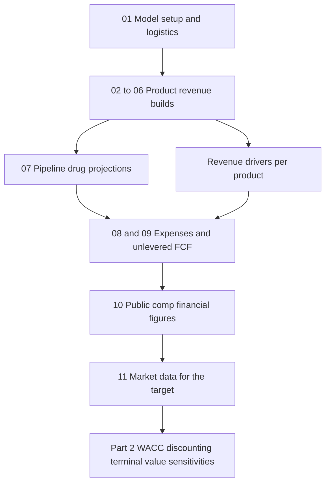

The module is one long chain. Every lesson adds a block to the same model, so a mistake in the revenue build shows up later in the free cash flow and in the implied share price. The working order is:

1. Set up the workbook and the "before and after" model versions (01).
2. Forecast revenue for each marketed product (02 to 06).
3. Forecast the pipeline, which is revenue from drugs not yet on the market (07).
4. Forecast operating expenses and turn everything into unlevered free cash flow (08 and 09).
5. Gather the market data for the comparable companies and the target, which feeds the discount rate and multiples (10 and 11).

Part 1 is mostly about building things. Part 2 is about turning the built model into a valuation.

---

## Lessons

### 8.1 Case Study Overview, Logistics and Model Setup

- **The case in brief.** A specialty pharma company is about to lose most of its revenue, roughly 75 percent at the peak of the drop, as patents on its main drug expire over the next few years. It is trying to replace that revenue with a similar successor drug, and to add new drugs through acquisitions and in-house development. The question is whether the stock is overvalued, undervalued or fairly valued. The case ends with a short stock pitch, for or against.
- **How the case is organized.** Three segments:
  1. Research the company, read the filings, and build the unlevered free cash flow (UFCF) projections. This is the part that matters most for case studies and modeling tests.
  2. Spread the comparable public companies and precedent transactions. This is tedious data entry, mostly on-the-job work, and optional if you are only preparing for interviews.
  3. Advanced WACC, DCF features and model summaries. Useful for some companies, not required for a test.
- **Business model of branded pharma.** Patents and exclusivity give a time-limited monopoly, so prices can be high. The argument is that developing drugs is long, expensive and risky, and the monopoly pays for that risk. Patients rarely pay the full list price directly. Insurers and government plans pay most of it, which is part of why the system holds together.
- **Life cycle of one drug.** Development takes years, then launch, then a ramp to peak sales, then decline. Decline comes from generic entry, which can cut price by 90 percent or more in a single year. Unit volume can stay flat while revenue falls sharply. A new drug can instead raise prices 10 to 30 percent a year while it gains acceptance.
- **Driver logic.** Annual revenue is usually patients times annual price per patient. Newer or unproven drugs need a probability-of-success haircut on revenue. Sales and marketing tends to move with revenue, since reps are paid on sales. R&D does not track revenue closely, and companies rarely disclose R&D by product, so it is usually modeled as a percent of revenue.
- **Which products get detail.** Go deep on the products that carry most of the revenue, and on products whose revenue is expected to move by something like 5x to 10x. Consolidate mature products that are flat and have no growth story.
- **Pace for a one-week case.** Days 1 and 2: read the annual report, the quarterly report and the latest investor presentation, and settle the model setup. Days 3 to 6: build the model, focusing on revenue and expense drivers and the evidence behind them. Day 7: outline and draft the pitch.
- **Mid-year trap.** When a company has made a big acquisition during the year, the 10-K alone is not enough. The 10-Q and the presentation show the newly acquired drug and any launch that the annual report does not yet reflect.
- **Scenarios or toggles.** A toggle changes one input at a time and suits drivers that move together. A scenario switch changes many inputs together (base, upside, downside). Here the drugs are largely unrelated, so one drug failing says little about another. Excel data tables can only flex two variables at a time, so a full toggle grid is not practical with 10 to 15 drivers. The valuation goal is the minimum and maximum value the company might have, so the team applies scenarios to the most important drivers only and leaves the rest fixed.
- **UFCF line items.** Start from revenue. Include cost of product sales, SG&A, R&D and intangible amortization as recurring costs. Exclude impairments and acquired in-process R&D as non-recurring. Tax the operating income and leave out interest, to get NOPAT. Add back depreciation, amortization, deferred taxes and a small "other" bucket. Subtract working capital change, capex, intangible purchases and acquisitions. Intangible purchases and acquisitions count as recurring here because a drug company buys assets all the time. Stock-based compensation is skipped in this model, as in the earlier cases.
- **Setup used in the case.** A bare-bones workbook is set up first, then the revenue breakout and the expense and cash flow lines are pasted in from prepared sheets rather than typed one by one. Full data entry would take an estimated 50 to 60 hours.

| Step | What you do | Where it comes from |
|---|---|---|
| Revenue breakout | One line per marketed drug, a line for mature drugs grouped together, a line for pipeline drugs | 10-K product table, investor presentation |
| Expense lines | Cost of sales, SG&A, R&D, intangible amortization | Income statement in the 10-K |
| Non-cash lines | D&A, deferred taxes, other | Cash flow statement |
| Cash lines | Working capital, capex, intangible purchases, acquisitions | Cash flow statement |
| Output | UFCF and EBITDA by year | Calculated |

**Worked example (made-up numbers, $ millions).** Scenario switch for one drug with a patent cliff:

| Driver | Base | Upside | Downside |
|---|---|---|---|
| Patients on drug, year 2 | 40,000 | 44,000 | 32,000 |
| Annual net price per patient | $60,000 | $62,000 | $52,000 |
| Year 2 revenue | 2,400 | 2,728 | 1,664 |

Only the scenario cell changes. The formulas pick the column with `INDEX` or `CHOOSE`, so the drivers for this drug move together under one switch. The revenue cell is still patients times price, the same as in the other drugs.

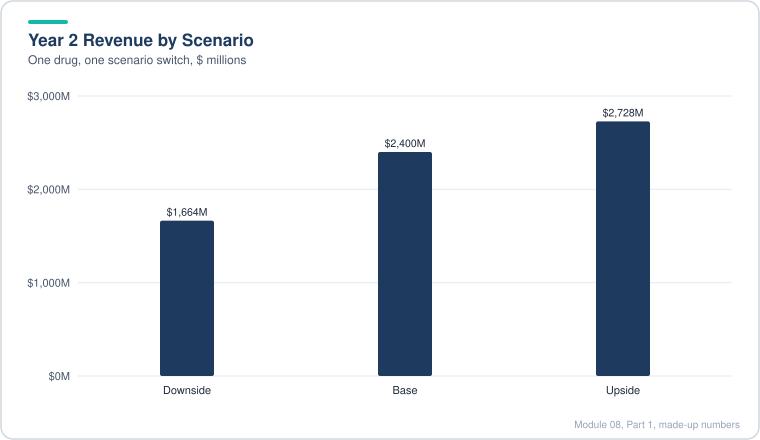

*The downside case cuts both patients and price, so revenue falls much further than either driver alone.*

> [!TIP]
> **Going further.** Two habits that save time later. First, decide on the timeline and the units before you enter any numbers, and put the fiscal year end on the first tab. Second, keep a source column next to every hardcoded input (filing name and page). Analysts who skip the source column spend the last day of a case hunting for where a number came from. Interviewers also like to ask "where did that number come from", so the habit pays off twice.

> [!WARNING]
> **Common mistake.** Modeling every product in equal detail. Detail should follow materiality and expected change. A reader who sees 15 lines of detailed drug forecasts for products that together make up 3 percent of revenue will assume the modeler ran out of time, or did not know what mattered.

---

### 8.2 Revenue Projections for the Main Sleep Drug (Drug 1)

- **Why this drug gets full treatment.** It is the company's main product, about three quarters of revenue. The company discloses the inputs, so the forecast can be built bottom up from patients and price.
- **Data you can usually find.** The filings give the disease incidence (roughly 1 in 2,000 people), the total patients on the drug franchise, the patients on the newer successor drug (subtract it to get the patients on this drug alone), and the revenue by product. Older 10-Ks give history. Population data from a public statistics source gives the market size.
- **Build the historical block.**
  - Total market = population divided by the incidence denominator.
  - Patients = average of the year's patient counts (revenue is an annual flow, so an average fits better than a year-end count).
  - Share = patients divided by total market.
  - Annual price per patient = revenue divided by average patients, with a units adjustment (revenue in $ millions, so multiply by 1,000,000 or 1,000 as needed).
  - Historical price growth is about 10 percent a year. The share of the market on the drug rose slightly, then started to fall once the successor drug and generics came in.
- **Forecast logic.** Market grows with population (about 0.5 percent a year). Share falls by about 1 point a year from a starting level near 7 percent, then holds at a floor near 0.5 percent. Patients equal market times share. Price follows a two-phase path. Before generic entry it rises at the historical rate. Once generics arrive, price drops by about 90 percent in one year, then grows with inflation (about 3 percent).
- **Scenarios only on price.** Share is not flexed, because it heads to a low level in every case and the only real question is timing. Price is flexed through the generic entry year, which is the main value driver. Upside: entry is late. Base: entry is in the middle. Downside: entry is early.
- **Selecting the scenario.** A scenario cell with a data validation list (upside, base, downside) drives an INDEX and MATCH. The match returns the right row of the price block, so the revenue line only ever reads one price row.

**Worked example (made-up numbers, $ millions, price in dollars).**

| Year | Market (people) | Share | Avg patients | Price per patient | Revenue |
|---|---|---|---|---|---|
| Y0 (actual) | 200,000 | 6.0% | 12,000 | $100,000 | 1,200.0 |
| Y1 (+10% price) | 201,000 | 5.0% | 10,050 | $110,000 | 1,105.5 |
| Y2 (generics, -90%) | 202,005 | 4.0% | 8,080 | $11,000 | 88.9 |

Revenue falls by about 92 percent from Y1 to Y2 because price falls 90 percent and patients fall 20 percent at the same time. Patients fall only because the share is set lower, not because of the price.

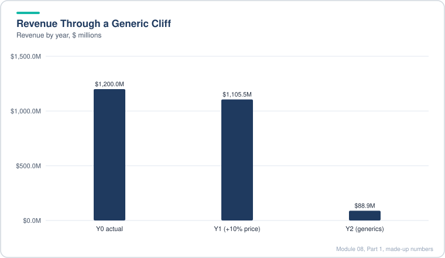

*Revenue barely changes in Y1 and then collapses once generics enter in Y2.*

> [!TIP]
> **Going further.** The generic entry date is the single most important input in this lesson and it is a legal question. A patent calendar, litigation over patent challenges, and settlements with generic makers can all move it. Treat the entry year as a judgment with a range, and say which filing or article it rests on. Also, a 90 percent price cut is a common assumption, but actual erosion depends on how many generic makers enter and whether the drug has an authorized generic. Two generics usually cut price much less than ten do.

> [!WARNING]
> **Common mistake.** Forecasting price growth at the historical rate for many years. Historical pricing power often ends when a patent expires or when payers push back. Use the historical rate only for the window the company can still control.

> [!TIP]
> **Interview tie-in.** "How would you forecast a drug with a patent cliff?" The answer is patients times price, with the cliff as a step change in price and a slower path for share, and with a scenario on the timing.

---

### 8.3 Revenue Projections for the Successor Sleep Drug (Drug 2)

- **Why it is different.** The successor drug is new. It launched in the last quarter of the first historical year, so there is only a few quarters of history. The lesson turns on three questions: how big the revenue already is, what it costs a patient per year, and how far the share of the market can climb.
- **Annualize a partial year.** A quarter's revenue times four is only a run-rate. Patient counts are averaged over the quarter, and price is revenue times four divided by average patients. Do the same with the first half of the next year, and subtract the second quarter from the half year to get the first quarter.
- **Price cross-check.** A new drug's price is quoted per unit (per bottle or per vial), so work out how many units a typical patient uses per month, multiply, and annualize. Compare the result to a public price source. If the implied annual price is in the right range, the company's own price per patient is probably right.
- **Price path.** Start near the observed annual price, grow slowly (about $2,000 a year in the base case), and cut price by about 90 percent when generic entry comes. After that, grow in low single digits. The lesson argues that the company has less pricing power here than on the first drug, because the new drug already sells at a high price and faces competition.
- **Share path from a peak-sales view.** Use analyst estimates of peak sales and of the eligible market. Divide peak sales by the potential patient count times the price to get a peak share. Then ramp share to that peak over four or five years, hold it, and let it decline after exclusivity ends. Each scenario gets its own peak share.
- **Scenario design.** The three cases differ mainly in how high the share goes and how fast it ramps. Price is shared across cases and dropped at the generic date.

**Worked example (made-up numbers).** Quarterly revenue annualized into a price.

| Period | Revenue ($M) | Avg patients | Annualized price |
|---|---|---|---|
| Q4 Year 0 (launch) | 12 | 800 | 12 x 4 / 800 = $60,000 |
| Q1 Year 1 | 60 | 3,000 | 60 x 4 / 3,000 = $80,000 |
| Q2 Year 1 | 100 | 4,000 | 100 x 4 / 4,000 = $100,000 |

**Peak share check (made-up).** Eligible patients 180,000, peak share 5 percent, so 9,000 patients. At $110,000 a year that is about $990 million. Two peak-sales estimates that sit far apart (say $0.5 billion and $1.5 billion) tell you the range the scenarios should cover.

> [!TIP]
> **Going further.** Two checks an analyst should add to this kind of build. First, check that revenue for the current year is above what the first half already printed, since annual revenue has to be at least the run-rate already booked, unless the company says otherwise. Second, look at the cannibalization between the old and new drug. If the successor drug takes patients from the old one, the old drug's share should fall at the same time. The case handles this lightly, but a combined check (sum of both drugs against the total patient pool) catches most mistakes.

> [!WARNING]
> **Common mistake.** Annualizing a partial year without the averaging step. Dividing the full-year revenue by the year-end patient count understates the price, because the year-end count is higher than the average over the year during a ramp.

> [!TIP]
> **Interview tie-in.** "How do you value a drug that has only been on the market for a few quarters?" Answer with run-rate, unit price, a peak share from analyst views, and a scenario range. Say that you are using the market as a cross-check, not as the main driver.

---

### 8.4 Revenue Projections for the Acquired Epilepsy Drug

- **The drug.** A cannabinoid-based oral treatment for rare, severe childhood epilepsies. It was bought with the company that developed it, so the buyer has the historical sales from the seller's reports. It is an orphan drug: a drug for a disease that affects fewer than about 200,000 people in the U.S. That status brings seven years of orphan exclusivity from approval, which keeps generic rivals out for a long time.
- **Sources for the history.** The deal presentation shows the seller's annual revenue for the last two years. The acquisition closed partway through the year, so the buyer has no revenue for the early part of the year. Check the revenue run-rate against the quarter reports.
- **Market size is a sum of groups.** Approved indications are sized from published patient counts. Unapproved indications still in trials are added at a midpoint of a range, and flagged as not yet approved. Keep approved and unapproved groups in separate rows so the reader can see which part of the market is already real.
- **Price.** The company does not disclose patients or price per patient in the deal filings. Use public price references for the annual cost, and check it against revenue divided by an implied patient count. Assume an annual increase near the long-run orphan drug average (about 5 percent a year in the source data).
- **Market growth.** Grow the eligible market with U.S. population only. The drug is approved in Europe, but sales are almost all U.S. so far. Leave Europe out of the base case until there is evidence.
- **Backing into share.** Start from a peak-sales estimate for the peak year (the case uses 2027 for peak). Peak patients equal peak revenue divided by peak-year price. Divide by eligible patients to get peak share. Analyst estimates ranged widely, so the three cases use peak shares that give about $2.5 billion (upside), about $1.8 billion (base) and about $1.3 billion (downside) at peak.
- **Ramp and decline.** Share rises by a few points a year to the peak, then falls slowly. The decline comes from new branded competitors, not from generics. Patents expire much later than orphan exclusivity, so generics are left out of the timing.

**Worked example (made-up numbers, $ millions).**

| Year | Eligible patients | Share | Patients | Price | Revenue |
|---|---|---|---|---|---|
| Y0 (actual) | 95,000 | 16.0% | 15,200 | $32,500 | 494.0 |
| Y1 | 95,475 | 25.0% | 23,869 | $34,125 | 814.5 |
| Y2 | 95,952 | 35.0% | 33,583 | $35,831 | 1,203.3 |

Patients are eligible patients times share. Price grows 5 percent a year. Revenue is patients times price divided by 1,000,000.

> [!TIP]
> **Going further.** Two gaps to fill. First, a drug's price per patient in a public source is a list price, not a net price after rebates. Net price is what the company keeps and is usually lower, sometimes much lower in the U.S. If you have the company's gross-to-net disclosure, use it. Second, a price increase that looks fine in a public article may be hard to repeat once payers push back on a drug with many patients. Test the price path against that risk, not only against past increases.

> [!WARNING]
> **Common mistake.** Treating the market size as fixed when indications are still in trials. If the upside case depends on a new indication, the eligible market should move with approval, not with the growth rate. Mixing the two makes the upside look more certain than it is.

> [!TIP]
> **Interview tie-in.** "Why is the orphan status important?" Because it sets the exclusivity timeline and the reason the price is high. Explain it as a cash-flow timing question: exclusivity length matches the time the company needs to earn back development cost.

---

### 8.5 Revenue Projections for a New Leukemia Drug, a Sleep Drug and the Legacy Portfolio

Three different methods in one lesson, ordered from hardest to easiest.

**A. The new leukemia drug (hardest).**

- **The drug.** A new treatment for a childhood blood cancer, approved shortly before the case starts, so there is no revenue yet. It is an improved version of an older drug, used for patients who react badly to standard treatment.
- **Market is new cases, not prevalence.** This is the key difference from the sleep drugs. A cancer patient either recovers or does not, so the right base is new diagnoses each year, not the cumulative number of patients. The eligible group is the new cases in a year that fit the drug's label. Use a flat count because the incidence is very low and the population of the target age group is not expected to grow much.
- **Price per patient is the hard part.** Companies quote price per vial, not per patient. Build the annual cost from four inputs: units per dose, doses per week, average weeks of treatment, and price per unit. Use the older drug's historical pricing as a sense check. The lesson gets a per-patient cost near $400,000 for a full course. This is an estimate, not a disclosed number, and the lesson says so.
- **Share and ramp.** Anchor on analyst revenue expectations and on the old drug's peak sales. The case uses about 10 percent of new cases as the peak share, with a ramp over two years, a plateau, then a decline of about 5 percent a year.

**Worked example, new cases method (made-up numbers, $ millions).**

| Year | New cases | Share on drug | Patients treated | Annual price per patient | Revenue |
|---|---|---|---|---|---|
| Y1 | 5,000 | 4% | 200 | $400,000 | 80.0 |
| Y2 | 5,000 | 7% | 350 | $404,000 | 141.4 |
| Y3 | 5,000 | 8% | 400 | $408,040 | 163.2 |

Price rises 1 percent a year, which the lesson treats as modest for a drug that is already very expensive.

**B. The sleep drug already on the market (easier).**

- **Market.** Link to the same eligible-patient market used for the first sleep drug. It is the same disease area, but this drug is cheaper and aimed at a broader group, so it reaches more patients.
- **Price.** Use the published monthly price, multiply by 12, and grow it in steps (about 10 percent a year early, then flattening). The price is well below the first sleep drug's, so the patient count is much higher for the same revenue.
- **Share.** Peak revenue from analyst views and the company's own targets (the company's view is discounted, since it is the seller). The lesson uses a peak year and a ramp of about 5 points a year to peak, then a slow fall because of more competition.
- **Check.** Today's share is estimated at 2 to 3 percent. That is the starting point, and the ramp is the way to reach the target.

**Worked example, sleep drug (made-up numbers).**

| Year | Eligible market | Share | Patients | Annual price | Revenue |
|---|---|---|---|---|---|
| Y1 | 150,000 | 8.0% | 12,000 | $8,000 | 96.0 |
| Y2 | 150,000 | 10.0% | 15,000 | $8,800 | 132.0 |

**C. Legacy and mature drugs (easiest).**

- Group the mature drugs into one line. They are either growing or declining, and no single one is big enough to model separately.
- Project the group with a simple growth path, starting near the last reported growth rate, and fade the rate to low single digits over time. Acquired or developed smaller drugs can fall into this line later.
- The case uses a few percent a year as the early growth rate, fading to about 2 percent, and keeps that rate in a clear input row.

> [!TIP]
> **Going further.** Three checks to add. First, a per-patient cost built from vials and dosing is only as good as the dosing assumption. Confirm it with the prescribing information if you can, since the number of weeks of treatment changes the answer by a large factor. Second, for a pediatric drug, the eligible patients are often below 20 years old. Pediatric exclusivity and orphan rules can add protection on top of the base patent term, so check them before you assume a generic date. Third, a legacy segment that is "growing at 3 percent" can hide one product growing fast and one fading fast. If the segment is material, break it out.

> [!WARNING]
> **Common mistake.** Using cumulative prevalence for a cancer drug. That treats a patient who was cured years ago as still needing the drug. The rule is: match the market definition to how long patients stay on the drug.

> [!TIP]
> **Interview tie-in.** "How do you size a market for a drug with a small patient pool?" Start with the incidence or prevalence, then the share of patients who get the drug, then price and duration, and say which of these is a company disclosure and which is your estimate.

---

### 8.6 Revenue Projections for a Rare Lung Cancer Drug, with Royalties and Milestones

- **The drug.** A newer chemotherapy for a rare lung cancer seen mostly in older smokers and former smokers. It was licensed from a foreign developer. The license brings two extra cash costs that the earlier drugs did not have: milestone payments to the licensor and royalties on sales.
- **Market shrinks.** The market is the number of adult lung cancer diagnoses each year times the share that is this rare subtype (about 13 percent in the source data). The lung cancer count falls over time because smoking rates have fallen for decades. The case uses a 2 percent annual decline and does not add population growth, since the decline is already net of population growth.
- **Price from the cycle count.** The company gives the cost per cycle and the median number of cycles in its trial. Multiply them for a per-patient cost, then check the answer against a public price reference. Keep price growth small: the drug's clinical evidence is weak, so pricing power is limited.
- **Share and ramp.** Start from the current share implied by last year's revenue (revenue divided by patients times price). Anchor on the peak-sales estimates from analysts and the company's own "multi-hundred million" language. Then set a peak share and a ramp to match the revenue run-rate for the current year.
- **Royalties and milestones.**
  - Royalty payments are a percentage of revenue. The company gave a range (high teens to 30 percent, with tiers), so take the middle.
  - Commercial milestones are a lump sum the company will pay as sales targets are hit. The disclosed total is large but the timing is vague, so spread it evenly over the years it is likely to be paid and then stop.
  - Royalties go into cost of goods sold. Milestone payments are capitalized and amortized like an asset, so they sit in investing cash flow, between intangible purchases and acquisitions, and their amortization runs through the non-cash add-backs.

**Worked example (made-up numbers, $ millions unless marked).**

| Year | Adult lung cancer cases | SCLC share | SCLC cases | Share on drug | Patients | Price per patient | Revenue | Royalty at 20% | Milestone |
|---|---|---|---|---|---|---|---|---|---|
| Y0 (actual) | 200,000 | 12% | 24,000 | 5.0% | 1,200 | $50,000 | 60.0 | n/a | n/a |
| Y1 | 196,000 | 12% | 23,520 | 10.0% | 2,352 | $51,000 | 120.0 | 24.0 | 100 |
| Y2 | 192,080 | 12% | 23,050 | 15.0% | 3,458 | $53,000 | 183.3 | 36.7 | 100 |

Lung cancer cases fall 2 percent a year. Royalty and milestone rows are shown from the first year they apply.

> [!TIP]
> **Going further.** Three things to watch. First, a royalty range of 15 to 30 percent is a large swing. Run the royalty rate as a sensitivity, since it moves the cash flow directly, while revenue barely moves it. Second, milestones are often tied to sales thresholds, so model them as "paid when revenue first crosses X" if the agreement gives the thresholds, rather than as an even spread. Third, check the accounting. Capitalizing a milestone changes EBITDA: a capitalized payment does not reduce EBITDA, so two models can show different EBITDA for the same cash flow. Say which treatment you used.

> [!WARNING]
> **Common mistake.** Forgetting that royalties are a cost of goods sold item. Treating them as an opex line or leaving them out of gross margin makes the gross margin look better than it is.

> [!TIP]
> **Interview tie-in.** "How do royalties and milestones affect the DCF?" Royalties reduce margin on each dollar of revenue, so they lower the cash flow that the discount rate is applied to. Milestones are cash out, and they are often treated like capex if they create a long-lived asset.

---

### 8.7 Pipeline Drugs: Projections with Little Data and Risk Adjustment

- **Which pipeline drugs get modeled.** Only the late-stage ones that the company calls out. Early drugs (Phase 1) would need such a heavy risk discount that even a large peak would be small after it. The sweet spot is Phase 2 to Phase 3, where revenue is still meaningful but the risk is discounted.
- **Two drugs, two indications.** One is for an essential tremor (a large population, with generic options already on the market). The other is for post-traumatic stress disorder (a larger population still, where existing drugs are used widely). Both are Phase 2.
- **Data is thin, so build from analogues.**
  - Patient pool: a published prevalence figure, cross-checked against the company's target population. When sources disagree widely (the PTSD case had estimates from about 8 million to over 20 million), use the company's target and say why.
  - Price: a blend between generic and branded prices of drugs already sold for the same condition. Start at an order-of-magnitude figure in the middle of the range, not at a precise number.
  - Share: take the share that drugs already in the market for the same condition have reached, and set base, upside and downside around it.
  - Timing: count the years from Phase 2 to approval (typically several years) and start revenue after that.
- **Scenarios on every pipeline drug.** Each one gets release year, peak share, and ramp in three cases. In the first drug the upside share is roughly double the base and the downside roughly half. In the second drug the upside is higher than base and the downside is lower.
- **Risk adjustment.** Multiply unrisked revenue by the probability that the drug reaches approval from its current phase. A Phase 2 drug's chance is the product of two phase transition rates (Phase 2 to Phase 3, then Phase 3 to approval). The case uses the rate for the central nervous system therapeutic category, since the drug is not oncology. Keep the risk factor as a named input, so it can be changed in one place.
- **Scenario sum.** After risk adjustment, the pipeline lines are added to the company's other products. As a sense check, compare total revenue in the downside case with the company's current revenue.

**Worked example (made-up numbers, $ millions unless marked).** Pipeline drug with a 7 million patient pool, price $1,000 a year growing 5 percent, base share ramp 1 percent, 2.5 percent, 4 percent. Phase 2 risk factor 25 percent (50 percent times 50 percent, made up).

| Year | Patient pool | Share | Patients | Price | Unrisked revenue | Risk-adjusted (x 25%) |
|---|---|---|---|---|---|---|
| Y2 (release) | 7,000,000 | 1.0% | 70,000 | $1,000 | 70.0 | 17.5 |
| Y3 | 7,035,000 | 2.5% | 175,875 | $1,050 | 184.7 | 46.2 |
| Y4 | 7,070,175 | 4.0% | 282,807 | $1,102.50 | 311.8 | 77.9 |

Only the risk-adjusted line goes into the company's total. The unrisked line is kept for reference, so a reader can see how much value depends on approval.

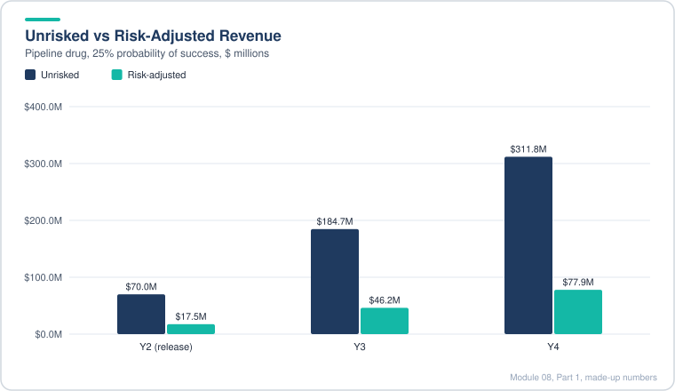

*The 25 percent probability of success cuts every year of pipeline revenue to a quarter of the unrisked figure.*

> [!TIP]
> **Going further.** Four points. First, the phase transition rates are industry averages. A drug with a known mechanism, an approved sister drug, or a strong Phase 2 readout deserves a different rate. Second, probability of success is not the same as probability of being on the market by a date. A risk-adjusted revenue line hides timing risk, so run a delayed-launch case as well. Third, a single risk factor multiplying a full revenue curve treats failure as "no revenue at all". In practice, a drug can get approved with a narrower label, so a smaller share might be the better base case. Fourth, the pipeline is often the largest source of valuation disagreement between analysts, so show it as a separate line in your summary.

> [!WARNING]
> **Common mistake.** Applying the risk factor to the wrong year. The risk factor reduces expected revenue, not the years before launch. The R&D spent to get the drug to market is paid whether or not the drug succeeds, so the cost side should stay at its full, certain amount while only the revenue is risked. Risking both sides the same way understates the cost of the program.

> [!TIP]
> **Interview tie-in.** "How do you value a pipeline asset?" Use risk-adjusted NPV: probability of approval times the expected cash flows, then discounted at a rate that fits the stage. Say that the probability is a placeholder and that the peak-share estimate is the real debate.

---

### 8.8 Expenses, D&A, Taxes and NOPAT (Part 1 of 2)

- **Why expenses are simpler here.** Revenue has many drivers, but the company does not disclose expenses by product, and the big acquisition makes history hard to compare. So the expense block uses a few simple drivers: cost of sales as a percent of revenue, a single cash operating expense line driven by headcount, and a small depreciation line.
- **Combine SG&A and R&D.** The company only discloses its R&D headcount in the latest filing, not for past years. Splitting history would mean guessing, so the case merges SG&A and R&D into one "cash operating expenses" line. Keep the reported split as a memo if you want it.
- **Cost of sales.** Cost of product sales as a percent of revenue, using a simple historical average. The trend is noisy, so the average is safer than a trend line.
- **Headcount method.**
  - Revenue per employee = revenue divided by total employees (historical).
  - Cash cost per employee = cash operating expenses divided by employees.
  - Forecast cost per employee with a growth rate that fades (about 4 percent early, down to about 1 percent later, roughly tracking inflation).
  - Forecast revenue per employee on a path (down a little at first, then turning up after the acquisition is absorbed).
  - Employees = revenue divided by revenue per employee. Cash opex = employees times cost per employee.
- **Margin story.** The company is becoming more diversified, with more products, more sales reps and more overhead. So the EBITDA margin should fall by about 4 to 6 percentage points over the forecast. Check that EBITDA growth turns slightly negative late in the period. If it does not, the assumptions are too rosy.
- **Depreciation.** A small share of revenue. The company does not build factories, so capex is small and depreciation is an afterthought. Use a simple historical average.
- **Amortization has two parts.**
  - Existing: the amortization already booked on acquired intangibles, plus the remaining-year amount and each future year, taken from the filings. The company's disclosed total is well above the sum, so the schedule is safe.
  - New: intangible purchases (modeled as a percent of revenue, about 5 percent here) plus capitalized milestones, cumulated and amortized straight-line over about 10 years. Start amortizing the year after the spend, not the year of spend. The schedule stops after 10 years, which is inside the forecast window, so no cap is needed.
- **Tax.** The company's effective rate has been volatile (negative in one year), and the statutory rate in its home country is lower than the U.S. rate. The case uses 15 percent, between the statutory rate and the historical effective rate. Apply it to operating income, not to pre-tax income, because this is the unlevered version.
- **Royalties.** Royalties go into cost of goods sold, so they hit gross profit, not operating expenses. The company's own presentation says so.

**Worked example (made-up numbers, $ millions).**

| Line | Year 1 | Year 2 | How it is built |
|---|---|---|---|
| Revenue | 1,000.0 | 1,050.0 | Given |
| Cost of product sales | (70.0) | (73.5) | 7% of revenue |
| Royalties | (40.0) | (42.0) | Royalty rate times revenue, in COGS |
| Gross profit | 890.0 | 934.5 | Revenue less COGS and royalties |
| Cash operating expenses | (600.0) | (655.2) | Employees times cost per employee |
| Existing amortization | (150.0) | (150.0) | From filings |
| New amortization | 0.0 | (5.0) | Last year's spend over 10 years |
| EBIT | 140.0 | 124.3 | Gross profit less opex and amortization |
| Taxes at 15% | (21.0) | (18.6) | Tax rate times EBIT |
| NOPAT | 119.0 | 105.7 | EBIT less taxes |
| Depreciation | 20.0 | 21.0 | 2% of revenue |
| EBITDA | 310.0 | 300.3 | EBIT plus depreciation plus all amortization |
| EBITDA margin | 31.0% | 28.6% | EBITDA over revenue |

Year 2 headcount is 1,050 employees at $1.0 million revenue each. Cost per employee grows 4 percent, from $0.60 million to $0.624 million.

> [!TIP]
> **Going further.** Three points. First, EBITDA here adds back all amortization, including the large amount from the acquisition. Say so in the output, because EBITDA that adds back acquisition amortization looks much bigger than EBITDA that does not, and the gap is not operating performance. Second, the headcount method hides the fact that sales and marketing scales with revenue, while R&D does not. Merging them is fine for a quick DCF, but a reader who wants margin detail will ask for the split. Third, the 15 percent tax rate is a judgment. A different rate changes NOPAT in every year and the terminal value by the same percentage.

> [!WARNING]
> **Common mistake.** Moving royalties below EBITDA, or leaving them out of gross profit. Royalties are a cost of sales here, so they belong inside COGS and above EBITDA. Leaving them out inflates both gross margin and EBITDA.

> [!TIP]
> **Interview tie-in.** "Why would a drug company's EBITDA margin fall as it grows?" It adds products, sales reps and overhead before the new products earn their full sales. Also say it is a forecast assumption, not a rule.

---

### 8.9 Unlevered Free Cash Flow, Deferred Taxes and Normalized Net Income (Part 2 of 2)

- **Finish the cash flow block.** The remaining lines are stock-based compensation, the change in working capital, capex, acquisitions and a catch-all "other" line. Most are simple ratios of revenue, but two need care: the change in working capital (tied to revenue change, not to revenue) and deferred taxes (the model's cash-tax check).
- **Stock-based compensation.** A percent of revenue, falling gradually. It is not added back in the UFCF in this model, but it is projected because it drives deferred taxes.
- **Working capital.** Express the change in working capital as a percent of the change in revenue, not as a percent of revenue. A simple historical average is safest when the history has no clean trend. A negative number here means cash goes into inventory and receivables as sales grow, which is normal for a product company.
- **Capex and other items.** Capex is a percent of revenue (small, because the company does not build plants). The "other" line is a simple dollar average, since it does not move with revenue.
- **Acquisitions are one-time.** The large acquisition sits in the first forecast year, then the line is set to zero. Do not project acquisitions as a percent of revenue unless the company has a pattern of buying businesses each year.
- **Deferred taxes are the key line.** Intangible amortization from acquisitions and stock-based compensation are usually not deductible for cash tax. So book taxes (based on the book profit) are lower than cash taxes. The model estimates the gap as (existing amortization plus new amortization plus stock-based compensation) times the tax rate, shown as a negative adjustment. The case assumes that the historical gap was partly one-time and does not carry the full historical gap forward.
- **UFCF build.** NOPAT, plus depreciation and amortization, plus deferred taxes, plus the change in working capital, less capex, less intangible purchases, less milestone payments, less acquisitions.
- **Normalized net income to common (for the comps later).** Operating income less net interest, times one minus the tax rate, plus equity investment income, less the non-controlling interest share. It is not used in the DCF, but comparable company multiples need it. Interest and equity income are estimated from the latest 10-Q (six months actual, plus three months doubled), held flat.
- **Calibration check.** After the first full build, the drug 1 revenue was checked against the run-rate in the latest interim report. Doubling the first-half revenue gave about $1.3 to $1.4 billion, but the model was showing $1.5 to $1.6 billion for the year. So the price growth and share path were reduced for the near term, and the post-generic price cut was made a little less severe to keep the long-term tail reasonable. This is the right habit: calibrate near-term revenue to what has already happened, then adjust the long-term view.

**Worked example (made-up numbers, $ millions, Year 1, continuing the table from 8.8).**

| Line | Year 1 | How it is built |
|---|---|---|
| NOPAT | 119.0 | From 8.8 |
| Depreciation and amortization | 170.0 | Depreciation 20 plus amortization 150 |
| Deferred taxes | (30.0) | Tax rate 15% times (existing 150 + new 0 + SBC 50) |
| Change in working capital | (10.0) | Negative 20% of revenue change of 50 |
| Capex | (20.0) | 2% of revenue |
| Intangible purchases | (50.0) | 5% of revenue |
| Milestone payments | 0.0 | None this year in the example |
| Acquisitions | 0.0 | None this year in the example |
| **Unlevered free cash flow** | **179.0** | Sum of the lines above |

Year 2 in the same example: NOPAT 105.7, D&A 176.0, deferred taxes (31.1), working capital (10.0), capex (21.0), intangible purchases (52.5), so UFCF is 167.1. UFCF falls because operating profit falls as the margin compresses, while the non-cash and tax lines grow only slightly.

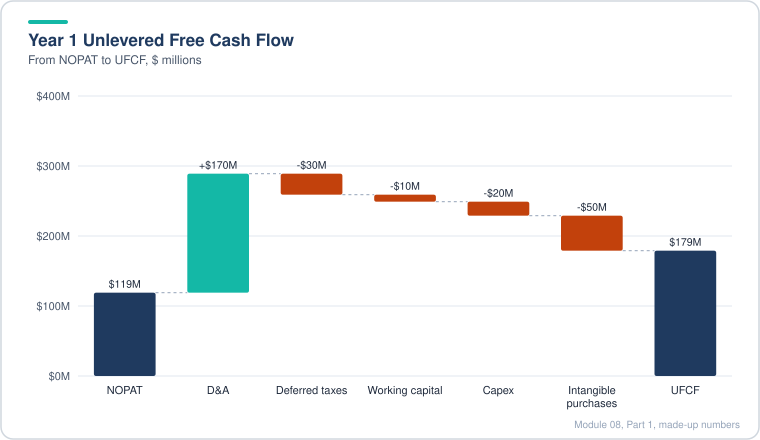

*The depreciation and amortization add-back is large, so UFCF ends well above NOPAT even after the cash outflows.*

> [!TIP]
> **Going further.** Three checks. First, deferred taxes are an estimate, and they can be the difference between a sensible and a silly UFCF. Pull the actual cash taxes paid from the cash flow statement and compare them to the book tax line. Second, a model that adds back D&A but ignores stock-based compensation is treating SBC as free. Many analysts subtract it, because the company pays it with shares that dilute holders. Pick one approach and say why. Third, if working capital is set as a percent of the change in revenue, a revenue decline produces a cash inflow, which can flatter UFCF in the declining years. Check the sign in the decline years.

> [!WARNING]
> **Common mistake.** Forgetting that acquisitions and milestones are not recurring in the same way as capex. Including a large one-off acquisition in every year, or leaving it out of the first year, distorts the whole valuation.

> [!TIP]
> **Interview tie-in.** "Why would you care about deferred taxes?" Because a company with large non-deductible amortization pays more cash tax than its book tax suggests. Using the book tax rate would overstate UFCF.

---

### 8.10 Spreading the Public Comps: Last-Twelve-Month (LTM) Financials (Optional)

This lesson is the manual version of the comps work. It is optional, since a case study or interview will rarely ask for it. Learn the method, then use a data service for speed.

- **Why LTM.** No company reports a last-twelve-months figure. Filers report full years, quarters, half years and nine-month totals. To line up a set of comparable companies on the same recent 12-month window, build LTM yourself: take the last full fiscal year, add the current year-to-date period, and subtract the same prior-year period.
- **Which metrics.** Revenue, EBITDA and net income, plus the effective tax rate for later use. For a normal company, pair sales-based metrics (revenue) with profit-based ones (EBITDA). Net income is best left alone, because it has too many adjustments and P/E is often meaningless for companies that lose money.
- **EBITDA build.** Start with operating income from the income statement. Add depreciation and amortization from the cash flow statement, since that figure is complete even when the income statement does not show it as a line. Add back non-recurring charges that do affect operating income.
- **Watch for below-the-line amortization.** Amortization of debt discounts, issuance costs and investment premiums sits under interest or other expense. It does not touch operating income, so do not add it back to EBITDA. A rule of thumb: depreciation and amortization lines that are called that way sit above operating income.
- **Non-recurring items.** Search for restructuring, integration, acquisition and merger costs, severance, and changes in contingent consideration (common in IP-heavy companies, and volatile year to year). Read the "results of operations" section, which describes the big items, and the company's adjusted-EBITDA bridge if it has one. Do not chase small items, because they rarely change the answer.
- **Effective tax rate.** Use the latest annual report. The case uses a statutory U.S. rate of about 35 percent, which was the federal rate before 2018. The federal rate is now 21 percent, plus state tax, so check the current figure before you quote it. If one year is abnormal (for example a tax benefit), average the normal years and say so.
- **Projected figures.** Use consensus estimates from a data service or published research. Sanity-check them. The case example had EBITDA above revenue in one year, which is impossible, so the estimate was treated as a data error and marked not applicable.
- **Calendarization.** If one comparable has a June year end and another a December year end, the fiscal years cover different 12-month periods. For historical LTM figures this does not matter, because every company gets its own LTM. For projections, add or subtract quarters (or fractions of a year) so every company lines up on one year end.

**Worked example (made-up numbers, $ millions).** LTM = full year + current half year minus prior-year half year.

| Line | FY 2016 | H1 2017 | H1 2016 | LTM |
|---|---|---|---|---|
| Revenue | 400 | 220 | 200 | 420 |
| Operating income | 30 | (10) | (20) | 40 |
| Depreciation and amortization (cash flow) | 25 | 12 | 10 | 27 |
| Change in contingent consideration | 8 | 3 | 2 | 9 |
| Merger costs | 5 | 0 | 0 | 5 |
| Adjusted EBITDA | 68 | 5 | (8) | 81 |

Adjusted EBITDA margin on LTM revenue is 81 / 420, about 19.3 percent. The "adjusted EBITDA" column is operating income plus D&A plus the two add-backs, for each period, before the LTM step.

> [!TIP]
> **Going further.** Two things. First, companies differ in what they call non-recurring. A company that has a "restructuring" every year is not showing a one-off. Check the history before adding back a charge that repeats. Second, the adjusted EBITDA you calculate may not match the figure a data service or a bank uses, because each source makes different add-back choices. Keep a note of your add-backs so the number can be checked and defended.

> [!WARNING]
> **Common mistake.** Subtracting the prior-year half from the current year's full-year number, instead of adding the current half. The order is always full year plus current year-to-date minus prior year-to-date.

> [!TIP]
> **Interview tie-in.** "How do you get LTM numbers?" Full year plus current YTD minus prior YTD, and say why: it puts every comparable on the same recent window.

---

### 8.11 Market Data and the Equity-to-Enterprise Value Bridge for a Comparable (Optional)

- **Why spread comps at all.** Data services (for example Capital IQ or FactSet) are fast but imperfect. They often treat leases inconsistently, misclassify non-recurring items, and miss industry metrics such as pipeline revenue. Spreading by hand is slow, but it is what you do when numbers must hold up under scrutiny: a fairness opinion, a bankruptcy filing, or a very large deal that takes months to close. For a case study or a quick pitch, use the services and move on.
- **Model structure.** Keep the display tab separate from a calculation tab. The calculation tab holds the raw inputs in a consistent layout, with lookups in the rightmost column of each company's block. The display tab pulls from it with INDEX and MATCH, using named ranges for the data block, the row labels and the ticker row. INDEX and MATCH works in every Excel version. XLOOKUP is cleaner in newer versions but the result is the same.
- **Step 1, market data.** Get the share price and beta from a market data source, with the date. Get basic shares from the most recent 10-Q (the cover page is usually the fastest). Equity value is price times diluted shares, which is built in the next steps.
- **Step 2, dilutive securities.**
  - Restricted stock units: add all unvested units. Add performance-based and market-based units too, to be conservative, if the conditions are not given.
  - Options: use the treasury stock method at the current share price. Shares added = options minus (options times strike divided by share price), only when the price is above the strike. For public comparables use exercisable options. For precedent transactions or M&A comps use outstanding options, since they usually vest on a change of control.
  - Convertible notes: if the conversion price is above the current share price, the notes are out of the money. No shares are added, and the notes count as debt at fair value. If the conversion price is below the share price, the notes are in the money. Shares added equal principal divided by conversion price, and the notes are dropped from debt (because they behave like equity).
  - Fair value of the notes: the filing discloses it. Use the most recent one (usually the latest 10-Q). Use the annual report only if no interim figure exists.
- **Step 3, the bridge from equity value to enterprise value.** Add debt (including fair value of out-of-the-money convertibles), preferred stock and non-controlling interests. Subtract cash and investments (short and long term). Subtract equity investments and non-core assets that the company values separately. Subtract the value of net operating losses, measured after a valuation allowance. Add unfunded pension liabilities if any. Operating leases are set to zero for U.S. GAAP companies in this model, which is consistent with keeping leases out of EV.
- **Search technique.** Start with the 10-Q, then go to the 10-K for the items it does not repeat (net operating losses, the full dilution table, the detail of other assets). Search for terms such as "diluted", "fair value of", "net operating loss", "equity investment", and "pension". Small items are not worth chasing.

**Worked example (made-up numbers, $ millions and millions of shares).**

| Line | Value | Note |
|---|---|---|
| Share price | $50.00 | Market data, date stated |
| Basic shares | 100.0 | From the 10-Q cover |
| RSUs and PSUs | 2.5 | All added, to be conservative |
| Options | 1.6 | 4.0 options at a $30 strike: 4.0 - 4.0 x 30 / 50 = 1.6 |
| Convertible, $400 principal, $60 conversion | 0.0 | Out of the money (50 is below 60), so no shares |
| Diluted shares | 104.1 | 100.0 + 2.5 + 1.6 |
| Equity value | 5,205.0 | 104.1 x $50 |
| Convertible debt at fair value | +380.0 | Out-of-the-money notes count as debt |
| Cash and investments | (600.0) | Balance sheet, short and long term |
| Equity investments | (8.0) | Small, from the notes |
| **Enterprise value** | **4,977.0** | 5,205 + 380 - 600 - 8 |

If the same convertible had a $40 conversion price, it would be in the money. Shares added would be 400 / 40 = 10.0 million, the diluted share count would be 114.1 million, and the debt line would drop to zero.

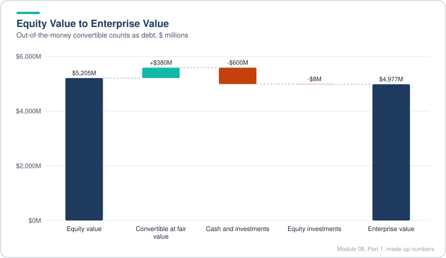

*The out-of-the-money convertible adds to enterprise value as debt, while cash and investments reduce it.*

> [!TIP]
> **Going further.** Four points. First, the treasury stock method gives the answer for options, but a big option pool with a strike close to the price can move diluted shares a lot, so show it as a separate line. Second, the in-the-money test uses today's price. If the stock is near the conversion price, the answer flips with small price moves, so check the sensitivity. Third, the net operating loss line is a judgment. Using the gross number overstates value, and the valuation allowance reflects the company's own view on whether it can use the losses. Fourth, fair value of debt is a market estimate, not a face amount. A convertible that trades below par, for example after rates rise, carries a lower fair value in the bridge. That is the right number for EV, even though the face amount and the coupon have not changed.

> [!WARNING]
> **Common mistake.** Counting convertibles twice: once as debt in the bridge and again as shares in the diluted count. Pick one treatment for each note, based on the conversion test.

> [!TIP]
> **Interview tie-in.** "How do you go from equity value to enterprise value?" Add debt-like items and subtract cash-like items. Then say what makes convertibles and leases awkward: they can be either debt or equity, depending on the share price and the accounting.

---

## Diagrams and Charts

**1. How a single change flows through the model (flowchart).**

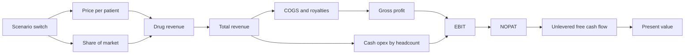

**2. Revenue by scenario for one drug (illustrative, made-up numbers, xychart-beta).**

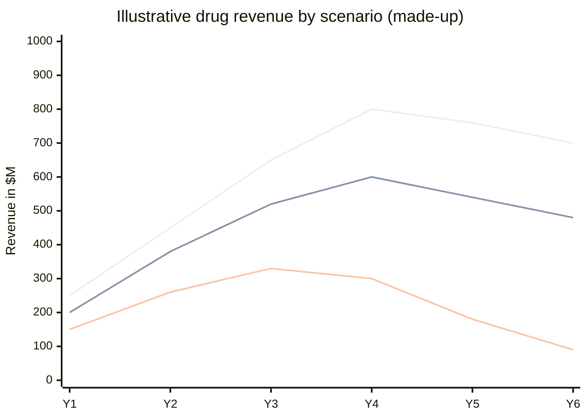

The top line is upside, the middle is base, the bottom is downside. The cliff in the downside line is generic entry in Year 4.

**3. Revenue mix in one year (illustrative, pie).**

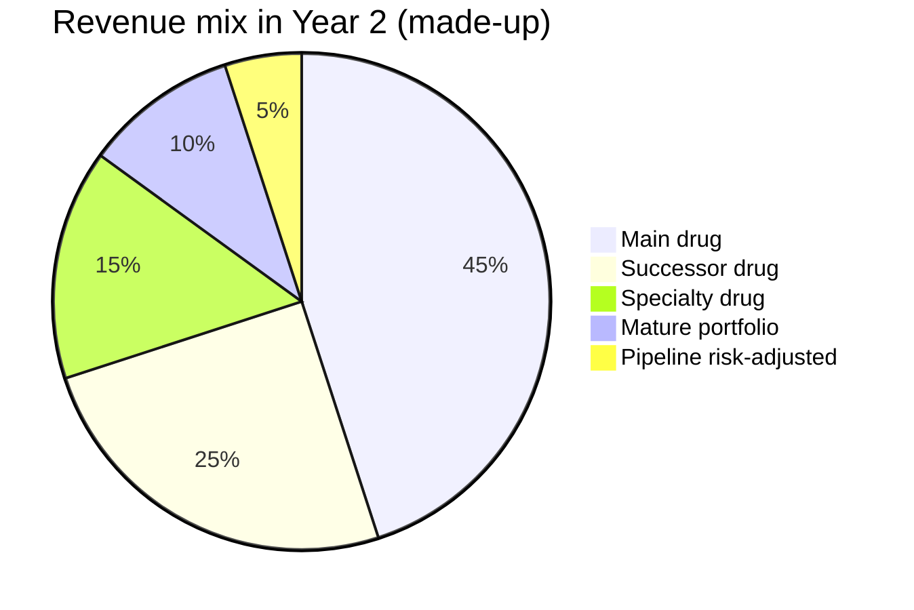

**4. Share of market path against peak sales (illustrative, xychart-beta).**

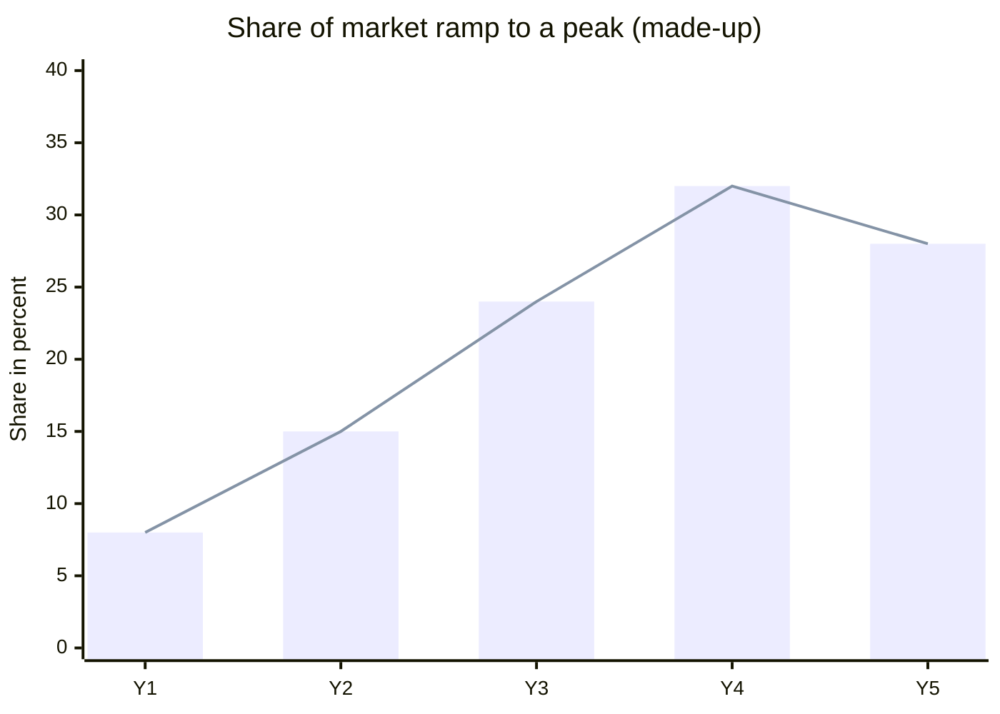

**5. Lesson flow of this part (flowchart).**

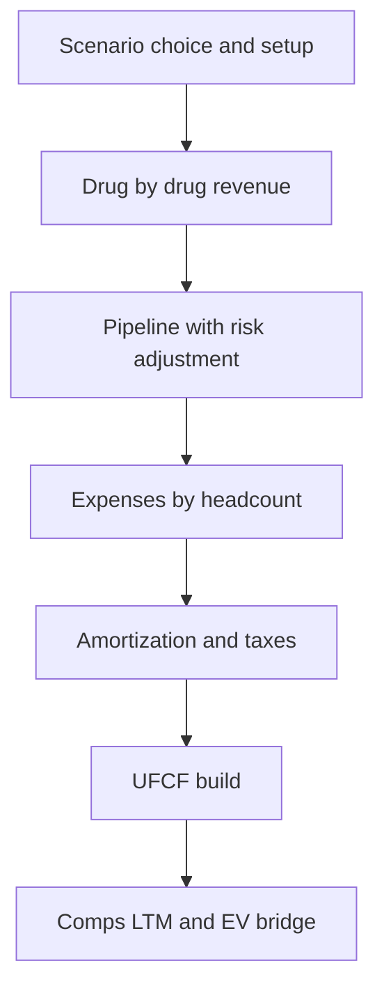

## Excel Model Walkthrough

The case workbook is built in tabs. The complete version of the file lists these in its cover page:

| Tab | What it holds | Notes |
|---|---|---|
| Cover | Company name, model name, file name, analysis date, a navigation list | Analysis date is a named input, used by the stub period |
| Summary | Valuation summary and key outputs | Output only, no hardcoded inputs |
| Main DCF tab | The ten-year DCF by product: assumptions at the top, then one block per drug, then the expense and cash flow block | The main working tab (covered in this part) |
| H1_Results | The stub period, the results already booked in the first half of the year | Used to take only the second half of the year into the valuation |
| ValGraph | Football field chart of the valuation range | Output |
| ValSum | Back-end calculations for the valuation summary | Feeds ValGraph |
| WACC | Cost of capital build | Part 2 of the module |
| Public_Comps | Comparable company output table | Display |
| Public_Comps_Data | Back end for comps, lookups by name | INDEX and MATCH with named ranges |
| MA_Comps | Precedent transactions | Optional |

**Layout of the main DCF tab.** The years run across the columns on the same row, with the same column for the same year on every block. The assumptions area at the top holds the scenario switch (a drop-down of upside, base, downside), the population growth rate, the tax rate and the share price. Named cells carry the important inputs, such as the U.S. population growth rate and the Phase 2 risk-adjustment factor.

**Drug blocks.** Each drug has a repeated pattern: total market, patients at year end, average patients, growth in patients, share of market, annual price increases before and after generics, the price per patient with a scenario INDEX and MATCH, revenue, and growth rate. The mature drugs and the legacy portfolio are a single block with a growth rate row.

**Pipeline block.** Unrisked revenue for each pipeline drug, then a risk-adjusted line equal to unrisked revenue times the named risk factor. The risk-adjusted lines are the only ones added to total revenue.

**Expense block.** Cost of product sales as a percent of revenue, royalties below it, gross profit, headcount-based cash opex, existing and new intangible amortization, EBIT, taxes at the model rate, NOPAT, then the EBITDA and margin rows.

**Cash flow block.** Depreciation and amortization, deferred taxes (from the non-deductible items), working capital, capex, intangible purchases, milestone payments, acquisitions, and the resulting annual unlevered free cash flow. A mid-year discount period and a stub fraction are set up for Part 2.

**Key formulas (described).**

- Patients = market times share (or new cases times share for the cancer drug).
- Revenue = patients times annual price, divided by the units factor.
- Price path before generics = prior price times one plus the pre-generic increase. In the generic year, price is prior price times one minus the price cut. After that, it grows at the post-generic rate.
- Amortization of new spend = cumulative spend up to last year, divided by useful life, starting the year after spend.
- Deferred taxes = minus tax rate times (existing amortization plus new amortization plus stock compensation).
- UFCF = NOPAT plus D&A plus deferred taxes plus working capital change minus capex minus intangibles minus milestones minus acquisitions.

> [!TIP]
> **Build tip.** Build the tab in the order of the lessons and check each block against the finished ("after") version of the file before you move on. A broken formula in one drug block only shows up as a wrong total three blocks later.

## Interview Questions

1. How do you forecast revenue for a drug that is losing exclusivity?

Patients times price. Model share and price separately. Price drops sharply at generic entry (often around 90 percent for a branded small molecule), and share then falls more slowly as competitors enter. Put the entry year in a scenario.

2. Why is the generic entry date a scenario and not a toggle?

Because the entry date changes several drivers at once: price, share and the timing of the decline. A scenario moves them together. A toggle would change one at a time and miss the link.

3. What is the difference between prevalence and incidence, and which do you use for a drug?

Prevalence is the number of patients with the condition at a point in time. Incidence is new cases in a year. Use prevalence for chronic conditions where patients stay on the drug. Use incidence for cancers where patients come on and off treatment.

4. How do you forecast a new drug with only a few quarters of sales?

Annualize the latest quarter (times four) to get a run-rate. Check it against the unit price from a public source. Anchor peak share on analyst estimates, and ramp to that peak over four or five years.

5. Why annualize with average patients rather than year-end patients?

Revenue is a flow over the year. During a ramp, the year-end count is higher than the average, so dividing revenue by year-end patients understates price.

6. How do you handle a pipeline drug?

Estimate the eligible population and a price from analogues, then a peak share and a release year in each scenario. Multiply revenue by the probability of approval, which is the product of the phase transition rates still ahead.

7. Why do you risk-adjust revenue but not the R&D?

R&D is spent whether or not the drug succeeds. Revenue only arrives if approval happens. So the risk factor belongs on the revenue side.

8. What is a royalty and where does it sit in the model?

A percentage of the revenue paid to a licensor. It is a cost of sales, so it sits in COGS and reduces gross margin and EBITDA.

9. How are milestone payments treated?

When they create a long-lived asset (the right to sell the drug), they are capitalized and amortized. In the UFCF they are an investing outflow in the year paid, and the amortization is a non-cash add-back.

10. Why might EBITDA margin fall as a pharma company grows?

It adds products, sales reps and overhead before new products reach full sales. Mix moves toward R&D, which does not scale with revenue.

11. Why do deferred taxes matter in this model?

Acquisition amortization and stock compensation are often not tax-deductible, so cash tax can be higher than book tax. Ignoring that overstates UFCF.

12. How do you compute LTM revenue?

Full year plus current year-to-date minus prior year-to-date.

13. What counts as a non-recurring item for EBITDA?

Items that affect operating income and are unlikely to repeat: restructuring, merger costs, severance, and changes in contingent consideration. Do not add back items below operating income, such as debt discount amortization.

14. How do you treat a convertible bond in the EV bridge?

If out of the money, count it as debt at fair value and add no shares. If in the money, add shares equal to principal divided by conversion price and leave it out of debt.

15. What is the treasury stock method?

For options in the money, the net new shares equal options minus options times strike divided by the share price. It assumes the exercise cash buys back shares.

16. Why use EV rather than equity value to compare companies?

EV is capital-structure neutral. A company with more debt has a higher EV for the same business, so comparing equity values across companies with different debt levels is misleading.

17. What is the scenario INDEX and MATCH doing?

It reads the scenario name from a drop-down, finds its row in the price block, and returns the matching value, so the revenue formula does not change between scenarios.

18. When would you not use a sensitivity table?

When there are more than two drivers. Data tables take at most two variables, so use scenarios for many unrelated drivers.

19. What is the risk of using a public price as the price per patient?

It is a list price, not the net price after rebates. Net price is what the company keeps and is usually lower.

20. How would you check a revenue forecast against history?

Compare the current year against the run-rate of the year to date. If the full-year forecast is far from the run-rate, explain the gap or change the assumption.

## Career Angle

For a valuation or fixed income analyst, this module maps to the following skills and target roles.

**Skills this module maps to.**

| Module skill | Related professional work | Target roles |
|---|---|---|
| Driver-based revenue (patients or units times price) | Fair value of an MBS and whole loan book, pricing inputs, mortgage portfolio reporting | Valuation, capital markets, corp dev |
| Scenario design and sensitivities | Monthly pricing review, pricing exceptions investigated | Valuation, portfolio management |
| Risk-adjusted cash flows | Pricing of cash flows under rate paths, MBS prepayment-driven cash flows | Corp dev, PE, asset management |
| Expense build by headcount and margins | FP&A forecasting and budget variance work | Strategic FP&A, corp dev |
| LTM and comps build | Financial reporting and data prep in Python and SQL | Corp dev, equity research, data and quant |
| EV bridge and dilutive securities | Understanding of debt-like items in valuation | Capital markets, valuation |

**Talking points (framed as studied or built in coursework only).**

1. "I worked through a full DCF build for a specialty pharma company, covering product-by-product revenue, scenario design, risk-adjusted pipeline revenue and free cash flow. The method (driver-based revenue, a scenario switch and a risk factor on the pipeline) is the same one I use when I price a portfolio."
2. "On the comps side I built the LTM and enterprise value bridge by hand, including the treasury stock method and convertible treatment, so I know why a data service's number can differ from a filing-based one."
3. "I studied how deferred taxes and non-deductible amortization change cash tax, and I apply the same check to any model I review."

> [!WARNING]
> **Caution.** Only use talking point 1 if the case models were actually worked through. Never invent experience: a model that was only read should be described as "studied" or "worked through in coursework", not "built". The pharma case is a coursework exercise, not job experience. Real fair value and pricing work on the job is a separate and stronger story.

> [!TIP]
> **Career tie-in.** The biggest gap versus target roles is that valuation work is about judgment on uncertain inputs, not only about the formulas. Real pricing work gives concrete examples of that (exceptions, judgment calls on fair value). Use those in interviews and treat the case study as the method behind them.

## Cheat Sheet

- **Revenue.** Patients times price. For cancer drugs, use new cases times share and duration.
- **Share.** Peak share equals peak revenue divided by (eligible patients times peak price). Ramp to it, then fade.
- **Price path.** Grow before generics, cut by about 90 percent in the entry year, then grow with inflation.
- **Scenarios.** Use for many unrelated drivers. Toggles for one driver at a time. Data tables take at most two variables.
- **Partial year.** Run-rate is the quarter times four. Price is revenue times four over average patients.
- **Pipeline.** Unrisked revenue times the probability of approval. Probability is the product of the phase transition rates still ahead. Do not risk R&D the same way.
- **Royalties.** Percent of revenue, in COGS. Milestones: capitalize and amortize.
- **Headcount method.** Employees equal revenue over revenue per employee. Cash opex equals employees times cost per employee.
- **Amortization.** Existing from filings, new equals cumulative spend over useful life, starting the year after spend.
- **Tax.** The model rate applies to EBIT (unlevered). Deferred tax equals minus rate times non-deductible items.
- **UFCF.** NOPAT plus D&A plus deferred taxes plus working capital change minus capex, intangibles, milestones and acquisitions.
- **Working capital.** a percent of the change in revenue, not of revenue.
- **LTM.** Full year plus YTD minus prior YTD.
- **Non-recurring for EBITDA.** Above operating income only. Not debt discount amortization.
- **Options (TSM).** Shares equal options minus options times strike over price, if in the money.
- **Convertibles.** In the money means shares equal principal over conversion price and no debt. Out of the money means debt at fair value.
- **EV bridge.** Equity value plus debt, preferred and NCI, minus cash and investments, minus equity investments and non-core assets, minus NOLs (net of valuation allowance), plus unfunded pensions. Leases are zero for U.S. GAAP here.

---

*All worked examples use made-up round numbers. The case company is described generically.*

---

[← Previous: Module 07](07-valuation-and-dcf-analysis.md) · [Contents](../README.md) · [Next: Module 08, Part 2 →](08-advanced-valuation-and-dcf-part-2.md)
