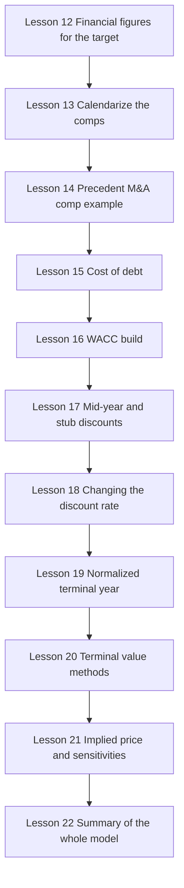
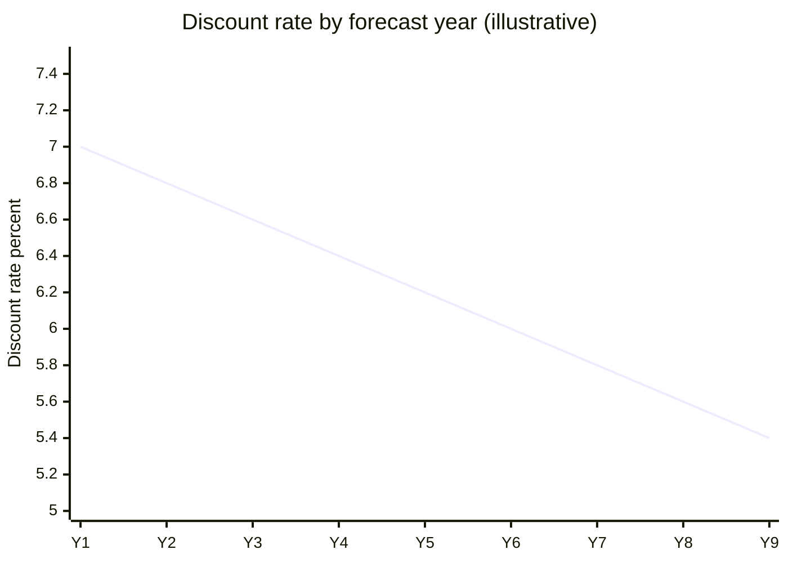
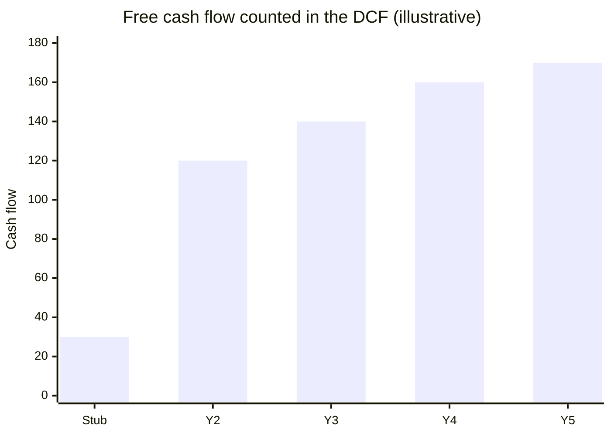
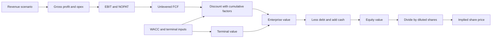
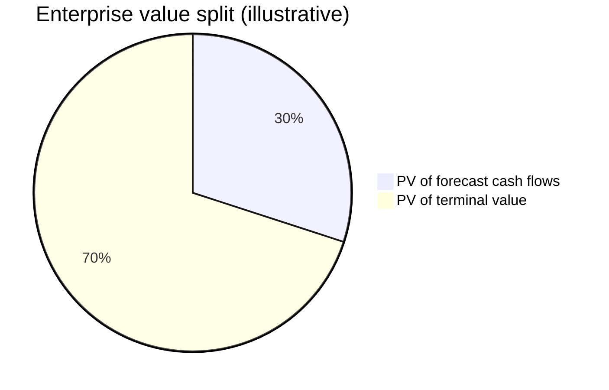

# Module 08, Part 2: Advanced Valuation and DCF

[← Previous: Module 08, Part 1](08-advanced-valuation-and-dcf-part-1.md) · [Contents](../README.md) · [Next: Module 09 →](09-valuation-interpretation-and-uses.md)

<details>
<summary><b>Contents</b></summary>

- [Overview](#overview)
- [Module Map](#module-map)
- [Lessons](#lessons)
  - [8.12 Finding the Financial Figures for the Public Comps](#812-finding-the-financial-figures-for-the-public-comps)
  - [8.13 Calendarization and the Target Company's Public Comp Bridge](#813-calendarization-and-the-target-companys-public-comp-bridge)
  - [8.14 Precedent M&A Comp, Worked by Hand](#814-precedent-ma-comp-worked-by-hand)
  - [8.15 Pre-Tax Cost of Debt, Including Convertibles](#815-pre-tax-cost-of-debt-including-convertibles)
  - [8.16 Building WACC for the Peers and for the Target](#816-building-wacc-for-the-peers-and-for-the-target)
  - [8.17 Stub Periods and the Mid-Year Convention](#817-stub-periods-and-the-mid-year-convention)
  - [8.18 A Changing Discount Rate and Cumulative Discount Factors](#818-a-changing-discount-rate-and-cumulative-discount-factors)
  - [8.19 The Normalized Terminal Year](#819-the-normalized-terminal-year)
  - [8.20 Terminal Value with the Multiples and Perpetuity Methods](#820-terminal-value-with-the-multiples-and-perpetuity-methods)
  - [8.21 From Enterprise Value to a Share Price, and Sensitivity Tables](#821-from-enterprise-value-to-a-share-price-and-sensitivity-tables)
  - [8.22 The Valuation Summary, the Football Field, and the Model Cover Sheets](#822-the-valuation-summary-the-football-field-and-the-model-cover-sheets)
- [Diagrams and Charts](#diagrams-and-charts)
- [Excel Model Walkthrough](#excel-model-walkthrough)
- [Interview Questions](#interview-questions)
- [Career Angle](#career-angle)
- [Cheat Sheet](#cheat-sheet)

</details>

## Overview

Taking a messy real-world company through a full DCF, from the revenue build and expense lines to a public comp set, WACC, mid-year discounting and terminal value, then checking the answer with sensitivity tables.

## Module Map



The flow runs in two halves. Lessons 12 to 14 pull market and peer data, so the target can be compared with other companies. Lessons 15 to 22 turn that into a discount rate and a DCF value, then test how sensitive that value is to the inputs.

## Lessons

### 8.12 Finding the Financial Figures for the Public Comps

**Core ideas**

- For a comp set, you need a common set of historical metrics: LTM revenue, LTM EBITDA and LTM normalized net income to common. Sales-based and profit-based metrics together give a fuller picture, and biotech and pharma comps usually use this trio.
- **LTM (last twelve months)** is almost never printed in a filing. You build it:

```text
LTM = Last full fiscal year + Current YTD period - Same YTD period last year
```

- Use the most recent interim filing (10-Q for quarters, or a 6-month or 9-month report) for the YTD pieces. Apply the same method to every line item.
- **EBITDA** starts at operating income (EBIT), then adds D&A taken from the cash flow statement, then adjusts for non-recurring items. Only adjust for items that actually sit above operating income. If a charge is below EBIT, it should not change EBITDA.
- **What counts as non-recurring?** Something rare, unusual or not part of the core business, such as asset-sale gains, a one-time inventory write-down or a restructuring charge. Items that repeat every year and tie to the core business (for example, a recurring earnout revaluation) stay in.
- **Materiality rule.** Do a quick scan of the statements and the MD&A for obvious items, then stop. A $4 to $5 million charge against roughly $100 million of EBITDA will not change the valuation, so do not spend hours on it.
- **Normalized net income** is harder than EBITDA because every non-recurring item and every tax quirk reaches net income. The steps are:
  1. Start from pre-tax income and add back non-recurring items (the ones already fixed in EBIT, plus non-operating items such as unrealized FX gains or losses).
  2. Estimate a normal effective tax rate, usually close to the blended federal and state statutory rate (about 21% federal plus state). Average it over three years from the tax reconciliation in the 10-K.
  3. Tax the normalized pre-tax income at that rate.
  4. Subtract preferred dividends and non-controlling interest, and add equity-method income if it is not already in pre-tax income.
- **Convertible bonds.** If the convertible counts as equity in the diluted share count (because the share price is high enough for conversion), the cash coupon and the amortization of the debt discount and issuance fees should be added back to net income. If the bonds are out of the money, they are plain debt and nothing is added back. When the company does not split interest by tranche, allocate the add-back by each tranche's principal share.
- **Interim periods.** The adjustment has to be pro-rated to the period. A half-year add-back is half of the annual figure, for example.
- **Practical reality.** For many biotechs, net income is negative or near zero. A P/E above about 100x is shown as "NM" (not meaningful) and left out of the comp averages. That makes much of the normalization work irrelevant, and it is a good reason not to over-engineer it.
- **Projections.** Consensus estimates (from a data service, sell-side research or company investor presentations) are the usual source. Your own projections are also fine if you show your logic. If a peer's fiscal year ends on a different date, calendarize it (see the next lesson).

**Worked example (made-up numbers, $ millions)**

| Line item | Last FY | Prior YTD (6 mo) | Current YTD (6 mo) | LTM |
|---|---|---|---|---|
| Operating income (EBIT) | -40.0 | -15.0 | 30.0 | 5.0 |
| + D&A (cash flow statement) | 100.0 | 48.0 | 52.0 | 104.0 |
| + Inventory write-down (in cost of sales) | 75.0 | 0.0 | 0.0 | 75.0 |
| - Gain on sale of non-core assets | -10.0 | 0.0 | -4.0 | -14.0 |
| **Adjusted EBITDA** | | | | **170.0** |

The LTM column is: last FY, plus current YTD, minus prior YTD, applied line by line (for EBIT: -40 + 30 - (-15) = 5). Add the adjustments, and the adjusted EBITDA is 5 + 104 + 75 - 14 = 170.

> [!TIP]
> **Going further.** The "EBIT then add D&A" route is the standard one, but check whether the company's own "adjusted EBITDA" uses a different definition. In a deal, the banker's number and the company's non-GAAP number often differ, and you need to know why. Also, the LTM math only works if the periods line up (same months, same fiscal calendar), so always write down the period dates next to each input.

**Common mistakes**

- Adding a below-the-line charge (like a debt extinguishment loss) to EBITDA.
- Using the wrong sign for a gain (gains reduce EBITDA when you remove them).
- Forgetting that the prior-year YTD must be subtracted, which double-counts the first half.
- Spending a week hunting for non-recurring items that do not move the multiple.

### 8.13 Calendarization and the Target Company's Public Comp Bridge

**Core ideas**

- **Calendarization** lines up companies whose fiscal years end on different dates, so every peer is measured over the same months. A company with a June year end reports July to June, while a December year end reports January to December. Those numbers cannot be compared directly.
- **Historical (LTM) figures are easy.** For public comps, use LTM as of the valuation date. For precedent deals, use LTM as of the announcement date. Calendarization only really bites on the projections.
- **Pick the target alignment.** The simplest rule is to align everyone to the most common fiscal year end in the set. If the target is the odd one out, you can either move the peers to the target's year end, or move the target, or simply put everyone on a December year end. Whichever you choose, state it.
- **Tolerance.** a one- or two-month mismatch (for example, September 30 against October 31) is usually fine to ignore. Three months is the outer edge.
- **Fractions when you lack quarters.** If you only have annual estimates, weight the two fiscal years that overlap the target calendar year by the number of months each contributes.

```text
Calendar year C from a fiscal year ending in month M:
CY(C) = (M / 12) x FY(C) + (1 - M / 12) x FY(C + 1)
```

For a fiscal year ending March 31 (M = 3), CY 2023 = 0.25 x FY2023 + 0.75 x FY2024. For a June 30 year end (M = 6), it is 0.5 x FY2023 + 0.5 x FY2024.

**Worked example (made-up numbers, $ millions)**

| Item | FY2023 (ends Jun) | FY2024 (ends Jun) | Calendar 2023 (0.5 / 0.5) |
|---|---|---|---|
| Revenue | 800 | 900 | 0.5 x 800 + 0.5 x 900 = 850 |
| EBITDA | 200 | 240 | 0.5 x 200 + 0.5 x 240 = 220 |

If you had quarterly data instead, you would add the four calendar quarters directly and skip the weights.

**Target company bridge (the equity value to enterprise value items)**

These are the items that move from the balance sheet and filings into the enterprise value bridge and the share count:

- **Diluted shares.** Basic shares from the latest 10-Q cover page, plus in-the-money options (treasury stock method), plus RSUs, plus convertible shares only if the conversion is in the money.
- **Convertibles.** If the bonds are out of the money, treat them as debt at fair value (the 10-Q often discloses it). If they are in the money, treat them as shares and remove them from debt.
- **Debt-like items.** Finance leases, the current and long-term portions of debt (at fair value where disclosed) and sometimes pension deficits. U.S. operating leases are usually set to zero in the bridge because they already sit in operating costs.
- **Cash and investments.** Cash plus short-term investments, and equity investments that are not part of the operating business.
- **NOLs.** Net operating loss carryforwards are an asset in some frameworks. Adjust them for any valuation allowance on the deferred tax asset, and do not double count them.
- **Preferred stock and non-controlling interests** go in the bridge if present.

**Non-recurring items for the target LTM**

- Impairment charges and acquired in-process R&D are normally one-off, so add them back.
- An inventory step-up from an acquisition is a non-cash charge tied to the deal accounting. Add it back for consistency with how you treated other inventory items.
- Large one-time acquisition costs can be added back if the company is not expected to keep buying businesses in the forecast. If the company is a serial acquirer, that argument gets weaker, so state your judgment.
- Foreign exchange gains and losses sit below operating income and have nothing to do with the core business or capital structure. Adjust them out of normalized pre-tax income, but do not adjust interest expense or interest income.

> [!TIP]
> **Going further.** Calendarization matters most in the projections. Cross-check your fractional math against the company's guided figures for the calendar year. Also, if a company changes its fiscal year (some do after an acquisition), the older periods are often not comparable, so check the 10-K for a transition period.

**Common mistakes**

- Weighting the wrong fiscal years (the year that ends in the target's calendar year is the one that gets the most weight).
- Treating in-the-money convertibles as both shares and debt, which double counts the claim.
- Using the book value of convertible debt when the fair value is disclosed and materially different.

### 8.14 Precedent M&A Comp, Worked by Hand

**Core ideas**

- **Precedent transactions** look at what buyers actually paid for a company. The output is a transaction multiple (purchase enterprise value divided by LTM revenue or EBITDA), plus the control premium the buyer paid over the pre-announcement share price.
- The data is harder to gather than public comps because deal documents are long and the filings are as of the announcement date, not today. Most teams automate the data pull and only check the big items by hand.
- **Offer price per share** is not always a single number. When part of the consideration is paid in the buyer's stock, the headline price moves with the buyer's share price. Use the price the fairness opinion or merger filing uses for the exchange ratio, and note the reference date.
- **Share premium.** Compare the offer price against the target's share price one day, one week and one month before the announcement. A high premium on the one-day figure, with a smaller one on the one-month figure, can suggest leaks or pre-deal run-ups.
- **Diluted shares** come from the merger agreement's capitalization section when you can find it. Count issued shares, in-the-money options (use the weighted average strike price disclosed in the 10-K), vested or accelerated RSUs and PSUs. Do not count shares that are only reserved for future grants.
- **Enterprise value bridge at announcement.** Cash and marketable securities come off, and debt, finance leases and sometimes equity investments and NOLs adjust the bridge. If the debt fair value is not disclosed, the 10-K often says the fair value approximates book, which is good enough.
- **Leases.** The 10-Q may report a combined "finance and operating lease" total without a split. You can back out the non-current operating lease balance to estimate the finance lease piece, then note the leftover current lease items you could not find.
- **LTM financials.** Same method as before, with a nine-month YTD in the 10-Q plus the full prior fiscal year. Add back items like acquired in-process R&D, impairments, deal costs and gains on asset sales.
- **Judgment on contingent consideration.** For biopharma, earnout revaluations recur across many deals, so many teams do not add them back. Restructuring that appears in each of the last three years is recurring too.
- **Digging into the notes** can turn up small one-time items (for example, a regulatory settlement that the notes say sat inside SG&A). Add these only when the filing confirms they are inside operating income.
- **Projections** for a precedent deal are optional. You need estimates as of the announcement date, which are usually in the fairness opinion, not the consensus data you would pull today.

**Worked example (made-up numbers, $ millions except per share)**

| Step | Item | Value |
|---|---|---|
| 1 | Offer: $40 cash + 0.5 buyer shares at a $60 reference price | $40 + 0.5 x $60 = $70 per share |
| 2 | Diluted shares: 100 basic + 4 options (TSM) + 2 RSUs | 106 million |
| 3 | Equity purchase price: $70 x 106 | 7,420 |
| 4 | Less cash and securities | -500 |
| 5 | Plus debt and finance leases | +800 |
| 6 | Purchase enterprise value | 7,720 |
| 7 | LTM revenue | 1,100 |
| 8 | LTM EBITDA | 260 |
| 9 | EV / LTM revenue | 7.0x |
| 10 | EV / LTM EBITDA | 29.7x |
| 11 | One-day premium, if the pre-deal price was $54 | 70 / 54 - 1 = 29.6% |

> [!TIP]
> **Going further.** Premium and multiple alone do not explain a deal. Strategic buyers can pay more for synergies, and distressed targets can trade at low multiples. Always write a one-line note on why the deal happened, because a precedent with a bidding war is different from a quiet negotiated sale.

**Common mistakes**

- Using the buyer's reference price on a different date than the one in the deal documents.
- Counting reserved but unissued shares.
- Pulling the LTM from the wrong 10-Q (the one after the announcement, not before).
- Treating the lease totals as if they were split out when the filing does not split them.

### 8.15 Pre-Tax Cost of Debt, Including Convertibles

**Core ideas**

- The cost of equity is always a variation of CAPM: risk-free rate plus levered beta times the equity risk premium. The real complexity in WACC sits in the cost of debt.
- **Pre-tax cost of debt** is the weighted average yield to maturity (YTM) across every debt tranche. Weight each tranche by its market value share of total debt.
- **Convertibles.** If a convertible counts as equity (it is in the money, so it dilutes the share count), remove it from debt and give it a YTM of zero. If it counts as debt, use the yield on comparable straight debt, not the low coupon. Companies often disclose an effective interest rate for convertibles that you can use, and where they do not, you estimate it from the coupon plus a spread that you can observe at peers that do disclose it.
- **Market value versus face value.** The YTM depends on the price the market pays today. A bond trading above par has a lower YTM than its coupon, and one trading below par has a higher YTM.
- **YTM inputs.** Settlement date (valuation date), maturity date, coupon rate, price as a percent of par, redemption value (usually 100) and payment frequency (usually semiannual).
- **Finance leases** carry a weighted average discount rate in the lease footnote. Include them with the debt, and leave out operating leases for U.S. companies.
- **Term loans** usually have a YTM close to the coupon, so a simple coupon-based estimate is fine.
- **Cost of preferred.** Zero if the company has none. Preferred dividends are not tax-deductible, so they are not multiplied by (1 - tax rate).
- **Dates that have passed.** If a maturity falls before the valuation date, the YIELD function returns an error. Roll the date forward a year and note that you did it. Better still, note that the bond is probably already due and check whether the notes were already exchanged or repaid.

```text
Pre-tax cost of debt = sum over tranches of [ YTM(tranche) x (tranche market value / total debt) ]
  where YTM = 0 for any convertible that counts as equity
After-tax cost of debt = pre-tax cost of debt x (1 - tax rate)
```

**Worked example (made-up numbers, $ millions)**

| Tranche | Face | Market value | Price (% of par) | Coupon | YTM used | Weight | Contribution |
|---|---|---|---|---|---|---|---|
| Convertible A (out of the money) | 600 | 570 | 95 | 1.5% | 5.5% (estimated) | 0.361 | 1.98% |
| Convertible B (in the money, counts as equity) | 500 | excluded | n/a | 2.0% | 0% | 0 | 0% |
| Senior secured term loan | 1,000 | 1,010 | 101 | 4.0% | about 3.8% | 0.639 | 2.43% |
| **Total debt weight** | | **1,580** | | | | **1.000** | **4.41%** |

Convertible B is removed from both the numerator and the denominator. The weights are then based on the 1,580 of debt that is still treated as debt (570 + 1,010), so the weights add to 1.000.

> [!TIP]
> **Going further.** The estimated convertible yield is the weakest input here. Test it: change the assumed spread by 1 percentage point and see how the WACC moves. If it moves a lot, the company is more sensitive to its debt assumption than you might think. Also, for a company with a credit rating, a rating-based spread over the risk-free rate is a sanity check on the YTM you compute.

**Common mistakes**

- Using the coupon instead of YTM for bonds trading far from par.
- Forgetting to remove a convertible from debt when it counts as equity, which double counts it.
- Dividing by the wrong total when some tranches are excluded.
- Adding operating leases to debt for a U.S. GAAP company without a reason.

### 8.16 Building WACC for the Peers and for the Target

**Core ideas**

- WACC is the blended cost of capital: equity share times cost of equity, plus debt share times after-tax cost of debt, plus preferred share times cost of preferred.
- **Cost of equity (CAPM).** Risk-free rate + levered beta x equity risk premium. Use the 10-year government yield for the risk-free rate, and a commonly used equity risk premium (in this module about 5.5%).
- **Compute WACC for every peer, not just the target.** The spread across peers shows what a "mature" company looks like versus a "high-risk growth" one. It also gives a starting point for a declining discount rate over the forecast.
- **Unlever and relever beta.** Remove the effect of debt from each peer's levered beta to get an unlevered (asset) beta, then add back the target's own leverage.

```text
Unlevered beta = Levered beta / [1 + (1 - tax rate) x (Debt / Equity) + Preferred / Equity]
Re-levered beta = Unlevered beta x [1 + (1 - tax rate) x (Debt / Equity) + Preferred / Equity]
```

- Use each company's own tax rate when you unlever it. Only use the target's rate when you relever the target.
- **Two capital structures for the target:**
  - **Current structure.** The target's own debt, preferred and equity weights.
  - **Optimal or peer structure.** The median weights of the peers. Compute debt as 1 minus equity minus preferred, so the weights still add to 100% even when the medians do not.
- **Cost of equity methods for the target.** (a) relevered beta at the current structure, (b) relevered beta at the peer structure, and (c) the target's historical (regression) beta. Showing all three gives a range.
- **Why a range matters.** a single WACC is always a guess. The lower equity weight on the current structure is offset by a higher cost of equity, so the WACCs can come out close even when the cost of equity estimates differ a lot.
- **Beta is an imperfect risk measure for biotech.** These companies often move on trial readouts, approvals or legal news rather than on the broad market, so a low beta can understate their risk. That is a reason to start the target higher than the peer median.

**Worked example (made-up numbers, $ millions)**

Peer X: levered beta 1.20, debt 400, equity 1,600, tax rate 21%.

```text
Unlevered beta = 1.20 / [1 + (1 - 0.21) x (400 / 1,600)]
               = 1.20 / [1 + 0.79 x 0.25]
               = 1.20 / 1.1975
               = 1.00 (rounded)
```

Target relevered at its current structure, with debt 1,000 and equity 3,000 and a 21% tax rate, and an unlevered beta of 1.00:

```text
Re-levered beta = 1.00 x [1 + 0.79 x (1,000 / 3,000)]
                = 1.00 x 1.2633
                = 1.26
```

Cost of equity with a 1.3% risk-free rate and 5.5% ERP: 1.3% + 1.26 x 5.5% = 8.23%.

| Component | Weight | Cost | Contribution |
|---|---|---|---|
| Equity | 0.75 | 8.23% | 6.17% |
| Debt (after tax: 4.0% x 0.79) | 0.25 | 3.16% | 0.79% |
| **WACC** | 1.00 | | **6.96%** |

> [!TIP]
> **Going further.** The case uses a 1.3% ten-year yield, which reflects a low-rate period. Current rates are much higher, so refresh the risk-free rate and the ERP before you use any of these numbers. Also, a 5.5% ERP is a judgment call. Show a sensitivity, and do not present a single figure as a fact.

**Common mistakes**

- Using the target's tax rate to unlever peers.
- Using the Tax_Rate named cell (the target's rate) when unlevering a peer.
- Forgetting that weights must use market values, not book values.
- Treating a low median WACC as a truth about a risky biotech, rather than a starting point to adjust.

### 8.17 Stub Periods and the Mid-Year Convention

**Core ideas**

- The `NPV` function works only when every year has the same discount rate and the cash flows are evenly spaced. Neither holds here, so the DCF switches to explicit discount periods and a running discount factor.
- **Stub period.** When the valuation date falls partway through the first forecast year, only part of that year's cash flow is still ahead of the buyer. Measure the fraction of the year that remains with the `DAYS` function.

```text
Stub fraction = (Year-1 end date - valuation date) / (days in the fiscal year)
```

- **The stub cash flow.** The year-1 free cash flow that is still ahead is the full-year figure multiplied by the stub fraction. The part already generated before the valuation date is excluded, because the market price already reflects it (or it is in the balance sheet cash).
- **Normal discount period.** The time from the valuation date to the end of each cash flow period. The first one is the stub fraction. Each year after that adds one.

```text
Normal period, year 1 = stub
Normal period, year n = stub + (n - 1)
```

- **Mid-year convention.** Cash comes in through the year, so its average arrival is near the middle of each period. The first period's midpoint is half the stub. Later periods move back by half a year from the normal period.

```text
Mid-year period, year 1 = stub / 2
Mid-year period, year n = normal period (n) - 0.5   (for n >= 2)
```

Dividing every normal period by two is a common mistake. It only works for the stub year.

**Worked example (made-up dates and numbers)**

Valuation date is March 31, year 1 ends December 31, and the stub is 0.25 of the year (rounded). Projected FCF for years 1 to 4 is 100, 120, 140 and 160 ($ millions).

| Year | Full-year FCF | FCF counted | Normal period | Mid-year period |
|---|---|---|---|---|
| 1 (stub) | 100 | 100 x 0.25 = 25 | 0.25 | 0.25 / 2 = 0.125 |
| 2 | 120 | 120 | 1.25 | 1.25 - 0.5 = 0.75 |
| 3 | 140 | 140 | 2.25 | 2.25 - 0.5 = 1.75 |
| 4 | 160 | 160 | 3.25 | 3.25 - 0.5 = 2.75 |

Check year 2: the buyer waits 0.25 of a year, then gets year-2 cash halfway through year 2, which is 0.25 + 0.5 = 0.75. The table agrees.

> [!TIP]
> **Going further.** The stub fraction uses calendar days, but some banks use a 360-day or month-based convention. The answer barely moves, so pick one and state it. Also, check whether the stub cash flow should be based on the company's actual year-to-date cash, since real companies are seasonal. A flat fraction ignores a heavy Q4.

**Practice check (exercises redone with made-up dates)**

| Valuation date | Stub fraction | Normal period (year 1) | Mid-year period (year 1) |
|---|---|---|---|
| Late in the year, about three-quarters gone | 0.25 | 0.25 | 0.125 |
| About a third of the year gone | 0.67 | 0.67 | 0.335 |
| Very early in the year, about a tenth gone | 0.90 | 0.90 | 0.45 |

The later-year mid-year periods follow the same rule: normal period minus 0.5.

**Common mistakes**

- Dividing every mid-year period by two.
- Using the full year-1 cash flow when the valuation date is mid-year.
- Forgetting the stub when the terminal value is discounted, which pushes the whole valuation off.
- Using a different day count for the stub than for the period definitions.

### 8.18 A Changing Discount Rate and Cumulative Discount Factors

**Core ideas**

- **Linear glide path.** The discount rate starts high for a riskier company and falls toward a mature-company rate. A simple way to build it is to step the rate by the same amount each year.

```text
Step = (End rate - Start rate) / (number of periods - 1)
Rate in period k = Start rate + (k - 1) x Step
```

The "minus 1" is the easy thing to get wrong. Without it, the last period stops short of the end rate.

- **Remaining cash flow in a stub year.** If the first half of the year has already happened, do not discount the full-year free cash flow. Subtract the year-to-date unlevered free cash flow from the full-year figure. The result is the cash flow still to come.
- **Make the stub cash flow consistent with the forecast.** Use the same definitions as the forecast (EBIT excluding one-off items, the normal tax treatment, the same working capital and capex lines). Otherwise the subtraction mixes two bases.
- **Cumulative discount factor (CDF).** Instead of repeating a long formula in every column, track one running factor. Each step multiplies the prior factor by one divided by (1 + that year's rate) raised to the time between the two cash flow dates.

```text
CDF(year 1) = 1 / (1 + r1) ^ t1       (t1 = stub, or stub / 2 with mid-year)
CDF(year n) = CDF(year n-1) / (1 + rn) ^ (t_n - t_(n-1))
PV(year n)  = Cash flow(n) x CDF(n)
```

- **Time intervals.** With a stub and a mid-year convention, the gaps between cash flow dates are not whole years. The gap between the first two mid-year dates is 0.5 to 1 year, not 1. From year three onward, the gap is usually exactly one year, so the exponent drops out.
- **Mid-year lifts value.** The mid-year factors are a bit higher, because cash arrives earlier in each period.
- **How much does it matter?** In this case, switching between the normal and mid-year factors moved the present value of the forecast by roughly 7 to 8 percent. That is material for a model, but usually does not change a buy or sell call on its own.

**Worked example (made-up numbers, $ millions)**

Stub = 0.25 year. Discount rates: 8.0% in year 1, 7.5% in year 2, 7.0% in year 3. Mid-year dates: 0.125, 0.75 and 1.75 years.

| Year | Rate | Interval (years) | CDF (mid-year) | Cash flow counted | PV |
|---|---|---|---|---|---|
| 1 (remaining after H1) | 8.0% | 0.125 from valuation date | 1 / 1.08^0.125 = 0.9904 | 30 | 29.7 |
| 2 | 7.5% | 0.75 - 0.125 = 0.625 | 0.9904 / 1.075^0.625 = 0.9467 | 120 | 113.6 |
| 3 | 7.0% | 1.75 - 0.75 = 1.0 | 0.9467 / 1.07 = 0.8848 | 140 | 123.9 |
| **Sum, years 1 to 3** | | | | | **267.2** |

Year 1's "cash flow counted" is the full-year figure less the first-half cash flow (for example, full year 60 less H1 30), so only the remaining 30 is discounted.

> [!TIP]
> **Going further.** A straight-line glide path is a convenience, not a theory. Many analysts instead step the rate down in a few discrete jumps tied to a specific event (for example, a product losing exclusivity). That is easier to defend in a meeting. Also, a long glide path means your terminal rate becomes very important, so test the end rate separately.

**Common mistakes**

- Using `NPV` on a column of cash flows whose rates differ by year.
- Forgetting that the first CDF uses the stub exponent, and the mid-year one uses half of it.
- Discounting the full first-year cash flow when part of it is already in the balance sheet.
- Computing the glide path with the wrong number of steps, so the end rate is missed.

### 8.19 The Normalized Terminal Year

**Core ideas**

- A **terminal year** is the single representative year you use to value everything after the explicit forecast. Most simple DCFs simply carry the last forecast year forward.
- A **normalized terminal year** is a separate, cleaned-up year built to represent steady state. You build it when the last forecast year is not a fair picture of the long run, for example because:
  - revenue growth changes sharply after the forecast,
  - a product's patent or exclusivity ends and its royalty stream shrinks,
  - acquired intangibles finish amortizing and stop distorting operating income,
  - capex needs shift from growth to maintenance.
- **Normalize line by line.** Usually: set a steady growth rate, keep cost ratios as percentages of revenue, tie royalties to the revenue of the product they come from, and set amortization to a run-rate that matches what the company spends on intangibles over time (not the old, large amortization).
- **Maintenance spending.** a common rule is that terminal depreciation and amortization are a bit below capex (for example, 90 to 95 percent of capex). That reflects a company that spends to keep its assets going, with limited growth.
- **Cash taxes.** Amortization that is not tax deductible changes the split between book taxes and deferred taxes. Check that total cash taxes make sense, because the split can look very different while the cash outcome barely moves.
- **Working capital** should respond to the change in revenue, not the level of revenue.
- **Commercial milestones and acquisitions** should go to zero in the terminal year. They are one-off items.

```text
Terminal FCF = NOPAT + D&A - capex - intangible purchases + change in working capital (sign as cash)
             where NOPAT = EBIT x (1 - tax rate)
```

**Worked example (made-up numbers, $ millions)**

Last forecast year revenue 1,000 with an operating margin of 11%. Normalized terminal year: revenue growth of -2%, so revenue is 980. Amortization falls from 90 (acquired intangibles) to a run-rate of 40 (90% of purchases of 44).

| Line | Last forecast year | Normalized terminal year |
|---|---|---|
| Revenue | 1,000 | 980 |
| Gross profit (60% margin) | 600 | 588 |
| Operating expenses (40% of revenue ex-amortization) | 400 | 392 |
| Amortization | 90 | 40 |
| Operating income (EBIT) | 110 | 156 |
| Operating margin | 11.0% | 15.9% |

The normalized year has a higher margin only because the big acquired-intangible amortization has rolled off. Whether that is fair depends on how much new capex and intangibles the company needs to keep the revenue base.

> [!TIP]
> **Going further.** Normalizing is most useful when the difference is large. A quick test is to compare the terminal free cash flow with the last forecast year's free cash flow times (1 + g) after adjusting for the known changes. If the two land within a few percent, the normalized year is not adding much, and you can skip building it. The case reached the same conclusion: for this company, a simple haircut to the last year's free cash flow gave almost the same answer.

**Common mistakes**

- Keeping one-off amortization from acquisitions in the terminal year, which understates steady-state earnings.
- Setting terminal capex below depreciation for a company that still needs to maintain assets.
- Forgetting to use the change in revenue for working capital.
- Treating a 2 percent difference in result as important enough to spend days on.

### 8.20 Terminal Value with the Multiples and Perpetuity Methods

**Core ideas**

- Two methods, one purpose: estimate the value of everything after the forecast.
  - **Multiples method.** Terminal EBITDA (the final forecast year) times an exit multiple.
  - **Perpetuity growth method.** a steady-state cash flow divided by (discount rate minus growth rate).
- **Perpetuity formula with a changing discount rate.** Use the final discount rate in the denominator, and the normalized terminal cash flow in the numerator.

```text
TV (perpetuity) = Terminal FCF / (r_final - g)
```

- **Implied exit multiple.** Convert the perpetuity TV into an EBITDA multiple by dividing by final-year EBITDA. This is a sanity check. A multiple of 30x or 2x to 3x signals a broken assumption.
- **Implied growth rate.** Solve the same formula for g. Rearranging gives:

```text
g = r_final - Terminal FCF / TV
```

Use it to check the multiples method. If the multiple you picked implies a growth rate you would not defend, change one of them.

- **Timing with the stub period:**
  - The multiples method is based on an income-statement metric at a year-end, so use the normal (year-end) discount factor. With a stub, that year-end sits at a period like 9.334 years, not 10.
  - The perpetuity method is based on cash flows that arrive through the year, so use the mid-year factor. The terminal value is then discounted from a period half a year earlier.
- **Multiples discipline.** Pick the exit multiple below current peer multiples, because a maturing company should trade at a lower multiple than a growing one. Check it against forward peer multiples, not trailing ones.
- **Share of value from terminal value.** a healthy DCF has the terminal value at well under about 90 percent of enterprise value. If it is 95 percent, the forecast does not matter. For a company with declining cash flows, a lower share is a good sign.
- **Scenarios.** Keep the growth and multiple inputs in a scenario table and pull the active case with INDEX and MATCH.

**Worked example (made-up numbers, $ millions, flat 5.4% rate for illustration)**

Final-year EBITDA = 300. Normalized terminal FCF = 200. Terminal growth = -1%. Final discount rate = 5.4%. Stub makes the year-end period 9.334 and the mid-year period 8.834.

| Item | Multiples method | Perpetuity method |
|---|---|---|
| Terminal value | 300 x 10.0x = 3,000 | 200 / (5.4% + 1%) = 3,125 |
| Implied EBITDA multiple | 10.0x | 3,125 / 300 = 10.4x |
| Implied growth | 0.054 - 200/3,000 = -1.3% | -1.0% |
| Discount period | 9.334 (year end) | 8.834 (mid-year) |
| Discount factor (flat 5.4%) | about 0.612 | about 0.628 |
| PV of terminal value | 3,000 x 0.612 = 1,836 | 3,125 x 0.628 = 1,963 |
| PV of forecast cash flows (assumed) | 800 | 800 |
| Terminal value share of EV | 1,836 / 2,636 = 70% | 1,963 / 2,763 = 71% |

The two methods land within a few percent of each other, which is a good sign. The perpetuity figure is higher because its cash flow is discounted from an earlier date.

> [!TIP]
> **Going further.** The mid-year adjustment for perpetuity is a convention, and some teams handle it by adjusting the terminal value itself and using a year-end factor. Pick one approach, use it on every model, and state it. Also, the exit multiple is the easiest input to abuse. Show the implied growth rate next to it on the same page so readers can see both.

**Common mistakes**

- Applying the mid-year factor to the multiples method.
- Discounting a terminal value from the year-end period when the perpetuity method calls for mid-year.
- Dividing the perpetuity terminal value by the terminal-year EBITDA instead of the final forecast-year EBITDA (the convention here is final-year EBITDA).
- Ignoring the implied growth rate that a chosen multiple carries with it.

### 8.21 From Enterprise Value to a Share Price, and Sensitivity Tables

**Core ideas**

- **Enterprise value to equity value** runs the bridge in reverse from the comps. Subtract debt and debt-like items, add cash and investments:

```text
Equity value = Enterprise value - debt - finance leases - preferred - non-controlling interest + cash + equity investments
```

- **Convertibles in the bridge.** If a convertible is out of the money, subtract its fair value as debt. If it is in the money, leave it out of debt and add its shares to the diluted count. Test each tranche separately, because a company can have one tranche converting and others not.
- **Options in the bridge are circular.** The treasury stock method depends on the implied share price, and the implied share price depends on the diluted share count. Turn on iterative calculation so Excel can settle the loop, and set workbook calculation to automatic (or automatic except data tables).

```text
Net new shares from options = options x (1 - strike / implied price)     (only if the price is above strike)
Implied share price = Equity value / (basic shares + net option shares + RSUs + in-the-money convertible shares)
```

- **Wrap the price in MAX(0, ...)** so a negative equity value does not show up as a negative share price.
- **Premium or discount.** Implied price divided by current price, minus one. Read this as the model's view of value, not as a forecast.
- **Scenarios versus toggles.** The case uses scenarios (downside, base, upside) rather than toggles. Excel's two-variable data tables can flex only two inputs at once, so scenarios let the table show the operating case alongside a valuation input.
- **Sensitivity table design:**
  - Pick inputs that move value the most: the starting discount rate, the terminal growth rate, the terminal exit multiple and the operating scenario.
  - Make the ranges a bit wider than the base case, so the table shows the tails.
  - Use a step that lands exactly on the endpoint. A common error is a step that misses the end value by a small amount.
  - Use the implied exit multiple as a companion to the growth rate. Map the growth range to the multiple range first, so the two tables cross-check each other.
- **Data tables do not always refresh** when calculation is set to automatic except tables. Press the recalculation key or switch to fully automatic.

**Worked example (made-up numbers, $ millions except per share)**

| Item | Value |
|---|---|
| Enterprise value (DCF) | 4,000 |
| Less debt at fair value | -600 |
| Plus cash and investments | 500 |
| Equity value | 3,900 |
| Basic shares (millions) | 100 |
| Net option shares (4 at $20 strike, price about $38) | 4 x (1 - 20/38) = 1.9 |
| RSUs | 1.0 |
| Diluted shares | 102.9 |
| Implied share price | 3,900 / 102.9 = $37.9 |
| Current price (assumed) | $30.0 |
| Premium | 37.9 / 30.0 - 1 = 26% |

Illustrative sensitivity table (made-up outputs, implied price per share):

| Starting discount rate \ terminal growth | -2.5% | -1.25% | 0.0% |
|---|---|---|---|
| 6.5% | $52 | $45 | $39 |
| 7.0% | $47 | $41 | $36 |
| 7.5% | $43 | $37 | $32 |

Read the table by asking which cells sit above the current price. If most do, the stock looks cheap across the range. If only the corner cases do, the call depends on one input.

> [!TIP]
> **Going further.** A sensitivity table only shows the inputs you chose. A downside case should also include the event risks the table misses (a failed trial, a generic entry earlier than assumed, a rate shock). Also, a table that is almost entirely above the current price can reflect a model that is too generous overall, so check the base case assumptions before trusting the headline.

**Common mistakes**

- Using the implied share price from the wrong method in the table.
- Treating an in-the-money convertible as debt, which double counts it.
- Leaving iterative calculation off, so the option dilution loop breaks.
- Reading a table as a probability distribution. It is a grid of what-ifs.

### 8.22 The Valuation Summary, the Football Field, and the Model Cover Sheets

**Core ideas**

- **Football field chart.** a horizontal bar chart with one bar per method (for example, LTM revenue multiples, LTM EBITDA multiples, precedent deals, DCF). Each bar runs from a low to a high implied share price, usually the 25th to 75th percentile of the range. A vertical line marks the current share price.
- **Build the ranges from the comp statistics.** Apply the minimum, 25th percentile, median, 75th percentile and maximum multiples to the target's metric, convert each to an enterprise value or an equity value, then to a share price.
- **Use a one-row sensitivity table per method** to run the circular convertible and option dilution calculation for each multiple. Do this instead of dividing by a fixed share count, because the share count depends on the price.
- **Floor at zero.** Some multiples produce negative equity values, so cap the implied price with MAX(0, ...).
- **Premiums.** For a takeover view, apply the one-day, one-week and one-month premium distribution from precedent deals to the current price.
- **Pick DCF ranges with a rule, and write it down.** The case picked the low and high ends from the downside and upside scenarios across two discount rates, then used the base case for the median. Any rule is a judgment, so say what you chose and why.
- **Reading the chart.** If the current price sits below most of the bars, the stock looks cheap across methods. Weight the DCF more if you think it best captures the business, but show the others so the reader can judge.
- **Scenario switches move the chart.** A downside case can flip the DCF bar toward fair or overvalued, while the comps bars move less. Know which bars are sensitive to which assumption.
- **Summary and cover sheets.** a one-page summary (revenue by product in each scenario, CAGRs, and the valuation multiples) is the piece senior readers actually look at. A cover sheet with links to each tab helps navigation. Scenario revenue is often recalculated on the summary tab with INDEX and MATCH so all cases show at once.

**Worked example (made-up numbers, implied share price)**

| Method | Low (25th pct) | High (75th pct) | Current price |
|---|---|---|---|
| LTM revenue multiples | $22 | $34 | $30 |
| LTM EBITDA multiples | $26 | $41 | $30 |
| Precedent deals (1-day premium) | $33 | $44 | $30 |
| DCF (downside to upside, two discount rates) | $28 | $52 | $30 |

Here the current price is below the low end of the precedent bar and in the lower part of the others, so the stock screens cheap on every method. The DCF bar is the widest, which tells you the answer is most sensitive to the operating case.

> [!TIP]
> **Going further.** A football field is a summary of your assumptions, not evidence. Each bar can be pushed wider or narrower by how you choose the percentiles and scenarios. Before a pitch, reread the chart as if you wanted the opposite answer and see if the bars still support it. If they do not, the case is weaker than it looks.

**Common mistakes**

- Using the 0 to 100 percent range (min to max) for bars, which makes every chart look unhelpful.
- Forgetting to update the current price line when the scenario changes.
- Treating a pair of DCF bars as two independent methods, when they come from the same model.
- Presenting the football field without the assumptions behind each bar.

---

## Diagrams and Charts

**Discount rate glide path (illustrative, 7.0% down to 5.4% in steps of 0.2 points):**



**Unlevered FCF by year, with stub-year cash only (illustrative numbers):**



**How a change flows from the forecast to the share price:**



**Where the value sits (illustrative split of enterprise value):**



## Excel Model Walkthrough

**What the model does.** A case-study model for a mid-size biotech with one large product losing exclusivity soon. It has three operating scenarios, a multi-product revenue build, an expense and free cash flow build, a comp set with a full equity-to-enterprise bridge, a WACC build, a DCF, and a valuation summary with a football field.

**Layout.** The workbook has ten tabs, in this order:

| Tab | What it holds |
|---|---|
| Cover | Navigation links to every tab, with the company name and valuation date |
| Summary | Revenue by product in each scenario, CAGRs, profitability and cash flow metrics, and summary valuation multiples |
| Main_DCF | The 10-year model. Sections: assumptions and scenario selector, revenue assumptions by product (about 150 rows), expense and cash flow assumptions, DCF assumptions and output (discount rates, stub, discount periods, cumulative factors, terminal value, implied price), unlevered free cash flow projections, and sensitivity tables |
| H1_Results | Year-to-date actuals for the stub year, rebuilt to the same definitions as the forecast |
| ValGraph | Football field chart data and the chart with a dynamic current-price line |
| ValSum | Back-end calculations for each valuation range, including the circular one-row sensitivity tables |
| WACC | Peer WACC, unlevered and relevered beta, cost of equity range, WACC range |
| Public_Comps | Output table of comp multiples and statistics |
| Public_Comps_Data | Market data, equity-to-enterprise bridge, diluted share and convertible logic, LTM financials, projections |
| MA_Comps | Precedent transaction data and multiples |

**How the pieces link.**

- The scenario selector drives revenue and expenses. Revenue feeds gross profit, operating expenses, EBIT, NOPAT and free cash flow.
- The DCF takes free cash flow, the discount rate path and the stub fraction, and produces the enterprise value. Terminal value is added on top.
- The equity bridge (in the comp data tab) is reused in reverse for the target, so the same debt and cash definitions drive the comps and the DCF.
- The WACC tab feeds the starting discount rate, which the DCF steps down toward the terminal rate.
- Sensitivity tables re-run the DCF across the discount rate, terminal growth, exit multiple and scenario.

**Key formulas (described).**

- Stub fraction: days from valuation date to year-end, divided by days in the year.
- Cumulative discount factor: prior factor divided by (1 + rate) raised to the time gap, with the first gap set to the stub or half the stub.
- Terminal value: normalized terminal FCF divided by (final rate minus growth), with the perpetuity method discounted using the mid-year period.
- Implied share price: bridge-adjusted equity value divided by diluted shares, where the diluted share count depends on the price (iterative calculation on).

---

## Interview Questions

<details>
<summary>1. Walk me through how you calculate LTM revenue.</summary>

Take the last full fiscal year, add the current year-to-date period, and subtract the same prior-year period. Do it line by line for each metric.

</details>

<details>
<summary>2. When do you add back a non-recurring item to EBITDA?</summary>

Only when it sits above operating income and is rare or non-core. Items below EBIT should not change EBITDA.

</details>

<details>
<summary>3. Why is normalized net income often not useful for biotech comps?</summary>

Many companies have losses or a very low profit, so P/E is either negative or above 100x and is excluded.

</details>

<details>
<summary>4. How do convertible bonds change the bridge?</summary>

If the price is above the conversion price, treat the bonds as shares and remove them from debt. If not, treat them as debt at fair value.

</details>

<details>
<summary>5. What is calendarization and when do you need it?</summary>

Aligning fiscal years so every company's figures cover the same months. You need it when peers have different year ends, and a one or two month gap is usually fine.

</details>

<details>
<summary>6. How do you pick a cost of debt if a convertible has no disclosed effective rate?</summary>

Estimate it from the coupon plus a spread observed at peers that do disclose it, then sanity check against the company's credit spread.

</details>

<details>
<summary>7. Why do you unlever beta?</summary>

To strip out the effect of a peer's debt so you can relever it at the target's capital structure.

</details>

<details>
<summary>8. Why do you use a range of WACCs?</summary>

Beta and capital structure are estimates, so a range shows how sensitive value is to the rate.

</details>

<details>
<summary>9. What is a stub period and how does it change the DCF?</summary>

The part of the first forecast year already elapsed. Only the remaining portion of cash flow is discounted, and the discount periods start at the stub fraction.

</details>

<details>
<summary>10. Mid-year convention: where does the cash flow go?</summary>

Cash arrives through the year, so the first period is at half the stub and later periods are at the normal period minus 0.5.

</details>

<details>
<summary>11. Why can't you use NPV when the discount rate changes?</summary>

NPV assumes one constant rate. Use cumulative discount factors that multiply each year's rate.

</details>

<details>
<summary>12. When would you use a normalized terminal year?</summary>

When the last forecast year does not represent the steady state, for example after a patent expiry or when acquired intangibles roll off.

</details>

<details>
<summary>13. Perpetuity growth or exit multiple: which one and why?</summary>

Show both. The exit multiple reflects market pricing, and the growth rate reflects cash flows. Check each against the other's implied value.

</details>

<details>
<summary>14. Which discount period do you use for each terminal value method?</summary>

Year end (normal) for the multiples method, and mid-year for the perpetuity method.

</details>

<details>
<summary>15. What is a good share of enterprise value from terminal value?</summary>

Well under 90 percent. Very high shares mean the forecast does not drive the answer.

</details>

<details>
<summary>16. Why does the implied share price calculation need iteration?</summary>

The option and convertible dilution depends on the price, and the price depends on the dilution.

</details>

<details>
<summary>17. What is the football field and what does it tell you?</summary>

A chart of implied price ranges by method against the current price, used to see where value overlaps.

</details>

<details>
<summary>18. How do you choose sensitivity table ranges?</summary>

Wider than the base case, with the step landing exactly on the endpoints, and mapped to a related output such as the implied multiple.

</details>

---

## Career Angle

**What the module builds.** A full valuation workflow: LTM and normalized financials, public and precedent comps, WACC and beta, DCF with stub and mid-year timing, terminal value cross checks, and a sensitivity and football field summary. That is the same chain used in a fairness opinion or a valuation memo.

**Mapping to related work (real experience only).**

- **Fair value of a large book.** For an analyst on a pricing and valuation team, a very large book of mortgage and debt assets is valued at month-end. The discounting, curve and scenario logic here is the same family of work. Describe it that way, not as a DCF on a company.
- **MBS and fixed income.** Discount rates, cash flow timing and sensitivity to rate paths carry straight over from the terminal and stub mechanics.
- **FP&A forecasting and CFO reporting.** The LTM bridging, calendarization and normalization steps match the way forecasts and actuals get lined up for monthly reporting.

**Talking points (framed as coursework, not job experience).**

1. "I built a full DCF in a case study, including a stub period, mid-year discounting, a changing discount rate and cross checks between the perpetuity and exit multiple methods. The model reconciled the implied growth rate to the multiple."
2. "In coursework I worked through a comp set, calendarizing peers with different fiscal year ends and building LTM figures from 10-K and 10-Q filings. I also handled convertible bonds in the equity bridge by testing whether each tranche was in the money."
3. "In my day job I work on fair value of a large book each month, so the discounting and sensitivity habits from this module are close to my daily work. I can explain how those choices change a value." (Use this only if it matches the speaker's actual role, and do not claim the book or models in the case study.)

> [!WARNING]
> **Do not say.** That a company DCF was built for a client, that the case numbers are real, or that valuation work was "led" when it was only studied.

## Cheat Sheet

| Topic | Rule |
|---|---|
| LTM | Last FY + current YTD - prior YTD, line by line |
| EBITDA adjustments | Add back only items above EBIT that are rare or non-core |
| Calendarize | CY = (M/12) x FY(C) + (1 - M/12) x FY(C+1), where M is the fiscal year-end month |
| Convertible in bridge | In the money: treat as shares. Out of the money: treat as debt at fair value |
| Pre-tax cost of debt | Weighted YTM across tranches; YTM = 0 for convertibles that count as equity |
| Cost of equity | Risk-free + levered beta x ERP |
| Unlever | Beta / [1 + (1 - t) x D/E + P/E] |
| Relever | Beta x [1 + (1 - t) x D/E + P/E] |
| WACC | E/V x Ke + D/V x Kd x (1 - t) + P/V x Kp |
| Stub fraction | Days to year-end / days in year |
| Normal period | Year 1 = stub; year n = stub + (n - 1) |
| Mid-year period | Year 1 = stub / 2; year n = normal period - 0.5 |
| Cumulative DF | Prior DF / (1 + r_n) ^ (gap); first gap = stub (or stub / 2) |
| Perpetuity TV | Terminal FCF / (r_final - g); discount at mid-year period |
| Multiples TV | Final-year EBITDA x multiple; discount at year-end period |
| Implied multiple | Perpetuity TV / final-year EBITDA |
| Implied growth | g = r - FCF / TV |
| Equity value | EV - debt - leases - preferred - NCI + cash + equity investments |
| Net option shares | Options x (1 - strike / price), only if price > strike |
| Terminal share of EV | Aim for well under 90 percent |
| Negative values | Floor implied equity and price at zero |
| Sensitivity | Wide ranges, steps that land on the endpoints, iterative calc on |

---

[← Previous: Module 08, Part 1](08-advanced-valuation-and-dcf-part-1.md) · [Contents](../README.md) · [Next: Module 09 →](09-valuation-interpretation-and-uses.md)
