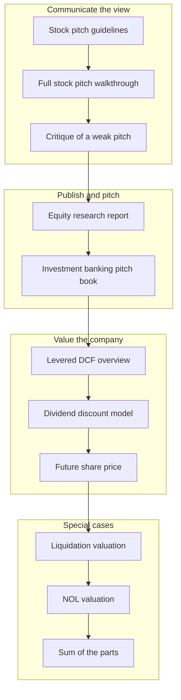
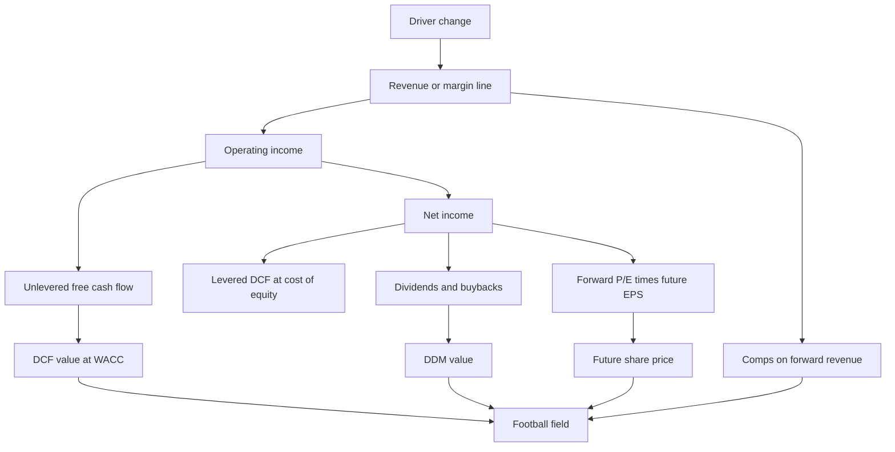
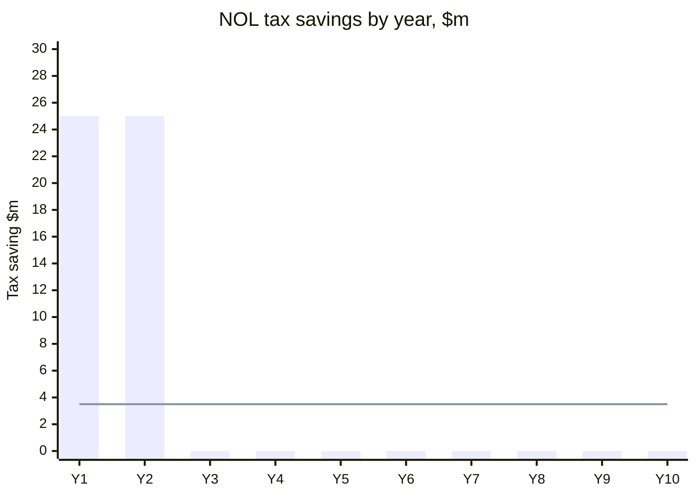
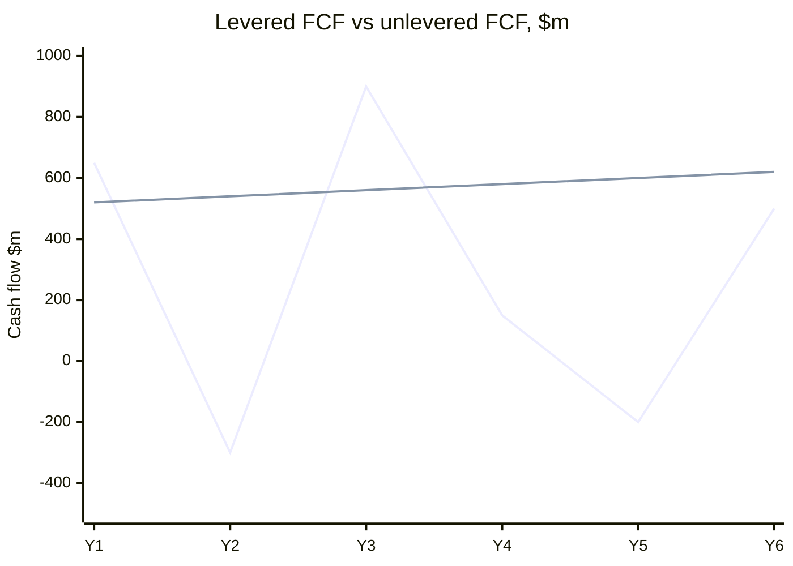
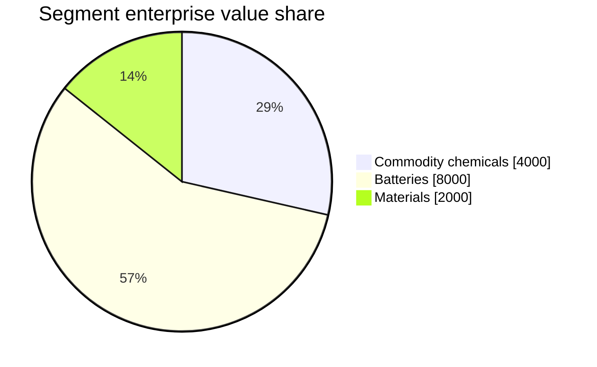
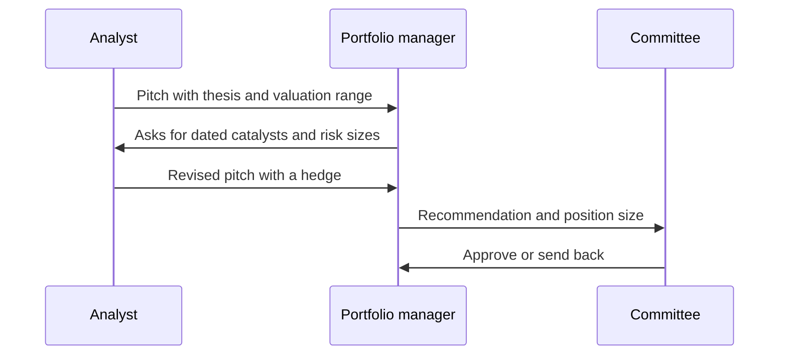

# Module 09: Valuation Interpretation and Uses

[← Previous: Module 08, Part 2](08-advanced-valuation-and-dcf-part-2.md) · [Contents](../README.md) · [Next: Module 10 →](10-merger-models.md)

<details>
<summary><b>Contents</b></summary>

- [Overview](#overview)
- [Module Map](#module-map)
- [Lessons](#lessons)
  - [9.1 Stock Pitch Guidelines and Outline](#91-stock-pitch-guidelines-and-outline)
  - [9.2 Full Stock Pitch (Written and Slide Versions)](#92-full-stock-pitch-written-and-slide-versions)
  - [9.3 Critique of the Stock Pitch](#93-critique-of-the-stock-pitch)
  - [9.4 Equity Research Report](#94-equity-research-report)
  - [9.5 Investment Banking Pitch Book](#95-investment-banking-pitch-book)
  - [9.6 Overview of Supplemental Methods and the Levered DCF](#96-overview-of-supplemental-methods-and-the-levered-dcf)
  - [9.7 Dividend Discount Model (DDM)](#97-dividend-discount-model-ddm)
  - [9.8 Future Share Price (Present Value of Future Share Price)](#98-future-share-price-present-value-of-future-share-price)
  - [9.9 Liquidation Valuation](#99-liquidation-valuation)
  - [9.10 Net Operating Loss (NOL) Valuation](#910-net-operating-loss-nol-valuation)
  - [9.11 Sum-Of-The-Parts (SOTP) Valuation](#911-sum-of-the-parts-sotp-valuation)
- [Diagrams and Charts](#diagrams-and-charts)
- [Excel Model Walkthrough](#excel-model-walkthrough)
- [Interview Questions](#interview-questions)
- [Career Angle](#career-angle)
- [Cheat Sheet](#cheat-sheet)

</details>

## Overview

A valuation is only as useful as the decision it supports, so this module turns the earlier models into a stock pitch, a research report, a pitch book and a set of special-case valuations, and teaches how to read what each one says.

## Module Map



## Lessons

### 9.1 Stock Pitch Guidelines and Outline

- **Purpose.** A stock pitch is a short written argument for buying or shorting one company. It has to answer three questions: what is the price today, what is it worth, and what would make the gap close. Everything in the module hangs off that structure.
- **Source material.** A long guidelines document accompanies the case. The reader is expected to skim it once and then build the outline from the financial model that already exists. Nothing in the outline is new modeling. The model supplies the investment thesis, the valuation range and the scenario results.
- **Where new research is needed.** Two sections need outside work: **catalysts** (events that could move the price within a known window) and **risk factors** (things that could make the thesis wrong). Background, thesis and valuation are already in the model.
- **Anchoring the thesis on a data point.** The example case uses one sharp event, a large drop in sales of a key product in a quarter, and argues the market overreacted. The stock fell roughly 25% on that news. The pitch is then built on whether the overreaction reverses. Good pitches usually hinge on one or two data points the market has misread, not on a long list of reasons.
- **Valuation range from scenarios.** The DCF gives a base case, an upside case and a downside case. The implied upside or downside in each case becomes the pitch's headline: "undervalued by 30% to 70%" means base to upside. The downside case sets the bear number, which the pitch compares to the upside to argue the reward-to-risk is skewed.
- **Estimating the impact of one factor.** You do not need a new model for each risk or catalyst. Change one input (for example, the year a competing generic enters) and re-read the implied valuation. Repeat it for each factor. The change in implied value is the factor's impact. If the change is small, the factor is not worth a line in the pitch.
- **Probability-weighted catalysts.** For a clinical-style catalyst with a stated probability of success, removing the probability term from the risk-adjusted value shows the upside if the event succeeds. The difference between the two results is the catalyst's value.
- **Conservative assumptions as a selling point.** A pitch is more credible if it shows the model already assumes things that are pessimistic, such as margins that drift down and cash flows that shrink forever. Say so explicitly.
- **Length.** The guidelines cap the pitch at a few pages. The outline already fills three pages in bullet form, so the final pitch is mostly a rewrite into paragraphs.

**Worked example (made-up numbers).** A company trades at $50 a share. Base case DCF gives $65 (30% upside). Upside case gives $85 (70% upside). Downside case gives $44 (12% downside). The pitch says: "undervalued by 30% to 70% with 12% downside in the bear case." The reward to risk is about 2.5 to 6 times the risk.

| Scenario | Value per share | vs. $50 price | Use in the pitch |
|---|---|---|---|
| Upside | $85 | +70% | Bull target |
| Base | $65 | +30% | Headline valuation |
| Downside | $44 | -12% | Bear case and worst-case price |

**Factor impact (made-up numbers).**

| Factor changed | Base implied upside | New implied upside | Impact |
|---|---|---|---|
| None (base) | 30% | 30% | n/a |
| Generic entry one year earlier | 30% | 27% | -3 points, not worth a line |
| Competitor takes 5% more share | 30% | 22% | -8 points, worth a risk bullet |
| Trial fails (probability to 0%) | 30% | 20% | -10 points, worth a catalyst bullet |

> [!TIP]
> This is often called "more art than science," and that is the right framing. The numbers are only as good as the single-input change you chose. A better habit is to show the sensitivity as a range and say which assumption drives it. Interviewers like candidates who can say "this factor matters because the model is most sensitive to the share assumption, which I could not verify."

> [!WARNING]
> A common mistake is to list every risk the company has. A pitch should only include risks whose impact you have quantified, or at least bounded. A risk with no number attached is a comment, not a risk factor.

### 9.2 Full Stock Pitch (Written and Slide Versions)

- **Same argument, different format.** The written pitch is the outline turned into paragraphs. The slide version reorders the same content into a recommendation, background, thesis and catalysts, valuation summary, risks, and a closing recommendation. The argument does not change between formats. Only the emphasis does.
- **Implied price range from midpoints.** Scenarios assume every driver moves the same way at once (every product beats, every risk hits). Real life is messier. A more honest range takes the midpoint of each driver's range and runs those through the model. That gives a narrower, more believable price band (the case lands on a band of roughly $170 to $230 on the example stock).
- **Visual scanning.** Readers are busy. Bold the one number that matters (the implied undervaluation percentage), use a callout on the chart that shows the thesis, and limit each slide to one message.
- **Price-volume chart as the anchor.** A stock that traded in a tight range for about nine months and then gapped down on news is strong evidence of an overreaction only if the underlying drivers did not change. The pitch uses that chart to say "the market knew this was coming, and still sold off."
- **Choose the valuation evidence.** Do not paste every comp table and every sensitivity table. Pick the one or two that make the case. In the example, the team uses only two DCF sensitivity tables: the base case and the downside case at a stated discount rate. The point is "virtually all of the base table sits above the current price."
- **Highlight the drivers that differ across cases.** When building the 10-year assumptions summary, highlight the rows that vary most between scenarios (the big product's peak sales, the terminal value, the implied price). Rows that stay constant (margins, WACC) do not need the same attention.
- **Strike prices on protection.** The pitch proposes put options at strikes that cap the loss around 15% to 25%. A strike 25% below the price gives a loss of about 25% if exercised. Check the arithmetic: loss = (strike - price) / price, with the premium ignored.

**Worked example (made-up numbers).** A stock trades at $100. Three methods give: DCF base $140, DCF upside $180, DCF downside $95. Trading comps give $120 to $135. Using the midpoint of each driver range gives a DCF band of $125 to $165. The pitch reports: "implied value $125 to $165, 25% to 65% upside, downside to $95 in the bear case." A put struck at $85 caps the loss at 15% (ignoring premium).

| Item | Written pitch | Slide pitch |
|---|---|---|
| Structure | Paragraphs, background first | Six slides, recommendation first |
| Best for | Full read by a PM or committee | Quick scan by a busy reader |
| Risk of over-detail | Medium | High, so limit each slide |
| Key numbers | In text | In bold and in callouts |

> [!TIP]
> The "midpoint of each driver" idea is worth remembering. It is a simple guard against the scenario trap, where a bull case assumes every good thing happens at once. Many real valuations are over-optimistic because the upside case quietly stacks several favorable assumptions. Taking the midpoint of each driver is a cheap sanity check.

> [!TIP]
> Putting the catalysts inside the thesis box is a judgment call. Put them in their own section if they are the strongest argument. Fold them into the thesis if they are supporting evidence only. Good pitch writers decide based on which argument carries the most weight.

### 9.3 Critique of the Stock Pitch

The lesson reviews the pitch from the previous lesson as a reviewer would. It lists what worked, what did not, and how to fix it with more time.

**What worked**

- **The model was the right size.** A DCF of a few hundred rows with unit-level product revenue is enough for a pitch. A 2,000-row model does not help a reader who has a few minutes. Detail belongs where it changes the answer (major products), not everywhere.
- **Quantified factors.** Each thesis point was tied to a percentage change in implied value. That is far more useful to a reader than "this is a risk."
- **Simple thesis.** "The market overreacted to one number, and the business is still sound" fits on one slide. Simple theses are easier to defend.
- **Evidence in the right place.** The football field and the sensitivity tables show that most of the valuation range sits above the current price.
- **Scenario averaging fix.** Upside assumes everything goes right and base assumes everything is average. Both are unrealistic in combination, so taking the midpoint of each driver is a reasonable way out.
- **Risk section present.** Many pitches skip risks or only name them. Naming risks and how to hedge them is a step up.

**What did not work**

- **No outside voices.** The pitch never quotes an expert or a channel check. One hour of calls with a doctor or an industry contact would have made the competitive-threat argument much stronger.
- **Weak catalysts.** A catalyst should be an event inside the next 6 to 12 months. The pitch listed events with no dates (a lawsuit settlement, trial results years away, an FDA step with no timing confidence). Two kinds of catalyst help: a **hard catalyst** is a scheduled event (earnings, a specific regulatory date), and a **soft catalyst** is a likely event with an uncertain date.
- **Circular reasoning.** One catalyst relied on a date that was only known after the fact. A reader will catch that.
- **Lawsuit outcome not stress-tested.** The pitch assumed a favorable settlement without weighing the chance of losing.
- **Competitive threat under-sized.** A one-dose drug competing against a two-dose drug for the same patients is a big deal, probably bigger than the pitch treated it.

**How the lesson says to fix it with more time**

1. Spend less time in the spreadsheet and more time with people (experts, channel checks).
2. Build a catalyst calendar from equity research reports and company filings.
3. Give every risk a timeline, even a rough one, based on how long similar trials or approvals took before.
4. Check the competitor's product profile in more detail.

> [!TIP]
> The distinction between a long pitch and a short pitch matters here. For a long pitch on an undervalued stock, catalysts are a nice-to-have because the market can simply re-rate the stock as it realizes the overreaction. For a short pitch, you need a specific trigger, because a fundamentally weak stock can stay expensive for a long time without one. Interviewers often ask which kind of pitch needs the harder catalyst. The answer is the short.

> [!TIP]
> **Practical tip.** When you critique a pitch, grade each section on two things: "is the claim specific?" and "is the claim dated?" Most weak pitches fail one or both.

### 9.4 Equity Research Report

- **Same engine, softer argument.** A research report starts from the same model as a stock pitch but argues a milder view. The stock pitch says "the market is wrong by 50% or more." The report says "our view is a moderate upgrade, with a single target price."
- **Four differences to remember.**
  1. **Recent results drive it.** Expect a first-page update: the latest quarter, guidance changes, trial news, product launches. Stock pitches care less about the latest print because the pitch rests on the writer's own view.
  2. **Mainstream views.** Research tends to stay near the consensus. Reports rarely call a stock worth double or a tenth of its price. An extreme target price reads as a red flag, and a rating in the middle of the range is common.
  3. **Single price target.** Reports almost always publish one target price, sometimes with bull, base and bear values. Stock pitches show a valuation range. Target prices are less useful than ranges because the true value is uncertain. Several published studies have found that target prices are not very accurate, so treat a single number with care.
  4. **Looser thesis and risks.** Catalysts and risks are listed with dates but not tied to per-share impacts. Generic risk language appears to protect the author if the call is wrong.
- **Typical report layout.** Page one: the update, rating, price target, recent results, and a short valuation summary. Page two onward: operating summary (revenue by product, market share, unit sales, pricing), valuation (scenarios, peer multiples, football field), investment thesis, catalyst calendar and risk factors.
- **Ratings.** Most reports are buy or outperform, a smaller share hold, and sell is rare. A report that rates nearly every analyst the same way deserves some skepticism. Check the rating distribution across the sell side before taking a buy rating at face value.
- **Multiples.** Reports cite specific peer multiples, such as the median or the 25th percentile, and tie the target to one. Stock pitches lean on a DCF and use comps as a sanity check.

**Worked example (made-up numbers).** The same stock as in lesson 9.1, now at $50. The pitch says "$65 to $85, roughly 30% to 70% upside." The report says "Outperform, price target $68 (base case), bear $44, bull $80." The gap is not in the model. It is in how boldly the conclusion is stated.

| Element | Stock pitch | Equity research report |
|---|---|---|
| Tone | Strong, contrarian | Measured, near consensus |
| Valuation output | Range of values | Single target, plus scenarios |
| Catalysts | Quantified per share | Listed with dates |
| Risks | Quantified, hedged | Generic list plus key risks |
| Focus | Thesis and mispricing | Recent results and guidance |

> [!TIP]
> Why research tends to be conservative: analyst incentives. Research analysts do not usually invest their own money, and the sell side historically earned fees from trading. Those incentives have changed since research was unbundled from trading commissions, but the culture of "stay near the consensus" has not disappeared.

> [!TIP]
> Practical point for a valuation analyst: a research-style write-up is often the easiest thing to ask for in an interview, because it tests whether you can move between a hedge-fund style argument and a bank-style summary without changing the model.

### 9.5 Investment Banking Pitch Book

- **Different client, different question.** A stock pitch asks "should we buy or short this?" An investment banking pitch book asks "what transaction should the company do?" Bankers advise companies on financing, acquisitions, sales, and restructurings. They are paid when a deal happens, so the book is built to lead toward one.
- **Code names.** Pitch books often use a code name with the same first letter as the client, sometimes an animal, plant or character. It is a confidentiality habit, but it is weak in practice, because logos and product names can give the company away.
- **Ruling out options with numbers.** The book first checks each financing or M&A route against the company's balance sheet:
  - **More debt.** The company already carries a large share of debt in its capital structure, so further borrowing is constrained.
  - **Equity issuance.** Issuing stock at a low price causes heavy dilution. Companies prefer to issue when the price is high.
  - **Acquisitions for cash.** The cash on hand is too small for a large deal.
  - **Restructuring.** The company is not distressed, so there is nothing to restructure.
  That leaves two options: sell the company, or keep growing organically. A banker will recommend the sale.
- **Anchoring the price.** A pitch book sets a target price above the recent trading range, and above prior highs, to create a reason for the board to say yes. A conservative valuation will not move a board that remembers trading at a higher price a few months ago.
- **Management case vs consensus case.** The book relabels scenarios to fit the audience. The upside case becomes the "management case" (what the company says it will do). The base case becomes the "consensus case" (what the market expects). The downside case is dropped. The gap between the two is small once you look at total revenue, so both support the same conclusion.
- **Shareholder profile.** The book checks who owns the stock. Heavy insider or activist ownership can block a deal. Heavy ownership by large index and asset managers makes a deal easier, because they tend to accept reasonable offers.
- **Buyers screened by capacity.** A Tier 1 buyer needs enough cash plus debt capacity to fund a deal of the target size. The example uses a threshold of roughly $18 to $20 billion for a deal this large. A Tier 2 buyer may only work if it can also issue stock. A private equity firm is unlikely to bid because the deal is too large and too risky for its funds.
- **Structure of the book.** Recommendation first, then company background and why it is undervalued, then the likely deal value, then the process and a list of buyers.

**Worked example (made-up numbers).** A company with $900 million of cash and a debt ratio near 50% cannot fund a $10 billion acquisition. A Tier 1 buyer with $10 billion of cash and $30 billion of debt capacity can. The book then recommends a sale process with a target of $200 per share.

| Test | Result | Conclusion |
|---|---|---|
| Raise debt | Debt ratio already high | Not viable |
| Issue equity | Price near 52-week low | Too dilutive |
| Cash acquisition | $0.9B cash vs $10B deal | Not viable |
| Restructure | Not distressed | Not relevant |
| Sell the company | Buyers exist with capacity | Recommend |

> [!TIP]
> The "targeting" advice is a real-world pattern. Large pharma buyers are the usual acquirers of late-stage biotech because they need pipeline and have cash flow to absorb the risk. Private equity rarely buys a biotech whose value depends on pending trial results, because the leveraged structure cannot survive a failed trial.

> [!TIP]
> Pitch book pages are a tool for persuasion. The lesson itself says several slides (the peer multiples bar chart, for one) are weak because they are hard to read. Interviewers often ask candidates to critique a slide. A good answer names the message, checks whether the chart actually proves it, and suggests a clearer table.

### 9.6 Overview of Supplemental Methods and the Levered DCF

- **Optional material.** The lesson frames the rest of the module as optional. Only a few methods are common in practice. The levered DCF is covered mainly so you can explain why you would not use it. The lesson also says the adjusted present value (APV) method is not worth learning in depth.
- **Methods covered in the module.** Levered DCF, dividend discount model (DDM), future share price, liquidation value, net operating loss (NOL) valuation, and sum-of-the-parts (SOTP). Other methods exist for banks and insurers (DDM, embedded value), REITs (net asset value) and oil and gas (NAV). Those are industry-specific topics, not general ones.
- **What a levered DCF is.** Instead of unlevered free cash flow (cash available to all capital providers, discounted at WACC), you project cash flow to equity holders. Steps:
  1. Start from operating income and subtract net interest expense.
  2. Subtract taxes to get net income.
  3. Add back non-cash items (D&A, deferred taxes, non-cash interest).
  4. Adjust for working capital, capex and acquisitions.
  5. Add net borrowing (new debt issued minus mandatory repayments).
  6. Discount at the cost of equity, not WACC.
- **Terminal value.** Use an equity-based multiple (P/E) rather than EV/EBITDA. Perpetuity growth also works, but the growth rates usually differ from the unlevered case to get a comparable answer.
- **No bridge.** A levered DCF produces implied equity value directly. There is no step from enterprise value to equity value. That means convertible bonds cannot be switched between debt and equity treatment. The model has to pick one and stick with it.
- **Key formula.**

  ```
  Levered FCF = Net income to common
                + D&A + non-cash interest + deferred taxes
                - change in working capital - capex - acquisitions
                + net borrowing (new issues - mandatory repayments)
  Equity value = PV(levered FCF over forecast) + PV(terminal value)
  Discount rate = cost of equity
  ```

- **Why it is hard to make it match.** An unlevered DCF is not affected much by the interest rate on debt. A levered DCF is directly affected by it, so small input changes move the answer a lot. Net borrowing is volatile, so the final-year cash flow can swing from large positive to large negative depending on one assumption. The lesson used a long average of past issuances to smooth it.
- **Disagreement on definitions.** Practitioners do not agree on whether levered free cash flow subtracts all debt repayments or only mandatory ones, and whether it adds new issuance. Four bank or company presentations in the lesson each used a different definition.

**Worked example (made-up numbers).** Net income to common is $400 million. Add D&A of $150 million, non-cash interest of $30 million and a deferred tax item of $20 million. Subtract working capital growth of $50 million and capex of $200 million. Net borrowing is +$100 million (new $400 million issues less $300 million mandatory repayments). Levered FCF is $450 million. Unlevered FCF for the same year might be $520 million, with the difference mostly reflecting after-tax interest and the debt flows.

| Item | Amount ($m) |
|---|---|
| Net income to common | 400 |
| + D&A | 150 |
| + Non-cash interest | 30 |
| + Deferred taxes | 20 |
| - Working capital | (50) |
| - Capex | (200) |
| + Net borrowing | 100 |
| **Levered FCF** | **450** |

> [!TIP]
> The usual verdict is blunt: "99% of the time, it's not a good idea." In practice, a levered DCF is sometimes used for equity REITs, where debt and equity issuance are predictable and the dividend policy is set by rules. It can also be useful in restructuring, where the capital structure changes a lot. For a typical company, use an unlevered DCF and compute equity value by subtracting net debt, or use a DDM for a company that pays regular dividends.

> [!WARNING]
> **Common mistake.** Mixing the discount rate and the cash flow. Levered cash flow belongs to equity holders, so it should be discounted at cost of equity. Unlevered cash flow belongs to all capital providers, so it is discounted at WACC. Pairing levered cash flow with WACC overstates the value of the equity.

### 9.7 Dividend Discount Model (DDM)

- **Why it exists.** Unlevered and levered free cash flows are constructed numbers. A shareholder only receives what the company actually pays out. The DDM values the stock on the dividends and buybacks it expects to return, discounted at the cost of equity.
- **Where it fits.** For banks, insurers, some REITs, some MLPs and regulated utilities, the DDM is the natural method. Those firms have legal or regulatory reasons to distribute cash, and their cash flows are predictable. For a biotech, an early-stage tech company or an exploration company with volatile cash flows, the DDM is a poor fit.
- **Steps for a normal company.**
  1. Project net interest. That needs projected cash and investment balances and debt balances, so the model tracks the cash balance rather than ignoring it.
  2. Forecast the share count. Buybacks reduce it over time, and per-share dividends depend on it.
  3. Project the full cash flow statement down to the change in cash: net income, non-cash items, NOL usage, working capital, net investments, borrowing, dividends and buybacks.
  4. Project dividends per share and buybacks, using a payout ratio.
  5. Compute terminal value, discount at cost of equity, and add the PV of dividends and buybacks.
- **Include buybacks.** A company that repurchases shares returns capital just as dividends do. Counting dividends alone undervalues the company. Use a **modified payout ratio** that is (dividends plus buybacks) divided by net income.
- **Terminal value options.**
  - Perpetuity growth on net income, or a terminal P/E multiple.
  - Growth in (dividends plus buybacks) based on retained earnings times return on equity: growth = (1 - payout) x ROE.
- **No bridge.** Like the levered DCF, the DDM gives equity value directly. You do not subtract net debt.
- **Sanity checks.** Look for:
  - stable ROE and payout ratios by the final year;
  - dividends, buybacks and net income growing at similar, low rates in the terminal period;
  - debt-to-equity and debt-to-cash ratios that do not swing wildly.

**Formulas.**

```
Dividends per share    = payout x EPS, or DPS forecast directly
Modified payout ratio  = (dividends + buybacks) / net income
Retained ratio         = 1 - modified payout ratio
Terminal growth (alt)  = retained ratio x ROE
Terminal value (alt)   = (final-year dividends + buybacks) x (1 + g) / (cost of equity - g)
Equity value           = PV(dividends + buybacks) + PV(terminal value) + PV(NOL left over)
```

**Worked example (made-up numbers).** Net income is $1,000 million. Dividends are $300 million and buybacks $200 million. The modified payout ratio is 50%. Retained earnings are 50%. ROE is 12%. The retention method gives a growth rate of 50% x 12% = 6%. That is too high to hold forever, so cap it at a long-run rate. With a 9% cost of equity and a 3% cap, the terminal value uses 3% growth.

| Metric | Value | Comment |
|---|---|---|
| Net income | $1,000m | Terminal base |
| Dividends | $300m | Paid to holders |
| Buybacks | $200m | Also returns capital |
| Modified payout | 50% | (300 + 200) / 1,000 |
| ROE | 12% | Check it is stable |
| Cost of equity | 9% | Discount rate |

**Why the DDM gives a lower answer.** The lesson's main point: for a normal company, dividends plus buybacks are usually well below unlevered or levered free cash flow, because the company also repays debt, buys other companies, builds cash and invests. The discount rate (cost of equity) is also higher than WACC when the company has debt. The terminal value does not usually rise enough to offset both effects. That is why the DDM tends to give the most conservative value of the methods for a normal company.

> [!TIP]
> The DDM is "conservative" for a reason that is easy to misread. It is not that the method is wrong. It is that most companies do not pay out all their free cash flow. If a company retains cash and invests it at a high return, the DDM will undervalue it unless the retained cash shows up in later dividends or buybacks. Ask whether the retained cash is creating value before you trust the output.

> [!TIP]
> **Interview tie-in.** "When would you use a DDM?" The short answer is banks and insurers, plus companies with a stable, policy-driven payout. "Why is your DDM value lower than your DCF?" The answer is the payout gap and the cost of equity gap described above.

> [!TIP]
> Small fix to the lesson's own point: the terminal growth formula (retention times ROE) is the cleanest way to link growth to the business. Keep the cap low. A company cannot grow faster than the economy forever.

### 9.8 Future Share Price (Present Value of Future Share Price)

- **The idea.** A shareholder earns from the future share price and the dividends in between. Project both, then discount to today at the cost of equity.
- **Two inputs.** The dividends come from the DDM work (per-share dividends, share count, net interest). The future share price comes from applying a forward multiple to a forward metric in the future year, then adjusting for net debt and the share count at that date.
- **Next-twelve-months (NTM) multiples.** Use a window that starts today and runs twelve months forward, not a calendar year. If today is in July, the window runs July to June the following year. Forward metrics are built by averaging two fiscal years, weighted by the half of each year that falls inside the window.
- **Multiples to use.** Three sources are common:
  1. the peer group's current NTM multiple (median);
  2. the company's own five-year average NTM multiple;
  3. the company's current NTM multiple.
- **Steps.**
  1. Forward metrics: EBITDA, net income, dividends, net debt and share count over the next few years.
  2. Multiple applied to a future metric to get the future equity value. For an EV multiple, subtract net debt. For a P/E multiple, skip the bridge.
  3. Divide by the future share count to get a future share price.
  4. Discount the future share price at cost of equity. Add the PV of dividends paid between today and that date, using the NPV function.
  5. Show the results as lines over time, one line per multiple source, and compare with today's price.
- **Share count.** Either reflect buybacks in a falling share count, or keep the count flat and show buybacks separately. Do not do both.

**Formula.**

```
Future price (P/E)   = NTM P/E x forward net income / future shares
Future price (EV)    = (NTM EV/EBITDA x forward EBITDA - net debt) / future shares
PV per share         = future price / (1 + cost of equity)^n + PV(dividends per share to date)
```

**Worked example (made-up numbers).** Forward EBITDA in one year is $2,000 million. The peer NTM EV/EBITDA is 5.0x. Net debt is $3,000 million. Shares are 200 million. Future EV is 10,000. Equity is 7,000. Future price is $35. Cost of equity is 10%. Discounted one year: $35 / 1.10 = $31.8. Add dividends of $1.00 per share received in that year, discounted: about $0.9. PV per share is about $32.7.

| Step | Value |
|---|---|
| Forward EBITDA | $2,000m |
| NTM multiple | 5.0x |
| Implied EV | $10,000m |
| Less net debt | $(3,000)m |
| Equity value | $7,000m |
| Shares | 200m |
| Future price | $35.00 |
| PV at 10% plus dividends | about $32.70 |

> [!TIP]
> The lesson is frank that this method adds little. Its output is usually close to what you get from the public comps and the DDM, because it is built from the same multiples and the same dividend policy. Its one real advantage is the five-year average multiple, and you can add that to a comps chart in a few minutes instead of rebuilding the model.

> [!TIP]
> Where it helps: a leveraged recapitalization or a large change in dividend or buyback policy. The method isolates the value of a specific capital structure change, which the other methods blend together. Investment banks use it for that purpose.

> [!WARNING]
> **Common mistake.** Forgetting that the future price is per share at a future date, so it has to be discounted. Also, the net debt in the future date has to be the forecast net debt for that date, not today's.

### 9.9 Liquidation Valuation

- **The idea.** Equity value equals assets minus liabilities. Most of the time, book values are a fair stand-in. The liquidation method swaps book values for what each asset would fetch in a sale, then subtracts what the company owes, and divides by the diluted share count.
- **Why it rarely works for healthy companies.** Most balance sheet items (cash, receivables, payables, short-term debt) are worth close to book value. The items that move a lot are long-lived assets such as property, plant and equipment (PP&E) and intangibles. Their value depends on whether they produce cash flow, which is a DCF question, not a balance sheet question. Asset-light businesses such as consulting firms barely have a balance sheet to value, so this method misleads.
- **Where it works.** Distressed, restructuring or bankruptcy cases, especially for asset-heavy companies (industrials, energy, real estate). In those cases the question is not "what is the stock worth" but "how much does each creditor get back".
- **Steps in the model.**
  1. **Recovery percentages on assets.** Cash is about 100%. Receivables, inventory and other current assets get lower percentages because some will not be collected or sold at full value. PP&E can go either way: a productive plant needs a DCF, while land and buildings can be checked against comparable sales. Goodwill is zero, since it cannot be sold on its own. Intangibles range widely depending on what they are.
  2. **Liabilities at about 100%.** Creditors get paid first. The usual practice is to leave liabilities at book value (or face value for debt, since the principal is what is repaid) and only adjust the asset side.
  3. **Equity per share.** Subtract adjusted liabilities from adjusted assets, including preferred stock and non-controlling interests, and divide by diluted shares.
  4. **Range.** Use two cases, such as a 25th and 75th percentile on the asset recovery assumptions, rather than many cases.
- **Claims waterfall (real bankruptcies).** Proceeds after wind-down and professional fees flow down the claims hierarchy: secured debt first, then senior unsecured, then subordinated. Each group gets 100% recovery until money runs out, then partial recovery, then zero.

**Worked example (made-up numbers).** Assets at book value total $1,000m. Cash $100m at 100%. Receivables $200m at 85%. Inventory $150m at 45%. Net PP&E $500m at 150%. Goodwill $50m at 0%. Other $0. Adjusted assets: $100 + 170 + 67.5 + 750 + 0 = $1,087.5m. Liabilities at 100%: $700m. Equity value = $387.5m. On 100m diluted shares, that is $3.88 a share.

| Asset | Book ($m) | Recovery | Adjusted ($m) |
|---|---|---|---|
| Cash | 100 | 100% | 100.0 |
| Receivables | 200 | 85% | 170.0 |
| Inventory | 150 | 45% | 67.5 |
| Net PP&E | 500 | 150% | 750.0 |
| Goodwill | 50 | 0% | 0.0 |
| **Total** | **1,000** | | **1,087.5** |

**Waterfall example (made-up numbers).** Net proceeds are $475m. Senior secured debt is $250m, recovered 100%, leaving $225m. Senior unsecured is $200m, recovered 100%, leaving $25m. Subordinated notes are $50m, recovered 50%. The equity gets nothing.

> [!TIP]
> The lesson quotes a well-known investor's line that liabilities are always good and the assets are the risk. In practice, the rule of thumb is: haircut the assets, leave the liabilities at face. Write it down as a principle and you will remember why the liquidation model looks the way it does.

> [!TIP]
> Judgment is most of the work. The mechanics are a few multiplications. The numbers that matter are the recovery percentages, and a sensible model shows a range and says which assets drive the answer. A 10-point change in PP&E recovery can move the answer more than every other line combined.

> [!WARNING]
> Do not confuse a liquidation floor with a fair value. A liquidation value tells you what the company could be worth if it stopped operating. For a healthy business, that number is usually well below the going-concern value, so it is a floor only in the loose sense that the stock is unlikely to go below it if the company is not in distress.

### 9.10 Net Operating Loss (NOL) Valuation

- **What an NOL is.** Accumulated tax losses that can shield future taxable income. The off-balance-sheet amount is the NOL itself. The on-balance-sheet item in the deferred tax asset (DTA) is roughly the NOL multiplied by the tax rate, which is the expected future tax saving.
- **Why the balance sheet can overstate the value.** Two things reduce the value of an NOL:
  1. **Expiry.** Some NOLs expire after a fixed number of years (10 to 20 years is a typical range, depending on the country). Losses that expire unused are worth nothing. Rules also change over time: U.S. federal NOLs created after 2017 can be carried forward without an expiry date, but their use is capped at a share of taxable income. Check the current rules for the jurisdiction you are modeling.
  2. **Time value of money.** A saving that arrives in year 8 is worth less than one that arrives now.
- **Standalone valuation.** Build an NOL schedule across the forecast:
  1. Project pre-tax income.
  2. NOLs created = the negative of pre-tax income, floored at zero.
  3. NOLs used = the smaller of the available balance and positive pre-tax income, but zero after the expiry year.
  4. Cash taxes = tax rate times (pre-tax income less NOLs used), floored at zero.
  5. Tax savings = cash taxes saved versus book taxes, floored at zero. The floor matters: a loss year does not create a refund.
  6. Discount the savings. The lesson uses WACC, which is how most bank presentations do it, though cost of equity is arguable.
- **Valuation allowance.** The accounting reserve for NOLs the company does not expect to use before they expire. Roughly, it is the unused NOL times the tax rate. If the company uses everything in time, the allowance is zero.
- **M&A limit (Section 382 in the U.S.).** After a change of ownership, the annual NOL usage of the target is capped at the target's equity purchase price times a long-term tax-exempt rate. This rule exists to stop companies buying tax losses. It makes NOLs much less valuable in an acquisition than on the seller's standalone balance sheet.
- **Combining with the buyer.** Add the buyer's and seller's pre-tax income, subtract foregone interest on cash and extra interest on acquisition debt, then apply the annual cap. The NOL usage becomes the smaller of the cap, the balance and the expiry constraint.

**Formula (annual usage in an acquisition).**

```
Annual 382 limit   = equity purchase price x long-term tax-exempt rate
NOL used in year t = MIN(NOL balance, annual limit, MAX(combined pre-tax income, 0))
                     and 0 after the expiry year
Tax saving         = MAX(tax rate x NOL used, 0)
PV of savings      = NPV(discount rate, tax savings)
```

**Worked example (standalone, made-up numbers).** NOL balance $200m, tax rate 25%, so the DTA is $50m. Pre-tax income is $100m a year, and expiry is year 10. The company uses $100m in year 1 and $100m in year 2. Tax saving is $25m a year for two years. At a 10% discount rate, PV = 25/1.10 + 25/1.21 = about $43.4m. The valuation allowance is zero.

**Worked example (acquisition, made-up numbers).** Same $200m NOL and $50m DTA. The seller's equity price is $800m. A long-term tax-exempt rate of 1.75% gives an annual cap of $14m. The usage is $14m a year for 10 years, so $140m is used and $60m expires. Tax saving is 25% x $14m = $3.5m a year for 10 years. At a 9% discount rate, PV = 3.5 x 6.42 = about $22.5m. The valuation allowance is 25% x $60m = $15m.

| Measure | Standalone | After acquisition |
|---|---|---|
| NOL balance | $200m | $200m |
| DTA on balance sheet | $50m | $50m |
| Usage per year | $100m | $14m (382 cap) |
| Years to use | 2 | 10, then expiry |
| PV of tax savings | about $43m | about $22m |

> [!TIP]
> The main takeaway from the lesson: NOL valuation is mostly an M&A question. On a standalone basis, a company that uses its NOLs quickly is worth about its balance sheet number, and a 5% to 10% gap is usually not worth modeling. In an acquisition, the cap can cut the value by half or more, which is why buyers and sellers argue over it.

> [!TIP]
> **Practical habit.** When you see a large DTA for an acquisition target, check three things first: the expiry schedule, the annual cap, and whether the buyer has enough taxable income to use the cap. If any one of those is binding, the balance sheet number is too high.

> [!WARNING]
> A common error is to take the DTA at face value in a purchase price bridge. The bridge should use the present value of the usable tax savings, not the accounting asset.

### 9.11 Sum-of-the-Parts (SOTP) Valuation

- **The idea.** Value each business segment on its own, add the values, adjust for costs and claims that sit above the segments, then back into the equity value and the share price.
- **When it fits.** Conglomerates and holding companies with segments in different industries or with very different growth and margins. A company with one segment, or with segments that trade at similar multiples, gains nothing. Two segments is the minimum for the method to count as SOTP.
- **Methods per segment.** Any multiple (EV/revenue, EV/EBITDA, P/E) from public comps or precedent deals, or a DCF per segment. Most work uses one or two multiples per segment. The DCF without a terminal value, used for drug portfolios that lose exclusivity, is a variant.
- **Steps (as taught).**
  1. Gather segment revenue, operating profit and, where possible, EBITDA. Use the most recent twelve months (LTM).
  2. Fill in gaps. If segment EBITDA is not disclosed, allocate total depreciation and amortization by revenue share and add it to segment operating profit. This is an estimate and should be labeled as one.
  3. Compute the combined company's current enterprise value and equity value.
  4. Pick comps per segment, with screens that fit each business. Global screens suit commodity-like businesses that sell worldwide. Regional screens suit businesses that are local.
  5. Apply a range of multiples to each segment (for example the 25th to 75th percentile) to get segment enterprise values.
  6. Sum the segments. Subtract corporate overhead (only if the segments do not already add up to group operating profit, or if you are modeling a spinoff, where overhead rises).
  7. Bridge to equity value. Reverse the usual enterprise-to-equity bridge (subtract debt, add cash, subtract minority interests and preferred). Divide by diluted shares.
  8. Chart the output as a waterfall with the current share price as a line.
- **Holding company discount.** A company whose value sits in stakes in other companies may trade at a discount to the sum of those stakes. Some SOTP analyses add a holdco discount for that reason.
- **Advantages.** More accurate for mixed businesses, the right tool for spinoffs and divestitures, and it shows which part of the company drives the value.
- **Disadvantages.** Data gathering is slow, because segment disclosures are thin. It also does not create a catalyst on its own. A segment can stay mispriced for years unless management acts.

**Formula.**

```
Segment EV          = segment metric x segment multiple (range)
Total EV            = sum of segment EVs - overhead x overhead multiple
Equity value        = total EV - debt - preferred - minority interest + cash
Implied share price = equity value / diluted shares
```

**Worked example (made-up numbers).** Three segments. Commodity chemicals with $4,000m revenue at 1.0x gives $4,000m. Batteries with $2,000m revenue at 4.0x gives $8,000m. Materials with $1,000m revenue at 2.0x gives $2,000m. Total EV before overhead is $14,000m. Overhead is 2% of total revenue of $7,000m, or $140m. Overhead is valued at the multiple of the catch-all "other" segment. For this example, use a 10x multiple on that overhead, which gives $1,400m. Post-overhead EV is $12,600m. Less net debt of $2,000m and minorities of $300m, equity value is $10,300m. On 100m shares, that is $103 per share.

| Segment | Metric | Multiple | Segment EV ($m) |
|---|---|---|---|
| Commodity chemicals | Revenue $4,000m | 1.0x | 4,000 |
| Batteries | Revenue $2,000m | 4.0x | 8,000 |
| Materials | Revenue $1,000m | 2.0x | 2,000 |
| Subtotal | | | 14,000 |
| Overhead (2% of revenue at 10x) | | | (1,400) |
| Post-overhead EV | | | 12,600 |
| Less net debt and minorities | | | (2,300) |
| Equity value | | | 10,300 |
| Per share (100m shares) | | | $103 |

**Recap of the module's valuation methods.** A quick comparison, useful as a one-page reference:

| Method | Basis | Best for | Typical output |
|---|---|---|---|
| Levered DCF | Cash to equity, cost of equity | Rarely; equity REITs | Volatile |
| DDM | Dividends and buybacks | Banks, insurers, stable payers | Conservative |
| Future share price | Future price plus dividends | Capital structure changes | Similar to comps |
| Liquidation | Asset recovery less liabilities | Distressed, bankruptcy | Floor, recoveries |
| NOL valuation | PV of tax savings | Large NOLs, M&A | Usually near DTA, lower in M&A |
| SOTP | Segment values summed | Conglomerates, spinoffs | Often the most useful |

> [!TIP]
> SOTP is the most useful of the optional methods for conglomerates. The weak spot is data. Most segment disclosures do not give EBITDA, capex or working capital by segment. Build an allocation rule, write it down, and show the sensitivity to it.

> [!TIP]
> **Interview tie-in.** "Why would a conglomerate trade at a discount?" The usual answers are complexity, a mix of low-growth and high-growth segments that the market averages together, a holdco discount, and capital allocation risk. SOTP is the tool that tests whether the discount is real or the market is just averaging.

> [!WARNING]
> **Common mistake.** Applying the overhead cost twice. If the segments already add up to group operating profit, overhead is already inside them. Only deduct it when a spinoff or stand-alone cost makes it real.

## Diagrams and Charts

**How one driver change flows through the outputs.** A change in a single assumption (for example, a competitor's launch date) moves the cash flows, which move the DCF, the DDM and the future price together. Comps are only affected if the metric they multiply changes.



**Illustrative NOL savings with and without the acquisition cap (made-up numbers, $m).** The standalone company uses its whole balance in two years. The acquired company is held to a fixed annual cap for ten years.



**Illustrative levered free cash flow swings (made-up numbers, $m).** Net borrowing makes levered FCF jump around, which is one reason the levered DCF is hard to rely on.



**Share of segment value in the SOTP example (made-up numbers).** Batteries carry more than half the value on under a fifth of the revenue, which is why the segment mix drives the answer.



**Typical hand-off when a pitch goes to a committee.**



## Excel Model Walkthrough

The module has one company model that carries through all the lessons, plus separate files for each specialty method. Each file is a copy of the same core workbook with extra tabs added. Only the new tabs are described here.

**Core tabs (shared by all the files).**

| Tab | What it holds | How it links |
|---|---|---|
| Cover | Navigation, model name, file name | Links to every tab by number |
| Summary | Revenue by product and scenario (upside, base, downside), margins, EBITDA, EBIT, multiples | Pulls from the DCF tab |
| Graphs | Revenue and EBITDA history and projections, price-volume chart | Pulls from Summary and comps |
| DCF tab | Patient-based drug revenue, pricing, operating costs, unlevered FCF, discount periods | Scenario switch drives the whole tab |
| H1_Results | First-half actuals for the stub period | Feeds the first partial year |
| ValSum | Implied share price by method and scenario | Pulls from DCF, comps, precedents |
| ValGraph | Football field chart | Reads ValSum |
| WACC | Cost of equity, cost of debt, weights, WACC | Feeds the DCF discount rate |
| Public_Comps and Public_Comps_Data | Peer multiples, medians, percentiles | Feeds ValSum |
| MA_Comps | Precedent transactions | Feeds ValSum |

**Added tabs by lesson.**

| Lesson | Tab | Key line items | Key links |
|---|---|---|---|
| 9.6 | Levered DCF version of the DCF tab | Net interest, net income to common, NOL usage, non-cash interest, net borrowing, levered FCF | Discount at cost of equity; terminal value on P/E |
| 9.7 | Steel_DDM (DDM tab for a steel producer) | Cash and debt balances, interest income and expense, share count, DPS, buybacks, modified payout, ROE, change in cash | Terminal value by P/E or by retained earnings times ROE |
| 9.8 | FSP tab | Forward EBITDA and net income (averages of two fiscal years), forward dividends, net debt, share count, NTM multiples, future price, PV of dividends | Future price feeds a PV step at cost of equity |
| 9.9 | Liquidation tab | Book balance sheet, recovery percentage on each asset and liability, adjusted assets less liabilities, per-share value | Percentiles set the low and high case |
| 9.10 | NOL_Valuation tab | Tax rate, beginning NOL, expiry year, pre-tax income, NOL created and used, cash taxes, tax savings, valuation allowance | Second block adds the buyer and the annual cap |
| 9.11 | Conglomerate_SOTP tab | Current equity value bridge, segment revenue and EBIT, D&A allocation, LTM multiples per segment, overhead, implied EV and share price | Segment EV sums feed the bridge in reverse |

**Key formulas in the workbook (described, not copied).**

- Forward metric: average of two fiscal years, weighted to the twelve-month window you want. The FSP tab uses a simple average for this.
- Future price: the NTM multiple, times the forward metric, times or minus the bridge, divided by the share count at that future date. Anchor the multiple and share count so they do not shift when you copy across.
- Discounting: future price divided by (1 + cost of equity) raised to the number of years, plus the NPV of dividends per share.
- NOL usage: MIN of the balance, the annual cap (for an acquisition), and positive pre-tax income, multiplied by a flag that is zero after the expiry year.
- Tax savings: MAX of zero and (cash taxes after NOL minus book taxes). The floor stops a loss year from showing a negative saving.
- SOTP bridge: the equity bridge is reversed. Start from implied EV, subtract debt and other claims, add cash and investments, then divide by diluted shares.
- Sensitivity tables: a two-variable data table on the key drivers. Each table has one output. Keep the scenario choices in a separate tab so the tables stay clean.

**Practical notes on the workbook.**

- A scenario switch on the DCF tab drives the whole model. Changing one input and reading the implied value is the main sensitivity tool.
- Several tabs are duplicated with "before" and "after" versions in the workbook files. The "after" version is the finished state.
- Named ranges are used for key inputs (tax rate, share price, expiry year, valuation date). Use the same convention in your own models.

## Interview Questions

<details>
<summary>1. What is the difference between a stock pitch and an equity research report?</summary>

A pitch argues the market is wrong by a large margin, with dated catalysts and quantified risks. A research report stays closer to consensus, gives a single target price and lists catalysts and risks more loosely.

</details>

<details>
<summary>2. Why do banks use a code name in a pitch book?</summary>

Confidentiality and a neutral tone. In practice, logos and product names can reveal it, so the code name is mostly a convention.

</details>

<details>
<summary>3. Why would a company not raise more debt to fund a deal?</summary>

Its debt ratio is already high, so more borrowing raises the risk of covenant breaches and higher rates. The lender's view is the constraint, not the company's.

</details>

<details>
<summary>4. When would you use a DDM instead of an unlevered DCF?</summary>

For banks, insurers and companies with a stable, policy-driven payout. For a normal company, the DDM tends to produce a lower and more conservative value.

</details>

<details>
<summary>5. Why is the DDM usually lower than the DCF?</summary>

Dividends plus buybacks are normally less than free cash flow, because the company also repays debt, invests and holds cash. The cost of equity is also higher than WACC.

</details>

<details>
<summary>6. What is the difference between levered and unlevered free cash flow?</summary>

Levered FCF is after interest and net borrowing, and is discounted at cost of equity. Unlevered FCF is before financing and is discounted at WACC.

</details>

<details>
<summary>7. Why is a levered DCF generally avoided?</summary>

It needs many more projections (debt, interest, issuance), its output is volatile, the definitions are not standard, and it produces no advantage over an unlevered DCF.

</details>

<details>
<summary>8. What is a next-twelve-months multiple?</summary>

A multiple based on the next twelve months from the valuation date, rather than a fiscal year. It is built by blending two fiscal years.

</details>

<details>
<summary>9. Why does the future share price method add little?</summary>

It usually gives the same answer as public comps or a DDM, because it is built from the same multiples and dividends.

</details>

<details>
<summary>10. What is a liquidation valuation for?</summary>

Mostly distressed companies, to estimate recoveries for each creditor. For healthy companies it sets a loose floor but is not a fair value.

</details>

<details>
<summary>11. Why are liabilities usually left at 100% in a liquidation analysis?</summary>

Creditors have legal claims that must be paid in full before equity, so the question is almost entirely about how much the assets are worth.

</details>

<details>
<summary>12. What is an NOL and why is its balance sheet value often too high?</summary>

An NOL is an accumulated tax loss. The DTA is the NOL times the tax rate, but losses can expire and money received later is worth less today.

</details>

<details>
<summary>13. How does an acquisition limit NOL usage?</summary>

In the U.S., Section 382 caps the annual use of the target's NOLs at its equity purchase price times a long-term tax-exempt rate. That cap can cut the value of an NOL a lot.

</details>

<details>
<summary>14. Should you use WACC or cost of equity to discount NOL savings?</summary>

Practice varies. Many bank analyses use WACC for NOL savings. The argument for cost of equity is that NOLs are non-core assets with equity-like risk. The difference is usually small when balances are small.

</details>

<details>
<summary>15. Why do you adjust for overhead in a sum-of-the-parts?</summary>

Segments do not always add up to group operating profit after corporate costs. In a spinoff, standalone costs rise, so overhead must be deducted.

</details>

<details>
<summary>16. When would a conglomerate trade at a discount?</summary>

When high-growth and low-growth segments are averaged together, when capital allocation is weak, or when a holding company discount applies.

</details>

<details>
<summary>17. What is a hard catalyst and a soft catalyst?</summary>

A hard catalyst is a scheduled event with a date (for example, earnings or a regulatory deadline). A soft catalyst is a likely event without a firm date.

</details>

<details>
<summary>18. What makes a valuation "conservative" in a pitch?</summary>

Assumptions that already include margin decline, shrinking revenue, negative terminal growth and a higher discount rate. Stating these explicitly makes the pitch more credible.

</details>

## Career Angle

For a valuation or capital markets analyst, this module maps to the discipline of choosing among DCF, DDM, liquidation and SOTP style logic and then explaining the result. Valuing a large mortgage-related book is the same kind of work.

**Where the skills map.**

| Module skill | Real work it relates to | Target role |
|---|---|---|
| Scenario analysis and sensitivity tables | Month-end fair value of a large MBS and loan book under several rate cases | Pricing, financial engineering, valuation |
| Writing a thesis with quantified risks | Pricing review commentary and exception write-ups | Capital markets, equity research, buy-side |
| Equity bridge and per-share math | Reconciling values from enterprise to equity level | Corp dev, valuation, investment banking |
| Forward multiples and NTM logic | Forecasting and variance work in FP&A | Equity research, corp dev |
| Tax and NOL awareness | Tax-related accounting questions in reporting | Corp dev, M&A |
| Sum-of-the-parts thinking | Segment views in CFO reporting | Corp dev, strategy, investment banking |

**Talking points (only claim what has actually been done).**

1. "I worked through a full valuation module on stock pitches, equity research, pitch books and supplemental methods such as DDM, liquidation and sum-of-the-parts, and I can explain when each one is appropriate." This is a coursework claim. Use it only after the module is finished.
2. "On a capital markets pricing and valuation team, I help fair-value about $550 billion of assets and liabilities at month-end. The same question applies to every method: what would have to be true for this value to hold?" Use this only if it matches the speaker's actual role, and keep the number consistent with the verified figure on the resume.
3. "I can explain why a DDM gives a lower value than a DCF for a normal company, and why a levered DCF is rarely used. That came up in coursework and it matches how I think about cash flow to equity versus cash flow to all capital." This is a coursework talking point.

> [!WARNING]
> **Caveat.** Before using any talking point, confirm what was actually completed. A model that was only watched should be described as "studied", not "built".

## Cheat Sheet

- **Unlevered DCF.** FCF to all capital, discounted at WACC, gives enterprise value. Subtract net debt to get equity value.
- **Levered DCF.** FCF to equity (after interest and net borrowing), discounted at cost of equity, gives equity value directly. Rarely used.
- **DDM.** Dividends plus buybacks, discounted at cost of equity. Modified payout = (dividends + buybacks) / net income. Best for banks, insurers and stable payers. Usually conservative for normal companies.
- **Terminal growth via retention.** g = (1 - modified payout) x ROE. Cap g at a long-run rate.
- **Future share price.** NTM multiple x forward metric, adjust for net debt and future shares, discount at cost of equity, add PV of dividends.
- **Liquidation.** Adjusted assets (cash about 100%, receivables 80 to 90%, inventory 40 to 50%, goodwill 0%) minus liabilities at 100%, divided by diluted shares. Good for distress.
- **Waterfall.** Secured, then senior unsecured, then subordinated. Each class gets 100% until proceeds run out.
- **NOL savings.** Tax rate x NOL used, floored at zero, discounted. Expiry and the M&A annual cap limit usage. Annual cap = equity price x long-term tax-exempt rate.
- **DTA.** Roughly NOL x tax rate. The balance sheet number is an upper bound on value.
- **SOTP.** Value each segment on its own multiple, sum, subtract overhead (only if not already in segments), reverse the bridge, divide by shares.
- **Stock pitch.** Strong view, quantified catalysts and risks, scenario range, and a hedge (for example, puts near the bear case).
- **Equity research.** Measured view, one target price, recent results, looser catalysts and risks.
- **Pitch book.** The client needs a transaction. Rule out financing options with numbers, anchor the price above recent trading, screen buyers by capacity.
- **Catalysts.** Within 6 to 12 months. Hard means scheduled. Soft means likely, undated.
- **Rules of thumb.** Liabilities at face, assets haircut. Take the midpoint of each driver range rather than stacking the upside. Check that payout and ROE are stable before trusting a DDM.

---

[← Previous: Module 08, Part 2](08-advanced-valuation-and-dcf-part-2.md) · [Contents](../README.md) · [Next: Module 10 →](10-merger-models.md)
