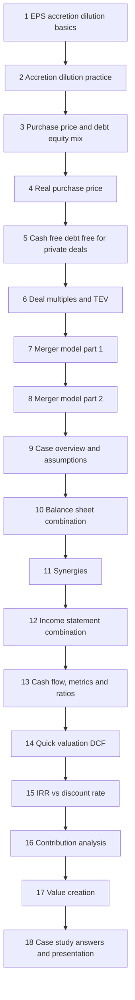
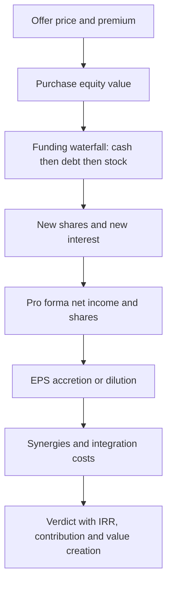
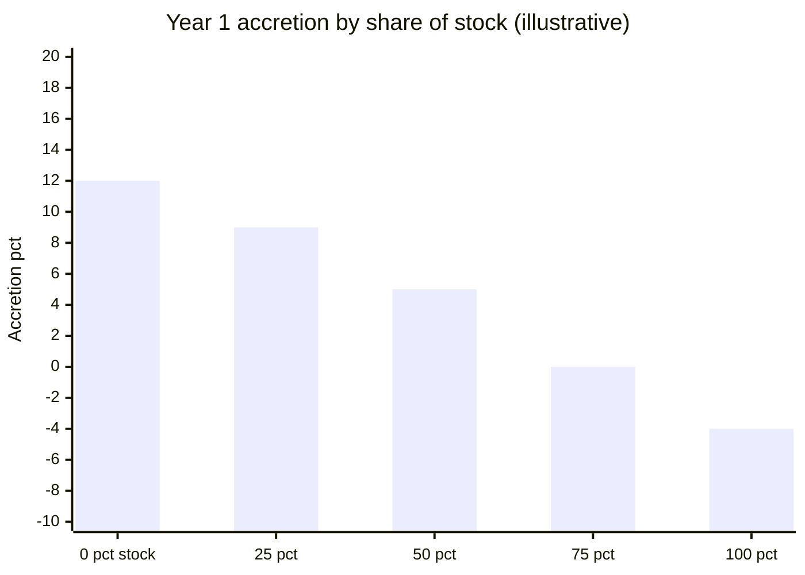
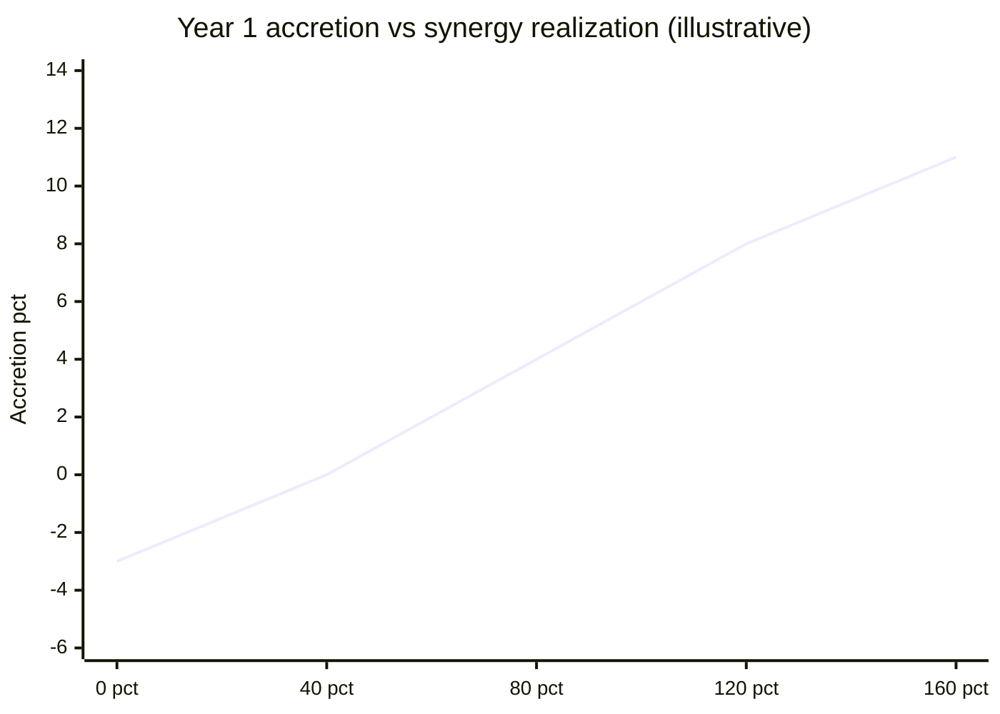
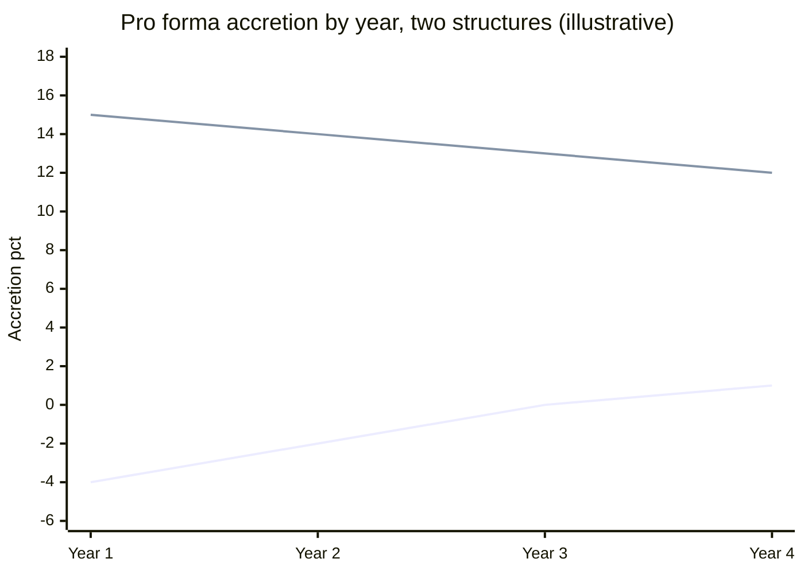

# Module 10: Merger Models

[← Previous: Module 09](09-valuation-interpretation-and-uses.md) · [Contents](../README.md) · [Next: Module 11, Part 1 →](11-advanced-m-and-a-concepts-part-1.md)

<details>
<summary><b>Contents</b></summary>

- [Overview](#overview)
- [Module Map](#module-map)
- [Lessons](#lessons)
  - [10.1 EPS Accretion and Dilution Basics](#101-eps-accretion-and-dilution-basics)
  - [10.2 Accretion and Dilution Practice (Build from a Blank Sheet)](#102-accretion-and-dilution-practice-build-from-a-blank-sheet)
  - [10.3 Purchase Price and the Cash, Debt and Stock Mix](#103-purchase-price-and-the-cash-debt-and-stock-mix)
  - [10.4 The "Real" Purchase Price: Equity Value vs Enterprise Value (Public Targets)](#104-the-real-purchase-price-equity-value-vs-enterprise-value-public-targets)
  - [10.5 Private Companies and Cash-Free, Debt-Free Deals](#105-private-companies-and-cash-free-debt-free-deals)
  - [10.6 Equity Value, Enterprise Value and Multiples in Deals](#106-equity-value-enterprise-value-and-multiples-in-deals)
  - [10.7 60-Minute Merger Model, Part 1: Assumptions, Sources and Uses, Purchase Price Allocation](#107-60-minute-merger-model-part-1-assumptions-sources-and-uses-purchase-price-allocation)
  - [10.8 60-Minute Merger Model, Part 2: Combined Statements and Sensitivities](#108-60-minute-merger-model-part-2-combined-statements-and-sensitivities)
  - [10.9 3-Hour Merger Model: Case Overview, Assumptions, Sources and Uses](#109-3-hour-merger-model-case-overview-assumptions-sources-and-uses)
  - [10.10 Balance Sheet Combination](#1010-balance-sheet-combination)
  - [10.11 Revenue and Expense Synergies, and What They Are Worth](#1011-revenue-and-expense-synergies-and-what-they-are-worth)
  - [10.12 Combined Income Statement (3-Hour Version)](#1012-combined-income-statement-3-hour-version)
  - [10.13 Combined Cash Flow, Key Metrics and Sensitivity Tables](#1013-combined-cash-flow-key-metrics-and-sensitivity-tables)
  - [10.14 Quick Valuation: Standalone DCF of the Target](#1014-quick-valuation-standalone-dcf-of-the-target)
  - [10.15 IRR vs Discount Rate](#1015-irr-vs-discount-rate)
  - [10.16 Relative Contribution Analysis](#1016-relative-contribution-analysis)
  - [10.17 Value Creation Analysis ("1 Plus 1 Equals 3")](#1017-value-creation-analysis-1-plus-1-equals-3)
  - [10.18 Case Study Answers and the Summary Presentation](#1018-case-study-answers-and-the-summary-presentation)
- [Diagrams and Charts](#diagrams-and-charts)
- [Excel Model Walkthrough](#excel-model-walkthrough)
- [Interview Questions](#interview-questions)
- [Career Angle](#career-angle)
- [Cheat Sheet](#cheat-sheet)

</details>

## Overview

A merger model asks whether buying another company makes the buyer's earnings per share go up or down, then uses the cash, debt and stock mix, the purchase price and the deal's synergies to show why, and then tests the deal with cash flow, returns and value-creation views.

## Module Map



Lessons 10.1 to 10.6 build the vocabulary (price, mix, cost of each funding source). Lessons 10.7 to 10.13 build the full combined model, from the pro forma balance sheet down to the cash flow. Lessons 10.14 to 10.18 step back and ask whether the deal creates value, using DCF, IRR, contribution and value-creation views.

## Lessons

### 10.1 EPS Accretion and Dilution Basics

- A buyer does a deal when it thinks it will be better off. The usual logic is that the price is below what the target is worth to the buyer, or that the return on the purchase beats the buyer's cost of capital. Strategic reasons (scale, new markets, new channels, defense against a rival) sit on top of the numbers.
- There are three ways to pay: cash, new debt, or new stock. Cash is fastest and cheapest, debt takes weeks or months to raise, and stock is usually the most expensive. For a merger model, new stock is new stock whether it goes straight to the seller or to new investors. The share count goes up either way.
- The core test is EPS accretion or dilution. EPS is net income (to common) divided by diluted shares. It is the one simple metric that picks up every deal effect at once: lost interest on cash, interest on new debt, and new shares. Accretive means the pro forma EPS is higher than the buyer's standalone EPS. Dilutive means lower.
- Boards often will not approve a deal that dilutes EPS, so this test matters even though EPS is a weak measure of value.

**Formulas**

```text
Equity value        = share price x diluted shares
Offer price         = target price x (1 + premium)
Purchase equity     = offer price x target diluted shares
Pro forma NI        = buyer NI + target NI - foregone interest on cash - new debt interest (after tax)
Pro forma shares    = buyer shares + new shares issued
Pro forma EPS       = pro forma NI / pro forma shares
Accretion %         = pro forma EPS / standalone EPS - 1
```

**Worked example (made-up numbers)**

| Item | Buyer | Target |
|---|---|---|
| Share price | $30.00 | $20.00 |
| Diluted shares (M) | 100 | 50 |
| Equity value ($M) | 3,000 | 1,000 |
| Pre-tax income ($M) | 250 | 120 |
| Tax rate | 25% | 25% |
| Net income ($M) | 187.5 | 90 |
| P/E | 16.0x | 11.1x |

- Premium of 20% gives an offer of $24.00 and a purchase equity value of $1,200M.
- Funding split: one third cash ($400M), one third debt ($400M), one third stock ($400M, so 13.3M new shares at $30).
- Standalone buyer EPS = 187.5 / 100 = $1.875.

> [!TIP]
> The P/E shortcut is the fastest sanity check. An all-stock deal is accretive when the buyer's P/E is higher than the P/E paid for the target. Here the buyer trades at 16x and the price paid is 13.3x (1,200 / 90), so the all-stock version would be accretive. A common mistake is to compare the target's market P/E instead of the P/E at the offer price.

### 10.2 Accretion and Dilution Practice (Build from a Blank Sheet)

- This lesson is a 20-minute drill. Start from a mostly blank sheet and build the accretion model from the case inputs, not from a finished template. The point is fluency: know what each input is for and which cells depend on which.
- Before building, sort the inputs. Some are missing: the buyer's net income and share count are not given directly. Work them out from EBIT, interest, tax rate and market cap divided by share price.
- The target's debt and cash stay in place in this case, so every deal number runs off the purchase equity value, not enterprise value.
- Inputs to set up: premium, purchase price (market cap times one plus premium), percent debt, percent stock, synergy percent and phase-in, benchmark rate, debt spread, and a debt repayment schedule.
- Keep the debt balance running. If 10 percent of principal is repaid each year, the remaining balance is 100 percent, then 90, then 80. Interest falls with the balance.
- Combined share count = buyer's shares + shares issued. The target's shares disappear.

**Worked example (made-up numbers)**

| Item | Buyer | Target |
|---|---|---|
| Share price | $50 | $10 |
| Diluted shares (M) | 20 | 40 |
| Market cap ($M) | 1,000 | 400 |
| EBIT ($M) | 150 | 60 |
| Interest expense ($M) | 30 | 10 |
| Pre-tax income ($M) | 120 | 50 |
| Net income ($M) | 90 | 37.5 |
| Standalone EPS | $4.50 | n/a |
| Yield (NI / market cap) | 9.0% | 9.4% |

- 20% premium: purchase equity value = 400 x 1.20 = $480M.
- 30% debt: $144M raised, interest at 2% benchmark plus 5% spread = 7% gives $10.08M of new interest in year one.
- 70% stock: $336M / $50 = 6.72M new shares.
- Pro forma pre-tax = (150 + 60) - (30 + 10 + 10.08) = $159.92M. Net income at 25% tax = $119.94M.
- Pro forma shares = 20 + 6.72 = 26.72M. Pro forma EPS = $4.49, about 0.2 percent dilutive.

**Credit check**

- Net debt to EBITDA: combine both companies' existing net debt, add the new debt raised scaled by the share still outstanding that year (the 10 percent repayment), then divide by combined EBITDA. Cash does not change, because the target's cash stays in place.
- EBITDA to interest: combined EBITDA divided by combined interest expense (existing plus new).

> [!TIP]
> The lesson's headline finding: a higher price funded with cheaper debt can be more accretive than a lower price funded with stock. Debt costing 7 percent here is cheaper than the buyer's earnings yield of 9 percent, which is what the stock costs. The seller's yield matters too. A seller with a high yield (cheap to buy) makes almost any deal accretive. A seller with a yield below the buyer's cost of funding is where deals get dilutive.

### 10.3 Purchase Price and the Cash, Debt and Stock Mix

This lesson answers two of the three questions left open after lessons 10.1 and 10.2: how the price is set, and how the buyer decides how much cash, debt and stock it can use. The third question (what the buyer really pays, equity or enterprise value) is covered in lesson 10.4.

**How the purchase price is set (public target)**

- The offer is a premium on the current share price. The reason is simple: to get control, the buyer has to move existing shareholders (including insiders like the CEO and the board) to sell. Nobody sells at the market price when a buyer is trying to buy the whole company.
- The premium is anchored to the valuation range and to the average premium paid in the market. Example (made-up numbers): a target trades at $25, a DCF and comps range puts it at $30 to $38, and the market premium is 15 to 30 percent. A 25 percent premium gives $31.25, inside the valuation range, so it is a defensible offer.
- A low valuation does not matter for the floor. If the target trades at $25, the buyer cannot buy shares at $18 even if a valuation says $18. The current price sets the minimum practical offer.
- Whether the premium is worth paying depends on the combined company. A premium above intrinsic value can still work if synergies lift the combined free cash flow enough.

**How the price is set (private target)**

- There is no share price to premium off. The price comes from a multiple of a financial metric: EV / revenue, EV / EBITDA, or equity value / net income (P/E).
- Pick a multiple in line with the market, then work back to an implied price. Example: a market range of 8x to 12x EBITDA, a target with $100M of EBITDA, and a 10x offer gives an enterprise value of $1,000M.
- Private companies still have a share count and a model share price, but nobody can quote it. It is an internal number, not a market number.

**Cash, debt and stock: the funding waterfall**

Companies try to use the cheapest funding first. The order is cash, then debt, then stock.

1. **Cash** is limited by a minimum operating cash balance that the combined company must keep. Available cash = MAX(combined cash less minimum cash, 0).
2. **Debt** is limited by a leverage target, usually a maximum Debt / EBITDA (for example 3x to keep an investment-grade rating). New debt capacity = leverage limit x combined EBITDA, less existing combined debt.
3. **Stock** is the rest. In theory there is no limit, but buyers usually want to keep control, so stock is capped at a level where the target's holders do not own more than about half the combined company. A second cap is an EPS test: the most stock that keeps the deal from being dilutive.

**Worked example (made-up numbers, $M)**

| Item | Value |
|---|---|
| Target market cap at $25.00 | 500 |
| Premium | 25% |
| Purchase equity value | 625 |
| Combined cash today | 120 |
| Minimum cash | 40 |
| Cash available | 80 |
| Combined EBITDA (year 1) | 200 |
| Max leverage | 3.0x |
| Max combined debt | 600 |
| Existing combined debt | 350 |
| Max new debt | 250 |
| Cash used = MIN(cash available, purchase price) | 80 |
| Debt used = MIN(max new debt, purchase price less cash) | 250 |
| Stock used = purchase price less cash less debt | 295 |
| Buyer share price | $50 |
| New shares (295 / 50, M) | 5.9 |
| Existing holders' ownership after deal | 40 / 45.9 = 87% |

- Weighted cost of acquisition = sum of (each funding amount / purchase equity value x its after-tax cost).
- Foregone interest on cash uses the pre-tax cash yield, and interest on new debt uses the pre-tax debt rate. Both are multiplied by the amounts used, then taxed.

**Finding the maximum price (goal seek)**

- Set the constraints: minimum cash, maximum leverage, and "must be accretive in year one."
- Use Goal Seek. Set the accretion cell to zero by changing the premium cell. The output is the highest premium that still passes the test, and from it the largest equity purchase price and stock issue.
- In the worked case from the lesson, the answer was a premium of roughly 63 percent (about $1.35 billion equity value) with about $738M of stock, leaving the buyer with about 60 percent of the combined company. That is the test of how far the deal can stretch before one constraint binds.

> [!TIP]
> Two points to remember. First, in real deals the minimum cash and leverage limits come from the lenders and the rating agencies, not from the model. Second, a cheap funding source does not make a deal good. It only makes it look accretive. The synergies and the value created still have to pay for the premium.

### 10.4 The "Real" Purchase Price: Equity Value vs Enterprise Value (Public Targets)

- The question: does the buyer pay the equity value or the enterprise value? The short answer is that neither is exactly right. The real cost sits between them, or above them once fees are counted.
- The equity purchase price is always the starting point for a public target. To own 100 percent, the buyer must buy every common share. Cash and debt can change the total, but the equity bill is fixed.
- Enterprise value is a measure of what the core operations are worth to all investors. It is not a checklist of what the buyer pays. Items like unfunded pensions, noncontrolling interests and leases are usually not paid at closing, so they do not add to the cash check, even though they are real claims on the business.
- Three ways to treat the target's existing debt:
  1. **Assume it.** It stays in place with the same terms. No extra cost at closing.
  2. **Repay it with the buyer's cash.** The buyer uses its own cash (or new debt), and the target's interest goes away. Rare in practice.
  3. **Replace it with new debt.** The old debt is repaid by a new issue at a similar size. This is the common case for public targets, because change-of-control clauses usually force repayment.
- Under option 3, the debt appears on both sides of the Sources and Uses schedule, so it cancels in the total. The only model effect is a small interest rate difference (for example, the combined company borrows at a slightly higher rate). That shows up as an "interest differential on replaced debt" line on the combined income statement.

**Worked example: replacing the target's debt (made-up numbers, $M)**

| Item | Value |
|---|---|
| Purchase equity value | 990 |
| Target debt replaced | 250 |
| Old rate on target debt | 6.0% |
| New rate on replacement debt | 7.0% |
| Interest differential | 1.0% x 250 = 2.5 per year, pre-tax |

Under the new rate, the combined company pays 2.5 more interest a year before tax. Lenders also price the riskier combined company more highly, so the differential is often positive.

#### Cash in the Deal: Minimum Cash and Fees

- The buyer cannot use all of the target's cash. Each company needs a minimum operating balance. The usable cash is the combined cash less the minimum, which can be used to pay for shares, fees, or buy back shares before closing.
- Transaction fees are real cash out. Advisory fees are often a percentage of the equity purchase price (about 1 percent in the lesson). Legal, accounting and other fees are a fixed amount. Financing fees are charged on new debt, commonly 1 to 3 percent.
- Simplest approach: raise the minimum cash to cover the fees, then add up combined cash, subtract the higher minimum, and treat the result as cash available for both equity and fees. Show the two uses on the Sources and Uses schedule separately.
- If the cash is not enough to cover the fees, the buyer raises more debt. That creates a circular reference between debt, interest and fees, so models usually avoid it with a simplifying assumption.

**Worked example: fees and the Sources and Uses (made-up numbers, $M)**

| Uses | Amount | Sources | Amount |
|---|---|---|---|
| Equity purchase price | 990 | Cash used | 80 |
| Target debt replaced | 250 | New debt | 945 |
| Advisory fee (1% x 990) | 9.9 | Target debt replaced | 250 |
| Legal and other | 6 | | |
| Financing fee (2% x 945 new debt) | 18.9 | | |
| Total uses | 1,274.8 | Total sources | 1,275 |

Check: sources less uses = 0 after rounding. The new debt is sized so that it covers the rest of the uses, and its own 2 percent fee is included in the uses, so the fee is solved with the debt (a small algebra step that avoids a circular reference in the build).

The point is the structure, not these exact figures.

- Foregone interest on cash now uses both the cash for the equity and the cash for fees, because both companies earn interest on the cash that is spent.
- The shares issued do not change, because the fees are paid in cash.

#### Where the Price Really Lands

- Sum the equity purchase price and the target debt replaced: that is close to the enterprise value at the offer.
- Add the fees, and the total uses sit above enterprise value.
- The answer to "what does the buyer really pay?" depends on how you count the debt replacement. Most bankers would say the debt replacement is not an extra price, but a refinancing of a claim that already sits inside enterprise value.

> [!TIP]
> For interview purposes: the purchase equity value is the price for the shares, the enterprise value is the price for the operating business, and the total cost of a deal (uses) adds the refinancing and the fees. Being able to say which one you mean is the real skill.

### 10.5 Private Companies and Cash-Free, Debt-Free Deals

- A cash-free, debt-free deal means the target's cash and debt both go to zero when the deal closes. The seller keeps its cash (or uses it to pay down debt) and hands over a business with no net debt. The buyer pays an enterprise value.
- Because the target's cash and debt disappear, the Sources and Uses schedule starts from the purchase enterprise value, not the equity value. Equity value is then derived: add the target's cash and subtract its debt.
- How the bridge works in practice:
  - If debt is bigger than cash, the target spends all its cash on debt and the buyer repays the rest at closing. The buyer's total outlay is the enterprise value, so the effective cost is higher than the headline equity value.
  - If cash is bigger than debt, the target repays all its debt and pays out the surplus (a dividend, a buyback, or simply leaves it in). Either way the buyer gets the cash, so the effective price is lower.
- The structure mostly moves cash around before the close, so it changes who pays off what rather than the economics of the business.

**Worked example (made-up numbers, $M)**

| Item | Value |
|---|---|
| Target Year 1 EBITDA | 120 |
| Multiple | 9.0x |
| Purchase enterprise value | 1,080 |
| Target cash | 30 |
| Target debt | 200 |
| Purchase equity value (EV + cash - debt) | 910 |
| Target revenue (Year 1) | 600 |
| EV / revenue | 1.8x |
| Equity value / net income (Year 1, NI 65) | 14.0x |

Here the target's debt is bigger than its cash, so the bridge drops the equity value below the enterprise value. The sign flips when cash is bigger than debt.

**Sources and uses for this structure**

- Uses are based on the purchase enterprise value, plus the advisory fee (a percentage of the equity value), legal and other fees, and the financing fee on new debt.
- The acquirer's own cash is the main funding for the combined cash side, because the target's cash is gone at close.
- Maximum cash available = MAX(acquirer cash less minimum cash, 0). Maximum new debt = MAX(leverage x combined EBITDA less acquirer debt, 0). The target's debt is not in that calculation because it is repaid.
- Cash used = MIN(deal funding, maximum cash). Debt used = MIN(deal funding less cash used, maximum new debt). Stock = the rest.

**Combined income statement differences**

- The usual lines still apply: foregone interest on cash (acquirer cash for equity and fees), interest on new debt, synergies, and the new shares.
- Two extra lines: the target's lost interest income (its cash has gone, so the income goes to zero) and the interest saved on its repaid debt (reversed sign). Both are reversals of the target's standalone interest lines.

> [!TIP]
> The lesson's view, which is useful in an interview: cash-free, debt-free barely changes EPS accretion in the case compared with the public structure, because the same total cash and debt end up being used, just split differently. The extra lines add complexity without much change in the answer. Use it when the deal really is a private company deal, and say so if asked why.

**Other private company terms to know**

- Earn-outs: part of the price is paid later, if the target hits set goals in years 2 to 5.
- Working capital adjustments: the price moves up or down with the target's working capital at closing against an agreed target level.

### 10.6 Equity Value, Enterprise Value and Multiples in Deals

- This lesson asks how the combined company's equity value, enterprise value and multiples move once a deal closes. Keep the analysis to three effects only: foregone interest on cash, interest on new debt, and new shares. Synergies, write-ups and fees are left out so the rules are visible.
- **Combined equity value** = acquirer equity value + market value of stock issued. The target's equity disappears, and only new stock adds to the equity side.
- **Combined enterprise value** = acquirer enterprise value + target's purchase enterprise value. Enterprise value is not changed by how the deal is paid for, because the operations do not change. Only the financing changes.
- The financing mix moves equity value but not enterprise value. A mix with more stock raises combined equity value, and a mix with more debt or cash leaves it lower. Enterprise value stays the same across all mixes.
- A premium raises both combined equity and enterprise value by the premium amount, because the buyer pays more and funds it with more cash, debt and stock.

**Why the enterprise value rule works (made-up numbers, $M)**

| Item | Value |
|---|---|
| Acquirer equity value | 600 |
| Acquirer net debt | 80 |
| Acquirer enterprise value | 680 |
| Target enterprise value (no premium) | 180 |
| Purchase equity value | 150 |
| Mix: 40% cash, 40% debt, 20% stock | 60 / 60 / 30 |
| Combined equity value (600 + 30 stock) | 630 |
| Combined net debt (80 + 60 new debt + 60 cash used + 30 target net debt) | 230 |
| Combined enterprise value (630 + 230) | 860 |
| Check: 680 + 180 | 860 |

Cash used adds to net debt, because the cash was netted off before. Debt adds to net debt. Stock adds to equity. The sum is always the two enterprise values added together.

> [!TIP]
> The idea behind the rule: enterprise value measures the operating assets, and none of those are changed by the deal. Only the claims on them change. The right way to say it: the target's equity is replaced by the new debt, cash and stock used to pay for it.

**Combined multiples**

- Enterprise-value multiples (EV / EBITDA, EV / EBIT) are unaffected by the financing mix, because EBITDA and EBIT are above the interest line.
- Equity-value multiples (P/E) are affected by the financing mix, because stock changes the equity value and debt and cash change net income through interest.
- Normally the combined multiple sits between the acquirer's multiple and the target's purchase multiple. It is closer to whichever company is bigger, because the bigger company drives more of the combined total.

**Worked example (made-up numbers)**

| Metric | Acquirer | Target at offer | Combined |
|---|---|---|---|
| EV / EBITDA | 680 / 85 = 8.0x | 180 / 22 = 8.2x | 860 / 107 = 8.0x |
| P/E | 600 / 40 = 15.0x | 150 / 12 = 12.5x | 630 / 48.4 = 13.0x |

- The combined EV multiple is essentially unchanged because the financing does not touch EBITDA or enterprise value.
- The combined P/E is in the middle, but it moved because of the stock issued and the interest on the debt and cash.

> [!TIP]
> A counter-example in the lesson: if the target has high interest expense and a P/E above the buyer's P/E, the combined P/E can fall below both. So "always in the middle" holds for enterprise-value multiples, but it is not guaranteed for equity-value multiples.

**When the market does not like the deal**

- If the market thinks the buyer overpaid, the buyer's share price falls, even if the deal is all cash. The market is repricing the combined company, so the drop cannot be avoided by changing the funding mix.
- Example (made-up numbers): the buyer pays a 25 percent premium on a target worth $150M, so the offer is $187.5M. If the market believes the target is only worth $150M, the buyer's equity value drops by the $37.5M overpayment. With 15M shares, the price falls by $2.50, from $40.00 to $37.50.
- Because the buyer issues more shares to pay the same price at a lower share price, the deal becomes less accretive. The multiples all move as well, because the combined equity value has dropped.

**Summary of the rules**

| Item | Rule |
|---|---|
| Combined equity value | Acquirer equity plus stock issued |
| Combined enterprise value | Acquirer EV plus target purchase EV |
| Financing mix | Changes equity value, not enterprise value |
| EV multiples | Not changed by financing; sit between the two sides |
| P/E multiples | Changed by financing; not always between the two sides |
| Market punishment | Buyer share price falls, lowering both equity and enterprise value |

### 10.7 60-Minute Merger Model, Part 1: Assumptions, Sources and Uses, Purchase Price Allocation

- This is the first of two lessons on a real-style case: a building-products buyer acquiring a building-products target in a deal of about $2.5 billion. The case is described generically below, with made-up numbers.
- The module's two models are built from three-statement models that come with the case. In a 60-minute exam you would not build those from scratch, you combine them. Read the filings for context, then focus on the deal layer.
- Things that are new compared with the simple models in lessons 10.1 to 10.6:
  - A transaction type switch: mixed cash, debt and stock, or 100 percent stock.
  - An **exchange ratio** for the all-stock case: each target share gets a fixed number of buyer shares. The offer value is the ratio times the buyer's current price, and the premium is worked out from that.
  - A **purchase price allocation** for goodwill and intangibles.
  - A **synergy phase-in and realization factor**, plus costs to achieve.
  - Expanded income statement and cash flow lines, and a debt repayment schedule.

**Key inputs and how they are set (made-up numbers)**

| Input | Setting |
|---|---|
| Buyer share price | $40.00 |
| Exchange ratio (all-stock) | 1.0 buyer share per target share |
| Implied offer per target share | 1.0 x $40 = $40.00 |
| Target share price (one day before) | $35.00 |
| Premium | 40 / 35 - 1 = 14% |
| Target diluted shares at offer | Basic shares + options (treasury method at the offer price) + RSUs and other |
| Purchase equity value | Offer price x diluted shares at offer |
| Purchase enterprise value | Equity value + debt at market value - cash |
| Minimum combined cash | $250M |
| Max combined debt / EBITDA | 4.0x |
| New debt cost | Buyer pre-tax cost + 200 bps |
| Debt amortization and tenor | 1% per year, 5-year maturity |

> [!TIP]
> Two points from this part that matter in practice. First, diluted shares at the offer price (not at the market price) are what the buyer pays for, so options and RSUs are counted at the offer. Second, debt in the enterprise value bridge should use market value where it is available, while the debt-capacity test uses face value, because lenders look at the amount they lent and the interest that is actually paid.

**Funding capacity**

- Maximum cash available = MAX(combined cash less minimum cash, 0).
- Maximum new debt = MAX(max leverage x combined EBITDA less existing face value debt of both companies, 0). The EBITDA here is at the closing date. Synergies can be left out, to be conservative.
- Cash used = MIN(purchase equity value, maximum cash) if the deal is mixed; zero if it is all stock.
- Debt used = MIN(purchase equity value less cash used, maximum new debt) if mixed; zero if all stock.
- Stock used = purchase equity value less cash used less debt used.

**Purchase price allocation (worked example, made-up numbers, $M)**

| Step | Amount |
|---|---|
| Purchase equity value | 2,000 |
| Less target book common equity | (900) |
| Plus target existing goodwill written off | 300 |
| Allocable purchase premium | 1,400 |
| PP&E write-up (10% of target PP&E of 400) | (40) |
| Definite-lived intangibles (25% of premium) | (350) |
| Indefinite-lived intangibles (10% of premium) | (140) |
| Write down target's existing DTL | (20) |
| New DTL on write-ups at 25% (40 + 350 + 140) x 25% | 132.5 |
| Goodwill created | 982.5 |

- Goodwill is what is left once everything else is allocated. Assets that go up in value reduce the goodwill needed. Liabilities that are created increase it.
- Existing goodwill is written off because its fair value is treated as zero. It is not an identifiable asset that can be resold.
- The write-ups do not get a tax deduction for cash taxes, so they create a **deferred tax liability**. The DTL is a timing item. Cash taxes run above book taxes early on, and the DTL unwinds as the book depreciation and amortization run off.

> [!TIP]
> The DTL is created by what happens later (book taxes are lower than cash taxes for a while), not by anything that happens in the deal itself. A quick check: the DTL equals the write-up multiplied by the tax rate, and it falls to zero as the write-ups are depreciated or amortized.

**Sources and uses for this part**

- Uses: equity purchase price, the target's debt assumed or replaced (on both sides, so it cancels), advisory fees (a percentage of equity value), financing fees (a percentage of new debt), and legal and other fees (a fixed amount).
- Sources: cash used, new debt, stock, assumed or replaced debt, and the cash for transaction fees.
- Check: total sources less total uses = 0.

> [!TIP]
> The lesson uses a 14 percent premium for the all-stock case. The point is that a stock deal can be stated as an exchange ratio, and the premium is then a result, not an input. Build the premium so you can read it off the exchange ratio and the buyer's price, and check it against the target's share price.

### 10.8 60-Minute Merger Model, Part 2: Combined Statements and Sensitivities

**Debt balance first.** The new debt drives the new interest line, so build its schedule first.

- Start with the face value of the debt raised at closing (taken from sources and uses).
- Repay 1 percent of the original principal each year, so the balance declines slowly. Track it next to the acquirer's and target's existing face value debt for reference.
- The new debt matures after the model's last projected year in this case, so the full maturity does not appear in the schedule.

**Combined income statement**

- Lines that both companies have (revenue, cost of sales, SG&A, depreciation, amortization, interest) are added. Lines only one company has (merger and integration costs, impairment, other income) are linked from the target alone. Check each row for that.
- Keep the first combined year in one fixed column in both company tabs, so links line up. Most errors in this module come from a link that drifted by one year.
- **Phased synergies.** Expense synergies = run-rate synergies x phase-in percentage x realization factor. A realization factor of 100 percent is the base case; sensitivities flex it.
- **Write-up D&A** is shown on the income statement: intangibles over their life and the PP&E write-up over its depreciation period. These are not tax deductible for cash taxes, which is handled later.
- **Integration costs.** Total cost = realization factor x Year 3 synergies x realization cost percentage. The total is spread across years (here two thirds in year one and one third in year two).
- **New interest** = face value of new debt x funding rate. **Financing fee amortization** = financing fee / maturity.
- **Foregone interest on cash** covers both cash used for shares and cash used for fees.

**Worked example (made-up numbers, $M)**

| Line | Year 1 | Year 2 |
|---|---|---|
| Run-rate expense synergies (phase-in 60% / 90%) | 60 | 90 |
| Integration costs (100 x 96% = 96, split 2/3 and 1/3) | (64) | (32) |
| Write-up D&A (70 intangible + 5 PP&E) | (75) | (75) |
| New interest on debt (face value of about 460, then 1% lower each year, x 8.7%) | (40) | (40) |

Pro forma EPS uses the combined net income over the combined share count (buyer shares plus new shares). Accretion is then compared with the buyer's standalone EPS.

**Adjusted or "pro forma" EPS.** Companies often add back integration costs and write-up D&A to show a cleaner number. The lesson's view: this can flatter the deal. Show it as a separate line, and never use it as the only test. In the lesson, moving from the GAAP view to the adjusted view turned a dilutive deal into a modestly accretive one, which is exactly why the two should always be shown side by side.

**Combined cash flow statement**

- Start with combined net income, add back combined D&A (including write-up D&A), amortization of issuance fees, and other non-cash items.
- **New deferred taxes** reverse the book tax benefit of the write-up D&A, because cash taxes do not get that deduction. Formula: -(write-up D&A) x buyer tax rate. In the example that is -(70 + 5) x 25% = -18.75 a year.
- Add working capital changes, CapEx and acquisitions, debt issuance and repayment, and dividends and buybacks (set to zero to keep the share count fixed).
- Starting cash = acquirer and target cash at closing, less the cash used for the equity purchase and the fees.

**Sensitivity tables**

- Use Excel data tables. The row input is the exchange ratio (a range around the deal ratio), and the column input is the expense synergy realization factor (0 percent to 160 percent in 20-point steps).
- Show accretion or dilution in Year 1 and Year 2 as percentages.
- Findings (applied to this case): the 100 percent stock version was dilutive in Years 1 and 2 at the proposed exchange ratio. A mixed cash, debt and stock structure was accretive in both years, with a bigger margin for error. The deal was very sensitive to synergies: accretion fell quickly as realization dropped toward zero.

> [!TIP]
> **Interview-ready takeaway.** A deal that only works when most synergies come through is a fragile deal. Show the breakeven realization factor, which is the percentage at which accretion crosses zero. Combine it with the funding mix so that the reviewer sees both risks at once.

### 10.9 3-Hour Merger Model: Case Overview, Assumptions, Sources and Uses

- The 3-hour version uses the same deal and the same three-statement models as the 60-minute case. What is new is the depth: a combined balance sheet, more detailed synergies (revenue and cost, with headcount behind the cost numbers), comps and precedent transactions, a DCF, an IRR test, a contribution analysis, a value-creation analysis and written case questions.
- Deal assumptions carry over: pricing by exchange ratio, offer price = ratio x buyer's price, premium = offer / target price - 1, and diluted shares at the offer price (options are re-computed at the offer, RSUs are not).
- Funding rules: minimum combined cash of $250M (a fixed floor), maximum combined debt of 4.0x EBITDA on face value debt measured at closing, and transaction debt at a 200 bps premium to the buyer's cost of debt with 1 percent amortization and a 5-year maturity.
- Fees: an advisory fee of 1 percent of equity value, a 2 percent financing fee on new debt, and fixed legal and other fees.
- Switches: transaction type (mixed or all-stock), and whether revenue synergies and expense synergies are included. The synergies here come from their own schedule, not the simple phase-in row used in the 60-minute model.
- Purchase price allocation is the same as lesson 10.7, with one change: intangibles are set as a share of the allocable premium, and the PP&E write-up is a percentage of net PP&E. Target existing DTLs are written down, and the new DTL is added.

> [!TIP]
> **Practical tip.** The 4.0x leverage test uses face value debt, because lenders underwrite the principal they lend and the interest that is actually paid. Book and market values change the answer only slightly for companies like these, so the choice is not the point. Be consistent and say which one you used.

### 10.10 Balance Sheet Combination

- The pro forma balance sheet is built at the closing date (no projections). Put the buyer and target balance sheets side by side, then add a column of adjustments that come straight from sources and uses and the purchase price allocation.
- Use the cash, debt and stock case (not all-stock) to test the whole structure, because every adjustment is then in play.
- **Tie-out rule.** Every line in sources, every line in uses (except the equity purchase price, which is covered by the goodwill math) and every line in the goodwill calculation must appear once on the combined balance sheet. Missing an item or counting one twice are the two common errors. Tick each item off as you post it.
- **Assets side.** Cash falls by the cash used for equity and for fees. PP&E and intangibles go up by their write-ups. Existing goodwill is written off, and new goodwill is added.
- **Liabilities and equity side.** The target's debt is replaced with new debt of the same face value (the unamortized issuance fees stay netted off). New transaction debt is booked net of its financing fees. The target's old DTL is written down, and the new DTL is added. Equity falls by the target's book equity and by the advisory and legal fees, and rises by the stock issued.
- Fees are booked against equity at closing as a shortcut. In reality they flow through the income statement, but this makes the balance sheet balance on the day of closing.

**Worked tie-out (made-up numbers, $M)**

| Item | Adjustment | Side |
|---|---|---|
| Cash used: equity (100), advisory and legal fees (30), financing fee (19) | (149) | Asset |
| PP&E write-up | +40 | Asset |
| Intangible write-ups (350 definite plus 140 indefinite) | +490 | Asset |
| Existing goodwill written off | (300) | Asset |
| New goodwill (from lesson 10.7) | +982.5 | Asset |
| **Total change in assets** | **+1,063.5** | |
| New transaction debt at face (950) less financing fee (19) | +931 | Liability |
| Target DTL written down | (20) | Liability |
| New DTL on write-ups | +132.5 | Liability |
| Target book common equity removed | (900) | Equity |
| Advisory and legal fees charged to equity | (30) | Equity |
| Stock issued | +950 | Equity |
| **Total change in liabilities and equity** | **+1,063.5** | |

The target's existing debt is replaced at the same face value, so it nets to zero and is not shown. Check: 1,063.5 on each side.

> [!TIP]
> The balance sheet check is a powerful test of the earlier work. If it does not balance, the most likely causes are a missing write-up, a goodwill number that was not updated after the write-ups changed, or a fee booked in the wrong place.

### 10.11 Revenue and Expense Synergies, and What They Are Worth

- Synergies should be tied to something real: headcount cut, buildings consolidated, supplier terms, or cross-selling into a bigger footprint. A lump sum ("save $100M") is the lazy version.
- **Revenue synergies** come with costs. If you add revenue, add cost of sales at the target's margin and add operating expense on the same base. Use the SG&A-only version if depreciation and integration costs would not grow with sales. Ramp the uplift over several years (here it rises from 10 percent to 25 percent for one product line and from 10 percent to 40 percent for another).
- **Expense synergies** built from headcount: take the number of roles cut at each company, multiply by its average SG&A cost per employee, and convert units. Result: a ramp that rises each year and roughly matches the buyer's own stated range.
- **Costs to achieve** (severance, retention, systems) are a percentage of the full Year 3 cost synergies, often front-loaded (two thirds in year one, one third in year two).
- All synergy lines hit the combined income statement and, by assumption here, cash taxes.

**Worked example (made-up numbers, $M)**

| Line | Year 1 | Year 2 | Year 3 |
|---|---|---|---|
| Extra revenue (10%, 20%, 30% uplift on a $300 line) | 30 | 60 | 90 |
| Cost of sales on extra revenue (at 70%) | (21) | (42) | (63) |
| Operating expense on extra revenue (at 15%) | (4.5) | (9) | (13.5) |
| Net revenue synergy (pre-tax) | 4.5 | 9 | 13.5 |
| Headcount cut (roles) | 150 | 250 | 300 |
| Average SG&A per role ($000) | 200 | 200 | 200 |
| Cost savings | 30 | 50 | 60 |
| Integration costs (100% of Year 3 savings x two thirds / one third) | (40) | (20) | 0 |

> [!WARNING]
> The most common mistake on revenue synergies is to count the extra sales and forget the extra cost of selling them. The net contribution is often a small fraction of the gross revenue. Cost synergies are easier to defend because they are tied to roles and contracts.

**Valuing the synergies against the premium**

- Put the after-tax synergy cash flows (savings and revenue contribution, less integration costs, after tax) into a DCF.
- Discount at the buyer's WACC, which is built from the usual inputs: cost of equity from CAPM (risk-free plus beta times equity risk premium), after-tax cost of debt, and market weights.
- Add a terminal value using a perpetuity growth rate (here 1 percent) on the last year's after-tax synergy.
- Compare the present value of synergies with the premium in dollars: purchase equity value less the target's standalone equity value.

Illustration (made-up numbers): after-tax synergy present value of 310 against a premium of 200 would say the premium is covered, but only if the synergies really last. A terminal value often makes up most of the answer, so test what happens if the synergies stop after five or ten years.

> [!TIP]
> The question an interviewer will ask is not "is the synergy PV bigger than the premium?" but "what assumption would make it not bigger?" Name the answer: usually the realization rate, the timing, or how long the synergies last.

### 10.12 Combined Income Statement (3-Hour Version)

- Three differences from the 60-minute version: synergies are richer (revenue, revenue costs, expense synergies, and on/off switches), the formulas must handle edge cases, and revenue is shown by product line so you can see overlap versus unique lines.
- **Build order.** Debt balance first, then revenue, then costs, then net income and EPS. The debt balance drives the interest line.
- **Debt principal repayment logic.** If the current year is the maturity year, repay the whole remaining balance. Otherwise repay the smaller of (a) the fixed annual amount (1 percent of original principal) and (b) what is still outstanding. Test it with a two-year maturity to see the full balance drop to zero in year two.
- **Line-by-line combination.** For each line, start with the acquirer. If the acquirer does not have the line, it must come from the target. Lines that overlap are summed. Unique lines are linked from one side only.
- **Switches.** Multiply each synergy line by its switch (1 for on, 0 for off). Revenue synergy switch also turns off the extra cost of sales and operating expense on those sales. Expense synergy switch turns off the cost savings and the integration costs.
- **Amortization and depreciation with caps.** Use MIN so the write-up stops being expensed once it is fully amortized: MIN(annual charge, original amount less the cumulative amount already charged). Only definite-lived intangibles amortize. Indefinite-lived intangibles are not amortized (their write-down timing is uncertain).
- **Sign checks.** Synergies reduce expenses, so they carry a plus sign when expenses are shown as negatives. Amortization and depreciation of write-ups carry negative signs.
- **Pro forma EPS** adds back integration costs and write-up D&A. It is shown as a separate line, not as the headline.

**Test cases to run before you trust the model**

| Test | Expected result |
|---|---|
| Revenue synergy switch off | Revenue, its cost of sales and its opex all go to zero, EPS falls |
| Expense synergy switch off | Cost savings and integration costs go to zero, deal turns dilutive |
| Write-up life set to two years | Write-up D&A stops after year two |
| Debt maturity set to two years | Balance goes to zero in year two |

> [!TIP]
> Only a few lines in this statement really move the answer: the synergies, the new interest, and the write-up D&A. If you test those three with the switches, you catch most of the errors in this part.

### 10.13 Combined Cash Flow, Key Metrics and Sensitivity Tables

**Combined cash flow statement**

- Start with combined net income in the first full combined year (the year after closing), then add back D&A, the amortization of debt issuance fees, goodwill impairment, stock-based compensation, deferred taxes and other items. Pull each from the right column in each company's cash flow statement.
- The **new write-up D&A** (intangibles, PP&E write-up and financing fees) is added back as a non-cash item.
- **New deferred taxes** reverse the tax benefit of the write-up D&A: multiply the total write-up D&A by the buyer's tax rate and treat it as a cash outflow. In the lesson's case this was about 16 million a year of extra cash taxes.
- Investing and financing lines are simple sums of the two companies, plus the new debt and debt repayments.
- Opening cash for the forecast is the post-transaction cash on the combined balance sheet, not a figure recalculated from sources and uses. Then add the net change in cash each year.

**Key metrics and ratios**

- **EBITDA** = operating income + D&A (existing and new write-up D&A) + impairments. Do not add back synergies or integration costs: they are real operating items. Interest on debt is below operating income, so issuance fee amortization is already outside EBITDA.
- **Credit ratios.** Total debt / EBITDA, net debt / EBITDA, and EBITDA / net interest expense. For net interest, include interest income given up on the cash used, and exclude goodwill impairment and other income, which are not interest.
- **Capital structure ratios.** Total debt / equity, total debt / total capital, net debt / equity, and net debt / net capital.
- **Equity roll-forward.** Beginning equity + net income + stock issued - buybacks - dividends = ending equity. Use the post-transaction balance sheet as the opening point.
- **Margins and checks.** Revenue growth, operating margin, EBITDA margin, net margin, and depreciation as a percent of revenue against CapEx as a percent of revenue (CapEx should run ahead of depreciation for a growing company).

**Worked illustration (made-up numbers)**

| Metric | Year 1 | Year 2 | Year 3 | Year 4 |
|---|---|---|---|---|
| Total debt ($M) | 1,600 | 1,400 | 1,150 | 950 |
| EBITDA ($M) | 500 | 540 | 580 | 620 |
| Debt / EBITDA | 3.2x | 2.6x | 2.0x | 1.5x |
| Total debt / total capital | 56% | 49% | 41% | 34% |

The pattern is the point: a fast fall in leverage says the company can carry more debt at the start. That is an argument for a more debt-heavy funding mix, which is a recommendation the model is supposed to support.

**Sensitivity tables**

- Two data tables: Year 1 and Year 2 pro forma accretion or dilution. The row input is the exchange ratio, set across a range that spans roughly 0 percent to 30 percent premium. The column input is the expense synergy realization factor, from 160 percent down to 0 percent in 20-point steps.
- Turn on or off the revenue synergies to see how much they add. In the lesson, revenue synergies added a few points of accretion.
- Read the tables for three things: the breakeven realization (where accretion crosses zero), the premium at which the deal stops being accretive, and how much the answer depends on the funding mix.

**Conclusions (applied to this case)**

- An all-stock structure was dilutive on both GAAP and pro forma bases unless realization was well above 100 percent. The mixed structure was accretive on a pro forma basis.
- With the company de-levering fast, the mixed structure had room to carry more debt. The lesson's view: a 100 percent stock deal was hard to justify on the numbers.

> [!TIP]
> Two common interview points: pro forma EPS hides real costs, and a fast leverage fall is evidence that the balance sheet can support more debt. Say both when you present a deal.

### 10.14 Quick Valuation: Standalone DCF of the Target

- Purpose: check whether the buyer is paying a sensible price for the target on its own, before adding synergies. Answer the question: is the offer above, below or near the target's own value?
- **Unlevered free cash flow build:**
  - Start with EBIT and add back one-time impairments. Do not add back merger costs, which are treated as recurring for this purpose.
  - Tax EBIT at the target's rate (taxes on EBIT, not on the interest-affected income) to get NOPAT.
  - Add D&A and deferred taxes. Subtract the change in working capital, and subtract CapEx and acquisitions together, since both are recurring spending for growth.
  - Ignore proceeds from asset sales in the long run: they do not repeat.
- **Historical ratios** (growth, margins, D&A and CapEx as a percent of revenue, working capital as a percent of change in revenue) drive the forecast. Use IFERROR so that blank early years show as N/A.
- **Projection assumptions** (a reading of the lesson's approach): revenue growth around 4 percent for a few years, then slowing to 3.5 percent. Operating margin held flat near 5.5 percent. D&A falls as a percent of revenue and stays below CapEx. CapEx stays slightly above D&A. Working capital is a fixed percent of the change in revenue.
- **Discounting.** Use the target's WACC (about 8.6 percent here, from the middle of a range) and treat the first projection year as Year 1. Note the timing is not perfectly consistent with the synergy analysis, which is acceptable for a rough view.
- **Terminal value** two ways: an exit multiple on final-year EBITDA (6.7x in the case, a discount to the peer median, because multiples tend to fall as growth slows), and a perpetuity growth rate (1 percent, a discount to nominal GDP). Then compare the two: the implied growth from the multiple and the implied multiple from the growth should be close.
- **Bridge.** Enterprise value minus net debt (and other claims) gives equity value. Divide by diluted shares for a per-share value and compare with the current price.
- **Sensitivities.** Discount rate against the terminal growth rate, and discount rate against the terminal multiple. Set the middle of each axis on the base case, and make the grid refresh automatically.

**Worked illustration (made-up numbers, $M)**

| Item | Value |
|---|---|
| Sum of PV of unlevered FCF (years 1 to 10) | 1,050 |
| Final-year EBITDA | 300 |
| Terminal value at 6.0x | 1,800 |
| PV of terminal value (discounted 10 years at 8.5%) | 800 |
| Enterprise value | 1,850 |
| Net debt and other claims | 500 |
| Equity value | 1,350 |
| Diluted shares (M) | 45 |
| Implied value per share | $30.00 |

- The terminal value is about 43 percent of enterprise value here. The lesson's case showed a bit over half. Either way the terminal value is the big swing factor.
- Compare with comps: public trading multiples set a range, and precedent deal multiples show what buyers have paid. The lesson's conclusion was that the target looked roughly fairly valued, possibly slightly rich, and that the premium is justified only if synergies are real.

> [!TIP]
> A DCF of a target says little about whether to buy it. It gives you a value to compare with the offer price. The gap between the value and the price, plus the value of synergies, is the real test of whether a deal creates value.

### 10.15 IRR vs Discount Rate

- Idea: treat the deal as an investment. The purchase price is the outflow at closing. The target's cash flows plus the after-tax synergies are the inflows. The terminal values at the end represent the long-term value. The IRR is the return the buyer earns; compare it with the buyer's WACC (the hurdle).
- It avoids two problems of EPS accretion: merger costs and pro forma adjustments can be manipulated, and EPS is a single-year view. This view runs for 10 to 15 years or more.
- **Setup:**
  - The first combined year is the first full year after closing. Start the target's cash flows there, not earlier, because the buyer is now combined.
  - Synergy cash flows are multiplied by a realization factor. Change it and the whole synergy stream scales, including its terminal value.
  - Terminal values for both the target and the synergies use the perpetuity growth method, discounted at the buyer's WACC (not the target's).
  - Cash flow row: negative purchase enterprise value at closing, then the target's cash flows plus synergies each year, with the terminal values added in the final year. Do not discount the terminal values here, because the IRR function does that.
- Do not leave out the terminal value. Without it the IRR is very low, because the buyer would have to recover the full price from a few years of cash flow.

**Worked illustration (made-up numbers, $M)**

| Year | 0 | 1 | 2 | 3 | 4 | 5 (incl. terminal) |
|---|---|---|---|---|---|---|
| Purchase enterprise value | (1,000) | | | | | |
| Target unlevered FCF | | 60 | 63 | 66 | 69 | 72 |
| Synergies after tax x 80% realization | | 20 | 24 | 28 | 30 | 32 |
| Terminal value (perpetuity, buyer WACC 10%) | | | | | | 1,100 |
| Net cash flow | (1,000) | 80 | 87 | 94 | 99 | 1,204 |

- IRR on these flows is about 10.8 percent, against a buyer WACC of 10 percent: a deal that clears the hurdle, but only just.
- Drop synergy realization to 40 percent (half of what is shown) and the IRR falls to about 9.5 percent, below the WACC. This shows the dependence on synergies.

**Sensitivity tables**

- **WACC against purchase price.** The IRR is usually above the WACC over most of the grid. The deal fails only when the price rises a lot. Price too high is more dangerous than a modest change in the discount rate.
- **Synergy realization against purchase price.** The deal holds up at full realization even at a higher price, but falls below the WACC quickly once realization drops, especially at higher prices. Without synergies the deal does not work even at a much lower price.
- Lesson conclusion (case): the deal works as priced, but it depends heavily on synergies. Some realization below 100 percent can still clear the hurdle at the current price. Test the lowest realization you think is plausible.

> [!WARNING]
> IRR has two traps. Its answer depends heavily on the terminal value, and with unusual cash flows it can give more than one answer. For a decision, check the NPV at the buyer's WACC alongside the IRR.

### 10.16 Relative Contribution Analysis

- Question: if the buyer contributes X percent of a metric (revenue, EBIT, EBITDA, net income, or a balance sheet item) to the combined company, does the buyer own about X percent in an all-stock deal? If not, the ownership split and the price are out of line.
- Most useful for all-stock deals, mergers of equals, and private all-stock deals. Synergies and deal effects are left out, because they are hard to attribute to either side.
- **Steps:**
  1. Pull each company's metrics for the first full combined year (and the next year). Add the two together to get the combined totals, with no adjustments.
  2. Compute each side's contribution percentage = its metric / combined metric.
  3. Gross up the buyer's current enterprise value by its contribution percentage for each enterprise-level metric (revenue, EBIT, EBITDA). For equity-level metrics (net income, book equity), gross up the buyer's current equity value instead.
  4. Convert between equity and enterprise value using the bridge items to get the implied combined totals.
  5. Implied target value = combined value less the buyer's own value. Divide by the target's diluted shares to get an implied price and an implied exchange ratio, then compare with the offer.

**Worked illustration (made-up numbers)**

| Metric | Buyer contribution | Target contribution |
|---|---|---|
| Revenue | 70% | 30% |
| EBITDA | 65% | 35% |
| Net income | 60% | 40% |
| Book equity | 75% | 25% |
| Proposed ownership (all stock at current offer) | 58% | 42% |

- The buyer contributes about two thirds of most metrics, but at the offer price it owns less than 60 percent. The target's owners are getting more ownership than their contribution.
- Implied price from the contribution view comes out below the target's current trading price, which is a problem: a buyer cannot offer less than the current price to get control. So the analysis is read as a direction, not a precise price.

> [!TIP]
> The lesson's conclusion: judged by contributions alone, the buyer is paying too much. The deal only looks sensible if a large share of synergies (around 80 percent or more) is realized, and if the synergies are credited to the target's holders. Contribution analysis is a fairness check on ownership, not a valuation.

### 10.17 Value Creation Analysis ("1 Plus 1 Equals 3")

- Question: if the combined company traded at the multiples of larger, higher-scale peers, what would the buyer's share price be? This is the optimistic case, and it is explicitly speculative.
- **Steps:**
  1. Pull each company's share price, diluted shares, equity value, enterprise value, revenue and EBITDA (plus growth rates for reference).
  2. Combined revenue and EBITDA come from the merger model (including synergies and integration costs). Add an adjustment line that can push combined EBITDA up or down, instead of a realization factor.
  3. Average the chosen peer multiples (larger companies in the sector), and apply the average to the combined revenue and EBITDA to get an implied combined enterprise value.
  4. Bridge to equity value: add cash (less the cash used in the deal), add non-core assets and investments, subtract debt (plus the new debt) and preferred stock.
  5. Divide by the buyer's diluted shares plus new shares to get an implied share price. Value created per share = implied price less the buyer's standalone price.
  6. Show the premium per share as well: (offer price less target price) x target diluted shares / new share count.

**Worked illustration (made-up numbers)**

| Item | Value |
|---|---|
| Combined EBITDA (incl. synergies) | 1,500 |
| Combined multiple at standalone levels (16,000 / 1,500) | 10.7x |
| Peer average multiple (larger peers) | 14.0x |
| Implied combined EV at peer multiple | 21,000 |
| Less net debt after the deal | (8,000) |
| Implied equity value | 13,000 |
| Buyer shares plus new shares (M) | 500 |
| Implied share price | $26.00 |
| Buyer standalone share price | $20.00 |
| Value created per share | $6.00 |

- Quick check of the example: at a 14x peer multiple the combined company is worth 21,000, which is a lot more than the two standalone enterprise values added together (16,000). The gap is the "multiple expansion" the deal is betting on.
- The lesson also notes that revenue multiples from peers can make the numbers look far too rich. Keep the EBITDA-based version and treat the revenue one with caution.

**Sensitivities**

- **Peer multiple against the exchange ratio.** Shows how much multiple expansion is needed to create value at each price.
- **Synergy adjustment against the exchange ratio.** Shows how much value depends on early synergies. In the lesson, synergies in the first full combined year were small, so the result leaned on the multiple.

> [!TIP]
> Lesson conclusions: the value creation view is only as good as the multiple assumption. Even at an 8x to 9x combined multiple there was some value created in the case, but if the multiple stays at the standalone blend, value is lost. Banks often use this framing to sell a deal. Test the no-expansion case first.

### 10.18 Case Study Answers and the Summary Presentation

- The case closes with a set of written questions. The answers all rest on the same few ideas: the funding mix sets accretion, the premium is reasonable for a public target, and synergies carry the deal.
- **Q1: Is the deal accretive to pro forma EPS?** In an all-stock version it is accretive in year one with revenue synergies, but it turns dilutive quickly. Without revenue synergies it is dilutive in most years. The reason is that the all-stock weighted cost of acquisition sits well above the target's earnings yield at the offer price. A mixed cash, debt and stock structure brings that cost close to the yield, so the deal stays accretive even with modest synergies.
- **Q2: Is the price appropriate?** Check the implied EBITDA multiple at the offer against precedent deals (here it sat near the median), the premium against historical one-day and 30-day premiums, and the DCF and comps. The answer was "reasonable, maybe slightly full". Cutting the exchange ratio does not fix an all-stock deal. The fix is the financing mix.
- **Q3: Is 100 percent stock the best structure?** No. Stock is the most expensive funding source, and the combined company had room for more debt (leverage well under the 4x cap). A mixed structure also keeps the buyer's ownership far higher: the lesson's example moved the buyer from about 57 percent to about 78 percent of the combined company.
- **Q4: Are the synergies credible?** Compare the cost savings with combined operating expenses. The lesson's answer: savings of about 3 to 5 percent of opex are ambitious but not implausible, and without some synergies the deal cannot be accretive under any structure.
- **Q5: Will value be created?** Only if the combined company re-rates to a higher EBITDA multiple. Modest re-rating (for example, to 8x or 9x) creates some value. A jump to the multiples of much larger peers is unlikely. Net synergies in year one are small, so the result does not depend on the synergies being high early.
- **Contribution check.** The target's share of most metrics was roughly a third, but it would own about 43 percent of the combined company at the offer. A lower price would fall below the target's current share price, so the structure, not the price, is the lever.

**Presentation structure (the summary slide deck)**

- Title and recommendation: approve the deal, but change the financing to a mixed structure.
- Valuation: DCF summary and sensitivities, precedent transactions and public comps charted against the target's position.
- Merger model: key assumptions summarized, combined income statement, the two structures side by side (for example, about 1 percent and negative 4 percent pro forma accretion under all-stock, against mid-teens accretion under the proposed mix).
- Contribution and value creation: ownership split, and the multiple re-rating needed.
- Summary: offer reasonable, EPS accretion possible, IRR above WACC, financing must change, deal depends on synergies.

> [!TIP]
> Two things to take from the presentation approach. Put the assumptions up front in a short table so a reader can check them, and show the two structures on adjacent slides, so the effect of the funding choice is visible without reading the model.

## Diagrams and Charts

The first diagram shows how a deal flows from the price to the verdict.



The second chart shows how accretion moves with the funding mix at one fixed price (illustrative numbers).



The third chart shows how accretion depends on synergy realization (illustrative numbers, mixed structure).



The fourth chart compares the all-stock and mixed cases by year (illustrative numbers).



## Excel Model Walkthrough

The workbook for the 3-hour version has these tabs (the 60-minute model uses the same logic with fewer tabs):

| Tab | What it holds |
|---|---|
| Merger_Model | Transaction assumptions and switches (transaction type, revenue and expense synergy on/off), funding capacity, funding waterfall, sources and uses, accretion dilution, credit stats |
| Acquirer and Target | Standalone three-statement models, with the first combined year in a fixed column |
| Synergies | Revenue synergy build, cost synergies from headcount, phase-in and realization, integration costs, synergy present value |
| Combined_BS | Balance sheet at closing: standalone balances, adjustments from sources and uses and purchase accounting, and a balance check |
| Cash flow and debt schedule (lower section of Merger_Model) | Debt principal repayment, face value tracking, debt maturity logic |
| WACC | Cost of equity, cost of debt and weights, used for synergy and DCF discounting |
| DCF_IRR | Unlevered free cash flow of the target, synergy stream, terminal values, IRR against WACC, and sensitivity data tables |
| Pub_Comps and MA_Comps | Public trading comps and precedent deal multiples |
| Contrib | Relative contribution percentages, implied ownership, implied exchange ratio |
| Value_Creation | Combined multiple re-rating, implied share price, value created per share |

**Key links (described)**

- Inputs on Merger_Model drive every other tab. The exchange ratio sets the offer price; the offer sets the purchase equity value; the purchase equity value sets the funding amounts.
- The funding waterfall uses MIN and MAX: cash used is the lesser of purchase price and cash available; debt used is the lesser of remaining need and debt capacity; stock is the remainder.
- Combined income statement pulls each line from the acquirer tab, the target tab, or both, and then adds deal effects through switches multiplied into each row.
- Write-up depreciation and amortization use MIN against the remaining balance, so charges stop when the asset is fully written off.
- The debt balance tab drives new interest each year; interest feeds the income statement, which feeds the cash flow, which feeds the year-end cash on the balance sheet.
- Sensitivity tables are Excel data tables with the premium or exchange ratio on one axis and the realization factor on the other. Automatic calculation is turned on so the grids refresh.

> [!TIP]
> Model hygiene the lesson keeps repeating: anchor the first combined column, keep the share count fixed by setting stock issuance and buybacks to zero in the standalone models, check the balance sheet every time, and test each switch to zero before trusting the output.

## Interview Questions

<details>
<summary>1. What makes a deal accretive?</summary>

Pro forma EPS above standalone EPS. It is accretive when the after-tax cost of the funding, weighted by the mix, is below the target's earnings yield at the offer price.

</details>

<details>
<summary>2. Quick test for an all-stock deal?</summary>

Compare the buyer's P/E with the P/E paid. A higher buyer P/E means accretion.

</details>

<details>
<summary>3. Why does debt often beat stock?</summary>

Debt costs an after-tax interest rate that is usually below the buyer's earnings yield on its shares, so it dilutes less.

</details>

<details>
<summary>4. What limits how much cash a buyer can use?</summary>

Minimum operating cash. Available cash is combined cash less that minimum, floored at zero.

</details>

<details>
<summary>5. What limits new debt?</summary>

A leverage cap (for example, debt to EBITDA of about 3x to 4x), applied to combined EBITDA less existing debt.

</details>

<details>
<summary>6. Why does the buyer care about control in a stock deal?</summary>

Issuing too much stock hands the target's holders more than half the combined company.

</details>

<details>
<summary>7. Does the purchase price equal equity value or enterprise value?</summary>

For a public target it starts at equity value, since the buyer must buy every share. Debt replacement and fees can push the total cost above enterprise value.

</details>

<details>
<summary>8. What is a cash-free, debt-free deal?</summary>

The target's cash and debt go to zero at close. The buyer pays enterprise value and the equity is derived from it.

</details>

<details>
<summary>9. How does a financing mix change combined enterprise value?</summary>

It does not. Only equity value and net debt move, so combined enterprise value stays the sum of the two.

</details>

<details>
<summary>10. Why do combined P/E multiples sometimes fall outside the range?</summary>

Interest and share count changes can move net income and equity value in opposite directions, so the combined P/E is not guaranteed to sit between the two.

</details>

<details>
<summary>11. What is goodwill in a deal?</summary>

The residual after writing up assets to fair value and recording deferred taxes. Existing goodwill is written off. New goodwill is not amortized, but it is tested for impairment.

</details>

<details>
<summary>12. Why is a deferred tax liability created?</summary>

Write-ups are not deductible for cash taxes but are deductible for book taxes, so cash taxes run higher early on. The DTL unwinds as the write-ups are depreciated or amortized.

</details>

<details>
<summary>13. How do you treat integration costs in a model?</summary>

Tie them to the run-rate synergies, split them across the years they are incurred, and show them on the income statement. Show pro forma EPS separately, adding them back only as a reference.

</details>

<details>
<summary>14. What is pro forma EPS and why be careful with it?</summary>

EPS that adds back integration costs and write-up D&A. It is a flattering view and must sit beside GAAP EPS.

</details>

<details>
<summary>15. How do you use the IRR against WACC test?</summary>

Put the purchase price as the outflow, the target cash flows plus after-tax synergies as inflows, and terminal values at the end. If IRR exceeds WACC, the deal earns its cost of capital.

</details>

<details>
<summary>16. Why must synergy realization be a sensitivity?</summary>

The deal often depends on it. A deal that is only accretive at 100 percent realization is fragile.

</details>

<details>
<summary>17. What is a contribution analysis?</summary>

A check on whether the ownership split matches each side's share of revenue, EBITDA, earnings and book equity.

</details>

<details>
<summary>18. What does value creation analysis assume?</summary>

That the combined company trades at a higher multiple, closer to larger peers. It is speculative, so test the no-change case first.

</details>

## Career Angle

For a valuation, capital markets or corporate development analyst, this module maps onto the following skills. Keep every point framed as coursework.

- **Fair value and pricing discipline.** Fair valuing a large MBS and whole loan book uses the same habits as the module's valuation work: explicit inputs, a documented discount rate, and sensitivity to the few assumptions that matter.
- **Funding and EPS impact.** The accretion and dilution, funding waterfall and credit ratio work matches forecasting and CFO reporting, where analysts build bridges from standalone results to the reported view.
- **Model building with checks.** Input blocks, switches, balance checks and sensitivity grids are the same structure used in well-built Python and Excel models.

**Truthful talking points (coursework, not deal experience).**

1. "I worked through a full 60-minute and 3-hour merger model, including accretion and dilution, a funding waterfall, purchase price allocation and a balance sheet tie-out, and I can explain why each step is there."
2. "In my study notes I built the synergy and integration cost schedule from headcount, and showed how the deal result depends on how much of the synergy actually arrives."
3. "I can explain why EPS accretion, IRR against WACC and contribution analysis can disagree, and why I would show all three before recommending a structure."

> [!WARNING]
> **Do not say.** That the candidate advised on a transaction, sourced a deal or built a live merger model for a client.

## Cheat Sheet

| Topic | Rule of thumb |
|---|---|
| Offer price | Target price x (1 + premium), or exchange ratio x buyer price |
| Purchase equity value | Offer price x diluted shares at the offer |
| Purchase enterprise value | Equity value + debt - cash (+ other claims) |
| Accretion test | Pro forma EPS vs standalone EPS |
| Predict in advance | Weighted after-tax funding cost vs target earnings yield (NI / purchase equity value) |
| All-stock shortcut | Buyer P/E above P/E paid means accretive |
| Cost of cash | Pre-tax cash yield x (1 - tax) |
| Cost of debt | Coupon x (1 - tax) |
| Cost of stock (income view) | Buyer NI / buyer equity value |
| New shares | Stock dollars / buyer share price |
| Target shares | Canceled at close |
| Funding order | Cash up to minimum cash, then debt up to leverage cap, then stock |
| Leverage cap | Max debt/EBITDA x combined EBITDA - existing debt |
| Goodwill | Purchase equity - (book equity - old goodwill) - write-ups + new DTL - old DTL write-down |
| DTL on write-ups | Write-ups x buyer tax rate |
| Write-up D&A | MIN(annual charge, remaining balance), not tax deductible for cash taxes |
| Synergies | Phase in, apply realization factor, net off costs to achieve |
| Integration costs | Realization % x Year 3 synergies, usually two thirds and one third |
| Combined EV | Acquirer EV + target purchase EV (unchanged by funding mix) |
| Combined equity | Acquirer equity + stock issued |
| EV multiples | Not affected by financing |
| P/E multiples | Affected by financing |
| Contribution check | Ownership should roughly match each side's share of metrics |
| IRR test | IRR above buyer WACC, with terminal values included |
| Value creation | Re-rated combined multiple x combined EBITDA, less net debt, over new share count |
| Balance sheet check | Asset change equals liability plus equity change |

---

[← Previous: Module 09](09-valuation-interpretation-and-uses.md) · [Contents](../README.md) · [Next: Module 11, Part 1 →](11-advanced-m-and-a-concepts-part-1.md)
