# Module 11, Part 1: Advanced M&A Concepts

[← Previous: Module 10](10-merger-models.md) · [Contents](../README.md) · [Next: Module 11, Part 2 →](11-advanced-m-and-a-concepts-part-2.md)

<details>
<summary><b>Contents</b></summary>

- [Overview](#overview)
- [Module Map](#module-map)
- [Lessons](#lessons)
  - [11.1 Intro and Quarterly Projections](#111-intro-and-quarterly-projections)
  - [11.2 Cash, Debt and Stock Assumptions](#112-cash-debt-and-stock-assumptions)
  - [11.3 All-Stock Assumptions (Fixed Exchange Ratio with a Collar)](#113-all-stock-assumptions-fixed-exchange-ratio-with-a-collar)
  - [11.4 Exchange Ratio Analysis](#114-exchange-ratio-analysis)
  - [11.5 Deal Financing, Sources and Uses](#115-deal-financing-sources-and-uses)
  - [11.6 Purchase Price Allocation: Stock vs Asset vs 338(h)(10)](#116-purchase-price-allocation-stock-vs-asset-vs-338h10)
  - [11.7 Combined Balance Sheet at Close](#117-combined-balance-sheet-at-close)
  - [11.8 Quarterly Synergy Projections](#118-quarterly-synergy-projections)
  - [11.9 Combined Quarterly Income Statement](#119-combined-quarterly-income-statement)
  - [11.10 Combined Quarterly Cash Flow Statement](#1110-combined-quarterly-cash-flow-statement)
  - [11.11 Combined Quarterly Balance Sheet](#1111-combined-quarterly-balance-sheet)
  - [11.12 Book vs Cash Taxes and Section 382 NOLs, Part 1](#1112-book-vs-cash-taxes-and-section-382-nols-part-1)
  - [11.13 Book vs Cash Taxes and Section 382 NOLs, Part 2](#1113-book-vs-cash-taxes-and-section-382-nols-part-2)
  - [11.14 Sensitivities and Annual Summaries](#1114-sensitivities-and-annual-summaries)
  - [11.15 Other Quarterly Tweaks (Summary, Comps, DCF, Value Creation, Contribution)](#1115-other-quarterly-tweaks-summary-comps-dcf-value-creation-contribution)
  - [11.16 Client Presentation and Case Study Answers](#1116-client-presentation-and-case-study-answers)
- [Excel Model Walkthrough](#excel-model-walkthrough)
- [Interview Questions](#interview-questions)
- [Career Angle](#career-angle)
- [Cheat Sheet](#cheat-sheet)

</details>

## Overview

Take a plain merger model and make it harder in four ways at once: close dates that can move by quarter, exchange ratios with collars, stock vs asset vs 338(h)(10) tax structures, and a combined three-statement model that has to switch between "before close" and "after close" on every line.

This is Part 1 of Module 11. It covers the complex quarterly merger model case (lessons 11.1 to 11.16). The Part 2 and Part 3 notes cover the shorter spin-off and majority-stake cases.

## Module Map

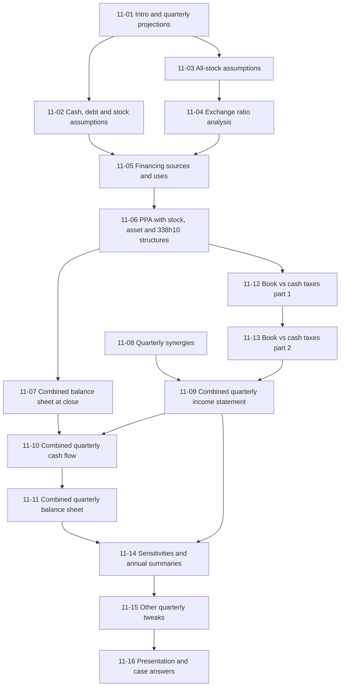

The big idea: the case is one deal modeled on a quarterly timeline. Every statement line has to ask "has the deal closed yet in this column?" before it picks a formula. The tax and purchase-price work decides what the balance sheet and EPS look like after close.

## Lessons

### 11.1 Intro and Quarterly Projections

**Core ideas**

- The case is the same Builders FirstSource (acquirer) and BMC Stock Holdings (target) deal from Module 10, rebuilt with three extra twists: variable close dates, exchange-ratio variations, and different legal structures (stock purchase, asset purchase, 338(h)(10) election).
- Quarterly models are usually not worth the effort. They create four times the columns, so they are hard to read on screen, and they only pay off when the close date falls mid-year, the company is very seasonal, or it is highly leveraged and covenants are tested on a trailing basis.
- Five rules change when you move from annual to quarterly:
  1. Growth rates compare a quarter with the same quarter last year (Q3 vs Q3), never with the prior quarter. Seasonal businesses would look wild otherwise.
  2. Working-capital balances (receivables, inventory, payables) should be driven by **LTM** (last twelve months) income statement totals, because the balance reflects a year of activity, not one quarter.
  3. Annual rates (interest, principal repayments) get divided by 4 for each quarter.
  4. Any ratio that mixes a balance sheet number with an income statement number should use LTM income statement figures. Ratios that are balance sheet only (debt to equity) can use the quarterly snapshot.
  5. The model needs an annual roll-up at the end. Flows use SUMIF, balances use INDEX/MATCH to pick the Q4 value, and per-unit metrics must be recalculated, never summed or averaged.
- Some metrics need care with units. A yearly salary per employee has to be grossed up (times 4) when it is calculated from a quarterly SG&A number, and then converted from dollars to millions.

**Worked example (made-up numbers)**

Revenue in $ millions, same quarter prior year vs this year:

| Quarter | Prior year | This year | Growth (used as input) |
|---|---|---|---|
| Q1 | 100 | 115 | 15.0% |
| Q2 | 110 | 109.5 | -0.5% |
| Q3 | 120 | 128.0 | 6.7% |
| Q4 | 150 | 160.0 | 6.7% |

Projection rule: next year's Q2 = this year's Q2 x (1 + growth input). Linking to the prior quarter instead would show Q2 dropping sharply against Q1 for no real reason.

Balance sheet rule: receivables = receivable percent x sum of the last four quarters of revenue. If the last four quarters sum to 500 and the receivable percent is 9%, receivables are 45.

> [!WARNING]
> **Going further.**
>
> - A common mistake is to fill in the first forecast quarter with the annual growth rate. Always check that the quarterly growth inputs average to something close to the annual forecast you already have, or the two models will disagree.
> - The LTM trick smooths things out but lags. A sudden drop in sales shows up in receivables only slowly, so a stress case may need a separate quarterly driver.
> - Quarterly data for public companies is usually pulled from 10-Q filings. Year-to-date cash flow statements have to be differenced to get the single quarter, which is the most error-prone part of building a quarterly history.

### Diagram: How the Quarterly Fix-Ups Connect

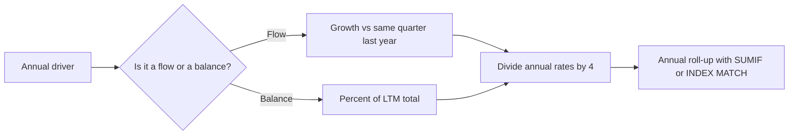

### 11.2 Cash, Debt and Stock Assumptions

**Core ideas**

- In a simple model, the offer price is backed out as exchange ratio x acquirer share price. That is a shortcut. In a real all-stock deal the buyer issues a fixed number of shares, so the offer price floats with the buyer's stock. That is why this model splits the assumptions into two sets: one for cash, debt and stock deals (built from a premium) and one for all-stock deals (built from an exchange ratio, next lesson).
- Cash/debt/stock offer price = target share price x (1 + premium).
- Diluted shares are recalculated at the offer price, not the current price. Options use the treasury stock method (TSM) at the offer price. Restricted stock units are added on top.

```text
Diluted shares (TSM) = Basic shares + RSUs + options x max(0, 1 - strike / offer price)
Purchase equity value = offer price x diluted shares
Purchase enterprise value = purchase equity value + the EV bridge items (debt, preferred, minority interest, less cash)
```

- Because the close date can move from December 2020 to June 2022, every balance pulled into the deal assumptions (cash, debt, LTM EBITDA) must be looked up by close date. The model uses INDEX/MATCH on the quarter date row, not a fixed cell.
- Cash available to fund the deal = MAX(combined cash at close minus minimum cash, 0). The minimum cash here is $300 million, raised because the close date is uncertain.
- New debt capacity = MAX(max combined leverage x LTM combined EBITDA at close minus combined debt, 0). Using face value of debt rather than book value gives a cleaner leverage number.
- The maturity date of new debt is set with EOMONTH from the close date plus the tenor in months.

**Worked example (made-up numbers, $ millions except per share)**

| Item | Value | How |
|---|---|---|
| Target share price | $20.00 | Input |
| Premium | 14% | Input |
| Offer price | $22.80 | 20 x 1.14 |
| Diluted shares at offer | 50.0 | Basic 46 + RSUs 1 + options via TSM 3 |
| Purchase equity value | 1,140 | 22.80 x 50.0 |
| Combined cash at close | 900 | INDEX/MATCH on close date |
| Minimum cash | 300 | Input |
| Cash usable | 600 | MAX(900 - 300, 0) |
| Max leverage x LTM EBITDA | 1,600 | 4.0 x 400 |
| Combined debt at close | 700 | INDEX/MATCH on face value |
| New debt capacity | 900 | MAX(1,600 - 700, 0) |

If the close date moves and combined cash drops to 250, usable cash becomes 0 and the deal has to lean harder on debt and stock. This is exactly why the close date changes the deal, not just the timing of the statements.

> [!TIP]
> **Going further.**
>
> - Treasury stock method at the offer price is more dilutive than at the current price, because a higher price makes more options in-the-money. Check that the diluted share count rises when the premium goes up.
> - Lenders do not always use face value. Rating agencies and covenants often use adjusted debt (leases, pensions). Know which definition your credit agreement uses before you set the leverage cap.
> - Minimum cash is a judgment call. Too high and you leave value unused, too low and you risk a liquidity squeeze if the close slips.

### 11.3 All-Stock Assumptions (Fixed Exchange Ratio with a Collar)

**Core ideas**

- A fixed exchange ratio says each target share becomes a fixed number of acquirer shares. With no collar, the target's ownership is locked and the equity purchase price moves with the acquirer's stock price.
- A collar adds a floor and a cap on the acquirer's share price (here $25 and $32). Inside the band the ratio is fixed. Below the floor the offer price is frozen at the floor offer, so the buyer issues more shares as its price falls. Above the cap the offer price is frozen at the cap offer, so the buyer issues fewer shares as its price rises.
- Result: the purchase equity value is flat outside the band and the share count is flat inside the band. Target shareholders get a range of value. Buyers get a limit on how much they can overpay.
- Excel implementation:

```text
Offer at floor   = fixed ratio x floor price
Offer at cap     = fixed ratio x cap price
Offer in band    = fixed ratio x acquirer price
Offer price      = MIN( MAX(offer at floor, offer in band), offer at cap )
Actual ratio     = offer price / acquirer price
New shares       = actual ratio x target diluted shares at the offer price
Equity value     = offer price x target diluted shares
```

- Diluted shares are still recalculated at the actual offer price (TSM).
- Price paid and multiples are fixed on the announcement date, not the close date, so the enterprise value bridge does not change with the close date even though the close date is uncertain.

**Worked example (made-up numbers)**

Fixed ratio 0.80x, target has 100m diluted shares, floor $25, cap $32. Offer at floor = $20.00, offer at cap = $25.60.

| Acquirer price | Ratio x price | Offer price (MIN/MAX) | Actual ratio | New shares (m) | Equity value ($m) |
|---|---|---|---|---|---|
| $20 | $16.00 | $20.00 | 1.000x | 100.0 | 2,000 |
| $25 | $20.00 | $20.00 | 0.800x | 80.0 | 2,000 |
| $28 | $22.40 | $22.40 | 0.800x | 80.0 | 2,240 |
| $32 | $25.60 | $25.60 | 0.800x | 80.0 | 2,560 |
| $35 | $28.00 | $25.60 | 0.731x | 73.1 | 2,560 |

Read the table as: equity value is flat at 2,000 below $25 and flat at 2,560 above $32. Shares issued move in the opposite direction at the edges.

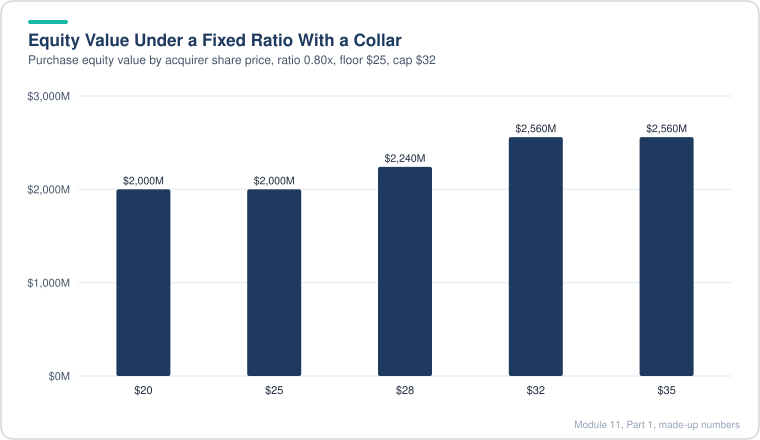

*Equity value is flat below the floor and above the cap, and only moves with the buyer's price inside the band.*

> [!WARNING]
> **Going further.**
>
> - Collars are negotiated. Targets like a collar on the downside (protects their value), buyers like one on the upside (caps what they pay in stock). Often a collar is paired with a walk-away right if the price moves past the band.
> - Watch the MIN/MAX order. Reversing the two (MIN of the floor offer and MAX of the cap offer) gives nonsense, which is a common error when someone builds this from memory.
> - A collar with a fixed ratio makes the ownership split swing. In the example, the target owns 100m / (acquirer shares + 100m) at $20 but a smaller slice at $35, so check pro-forma ownership at both ends of the band.

### 11.4 Exchange Ratio Analysis

**Source note:** this lesson is based on the Exch_Ratios tab of the Excel models (before and after versions) and the notes written beside it.

**Core ideas**

- The exchange-ratio tab compares four structures side by side for a range of acquirer share prices: fixed ratio, floating ratio, and each with a collar.
- **Fixed ratio:** new shares = ratio x target shares, fixed. Purchase equity value = acquirer price x ratio x target shares, so it rises and falls with the buyer's stock. The target's ownership stays fixed.
- **Floating ratio:** purchase equity value is fixed (a dollar amount agreed up front). Ratio = equity value / (acquirer price x target shares), so it moves inversely with the buyer's stock. The target's ownership moves.
- **Buyer ownership** for any ratio = buyer diluted shares / (buyer diluted shares + target diluted shares x ratio). Use it to check how much of the combined company each side keeps.
- **Collar on a floating ratio:** the ratio is clamped between a minimum and a maximum: `MIN(MAX(raw ratio, min ratio), max ratio)`. Inside the band the equity value floats with the buyer's price. Outside the band the ratio is frozen, so the equity value starts moving with the price.
- **Collar on a fixed ratio** (covered in 11.3): the offer price is clamped to a band set by a share price floor and cap.
- The collar that the buyer and target prefer depends on their view of the stock:

| Who | Worry | Prefers |
|---|---|---|
| Target | Buyer's stock falls | Fixed ratio with collar (value floor) |
| Buyer | Target ownership grows too much | Floating ratio with collar (ownership cap) |
| Buyer | Buyer's stock rises | Floating ratio (target gets less stock) |

**Worked example (made-up numbers)**

Buyer has 200m diluted shares. Target has 100m diluted shares. Fixed ratio 0.80x. Floating structure targets a fixed equity value of 2,000 with a collar from 0.70x to 0.90x.

| Buyer price | Fixed: shares (m) | Fixed: equity | Floating raw ratio | Floating clamped ratio | Floating: shares (m) | Floating: equity | Buyer ownership (floating) |
|---|---|---|---|---|---|---|---|
| $20.00 | 80 | 1,600 | 1.000 | 0.900 | 90 | 1,800 | 69.0% |
| $25.00 | 80 | 2,000 | 0.800 | 0.800 | 80 | 2,000 | 71.4% |
| $28.57 | 80 | 2,286 | 0.700 | 0.700 | 70 | 2,000 | 74.1% |
| $30.00 | 80 | 2,400 | 0.667 | 0.700 | 70 | 2,100 | 74.1% |

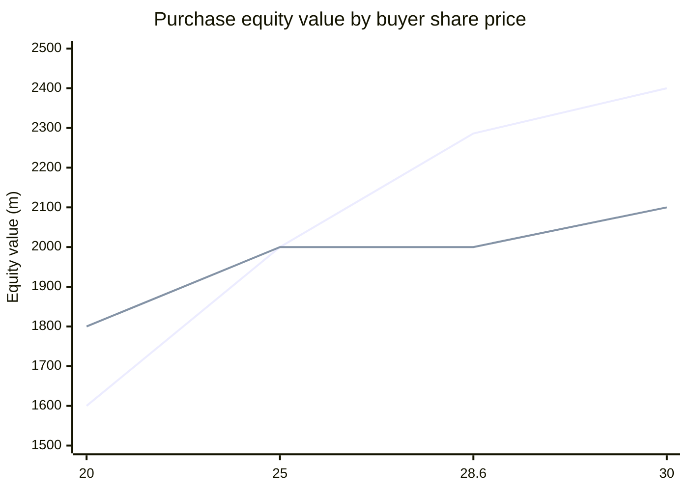

Read the chart: the top line is the fixed ratio (equity value follows the buyer's price). The bottom line is the floating ratio with collar (flat in the middle, moving at the edges).

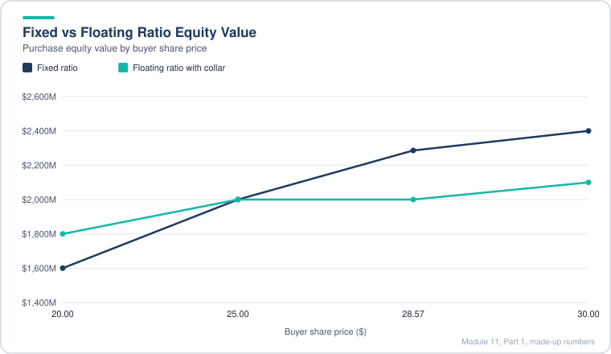

*The fixed ratio swings with the buyer's price, while the floating ratio with a collar stays flat through the middle.*

> [!TIP]
> **Going further.**
>
> - The floating structure can look like "fixed value" but it hides a risk: if the buyer's stock crashes, the target may get a lot of shares, and if it surges, the target may get very few. Board materials usually show a grid like the one above.
> - Collar bands are often set around the signing price with a symmetric percentage (for example plus or minus 10%). The band in this case study is asymmetric, which is fine as long as you say why.
> - Watch the direction of the clamp. A floating ratio clamp is applied to the ratio itself, while a fixed ratio clamp is applied to the offer price. Mixing them up is a common source of errors.

### 11.5 Deal Financing, Sources and Uses

**Core ideas**

- Every financing line checks one switch: which deal type is selected (1 = cash, debt and stock, 2 = 100% stock). The switch picks the offer price, purchase equity value and share count from the right assumption block.
- Cash used = MIN(purchase equity value, maximum cash available). In an all-stock deal it is zero.
- New debt used = MIN(maximum new debt, purchase equity value minus cash used). Almost always the debt cap binds, not the purchase price.
- Stock used = purchase equity value minus cash minus debt (cash, debt and stock case), or the full equity value (all-stock case).
- New shares = stock used / acquirer share price. The acquirer price is the same in both cases on purpose. Only the offer price is allowed to differ.
- Cost of each source, after tax:
  - Cash: pre-tax yield x (1 minus buyer tax rate)
  - Debt: interest rate x (1 minus buyer tax rate)
  - Stock: acquirer net income / acquirer equity value (an earnings yield)
- Weighted acquisition cost = sum of (source / purchase equity value x after-tax cost).
- Target's yield = target net income / purchase equity value. If the target's yield is below the weighted acquisition cost, the deal is likely dilutive before synergies.
- Uses: equity purchase price, refinance or assume target debt, transaction fees (a percentage of equity value plus fixed fees), and financing fees (a percentage of new debt).
- The target's debt depends on the close date, so it is pulled from the combined balance sheet with INDEX/MATCH/MATCH. Use IFERROR to return zero when a line item name is not found.
- Purchase multiples (EV/revenue, EV/EBITDA) are based on the announcement date. They do not change with the close date.

**Worked example (made-up numbers, $ millions)**

| Line | Cash, debt and stock | 100% stock |
|---|---|---|
| Purchase equity value | 1,140 | 1,140 |
| Cash used | MIN(1,140, 600) = 600 | 0 |
| New debt used | MIN(900, 1,140 - 600) = 540 | 0 |
| Stock used | 1,140 - 600 - 540 = 0 | 1,140 |
| Financing fees (2% of debt) | 10.8 | 0 |
| Transaction fees (1% of equity value plus 5 fixed) | 16.4 | 16.4 |

Note the cash, debt and stock case above: with a 600 cash limit, the debt cap of 900 is more than needed, so debt is only 540. That is exactly the MIN logic doing its job. The fees (27.2 in total) are paid from the companies' own cash, so they show up as an extra source ("cash for transaction fees"), and total sources equal total uses at 1,167.2.

Sources and uses check: total sources must equal total uses. Test the switch by flipping to all-stock and to a new close date. Sources and uses should still balance every time.

> [!TIP]
> **Going further.**
>
> - The "stock cost" as net income / equity value is a quick proxy. In a real deal you would use the buyer's cost of equity, which is higher than its earnings yield in many markets.
> - Financing fees are usually amortized over the life of the debt, not expensed at close. The sources and uses only show the cash paid.
> - The target's yield uses equity value, but some analysts use enterprise value. Be consistent with the way you compare it to the cost of funds.

### 11.6 Purchase Price Allocation: Stock vs Asset vs 338(h)(10)

**Core ideas**

- "Stock purchase" describes the legal structure, not how the deal is paid for. A stock purchase can be all cash, all debt or all stock. The same is true of asset purchases.
- **Stock purchase:** the buyer takes every asset, liability and off-balance-sheet item. Asset write-ups are not tax deductible, so a deferred tax liability (DTL) is created for the gap between book and tax basis. Goodwill is not amortized for tax. Part of the target's NOLs may be usable, subject to a limit (see 11.12 and 11.13).
- **Asset purchase:** the buyer picks specific assets and liabilities. Write-ups are deductible for cash tax, goodwill is amortized for tax (usually over 15 years), and no new DTL is created. The target's NOLs are written off entirely.
- **338(h)(10) election:** a U.S. tax election that gives legal stock-deal form and asset-deal tax treatment. In this model it behaves the same as the asset case.
- Purchase price allocation (PPA) steps:
  1. Equity purchase price minus seller book value (common equity), plus existing goodwill written off = allocable purchase premium.
  2. Write up PP&E (here 10% of seller net PP&E). Split the rest of the premium between indefinite-lived intangibles (40%) and definite-lived intangibles (20%). The remainder is goodwill before adjustments.
  3. Book D&A runs on the write-ups over book lives. Tax D&A runs over tax lives. Goodwill is never amortized for book purposes here.
  4. DTL = buyer tax rate x write-ups, only in a stock purchase.
  5. Goodwill created = premium minus write-ups, plus new DTL, plus or minus DTA and DTL write-downs.

```text
Allocable premium   = equity purchase price - (seller book equity - existing goodwill)
Goodwill (stock)    = premium - PP&E write-up - intangibles + new DTL + DTA/DTL write-downs
Goodwill (asset)    = same, but new DTL = 0
Tax amortization    = goodwill / 15 (asset and 338h10 only)
```

**Worked example (made-up numbers, $ millions)**

Equity purchase price 1,200. Seller book equity 500. Existing goodwill 150. Seller net PP&E 400. Buyer tax rate 25%.

| Step | Value | Calculation |
|---|---|---|
| Allocable premium | 850 | 1,200 - (500 - 150) |
| PP&E write-up | 40 | 10% x 400 |
| Indefinite-lived intangibles | 340 | 40% x 850 |
| Definite-lived intangibles | 170 | 20% x 850 |
| Goodwill before tax effects | 300 | 850 - 40 - 340 - 170 |
| DTL (stock purchase only) | 137.5 | 25% x (40 + 340 + 170) = 25% x 550 |

| Structure | DTL | Goodwill created | Tax-deductible write-ups |
|---|---|---|---|
| Stock purchase | 137.5 | 437.5 | None |
| Asset or 338(h)(10) | 0 | 300.0 | Goodwill over 15 years, intangibles over 15, PP&E over its tax life |

Tax amortization of goodwill in the asset case: 300 / 15 = 20 per year, which lowers cash taxes. That cash-tax saving is the reason buyers sometimes pay more for an asset-style structure.

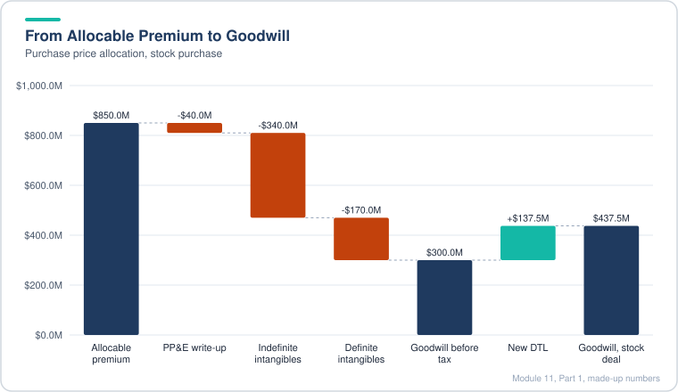

*The deferred tax liability in a stock purchase adds 137.5 to goodwill, which is why it ends above the asset case.*

> [!TIP]
> **Going further.**
>
> - The case simplifies the DTL write-down: it assumes existing DTLs are always written down, which is not always the rule. For a small DTL it does not matter much. For a large one, check the tax specifics.
> - A public company target almost never qualifies for a true asset purchase. A 338(h)(10) election usually needs the target to be an S corporation or a subsidiary of a consolidated group, so in real public deals the choice is often between a plain stock deal and a 338 election for a private seller.
> - Goodwill is tested for impairment for book purposes, but it is not amortized. Intangibles with a finite life are amortized for book purposes. Keep the two tracks separate.

### 11.7 Combined Balance Sheet at Close

**Core ideas**

- The combined balance sheet is built in three columns: acquirer at close, target at close, and pro-forma adjustments (debit and credit). Combined = acquirer + target + debits - credits.
- Both companies' balance sheets are pulled with INDEX/MATCH/MATCH on line-item name and close date. Wrapping each lookup in IFERROR returns zero when one company has no line with that name, such as new deal debt.
- Adjustments follow simple rules. Debit an asset to increase it. Credit a liability or equity to increase it. The adjustment table is the checklist: every number used in sources and uses and in the purchase price allocation must show up exactly once.

| Line | Adjustment | Direction |
|---|---|---|
| Cash | Cash used for equity and cash used for fees | Credit (reduces) |
| Net PP&E | PP&E write-up | Debit |
| Goodwill | Remove seller's existing goodwill | Credit |
| Goodwill | Add new goodwill created | Debit |
| Intangibles | Indefinite and definite-lived write-ups | Debit |
| Deferred tax assets | Write-down (linked to tax schedule, zero for now) | Credit |
| Target debt | Assumed or replaced (sources side) | Debit to reduce, credit to add back |
| New transaction debt | Face value, less financing fees | Credit, with fees as a debit |
| Deferred tax liabilities | Write-down of existing DTL, plus new DTL in a stock purchase | Debit (write-down), credit (new DTL) |
| Common equity | Remove seller equity, less transaction fees, plus stock issued | Debit, debit, credit |

- The equity purchase price itself never appears on the balance sheet. It is embedded in the goodwill and purchase price allocation, so it does not get its own check mark.
- Deal structure changes the balance sheet in predictable ways:
  - Stock purchase: new DTL appears, goodwill is larger, no tax amortization.
  - Asset or 338(h)(10): no new DTL, goodwill is smaller, intangibles and write-ups still exist.
  - All-stock deal: much less cash and no new transaction debt, and common equity goes up by the stock issued. The target's debt is effectively refinanced by the combined company.
- Close date changes the target's debt, DTL, goodwill, cash and other items, but the balance check must still hold.

**Worked example (made-up numbers, stock purchase, cash, debt and stock)**

Assume totals: assets balance must equal liabilities plus equity after every adjustment. Use this test:

| Check | Formula |
|---|---|
| Total assets after adjustments | Acquirer + target + asset debits - asset credits |
| Total liabilities and equity after adjustments | Acquirer + target + liability and equity credits - debits |
| Balance check | Difference = 0 |

If the difference is not zero, the usual causes are a fee on the wrong side, a goodwill write-off that was not linked, or a DTL that was added in an asset-deal case.

> [!TIP]
> **Going further.**
>
> - Real combined balance sheets also restate the target's assets to fair value and recognize any in-process R&D and contingent liabilities. This model only covers the line items in this case.
> - Transaction fees hit equity at close (under purchase accounting) while financing fees are capitalized against debt and amortized. The model follows that split.
> - Check the balance after every structure switch, not just once. Most errors only show up in a second scenario.

### 11.8 Quarterly Synergy Projections

**Core ideas**

- Synergies are built before the combined statements because they flow into the combined income statement in several places (revenue, cost of revenue, operating expenses, and the cost savings line).
- **Combined period counter:** if the quarter-end date is on or before the close date, the counter is 0. Otherwise it is the prior value plus 1 / number of periods. With four quarters per year the counter runs 0.25, 0.5, 0.75, 1.0, 1.25 and so on. Using 1 / periods (not a hard-coded 0.25) keeps the model flexible.
- **Phase-in lookup:** `ROUNDUP(combined period, 0)` converts the counter into a combined year number (0.25 to 1, 1.0 to 1, 1.25 to 2). `OFFSET` moves from the first year's assumption cell by that many columns, so each quarter picks up the right annual percentage. Wrap it in `IF(combined year > 0, ..., 0)` so nothing shows before close.
- **Revenue synergies:** target revenue lines times the phase-in percentage. Extra cost of sales = extra revenue x cost of sales percent. Extra operating expense = extra revenue x SG&A as a percent of revenue.
- **Cost synergies:** reduction in force (headcount) x SG&A per employee. Assumptions are annual, so the result is divided by 1,000,000 (units) and by 4 (quarters). Do the same for the acquirer.
- **Merger and integration costs:** set as a percentage of fully phased-in (Year 3) cost savings. Because close dates move, the model fixes the base at an on-time close (Dec 31, 2020). The total is spread over two years with a two-thirds and one-third split, then divided by four for each quarter.
- **Value of synergies:** after-tax cash flow = (additional operating income + cost savings - merger costs) x (1 minus buyer tax rate).
- **Terminal value:** sum the last four quarters to get an annual figure, then apply the Gordon growth formula: annual x (1 + g) / (WACC - g).
- **Present value:** XNPV on quarterly dates, discounting at the buyer's WACC, plus the terminal value discounted from the final date. Years are days / 365.
- Compare PV of synergies with the equity purchase premium (purchase equity value minus target's current equity). Later close dates shrink the PV toward the premium.

**Worked example (made-up numbers)**

Phase-in: 5% of revenue synergy in combined Year 1, 10% in Year 2, 15% in Year 3. On-time close at Dec 31, 2020.

| Quarter | Combined period | ROUNDUP year | Phase-in used |
|---|---|---|---|
| Q1 2021 | 0.25 | 1 | 5% |
| Q4 2021 | 1.00 | 1 | 5% |
| Q1 2022 | 1.25 | 2 | 10% |
| Q4 2022 | 2.00 | 2 | 10% |

Cost savings example: Year 1 reduction in force 50 employees, Year 2 cumulative 100, SG&A per employee $0.09m per year (already converted from dollars).

| Period | Annual savings ($m) | Quarterly savings ($m) |
|---|---|---|
| Year 1 | 50 x 0.09 = 4.5 | 1.125 |
| Year 2 | 100 x 0.09 = 9.0 | 2.250 |

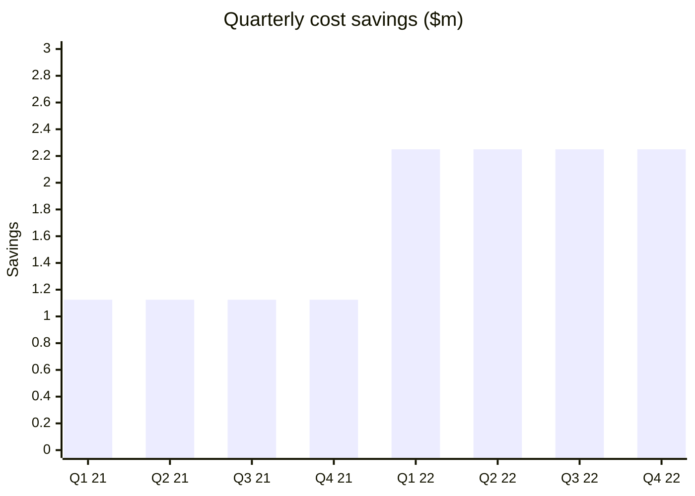

Merger costs example: Year 3 cost savings 60 x 100% = 60 total. Spread 2/3 in Year 1 (40) and 1/3 in Year 2 (20), so each quarter is 10 in Year 1 and 5 in Year 2.

> [!TIP]
> **Going further.**
>
> - The "fix the close date at Dec 31, 2020" shortcut is pragmatic but it means merger costs do not respond to close timing. A later close should also push integration costs later, so check if your reviewers accept that.
> - If the close is late, Year 3 synergies fall outside the model's horizon. The PV drops for two reasons: fewer quarters and a smaller terminal value. Say which one drives your answer.
> - Real integration costs are often front-loaded (severance, systems) and the cost synergies lag. A flat 2/3 and 1/3 split is a simplification.

### 11.9 Combined Quarterly Income Statement

**Core ideas**

- The acquirer and target use different line items and different row positions, so the combined income statement uses one long INDEX/MATCH/MATCH formula. The first MATCH finds the line label, the second finds the quarter date. Wrap it in IFERROR so a missing line returns zero.
- Target numbers are switched on with a flag, not an IF: `target value x (close flag > 0)`. The flag is 1 after close and 0 before, so the target only counts once the deal is closed.
- Acquisition effects are then layered on top, one line at a time:
  - Revenue synergies (switch on or off), with their cost of sales and operating expenses.
  - Cost savings from headcount cuts, times a realization factor.
  - Depreciation on the PP&E write-up and amortization of definite-lived intangibles. These use book lives and are converted to quarters.
  - Merger and integration costs, with the correct sign and realization factor.
  - Foregone interest on cash used (annual rate / 4).
  - Interest on new debt (face value x rate / 4).
  - Amortization of financing fees (fees / maturity in years / 4).
- Taxes: after close, tax = combined pre-tax income x buyer tax rate. Before close, use the acquirer's standalone tax from INDEX/MATCH.
- Shares: acquirer average diluted shares plus new shares issued (only after close). Standalone EPS is a direct link.
- EPS accretion/dilution (GAAP): combined EPS minus standalone EPS, and the percentage version is that difference over standalone EPS. Before close, display a blank string, not zero, so it is clear that the deal has not started.
- Pro-forma EPS adds back merger costs and deal D&A after tax (pre-tax income plus add-backs, times one minus buyer tax rate, over diluted shares). The accretion/dilution is then measured against standalone EPS.
- Because new debt balances are still blank at this stage, interest on new debt shows zero. It fills in once the cash flow statement and debt schedule are linked, so early accretion numbers are overstated.

**Worked example (made-up numbers, one quarter after close)**

| Line | Acquirer | Target (after close) | Adjustment | Combined |
|---|---|---|---|---|
| Revenue | 800 | 300 | 15 (synergy) | 1,115 |
| Operating expenses | -500 | -220 | -6 (synergy cost), -12 (integration) | -738 |
| Interest on new debt | 0 | 0 | -9 | -9 |
| Foregone interest on cash | 0 | 0 | -1.5 | -1.5 |
| Pre-tax income | | | | 366.5 |
| Tax at 25% | | | | -91.6 |
| Net income | | | | 274.9 |
| Diluted shares (m) | 100 | | 25 new shares | 125 |
| EPS | | | | $2.20 |

Standalone EPS from the acquirer alone: $2.25. Accretion is -2.2%, so this quarter is dilutive. Pro-forma EPS adds back the 12 integration costs and the D&A on write-ups after tax, which is why pro-forma can look better than GAAP.

> [!TIP]
> **Going further.**
>
> - A flag multiplied into the target's line is fast but hides errors. If the flag is ever mis-specified (for example, it counts the close quarter as "after close"), the whole column shifts. Test a close date in each quarter.
> - Pro-forma adjustments differ by company. Many acquirers exclude only the deal amortization. Read the press release convention before copying the adjustments.
> - Quarterly EPS does not sum to annual EPS when share counts change mid-year. Compare annual EPS built from the annual roll-up with the sum of quarters only as a rough check.

### 11.10 Combined Quarterly Cash Flow Statement

**Core ideas**

- The first job is the new acquisition debt schedule, because interest on that debt was left blank in the income statement lesson. The debt balance in each quarter follows three cases:
  1. Before close: zero.
  2. On the close date: the debt issued to fund the equity purchase (from sources and uses).
  3. After close: prior balance minus principal repaid this quarter.
- Principal repayment uses MIN logic. Scheduled amortization is a percentage of the original balance per year, divided by four. It is capped at the remaining balance. On the maturity date the whole remaining balance is repaid, whatever the schedule says.
- Total debt on the combined statement = acquirer face value + new deal debt + target face value (only after close). The target only counts after close, using the same flag as the income statement.
- Items that can be linked straight from the combined income statement, without INDEX/MATCH: net income, existing depreciation and amortization (sign flipped to non-cash add-backs), new intangibles amortization, PP&E write-up depreciation, amortization of financing fees, and goodwill impairment (sign flipped).
- Working capital is the exception. The line items are spread across several rows on each company's cash flow statement, so the model uses a plain SUM of the acquirer's changes plus the target's changes (after close) instead of INDEX/MATCH.
- The rest of the cash flow statement (capex, asset sales, acquisitions, financing lines) uses the same INDEX/MATCH/MATCH approach as the income statement, but on the cash flow statement rows and columns. Acquirer always counts; target counts only after close, and IFERROR returns zero for missing items.
- Two lines (change in deferred tax liabilities and assets) are still blank. They depend on the tax schedule, which comes later.
- Testing: after close the combined net income jumps, the new debt appears in the closing quarter, principal starts falling, and interest on new debt starts at a level and declines. With a 100% stock deal, new debt and its interest go to zero.

**Worked example (made-up numbers, quarterly)**

New debt issued at close: 540. Annual amortization 1% of original balance, so per quarter = 540 x 1% / 4 = 1.35.

| Quarter | Opening new debt | Principal paid | Closing new debt | Interest at 6% / 4 |
|---|---|---|---|---|
| Close (Q4 2020) | 0 | 0 | 540.00 | 0 (opening balance used for interest) |
| Q1 2021 | 540.00 | 1.35 | 538.65 | 8.10 |
| Q2 2021 | 538.65 | 1.35 | 537.30 | 8.08 |
| Maturity (Q4 2025) | remaining balance | all remaining | 0 | |

Interest in this table uses the opening balance for simplicity. The model multiplies the period's face value by the rate and divides by four. That is fine because the repayments are fixed and do not depend on cash, so there is no circular reference.

> [!TIP]
> **Going further.**
>
> - A cash flow statement that is off by a small amount usually points to a sign error. Each linked line should have a sign check, so review each flipped sign by hand.
> - Fixed-percentage amortization on term loans is common, but many deals have a cash sweep that depends on cash flow. A cash sweep makes the model circular, so use an iterative toggle or a copy-paste approach.
> - The statement check is simple: the change in cash must equal the ending cash minus the beginning cash on the balance sheet. Make sure it does before moving on.

### 11.11 Combined Quarterly Balance Sheet

**Core ideas**

- Each balance sheet line is sorted into one of two groups:
  - **Not changed by the deal** (receivables, inventory, lease assets, other long-term assets, payables, accrued liabilities, lease liabilities, other long-term liabilities). These are pulled from the combined sheet on the close date, from the acquirer before close, and from acquirer plus target after close.
  - **Changed by the deal** (cash, PP&E, goodwill, intangibles, deferred taxes, debt, equity). These use the close date to choose a source: the combined sheet on the close date, the acquirer's balance before close, and the prior quarter plus cash flow items after close.
- The three date cases for each line are:
  1. On the close date: link to the post-adjustment combined balance sheet (no INDEX/MATCH needed because the layouts match).
  2. Before the close date: acquirer only, via INDEX/MATCH.
  3. After the close date: roll forward. Previous balance plus the matching cash flow or income statement movement.
- Roll-forward examples:
  - Cash = prior cash + net change in cash.
  - Net PP&E = prior PP&E - depreciation - PP&E write-up depreciation + capex-related lines (with signs flipped for asset lines).
  - Goodwill = prior goodwill - impairment.
  - Other intangibles = prior - amortization of existing intangibles - amortization of new intangibles.
  - Common equity = prior + net income + stock compensation + other items + stock issued - buybacks - dividends.
  - New transaction debt = prior - repayments - fee amortization (fees are netted from debt book value).
- The new transaction debt line does not exist for the acquirer, so it is never looked up with INDEX/MATCH. It is linked straight to the cash flow statement.
- Anchoring mistakes are the main risk. Anchor the date row, the column reference and the label column. A typical error is an unanchored column that drifts when the formula is copied across.
- Check after every two or three changes. Q4 2020 (close date) should match the combined balance sheet exactly, and the balance check should be zero in every quarter.

**Worked example (made-up numbers, one quarter after close)**

| Line | Prior quarter | Movement | This quarter |
|---|---|---|---|
| Cash | 240 | Net change in cash -20 | 220 |
| Net PP&E | 1,300 | Capex +30, depreciation -28, write-up depreciation -4 | 1,298 |
| Goodwill | 760 | Impairment 0 | 760 |
| Other intangibles | 500 | Amortization -12 | 488 |
| New transaction debt | 540 | Repayment -1.35, fee amortization -0.4 | 538.25 |

Balance check: total assets must equal total liabilities plus equity in every quarter. A gap of even 0.1 usually means one roll-forward is missing a sign or an item.

> [!TIP]
> **Going further.**
>
> - Rolling the balance sheet from the cash flow statement is only as good as the cash flow statement. If a line on the cash flow statement is missing from the roll-forward, the balance check catches it. Reconcile each balance sheet line to a cash flow line before trusting the output.
> - Real companies also show restricted cash and changes in accumulated other comprehensive income. Fold these into the roll-forward so the check holds.
> - A pro-forma close-date balance sheet is usually a separate tab for exactly the reason in this lesson: it lets you compare the "as is" and "as combined" views side by side.

### 11.12 Book vs Cash Taxes and Section 382 NOLs, Part 1

**Core ideas**

- Book taxes follow accounting rules. Cash taxes follow the tax code. Deal structure decides how far the two drift apart.
- **Stock purchase:** the target's net operating losses (NOLs) survive, but their use is limited after a change of ownership. Write-up depreciation and amortization are not deductible, so cash taxes run higher than book taxes for years.
- **Asset or 338(h)(10):** the target's NOLs are written down to zero, and the related deferred tax asset (DTA) is written down too. In exchange the buyer deducts write-up D&A and goodwill for cash taxes.
- **Section 382 limit (stock purchase):** the annual NOL usage is the equity purchase price times a long-term tax-exempt rate. The rate is taken from IRS revenue rulings and is close to the 10-year Treasury yield. The model uses the highest of the past three months' adjusted long-term rates.
- **Write-down logic (stock purchase):** NOLs that cannot be used within their expiration period are written down. The usable amount is annual limit x years until expiry. Anything above that is removed.

```text
On-balance NOL (target)       = NOL balance as a positive number
NOL share of DTA              = on-balance NOL / DTA
Off-balance NOL (estimate)    = on-balance NOL / seller tax rate
Annual 382 limit              = equity purchase price x long-term rate
Off-balance write-down        = IF(asset or 338h10, full balance,
                                  MAX(off-balance - annual limit x expiry years, 0))
DTA write-down                = off-balance write-down x (on-balance NOL / off-balance NOL)
Post-deal DTA                 = DTA at close - DTA write-down
```

**Worked example (made-up numbers, $ millions)**

Equity purchase price 2,000. Long-term rate 0.9%. Off-balance NOL 300. Expiry window 10 years. Tax rate 25%.

| Item | Stock purchase | Asset or 338(h)(10) |
|---|---|---|
| Annual 382 limit | 2,000 x 0.9% = 18.0 | Not used (write-down is total) |
| Usable over 10 years | 18.0 x 10 = 180 | 0 |
| Off-balance write-down | MAX(300 - 180, 0) = 120 | 300 |
| DTA write-down | 120 x 25% = 30.0 | 300 x 25% = 75.0 |
| DTA at close | 95.0 | 95.0 |
| Post-deal DTA | 65.0 | 20.0 |

Note the DTA at close is the same in both cases. The difference is how much is written off.

Cash tax effect for one year (book pre-tax income 500, write-up D&A booked at 60, buyer tax rate 25%):

| Structure | Book taxable income | Add back book write-up D&A | Less tax-deductible D&A | Cash taxable income | Cash tax | Book tax |
|---|---|---|---|---|---|---|
| Stock purchase | 500 | +60 | 0 | 560 | 140.0 | 125.0 |
| Asset or 338(h)(10) | 500 | +60 | -50 | 510 | 127.5 | 125.0 |

In a stock purchase cash tax exceeds book tax, which is the reverse of a typical company with DTLs building. That gap is the DTL unwinding.

> [!TIP]
> **Going further.**
>
> - The case uses the adjusted long-term rate of the prior three months. The Section 382 rule actually uses the long-term tax-exempt rate, which is in the same IRS ruling and was slightly higher than the adjusted rate in August 2020. Using the higher figure lowers the annual limit a little, so check which rate your model should carry.
> - The off-balance NOL estimate (on-balance divided by tax rate) is a rough shortcut. The real figure is in the tax footnote. For a public deal, diligence would replace this estimate.
> - Section 382 can be triggered by a change in ownership of more than 50% of the target over three years. Some deals also have separate limits from state rules or from built-in gains.

### 11.13 Book vs Cash Taxes and Section 382 NOLs, Part 2

**Core ideas**

- The NOL schedule runs quarter by quarter after close:
  1. Beginning NOL = post-write-down balance at close, then the prior ending balance after close.
  2. NOLs created = MAX(0, -pre-NOL cash taxable income) when the period is post-close. A loss adds to the pool.
  3. NOLs used = MIN( MIN(beginning + created, allowed usage per quarter), MAX(pre-NOL cash taxable income, 0) ). The limit is the lower of the remaining balance, the annual 382 cap divided by four, and the income available to shelter.
  4. Ending NOL = beginning + created - used.
- Taxable income after NOLs = pre-NOL cash taxable income - NOLs used.
- Cash taxes payable = -MAX(taxable income after NOLs, 0) x buyer tax rate. Taxes are shown as negatives, so the formula keeps the sign convention.
- Deferred income taxes = cash taxes payable - book taxes. This must equal the change in DTL plus the change in DTA, which is the check.
- The model splits that deferred amount into two pieces:
  - Change in DTL = (book vs cash D&A differences on new deal items) x tax rate.
  - Change in DTA = (NOLs created - NOLs used) x tax rate.
- The model does not re-count the target's and acquirer's existing deferred items (existing intangible amortization, stock comp, impairments). The case assumes those are already inside their standalone DTL movements, so only new acquisition effects go into this schedule.
- Asset or 338(h)(10): the NOL balance is zero, so no NOLs are used, the DTA stays flat after the write-down, and the DTL moves only with the standalone company changes. Goodwill tax amortization over 15 years does not match the much shorter book periods, so deferred taxes are smaller than a naive estimate.
- Balance sheet result from the case's test: the cash balance and new debt differ only modestly between stock and asset cases. Because there are no optional debt repayments, the interest expense does not change much, so accretion or dilution barely moves.

**Worked example (made-up numbers, stock purchase, four quarters, $ millions)**

Beginning NOL at close 80. Annual 382 cap 18, so quarterly cap 4.5. Buyer tax rate 25%.

| Quarter | Pre-NOL taxable income | NOLs created | NOLs used | Ending NOL | Taxable after NOLs | Cash tax |
|---|---|---|---|---|---|---|
| Q1 | 10.0 | 0.0 | 4.5 | 75.5 | 5.5 | 1.375 |
| Q2 | -6.0 | 6.0 | 0.0 | 81.5 | -6.0 | 0.000 |
| Q3 | 3.0 | 0.0 | 3.0 | 78.5 | 0.0 | 0.000 |
| Q4 | 20.0 | 0.0 | 4.5 | 74.0 | 15.5 | 3.875 |

Notice that Q2 creates NOLs (a loss), and Q3 uses only the 3.0 of taxable income it has. The cap of 4.5 per quarter is never exceeded.

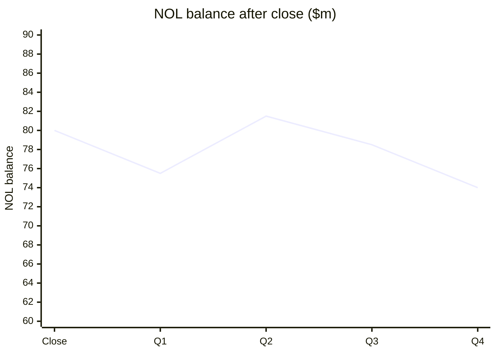

> [!TIP]
> **Going further.**
>
> - The cap on NOL usage is a true tax limit. Any NOL unused by its expiry is lost, which is why the write-down is tied to expiry years. In a real deal, the tax team sets the expiry profile and the usable amount; the model only mirrors their answer.
> - Deferred tax lines hide policy judgments. The case's shortcut (only new deal items drive the DTL, only NOLs drive the DTA) is reasonable for a model, but a tax team would reconcile each deferred line to the footnote.
> - The finding that deal structure barely changes accretion is a useful interview point: the big drivers are purchase price, financing mix and synergies, not tax structure, unless the NOL balance is large.

### 11.14 Sensitivities and Annual Summaries

**Core ideas**

- Quarterly models are hard to read, so the model adds an annual summary built from the quarterly rows:
  - **Flows** (revenue, expenses, cash flows): `SUMIF(fiscal year row, year, quarterly row)`.
  - **Balances** (cash, debt, equity): `INDEX/MATCH` on the Q4 date for that year, not a sum.
  - **Share counts**: `AVERAGEIF` across the year, because a share count is a point-in-time number and summing it would be wrong.
  - **Combined year number**: INDEX/MATCH on the date, because the counter moves in quarters and the close date can fall mid-year.
  - **Ratios and per-share metrics**: copied from the quarterly formulas, since they reference same-period cells. Do not add them up.
- Accretion and dilution are judged on an annual basis. Pro-forma EPS for fiscal 2022 and fiscal 2023 is the main output. Fiscal 2022 is chosen because even a June 30, 2022 close still gives partial 2022 results and full 2023 results.
- Sensitivity tables are two-variable Excel data tables. Each table has a row input and a column input, and the output is the annual accretion cell. The baseline value sits in the middle of each axis:
  - Expense synergy realization (0% to about 160%) against the exchange ratio.
  - Expense synergy realization against the acquirer's share price (for the collar structure).
  - Expense synergy realization against the purchase premium (for the cash, debt and stock structure only).
- Data tables slow down recalculation, so set Excel to "Automatic except for data tables" when you are done.

**Findings from the sensitivities (restated)**

- In the cash, debt and stock case the deal is at least close to accretive on a pro-forma basis in fiscal 2022 and 2023, even with lower expense synergies or higher premiums.
- In the 100% stock case, dilution appears in most cells unless expense synergies are realized near the top of the range.
- A lower buyer share price makes the fixed-ratio-with-collar structure worse, because the buyer must issue more shares to keep the target's equity value at the floor. Removing the collar (floor at $0 and cap at $50) improves accretion. So the proposed collar does not solve the buyer's problem.
- A floating ratio with a collar holds the target's ownership steady in the downside, so it fits a buyer more worried about ownership than about dilution.

**Worked example (made-up numbers, share count effect only)**

Buyer has 100m shares. Target has 70m diluted shares. Fixed ratio 1.20x, so the offer is 30 at a $25 floor and 38.4 at a $32 cap. Combined net income held at 260 for comparison.

| Buyer price | New shares with collar (m) | New shares without collar (m) | Combined EPS with collar | Combined EPS without collar |
|---|---|---|---|---|
| $20 | 105.0 | 84.0 | $1.27 | $1.41 |
| $25 | 84.0 | 84.0 | $1.41 | $1.41 |
| $28 | 84.0 | 84.0 | $1.41 | $1.41 |
| $35 | 76.8 | 84.0 | $1.47 | $1.41 |

With the collar, the buyer is worse off below $25 and better off above $32, because it issues fewer shares. The table shows why a collar may protect the target but hurts the buyer if its stock falls.

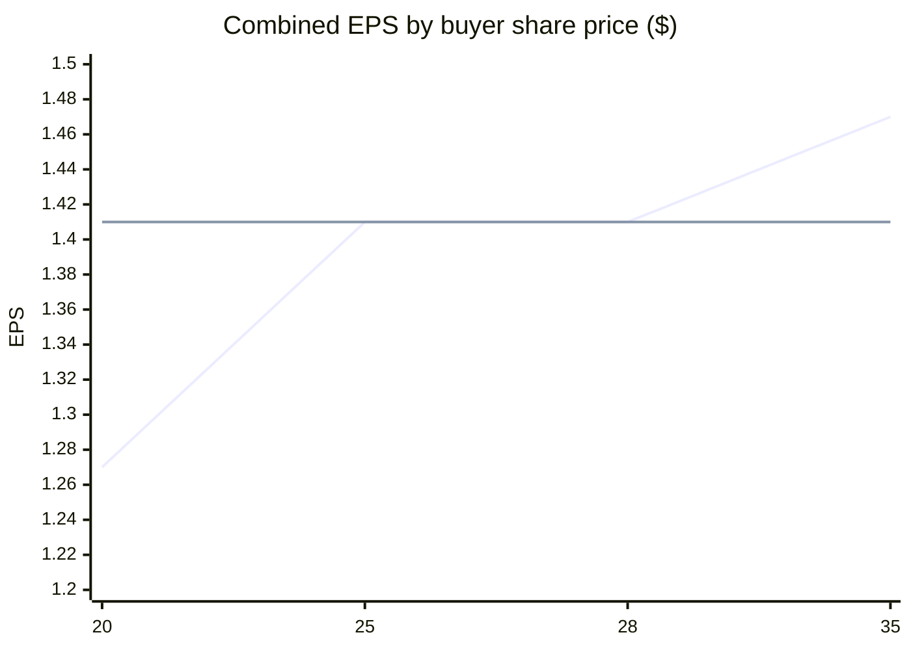

The first line is with the collar, the second is without. The gap at $20 is the cost of the collar to the buyer.

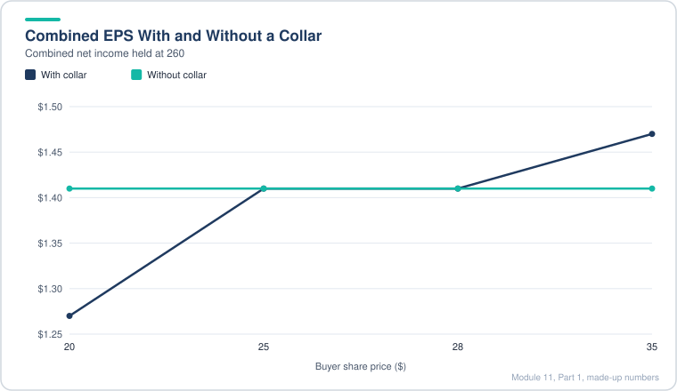

*The collar costs the buyer EPS at $20 and helps it at $35, because the share count moves in opposite directions.*

> [!TIP]
> **Going further.**
>
> - A sensitivity table is only as good as its axes. Pick ranges that include a realistic downside and upside, and mark the baseline. Do not set the axis so the answer is hidden in the middle.
> - The combined net income in the example is held fixed. In the real model, synergies, interest and share count all move together. A two-way table can hide that, so run at least one scenario that flexes all three.
> - Pro-forma EPS and GAAP EPS can tell different stories. Show both and explain the adjustment.

### 11.15 Other Quarterly Tweaks (Summary, Comps, DCF, Value Creation, Contribution)

**Core ideas**

- **Summary tab:** a one-to-two page view for senior readers. It uses only direct links and text formatting, and it shows the things a decision-maker asks first: deal structure, purchase equity and enterprise value, synergies and integration costs, purchase accounting, ownership from the contribution analysis, multiples, acquisition effects, accretion or dilution, and credit stats.
- Credit read-outs from the summary in this case: debt to EBITDA falls a lot after the deal because the equity base grows and EBITDA is added. EBITDA over net interest barely moves. Debt to equity falls mostly because equity rises, not because debt falls.
- **Public comps:** extended to fiscal 2021, 2022 and 2023 estimates, because a variable close date makes the later years the relevant ones. The same peer set is used, and the acquirer and target are included.
- **DCF:** the case keeps a full fiscal 2020 first year and does not add a stub period. The reasons: the merger model is the focus, the company's quarterly results were close to plan, and a stub would shift cash flow and discount period in offsetting ways. Note the trade-off: this is a shortcut you should state, not hide.
- **Value creation analysis:** pushed further into the future, with the synergy adjustment applied in each year. The sensitivity on exchange ratio is dropped because it no longer matters here. Output uses the year 2 and year 3 combined multiples.
- **Contribution analysis:** the combined year 1, 2 and 3 metrics (revenue, EBITDA, EBIT, net income) cannot be fixed cells any more, because the combined years move with the close date. The model looks them up using LTM figures at EOMONTH(close date, 12) and EOMONTH(close date, 24), wrapped in IFERROR so missing years show NA rather than wrong numbers.

**Worked example (made-up numbers, contribution analysis)**

Close date Sep 30, 2021. Combined year 1 is measured at Sep 30, 2022 (12 months later). Combined year 2 is measured at Sep 30, 2023 (24 months later).

| Close date | Year 1 lookup date | Year 2 lookup date | Year 2 available? |
|---|---|---|---|
| Dec 31, 2020 | Dec 31, 2021 | Dec 31, 2022 | Yes |
| Sep 30, 2021 | Sep 30, 2022 | Sep 30, 2023 | Yes |
| Jun 30, 2022 | Jun 30, 2023 | Jun 30, 2024 | No (outside model), so NA |

> [!TIP]
> **Going further.**
>
> - Summary tabs are easy to over-trust. The numbers on them are only as good as the links, so reconcile the summary to the full model on the last check before printing.
> - Using a DCF without a stub when the close date is mid-year is acceptable for a demo, but a fairness opinion would need the stub and the mid-year convention. Say so in the deck.
> - A contribution analysis based on LTM at future dates is a reasonable approach. Check that the lookup date does not land in a period where the combined company is not yet reporting.

### 11.16 Client Presentation and Case Study Answers

**Core ideas**

- The case ends with a short board-style deck (about ten slides) that answers four questions. The model supplies every number, and the deck explains which lever matters.
- The deck's logic runs in three blocks: close date effects, exchange ratio structures, then tax structure. It ends with a recommendation.
- Good practice shown here: when a number is hard to pull from a data table (for example, close date changes the year labels), run each scenario by hand, record the outputs in a table, and say which tab each number came from.
- Also shown: test a structure you do not have in the model by changing an input to mimic it. The case mimics a floating collar by setting the exchange ratio to its maximum and removing the floor and cap, which is a shortcut, not a rebuild.

**Answers to the four case questions**

1. **Close date effect.** It depends on the financing mix:
   - All-stock: close as early as possible. Later closes keep the same share count but leave more time for both share prices to move, and accretion or dilution drifts.
   - Cash, debt and stock: a later close can help. More debt capacity builds up as EBITDA grows, so the deal needs less stock, and dilution falls.
2. **Fixed ratio with a collar in an all-stock deal.** No. If the buyer's price falls, the collar forces it to issue more shares to hold the target's value, which makes dilution worse on the downside. A plain fixed ratio or a floating ratio with a collar is better if the worry is a falling stock price. Recommendation: keep the mixed cash, debt and stock structure.
3. **Asset purchase or 338(h)(10) vs stock purchase.** The difference is small when the target's NOL balance is modest. The asset route gives a modest cash benefit (write-up deductions and goodwill amortization) and writes off the NOLs. Because the acquisition debt cannot be prepaid early, the extra cash does not move EPS much. A stock purchase is fine.
4. **Overall recommendation.** Mixed cash, debt and stock, a later close date (within the fiscal 2021 to 2022 window), and a traditional stock purchase.

**Deck outline (10 slides)**

| Section | Slides | Content |
|---|---|---|
| Summary | 1 to 2 | Recommendation and key findings |
| Assumptions | 3 | Financing mix, exchange ratio, debt terms, synergies, write-ups |
| Close dates | 4 to 5 | Table of structure by close date: cash, debt, stock, ownership, accretion range, value creation range. Slide 5 holds the full transaction summary |
| Exchange ratios | 6 to 8 | Collar charts, fixed vs floating comparison |
| Tax and NOLs | 9 to 10 | Write-downs, goodwill and tax amortization, cash difference, EPS impact |
| Recommendation | 11 | Four takeaways |

Slides always lead with the answer. Each chart has a one-line takeaway written as a sentence.

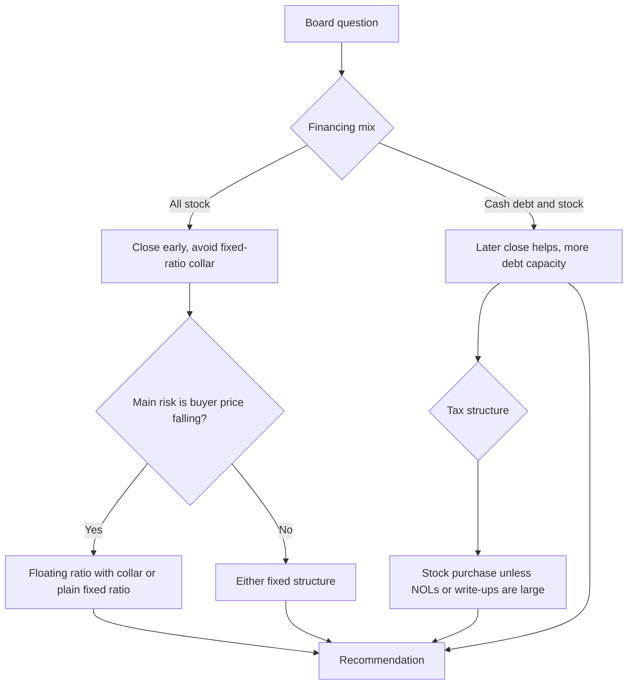

> [!TIP]
> **Going further.**
>
> - The deck is written for a board, so it leans on ranges ("8 to 10 percent accretion") rather than single points. Ranges communicate model risk better than one number.
> - Calling a structure "ideal" should come with the conditions that make it so (a later close, expense synergies realized, debt market open). Otherwise the board may take it as unconditional.
> - The NOL and tax answer is the kind of conclusion that reverses if the target is larger or has a bigger NOL pool. Re-check it whenever the target or the purchase price changes.

## Excel Model Walkthrough

**Files.** The case has a quarterly merger model in a "Blank" version (the template) and a "Complete" version (the finished model). The lesson files come in Before and After pairs. By file name, the Before file is the state at the start of a lesson and the After file is the state at its end. The source statements for both companies sit in a separate statements workbook.

**Tabs in the complete model (in order):**

| Tab | What it holds | Key links |
|---|---|---|
| Summary | Two-page board view: deal terms, synergies, ownership, multiples, accretion, credit stats | Direct links to Merger_Model, Value_Creation, Contrib |
| Merger_Model | Switches, transaction assumptions, sources and uses, PPA, combined IS, CFS, BS, EPS | Central hub. Reads Acquirer, Target, Synergies, Taxes, Combined_BS |
| Exch_Ratios | Fixed and floating ratios, with and without collars, ownership grid | Uses the exchange ratio and share price inputs from Merger_Model |
| Acquirer / Target | Quarterly statements for each company (IS, CFS, BS, LTM metrics) | Pulled into Merger_Model by INDEX/MATCH/MATCH |
| Synergies | Revenue and cost synergies by quarter, merger costs, PV of synergies | Feeds Merger_Model rows for revenue synergies, OpEx synergies and integration costs |
| Taxes | Book vs cash taxes, NOL schedule, DTA and DTL changes | Feeds deferred taxes on the CFS and DTA write-down on the BS |
| Combined_BS | Acquirer, target and pro-forma adjustment columns at each close date | Feeds the Q4 close-date column on the Merger_Model BS |
| Value_Creation | Value creation by multiple, for combined years 1 to 3 | Uses Pub_Comps and combined metrics |
| Contrib | Ownership by revenue, EBIT, EBITDA and net income | Uses LTM lookups by EOMONTH from the close date |
| Pub_Comps / MA_Comps | Trading comps (FY21 to FY23) and deal comps | Input only |
| DCF_IRR | Target DCF and IRR vs discount rate (no stub, FY20 first year) | Uses target annual numbers |
| WACC | Buyer discount rate | Input only |

**Switches on Merger_Model (inputs in blue):**

- Close date (drop-down of quarter ends from Dec 31, 2020 to Jun 30, 2022).
- Transaction financing: 1 = cash, debt and stock; 2 = 100% stock.
- Deal structure: 1 = stock purchase; 2 = asset or 338(h)(10).
- Include revenue synergies (1 or 0), include expense synergies (1 or 0), expense realization factor.
- Premium paid, minimum cash, maximum leverage, new debt rate and terms, fee percentages.

**Key formula patterns:**

- Combined period counter: `IF(date <= close, 0, prior + 1/periods)`.
- Target inclusion flag: `(combined year > 0)`, multiplied into each target line.
- Any line that could differ by close date: `INDEX(row, MATCH(line label, labels, 0)) ... MATCH(date, dates, 0)` wrapped in `IFERROR(..., 0)`.
- Annual roll-ups: `SUMIF` for flows, `INDEX/MATCH` on Q4 for balances, `AVERAGEIF` for shares.
- Deal flows that switch on structure: `IF(financing = 1, cash-debt-stock case, all-stock case)`.

**Checks built into the model:** the combined balance sheet balances in every quarter, sources equal uses, and the deferred tax change equals DTL change plus DTA change. If any check fails after a switch change, the problem is almost always a missing anchor or a sign flip.

## Interview Questions

<details>
<summary><b>1. What is the difference between a stock purchase and an asset purchase for tax?</b></summary>

In a stock purchase the buyer inherits the target's tax basis, so write-ups and goodwill are not deductible, and a deferred tax liability is created. In an asset purchase the basis steps up, so D&A and goodwill amortization are deductible, and the target's NOLs are written off.

</details>

<details>
<summary><b>2. What is a 338(h)(10) election?</b></summary>

A U.S. election that treats a stock purchase as an asset purchase for tax. The buyer gets the step-up and the legal form of a stock deal. It usually needs an S corp or a consolidated-group subsidiary seller.

</details>

<details>
<summary><b>3. Why does an all-stock deal use a different assumption set from a cash, debt and stock deal?</b></summary>

Because in an all-stock deal the buyer issues a fixed share count, so the offer price floats with the buyer's stock. In a mixed deal the offer price comes from a premium.

</details>

<details>
<summary><b>4. What is a fixed exchange ratio with a collar?</b></summary>

The ratio is fixed inside a band of buyer share prices. Outside the band the offer price is frozen at the floor or cap, so the buyer issues more or fewer shares. It limits the target's value risk, but it increases dilution when the buyer's stock falls.

</details>

<details>
<summary><b>5. What is a floating exchange ratio with a collar?</b></summary>

The purchase equity value is set in dollars. The ratio moves inversely with the buyer's price, but it is clamped between a minimum and maximum. Outside the band the equity value starts to move again.

</details>

<details>
<summary><b>6. How do you handle a variable close date in a merger model?</b></summary>

Look up balances by close date with INDEX/MATCH, classify each line as changed or unchanged by the deal, and multiply target lines by a before/after flag. Hold the announcement-date valuation fixed.

</details>

<details>
<summary><b>7. Why does a later close date help a cash, debt and stock deal?</b></summary>

The combined company has more cash and more EBITDA, so more debt capacity (leverage times EBITDA) is available. That replaces stock, which lowers dilution.

</details>

<details>
<summary><b>8. How do you convert an annual assumption to a quarterly one?</b></summary>

Divide annual rates by four. Use growth against the same quarter last year. Link working-capital balances to LTM figures. Gross up per-employee annual costs when building from quarterly numbers.

</details>

<details>
<summary><b>9. What is a combined period counter used for?</b></summary>

It tells every formula whether the combined company exists in that quarter and which combined year it is in, so synergies and deal effects switch on and phase in correctly.

</details>

<details>
<summary><b>10. What is an NOL limit under Section 382?</b></summary>

After an ownership change, annual use of pre-change NOLs is capped at the equity value times a long-term tax-exempt rate. Unused NOLs carry forward until they expire.

</details>

<details>
<summary><b>11. What is a DTL created in a stock purchase?</b></summary>

Book basis of the write-ups is higher than tax basis. Book amortization reduces book income but gives no cash deduction, so the difference is a liability that unwinds over time.

</details>

<details>
<summary><b>12. Why does purchase price allocation matter for EPS?</b></summary>

Write-up D&A and new intangible amortization reduce GAAP EPS. Pro-forma EPS often excludes them, so the two can show different accretion. The goodwill itself is not amortized for book purposes.

</details>

<details>
<summary><b>13. What is the allocable purchase premium?</b></summary>

The equity purchase price minus the seller's book value of equity, plus its existing goodwill that is written off.

</details>

<details>
<summary><b>14. Why would a buyer prefer stock over debt, or the reverse?</b></summary>

Debt is cheaper after tax when the buyer's stock earnings yield is high, but it adds leverage limits. Stock dilutes ownership but avoids leverage. The weighted acquisition cost comparison with the target's yield decides which is cheaper.

</details>

<details>
<summary><b>15. What does target's yield mean and how is it used?</b></summary>

Target net income divided by purchase equity value. Compare it with the weighted cost of acquisition funds. If the target yield is below the cost, the deal is usually dilutive before synergies.

</details>

<details>
<summary><b>16. How are synergies valued in a merger model?</b></summary>

Take after-tax synergy cash flows, add a terminal value with a growth rate, discount at the buyer's WACC, and compare the present value with the equity purchase premium.

</details>

<details>
<summary><b>17. What is an integration cost and how is it set?</b></summary>

A one-time cost to achieve synergies. Often set as a percentage of run-rate cost synergies and spread across the first two or three years.

</details>

<details>
<summary><b>18. Why do merger models often include a sensitivity on the buyer's share price?</b></summary>

Because in an all-stock deal the share count and the value transferred depend on that price. Showing a range shows the downside risk of stock consideration.

</details>

<details>
<summary><b>19. What is a realization factor?</b></summary>

The share of planned synergies that the company actually achieves. Models test it from low to above 100% to see how much margin of safety the deal has.

</details>

<details>
<summary><b>20. What does the balance check tell you?</b></summary>

That every adjustment, including fees, the PPA, the debt and the equity issuance, has been recorded on both sides. A break usually means an anchor error or a missed sign.

</details>

## Career Angle

**How the module maps to practical work**

- **Fair value work.** For a fixed income analyst, valuing MBS and other instruments for a trade desk, risk, accounting and reporting touches the same discipline. Price, yield and cash flow assumptions drive value, and the output is reviewed against a range, like the sensitivity tables here.
- **FP&A forecasting.** Building LTM and quarterly views, handling close-date or timing shifts and building annual roll-ups mirrors the work of a forecasting team.
- **CFO reporting.** The combined statements, the pro-forma adjustments and the check discipline are the same habits used in board and CFO packs.
- **Valuation and corp dev roles.** The deal math here (purchase price allocation, accretion or dilution, sources and uses, synergy PV) is the core of a corp dev or investment banking merger model.

**Talking points (framed as studied or built in a self-study case)**

1. "I worked through a complex quarterly merger model with variable close dates, collars on the exchange ratio and stock vs asset tax structures, and I can explain how each one changes the balance sheet and EPS." Confirm the build was actually completed before saying "built".
2. "On a quarterly merger model, I handled the close-date switch with INDEX/MATCH and a before-and-after flag, and checked that the balance sheet balanced across several deal structures." Only use this if the check was done personally.
3. "I can explain why a fixed exchange ratio with a collar hurts the buyer when its stock falls, and why a floating ratio with a collar may suit a buyer more worried about ownership." This is a sound discussion point for corp dev interviews.

Do not claim M&A deal experience, deal execution or a deal close unless one is on the record.

## Cheat Sheet

| Topic | Rule |
|---|---|
| Stock purchase | No tax step-up, DTL created, NOLs survive with annual 382 cap |
| Asset or 338(h)(10) | Tax step-up, goodwill amortized over 15 years, NOLs written off, no new DTL |
| Offer price (mixed) | Target price x (1 + premium) |
| Offer price (fixed ratio with collar) | MIN(MAX(ratio x floor, ratio x price), ratio x cap) |
| Actual exchange ratio | Offer price / buyer price |
| Floating ratio with collar | MIN(MAX(equity value / (price x shares), min), max) |
| Allocable premium | Equity price - (seller equity - seller goodwill) |
| Goodwill (stock) | Premium - PP&E write-up - intangibles + new DTL (+/- write-downs) |
| 382 annual limit | Equity value x long-term tax-exempt rate |
| Combined period | 0 before close, then prior + 1/periods |
| Quarterly rate | Annual rate / 4 |
| LTM metric | Sum of last four quarters |
| Annual roll-up | Flows SUMIF, balances INDEX/MATCH on Q4, shares AVERAGEIF |
| Accretion | (Pro-forma EPS - standalone EPS) / standalone EPS |
| Synergy terminal value | Annual run-rate x (1 + g) / (WACC - g), discounted |
| Cash usable | MAX(combined cash - minimum cash, 0) |
| New debt capacity | MAX(max leverage x LTM EBITDA - existing debt, 0) |
| Sources equal uses | Must always hold. Test after every switch |
| Balance sheet check | Assets = liabilities + equity in every quarter |

---

[← Previous: Module 10](10-merger-models.md) · [Contents](../README.md) · [Next: Module 11, Part 2 →](11-advanced-m-and-a-concepts-part-2.md)
