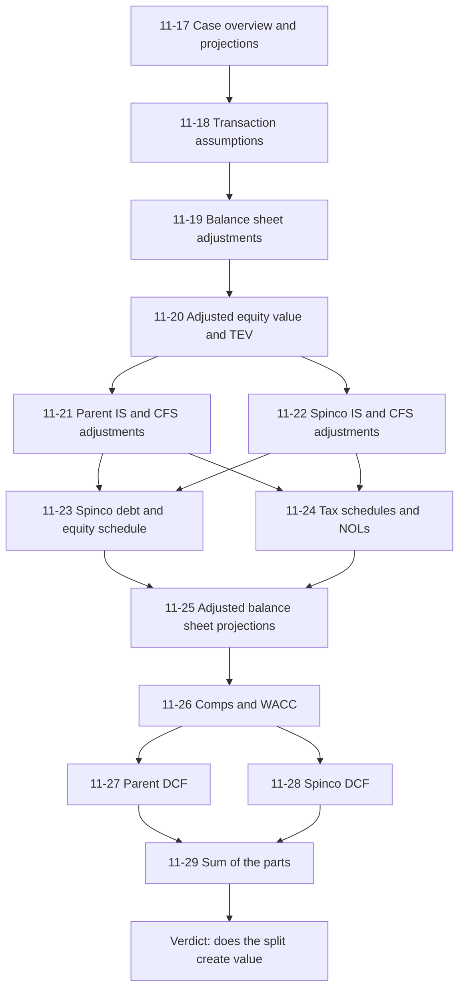
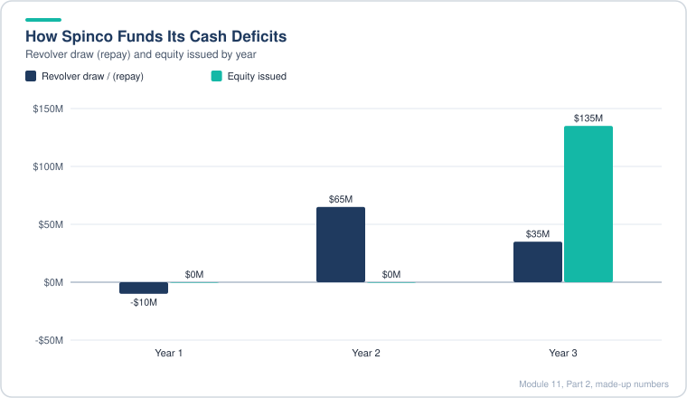
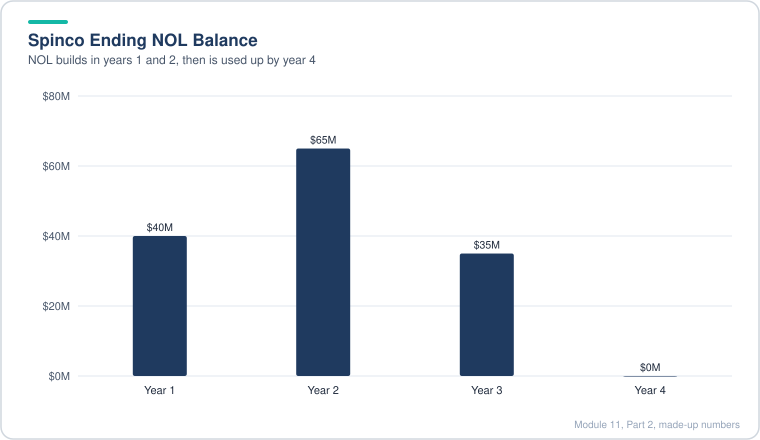
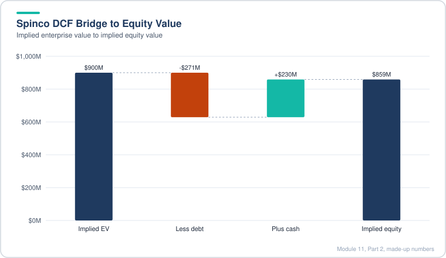
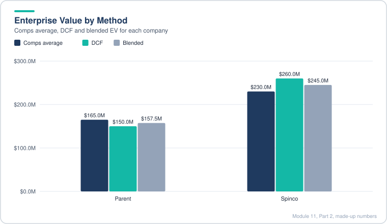
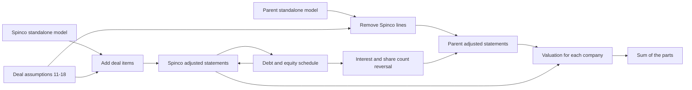
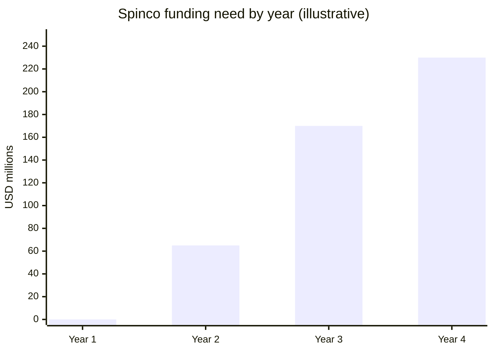
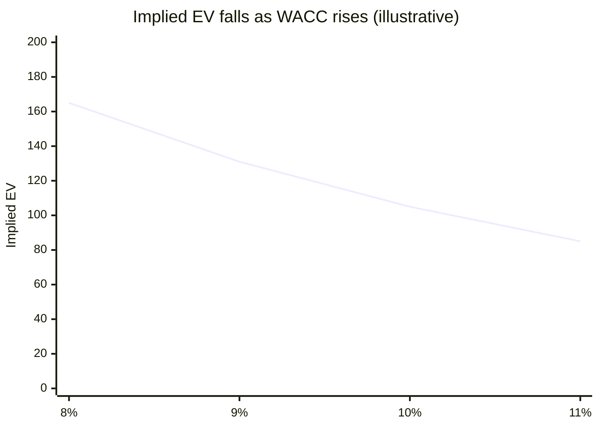
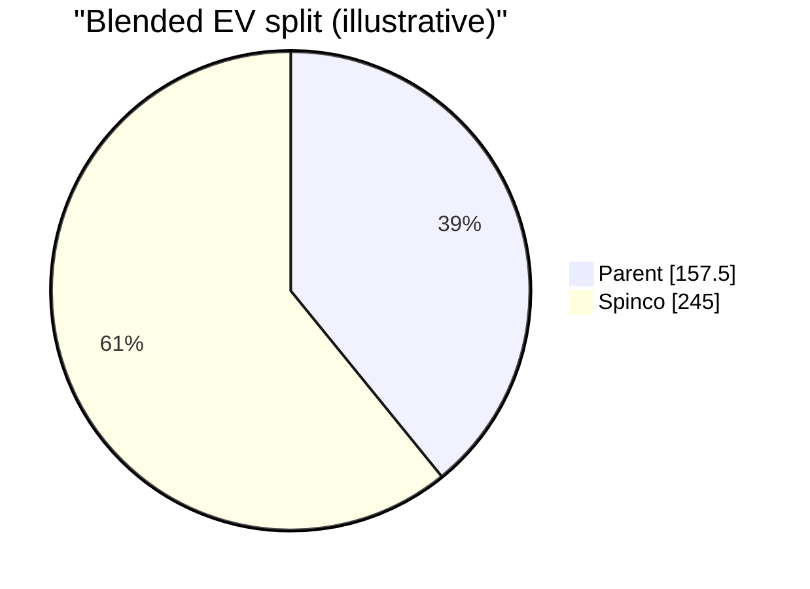
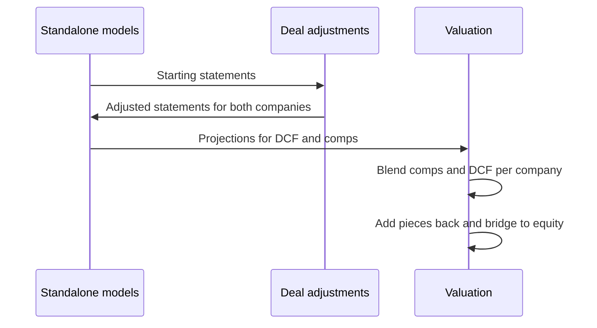

# Module 11, Part 2: Advanced M&A Concepts

[← Previous: Module 11, Part 1](11-advanced-m-and-a-concepts-part-1.md) · [Contents](../README.md) · [Next: Module 11, Part 3 →](11-advanced-m-and-a-concepts-part-3.md)

<details>
<summary><b>Contents</b></summary>

- [Overview](#overview)
- [Module Map](#module-map)
- [Lessons](#lessons)
  - [11.17 Case Overview and Standalone Projections](#1117-case-overview-and-standalone-projections)
  - [11.18 Transaction Assumptions](#1118-transaction-assumptions)
  - [11.19 Balance Sheet Adjustments for Parent and Spinco](#1119-balance-sheet-adjustments-for-parent-and-spinco)
  - [11.20 Transaction-Adjusted Equity Value and Enterprise Value](#1120-transaction-adjusted-equity-value-and-enterprise-value)
  - [11.21 Parent Income Statement and Cash Flow Adjustments](#1121-parent-income-statement-and-cash-flow-adjustments)
  - [11.22 Spinco Income Statement and Cash Flow Adjustments](#1122-spinco-income-statement-and-cash-flow-adjustments)
  - [11.23 Spinco Debt and Equity Schedule](#1123-spinco-debt-and-equity-schedule)
  - [11.24 Tax Schedules and NOLs After the Spinoff](#1124-tax-schedules-and-nols-after-the-spinoff)
  - [11.25 Adjusted Balance Sheet Projections](#1125-adjusted-balance-sheet-projections)
  - [11.26 Public Comps and WACC for Both Companies](#1126-public-comps-and-wacc-for-both-companies)
  - [11.27 Parent 15-Year Unlevered DCF with NOLs](#1127-parent-15-year-unlevered-dcf-with-nols)
  - [11.28 Spinco 15-Year Unlevered DCF with NOLs](#1128-spinco-15-year-unlevered-dcf-with-nols)
  - [11.29 Sum-of-the-Parts Valuation and the Case Answers](#1129-sum-of-the-parts-valuation-and-the-case-answers)
- [Diagrams and Charts](#diagrams-and-charts)
- [Excel Model Walkthrough](#excel-model-walkthrough)
- [Interview Questions](#interview-questions)
- [Career Angle](#career-angle)
- [Cheat Sheet](#cheat-sheet)

</details>

## Overview

A spinoff is a tax-free distribution of a business to shareholders, and the job is to rebuild both companies as standalone statements, value each piece on its own, then add the pieces back up as a sum of the parts to see if the split creates value.

This part covers lessons 11.17 to 11.29, one long case study. The case follows a parent company that spins off its manufacturing arm, brings in a strategic investor, and asks whether the split is worth doing. Each lesson adds one layer to the same model.

## Module Map



## Lessons

### 11.17 Case Overview and Standalone Projections

- **Why spin off.** A spinoff separates one business from a larger company and gives its shares to the existing holders. The usual reason is valuation. The market often pays a lower multiple for a group of unrelated businesses (a conglomerate discount), so a clean, focused company can be worth more on its own than as one piece of the whole.
- **What the analysis is not.** EPS accretion or dilution, contribution analysis, synergies and IRR versus a hurdle rate are not the point here. Nothing is being bought, so the question is simply: are the two companies worth more separately than together?
- **Structure in the case.** A parent company (call it Parent) owns 100% of a manufacturing subsidiary (call it Spinco). Parent creates a new public company from Spinco, distributes its shares to Parent holders, and drops its ownership to 0%. The distribution ratio sets how many Spinco shares each Parent holder gets per Parent share.
- **Ownership is layered.** A large outside holder may own a majority of Parent, and Parent's own shares do not change in a spinoff. A third investor can buy a stake in Spinco at close, so the Spinco shareholder base is a mix of the old Parent holders and the new investor.
- **The multiple gap.** The case compares trading multiples. Installers and services businesses with negative margins still trade at 5x to 6x revenue, while manufacturers trade near 1x. Parent as a blend trades near 1x, so the market is pricing it like a manufacturer. If the pieces trade at their own multiples, the blended multiple could rise a lot even though Spinco trades at a low multiple.
- **Projections are driven by volume and price.** Solar revenue is megawatts installed times price per watt. Volume grows fast, prices fall each year, and the net result is revenue growth that slows down over time.
- **Funding link.** Spinco's large capex was funded by Parent issuing debt and equity each year. After the spinoff, that funding stops, so the capex needs a new source. This "net parent contribution" line is the thing to watch.

> [!TIP]
> **Going further.** The conglomerate discount is real but not automatic. Spinoffs often fail to unlock value if the spun company has weak margins, high capex needs or no standalone financing. Check whether the pieces would be financially viable on their own before assuming the multiples will rise.

**Worked example (made-up numbers)**

| Item | Combined | Parent (after) | Spinco |
|---|---|---|---|
| Revenue | 1,000 | 600 | 400 |
| EV / Revenue | 1.0x | 3.0x | 0.6x |
| Implied EV | 1,000 | 1,800 | 240 |
| Blended multiple (sum of EV / revenue) | 1.0x | | 2.04x on 2,040 total |

The combined company was worth 1,000. The two pieces together are worth 2,040 on their own multiples, so the split creates 1,040 of paper value. That gap is exactly what the rest of the module tries to test honestly.

> [!WARNING]
> **Common mistake.** Applying a segment multiple to the wrong revenue. Make sure the segment figures net out intersegment sales first, or you double count revenue that is only one company's sale to the other.

### 11.18 Transaction Assumptions

This lesson sets up the deal inputs that every later schedule depends on. It covers three things: the share count and equity value of the new company, the debt raised at close, and the cash that moves between the two companies at close.

**1. Shares created and post-money equity value**

```
New shares      = Parent diluted shares x distribution ratio
Distribution $  = New shares x opening share price
Post-money equity = Distribution $ + new cash invested at close
Investor stake  = Investment / Post-money equity
Post-money shares = New shares / (1 - Investor stake)
```

- Use the **diluted** share count (it includes unvested restricted stock units). The basic count produced a stake and a valuation that did not match the company's own disclosures.
- A new equity investment raises equity value but not enterprise value, because the cash that comes in sits on the balance sheet and offsets the higher equity value.

**2. Debt raised at close**

- A revolver (a bank credit line) is sized on its maximum capacity, but only the drawn part is debt. Issuance fees are charged on the full facility, not on the drawn amount.
- A convertible note is split into a debt piece and an equity piece (the conversion option). The debt carrying value is the face less issuance fees less the equity component.
- Issuance fees are capitalized and amortized over the life of the instrument, so each year's interest expense includes a non-cash fee amortization.

**3. Cash that moves at close**

```
Pre-deal cash
  - Note repaid to Parent
  - Transaction expenses reimbursed to Parent
  + Revolver draw, net of fees
  + Convertible proceeds, net of fees
  - Prepaid hedge or forward paid
  = Cash before the new investment
Excess (or deficit) vs minimum cash = Cash before investment - minimum cash
```

If the excess is positive, the spun company pays it to the parent. If it is negative, the parent funds the shortfall.

**Worked example (made-up numbers)**

| Step | Value |
|---|---|
| Parent diluted shares | 160M |
| Distribution ratio (1 new per 8) | 0.125x |
| New shares | 20.0M |
| Opening price | $30.00 |
| Distribution value | $600M |
| Investor cash at close | $250M |
| Post-money equity | $850M |
| Investor stake | 29.4% |
| Post-money share count | 28.3M |
| Revolver: fee on $100M line at 1.5% | $1.5M |
| Revolver book value (drawn $10M less fee) | $8.5M |
| Convertible: $200M face, 3% fee, $40M equity piece | Debt book $154M |
| Pre-deal cash $150M, less $100M note, less $25M expenses, plus $8.5M revolver, plus $194M convert, less $30M hedge | $197.5M |
| Excess over $50M minimum | $147.5M paid to parent |

> [!TIP]
> **Going further.** Real deals often close mid-year, so a year-end close is a simplification. The model treats it as a year-end event so the annual schedules line up. Also, the excess cash payment is a negotiated term, not a formula. Read the investment agreement, because the model follows the agreement, not a general rule.

> [!WARNING]
> **Common mistake.** Forgetting that the new company's opening share count depends on the parent's diluted shares at the record date, not the year-end count. Using a different share base makes the investor stake drift away from the number in the deal documents.

### 11.19 Balance Sheet Adjustments for Parent and Spinco

This lesson rebuilds the balance sheets for both companies after the split. The method has two halves: take out the Spinco balance sheet from Parent, then make smaller reclassifications, then let equity absorb whatever is left so the balance sheet still balances.

**Parent (the company that spins off)**

- Going from 100% to 0% ownership means every Spinco asset, liability and equity line is removed in one move. Assets are credited, liabilities and equity are debited.
- On top of that, a few small items move with Spinco: intercompany prepaid expenses, some PP&E and lease assets, some intangibles and intercompany accrued liabilities. These are adjusted line by line from the reclassification table.
- Cash is the one line that needs a judgment: add up everything Spinco pays Parent at close (note repayment, expense reimbursement, and any excess cash), with deficits flipped to negatives.
- Equity is the plug. Sum the other adjustments (assets less liabilities) and the gap is the equity change. The balance sheet has to balance, so that gap is forced into common equity.
- Goodwill and non-controlling interests do not change. Spinco was an internal division, never bought, so there is no goodwill to move, and no partial ownership to report.

**Spinco (the new public company)**

- Spinco already has its own balance sheet in the model, so the work is smaller: flip signs on the reclassified lines, add the new convertible and drawn revolver at book value (net of fees), and enter the cash and equity items.
- Cash in: revolver and convertible proceeds, plus the investor cash, minus any amount owed to Parent. If Spinco is short of cash, the sign flips and Parent pays Spinco instead. A MIN and MAX pair handles both cases.
- Equity: the investor cash and the convertible equity component boost equity. A large negative adjustment removes Parent's historical net contribution to Spinco, so the net equity change is much smaller than the cash raised.

```
Parent equity change   = Sum of asset adjustments - Sum of liability adjustments - Spinco equity removed
Spinco equity change   = Assets adjustments - Liabilities adjustments - investor cash - convertible equity piece - net parent contribution removed
```

**Worked example (made-up numbers)**

| Item | Before | Adjustment | After |
|---|---|---|---|
| Parent cash | 500 | -120 (Spinco cash removed), +150 received from Spinco | 530 |
| Parent PP&E | 800 | -300 (Spinco PP&E) -10 reclass | 490 |
| Parent equity | 1,400 | balancing figure (illustrative) | 1,213 |
| Spinco revolver (book) | 0 | +8.5 | 8.5 |
| Spinco convertible (debt book) | 0 | +154 | 154 |
| Spinco equity | 300 | +250 investor, +40 convert equity, -375 parent contribution removed | 215 |

The Spinco equity line looks small next to the 290 of new capital because most of it offsets the historical contribution from Parent.

> [!TIP]
> **Going further.** A spinoff is not a sale, so there is no gain or loss on the transfer. The equity plug is an accounting convenience. In a real filing, a spinoff shows up as a reduction in the parent's equity, and the reclassification lines are disclosed in the carve-out notes. Always tie the plug back to a disclosed number before you trust it.

> [!WARNING]
> **Common mistake.** Setting Spinco's cash to zero before adding the investor proceeds, or forgetting that the net parent contribution is buried in equity rather than shown as its own line. Both break the balance check in ways that look like a formula error but are really missing reclassifications.

### 11.20 Transaction-Adjusted Equity Value and Enterprise Value

Lessons 11.18 and 11.19 set up the deal and the balance sheets. This lesson turns them into two valuation starting points, one per company: equity value and enterprise value (TEV), adjusted for the deal. Parent already has a market price, so its figures start from the current market bridge. Spinco is not trading yet, so its figures are built from scratch off its balance sheet.

**Parent: start from today's market numbers and adjust**

```
Parent adjusted equity value = Parent current equity value - Spinco distribution value
```

- Use the distribution value (shares created times the opening price), not the post-money value. The investor cash is not yet on Parent's books, so including it would double count.
- For each bridge item (cash, equity investments, debt, minority interest), start from the current bridge and apply the balance sheet adjustments from 11.19. Cash is reduced by everything Spinco takes out, and debt is reduced by Spinco's debt.
- NOLs are handled separately (see below), and the result is summed into TEV.

**Parent NOL value after the split**

```
Spinco share of combined NOL = Combined off-balance NOL - Spinco NOL
Spinco DTA (net)             = Spinco NOL x tax rate x (1 - valuation allowance / gross DTA)
```

The valuation allowance matters because it is management's own estimate that part of the asset will never be used. The net value of an NOL is the tax saving you expect to actually use.

**Spinco: start from its own balance sheet, after the investor**

- Equity value is the post-money equity value (investor cash included), because Spinco is valued after the deal.
- Cash, equity investments and minority interest come from the balance sheet at the last reported year end, adjusted by the deal.
- Debt uses face values, not market values, for both the existing notes and the new revolver and convertible. Market values are not disclosed, and the difference is small for these short-tenor instruments.
- Spinco's tax rate is lower after the move to a low-tax jurisdiction, so the NOL value uses the new rate.

**Worked example (made-up numbers)**

| Item | Parent | Spinco |
|---|---|---|
| Equity value (Parent: current less distribution; Spinco: post-money) | 1,000 - 600 = 400 | 1,100 |
| Plus debt at face | 350 | 61 + 10 revolver + 200 convert = 271 |
| Less cash after deal adjustments | 60 | 80 + 150 deal cash = 230 |
| Less NOL value (net of allowance) | 40 | 25 |
| Transaction-Adjusted TEV | 400 + 350 - 60 - 40 = 650 | 1,100 + 271 - 230 - 25 = 1,116 |

Together the two TEVs come to 1,766. Compare that with the combined company's own TEV before the deal, and the difference is what the market has to agree to for the split to add value. The model does not decide that yet. It only sets up the starting values for the valuation lessons.

> [!TIP]
> **Going further.** Mixing market values for one company with face values for the other is a common shortcut. It works when the debt trades near par, which is true for most investment grade debt but less so for distressed or convertible debt. A convertible's market value can move a lot with the stock price, so face value is an approximation.

> [!WARNING]
> **Common mistake.** Reusing the post-money equity number for the parent. The investor cash does not belong on the parent's balance sheet, so subtract the distribution value instead.

### 11.21 Parent Income Statement and Cash Flow Adjustments

Here the model builds the post-spinoff income statement and cash flow statement for Parent. The method is subtractive: take the combined company's numbers, remove everything that belongs to Spinco, then add back a few items that are reallocated on purpose.

**Income statement, in order**

```
Revenue                 = Combined revenue - Spinco revenue
Cost of revenue         = Combined cost - Spinco cost (including intersegment items)
Gross profit            = Revenue - cost of revenue
Operating expenses      = Combined opex - Spinco opex
                          - corporate overhead reallocated to Spinco
                          - D&A reallocated to Spinco
                          + one-time deal fees (zero after close)
Interest expense        = Parent interest - Spinco's own interest (but keep parent-funded portion)
Income tax              = Pre-tax income x Parent tax rate
Net income to parent    = Pre-tax income - tax +/- equity investment and minority items
```

- Revenue and cost are reversed one for one. The only trap is intersegment eliminations: if the parent sold to Spinco, that sale disappears on both sides once the companies separate.
- Only Spinco's **own** interest expense is removed. Some interest shown on Spinco's statements is really the parent's cost of funding Spinco. That part stays with Parent.
- Equity investment and minority interest lines are taken from Parent, with Spinco's amounts reversed.

**Cash flow statement, in order**

- Net income and non-cash items: take the parent figure, subtract Spinco's version, and reverse the reallocated D&A.
- Working capital and investing: take parent less Spinco, line by line. Small leftover differences are ignored, because the balance sheet adjustments in 11.19 already cover them.
- Financing: remove the debt and equity Parent was raising to fund Spinco's capex. Show the original funding line and a separate reversal line. This makes it obvious what the deal changed.
- Beginning cash for the first projected year is the post-transaction cash balance from 11.19, not the old year-end cash.

**Interest and share count reversal**

```
Interest saved  = Cumulative debt funding removed x effective rate
Shares removed  = Cumulative equity funding removed / Parent share price
```

The share price is the pre-deal price on purpose. The projections were built off that price, so dividing by today's price reverses exactly the share count that was projected.

**Worked example (made-up numbers, one year)**

| Item | Combined | Spinco | Parent after |
|---|---|---|---|
| Revenue | 900 | 300 | 600 |
| Gross profit | 180 | -20 | 200 |
| Operating expenses | 200 | 60 | 200 - 60 - 10 overhead - 5 D&A = 125 |
| Operating income | -20 | -80 | 200 - 125 = 75 |

The point is that the reallocated overhead and D&A leave Parent and land on Spinco. Parent's operating income looks better after the split, but Spinco's standalone loss grows by the same 15. Any single-company view has to show both sides of a reallocation, or it flatters one company.

**Accretion and dilution**

```
EPS accretion = (Post-spinoff EPS - Pre-spinoff EPS) / Pre-spinoff EPS
```

The result is usually strongly accretive when the spun business has lower margins and it is also the business that eats up the most capex. Removing the funding requirement is a large part of the effect.

> [!TIP]
> **Going further.** Accretion or dilution is a weak test for a spinoff. The shareholder does not sell anything, so EPS change is mostly a side effect of which costs stay where. Use it as a sanity check, not as the reason to do the deal. A spinoff that looks accretive mainly because the spun business lost money has not created value by itself.

> [!WARNING]
> **Common mistake.** Forgetting that the interest saved and the shares removed must move together. If interest is reversed but the share count is not, EPS looks inflated or deflated for reasons that have nothing to do with the business.

### 11.22 Spinco Income Statement and Cash Flow Adjustments

Spinco is already modeled as a separate business, so this lesson is mostly linking and reclassifying rather than subtracting. The new items are the costs that only exist because the company is now standalone.

**Income statement, in order**

```
Revenue                 = Spinco standalone revenue
Cost of revenue         = Spinco standalone cost of revenue
Gross profit            = Revenue - cost of revenue
Operating expenses      = Standalone opex
                          + overhead reallocated from Parent (now Spinco's cost)
                          + D&A reallocated from Parent
                          + dis-synergies (new, standalone costs)
Operating income        = Gross profit - operating expenses
Interest expense        = Spinco's own interest + new debt interest (from 11.23)
                          - reversal of Parent interest shown on Spinco's statements
Income tax              = -Pre-tax income x Spinco tax rate
```

- **Dis-synergies** are new costs with no offset. A standalone company has to rebuild services that used to be shared, so its own overhead rises. This is different from a reallocation, which moves an existing cost from one company to the other.
- **Tax rate** changes after the move. A relocated headquarters can bring a lower statutory rate. The blended rate is a judgment, so set it a few points above the statutory rate if the company still earns income in higher-tax countries.
- Lines that depend on the new debt (new interest, commitment fees, fee amortization) are left blank until the debt schedule is built.

**Cash flow statement**

- Net income is the starting point, then the standard reversals for equity investments and minority interest.
- Add back Spinco's depreciation, amortization and stock compensation, plus the newly reallocated D&A, since it is non-cash.
- Remove the parent's non-cash interest portion, pro-rated to the share of the interest that belongs to Parent.
- Working capital and investing link to the standalone statements.
- Financing: show the old net parent contribution as a negative, so the reversal is visible. Debt and equity raised by the schedule are added later.

**What the first pass shows**

```
Spinco cash balance (before the debt schedule) = deeply negative in the early years
```

That is the key finding of the lesson. Once the parent stops funding capex, the company runs out of cash fast. The transaction proceeds alone are not enough, and the model has to show a revolver draw or new equity.

**Worked example (made-up numbers, one year)**

| Line | Value |
|---|---|
| Revenue | 300 |
| Gross profit | 30 |
| Standalone opex | 45 |
| Overhead from Parent | 10 |
| D&A from Parent | 5 |
| Dis-synergies (new) | 8 |
| Operating expenses after deal | 68 |
| Operating income | 30 - 68 = -38 |
| Free cash before new funding | Negative, roughly -60 once capex is included |

The -60 is a rough, illustrative figure. The point is the direction: Spinco turns from a business funded by Parent into one that has to fund itself, and its capex is large enough that it cannot.

> [!TIP]
> **Going further.** Dis-synergies are often underestimated in spinoff plans. Management usually plans for them, but in a real carve-out they show up as extra audit, IT, legal, treasury and benefits costs. Expect a few years of duplicate cost before scale catches up.

> [!WARNING]
> **Common mistake.** Treating a reallocated cost as a saving. If Parent's overhead moves to Spinco, the combined company's total cost is unchanged. Only dis-synergies, which are truly new, make the combined company worse.

### 11.23 Spinco Debt and Equity Schedule

Once the parent stops funding Spinco, Spinco has to fund itself. This schedule answers the question "how much new money does the company need each year, and where does it come from?" The answer is a waterfall: use the revolver first, then issue equity once the revolver is full.

**The funding waterfall**

```
Cash before new financing  = Beginning cash + operating CF + investing CF
                             + financing CF excluding revolver and new equity
Surplus / (deficit)        = Cash before new financing - minimum cash
Funding need               = MAX(-Surplus, 0)

If surplus > 0:
    Revolver draw/(repay)  = -MIN(beginning drawn revolver, surplus)
Else:
    Revolver draw/(repay)  = MIN(funding need, max revolver - beginning drawn revolver)

Equity issued              = MAX(funding need - revolver draw, 0)
```

- **Use beginning balances for interest.** Using the average balance would create a circular reference (interest depends on the balance, which depends on interest). Beginning balances break the loop and are close enough for a model like this.
- **Revolver interest and fees.** Cash interest is the rate times the beginning drawn balance. The commitment fee is charged on the undrawn part, also on the beginning balance. As the line fills up, the fee goes to zero.
- **Convertible notes.** Interest is the coupon times face. Two non-cash items sit on top: amortization of the issuance fee and amortization of the equity discount. Straight-line amortization is a fine simplification.

**Why the convertible has two non-cash items**

A convertible is split into a debt piece and an equity piece (the value of the conversion option). The equity piece is recorded as a discount on the debt. That discount is amortized into interest expense over the life of the note, so the reported interest is higher than the cash coupon. The cash flow statement adds that amortization back, because no cash leaves the company for it.

**Worked example (made-up numbers, three years)**

| Year | Cash before financing | Minimum | Surplus / (deficit) | Revolver draw / (repay) | Equity issued |
|---|---|---|---|---|---|
| 1 | 70 | 50 | +20 | -10 (repay drawn balance) | 0 |
| 2 | -15 | 50 | -65 | +65 (drawn balance now 65) | 0 |
| 3 | -120 | 50 | -170 | +35 (drawn balance now 100, the full line) | 135 |



*Spinco uses the revolver first and only issues equity in year 3, once the line is full.*

In year 1 the company has more cash than it needs, so it pays down the drawn revolver first. In year 3 the revolver is full, so the rest of the need is covered with equity. Both the debt and equity lines feed back into the cash flow statement and the balance sheet.

> [!TIP]
> **Going further.** The waterfall is an approximation of how a real treasury works. In practice the revolver often has a borrowing base (a cap tied to receivables and inventory), so the usable amount can be lower than the headline size. Also, a company that must issue equity to fund capex is signaling a weak standalone balance sheet, and the market usually prices that in before the issue happens.

> [!WARNING]
> **Common mistake.** Letting the revolver draw go above the facility size, or letting it go negative (a repayment larger than what is drawn). Both come from skipping the MIN and MAX guards in the formulas.

### 11.24 Tax Schedules and NOLs After the Spinoff

The tax schedule is mostly a copy of the standalone NOL schedule from earlier modules. What changes is the starting NOL balance (which company keeps which losses), the tax rate and the amortization that feeds taxable income. Each company gets its own schedule.

**The standard NOL schedule**

```
Pre-tax book income
  + stock comp, impairments, amortization that differ for tax (book to tax)
= Taxable income before NOLs
NOL created  = MAX(-Taxable income, 0)
NOL used     = MIN(beginning NOL, MAX(Taxable income, 0))   [limited in practice]
NOL ending   = Beginning + created - used
Taxable income after NOLs = Taxable income - NOL used
Cash taxes   = MAX(Taxable income after NOLs, 0) x tax rate
Deferred tax = Cash taxes - book tax expense
```

Two points about the formulas:

- **Deferred tax must subtract book tax, not some other line.** The first draft of the schedule pulled the wrong row. Book tax expense is on the income statement, so the deferred tax line should reference it directly.
- **Losses create a benefit on paper, not in cash.** When a company has negative pre-tax income, the income statement shows a tax benefit. No cash comes back, so the difference is booked as a deferred tax asset that is only used in later profitable years.

**What changes for each company**

| Item | Spinco | Parent |
|---|---|---|
| Starting NOL | Standalone NOL (gets its own losses) | Combined NOL less Spinco's share |
| Tax rate | New, lower rate after the move | Unchanged |
| Amortization | Increased by reallocated intangibles | Decreased by the same amount |
| Pattern | Creates NOLs for several years, then uses a little | Uses NOLs quickly, then pays cash tax |

**Worked example (made-up numbers)**

| Year | Taxable income before NOL | NOL created | NOL used | Ending NOL | Cash tax at 21% |
|---|---|---|---|---|---|
| 1 | -40 | 40 | 0 | 40 | 0 |
| 2 | -25 | 25 | 0 | 65 | 0 |
| 3 | 30 | 0 | 30 | 35 | 0 |
| 4 | 50 | 0 | 35 | 0 | (50 - 35) x 21% = 3.2 |



*Losses build the NOL in the first two years and later profits use it up, so cash tax only appears in year 4.*

In year 4 the NOL runs out partway through, so the company pays cash tax only on the excess. The pattern is the same as the spinoff case: the company looks profitable on paper for a while but pays almost nothing in cash.

> [!TIP]
> **Going further.** In the US, NOL use after an ownership change is limited by Section 382. A spinoff or a large new equity investment can trigger that limit, which cuts the value of the NOL. The model here assumes the NOLs survive. A real deal needs a tax review before anyone puts a dollar value on them. Also, NOLs arising after 2017 can only offset about 80% of taxable income, so the simple formula above overstates use in those cases.

> [!WARNING]
> **Common mistake.** Splitting the NOL balance by the book loss instead of the tax loss. The two differ by stock comp, impairments and tax-versus-book amortization, so the split should come from the tax footnote.

### 11.25 Adjusted Balance Sheet Projections

The last step before valuation is to finish the balance sheet for both companies so that it balances every year. The usual three-statement method projects each balance sheet line and derives the cash flow from the change. Here the cash flow statement has already been adjusted for the deal, so it is easier to go the other way: each balance sheet line links to the prior year plus the matching cash flow lines.

**Linking rules**

| Balance sheet line | Formula idea |
|---|---|
| Cash | Ending cash from the bottom of the cash flow statement |
| Receivables, inventory, other current assets | Prior balance less the cash flow change (an increase in the asset is a use of cash) |
| Accounts payable, accrued liabilities, contract liabilities | Prior balance plus the cash flow change |
| Net PP&E | Prior balance less depreciation (including the part sent to Spinco), less impairments, plus capex, less disposal proceeds |
| Intangibles | Prior balance less amortization (including the part sent to Spinco), plus purchases |
| Equity investments | Prior balance plus the equity income and purchases, less dividends and gains |
| Total debt | Prior balance plus issuances, less repayments, plus non-cash interest and accretion |
| Common equity | Prior balance plus net income to parent, plus stock comp, plus stock issued, plus FX |
| Non-controlling interest | Prior balance plus its share of income, plus contributions, less distributions |

**Sign reminders**

- An increase in an asset shows as a negative on the cash flow statement, so the balance sheet formula subtracts it.
- An increase in a liability shows as a positive, so the formula adds it.
- A non-cash expense that increases debt (like amortization of a discount on a convertible) is added to debt, because the carrying amount grows toward face value over time.

**The balancing check**

After linking, total assets must equal total liabilities plus equity every year. If it does not, the usual cause is a line on the cash flow statement that was never linked to any balance sheet item. The fix is to find the missing line and place it somewhere. Common equity is the safe catch-all: it can absorb a small leftover without changing the valuation, because the valuation uses cash flow and revenue, not book equity.

**Worked example (made-up numbers, one year, Spinco)**

| Line | Prior year | Change or flow | Current year |
|---|---|---|---|
| Accounts receivable | 60 | +5 (cash flow shows -5) | 65 |
| Net PP&E | 300 | +120 capex, -40 depreciation, -10 sent to Parent, -5 impairment | 365 |
| Total debt | 271 | +20 non-cash accretion, +40 new revolver draw | 331 |
| Common equity | 215 | +(-45) net loss, +3 stock comp | 173 |

The check is then Assets = Liabilities + Equity, which balances only once every line is connected.

> [!TIP]
> **Going further.** Linking balance sheets through the cash flow statement is a shortcut. It works only when the cash flow statement is complete. A real company's balance sheet also moves for reasons outside the cash flow (currency translation, acquisitions, pension remeasurement), so the standard practice is to reconcile each line to a disclosed roll-forward, not just to the total.

> [!WARNING]
> **Common mistake.** Projecting the balance sheet independently of the cash flow and then adding a "plug" to force it to balance. That hides errors. Link everything, and use the plug only for a tiny, explained residual.

### 11.26 Public Comps and WACC for Both Companies

Before any DCF or sum-of-the-parts, each company needs two things: a set of trading multiples from comparable companies, and a discount rate (WACC). This lesson builds both. The comp sets are provided; the work is linking the right post-deal figures into them.

**Building a comp row**

```
Equity value  = Share price x diluted shares (or link the post-deal equity value)
Enterprise value = Equity value + debt + preferred + minority interest
                   - cash - equity investments - non-core assets (and NOL value, per the bridge)
EV / Revenue  = EV / LTM or projected revenue
EV / EBITDA   = EV / EBITDA (use the same EBITDA definition for every comp)
```

- Use the company's **post-deal** numbers. A spinoff changes the share count and the balance sheet, so the old share price is meaningless.
- Keep the **same year** for every company. Misaligned columns are the most common error in comp sheets, because the source statements have different layouts.
- Good practice: include the projections that the multiple uses, so a reader can recompute the multiple.

**Reading the percentiles**

- Comp sets of about 5 to 10 companies give a usable range. Two companies are not a set; they are two data points.
- Look at the 25th percentile, median and 75th percentile, and ask whether the company sits inside the range or outside it.
- A high multiple on a thin set can be a sign of a merger or a one-off event, not a real signal.

**WACC, step by step**

```
Unlevered beta  = Levered beta / (1 + (1 - t) x D/E)     (for each comp)
Relevered beta  = Average unlevered beta x (1 + (1 - t) x target D/E)
Cost of equity  = Risk-free rate + beta x equity risk premium
Cost of debt    = pre-tax rate x (1 - t)
WACC            = E/(D+E) x Cost of equity + D/(D+E) x after-tax cost of debt
```

**Judgment calls in this lesson**

- **Beta from history.** After a spinoff the company is not the same business as the one that produced the historical beta, so the historical beta is a weak guide. The model uses it anyway because it sits in the middle of the range, but it is a flagged assumption.
- **Cost of debt.** The effective interest rate on the books is lower than the market rate, mostly because the convertible carries a low coupon. The model instead uses a rate for a comparable straight bond, set a few points above the coupon.
- **Shared inputs.** Both companies use the same risk-free rate and equity risk premium, so the WACC difference comes from beta and the capital structure, not from macro assumptions.

**Worked example (made-up numbers)**

| Item | Parent | Spinco |
|---|---|---|
| Comp median EV / revenue | 0.6x | 0.9x |
| Comp 75th percentile EV / revenue | 0.9x | 1.4x |
| Company EV / revenue | 0.5x | 1.0x |
| Relevered beta | 1.10 | 1.45 |
| Cost of equity (rf 4%, ERP 5%) | 9.5% | 11.25% |
| Pre-tax cost of debt | 7.5% | 10.0% |
| Debt weight | 40% | 25% |
| WACC (tax 22%) | 8.0% | 10.4% |

These are illustrative. The pattern to notice is that the company with the lower multiple is often the one with the lower WACC. A cheap multiple on a stable business can still be a lower-risk stock.

> [!TIP]
> **Going further.** A single discount rate for a company that is changing a lot is a simplification. A spinco that is turning from loss to profit is really a set of different businesses over time. Many analysts use a higher rate in the early years and a lower one later, or they use a country risk premium for a plant in an emerging market.

> [!WARNING]
> **Common mistake.** Using the reported effective interest rate as the cost of debt. The effective rate includes non-cash amortization and reflects old borrowing, not what the company would pay for new debt today.

### 11.27 Parent 15-Year Unlevered DCF with NOLs

This is the first full DCF in the case. It is a standard unlevered DCF with two extra features: the forecast runs 15 years instead of the usual 5, and the company's NOLs are built into the cash flows year by year rather than valued in the bridge.

**Layout of the DCF**

1. Revenue and EBIT, from the adjusted statements. Growth starts high and fades toward single digits. A CAGR check (the growth rate compounded over the last five years) confirms the path looks sensible.
2. EBIT margin held at a stable level. Non-cash and working capital lines are set as percentages of revenue or of the change in revenue, not as separate forecasts.
3. NOL schedule, then cash taxes, then NOPAT (EBIT less cash taxes).
4. Unlevered free cash flow = NOPAT + D&A + change in working capital - capex.
5. Discount each year's cash flow at WACC, then add a terminal value.
6. Bridge from enterprise value to equity value and a per-share figure.

**The NOL logic inside the cash flows**

```
NOL created    = MAX(-EBIT, 0)
NOL used       = MIN(beginning NOL + created, MAX(EBIT, 0))  (limited to the positive EBIT)
Cash taxes     = MAX(EBIT - NOL used, 0) x tax rate
NOPAT          = EBIT - cash taxes
```

Because the NOL is already in the cash taxes, it must not also appear as a separate asset in the bridge. Counting it twice is the most common mistake here.

**Terminal value and leftover NOLs**

```
TV (perpetuity)  = UFCF in final year x (1 + g) / (WACC - g)
PV of TV         = TV / (1 + WACC)^N
PV of leftover NOL = Ending NOL in year N x tax rate / (1 + WACC)^N
Implied EV       = Sum of PV of UFCF + PV of TV + PV of leftover NOL
Implied TV / EBITDA multiple = TV / EBITDA in year N
```

The implied multiple is a sanity check. If the perpetuity method gives an exit multiple far from the trading comps, one of the two methods is probably wrong.

**Worked example (made-up numbers, 3 years shown)**

Assume WACC 9%, terminal growth 2%, tax rate 25%, starting NOL zero.

| Year | EBIT | NOL created | NOL used | Cash tax | NOPAT | D&A | Change in WC | Capex | UFCF |
|---|---|---|---|---|---|---|---|---|---|
| 1 | -20 | 20 | 0 | 0 | -20 | 10 | -5 | -30 | -45 |
| 2 | 30 | 0 | 20 | 2.5 | 27.5 | 12 | -6 | -25 | 8.5 |
| 3 | 45 | 0 | 0 | 11.25 | 33.75 | 13 | -7 | -26 | 13.75 |

- PV of the three years: -45 / 1.09 + 8.5 / 1.09^2 + 13.75 / 1.09^3 = -41.3 + 7.2 + 10.6 = -23.5.
- Terminal value at year 3: 13.75 x 1.02 / (0.09 - 0.02) = 200.4. PV = 200.4 / 1.09^3 = 154.7.
- Implied EV = -23.5 + 154.7 = 131.2.
- Implied TV / EBITDA (year 3 EBITDA = 58): 200.4 / 58 = 3.5x.

Notice that the terminal value is more than 100% of the enterprise value. This is a warning sign, not a success. It happens because the early years are negative, so all of the value sits in the far future. The lesson's guidance is that terminal value should usually be under half of the total, and a model that breaks that rule needs a closer look at its assumptions.

**Bridge**

- Start from implied EV, subtract debt and add cash and investments, as usual.
- Set the NOL line in the bridge to zero, because the NOL value is already in the cash flows and the leftover NOL is in the terminal value.
- Compute the premium or discount against the transaction-adjusted equity value, not the old share price, because the spinoff changes the equity value.

**Sensitivity tables**

- Two tables are common: terminal growth against discount rate, and terminal EBITDA multiple against discount rate. Keep growth in a narrow band (low single digits).
- The two methods will not line up exactly. A terminal multiple can only match a growth rate for one specific set of cash flows. Pick a multiple that is close to the implied value and say so.

> [!TIP]
> **Going further.** The 15-year horizon is chosen because the company is still ramping. A five-year DCF would miss most of the value. The cost is that every number after year 5 is a guess. Always show how much of the value comes from years beyond the normal forecast window.

> [!WARNING]
> **Common mistake.** Using book EBIT for NOL tests when the tax code uses taxable income. Book and tax income differ, so the NOL schedule should use taxable EBIT when the data allows it.

### 11.28 Spinco 15-Year Unlevered DCF with NOLs

The Spinco DCF uses the same skeleton as the Parent DCF in 11.27. The differences are in the assumptions: a company that grows faster but earns a thinner margin, spends a much larger share of revenue on capex and D&A, and keeps its NOLs for longer. This lesson is useful mainly as a reminder of what to check when you copy a model.

**What changes from the Parent DCF**

| Driver | Parent (services) | Spinco (manufacturing) |
|---|---|---|
| Revenue growth | Starts mid-teens, fades to single digits | Starts high (around 18%), fades to about 6% |
| EBIT margin | Stable near 11% | Rises from negative to about 9% |
| Capex, % of revenue | About 3.5% | About 7% |
| D&A, % of revenue | About 1.5% | About 5.5% |
| Tax rate for cash taxes | Parent rate | Spinco's lower post-move rate |
| Discount rate | Parent WACC | Spinco WACC (about 1 to 2 points higher) |
| Share of EV from terminal value | Under half | Around 90% or more |

**Assumptions have to be checked against each other**

The company's own guidance pairs very high revenue growth with a fairly high EBITDA margin. That combination is unusual, because growing companies usually reinvest and show lower margins. The model accepts the guidance, but the lesson points out the tension. A useful habit: write the margin, D&A and capex assumptions as a chain. If EBITDA margin is 12%, and D&A is 5.5% of revenue, then EBIT margin cannot exceed about 6.5% without another explanation. In the model the EBIT margin ends near 9% and D&A near 5.5%, so EBITDA lands a bit above the 12% target. That is a judgment call, and any write-up should say so.

**Terminal value dependence**

When 90% of the value sits in the terminal value, the DCF is really a bet on what the company looks like after year 15. Two things to do:

1. Test the terminal growth rate and the exit multiple separately. If the perpetuity method gives a multiple far above or below the trading comps, the cash flows and the discount rate may be inconsistent.
2. Ask how much the answer moves with a small change in the discount rate. A tight sensitivity table can look reassuring, but the table only shows the range you chose.

**Sensitivity table design**

- Growth is kept in a narrow band (0% to 2%) because a terminal growth rate above long-run GDP is hard to defend.
- Discount rate is centered on the WACC from 11.26, with a step of 0.25% so the table shows where the value moves.
- The exit multiple axis is chosen so that its middle matches the perpetuity result. Pick values that bracket the trading comps, not values that are easy to type.

**Worked example (made-up numbers, one year of the bridge)**

| Item | Value |
|---|---|
| Implied enterprise value (sum of PV of UFCF + PV of TV + PV of leftover NOL) | 900 |
| Less debt (book, face) | -271 |
| Plus cash | 230 |
| Less NOL (set to zero, already in cash flows) | 0 |
| Implied equity value | 859 |
| Diluted shares | 30.0M |
| Implied share price | $28.63 |
| Proposed share price | $30.00 |
| Premium or discount | -4.6% |



*Debt takes value away and cash gives some back on the way from enterprise value to equity value.*

The check at the end is simple: if the implied price is close to the price being proposed, the model is consistent with the deal. A large gap in either direction is the starting point for the question "why does the market disagree with us?"

> [!TIP]
> **Going further.** Using a single DCF to say a company is "about right" is weak evidence when the terminal value is 90% of the total. A model like this should be presented as a range with its key assumptions named, not as a point estimate. Also, a manufacturer that needs heavy capex to stay competitive is exposed to price cuts, so an assumption of falling prices with rising volume deserves a separate stress test.

> [!WARNING]
> **Common mistake.** Copying a DCF tab and forgetting to change the named references. The discount rate, tax rate, share count and terminal growth rate are often named cells. If one still points at the other company, the output looks reasonable and is wrong.

### 11.29 Sum-of-the-Parts Valuation and the Case Answers

The final lesson adds the two companies back together in a sum of the parts (SOTP), then asks whether the split creates value for the shareholders of the original company. It also answers the three written case questions. The SOTP is the most reusable piece here, so most of this section focuses on it.

**Step 1: value each piece on its own**

For each company, build a low and a high value from two methods:

```
Comps EV low   = 25th percentile multiple x company revenue
Comps EV high  = 75th percentile multiple x company revenue
DCF EV         = implied EV from the DCF range (its own low and high)
Blended EV     = AVERAGE(comps average, DCF)
```

The blend averages the revenue multiples into one number and then averages that with the DCF, so the multiples do not outweigh the DCF just because there are more of them. Use the same method for both companies, or the comparison is not fair.

**Step 2: add the pieces back and bridge to equity**

```
Combined EV             = Parent blended EV + Spinco blended EV
                          (+ any dis-synergy adjustment, set to zero if already in projections)
Combined equity value   = Combined EV - net debt before the split
Implied price           = Combined equity value / share count
Premium to current      = Implied price / current price - 1
```

- **Which bridge.** Use the pre-deal bridge when asking "what would the old combined company be worth if its pieces were valued separately?" That keeps the comparison clean.
- **Which share count.** The lesson reasons that the investor's new shares should not count, because they were not in the pre-deal capital structure. It also notes that the answer barely changes whichever share count you pick, which is a good sign that the result is robust.
- **Dis-synergies.** The corporate overhead line is set to zero because the standalone projections already include the reallocated overhead and the new dis-synergy cost. Adding them again would double count.

**Step 3: what the original shareholder owns**

```
Shareholder stake in Spinco    = Parent ownership x distribution ratio x Spinco shares
Value of stake before split    = Parent ownership x current Parent equity value
Value of stake after split     = Parent ownership x (Parent equity + Spinco equity)
```

Note that the holder does not change its ownership percentage in the parent. Only the number of companies it holds changes. The value uplift is simply the gap between the combined SOTP value and the pre-split value.

**Worked example (made-up numbers)**

| Item | Parent | Spinco |
|---|---|---|
| Revenue | 300 | 200 |
| Comps EV, 25th percentile | 0.4x = 120 | 0.8x = 160 |
| Comps EV, 75th percentile | 0.7x = 210 | 1.5x = 300 |
| Comps average | 165 | 230 |
| DCF EV | 150 | 260 |
| Blended EV | 157.5 | 245 |



*The blended EV sits between the comps average and the DCF for each company.*

- Combined EV = 157.5 + 245 = 402.5.
- Pre-split net debt = 120, so combined equity = 282.5.
- Shares = 30M, so implied price = $9.42.
- Current price $6.00, so premium = 57%.
- A holder owning 50% of the parent sees its stake move from 90 to 141.25.

**The case questions, answered**

1. **Is the investor cash enough to fund the capex?** Not on its own. The funding schedule in 11.23 shows a gap of several hundred million over the first four years even after the revolver is full. The investor cash covers the first leg. The best remaining option is probably a convertible or term debt, because the after-tax cost of debt is lower than the cost of equity. Equity raises are the most expensive source once the cost of equity is counted.
2. **Are the DCFs plausible?** Revenue growth is defensible for a fast-growing industry. The weak point is the margin path: EBIT margins rise sharply and turn positive in a few years. A better test is to anchor long-run EBITDA margins near the comparable median and see how far the value falls. Terminal value is most of the value, so this matters a lot.
3. **Should the parent proceed?** The math suggests the split can create value on paper, mostly because the services piece deserves a higher multiple. The case is weaker than the headline premium suggests once margins and multiples are cut back. The main risks are the margin assumptions, the thin comp set, the funding gap, NOL limits after the ownership change and the cost of dis-synergies. Changes that would make it more viable: secure committed financing before close, use cheaper debt for the funding gap, and phase the capex so it is not all committed at once.

> [!TIP]
> **Going further.** A large implied premium from a sum of the parts is a sign to slow down, not to celebrate. A 200% to 300% premium usually means the inputs are optimistic. The better habit is to show a range and ask what would have to be true for the premium to disappear. Also, spinoffs often disappoint in the first year because the new company has no analyst coverage and some holders sell it immediately. Plan for that.

> [!WARNING]
> **Common mistake.** Using the post-deal share count with the pre-deal net debt, or the reverse. The two must come from the same capital structure, or the implied price is off by the investor's stake.

**Interview angle.** This case is much more useful on the job than in interviews, and the SOTP is the piece worth knowing. If asked, be ready to explain the three steps above, why the blend is used, and why the valuation depends on margins more than on the discount rate.

## Diagrams and Charts

**1. How the deal flows through the statements**



**2. Spinco funding need by year (illustrative, from the worked waterfall in 11.23)**



**3. How the implied value moves with the discount rate (illustrative shape only)**



**4. Share of the blended value by company (from the worked SOTP example)**



**5. Order of the valuation steps**



## Excel Model Walkthrough

The case provides a solved workbook and a blank version of the same model. The solved file has eleven tabs, and the tab names tell you the flow.

| Tab | What it holds | Key links |
|---|---|---|
| SOTP_Val | Sum of the parts, implied prices, the investor's stake | Pulls implied EV from both DCFs and both comp sets |
| MAXN_Adj | Spinco adjusted statements, transaction assumptions, debt and equity schedule | Feeds Spinco DCF, comps and WACC |
| SPWR_Adj | Parent adjusted statements, cash and share reversals, NOL schedule | Feeds Parent DCF, comps and WACC |
| SPWR | Parent standalone three-statement projections (before the deal) | Source for the adjustments |
| MAXN | Spinco standalone three-statement projections | Source for the adjustments |
| SPWR_DCF | Parent 15-year unlevered DCF, bridge, sensitivity tables | Uses the adjusted statements |
| MAXN_DCF | Spinco 15-year unlevered DCF, bridge, sensitivity tables | Uses the adjusted statements |
| SPWR_Comps | Parent trading comps and multiples | Percentiles feed the SOTP |
| SPWR_WACC | Parent WACC build (unlever, relever, cost of equity, cost of debt) | Named discount rate |
| MAXN_Comps | Spinco trading comps and multiples | Percentiles feed the SOTP |
| MAXN_WACC | Spinco WACC build | Named discount rate |

**Key items and how they link**

- **Named ranges.** The model uses names such as the parent diluted shares, the distribution ratio, the subsidiary share total, the parent and subsidiary tax rates, the discount rates and the terminal growth rates. Using names keeps the DCF formulas readable and makes copying across tabs safer.
- **Column alignment.** The adjusted tabs have transaction columns between the historical and projected years, so the same fiscal year sits in a different column on each tab. Always check the header before you link.
- **Balance check rows.** Each adjusted tab ends with a balance check that should read zero every year. Keep it visible while you edit.
- **Solved vs blank.** Use the blank file for practice. The solved file shows the answer, so check your work against it only after you have built each step.
- **Before and after files.** The Before and After files show the model before and after the cells were filled in. Comparing the two is a quick way to see which formulas were added.

**Key formulas, described**

- Distributed shares = parent diluted shares x distribution ratio.
- Investor stake = investor cash / post-money equity.
- Blended EV = average of (average of comps low and high) and the DCF value.
- Cash taxes in the DCFs = taxable EBIT after NOL use x the tax rate for that company.
- Funding need = the negative of the minimum of the surplus and zero, with the revolver used first.

> [!TIP]
> **Practical tip.** The most expensive mistake in this model is a mis-aligned link to a column that looks right. Build a habit of checking one linked cell against the source tab every time you copy formulas across.

## Interview Questions

<details>
<summary><b>1. What is a spinoff, and how is it different from a sale?</b></summary>

A spinoff distributes shares of a subsidiary to the parent's existing shareholders, so no cash changes hands and there is no buyer. A sale transfers the business to a buyer for cash or stock.

</details>

<details>
<summary><b>2. Why would a company spin off a division?</b></summary>

Mainly valuation. A focused company often trades at a higher multiple than it does as part of a conglomerate, so the pieces can be worth more together than the whole.

</details>

<details>
<summary><b>3. Why don't you use EPS accretion or dilution for a spinoff?</b></summary>

Shareholders do not give up value in a spinoff; they hold two companies instead of one. EPS changes are a side effect of which costs move where, so they do not show whether value was created.

</details>

<details>
<summary><b>4. How do you split the balance sheet between parent and spinco?</b></summary>

Remove the spinco's assets and liabilities from the parent, make the small reclassifications for shared items, and let common equity absorb the balancing difference.

</details>

<details>
<summary><b>5. What is a distribution ratio?</b></summary>

The number of new shares a parent shareholder receives per parent share. In the case, one new share for every eight parent shares.

</details>

<details>
<summary><b>6. How do you compute the new company's post-money equity value?</b></summary>

Distribution value (new shares times opening price) plus any new investor cash raised at close.

</details>

<details>
<summary><b>7. What is the investor's stake?</b></summary>

Investor cash divided by post-money equity value. The post-money share count is the new shares divided by one minus that stake.

</details>

<details>
<summary><b>8. Why use the diluted share count?</b></summary>

Diluted shares include restricted stock units and reflect what the company will issue, so they match the company's own numbers better than basic shares.

</details>

<details>
<summary><b>9. How are convertible notes split on the balance sheet?</b></summary>

Into a debt piece and an equity piece (the conversion option). The equity piece is recorded as a discount on the debt and amortized into interest expense.

</details>

<details>
<summary><b>10. Why are issuance fees amortized?</b></summary>

Fees are paid up front but the financing lasts for years, so they are capitalized and expensed over the term. The amortization is non-cash, so it is added back in the cash flow.

</details>

<details>
<summary><b>11. What is a funding waterfall?</b></summary>

The order in which a company raises money to cover a shortfall: cash first, then the revolver, then new equity or debt. The model draws the revolver first because it is the cheapest source.

</details>

<details>
<summary><b>12. How do NOLs work in a DCF?</b></summary>

Losses create NOLs that offset future taxable income, so they reduce cash taxes. Model them inside the cash flows, then do not also add them in the bridge, or you double count them.

</details>

<details>
<summary><b>13. What happens to NOLs in a spinoff?</b></summary>

They are split between the companies, usually following the tax losses of each business. There may also be limits on use after an ownership change, which a tax review must check.

</details>

<details>
<summary><b>14. Why is terminal value a risk flag?</b></summary>

If most of the value sits beyond the forecast, the answer depends on long-run assumptions that are hard to check. A terminal value over about half the total calls for a closer look.

</details>

<details>
<summary><b>15. How do you choose a terminal growth rate?</b></summary>

Keep it at or below long-run economic growth, typically low single digits, and check the implied exit multiple against trading comps.

</details>

<details>
<summary><b>16. What is a sum-of-the-parts valuation?</b></summary>

Value each business separately using its own multiples or DCF, add the values, then bridge to equity value. It shows whether the pieces are worth more apart than together.

</details>

<details>
<summary><b>17. Why blend the comps and the DCF?</b></summary>

Each method has a weakness. Blending gives a range that does not depend on one method, and averaging the multiples first keeps the multiples from outweighing the DCF.

</details>

<details>
<summary><b>18. Why might a standalone company have a higher WACC?</b></summary>

It may have less debt capacity, more business risk, thinner margins and no history as a separate company, so its beta and cost of debt are harder to estimate.

</details>

<details>
<summary><b>19. When do comp sets become unreliable?</b></summary>

Very small sets (two or three companies), companies that just merged, and companies with very different business mixes. The percentiles then say little.

</details>

<details>
<summary><b>20. What is a dis-synergy?</b></summary>

A new cost that appears when a combined company splits, such as duplicate overhead. It is different from a reallocated cost, which only moves between the two companies.

</details>

## Career Angle

**What the module maps to in practice**

- **Fair value and valuation.** For an analyst who values a large book of mortgage assets and liabilities, the discipline is the same: build a cash flow view, choose a discount rate and check the result against market comparables.
- **FP&A forecasting.** The three-statement linking, the funding waterfall and the minimum cash test are the same logic as a forecast that must stay consistent across statements.
- **CFO reporting.** Tying every balance sheet line to a reconciled total is the same habit behind the checks in board and CFO reporting packs.
- **Target roles.** Valuation, capital markets and corporate development roles all use spinoff, carve-out and sum-of-the-parts analysis. This module is directly on that path.

**Truthful talking points (framed as studied or built in a self-study case)**

1. "In a self-study case, I built a spinoff model end to end: I deconsolidated a subsidiary, rebuilt both companies' statements, modeled a revolver and convertible funding schedule to a minimum cash balance, and valued each company with a 15-year DCF and trading comps before combining them into a sum-of-the-parts."
2. "The part I found most useful was the funding waterfall. Once a parent stops funding a subsidiary's capex, the subsidiary's cash runs out fast, and the question becomes which funding source is cheapest once the cost of equity is counted."
3. "I learned to be skeptical of a large implied premium. In the sum-of-the-parts, the answer depended more on the margin path than on the discount rate, and I would show that sensitivity first in any memo."

**Do not claim**

- Any M&A, spinoff or carve-out deal experience. This is a training case.
- Ownership of a valuation model in production. The model was a training case.
- Any link between this case and the results of current day-to-day work. Keep the two separate.

> [!TIP]
> **Positioning note.** Frame this as a strength in technical depth and in judgment about assumptions, which is what interviewers test for. Day-to-day valuation work shows the skill is applied in practice, and this case study backs up the depth.

## Cheat Sheet

| Topic | Rule of thumb |
|---|---|
| Spinoff | Tax-free distribution of shares to existing holders; no cash to shareholders |
| Distribution value | New shares x opening price |
| Post-money equity | Distribution value + new investor cash |
| Investor stake | Investor cash / post-money equity |
| Post-money shares | New shares / (1 - investor stake) |
| Share count | Use diluted shares for the distribution |
| Revolver book value | Drawn amount less issuance fees on the full facility |
| Convertible book value | Face less issuance fees less equity component |
| Fee amortization | Fees / term, non-cash, added back in cash flow |
| Parent adjusted equity | Current equity less distribution value |
| Funding waterfall | Cash, then revolver, then equity |
| Revolver interest | Rate x beginning drawn balance (avoids circularity) |
| NOL created | MAX(-taxable income, 0) |
| NOL used | Limited by the positive taxable income |
| Cash taxes | MAX(taxable income after NOL, 0) x tax rate |
| Deferred tax | Cash taxes less book tax expense |
| Unlevered FCF | NOPAT + D&A + change in WC - capex |
| Terminal value | UFCF x (1 + g) / (WACC - g) |
| Implied exit multiple | TV / final-year EBITDA |
| Leftover NOL value | Ending NOL x tax rate, discounted |
| NOL in bridge | Set to zero when NOL is already in cash flows |
| Terminal value share | Should usually be under half of EV |
| Blended EV | AVERAGE(AVERAGE(comps low, comps high), DCF) |
| Unlevered beta | Levered beta / (1 + (1 - t) x D/E) |
| Relevered beta | Unlevered beta x (1 + (1 - t) x target D/E) |
| WACC | E/V x Ke + D/V x Kd x (1 - t) |
| Dis-synergy | New standalone cost; not a reallocation |
| Accretion | (Post EPS - Pre EPS) / Pre EPS; a weak test for spinoffs |

---

[← Previous: Module 11, Part 1](11-advanced-m-and-a-concepts-part-1.md) · [Contents](../README.md) · [Next: Module 11, Part 3 →](11-advanced-m-and-a-concepts-part-3.md)
