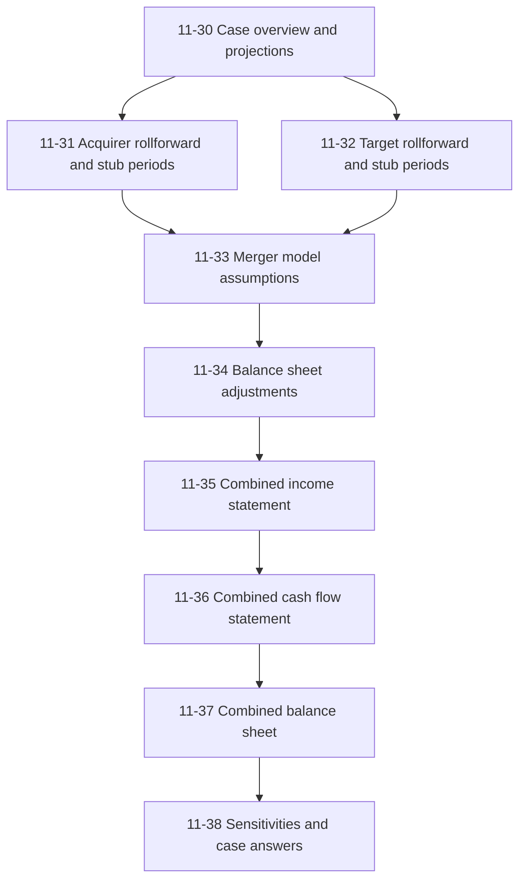
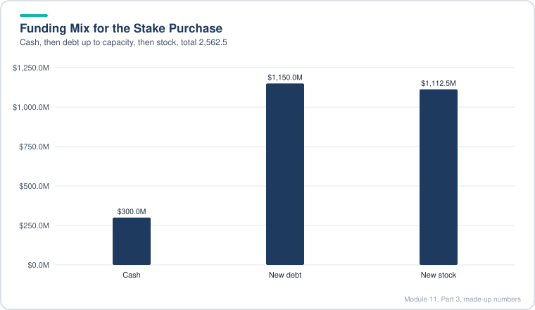
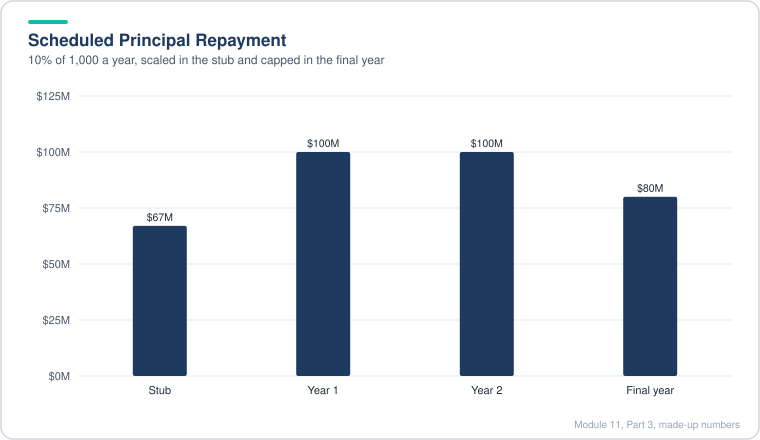
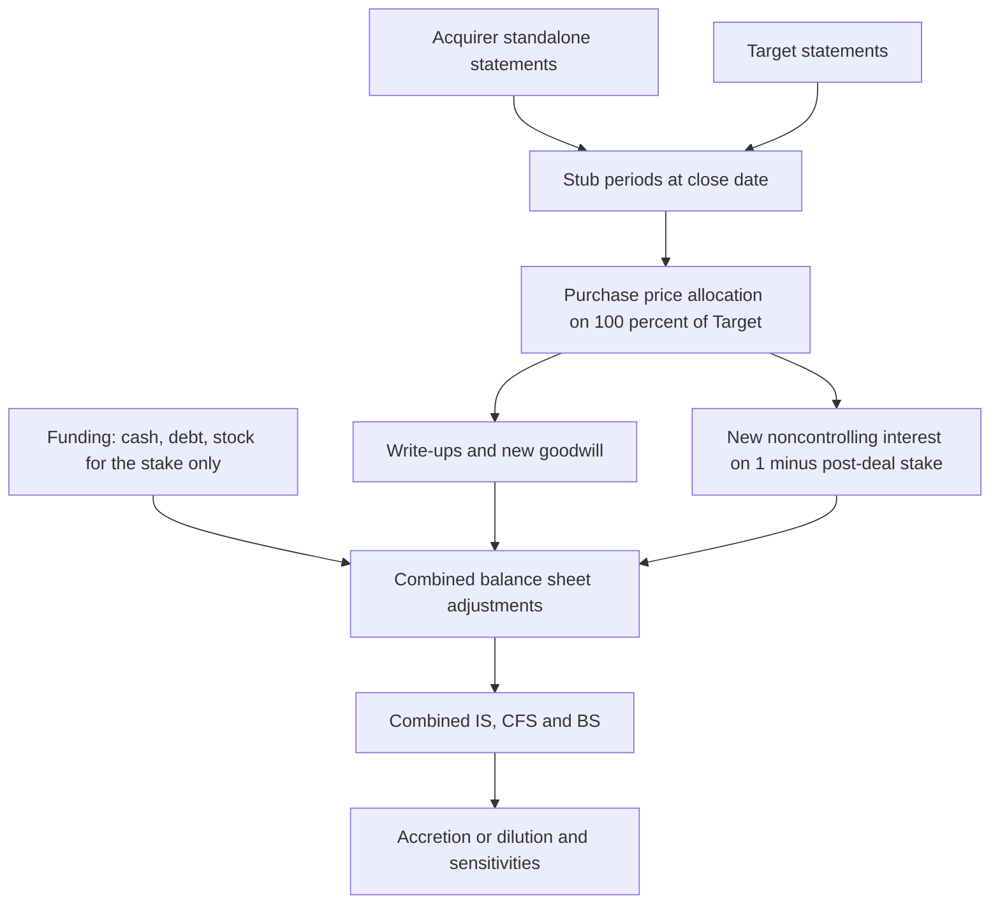
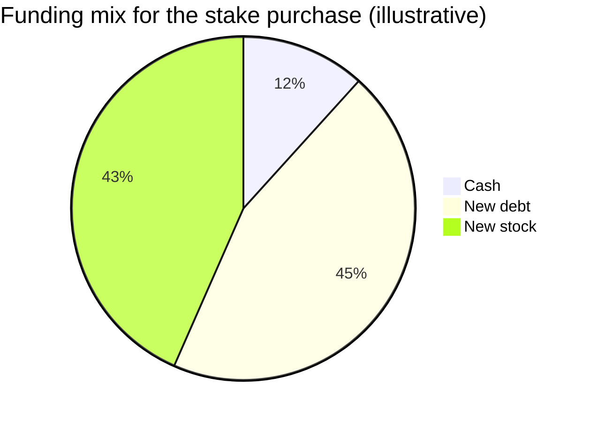
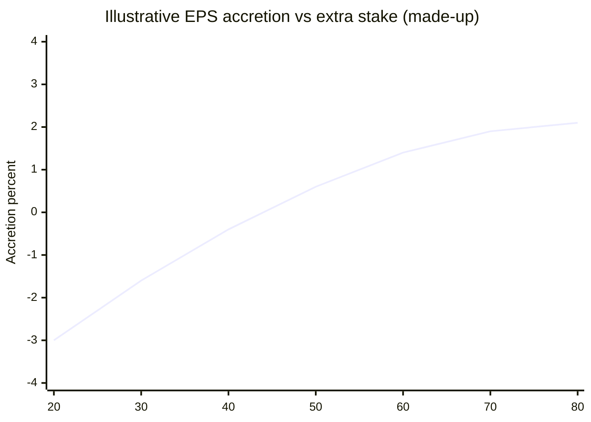
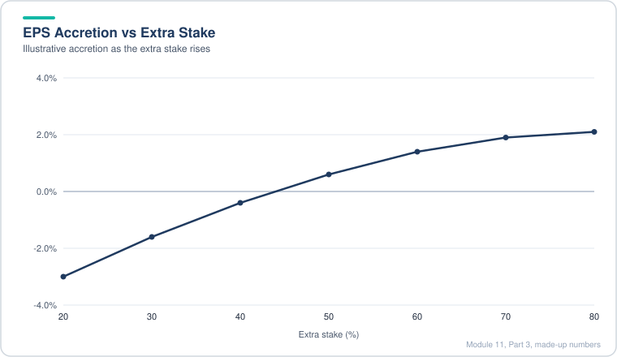
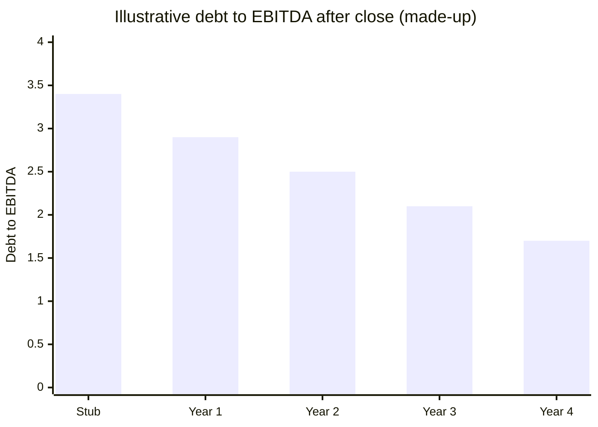
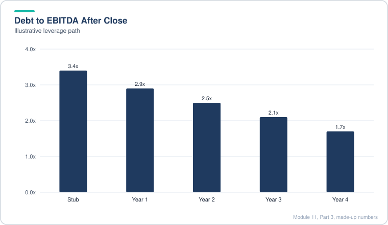

# Module 11, Part 3: Advanced M&A Concepts

[← Previous: Module 11, Part 2](11-advanced-m-and-a-concepts-part-2.md) · [Contents](../README.md) · [Next: Module 12, Part 1 →](12-lbo-concepts-and-simple-models-part-1.md)

<b>Contents</b>

- [Overview](#overview)
- [Module Map](#module-map)
- [Lessons](#lessons)
  - [11.30 Case Overview and Projections](#1130-case-overview-and-projections)
  - [11.31 Acquirer Rollforward and Stub Periods](#1131-acquirer-rollforward-and-stub-periods)
  - [11.32 Target Rollforward and Stub Periods](#1132-target-rollforward-and-stub-periods)
  - [11.33 Merger Model Assumptions for a Majority Stake Deal](#1133-merger-model-assumptions-for-a-majority-stake-deal)
  - [11.34 Balance Sheet Adjustments for a Majority Stake](#1134-balance-sheet-adjustments-for-a-majority-stake)
  - [11.35 Combined Income Statement](#1135-combined-income-statement)
  - [11.36 Combined Cash Flow Statement](#1136-combined-cash-flow-statement)
  - [11.37 Combined Balance Sheet](#1137-combined-balance-sheet)
  - [11.38 Sensitivities and Case Study Answers](#1138-sensitivities-and-case-study-answers)
- [Diagrams and Charts](#diagrams-and-charts)
- [Excel Model Walkthrough](#excel-model-walkthrough)
- [Interview Questions](#interview-questions)
- [Career Angle](#career-angle)
- [Cheat Sheet](#cheat-sheet)

## Overview

Part 3 walks through a full majority-stake merger model, where the acquirer buys more than half of a target but not all of it, and every step from the projections to the combined three statements to the sensitivity tables is built out in a single case.

## Module Map

The flow is one-way. Projections feed the rollforwards, the rollforwards and deal assumptions feed the purchase accounting adjustments, and those adjustments feed the three combined statements. Sensitivities sit at the end because they only work once the whole chain calculates correctly.

## Lessons

### 11.30 Case Overview and Projections

- **The deal in one sentence:** the Acquirer already owns a bit under half of the Target (a minority stake, 49.99% in this case). It buys enough extra shares to pass 50% and reach at least 70.5%, which lets it consolidate the Target's financials 100%. The case is based on a European utility deal, but the names here are generic.
- **Why not just buy 100%?** Three reasons show up again and again in majority-stake deals:
  - **Trial run.** The buyer moves up in steps (40%, 49%, 60%, 70%) to see how the business and its shareholders react before committing fully.
  - **Regulation.** Governments often limit foreign or outside control of sensitive assets like power plants. A cap such as 70% may be the most a regulator will allow for now.
  - **Politics and ownership.** If the Acquirer is itself state-owned, valuation is often a secondary concern. Energy security and supply can drive the decision.
- **Why it is still a "normal" merger model:** once the Acquirer controls more than 50%, the Target is consolidated line by line. That means regular accretion and dilution analysis still works, unlike a spinoff where you need a different framework.
- **Stub periods matter here.** The close can happen in any month of the next year, not just at a quarter end, so the model needs monthly rollforwards and partial-year (stub) cash flows. This is the main technical difference from the earlier cases.
- **Three questions the case answers at the end:** is the deal accretive, what is the best close month, and what ownership percentage makes the most sense?
- **Projection approach (highlights only):** the case treats the operating models quickly and focuses on how drivers link. The Target is a power generator and trader. The Acquirer is a more traditional generator with heat sales.

#### How the Target's Revenue Is Built

The Target sells power it generates and also buys and resells power and gas it does not produce. The revenue build works like this:

1. **Capacity** (MW of installed generation) grows at a low single-digit rate, with a dip in the pandemic year.
2. **Maximum possible output** in TWh = capacity x 24 hours x days in the year / 1,000,000.
3. **Sales volume** = a percentage of maximum output, using history from the annual report.
4. **Revenue** = (own electricity volume + wholesale electricity volume + wholesale gas volume) x average price per MWh.

Worked example with made-up numbers:

| Step | Formula | Value |
|---|---|---|
| Capacity | input | 12,000 MW |
| Max output | 12,000 x 24 x 365 / 1,000,000 | 105.12 TWh |
| Sales at 60% of max | 105.12 x 60% | 63.07 TWh |
| Price | input | 50 per MWh |
| Revenue | 63.07 TWh x 1,000,000 MWh per TWh x 50 | 3,153.6 million |

> [!TIP]
> **Gap to notice:** a real utility's sales are not just "capacity times utilization." Plant availability, outages, hedging and contract prices all matter. A model like this is a top-down simplification. In a real pricing or FP&A job, you would tie the volume line to plant-level data where you can.

#### Expenses and Margin

- Costs are set as a cost per MWh (cost divided by total volume in the historical year) and then carried forward with a trend. Because costs and revenue both move with volume and price, margins stay in a narrow band (around 1% to 2%). Trading businesses look like this: thin, stable margins on high volume.
- For the Acquirer, costs follow total capacity instead (a cost per watt of installed capacity). Here, if revenue grows and capacity grows, CapEx and PP&E grow too. That difference drives very different cash flow profiles for the two companies.

#### The Acquirer's Other Investments

- The Acquirer has many associates and joint ventures, not just the Target. The case separates the Target stake from the rest, because mixing them makes the deal impact hard to track.
- Income from the other associates is modeled as a yield on the investment balance (about 5% a year, the historical average).
- Balance sheet working capital is simple: receivables as a percent of revenue, inventory and payables as a percent of cost of sales.
- Dividends come in three types: dividends from associates, dividends to the Acquirer's own shareholders, and dividends paid to noncontrolling interests (minority holders in subsidiaries it already controls).

> [!WARNING]
> **Common mistake:** dividends paid to noncontrolling interests are based on the subsidiary's net income, not the parent's. Dividends from associates are based on the associate's income attributable to the investor. Using one base for all three is a classic error.

#### The Existing Minority Stake (The Important Part)

- Because the Acquirer holds less than 50%, it uses the **equity method**. The Acquirer's income statement picks up its share of the Target's net income (ownership % x Target net income to parent).
- On the cash flow statement, that non-cash income is reversed (subtracted), and cash dividends received are added in.
- On the balance sheet, the investment balance goes up by the share of income and down by the dividends received. The balance sheet balances only when those three moves are linked correctly.
- The stake keeps growing as long as the Target earns more than it pays out.

> [!TIP]
> **Why this matters in practice:** the stake is an asset that is worth less than its book value if the Target's cash flows fall. After the buyout, this line disappears and is replaced by the Target's full assets, liabilities and income. That replacement is the purchase accounting work in lessons 11.34 and beyond.

### 11.31 Acquirer Rollforward and Stub Periods

- **Why stubs exist:** the deal closes partway through the year, so the combined company's year has two parts. Before close, the Acquirer reports on its own. After close, the Target is consolidated. The model needs both pieces for the same fiscal year, and that split is the "stub period."
- **Close date list:** the close can be any month-end of the next calendar year. Build the list with date functions: take the last day of the next year, step back to get each month-end (EOMONTH is the workhorse here), and use data validation to pick one.
- **Stub fraction:** post-close fraction = days from close date to year end / days in the year. Pre-close fraction = 1 minus that.

Worked example with a close on April 30 in a leap year (366 days):

| Item | Calculation | Value |
|---|---|---|
| Days from close to year end | Apr 30 to Dec 31 | 245 days |
| Post-close fraction | 245 / 366 | 0.669 |
| Pre-close fraction | 1 - 0.669 | 0.331 |
| Full-year net income (made up) | input | 1,200 |
| Pre-close net income | 1,200 x 0.331 | about 397 |
| Post-close net income | 1,200 x 0.669 | about 803 |

- **Income statement and cash flow statement:** the simple method is to multiply each full-year line by the pre or post fraction. This assumes revenue and costs arrive evenly by month, which is not true for power companies with seasonal demand. The case says so openly. Annual data is all that is available, so the assumption is the price of having a model at all.
- **Share count is the exception.** It is a point-in-time number, so you do not multiply it. Start from the prior year count, add the change times the pre-close fraction, and check that the EPS still ties to net income divided by shares.
- **Cash flow statement balance:** beginning cash for each stub should link to the prior stub's ending cash, not back to the annual number. The stubs must chain. The final ending cash has to match the annual balance sheet cash.
- **Balance sheet is the hard part.** The case uses three methods depending on the line:
  - **Cash:** link to the ending cash from the cash flow stub.
  - **Working capital items (receivables, inventory, payables):** take the full-year change (2020 minus 2019), multiply by the pre-close fraction, and add back to the 2019 balance. This is the same "difference times fraction" idea as the share count.
  - **Schedule-driven items (PP&E, equity investments, the Target stake, debt, equity):** roll each forward from the prior balance using the cash flow lines (for example, PP&E = old PP&E + CapEx - depreciation).
- **Check the work:** total assets must equal total liabilities plus equity for every stub. The case tests this by moving the close date to a different month and confirming the balance sheet still balances. That is a good habit: change an input and make sure the checks still pass.

> [!TIP]
> **Real-world note:** companies do not close on month-ends in neat fractions, and purchase accounting resets the balances at the close date. Stub models like this are for analysis and planning. Final reporting follows the actual close date and the actual fair values on that day.

> [!WARNING]
> **Common mistake:** using full-year numbers in a stub column, or rolling the Acquirer's balance sheet forward alone after close, when the Target's balance sheet has to be combined at the close date.

### 11.32 Target Rollforward and Stub Periods

- **Same method as the Acquirer, with different line items.** The Target is the company being bought, so its stub periods feed the consolidation. The three-statement logic is identical: split the full-year numbers by the pre-close and post-close fractions, roll the balance sheet forward, and check it.
- **Income statement:** multiply each full-year line by the stub fraction. The case recommends computing subtotals (operating income, pre-tax income, net income) by summing lines rather than multiplying them directly. That way the subtotals test your work. If the summed net income does not match the net income times the fraction, something is wrong.
- **Shares:** start from the prior year count, add the change times the pre-close fraction, and recompute EPS.
- **Cash flow statement:** multiply each full-year line by the stub fraction, then chain the beginning and ending cash the same way as the Acquirer.
- **Balance sheet, three link types:**
  - **Cash:** from the cash flow stub.
  - **Working capital (receivables, inventory, payables, other liabilities):** prior year balance plus (change in the year x pre-close fraction).
  - **Long-lived items:** prior balance plus or minus the cash flow lines. For PP&E and intangibles, that means subtract depreciation and amortization (including right-of-use depreciation under IFRS 16 leases), then subtract CapEx and intangible purchases. Goodwill is reduced by impairment. Associates are reduced by the share of income and any dividends.
- **Equity and minority interest:** common equity picks up net income to parent, other operating items, dividends to parent owners and FX effects. Noncontrolling interests pick up their share of income less dividends paid to minority holders.

> [!TIP]
> **Why use different methods on purpose:** if you use one method everywhere, a bug can hide. Mixing linking styles gives you a second check. If total assets from one route do not match total assets from another, you have a problem.

> [!TIP]
> **Interview note:** the most common question here is "why does the balance sheet balance after you change the close date?" The honest answer is that every stub's movements come from the same cash flow lines, so the cash flow stubs and the balance sheet stubs must use the same fractions.

| Check | What to look for |
|---|---|
| Total assets vs total liabilities plus equity | Must match in every stub |
| Net income sum vs net income line | Must match |
| Ending cash vs balance sheet cash | Must match |
| Result after changing the close date | Must still balance |

### 11.33 Merger Model Assumptions for a Majority Stake Deal

- **The big difference from a normal merger model is that the Target is measured on three different bases.** Use the wrong base and the model is wrong even if the formulas are right.
  - **100% of the Target:** for purchase equity value, purchase enterprise value, implied multiples, and purchase price allocation (goodwill).
  - **Only the stake being bought:** for sources and uses (the cash, debt and stock actually spent).
  - **The new total stake** (old stake plus new stake): for the new ownership percentage.
- **Offer price:** the Target's share price times (1 + premium). The implied equity value at 100% is offer price times basic shares.
- **Premium to the old stake (the hidden issue).** The Acquirer already carries its old stake on the balance sheet at book value. Once it controls the Target, that stake gets replaced by the Target's assets and liabilities at fair value, and a noncontrolling interest is created for the shares it still does not own. The noncontrolling interest is based on market value, while the old stake was carried at book value. The gap goes into common equity as an adjustment so the balance sheet still balances.
  - Gap = (offer price x the shares represented by the old stake) minus the book value of that stake on the Acquirer's balance sheet.
- **Cash and debt capacity (with floors at zero):**
  - Usable cash = MAX(0, combined cash - minimum cash balance).
  - New debt capacity = MAX(0, maximum leverage x combined EBITDA - combined existing debt).
- **Funding waterfall for the stake's value:**
  - Cash used = MIN(stake value, usable cash).
  - Debt used = MIN(stake value - cash used, debt capacity).
  - Stock used = stake value - cash used - debt used.

Worked example with made-up numbers (all figures in millions):

| Item | Calculation | Value |
|---|---|---|
| Target share price | input | 20.00 |
| Premium | input | 25% |
| Offer price | 20.00 x 1.25 | 25.00 |
| Target basic shares | input | 500 |
| Stake being bought | input | 20.5% |
| Stake purchase value | 25.00 x 500 x 20.5% | 2,562.5 |
| Usable cash | MAX(0, 1,000 - 700) | 300 |
| Debt capacity | MAX(0, 3.5 x 900 - 2,000) | 1,150 |
| Cash used | MIN(2,562.5, 300) | 300 |
| Debt used | MIN(2,562.5 - 300, 1,150) | 1,150 |
| Stock used | 2,562.5 - 300 - 1,150 | 1,112.5 |

*Cash is small, debt is capped by capacity, and stock fills the remaining gap.*

- **Cost of each funding source:** cash has a foregone interest rate (a small number, close to what the Acquirer earns on cash). New debt equals the Acquirer's current borrowing cost plus a premium (the case used 100 basis points). Stock's cost is the earnings yield: the first full-year net income divided by the Acquirer's current equity value.
- **Weighted average cost of the deal:** each source's after-tax cost, weighted by its share of the purchase value. Only debt gets an interest tax shield, so its after-tax cost is the pre-tax rate times (1 minus the tax rate). Cash and stock use their own cost inputs and are handled the same way in the formula.
- **Target yield:** the Target's net income to parent divided by the equity value. The numerator and denominator must use the same ownership basis. If you divide 100% of income by 100% of value, that is consistent. If you divide 100% of income by a 20.5% value, it is not.
- **Sources and uses:** uses should include only the 20.5% stake purchase value, the advisory fee on that amount, other fees and financing fees (a percent of new debt). Refinanced Target debt is treated as both a use and a source.
- **Purchase price allocation:** even when the stake is less than 100%, once control passes (50% or more), you still record goodwill on 100% of the Target's equity value. Write up PP&E and intangibles, write off the Target's existing goodwill, and record a new deferred tax liability on the write-ups. The stock purchase means the extra D&A is not tax deductible, so a DTL is created. A net deferred tax asset on the Target means you can justify skipping a DTL write-down.

> [!TIP]
> **Why the low multiple matters:** when the implied multiple is low, the Acquirer is paying a small premium relative to fundamentals. State-owned or regulated assets often trade this way. This is a reminder that a low multiple is not the same as a bargain: the value of the assets and the regulatory limits can explain it.

> [!WARNING]
> **Common mistake:** using 20.5% of the Target for the purchase equity value and goodwill. Goodwill is based on 100% because the Acquirer now consolidates 100% of the Target's net assets, including the portion owned by minority holders.

### 11.34 Balance Sheet Adjustments for a Majority Stake

- **Structure of the combined balance sheet:** three blocks. (1) Link in the Acquirer's historical annual balance sheet and both companies' stub balance sheets at the close date. (2) Apply debit and credit adjustments to assets. (3) Apply debit and credit adjustments to liabilities and equity. The combined column is the start-of-deal balance plus the adjustments.
- **Debit and credit on the asset side:** a debit increases an asset and a credit decreases it. Keep that straight and the rest is bookkeeping.
- **Asset adjustments in this deal:**
  - **Cash:** credit for the cash used to buy the stake and the cash used for fees.
  - **PP&E and intangibles:** debit for the write-up on the Target's assets (the write-up comes from the purchase price allocation).
  - **Goodwill:** debit for new goodwill and credit for the write-off of the Target's old goodwill.
  - **The Acquirer's existing stake in the Target:** removed entirely. It is credited at the stub balance, because that balance is now replaced by the Target's own assets.
  - Items the deal does not touch (accounts payable-type items, interest-bearing receivables, associates, other long-term assets) get zeroes. Listing them with zeroes is a deliberate checklist habit.
- **Liability and equity adjustments:**
  - **Target debt:** assumed or refinanced. It is debited (removed) and credited (re-added) at the same amount, so the net effect is zero. This keeps the debt visible as a separate line.
  - **New transaction debt:** credited for the borrowed amount. Financing fees are debited, because they reduce the carrying value of debt (they are amortized over the life of the debt).
  - **Deferred tax liability:** the new DTL from the write-ups is credited. No write-down is applied here.
  - **Common equity:** debit the Target's old equity (taken from the purchase price allocation). Debit the transaction fees (advisory and legal, which are expensed against equity in this model). Credit any new stock issued. Include the premium adjustment for the old stake.
  - **New noncontrolling interest:** credited for the share of 100% of the Target's equity value that the Acquirer does not own after the deal. Formula: purchase equity value at 100% x (1 minus post-deal ownership).
- **The equity plug (the honest part):** the case needs an adjustment in common equity equal to the gap between the market value of the old stake and its carrying value. Without it the balance sheet does not balance. The case admits it has no clean accounting justification for the plug. Treat it as a modeling reconciliation, not an accounting answer.

> [!TIP]
> **What the real standards say:** under US GAAP (ASC 805) and IFRS 3, a step acquisition, where control is gained in stages, generally remeasures the previously held stake to fair value and records any gain or loss in earnings. That is different from the equity plug. In a real model you would show the gain through income and the tax effect, not hide it in equity. The case's approach is a shortcut, so be ready to explain it in an interview as a simplification.

> [!TIP]
> **Good test to run:** change the minimum cash balance so the deal is all debt, or all stock, or a mix. The balance sheet should still balance. If it breaks, one of the funding links is wrong.

| Balance sheet block | What moves it |
|---|---|
| Assets | Cash used, PP&E write-up, goodwill write-off and new goodwill, Acquirer stake removed |
| Liabilities | Debt refinanced, new transaction debt net of fees, new DTL |
| Equity | Target equity removed, fees, new stock, old-stake premium, new noncontrolling interest |

### 11.35 Combined Income Statement

- **Build order:** (1) link in each company's historical income statement and the pre-close stub, (2) add up 100% of both companies for the post-close periods, (3) layer on the acquisition effects, (4) compute GAAP and pro-forma EPS and accretion or dilution.
- **Consolidate 100%, not the stake.** Even though the Acquirer buys only 20.5% in this deal (70.5% in total), it consolidates 100% of the Target's revenue, costs and income. The portion it does not own comes out later, as net income attributable to noncontrolling interests.
- **Stub-period mixing.** Each combined line uses the post-close stub for the year of the deal (the stub fraction of full-year numbers), and full-year numbers after that. Items that exist for only one company (other income, goodwill impairment) are linked from that company alone.
- **Acquisition effects, one by one:**
  - **Expense synergies:** zero in year one (the case gives no synergies in year one). Then the fully realized synergy number is multiplied by a realization factor that ramps up. Use a row-wide array (TRANSPOSE) to avoid copying formulas by hand.
  - **D&A on write-ups:** the PP&E write-up divided by its depreciation life, times the post-close stub fraction in the deal year. Wrap it in MIN so the cumulative depreciation never exceeds the write-up. Test it by shortening the life and checking that the full write-up is expensed.
  - **Merger and integration costs:** a one-time cost sized as a percentage of year-three synergies, phased in over the first two years (one third in year one, two thirds in year two, none after).
  - **Interest on new debt:** the rate times the face value of the debt (not the book value, which is net of fees), times the stub fraction in the deal year.
  - **Amortization of financing fees:** fees divided by the debt maturity (minimum one year), with an IF test. If the debt is repaid early, the unamortized balance hits the income statement in the repayment year.
  - **Forgone interest on cash:** the interest rate on cash times the cash used for the stake and the fees. Cash used is a real cost because it stops earning interest.
  - **Tax:** the combined pre-tax income is taxed at the Acquirer's rate.
  - **Associate income from the Target:** before the deal, the Acquirer booked its share of the Target as equity income. After the deal, that line goes to zero, and the Target's net income is consolidated instead.
  - **Noncontrolling interest:** net income attributable to the minority holders = the Target's net income to parent x (1 minus post-deal ownership). Subtract this to get net income to the Acquirer.

Worked example for the transition (made-up numbers):

| Item | Calculation | Value |
|---|---|---|
| Fully realized synergies, year 3 | input | 90 |
| Merger costs, as a % of year-3 synergies | input | 150% |
| Total merger costs | 90 x 150% | 135 |
| Year 1 share | one third | 45 |
| Year 2 share | two thirds | 90 |
| PP&E write-up | input | 1,000 |
| Depreciation life | input | 20 years |
| Annual D&A on write-up | 1,000 / 20 | 50 |
| D&A in the stub (fraction 0.669) | 50 x 0.669 | about 33 |

- **Accretion or dilution:** GAAP EPS = net income to parent / shares. Pro-forma EPS adds back the after-tax D&A on write-ups and after-tax merger costs, because the case treats them as one-time or non-cash. Accretion = (pro-forma EPS / standalone EPS) - 1.
- **Example:** standalone EPS of 1.00 and pro-forma EPS of 1.04 means 4% accretion. If the new debt interest is understated, that 4% is wrong, which is exactly the situation here until the cash flow and balance sheet are linked.

> [!TIP]
> **Interview angle:** "Is the deal accretive?" The fast answer is "on what basis?" GAAP includes write-up D&A and one-time costs. Pro-forma strips them out. Always say which one you mean, and say what is driving the gap.

> [!WARNING]
> **Common mistake:** using book value of new debt for interest. Book value is lower because financing fees reduce it, so interest looks smaller than it really is. Use face value.

> [!WARNING]
> **Circularity warning:** the new debt balance depends on the cash flow statement, which depends on net income, which depends on interest. The case builds the income statement first and links the debt later. In a real model, that loop may need an iterative calculation setting or a copy-paste break.

### 11.36 Combined Cash Flow Statement

- **Operating section starts from the combined net income and reverses non-cash items.** Net income to parent comes from the income statement. Then:
  - Add back NCI income (flip the sign on the line that comes from the income statement).
  - Reverse the equity income from associates, and the old Target equity income (now zero after close, but linked anyway so a change in inputs flows through).
  - Add back D&A, the amortization of financing fees and any goodwill impairment.
  - Take deferred taxes and working capital from the two companies' statements, using the stub or full-year numbers as appropriate.
- **New deferred tax line:** D&A on the write-ups is not tax deductible in a stock deal, so the model records the tax on it as a cash outflow. The formula is the write-up D&A times the buyer's tax rate, shown as a negative. The income statement shows a tax benefit that never reaches cash.
- **Dividends are the trickiest part.** Before the deal, the Acquirer received its share of the Target's dividends as investment income. After the deal, the Target's dividends are split: the part to the Acquirer's own shareholders, the part to the 29.5% or so of holders who are now minority. Show the two streams on separate lines (for example, "Target common dividends" as its own line) so the balance sheet can route each to the right equity account.
- **Investing is a simple sum** of both companies, with the stub used for the deal year.
- **Financing:**
  - Debt issuance and repayment from both companies, with the new transaction debt split out.
  - New debt principal repayment follows a schedule: a fixed annual percentage of the original principal (10% in this case), scaled by the stub fraction in the deal year. Three cases apply: the stub, a normal year, and a final year where the remaining balance is smaller than the fixed payment, so the model repays only what is left. The maturity year repays the whole remaining balance.
- **Ending cash:** the first post-close ending cash is the cash just after the deal closes. From there, beginning cash plus net change in cash rolls forward.

Worked example of the repayment schedule (made-up numbers):

| Year | Beginning principal | Scheduled repayment | Repayment used | Ending principal |
|---|---|---|---|---|
| Stub (about 0.669 of a year) | 1,000 | 10% x 1,000 x 0.669 | 67 | 933 |
| Year 1 | 933 | 10% x 1,000 | 100 | 833 |
| Year 2 | 833 | 10% x 1,000 | 100 | 733 |
| Final year (only 80 left) | 80 | 10% x 1,000 | 80 (capped) | 0 |

*The stub payment is scaled down and the final payment is capped at the balance left.*

> [!TIP]
> **Why the cap matters:** if you let a repayment exceed the balance, you create negative debt. A MIN function (the scheduled amount or the balance left, whichever is smaller) prevents that. This is the same pattern as the capped D&A on the write-ups.

> [!TIP]
> **Sanity check:** the case compares the combined ending cash to the sum of the two companies' standalone cash plus the new debt flows. Both came out near each other. That is only a rough check, because the balance sheet and new interest are not linked yet. Treat it as a smoke test, not proof.

> [!TIP]
> **Interview angle:** "Why are non-cash deferred taxes on write-ups a cash outflow?" Because in a stock deal the tax basis of the assets does not step up, so the extra book D&A is not deductible. The book tax benefit is offset by a deferred tax liability that unwinds over time. In cash terms, the company pays tax as if the write-up did not exist.

### 11.37 Combined Balance Sheet

- **Easiest of the three statements, but easy to mislink.** Most lines come from one of two places: the two companies' own balance sheets (for working capital, other assets and payables) or the combined cash flow statement (for cash, PP&E, debt and equity). Keep a list of which is which.
- **Balance sheet timing.** A balance sheet is a snapshot. The stub ending on December 31 equals the full-year balance on December 31, so you can link straight to the annual balance sheets for each company.
- **Assets:**
  - Cash comes from the bottom of the combined cash flow statement.
  - PP&E and intangibles = prior balance - D&A - D&A on write-ups - CapEx and intangible purchases (cash outflows shown as positives on the cash flow, so the signs flip here).
  - The Target stake (the Acquirer's old equity stake) is linked for completeness. Its income is still shown as an equity item, but its dividends now go to the noncontrolling interest rather than reducing the stake.
- **Liabilities:**
  - Payables and other liabilities come from both companies' sheets.
  - Existing debt = prior balance + debt issued - debt repaid.
  - Transaction debt = prior balance - fee amortization - principal repayments (the fee amortization is a non-cash item that brings the book value back up toward face value).
  - Net deferred tax = prior balance + normal deferred tax change - the new deferred tax on write-ups.
- **Equity:** common equity = prior balance + net income to parent + other operating items + parent dividends + other financing items + FX effects. This is why parent dividends and Target dividends were split onto separate lines.
- **Noncontrolling interest in the Target:** NCI = prior balance + NCI net income + dividends received from the Target (the Acquirer's share, shown as a positive inflow to the NCI) + total Target dividends (negative). Net effect: the minority holders' share of net income, minus the minority holders' share of dividends.

Worked example of the Target NCI roll (made-up numbers, 30% minority):

| Item | Calculation | Value |
|---|---|---|
| Target net income | input | 100 |
| NCI share of income | 30% x 100 | 30 |
| Target common dividends paid | input | 40 |
| Dividends received by the Acquirer | 70% x 40 | 28 |
| Dividends to minority holders | 40 - 28 | 12 |
| Change in NCI | 30 - 12 | +18 |

> [!TIP]
> **Good test:** the total of the NCI roll should equal "minority share of income minus minority share of dividends," and that is exactly what the example above shows.

**Stress testing the model.** The case changes several inputs at once: a faster debt amortization schedule, a 3x leverage cap that forces a mix of cash, debt and stock, a larger stake, a later close date, and a synergy change. The balance sheet still balances, which is the main check. Two issues surfaced:

- **Fee amortization keeps running after the debt is repaid early.** The formula uses the scheduled maturity to stop amortization. If principal is repaid faster (for example, a one-third-a-year schedule), the remaining fees should be written off when the balance hits zero, but the formula keeps amortizing them. The balance sheet still balances, so the error is easy to miss. The fix is to tie fee amortization to the remaining principal, not only to the maturity year.
- **Accretion looks different once the schedule changes.** With a larger stake, the deal is accretive in later years on both GAAP and pro-forma bases, but not early. The case notes that the claim of accretion on both bases only holds under some assumptions, so the close date and stake percentage matter.

> [!TIP]
> **Real-world note:** when you stress test, change one thing at a time when you are hunting a bug, and change several when you are checking that the model holds together. The case does both. Use the same discipline when you build a model for work.

### 11.38 Sensitivities and Case Study Answers

- **Model fixes made in this lesson:**
  - **Fee amortization:** instead of dividing the fees by the maturity year, amortize them using the annual principal repayment percentage. The fees then stop when the debt is paid off, which fixes the bug from 11.37. Test it with a one-third annual schedule and check that the fee balance reaches zero.
  - **Merger and integration costs:** tie them to the synergy realization factor too. If synergies are cut, the one-time costs should drop with them. Otherwise the model charges costs for synergies you are not getting.
- **Metrics and ratios (interpretation):**
  - Before the deal, leverage was high (debt to EBITDA near 4x) and margins were fat (EBITDA margins above 20%). The Target's business is a low-margin trading book, so after consolidation the combined EBITDA margin falls to single digits.
  - Leverage falls fast because the Target's much larger EBITDA sits in the denominator. Debt to EBITDA goes from around 3.4x in the first stub toward about 1.7x by Year 4.
  - Debt to total capital falls much less, because the new equity and the noncontrolling interest keep it higher.
  - Strange growth rates are a real signal, not a typo: the Target is bigger than the Acquirer by revenue, so its numbers swamp the Acquirer's.
  - Takeaway from the case: the combined company deleverages quickly enough that it could take on more debt, or repay the new debt faster than 10% a year.
- **Choosing the sensitivity year:** pick the year where the answer can actually change. The stub is always dilutive (it carries the new interest with only part of the benefit). Year 2 sits near breakeven because synergy costs and savings offset each other. Year 1 or Year 3 are more informative when the synergy ramp is the variable. If a year has no synergies, a synergy sensitivity in that year is meaningless.
- **Sensitivity ranges:**
  - **Premium:** from zero up to about 30%, in steps.
  - **Synergy realization:** from 100% down to 0%.
  - **Additional stake:** starts at the minimum stake (20.5% here) and stops below 100% total ownership, so the top of the range is roughly 48% to 49% extra.
- **The non-obvious result:** EPS can get better as the stake rises, even though the Acquirer pays more and carries more interest. Higher stakes shrink the noncontrolling interest's share of the Target's income, which is a drag on the Acquirer's EPS. Eventually the extra interest outweighs that benefit. The sensitivity table shows where that crossover happens.

**The case study answers (summarized):**

| Question | Short answer from the model |
|---|---|
| Is the deal accretive? | Not on a GAAP basis every year. Pro-forma is accretive in every period. |
| What if synergies are zero? | Dilutive in the stub and Year 1, accretive afterwards on GAAP. Keeping full synergies can be slightly worse early, because one-time merger costs run ahead of the savings. |
| Best close date? | The effect is modest. A later close helps a bit because both companies hold more cash, so more cash can fund the deal. Recommend later in the year. |
| Ideal ownership? | A higher stake than the minimum produces better GAAP EPS, but the optimum depends on premium and funding. The case points to a range of roughly 30% to 35% extra stake as best under normal premiums. |

> [!TIP]
> **How to answer case questions in an interview:** state the answer first, then give the one driver behind it (for example, "later close helps because of the cash balance"), then say what would change the answer (a higher premium, less synergy, or a different funding mix).

> [!WARNING]
> **Caveat:** these results come from one set of inputs. The case says the ownership result may not hold when premiums are higher and stock has to be issued. Always re-run the table under new assumptions before you quote it.

## Diagrams and Charts

*Accretion turns positive once the extra stake passes roughly 40 to 50 percent, then flattens.*

*Leverage falls quickly because the Target's large EBITDA sits in the denominator.*

## Excel Model Walkthrough

- **Tabs in the model:** the case has an Acquirer tab with the standalone three statements and drivers, a Target tab with the same plus energy operating drivers, a Merger_Model tab for the deal inputs, the funding schedules, the purchase price allocation and the equity stake roll, and separate stub tabs for each company (rollforwards to the close date). The combined model then has an income statement, cash flow statement and balance sheet with a transaction adjustments column, plus a sensitivity tab.
- **Flow:** close date and deal inputs (Merger_Model) drive the stub fractions. Stub tabs use those fractions. The combined statements pull from the stub tabs and the annual tabs. The balance sheet adjustments feed the combined balance sheet.
- **Key links:**
  - Stub fraction = days from close to year end / days in year. Pre-close = 1 minus post-close.
  - Working capital stub = prior balance + (full-year change x pre-close fraction).
  - Target 100 percent basis for goodwill and purchase equity value. Stake basis (20.5 percent) for sources and uses.
  - NCI balance = prior balance + NCI income + dividends received from the Target + Target dividends (signed).
  - Debt schedule drives interest, fee amortization and principal repayment; interest uses face value, not book value.
- **Sign conventions:** the cash flow statement uses cash signs (cash outflows negative). The balance sheet uses debits and credits. Mixing these is the most common source of errors here.
- **Tests built into the model:** balance check on every stub and combined period; cash on the cash flow statement matches cash on the balance sheet; net income ties to EPS. Keep these checks visible.

## Interview Questions

<b>1. Why buy a majority stake instead of 100%?</b>

Trial run, regulatory caps, and political or security concerns. You still consolidate once you pass 50%.

<b>2. When do you consolidate an investment?</b>

At more than 50% control, generally. Below that, use the equity method (share of income on the income statement, a rising carrying value, dividends reduce it).

<b>3. What is a noncontrolling interest?</b>

The share of a consolidated subsidiary's equity and income that the parent does not own. It appears on the balance sheet in equity and on the income statement below net income to parent.

<b>4. How do you handle the Acquirer's existing stake when it goes to majority?</b>

Remove the equity-method investment, replace it with the Target's assets and liabilities at fair value, record goodwill on 100% of the Target, and create an NCI for the unowned share.

<b>5. Why is goodwill based on 100% of the Target if you only bought 20.5 percent?</b>

Because the Acquirer consolidates 100% of the net assets, so the purchase price allocation covers 100% of them.

<b>6. What does a stub period mean in a merger model?</b>

The part of a fiscal year before and after the close date. Pre-close shows the Acquirer alone, post-close shows the combined company.

<b>7. Why would the balance sheet break after a close date change?</b>

The stub fraction is applied inconsistently across the income statement, cash flow and balance sheet, or a working capital line is linked to the wrong period.

<b>8. Why is financing fee amortization a non-cash expense?</b>

It spreads the fee over the debt life. The cash was paid at close, so the amortization only affects the income statement and gets added back on the cash flow.

<b>9. Why use face value, not book value, for interest on new debt?</b>

Book value is net of unamortized fees, so it understates the interest cost.

<b>10. What is the difference between GAAP and pro-forma EPS here?</b>

GAAP includes the write-up D&A and merger costs. Pro-forma adds those back, so pro-forma is usually higher.

<b>11. Why can EPS improve when you buy a larger stake?</b>

A larger stake reduces the NCI's share of the Target's income, which is a drag on EPS. That benefit can outweigh the added interest up to a point.

<b>12. How do you treat deferred taxes on write-ups in a stock deal?</b>

The write-up D&A is not tax deductible, so the book tax benefit is offset by a deferred tax liability. Cash taxes do not benefit.

<b>13. What is the most sensitive input in this model?</b>

The premium and synergy realization, plus the funding mix. The close date matters less.

<b>14. Why do you split out dividends by source?</b>

Dividends to the parent's shareholders, to the Target's minority holders and from associates each hit a different equity or NCI line.

<b>15. What is the risk of stock-funded deals?</b>

Dilution of existing holders, and the cost of stock is the earnings yield, which can be higher than the after-tax cost of debt.

## Career Angle

- **Where this maps to practice.** For an analyst on a fair value team (valuing a large MBS and whole loan book, tracking exceptions and pricing differences), the same discipline applies: linking inputs to outputs, checking balances and explaining movements. The rollforward and stub logic is similar to the monthly roll of fair values and the month-end pricing review. FP&A forecasting and CFO reporting work shows the same tie-out habits.
- **Target roles.** Valuation and capital markets, corporate development (accretion and dilution, financing mix), and portfolio or asset management (understanding ownership stakes, equity method and consolidation).
- **Three talking points that can truthfully be used (framed as a self-study case).**
  1. "I studied a full majority-stake merger model with monthly stub periods, combined three statements and a noncontrolling interest, and I can explain how each line links."
  2. "In a self-study case I built a sensitivity analysis on premium, synergy realization and stake size, and I found that the best ownership level is not always 100 percent."
  3. "I checked the balance sheet after each change, including close date and funding mix, which is the same habit I use on the monthly fair value roll."

> [!WARNING]
> **Guardrail.** Do not claim that a real deal model or a purchase price allocation was built or run in a work setting. The honest frame is: studied the case in a self-study module, and used the same tie-out habits on live work.

## Cheat Sheet

| Topic | Rule |
|---|---|
| Consolidation threshold | Above 50 percent control: consolidate 100 percent. Below: equity method. |
| Stub fraction | Post-close = days from close to year end / days in year. Pre = 1 minus post. |
| Flow items in a stub | Full-year x fraction. Share counts: prior + change x pre fraction. |
| Working capital in a stub | Prior year + (change x pre fraction). |
| Goodwill basis | 100 percent of the Target's equity value (in a majority deal). |
| Sources and uses basis | Only the stake purchased. |
| NCI at close | 100 percent of equity value x (1 minus post-deal stake). |
| NCI roll | Prior + NCI income + dividends received - total Target dividends. |
| Cash available | MAX(0, combined cash - minimum cash). |
| Debt capacity | MAX(0, max leverage x EBITDA - existing debt). |
| Funding waterfall | Cash first, then debt up to capacity, then stock. |
| Interest on new debt | Face value x rate x stub fraction (stub) or full year. |
| Fee amortization | Tie to the repayment schedule, not only maturity. |
| Write-up D&A | Write-up / life x stub fraction, capped by remaining write-up. |
| Repayment | MIN(scheduled amount, remaining balance). |
| Accretion | (pro-forma or GAAP EPS / standalone EPS) - 1. |
| Checks | Balance sheet balances, cash ties, net income ties to EPS, after changing inputs. |

---

[← Previous: Module 11, Part 2](11-advanced-m-and-a-concepts-part-2.md) · [Contents](../README.md) · [Next: Module 12, Part 1 →](12-lbo-concepts-and-simple-models-part-1.md)
