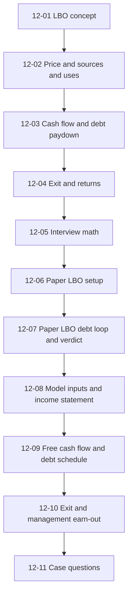
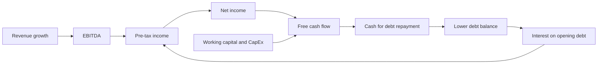
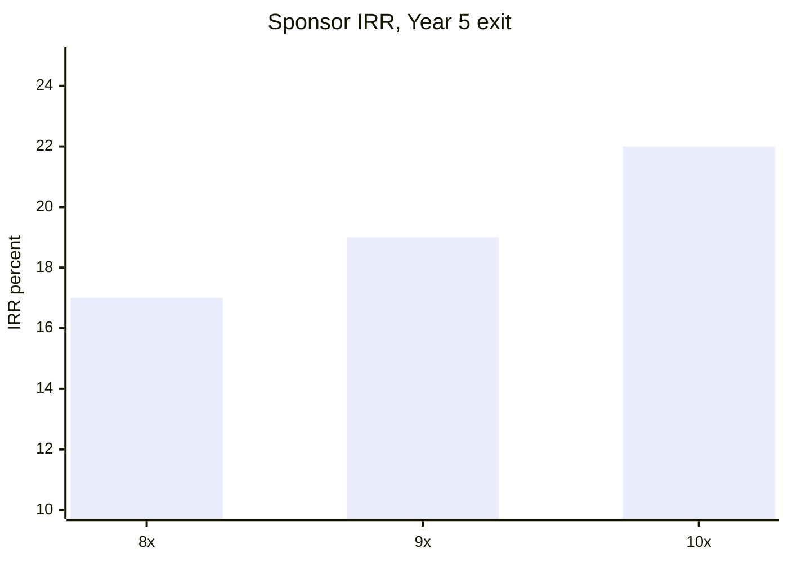
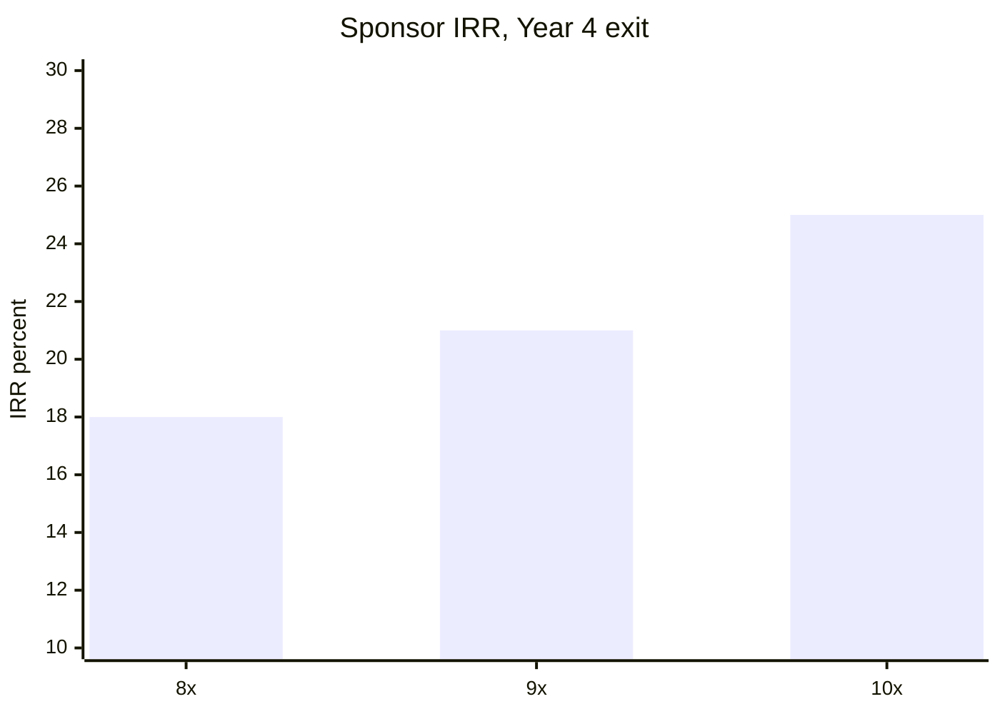
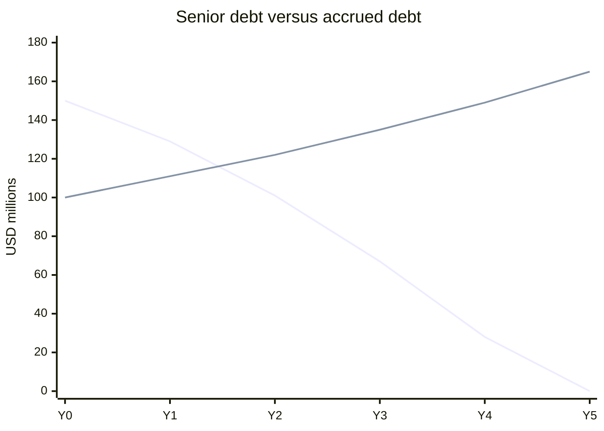
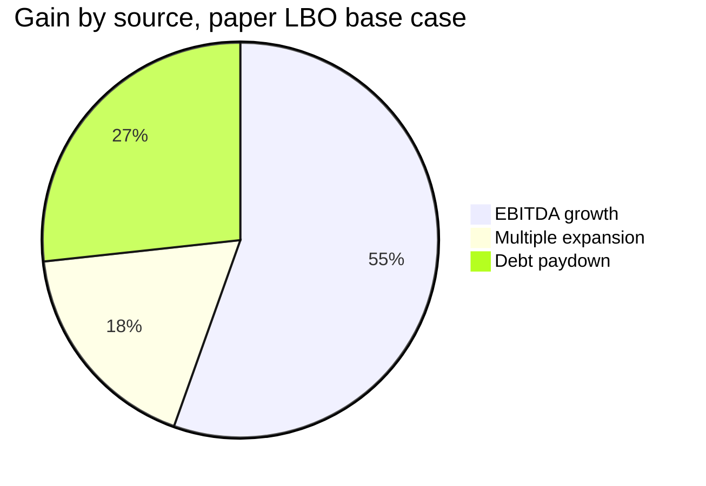
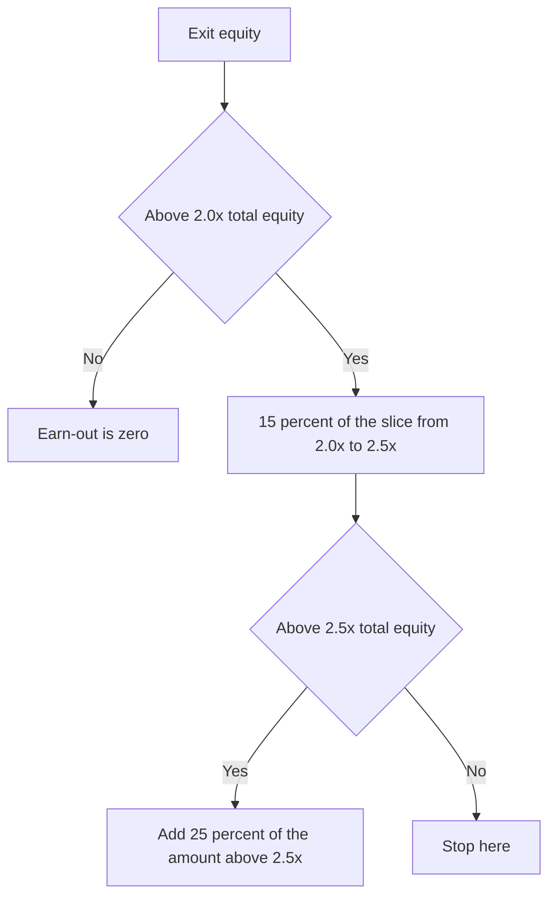

# Module 12, Part 1: LBO Concepts and Simple Models

[← Previous: Module 11, Part 3](11-advanced-m-and-a-concepts-part-3.md) · [Contents](../README.md) · [Next: Module 12, Part 2 →](12-lbo-concepts-and-simple-models-part-2.md)

<details>
<summary><b>Contents</b></summary>

- [Overview](#overview)
- [Module Map](#module-map)
- [Lessons](#lessons)
  - [12.1 LBO Concept and Mechanics](#121-lbo-concept-and-mechanics)
  - [12.2 Purchase Price, Leverage, and Sources and Uses](#122-purchase-price-leverage-and-sources-and-uses)
  - [12.3 Cash Flows and Debt Repayment](#123-cash-flows-and-debt-repayment)
  - [12.4 Exit Assumptions, Returns, and Whether the Deal Is Believable](#124-exit-assumptions-returns-and-whether-the-deal-is-believable)
  - [12.5 LBO Math for Interviews](#125-lbo-math-for-interviews)
  - [12.6 The 30-Minute Paper LBO, Part 1 (Setup, Revenue, EBITDA, Other Items)](#126-the-30-minute-paper-lbo-part-1-setup-revenue-ebitda-other-items)
  - [12.7 The 30-Minute Paper LBO, Part 2 (The Debt Loop, Exit, and Recommendation)](#127-the-30-minute-paper-lbo-part-2-the-debt-loop-exit-and-recommendation)
  - [12.8 The 60-Minute LBO from Scratch, Part 1 (Approach, Assumptions, Income Statement)](#128-the-60-minute-lbo-from-scratch-part-1-approach-assumptions-income-statement)
  - [12.9 The 60-Minute LBO from Scratch, Part 2 (Free Cash Flow and the Debt Schedule)](#129-the-60-minute-lbo-from-scratch-part-2-free-cash-flow-and-the-debt-schedule)
  - [12.10 The 60-Minute LBO from Scratch, Part 3 (Exit, Seller Notes, Management Earn-Out)](#1210-the-60-minute-lbo-from-scratch-part-3-exit-seller-notes-management-earn-out)
  - [12.11 The 60-Minute LBO from Scratch, Part 4 (Case Questions and Answers)](#1211-the-60-minute-lbo-from-scratch-part-4-case-questions-and-answers)
- [Diagrams and Charts](#diagrams-and-charts)
- [Excel Model Walkthrough](#excel-model-walkthrough)
- [Interview Questions](#interview-questions)
- [Career Angle](#career-angle)
- [Cheat Sheet](#cheat-sheet)

</details>

## Overview

An LBO is buying a company mostly with borrowed money, paying the debt down with the company's own cash flow, and selling it later; this part builds the mechanics by hand and then in Excel, from a 30-minute paper case to a 60-minute model built from a blank sheet.

The module map shows how the lessons connect. Lessons 12.1 to 12.5 cover concepts and interview math. Lessons 12.6 and 12.7 cover the 30-minute paper test. Lessons 12.8 to 12.11 cover the 60-minute model built from scratch.

## Module Map



## Lessons

### 12.1 LBO Concept and Mechanics

**The big idea.** A leveraged buyout (LBO) is an acquisition where most of the price is paid with borrowed money. The buyer, usually a private equity (PE) firm, puts in a smaller slug of its own cash, called sponsor equity. The target company's own cash flow then pays the interest and repays the debt. The buyer exits after a few years by selling the company or taking it public, and the return comes from what is left over for the equity.

**Why PE firms do it.** PE funds raise money from limited partners (LPs), such as pensions and endowments, and deploy it into companies. A fund typically wants to hold a company for three to seven years, improve it, and sell it. Returns come from three places:

- EBITDA growth (the business gets bigger or more profitable)
- Debt paydown (the company's cash reduces what the equity owes lenders)
- Multiple expansion (the company sells for a higher EBITDA multiple than the one paid)

**Why leverage helps.** Borrowing lowers the upfront equity check. The equity is then a smaller base, so the same dollar gain shows up as a bigger percentage return. Debt is cheaper than equity because lenders get paid first and accept a fixed return, so the equity holders keep the upside.

**How it differs from an M&A deal.** In a strategic M&A deal, the buyer can pay with cash, debt or its own stock, and it plans to keep the company. In an LBO, the sponsor pays only with cash it raised plus debt, because a PE fund is usually private and would not issue stock to buy one company it plans to sell soon. The scorecard is also different. M&A is judged by EPS accretion or dilution. LBOs are judged by:

- IRR, the annualized return on the equity
- MOM (money-on-money multiple), total cash returned divided by cash put in

**The house analogy, reworked.** A mortgage is a useful picture, but an LBO is closer to buying a rental property, collecting rent, paying the mortgage down, and then selling. The rent is the company's free cash flow, the mortgage is the acquisition debt, and the sale price is the exit value.

**Worked example (made-up numbers).** Buy an asset for 800. Two scenarios, exit in Year 5 at 960, rent of 70 a year, debt at 6% interest and 5% of the original debt repaid each year.

| Item | All cash | 25% equity, 75% debt |
|---|---|---|
| Upfront outlay (Year 0) | -800 | -200 |
| Starting debt | 0 | 600 |
| Annual cash in (rent) | 70 | 70 |
| Interest paid, Year 1 | 0 | 36 |
| Principal repaid per year | 0 | 30 |
| Debt left at exit | 0 | 450 |
| Exit proceeds to equity (Year 5) | 960 | 510 |
| Total cash back | 1,310 | 548 |
| MOM | about 1.6x | about 2.7x |
| IRR | about 11.5% | about 23% |

The leveraged case gets back less total money, but it put in a quarter of the cash, so the return on the smaller base is much higher.

**Leverage cuts both ways.** If the exit price falls to 600 instead of 960, the all-cash case still returns its money, but the levered case gets only 600 minus 450 of debt, which is 150, so the MOM falls to about 0.9x and the IRR turns slightly negative. A small drop in value wipes out a large share of the equity.

> [!TIP]
> **Going further.** In a real LBO, the price is quoted as a multiple of EBITDA, and the debt is sized as a multiple of EBITDA too (lenders usually cap total leverage). The house example skips taxes, fees, and the cash sitting in the business, which all matter in practice. The most common mistake for beginners is to treat leverage as free money. It is cheap money that makes the equity riskier.

> [!TIP]
> **Connection to practice.** In fixed income valuation, the pricing of cash flows is a close relative of this logic. Discounting a stream of cash flows and asking how much a buyer can afford to pay for it is the same core idea, and the LBO adds a debt schedule on top.

**Key takeaways**

- An LBO is buy, service debt from cash flow, then sell.
- Leverage lifts IRR and MOM when things go well and magnifies losses when they do not.
- Judge deals on IRR and MOM, not EPS.

### 12.2 Purchase Price, Leverage, and Sources and Uses

**Goal.** Set up the deal before any projections. Three things get decided: what the buyer pays, how much debt it can borrow, and how the whole thing is funded (sources and uses).

**Private target (cash-free, debt-free).**

- Price is set as a multiple of EBITDA (sometimes EBIT or revenue). Purchase enterprise value (EV) = multiple x EBITDA.
- Cash-free, debt-free means the seller keeps the cash and pays off the debt, so the target's balance sheet effectively starts at zero cash and zero debt. Equity purchase price = EV + cash - debt, which here is just EV.
- Debt is sized off a leverage ratio on EBITDA (for example 4x), not a percentage of price. Lenders think in leverage multiples, and a higher price should not automatically mean more debt.
- Uses: purchase EV, transaction fees (advisory fee, often a % of price, plus legal), and financing fees (a % of new debt).
- Sources: new debt, plus investor equity as the plug. No stock, because there is no acquirer to swap shares with.

**Public target.**

- Price = current share price x (1 + premium) x diluted shares. The premium is usually about 10% to 30%.
- EV = equity value + debt - cash. The EBITDA multiple is calculated as an output, not an input.
- Debt is still sized off EBITDA.
- Uses start from equity purchase price, then refinance (or assume) existing debt, then fees.
- Sources: new debt, existing debt rolled over (shown on both sides), excess cash on the balance sheet, and investor equity as the plug.
- Excess cash = current cash - minimum cash, where minimum cash is a set amount or % of EBITDA.

**Formulas**

```text
EV (private)        = Entry multiple x EBITDA
Equity price (pub)  = Share price x (1 + premium) x diluted shares
EV (public)         = Equity price + existing debt - cash
New debt            = Leverage ratio x EBITDA
Financing fee       = Fee % x new debt
Excess cash         = Current cash - minimum cash
Investor equity     = Total uses - (all other sources)
Check               = Total sources - total uses = 0
```

**Worked example, private (made-up numbers).** EBITDA 40, entry at 10x, leverage 4x, advisory fee 2% of EV, legal 3, financing fee 2% of debt.

| Uses | Amount | Sources | Amount |
|---|---|---|---|
| Purchase EV (10 x 40) | 400.0 | New debt (4 x 40) | 160.0 |
| Advisory fee (2% x 400) | 8.0 | Investor equity (plug) | 254.2 |
| Legal fees | 3.0 | | |
| Financing fee (2% x 160) | 3.2 | | |
| **Total** | **414.2** | **Total** | **414.2** |

Equity is 61% of the sources. That is high for an LBO, and it shows how much the entry multiple, not the debt, drives the check.

**Worked example, public (made-up numbers).** Share price 10, premium 20%, 30 million diluted shares, cash 25, debt 60, minimum cash 5.

- Equity price = 10 x 1.2 x 30 = 360
- EV = 360 + 60 - 25 = 395, so the implied multiple is 395 / 40 = 9.9x
- Excess cash = 25 - 5 = 20
- New debt = 4 x 40 = 160

| Uses | Amount | Sources | Amount |
|---|---|---|---|
| Equity purchase price | 360.0 | New debt | 160.0 |
| Refinance existing debt | 60.0 | Existing debt rolled over | 60.0 |
| Advisory fee (2% x 360) | 7.2 | Excess cash used | 20.0 |
| Legal fees | 3.0 | Investor equity (plug) | 193.4 |
| Financing fee (2% x 160) | 3.2 | | |
| **Total** | **433.4** | **Total** | **433.4** |

> [!TIP]
> **Going further.** A few real-world points that the case notes only briefly. (1) Lenders often cap leverage by total debt / EBITDA and by interest coverage, so the leverage ratio really reflects what the debt market will accept at the time. (2) Financing fees are usually amortized over the life of the loan for accounting, which matters for net income but not for cash. (3) In a public deal the premium paid is partly a judgment call, and boards need a fairness opinion from an advisor. (4) The minimum cash number is a working-capital need, so setting it too low can leave the business short on day-to-day cash.

**Common mistakes**

- Using the public-company EV formula on a private deal, or forgetting that a private target is usually delivered cash-free and debt-free.
- Forgetting to make financing fees a use of funds.
- Treating the EBITDA multiple as an input in a public deal (it is an output).
- Letting the plug go negative, which means the debt or the price assumptions are off.

### 12.3 Cash Flows and Debt Repayment

**Goal.** You do not need a full three-statement model to run an LBO. You need enough of the income statement and cash flow to answer one question each year: how much debt can the business pay down? That means projecting free cash flow, then layering on cash that must be kept on hand and cash already sitting on the balance sheet.

**Projection drivers.** The case uses simple percentages. A realistic model would drive revenue from units and prices, but for this stage:

- Revenue growth slows over time (a maturing business).
- EBITDA margin expands a little each year.
- D&A falls as a share of revenue (a less capital-heavy business).
- Working capital and CapEx are tied to the change in revenue, so growth is what consumes cash.

**The free cash flow build.** The point is to get to a clean number:

```text
Pre-tax income  = EBITDA - D&A - interest expense
Net income      = Pre-tax income x (1 - tax rate)
FCF             = Net income + D&A - increase in working capital - CapEx
```

Notes on the build:

- Leave out debt issuance and repayment from the cash flow statement. Those are what the model is solving for, so they cannot be inputs.
- Interest is calculated on the beginning-of-year debt balance. Using the beginning balance avoids a circular reference (interest depends on repayment, which depends on cash flow, which depends on interest). Circularity is a real annoyance in models, so avoiding it is a valid choice, as long as you say so.

**From FCF to debt repayment.** Cash that can go to lenders is not just this year's FCF:

```text
Cash available for debt repayment = FCF + beginning cash - minimum cash
Debt repaid this year             = MIN(cash available, beginning debt)
Ending debt                       = Beginning debt - debt repaid
Ending cash                       = Beginning cash + FCF - debt repaid
Ending equity                     = Beginning equity + net income
```

- Minimum cash is the operating cash the company must keep, often set as a % of EBITDA.
- MIN() stops repayment from exceeding the debt. If only 10 is left, you repay 10, not the cash you have.
- Equity moves only with net income, because there are no dividends or buybacks in a private LBO.

**Worked example (made-up numbers, two years).** Starting revenue 200, entry debt 160, beginning cash 10, tax rate 25%, interest 6% on beginning debt, minimum cash 10% of EBITDA. Revenue growth 10% then 10%. EBITDA 20% then 21% margin. D&A 8% of revenue. Working capital investment 5% of the revenue change. CapEx 20% of the revenue change (this model has no separate maintenance CapEx).

| Line | Year 1 | Year 2 |
|---|---|---|
| Revenue | 220.0 | 242.0 |
| EBITDA | 44.0 | 50.8 |
| D&A | 17.6 | 19.4 |
| EBIT | 26.4 | 31.4 |
| Interest (6% x beginning debt) | 9.6 | 7.8 |
| Pre-tax income | 16.8 | 23.6 |
| Net income (after 25% tax) | 12.6 | 17.7 |
| Plus D&A | 17.6 | 19.4 |
| Less working capital build | (1.0) | (1.1) |
| Less CapEx | (4.0) | (4.4) |
| **Free cash flow** | **25.2** | **31.6** |
| Beginning cash | 10.0 | 4.4 |
| Less minimum cash (10% EBITDA) | (4.4) | (5.1) |
| Cash available for repayment | 30.8 | 30.9 |
| Debt repaid | (30.8) | (30.9) |
| Ending debt | 129.2 | 98.3 |
| Ending cash | 4.4 | 5.1 |

Notice that the ending cash equals the minimum cash each year, because the model sweeps all spare cash to lenders. That is a cash sweep. Real credit agreements often sweep only a percentage, so this is a simplifying assumption.

> [!TIP]
> **Going further.** Interest is the first thing to watch. Every dollar of debt paid down reduces next year's interest, which is why the paydown accelerates over time (the snowball effect). The reverse is also true, so a rate rise can stall deleveraging. Lenders also check interest coverage (EBITDA divided by interest) and fixed charge coverage, not just leverage.

> [!TIP]
> **Connection to practice.** The working capital and CapEx-as-percent-of-growth approach is the same logic used when forecasting cash for a book of business: growth consumes cash, and the question is how much. In a CFO reporting role this kind of cash-timing thinking is an everyday task.

**Common mistakes**

- Subtracting debt repayment before you have calculated it.
- Forgetting beginning cash, or forgetting minimum cash. Both change the answer.
- Using ending debt for interest, which creates a circular reference without anyone meaning to.
- Letting debt go negative (the MIN() guard prevents this).

### 12.4 Exit Assumptions, Returns, and Whether the Deal Is Believable

**Exit value.** Pick an exit EBITDA multiple, apply it to exit-year EBITDA to get exit enterprise value, then bridge to equity: subtract remaining debt and add remaining cash. The equity left is what the sponsor gets back.

```text
Exit EV          = Exit multiple x exit-year EBITDA
Exit equity      = Exit EV - debt at exit + cash at exit
MOM              = Total cash returned to equity / equity invested
IRR (single exit)= (Exit equity / equity invested)^(1 / years) - 1
```

The IRR formula is only valid when the sponsor gets nothing until exit. If there are dividends or interim sales, you need the IRR function on a row of annual cash flows.

**Choosing the exit multiple.** The base case usually sets the exit multiple equal to the entry multiple (no multiple expansion). That is a conservative anchor, because the buyer is assuming growth and margin gains, not a higher price from the next buyer. Going above the entry multiple needs a reason, such as faster growth, better margins or better returns on capital.

**Returns attribution.** Split the total gain to equity into three buckets:

```text
EBITDA growth        = (Exit EBITDA - Entry EBITDA) x Entry multiple
Multiple expansion   = (Exit multiple - Entry multiple) x Exit EBITDA
Debt paydown & cash  = Total equity gain - the two above
Total equity gain    = Exit equity - Equity invested
```

Debt paydown and cash can also be checked directly: (ending cash - starting cash) + (starting debt - ending debt). That check ties only if transaction and financing fees are zero or are counted as a use of cash. The fees are the gap between the two calculations.

**Why attribution matters.** A deal driven by EBITDA growth is easier to believe than one that needs a higher multiple. If most of the return comes from multiple expansion, the investor is betting on the next buyer paying more, which is outside its control. A large share from debt paydown says the business may not be growing much, and the deal leans on leverage.

**ROIC as a sanity check.** Invested capital is defined here as debt plus equity. NOPAT = EBIT x (1 - tax rate). ROIC = NOPAT / average invested capital. Rising ROIC supports an exit multiple at or above the entry multiple. Falling ROIC argues against it.

**Worked example (made-up numbers, exit at Year 3).** Use the operating case from 12.3: Year 3 EBITDA is 58.6, debt at Year 3 is 60.2 and cash is 5.9. Entry EBITDA is 40, entry multiple 10x, debt at entry 160, starting cash 10, equity check 250. Fees are set to zero here so the attribution bridge ties.

| Item | Value |
|---|---|
| Exit EV (10x x 58.6) | 586.0 |
| Less debt at exit | (60.2) |
| Plus cash at exit | 5.9 |
| Exit equity | 531.7 |
| Equity invested | 250.0 |
| MOM | 2.13x |
| IRR (2.13^(1/3) - 1) | about 29% |

| Attribution bucket | Amount | Share of gain |
|---|---|---|
| EBITDA growth (58.6 - 40) x 10 | 186.0 | 66% |
| Multiple expansion (10 - 10) x 58.6 | 0.0 | 0% |
| Debt paydown and cash | 95.7 | 34% |
| **Total gain (531.7 - 250)** | **281.7** | **100%** |

Debt and cash check: (5.9 - 10.0) + (160.0 - 60.2) = 95.7. The bridge ties.

**Stress test.** If the exit multiple rises to 14x instead of 10x, exit EV = 820.4, exit equity = 766.1, MOM about 3.1x, and IRR about 45%. Multiple expansion now accounts for 234.4 of the 516.1 gain, about 45% of it. The return looks much better on paper, but it depends on the buyer paying 14x. That is the reason to present the base case with no expansion.

**Alternative exits.**

- **Sale to a strategic buyer or another sponsor.** One clean exit, all cash at once. This is the reference case.
- **IPO followed by sell-downs.** Sponsor sells stakes over three to five years. The stock price path matters, and a flat price trims the IRR, because the cash comes back slowly.
- **Dividend recap or continuing dividends.** Sponsor takes cash out while holding the company. The MOM can exceed 2x, but the IRR is lower because the money comes back over a long period.

Timing drives IRR more than the multiple does. With these numbers, 2.0x returned in three years is about a 26% IRR. The same 2.0x spread evenly over ten years is about 15%. That is why recaps and long holds look worse, even when the total cash is similar. Recaps are also capped by the company's cash flow, so they work best for mature businesses. In emerging markets they are common because the pool of large buyers is small.

> [!TIP]
> **Going further.** PE firms usually aim for roughly 20% or more IRR and about 2.5x to 3x MOM over a five-year hold. Those are rules of thumb, not promises. Two other attribution points worth knowing: (1) if the sponsor pays down debt with cash, the cash came from the business, so debt paydown is really EBITDA-driven at heart. (2) Real models usually show a sensitivity table of IRR against entry and exit multiples, and that table often shows more about deal risk than the base case alone.

> [!TIP]
> **Connection to practice.** Attribution is the same habit as variance analysis in FP&A, where you break a result into volume, price and mix. Here the buckets are growth, multiple and cash. Being able to say which driver explains a number, and how much, is the skill interviewers want to see.

**Common mistakes**

- Using the IRR formula with interim dividends. It needs the IRR function on annual cash flows.
- Assuming multiple expansion without a reason.
- Forgetting to subtract exit debt, or to add exit cash, in the equity bridge.
- Quoting MOM without the hold period. 2.5x over three years and 2.5x over ten years are very different deals.

### 12.5 LBO Math for Interviews

**What interviewers test.** Three levels, in rising difficulty:

1. Walk through a basic LBO and explain why the math works.
2. Judge the deal: what makes a good LBO candidate?
3. Quick arithmetic: approximate an IRR, or back-solve for the missing input (purchase multiple, EBITDA growth, debt paydown) that gives a target IRR.

The core logic: an LBO is one equation with one unknown once you know the equity in, the equity out and the hold period.

**Good LBO candidates (short list).**

- A reasonable price. Almost any deal works at a low enough price.
- Stable, predictable cash flow that can service the debt.
- Low ongoing CapEx, so cash goes to lenders and not back into the asset.
- Room to improve: revenue growth, margin gains, or add-on acquisitions.
- Returns that do not depend mainly on leverage or on a higher exit multiple.

**Rules of thumb for IRR.**

```text
Rule of 72:  years to double  ~ 72 / IRR%     (8% gives about 9 years)
Rule of 115: years to triple  ~ 115 / IRR%    (10% gives about 11.5 years)
Exact:       IRR = MOM^(1/years) - 1
```

Anchors worth memorizing for a three-to-five-year hold:

| Money multiple | 3 years | 5 years |
|---|---|---|
| 2.0x | about 26% | about 15% |
| 3.0x | about 44% | about 25% |

Between two anchors, interpolate. A 2.5x over five years sits between 15% and 25%, so about 20%. Exact answer: 20.1%.

For dividends or an IPO exit with sell-downs, estimate the average year of cash receipt and treat that as the hold period. Then check the result by building the cash flow row in Excel, or on paper, and running IRR.

**Worked interview-style problems (made-up numbers).**

**Problem 1. Forward IRR.** Buy an 80 EBITDA company at 8x with 50% debt. EBITDA grows to 120 by Year 5. Exit at 8x. Lenders are repaid 120 of debt, so 200 remains.

| Step | Value |
|---|---|
| Equity in (80 x 8 x 50%) | 320 |
| Exit EV (120 x 8) | 960 |
| Exit equity (960 - 200) | 760 |
| MOM (760 / 320) | about 2.4x |
| IRR | about 19% |

Quick check: 2.4x over five years is between 15% (2x) and 25% (3x), so roughly 19% to 20%.

**Problem 2. Back-solve EBITDA.** Buy a 150 EBITDA company at 9x with 4x debt, and exit in four years at 9x. You want a 15% IRR. Assume 400 of the 600 debt is repaid, so 200 remains.

- Equity in = 1,350 - 600 = 750
- Required proceeds = 750 x 1.15^4 = 750 x 1.75 = about 1,312
- Exit EV = 1,312 + 200 = 1,512
- Exit EBITDA = 1,512 / 9 = 168
- Total EBITDA growth = 168 / 150 - 1 = 12%, or about 3% a year

The answer is that the deal needs only modest growth to hit a 15% return.

**Problem 3. IPO with sell-downs.** Buy a 60 EBITDA company at 10x, 50% debt. EBITDA reaches 90 in Year 3, and 100 of debt is repaid, so 200 remains. The sponsor sells one-third of its stake each year in Years 3, 4 and 5 at 8x.

- Equity in = 600 / 2 = 300
- Exit EV = 90 x 8 = 720, so exit equity = 720 - 200 = 520
- MOM = 520 / 300 = 1.73x, with an average cash receipt year of 4
- A 1.73x over four years is about 15%. Excel check: the IRR of (-300, 0, 0, 173, 173, 173) is about 15%.

**Problem 4. Dividends and a target IRR.** Buy a 100 EBITDA company at 10x, 50% debt. Exit in Year 5 at 10x. Debt falls by 40%, so 300 remains. The company pays 40 of dividends in each of Years 3, 4 and 5. What exit EBITDA gives a 20% IRR?

- Equity in = 500. Target total money at 20% over 5 years is about 2.5x, or about 1,245.
- Dividends total 120, so exit equity needed = 1,245 - 120 = 1,125.
- Exit EV = 1,125 + 300 = 1,425, so EBITDA = 1,425 / 10 = 142.5.
- Excel check: at EBITDA of 140, the IRR is just above 20%. So the answer is about 140, meaning about 40% growth over five years.

Notice that the dividends pull the cash forward, so the exit needs less value than a pure exit would. That is a point to say out loud in an interview.

> [!TIP]
> **Going further.** In interviews, say your assumptions first, then the arithmetic. The interviewer usually cares more about whether the logic is clear and whether you flag the sensitivity than whether you hit 20.1% exactly. Being off by a point is fine if you say the answer is approximate and show the check.

> [!TIP]
> **Connection to practice.** These are the same kind of back-solves used to set a price target for a valuation: given the required return, what has to be true about the cash flows? Practicing this kind of mental math is useful for quick comparisons when a pricing or valuation question comes up in a meeting.

**Common mistakes**

- Using a 5-year rule when the hold is 3 or 7 years. The anchors change a lot.
- Forgetting the remaining debt, or treating dividends as if they arrived at exit.
- Quoting the IRR without stating the hold period and the timing of cash.
- Assuming the rules of thumb are exact. They are for quick estimates only.

### 12.6 The 30-Minute Paper LBO, Part 1 (Setup, Revenue, EBITDA, Other Items)

**What a paper LBO is.** A pencil-and-paper test: about 30 minutes, no Excel, usually no calculator. You get a short written case with a purchase multiple, a debt structure, a growth outlook and a target return, and you must say whether the deal works. It tests whether you can get a sensible answer fast, not whether you can build a perfect model.

**How to approach it.**

1. **Clarify first.** Ask about anything missing: the exit multiple (same as entry, or higher?), how to calculate starting EBITDA if only costs are given, and whether fees can be ignored.
2. **Start with the end in mind.** A target IRR over five years implies a money multiple. 20% over five years is about 2.5x. 25% is about 3x. If a quick estimate of the exit equity falls well short, the deal fails and you can say so early.
3. **Simplify hard.** Round everything to multiples of 5 or 10. Ignore fees. Treat cash-free, debt-free deals. Assume debt is either flat or repaid with 100% of free cash flow, since splitting cash flow across tranches takes too long by hand.
4. **Project revenue and EBITDA first**, because everything else hangs off them.
5. **Build free cash flow**, then handle the debt schedule (next lesson).

**Setup (made-up case).** A mid-size industrial company, buyout at 9x LTM EBITDA of 200. Debt: a term loan at 3x EBITDA (6% interest, mandatory amortization of 2% of the original principal a year, and 100% of free cash flow swept to optional repayment) and senior notes at 1.5x (9% interest, no prepayment). The sponsor targets a 20% IRR and plans to exit in Year 5 at 10x, a multiple expansion. Costs: COGS 55% of revenue and SG&A 25%, so the margin is 20%. Margin then rises half a point a year as SG&A falls. Revenue growth runs 4%, 6%, 8%, 8%, 8%.

**Key derived figures.**

```text
Revenue (LTM)       = EBITDA / margin = 200 / 20% = 1,000
Purchase EV         = 9 x 200 = 1,800
Total debt          = 3x + 1.5x = 4.5x = 900 (50% of EV)
Sponsor equity      = 1,800 - 900 = 900
Target exit equity  = 900 x 2.5 = 2,250   (20% IRR over five years)
```

Note the mental check. A 2.5x hurdle on 900 of equity means exit equity of 2,250. That is the bar the model must clear.

**Revenue and EBITDA (rounded).**

| Line | Year 0 | Year 1 | Year 2 | Year 3 | Year 4 | Year 5 |
|---|---|---|---|---|---|---|
| Growth | | 4% | 6% | 8% | 8% | 8% |
| Revenue | 1,000 | 1,040 | 1,100 | 1,190 | 1,285 | 1,390 |
| EBITDA margin | 20.0% | 20.0% | 20.5% | 21.0% | 21.5% | 22.0% |
| EBITDA | 200 | 210 | 225 | 250 | 275 | 305 |

Year 1 EBITDA is 208 exactly, but 210 is close enough for pencil work. Round to what keeps the arithmetic clean.

**Mental-math tricks used here.**

- Keep revenue ending in 0 or 5. It makes the percentages easy.
- 20% of a number is double its 10%. Then add or subtract a small correction for the margin change.
- 1% of 1,100 is 11, so 3% is about 33. Use that for small margin shifts.
- Averaging two errors is fine when one is high and one is low.
- Interpolate for in-between growth rates. 7.5% growth on 1,050 falls halfway between 5% and 10%, so roughly 80 of new revenue.
- Check the rounded result against a fast full calculation if time allows. Here the rounded Year 5 revenue is within a fraction of a percent of the exact figure.

**Free cash flow, first half.** The clean definition for this stage:

```text
FCF = EBITDA - interest - cash taxes - other items
Other items = CapEx + purchases of intangibles + change in working capital
```

This works because net income plus D&A simplifies to EBITDA minus interest minus taxes, and the cash items (CapEx, intangibles and working capital) are grouped as one line.

**Other items as a percent of revenue.** In this case CapEx is 8% of revenue, intangibles 4%, and working capital is a source of 2%. Net, other items are -10% of revenue. Because they are all percentages of revenue, you can group them into one line and skip three separate calculations.

| Line | Year 1 | Year 2 | Year 3 | Year 4 | Year 5 |
|---|---|---|---|---|---|
| Revenue | 1,040 | 1,100 | 1,190 | 1,285 | 1,390 |
| Other items at 6% (rounded) | 60 | 65 | 70 | 75 | 85 |
| D&A at 4% (rounded) | 40 | 45 | 50 | 50 | 55 |

This table uses 6% net to illustrate capital intensity, while the case text uses 10%. Either way, the exercise is the same: replace line-by-line detail with one percentage.

**The circularity you cannot avoid by hand.** Interest depends on the debt balance. The debt balance depends on free cash flow. Free cash flow depends on interest, because interest reduces taxes and cash. Taxes depend on interest too. You break this with a year-by-year loop: start in Year 1, compute interest on the opening balance, get FCF, repay debt, then move to Year 2. The next lesson does this loop.

> [!TIP]
> **Going further.** In a real LBO model, you would avoid the circularity by using opening balances for interest, as the simpler model in 12.3 did. The paper test accepts the approximate loop because it is quick to do by hand with rounded numbers. In an interview, state which convention you are using. Either is acceptable if you are consistent.

> [!TIP]
> **Connection to practice.** A paper LBO is a good drill for quick estimation at work. When a stakeholder asks "roughly, does this clear our hurdle?", the habit of starting from the target and working back is what matters. The same habit is useful for a fast sanity check on a fair-value number or an FP&A forecast.

**Common mistakes**

- Spending too long on exact decimals. The test rewards sensible approximations.
- Forgetting that revenue is backed out from EBITDA and margin when the case gives costs, not revenue.
- Missing the 2.5x-style hurdle, which is the fastest way to decide if the deal works.
- Adding D&A twice, or leaving it out of the tax calculation. It belongs in taxable income but cancels out of cash flow.

### 12.7 The 30-Minute Paper LBO, Part 2 (The Debt Loop, Exit, and Recommendation)

**Where we are.** From 12.6 we have revenue, EBITDA, other items and D&A for each year. What is left is the loop: interest, taxes, free cash flow, and debt repayment, year by year. Then the exit.

**Step 1. Opening balances.** Term loan 600 at 6%. Senior notes 300 at 9%. Total debt 900.

**Step 2. Year-by-year loop (rounded).** Each year follows the same order:

```text
Interest      = TL rate x opening term loan + notes rate x notes
Taxable inc.  = EBITDA - D&A - interest
Taxes         = 25% x taxable income
FCF           = EBITDA - interest - taxes - other items
Debt repaid   = FCF   (2% mandatory is smaller than FCF, so it is absorbed)
Closing debt  = opening debt - debt repaid
```

| Line | Year 1 | Year 2 | Year 3 | Year 4 | Year 5 |
|---|---|---|---|---|---|
| Opening term loan | 600 | 540 | 469 | 380 | 274 |
| Interest on term loan | 36 | 32 | 28 | 23 | 16 |
| Interest on notes | 27 | 27 | 27 | 27 | 27 |
| Total interest | 63 | 59 | 55 | 50 | 43 |
| EBITDA | 210 | 225 | 250 | 275 | 305 |
| D&A | 40 | 45 | 50 | 50 | 55 |
| Taxable income | 107 | 121 | 145 | 175 | 207 |
| Taxes at 25% | 27 | 30 | 36 | 44 | 52 |
| Other items | 60 | 65 | 70 | 75 | 85 |
| **FCF** | **60** | **71** | **89** | **106** | **125** |
| Closing total debt | 840 | 769 | 680 | 574 | 449 |

**Why the 2% amortization does not matter here.** Mandatory repayment is 2% of the original term loan, which is 12 a year. Every year's FCF is above 12, so the sweep covers the mandatory amount and the rest goes to optional prepayment. You can track total debt and ignore the split. The 2% clause only bites if FCF falls below 12, which is a useful thing to say out loud, because it shows you checked.

**Why the notes do not need tracking.** Notes cannot be prepaid and have no amortization, so their balance is flat at 300. Only the term loan moves. Interest on the notes is a constant 27 a year.

**Rounding rules that kept the loop fast.**

- Round interest to the nearest 5 when the answer is close to a multiple of 5. Round taxes to a convenient figure when the tax rate is simple.
- Keep the sign and direction right even if the amount is rounded. Errors of a few units do not change the verdict.
- If you have a running total, check it against a rough sum as you go.

**Step 3. Exit.**

```text
Exit EV          = 10x x 305 = 3,050
Less debt        = (449)
Plus cash        = 0 (all free cash flow swept, so cash stays at its starting level)
Exit equity      = 2,601
MOM              = 2,601 / 900 = about 2.9x
IRR (5 years)    = 2.89^(1/5) - 1 = about 24%
```

A quick mental version: 3,050 - 450 = 2,600, divided by 900 is just under 3x. A 2.9x over five years sits between 2x (15%) and 3x (25%), so about 24%.

**Returns attribution (quick version).**

| Bucket | Amount | Share of 1,701 gain |
|---|---|---|
| EBITDA growth (305 - 200) x 9 | 945 | 56% |
| Multiple expansion (10 - 9) x 305 | 305 | 18% |
| Debt paydown | 451 | 27% |

Check: 945 + 305 + 451 = 1,701.

**Sensitivity to the exit multiple.** This is the important point of the case.

| Exit multiple | Exit equity | MOM | IRR (about) |
|---|---|---|---|
| 10x | 2,601 | 2.9x | 24% |
| 9x (no expansion) | 2,296 | 2.6x | 21% |
| 8x | 1,991 | 2.2x | 17% |

With no multiple expansion, the deal still clears 20%, but only just. Below 9x it falls short. That is a fragile result, and the recommendation depends on how confident you are in the exit.

**Recommendation.** Against a 20% target, the base case works, but:

1. Roughly a fifth of the gain comes from an exit multiple above the entry multiple.
2. The rest comes from EBITDA growth, which is solid (about 50% over five years).
3. Debt paydown is good (half the debt gone), which is a strength of the business.
4. The result is fragile. Dropping the exit to 8x takes it below the hurdle.

So the answer is: proceed to diligence, with a hard look at the exit multiple and the margin plan. Give the reason, not just the verdict.

> [!TIP]
> **Going further.** Interviewers often want the verdict and the single biggest risk. Here the biggest risk is the exit multiple. Quoting the sensitivity (what happens at 8x or 9x) is stronger than stating a number alone. Also note: the paper case ignores fees, which would lower the return a little. Fees are a real drag, especially on a deal with a lot of debt.

> [!TIP]
> **Connection to practice.** The "how much of this return is from the business versus from the price I assume at exit?" question is the same question a pricing or valuation reviewer asks when a fair value depends heavily on an assumed exit or terminal input. Separating the operating driver from the assumption is a skill that transfers directly.

**Common mistakes**

- Using the wrong starting balance for interest in Year 1 (use the opening balance).
- Letting cash drift instead of tracking it, which usually makes the exit equity wrong.
- Stopping at the verdict without showing the sensitivity or the main risk.
- Forgetting to check the mandatory 2% against FCF. If FCF were below 12 the answer would change.

### 12.8 The 60-Minute LBO from Scratch, Part 1 (Approach, Assumptions, Income Statement)

**What changes at this level.** The 30-minute paper test gives you rough numbers. The 60-minute test is a blank Excel sheet with a short written case. You build the model yourself: assumptions, sources and uses, a partial income statement and cash flow, a debt schedule with two or three tranches, returns, and a couple of answers. It is realistic to take 60 to 120 minutes when you are learning. Five hours means the basics need work.

**What to expect and what to skip.**

- Expect: a purchase price, a simple sources and uses, two or three debt tranches, simple percentage revenue and cost drivers, free cash flow, cash available for debt repayment, and an IRR and MOM at different exit years and multiples.
- Possible twists: a management earn-out, a management rollover or option pool, or a seller note whose repayment depends on exit EBITDA.
- Skip: full three-statement projections, detailed working capital schedules, purchase price allocation and goodwill, complex repayment rules, and operating scenarios.
- Keep the sheet small. Under roughly 100 rows is the goal. Sensitivity tables can push it to 100 to 130 rows.
- Read the questions at the end of the case before building, so you know which inputs must be adjustable (exit year, exit multiple, leverage).

**Working method.** Build in this order: assumptions block, sources and uses, operating projections, then the debt schedule and returns. Use one input for each assumption and link everything else. Format for readability only where it helps you check the work. Number formats such as 0.0x for multiples help you read the model quickly.

**Made-up case (USD millions).** A family-owned industrial distributor.

- LTM revenue 200, EBITDA margin 25%, so LTM EBITDA 50.
- Purchase at 9x EBITDA on a cash-free, debt-free basis, so EV = 450.
- Advisory and financing fees 2% of EV, so 9.
- Senior bank term debt at 3.0x EBITDA (150), fixed 6% interest.
- Seller note at 1.0x EBITDA (50), 9% interest accrued, with repayment tied to exit EBITDA.
- Shareholder loan at 1.0x EBITDA (50), 12% accrued interest. The case says to treat it as equity in the returns, even though it carries interest.
- Management rolls 10% of the equity and the sponsor provides 90%.
- Revenue growth starts at 10% and falls 1 point a year. Margin rises 0.5 points a year.
- D&A 5% of revenue. CapEx 7% of revenue. Receivables 5% of sales, inventory 10%, payables 5%. Tax rate 25%. Minimum cash 5.

**Sources and uses.**

```text
Uses:    Purchase EV = 9 x 50 = 450
         Fees        = 2% x 450 = 9
         Total uses  = 459

Sources: Senior debt   = 3.0 x 50 = 150
         Seller note   = 1.0 x 50 = 50
         Equity (plug) = 459 - 150 - 50 = 259
           of which management = 10% x 259 = 26
           of which sponsor (incl. shareholder loan) = 233
Check:   total sources - total uses = 0
```

A key point to say in the test: the equity line is a plug, and the shareholder loan is a piece of it for returns purposes, even though it accrues interest like debt. Splitting it out affects the sponsor's return, not the total sources.

**Partial income statement (Year 0 and Year 1).**

| Line | Year 0 | Year 1 |
|---|---|---|
| Revenue growth | | 10% |
| Revenue | 200.0 | 220.0 |
| EBITDA margin | 25.0% | 25.5% |
| EBITDA | 50.0 | 56.1 |
| D&A (5% of revenue) | | (11.0) |
| Interest expense | | (to come) |
| Pre-tax income | | to come |
| Taxes at 25% | | to come |
| Net income | | to come |

The structure is EBITDA less D&A less interest equals pre-tax income, and pre-tax income less tax equals net income. Interest is the link to the debt schedule, so leave that row linked later and not hard-coded.

**Keeping the model honest.**

- Put the tax sign and the D&A sign in one convention (all expenses negative, or all positive with a clear label). Mixed signs are the most common source of errors under time pressure.
- Anchor input cells, such as the tax rate, so they stay fixed when you copy formulas across.
- Note that the seller note's repayment depends on exit EBITDA. Build the exit assumptions as inputs so the seller note can be linked to them later.

> [!TIP]
> **Going further.** In a real deal the seller note with an EBITDA-linked payoff is an earn-out in disguise. It shifts risk to the seller, and it lets the buyer pay more if the business performs. Lenders usually want seller debt to be subordinated, which is why it often sits behind senior debt.

> [!TIP]
> **Connection to practice.** Building a blank model under time pressure is a skill in itself. The habits that matter, one input per assumption, clear sign conventions and a sheet that someone else can audit, carry straight into the forecast and reporting models that analysts build in Excel and Python.

**Common mistakes**

- Entering the 10% growth rate once and then writing it into each year by hand, instead of decreasing it by a step each year.
- Treating the shareholder loan as debt in the returns, when the case says it is equity.
- Forgetting the fees as a use of funds, which throws off the equity plug.
- Building the income statement with a hard-coded tax or D&A number, which breaks when assumptions change.

### 12.9 The 60-Minute LBO from Scratch, Part 2 (Free Cash Flow and the Debt Schedule)

**Goal.** Turn net income into free cash flow, work out the cash available for debt repayment, and track each debt tranche over time, with interest.

**Free cash flow, built from net income.**

```text
FCF = Net income
    + D&A
    + non-cash interest (interest that accrues to principal, not paid in cash)
    - increase in working capital
    - CapEx
```

Working capital sign rule. Receivables and inventory are assets, so growth in revenue ties up cash (negative sign). Payables are a liability, so growth in revenue releases cash (positive sign). In this case, receivables 5%, inventory 10% and payables 5% of sales make net working capital 10% of sales, so each year's cash cost is 10% of the change in revenue.

**The cash waterfall.** This is the same logic as the paper LBO, with a mandatory layer added:

```text
Cash available for debt repayment = beginning cash - minimum cash + FCF - mandatory repayments
Optional repayment (senior)       = MIN(cash available, senior balance after mandatory)
Ending cash                       = beginning cash + FCF - mandatory - optional
```

- **Mandatory repayment** is a set percentage of the original senior balance (in this case 10%, 15%, 20%, 25%, 30%, which totals 100%).
- **MIN guards** stop any repayment from exceeding the balance left. This matters in the final year, when the mandatory amount can exceed what remains.
- **Cash sweep**: whatever is left above minimum cash repays the senior debt, until the senior debt is gone.

**Tranche mechanics.**

- Senior bank debt: cash interest on the beginning balance, falls as it is repaid.
- Seller note and shareholder loan: no cash payments. Interest accrues to principal (paid in kind), so the balance grows. Their interest is non-cash, so it is added back in FCF.
- Interest on the beginning balance avoids a circular reference, which is the same choice as in the simpler model.

**Made-up numbers (USD millions, optional repayment shown).**

| Line | Year 1 | Year 2 | Year 3 | Year 4 | Year 5 |
|---|---|---|---|---|---|
| Net income (from 12.8 structure) | 19.2 | 23.2 | 27.6 | 32.0 | 36.5 |
| Plus D&A | 11.0 | 12.0 | 13.0 | 13.9 | 14.7 |
| Plus non-cash interest | 10.5 | 11.6 | 12.8 | 14.2 | 15.7 |
| Less working capital build | (2.0) | (2.0) | (1.9) | (1.8) | (1.7) |
| Less CapEx (7% of revenue) | (15.4) | (16.8) | (18.1) | (19.4) | (20.6) |
| **Free cash flow** | **23.3** | **28.0** | **33.4** | **38.9** | **44.6** |
| Beginning cash | 0.0 | 2.0 | 2.0 | 2.0 | 2.0 |
| Less minimum cash | (2.0) | (2.0) | (2.0) | (2.0) | (2.0) |
| Less mandatory senior repayment | (15.0) | (22.5) | (30.0) | (37.5) | (28.4) |
| Cash available for optional repayment | 6.3 | 5.5 | 3.4 | 1.4 | 16.2 |
| Optional senior repayment | (6.3) | (5.5) | (3.4) | (1.4) | 0.0 |
| Ending cash | 2.0 | 2.0 | 2.0 | 2.0 | 18.2 |

Note the Year 5 column. The scheduled mandatory amount would be 45, but only 28.4 is left, so the MIN guard caps it. Cash then builds, because there is no senior debt left to sweep.

**Debt balances and interest.**

| Tranche (closing) | Year 0 | Year 1 | Year 2 | Year 3 | Year 4 | Year 5 |
|---|---|---|---|---|---|---|
| Senior bank debt | 150.0 | 128.7 | 100.7 | 67.3 | 28.4 | 0.0 |
| Seller note | 50.0 | 54.5 | 59.4 | 64.7 | 70.5 | 76.8 |
| Shareholder loan | 50.0 | 56.0 | 62.7 | 70.2 | 78.6 | 88.0 |
| Cash interest (senior) | | 9.0 | 7.7 | 6.0 | 4.0 | 1.7 |
| Non-cash interest (note + loan) | | 10.5 | 11.6 | 12.8 | 14.2 | 15.7 |

**Things to say out loud in the test.**

- The senior interest shrinks as principal is repaid, while the accruing tranches grow. Total interest falls only slightly, but the cash portion falls much faster.
- Free cash flow is after non-cash interest is added back. If you forget the add-back, FCF is understated and the paydown is too low.
- The shareholder loan is part of the sponsor's money. It is repaid at exit with its accrued interest, but it is not a cash outflow in the sweep.

> [!TIP]
> **Going further.** Accrued (PIK) debt is a classic way to bridge a valuation gap. The buyer pays less cash now and the seller or shareholder gets paid later, often with a higher return. The cost is that the balance compounds, so the exit must be large enough to cover it. Watch for this in any deal where the accrued balance grows faster than EBITDA.

> [!TIP]
> **Connection to practice.** A debt schedule with a cash waterfall is the same kind of tracking as a cash-timing forecast. Knowing which dollars are committed (mandatory), which are discretionary (sweep) and which are not cash at all (accrual) is the kind of distinction a CFO reporting analyst needs to get right when explaining cash.

**Common mistakes**

- Applying the mandatory percentage to the remaining balance, instead of the original balance. That changes the schedule a lot over five years.
- Forgetting that the optional repayment must come after mandatory repayments.
- Leaving accrued interest out of the balance, so the seller note or loan looks flat.
- Ending cash below minimum cash, which means the sweep was set up wrong.

### 12.10 The 60-Minute LBO from Scratch, Part 3 (Exit, Seller Notes, Management Earn-Out)

**Goal.** Build the exit: enterprise value to equity, a seller note whose payoff depends on exit EBITDA, a tiered management earn-out, and returns to the sponsor and management. Make the exit year and exit multiple inputs so the answers can be flexed.

**Step 1. Exit inputs.** Put exit multiple and exit year at the top of the assumptions, next to the other inputs. Use a drop-down (data validation) for the exit year so only valid years can be picked. Set the multiple equal to the purchase multiple (9x) as the starting point.

**Step 2. Exit enterprise value and the bridge.** Each year's column returns a value only if that year is the exit year:

```text
Exit EV          = IF(year = exit year, exit EBITDA x exit multiple, 0)
Senior debt      = IF(year = exit year, senior balance, 0)   (subtracted)
Seller note      = IF(year = exit year, seller balance x exit EBITDA / target EBITDA, 0)  (subtracted)
Cash             = IF(year = exit year, ending cash, 0)     (added)
Exit equity      = EV - senior - seller note + cash
```

The shareholder loan is not subtracted in the bridge. It is part of the sponsor's own money, so its value comes back through the sponsor's proceeds.

**Step 3. The seller note payoff.** The target EBITDA here is 140% of LTM EBITDA at purchase, so 70 in this case. The seller note is paid in full when exit EBITDA equals the target. Above target, the seller collects more. Below target, the seller collects less.

```text
Repayment ratio  = exit EBITDA / target EBITDA
Seller payoff    = seller balance x repayment ratio
```

This is an EBITDA-linked earn-out for the seller. The buyer shares upside with the seller and gets some protection on the downside.

**Step 4. The management earn-out.** The tiers are described as a share of exit equity above two hurdles, measured as money multiples on total equity (2.0x and 2.5x). Key rule: the percentage applies only to the slice between the thresholds, not to the whole exit equity.

```text
T1 = 2.0 x total equity;  T2 = 2.5 x total equity
Earn-out = 15% x MAX(0, MIN(exit equity, T2) - T1)
         + 25% x MAX(0, exit equity - T2)
```

Written as one IF in Excel, the first term covers the 2.0x to 2.5x band and the second covers everything above 2.5x. Anchor the threshold cells so the formula copies cleanly across the years.

**Step 5. Splitting the proceeds.**

```text
Management proceeds = management % x exit equity + earn-out
Sponsor proceeds    = exit equity - management proceeds
```

The earn-out comes out of the sponsor's share, which is the main point of the structure.

**Worked example (made-up numbers, exit in Year 5 at 9x).**

| Item | Value |
|---|---|
| Exit EBITDA (Year 5) | 80.8 |
| Exit EV (80.8 x 9) | 727.2 |
| Senior debt remaining | 0.0 |
| Seller note balance (76.8) x (80.8 / 70) | (88.6) |
| Ending cash | 18.2 |
| **Exit equity** | **656.8** |
| Total equity invested | 259.0 |
| T1 (2.0x) and T2 (2.5x) | 518.0 and 647.5 |
| Earn-out: 15% x (647.5 - 518.0) | 19.4 |
| Earn-out: 25% x (656.8 - 647.5) | 2.3 |
| Total earn-out | 21.8 |
| Management: 10% x 656.8 + earn-out | 87.5 |
| Sponsor: 656.8 - 87.5 | 569.3 |

**Returns (five-year exit at 9x).**

| Investor | Invested at Year 0 | Received at Year 5 | MOM | IRR (about) |
|---|---|---|---|---|
| Sponsor (sponsor equity 183.1 plus shareholder loan 50) | 233.1 | 569.3 | 2.4x | 19% |
| Management | 25.9 | 87.5 | 3.4x | 28% |
| All equity together | 259.0 | 656.8 | 2.5x | 20% |

The earn-out takes about 1 point of IRR away from the sponsor and gives it to management. That is the structural tension in the deal, and the question at the end of the case will ask you to say so.

**Sensitivities (same structure, flexed inputs).**

| Scenario | Sponsor MOM | Sponsor IRR (about) | Management IRR (about) |
|---|---|---|---|
| Year 5 exit at 9x (base) | 2.4x | 19% | 28% |
| Year 5 exit at 8x | 2.2x | 17% | 21% |
| Year 4 exit at 9x | 2.2x | 21% | 26% |

At 8x, exit equity is 576.0 and only the 15% tier applies (about 8.7 of earn-out). Management's IRR falls quickly as the exit multiple drops, because the earn-out only pays out above 2.0x total equity. Year 4 is shorter, so the sponsor's IRR rises even though the money multiple is lower.

> [!TIP]
> **Going further.** Earn-outs and tiered management promotes (sometimes called ratchets) are common in deals where management owns a small stake but drives performance. The risk is misalignment. Management is paid heavily if the deal does very well, but the sponsor bears most of the risk if it does poorly. A checklist for a reviewer: confirm the thresholds are on total equity, confirm the percentage applies only to the band, and check that the earn-out does not exceed the total exit proceeds.

> [!TIP]
> **Connection to practice.** Tiered payouts and EBITDA-linked notes look like pricing or fee grids in asset management. Being able to read the formula and check its boundaries (where does each tier start, does it apply to the whole amount or the slice) is the same skill as checking a waterfall or a fee schedule.

**Common mistakes**

- Applying the earn-out percentage to total exit equity instead of only the slice above the threshold.
- Forgetting to anchor the threshold and target cells, so the formula drifts when copied.
- Subtracting the shareholder loan at exit when it is part of sponsor equity.
- Using the seller note balance without the EBITDA ratio, which ignores the performance link.

### 12.11 The 60-Minute LBO from Scratch, Part 4 (Case Questions and Answers)

**Goal.** Use the finished model to answer the written questions quickly and in plain language. In an interview or a timed test, the format is: state the answer, give the one or two numbers that support it, and name the main risk.

**Sensitivity grid (made-up model, sponsor returns).** Build this by changing the exit multiple and the exit year. A data table in Excel does it in one step. Manual flexing works for a small grid.

| Exit multiple | Year 4 exit: MOM / IRR | Year 5 exit: MOM / IRR |
|---|---|---|
| 8x | 1.9x / 18% | 2.2x / 17% |
| 9x (entry multiple) | 2.2x / 21% | 2.4x / 19% |
| 10x | 2.4x / 25% | 2.7x / 22% |

**Question 1. Returns at different exit multiples and years, and the deal call.** With a standard hurdle of about 20%, the Year 5 base case at 9x is just under the line. The 8x outcomes fail. Only a 10x exit, or the Year 4 exit at 9x, clears it.

Answer in short form: "No, at 8x to 9x the sponsor misses 20%. The company's growth slows from 10% to 6% by Year 5, so a multiple expansion to 10x is hard to justify. Recommend against, unless we can see a credible path to 10x or stronger growth."

**Question 2. Senior debt at 2x versus 4x EBITDA.** Lower leverage means a bigger equity check and a lower IRR. Higher leverage means a smaller check and a higher IRR, but the mandatory amortization schedule becomes harder to meet. Directionally, 2x lowers the sponsor IRR by about 2 points and 4x raises it by a similar amount. Not every case was re-run here, so confirm the exact figures in your own model.

The stronger point: at 4x, the mandatory repayments in the middle years are larger than free cash flow. The model then needs a revolver or extra borrowing, which is a real constraint. The fix is either a revolver or a lower amortization schedule. Recommended answer: 4x if the lenders accept a revolver, otherwise 3x.

**Question 3. Seller notes.** The seller note accrues 9% in kind. Its payoff ties to exit EBITDA against the target (140% of LTM). If exit EBITDA is above target, the seller earns more. Effect on the sponsor: small. In this case the Year 5 payoff is about 15% above the accrued balance, so the sponsor IRR falls by well under half a point.

The benefit is alignment. The seller shares the upside, and if the company misses its target, the seller still gets its principal back many times over in most plausible cases. So the note supports growth without an expensive cash coupon.

**Question 4. Shareholder loan.** The loan is treated as equity for returns, but its 12% accrued interest is tax deductible at the company level. That is a tax shield, and it lowers cash taxes in each year. At 1x EBITDA the effect is under one point of IRR. At a larger size it matters more. The message: a shareholder loan is mostly a tax and structuring tool, and its size decides whether the tax benefit is worth the complexity.

**Question 5. Best way to raise returns without changing projections.** Two levers:

1. More senior leverage, which raises IRR by reducing the equity check. The limit is mandatory amortization and interest coverage.
2. Tighter management earn-out thresholds. Moving the hurdles from 2.0x and 2.5x to 3.0x and 3.5x means that at the base exit, management earns nothing from the earn-out.

Quick check on lever 2, base case (Year 5, 9x, exit equity 656.8): with the 2.0x and 2.5x hurdles the sponsor gets 569.3, an IRR of about 19%. With 3.0x and 3.5x the earn-out is zero, so the sponsor gets 591.1 on 233.1 invested. That is 2.5x and about 20.5%, a gain of about 1.5 points for the sponsor.

Answer: "Use the highest senior leverage the lenders accept, and set earn-out thresholds higher. Together these may add two to four points. The deal may still fail the downside case at 8x, so it is closer to viable but not yet a yes."

> [!TIP]
> **Going further.** A realistic answer always mentions the trade-off. More debt boosts IRR but raises default risk. A tighter earn-out lowers the sponsor's upside cost but may weaken management incentives. Name both sides, then give your recommendation.

> [!TIP]
> **Connection to practice.** Written answers that lead with the conclusion and back it with two numbers are the same format as a monthly commentary or an executive summary. The skill of turning a sensitivity into one sentence a senior leader can act on is one that analysts use in a monthly pricing review.

**Common mistakes**

- Answering in pure prose without the numbers. Give at least the base IRR and one sensitivity.
- Saying a lever "helps" without saying the cost (for example, debt raises default risk).
- Quoting exact sensitivities you did not run. Say "approximately" or "directionally" and say what you would check.
- Missing the hurdle. Always state the target IRR first.

## Diagrams and Charts

How a single change moves through the model. Raising revenue growth or margin lifts EBITDA, which lifts free cash flow, which pays down debt, which cuts next year's interest and lifts net income again.



Sponsor IRR by exit multiple, from the 60-minute model (Year 5 exit).



Sponsor IRR by exit multiple, Year 4 exit, same model.



Senior bank debt paid down while accrued tranches grow, Years 0 to 5 (made-up numbers, USD millions).



Where the 30-minute paper LBO return came from (12.7 base case, exit at 10x).



The earn-out split of exit equity between the sponsor and management, using the tiered formula in 12.10.



## Excel Model Walkthrough

**The simple model (Private_LBO and Public_LBO tabs).** One workbook with two parallel tabs. The private tab is a cash-free, debt-free deal with purchase EV set from a multiple. The public tab starts from share price, diluted shares and a premium, then bridges to EV. Both tabs share the same layout, so the public tab is a useful check on the private one.

Layout, top to bottom:

1. **Transaction assumptions** (top left): purchase multiple, purchase EV, cash, debt, equity value. Top right: exit multiple, minimum cash as a percent of EBITDA, tax rate, fee percentages and legal fees. Leverage ratio and interest rate sit below.
2. **Sources and uses**: new debt and investor equity on one side, purchase EV, transaction fees and financing fees on the other. Investor equity is the plug. A check cell should equal zero.
3. **Income statement**: revenue with a growth input row, EBITDA with a margin input row, D&A as a negative percent of revenue, interest as a negative cell linked to the debt schedule, pre-tax income, taxes and net income.
4. **Cash flow and debt repayment**: net income, D&A added back, working capital as a percent of the change in revenue, CapEx as a percent of the change in revenue, then free cash flow. Below that, beginning cash, minimum cash, cash available for repayment, cash used for repayment (a MIN against the opening debt), debt balance and cash balance.
5. **Equity and invested capital**: equity balance rolls with net income. Invested capital equals debt plus equity. NOPAT is EBIT times one minus tax. ROIC is NOPAT over average invested capital.
6. **Returns attribution**: EBITDA growth, multiple expansion and debt paydown, each as a dollar amount and a share of the total gain.
7. **Exit calculations**: exit EV, less debt, plus cash, giving equity proceeds. MOM is proceeds over the equity check. IRR is MOM to the power of one over years, minus one (valid only with no interim cash).

Key formulas as used in the file, described rather than copied:

- Interest uses the opening debt balance for the year, which avoids a circular reference.
- Cash used for repayment is the lower of cash available and opening debt.
- Debt balance is opening debt less cash used for repayment.
- Cash balance is opening cash plus free cash flow less cash used for repayment.
- Attribution: EBITDA growth is the change in EBITDA times the entry multiple. Multiple expansion is the change in multiple times exit EBITDA. Debt paydown and cash is the total gain less those two.

**The 60-minute model (single sheet).** One sheet of about 90 rows, built in the order the case gives it. Layout:

1. **Inputs block at the top**: LTM revenue, margin, purchase multiple, fees, depreciation and CapEx as percents of sales, tax rate, exit multiple and exit year (drop-down list of valid years).
2. **Sources and uses and equity split**: senior debt, seller note, a plug equity line, then a split into management equity, shareholder loan and sponsor equity.
3. **Cash flow projections**: revenue and growth, EBITDA and margin, depreciation, interest (by tranche, linked below), pre-tax income, taxes, net income. Then the free cash flow block: net income, depreciation, non-cash interest, working capital, CapEx.
4. **Cash waterfall**: mandatory repayments (a percent of the original senior balance, capped by what is left), beginning cash, minimum cash, free cash flow, cash available, cash used for optional repayment, ending cash.
5. **Debt balances and interest**: each tranche has an opening balance, an accrual or repayment line, and an interest line. Senior interest is cash. Seller note and shareholder loan interest accrue to principal.
6. **Exit block**: exit EV is gated by the exit year (zero in other years), less senior debt, less the seller note with its EBITDA-linked payoff, plus cash. Then management proceeds (equity share plus earn-out), sponsor proceeds, the MOM and IRR for each party.

Key formulas, described: the exit year drives every exit line through a year-equals-exit-year test. Threshold cells for the earn-out are anchored so they stay put when copied across. Everything else is a direct link, which keeps the sheet quick to audit.

## Interview Questions

<details>
<summary><b>1. Walk me through an LBO.</b></summary>

Buy a company with mostly debt and some sponsor equity, use its free cash flow to repay debt and grow, then sell it in three to seven years. Returns come from EBITDA growth, debt paydown and any multiple change.

</details>

<details>
<summary><b>2. Why does leverage boost returns?</b></summary>

It cuts the equity check, so the same gain is a bigger percentage on a smaller base. It amplifies losses in the same way.

</details>

<details>
<summary><b>3. What makes a good LBO candidate?</b></summary>

Stable, predictable cash flow, low CapEx, a reasonable entry price, room to improve margins or grow, and returns that do not rely on leverage or multiple expansion.

</details>

<details>
<summary><b>4. How is EV different from equity value?</b></summary>

EV is equity value plus debt minus cash. In a cash-free, debt-free deal the seller keeps the cash and repays the debt, so the buyer pays EV.

</details>

<details>
<summary><b>5. Why is investor equity the plug in sources and uses?</b></summary>

Total uses are fixed by the price and fees. Debt is set by a leverage ratio. Whatever is left must come from the sponsor.

</details>

<details>
<summary><b>6. Why avoid circular references in an LBO model?</b></summary>

Interest depends on the debt balance, which depends on cash flow, which depends on interest. Using opening balances breaks the loop. It is slightly less precise but much easier to audit.

</details>

<details>
<summary><b>7. What is a cash sweep?</b></summary>

Using most or all free cash above a minimum balance to repay debt, often in the order of seniority.

</details>

<details>
<summary><b>8. What is the difference between mandatory and optional repayment?</b></summary>

Mandatory is scheduled by the loan terms. Optional is discretionary, usually from excess cash, and it is capped by what is left on the balance.

</details>

<details>
<summary><b>9. What is MOM and how is IRR approximated?</b></summary>

MOM is total cash back over cash in. For a single exit, IRR is MOM to the power of one over years, minus one. Useful anchors for a five-year hold: 2x is about 15% and 3x is about 25%.

</details>

<details>
<summary><b>10. How do you pick the exit multiple?</b></summary>

Start from the entry multiple (no expansion), then check comparables and whether growth and returns on capital support a different number.

</details>

<details>
<summary><b>11. What is returns attribution?</b></summary>

Splitting the gain into EBITDA growth, multiple expansion and debt paydown. A deal driven mainly by multiple expansion is riskier.

</details>

<details>
<summary><b>12. How does an IPO exit change the IRR?</b></summary>

Selling the stake over several years delays cash. Even at the same MOM, the IRR is lower.

</details>

<details>
<summary><b>13. What is a seller note?</b></summary>

Debt issued to the seller as part of the price. It often accrues interest in kind and can have an EBITDA-linked payoff.

</details>

<details>
<summary><b>14. What is a shareholder loan and why treat it as equity?</b></summary>

Money the sponsor lends the company. It is treated as equity in returns because the sponsor is the lender and it gets its return through the company. Its interest is usually tax deductible, which is the main benefit.

</details>

<details>
<summary><b>15. What is a management earn-out?</b></summary>

A payout to management tied to returns, often in tiers above set MOM thresholds. The percentage normally applies only to the slice between thresholds.

</details>

<details>
<summary><b>16. What happens if mandatory repayments exceed free cash flow?</b></summary>

The company needs a revolver or extra borrowing, or the amortization must be cut. It is a sign the leverage is too high for the cash flow.

</details>

<details>
<summary><b>17. How do fees affect the return?</b></summary>

Fees are a use of cash at entry, so they increase the equity check and lower IRR. Financing fees are often amortized in the accounts, but the cash cost is at close.

</details>

<details>
<summary><b>18. Quick paper check: target 20% over five years with a 1.5x equity multiple. Does it work?</b></summary>

No. 20% over five years needs about 2.5x. 1.5x is nowhere near, so the deal fails before any detailed modeling.

</details>

## Career Angle

**Where the skills map to practical work**

- **Fair value and valuation.** For an analyst who fair-values a large book of assets at month-end, LBO work uses the same discounting and cash flow logic, plus the question of what a buyer can afford to pay for a stream of cash flows.
- **FP&A forecasting.** Revenue growth, margin and CapEx drivers in the LBO model are the same kind of drivers used in a forecast. Forecasting and cash reporting both rest on these building blocks.
- **Variance and attribution.** Splitting a return into EBITDA growth, multiple and cash is a version of the variance work in FP&A. Naming the driver behind a result is a core skill.
- **Debt and cash tracking.** The mandatory and optional repayment logic, with minimum cash, is the same discipline as CFO reporting on cash and debt.

**Target roles.** Pricing and financial engineering roles value pricing and model vetting. Corporate development uses LBO thinking as a floor for what a financial buyer could pay. Capital markets and valuation roles use the same cash flow and return logic. Private equity roles require this module in full, but they often need a stepping stone first, so treat this module as a support for valuation and corp dev rather than the main route into PE.

**Talking points, framed honestly.** Use only what has actually been done. Replace "built" with "studied" until the model has been built.

1. "Studied LBO modeling: sources and uses, debt sweep with minimum cash, and sponsor and management returns with an EBITDA-linked seller note and a tiered earn-out." (Accurate for studied content.)
2. "Worked through paper LBO cases under time pressure, rounding to estimate IRR and money multiple and then checking the answer in Excel." (Accurate once the exercises are done.)
3. "Applied the same return attribution habit to valuation and forecast work: separate the operating driver from the assumption, then test the assumption." (Ties to real work in FP&A and valuation.)

## Cheat Sheet

| Topic | Rule |
|---|---|
| EV (private) | Entry multiple times EBITDA |
| Equity value (public) | Share price times (1 + premium) times diluted shares |
| EV from equity | Equity value plus debt minus cash |
| New debt | Leverage ratio times EBITDA |
| Investor equity | Total uses minus other sources (the plug) |
| FCF | Net income plus D&A plus non-cash interest minus working capital build minus CapEx |
| Cash for repayment | Beginning cash minus minimum cash plus FCF minus mandatory |
| Repayment | MIN of cash available and debt left |
| Interest | Rate times opening balance (avoids circularity) |
| Exit equity | Exit EV minus debt plus cash |
| MOM | Cash back over cash in |
| IRR, single exit | MOM^(1/years) minus 1 |
| Rule of 72 | Years to double is about 72 over IRR percent |
| Rule of 115 | Years to triple is about 115 over IRR percent |
| Anchors, 5 years | 2x about 15%, 3x about 25%, 2.5x about 20% |
| Anchors, 3 years | 2x about 26%, 3x about 44% |
| Attribution, EBITDA | (exit EBITDA minus entry EBITDA) times entry multiple |
| Attribution, multiple | (exit multiple minus entry multiple) times exit EBITDA |
| Attribution, cash | Total gain minus the two above |
| Seller note payoff | Balance times exit EBITDA over target EBITDA |
| Earn-out | 15 percent of the 2.0x to 2.5x slice plus 25 percent above 2.5x, on total equity |
| Paper LBO hurdle | 20% over five years needs about 2.5x |
| Good candidate | Stable cash flow, low CapEx, sensible price, room to improve |
| Leverage | Amplifies returns both ways |

---

[← Previous: Module 11, Part 3](11-advanced-m-and-a-concepts-part-3.md) · [Contents](../README.md) · [Next: Module 12, Part 2 →](12-lbo-concepts-and-simple-models-part-2.md)
