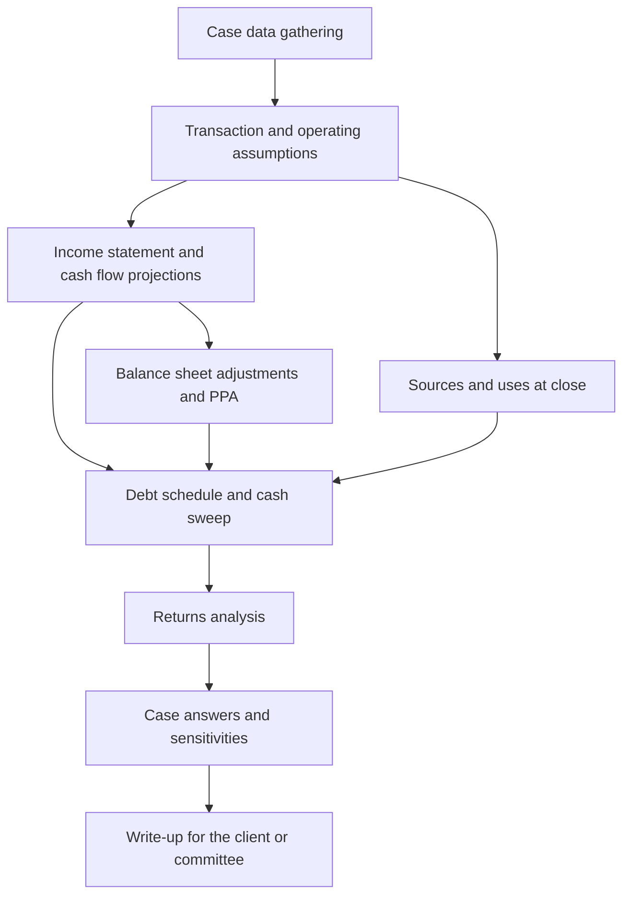
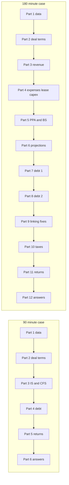
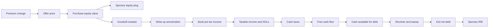
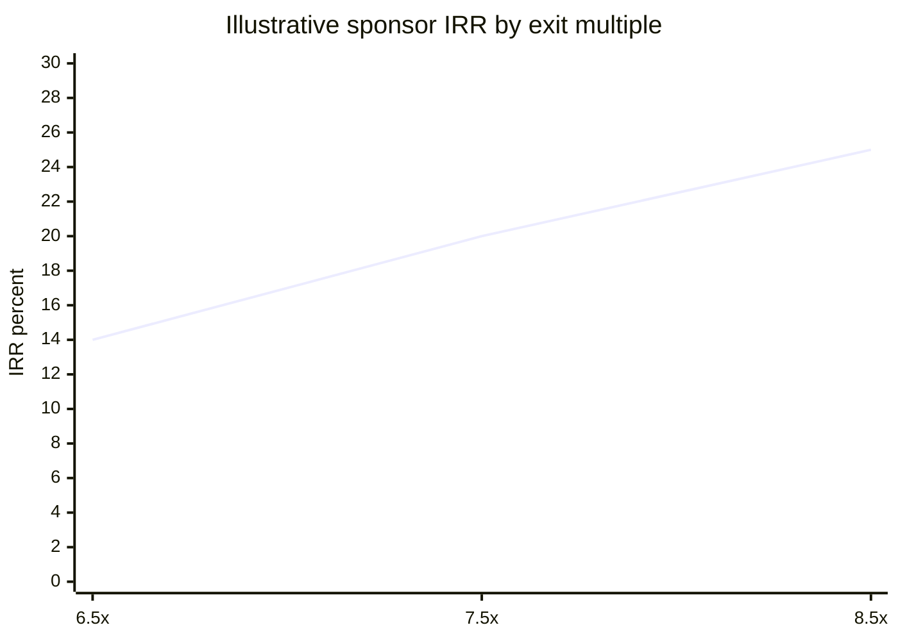
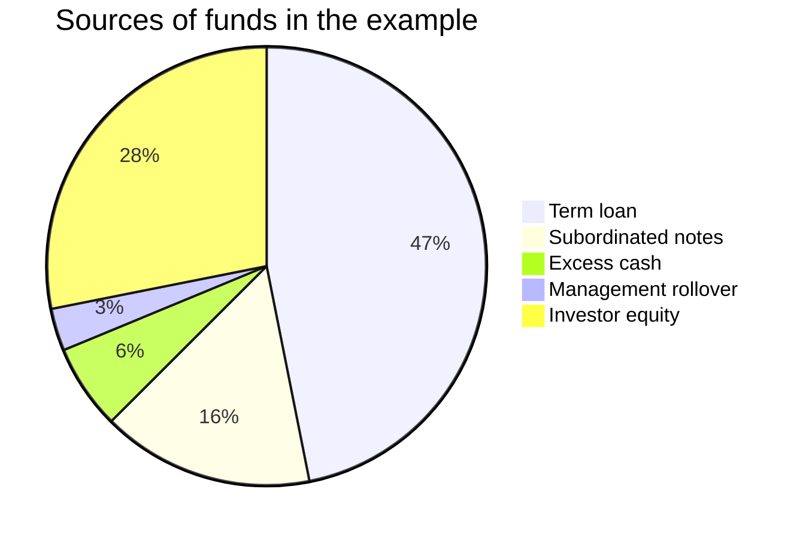
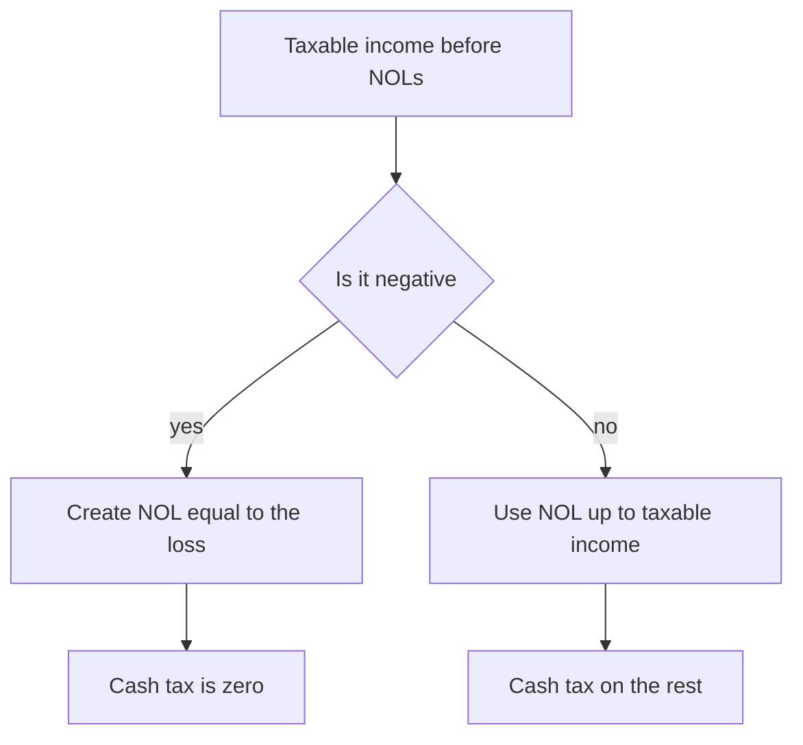

# Module 12, Part 2: LBO Concepts and Simple Models

[← Previous: Module 12, Part 1](12-lbo-concepts-and-simple-models-part-1.md) · [Contents](../README.md) · [Next: Module 13, Part 1 →](13-advanced-lbos-part-1.md)

<details>
<summary><b>Contents</b></summary>

- [Overview](#overview)
- [Module Map](#module-map)
- [Lessons](#lessons)
  - [12.12 Part 1: Overview and Data Gathering (90-Minute Case)](#1212-part-1-overview-and-data-gathering-90-minute-case)
  - [12.13 Part 2: Transaction and Operating Assumptions](#1213-part-2-transaction-and-operating-assumptions)
  - [12.14 Part 3: Income Statement and Cash Flow Projections](#1214-part-3-income-statement-and-cash-flow-projections)
  - [12.15 Part 4: Debt Schedule (Revolver, Cash Flow Sweep, PIK Interest)](#1215-part-4-debt-schedule-revolver-cash-flow-sweep-pik-interest)
  - [12.16 Part 5: Returns Calculations (Options Pool, Mezzanine Equity, Sensitivity)](#1216-part-5-returns-calculations-options-pool-mezzanine-equity-sensitivity)
  - [12.17 Part 6: Value Creation Analysis and Case Answers](#1217-part-6-value-creation-analysis-and-case-answers)
  - [12.18 Part 1: Overview and Data Gathering (180-Minute Case)](#1218-part-1-overview-and-data-gathering-180-minute-case)
  - [12.19 Part 2: Transaction Assumptions (IFRS, Public Target, Scenarios)](#1219-part-2-transaction-assumptions-ifrs-public-target-scenarios)
  - [12.20 Part 3: Revenue Assumptions (Square-Foot Driven, Scenarios)](#1220-part-3-revenue-assumptions-square-foot-driven-scenarios)
  - [12.21 Part 4: Expense, Lease and CapEx Assumptions](#1221-part-4-expense-lease-and-capex-assumptions)
  - [12.22 Part 5: Purchase Price Allocation and Balance Sheet Adjustments](#1222-part-5-purchase-price-allocation-and-balance-sheet-adjustments)
  - [12.23 Part 6: Financial Statement Projections (Working Capital, Cash Flow, Balance Sheet Links)](#1223-part-6-financial-statement-projections-working-capital-cash-flow-balance-sheet-links)
  - [12.24 Part 7: Debt Schedule Part 1 (Mandatory Repayments, Revolver, Cash Available)](#1224-part-7-debt-schedule-part-1-mandatory-repayments-revolver-cash-available)
  - [12.25 Part 8: Debt Schedule Part 2 (Optional Repayments, Call Premium, Interest)](#1225-part-8-debt-schedule-part-2-optional-repayments-call-premium-interest)
  - [12.26 Part 9: Linking the Debt Schedule and Fixing the Lease Treatment](#1226-part-9-linking-the-debt-schedule-and-fixing-the-lease-treatment)
  - [12.27 Part 10: Tax Schedule and Net Operating Losses](#1227-part-10-tax-schedule-and-net-operating-losses)
  - [12.28 Part 11: Credit Stats, Ratios and Returns with Management Rollover and Earn-Outs](#1228-part-11-credit-stats-ratios-and-returns-with-management-rollover-and-earn-outs)
  - [12.29 Part 12: Sensitivity Tables and Case Study Answers](#1229-part-12-sensitivity-tables-and-case-study-answers)
- [Diagrams and Charts](#diagrams-and-charts)
- [Excel Model Walkthrough](#excel-model-walkthrough)
- [Interview Questions](#interview-questions)
- [Career Angle](#career-angle)
- [Cheat Sheet](#cheat-sheet)

</details>

## Overview

Build a full leveraged buyout from a pre-formatted template in 90 minutes and then in 180 minutes, going from raw case data to sources and uses, operating projections, a debt schedule, returns and a final set of case answers.

Part 2 covers the two timed "from template" cases. The mechanics are already understood at this point, so the goal shifts from learning the logic to working fast and in order: pull the numbers, set the assumptions, project the statements, layer on debt, check returns, then answer the questions a case always asks.

## Module Map





## Lessons

### 12.12 Part 1: Overview and Data Gathering (90-Minute Case)

**What changes with a template.** The 90-minute case gives you a pre-formatted workbook with labels, color coding, and most of the raw inputs already in place. You fill in the formulas. The model is still a cash-flow LBO, not a full three-statement model. In practice you should expect about 200 rows of work through the returns section and roughly 250 once sensitivities and value-creation analysis are added. The template saves more time than the extra 30 minutes buys, so the case gets harder in other ways: more debt tranches, a revolver, a sweep, a management option pool, and more involved questions at the end.

**The case.** The target is a Japanese operator of nursing homes plus medical support services for hospitals. It was a real take-private in 2020. Right after the pandemic hit, the share price fell by more than half, and the buyer bid a low price. Shareholders objected and the bid rose. Your job is to finish the model, make an investment call, and solve for the offer price per share that gives the sponsor a 20%, 25%, and 30% IRR. In the write-up we call the company "NG" for short.

**Business profile (in words).**

- Mature and slow growing, with revenue growth of only a few percent a year.
- Gross margin under 20% because it is a services business. Operating margin is low single digits.
- Free cash flow converts from EBITDA at a respectable rate, so the business is a cash generator even without growth.
- Two segments behave very differently:
  - Medical support (services to hospitals) already covers almost every hospital in the country. Growth can only come from price.
  - Long-term care (nursing homes) can grow by adding or buying facilities and by spending capex to upgrade them and attract patients.
- Patient counts fell while segment revenue rose. That means pricing did the work. The plan is to keep pushing price and upgrade facilities, which costs margin and cash in the early years. That is why the revolver gets drawn early.

**Data sourcing.**

- Income statement, operating expense, cash, short-term investments, and goodwill come from the company's annual financial statements in the investor relations section.
- Patient counts and three years of segment revenue come from the same disclosure pack.
- Facility counts are not disclosed every year, so they are estimated and extrapolated. Note any estimate you make on the page.
- Share price and premium come from public announcements.

**Deal terms.**

- Debt was about five times EBITDA, which is about 100 billion yen after rounding a disclosed figure of 99 billion.
- Converting yen to dollars for a rough check: divide yen by about 100. For a real model, use the FX rate on the valuation date.

> [!TIP]
> The total amount of debt drives the equity check far more than the exact coupon or amortization. Pick realistic market rates, label them as assumptions, and move on.

**Worked example (made-up numbers).**

| Item | Value |
|---|---|
| Unaffected share price | $10.00 |
| Offer price | $14.00 |
| Premium to unaffected | 40% (14 / 10 - 1) |
| Shares outstanding | 20 million |
| Equity purchase price | $280 million |
| EBITDA | $40 million |
| Debt at 5x EBITDA | $200 million |

**Formulas**

```
Premium = Offer price / Unaffected price - 1
Debt = Leverage multiple x EBITDA
Equity purchase price = Offer price x Diluted shares
```

> [!TIP]
> The unaffected price matters. If the stock crashed right before the bid, a premium over the crashed price looks big but may still be low against the price a year earlier. Always check premium against several reference points: the unaffected price, the 30 or 52 week average, and the high.

### 12.13 Part 2: Transaction and Operating Assumptions

**Scope.** This lesson fills in the top of the workbook (purchase price, enterprise value bridge, goodwill, sources and uses) and then all the historical ratios and the projection drivers. It stops before the income statement and cash flows are fully built, because those need the debt schedule for interest.

**Step 1: Offer price and equity value.**

- Offer price = unaffected share price x (1 + premium). The case gave a premium of about 52.5%, which lands on the actual price paid.
- Purchase equity value = offer price x diluted shares. Use diluted shares, not basic.
- Purchase enterprise value = purchase equity value + debt + noncontrolling interest + unfunded pensions - cash. These balance sheet items come from the latest fiscal year.

**Step 2: LTM EBITDA, with a local GAAP twist.** Start with operating income, add back depreciation and amortization, and under local rules here also add back the amortization of goodwill, since the book P&L amortizes goodwill. Check that the D&A on the income statement matches the cash flow statement. If it does, no adjustment is needed.

> [!TIP]
> Under US GAAP, public-company goodwill is not amortized on the P&L, it is tested for impairment. If you see goodwill amortization on an income statement, check which accounting standard applies before you add it back.

**Step 3: Multiple.** Purchase multiple = purchase enterprise value / LTM EBITDA. The multiple is the sanity check on the price. It tells you whether the bid is reasonable against the company's own earnings.

**Step 4: Goodwill created.**

```
New goodwill = Purchase equity value - (Seller book equity - Seller existing goodwill)
```

The seller's equity is wiped out and the existing goodwill is written off. Any asset write-ups or write-downs are zero unless the case says otherwise.

**Step 5: Sources and uses for a public company.** A public take-private is not cash-free, debt-free. You buy the equity, then decide what to do with the debt.

| Uses | Sources |
|---|---|
| Purchase equity value | New debt (leverage x LTM EBITDA) |
| Refinance existing debt | Excess cash (cash less minimum cash) |
| Prepayment penalty (2% of existing debt) | Sponsor equity (plug) |
| Financing fees (2% of new debt) | |
| Advisory fee (1% of purchase equity) plus legal | |

Debt is refinanced in nearly every deal, so the "assume or replace existing debt" line is usually a refinancing. Sponsor equity is the plug: total uses minus all other sources.

**Worked example (made-up numbers, $ millions).**

| Item | Value |
|---|---|
| Unaffected price | $8.00 |
| Premium | 50% |
| Offer price | $12.00 |
| Diluted shares | 25 |
| Purchase equity value | 300 |
| Existing debt | 60 |
| Cash | 30 (minimum cash kept: 10) |
| LTM EBITDA | 40 |
| Purchase EV (300 + 60 - 30) | 330 |
| Purchase multiple | 8.25x |
| New debt at 5.0x | 200 |
| Existing book equity / existing goodwill | 90 / 25 |
| New goodwill (300 - (90 - 25)) | 235 |

| Uses | Amount | Sources | Amount |
|---|---|---|---|
| Purchase equity | 300.0 | New debt | 200.0 |
| Refinance debt | 60.0 | Excess cash (30 - 10) | 20.0 |
| Prepayment penalty (2%) | 1.2 | Sponsor equity (plug) | 150.2 |
| Financing fees (2% of 200) | 4.0 | | |
| Advisory (1% of 300) plus legal | 5.0 | | |
| **Total** | **370.2** | **Total** | **370.2** |

**Operating drivers.** The historical ratios are set up first so the projections have a base. The main drivers in this kind of model:

- Average patients (average of opening and closing count), since price paid per patient follows the average, not the year-end number.
- Revenue per patient = segment revenue / average patients. Watch the units. A yen-in-millions input needs a conversion.
- Patients per facility = average patients / facility count.
- Medical support revenue per hospital = segment revenue / hospitals. Hospitals stay flat because the company already reaches almost every one.
- Other segment growth rate, eliminations as a percent of total revenue, cost of sales and SG&A as a percent of revenue.
- Capex plus intangibles per owned facility, and D&A per owned facility. Both scale with the facility count because most of the assets sit in the nursing homes.
- Change in working capital as a percent of total revenue. Growth-based versions fluctuated too much, so a revenue-based version was kept.
- Cash taxes as a percent of cash taxable income.

**Cash taxes.** Taxes are computed on pre-tax income plus back the book goodwill amortization, because that amortization is not deductible for cash tax. The tax rate here averaged about 32%, in line with a statutory rate of roughly 30 to 33%.

```
Cash taxable income = Pre-tax income + Goodwill amortization
Cash taxes = Tax rate x Cash taxable income
```

> [!TIP]
> The model starts from EBITDA, so net income is not needed for free cash flow. Building a net income line only matters if you need an EPS or a book equity roll-forward.

**Debt terms (only a quick read at this stage).**

- Revolver and term loans are floating, priced as a base rate with a floor plus a spread.
- Term loans amortize at 10% of original principal a year.
- Part of excess cash flow sweeps to optional prepayment, here 50%.
- Subordinated notes and mezzanine have a mix of cash and paid-in-kind interest.
- The debt mechanics are built in later lessons, so do not chase them yet.

> [!WARNING]
> Common mistake: forgetting that financing fees are a use of funds that the sponsor must pay, so they raise the equity check even though they do not change the purchase price.

### 12.14 Part 3: Income Statement and Cash Flow Projections

**Goal.** Turn the assumptions from the last lesson into projected revenue, costs, D&A, and a free cash flow line that starts from EBITDA. Interest stays blank until the debt schedule exists.

**Revenue build, segment by segment.**

- Year-end patients = prior year-end patients x (1 + patient growth).
- Average patients = average of opening and closing patient counts.
- Revenue per patient = prior price x (1 + price growth).
- Long-term care revenue = average patients x revenue per patient, converted back to the model's units (millions).
- Facilities = average patients / patients per facility. Patients per facility is falling, but the facility count still rises, because patients are spread across more homes.
- Medical support revenue = hospitals x revenue per hospital. Revenue per hospital grows at its own rate.
- Other segments = prior year x (1 + other growth).
- Eliminations = negative x (total of the segments above) x elimination percent. Intersegment sales are removed so they are not counted twice.

**Costs and profit.**

- Cost of sales, SG&A, and other items = total revenue x their percent-of-revenue assumption.
- Gross profit = revenue - cost of sales. Gross margin = gross profit / revenue.
- Operating income = gross profit - operating expenses (SG&A plus other items).

**Goodwill amortization with a cap.** The new goodwill is amortized straight line over a set period, here ten years. The formula must never amortize more than the balance left.

```
Goodwill amortization (year t) = -MIN(Remaining goodwill balance, New goodwill / Amortization period)
```

Anchor the cells holding the goodwill and the period (with dollar signs) so the formula copies cleanly.

**Pre-tax income.** Operating income + net interest (blank for now) = pre-tax income. Interest stays blank until the debt schedule is built.

**Capex and D&A.**

- D&A = D&A per owned facility x owned facilities.
- Capex plus intangibles = capex per owned facility x owned facilities.
- Both are checked as a percent of sales so you can spot a jump that looks wrong.
- Change in working capital = revenue x working capital percent, as set in the last lesson.

**Free cash flow from EBITDA.** This is the part that confuses people. The standard build starts with net income and adds back D&A, non-cash interest, and deferred taxes, then subtracts working capital and capex. The EBITDA-based build gets to the same answer by a different route:

```
Free cash flow = EBITDA
                 - Change in working capital (as an increase)
                 - Capex and intangibles
                 - Cash taxes
                 - Cash interest expense
                 + Cash interest income
                 + Other items
```

Why it works: EBITDA is operating income plus D&A. Book taxes minus deferred taxes equals cash taxes, and total interest minus non-cash interest equals cash interest. The items are the same. They are just grouped differently.

**Worked example (made-up numbers, $ millions, one projected year).**

| Line | Value |
|---|---|
| Operating income | 22.0 |
| D&A | 8.0 |
| EBITDA | 30.0 |
| Goodwill amortization | 7.0 |
| Pre-tax income (22 - 7 + 0 interest) | 15.0 |
| Cash taxable income (15 + 7) | 22.0 |
| Cash taxes at 30% | 6.6 |
| Working capital change | 1.0 |
| Capex and intangibles | 9.0 |
| Free cash flow before interest (30 - 1 - 9 - 6.6) | 13.4 |

Notice the goodwill amortization hits book pre-tax income but is added back for cash tax. It is not in EBITDA, so it does not touch free cash flow directly except through the tax line.

> [!TIP]
> Two checks worth doing every time. First, does D&A on the P&L match D&A on the cash flow statement? If not, something is missing. Second, is the tax line computed on cash taxable income, not on book pre-tax income? A common shortcut is to apply the tax rate to book income, which overstates taxes when there is goodwill amortization.

> [!TIP]
> A subtle point about the cap: amortizing more than the balance would create negative goodwill on the balance sheet. The MIN function is a small guard that matters in the last years of a long projection.

### 12.15 Part 4: Debt Schedule (Revolver, Cash Flow Sweep, PIK Interest)

**Why this is the hard part.** Parts of the schedule depend on cells further down, so you cannot build it strictly top to bottom. The order that works:

1. Link the opening debt balances and the easy tranches (term loan amortization, fixed-rate and PIK interest on the notes).
2. Build the cash flow available for debt repayment, the revolver, and the cash sweep.
3. Build the interest rates and the interest on each tranche.
4. Sum everything and link back to the income statement and cash flow statement.

**Tranche structure, from most senior to most junior.**

- Revolver: a committed credit line. It acts like an overdraft. Draw when cash runs short, repay when cash is available. Not mandatory to repay.
- Term loan: senior, with fixed mandatory amortization (a set percent of the original principal each year) plus an optional sweep of excess cash.
- Subordinated notes and mezzanine: junior. Interest is partly cash and partly paid-in-kind (PIK), meaning it is added to principal instead of being paid. Mezzanine sits closest to equity.

**Opening balances.** Each tranche starts at the sources and uses amount. Cash at close is the company's cash less the excess cash used to fund the deal, which should equal the minimum cash balance. Each later year's beginning balance equals the prior year's ending balance.

**Term loan amortization.**

```
Mandatory amortization = -MIN(Beginning balance, Original principal x Fixed percent)
```

The MIN guards against paying down more than the remaining balance.

**PIK interest.** PIK interest accrues to principal, so it increases the balance. Compute it on the beginning balance:

```
PIK interest (year t) = Beginning balance (t) x PIK rate
Ending balance = Beginning balance + PIK interest
```

Using the beginning balance avoids a circular reference.

**Cash available for repayment.** This is the core logic.

```
Cash surplus (shortfall) = Beginning cash + Free cash flow + Mandatory amortization (negative) - Minimum cash
```

Then:

- If the surplus is positive, repay the revolver by the lesser of the surplus and the revolver balance.
- If the surplus is negative, draw the revolver by the shortfall.

**Cash flow sweep.** After the revolver, the leftover surplus goes partly to the term loan.

```
Optional sweep = -MIN(Sweep percent x Cash left after revolver, Term loan balance after amortization)
```

If there is no positive cash left, the sweep is zero. The MIN caps the sweep at the remaining term loan.

**Interest rates with a floor.** Floating tranches use the greater of a floor and a base rate, plus a spread.

```
Rate = MAX(Floor, Base rate) + Spread
Cash interest = Beginning balance x Rate
```

Using beginning balances for all interest also avoids circularity. If you used average or ending balances, the sweep would depend on interest, and interest would depend on the sweep. Many models use average balances with iterative calculation and a circuit breaker switch, but beginning balances are the standard speed-test choice.

**Linking back.**

- Income statement interest expense = total interest, including PIK.
- Income statement interest income = cash interest income on the beginning cash balance.
- Cash flow statement (in the EBITDA build) uses cash interest expense and cash interest income only. PIK is not a cash item. It does reduce taxes, which is already captured in the tax line.
- Cash flow to debt = revolver draws or repayments + mandatory amortization + sweep.

**Worked example (made-up numbers, $ millions, one year).**

| Line | Value |
|---|---|
| Beginning cash | 20.0 |
| Free cash flow | 15.0 |
| Mandatory term loan amortization | -6.0 |
| Minimum cash | -10.0 |
| Cash surplus | 19.0 |
| Beginning revolver | 12.0 |
| Revolver repayment, MIN(19, 12) | -12.0 |
| Cash left after revolver (19 - 12) | 7.0 |
| Sweep at 50% of 7 | -3.5 |
| Ending cash (10 + 3.5 leftover) | 13.5 |

Shortfall case: if free cash flow had been -5, the surplus is 20 - 5 - 6 - 10 = -1. The revolver draws 1, and there is no sweep.

Interest check: a 3.5% revolver rate on a 12.0 beginning balance is 0.42 of cash interest. A notes tranche at 4% cash plus 3% PIK on a 20.0 beginning balance adds 0.8 of cash and 0.6 of PIK. Only the 0.8 of cash interest hits the cash flow.

**Reading the output.** The schedule tells a story. In the early years of a plan that spends heavily on capex and takes a margin hit, the revolver is drawn. Later the business repays the revolver and then the term loan. If the term loan is fully repaid early, the sweep is hitting the cap, which is a good sign that the company is generating excess cash.

> [!TIP]
> Real deals often have a minimum cash balance and a cash sweep that is tested against leverage targets, a commitment fee on undrawn revolver, and maturities that force a refinancing. Mention these in a case answer as things a lender would check, even if the template does not model them.

> [!WARNING]
> A common error is letting the revolver draw go above its commitment. Add a check that compares the revolver balance to the facility size.

### 12.16 Part 5: Returns Calculations (Options Pool, Mezzanine Equity, Sensitivity)

**Scope.** The returns section has three jobs: compute exit value and sponsor returns by exit year, layer on the management option pool and the equity given to mezzanine investors, and build a two-way sensitivity table. The value creation analysis is saved for the next lesson.

**Step 1: Exit value by year.** Put a year counter across the top (1 to 5). With no cash flows between entry and exit, the IRR is a simple compound growth formula.

```
Exit enterprise value = Exit EBITDA x Exit multiple
Exit equity value = Exit EV - Total debt + Cash - Noncontrolling interest - Unfunded pensions
```

The exit multiple ramps from the purchase level toward the historical average by year five. The bridge is the reverse of the entry bridge: we move from enterprise value down to equity value.

**Step 2: Sponsor returns before dilution.**

```
MOIC = Exit equity value / Sponsor equity
IRR = MOIC ^ (1 / Years) - 1
```

Early exits show low or negative IRRs, because the year count is small and the equity has not had time to grow. Late exits show the high numbers.

**Step 3: Management option pool.** Management gets options struck at the offer price per share. They exercise only if the exit equity beats the original equity check. When they exercise, they pay the exercise price to the company, and that cash goes into the equity pot.

```
Cash from options = IF(Exit equity > Sponsor equity, Option % x Sponsor equity, 0)
```

The exercise price is fixed at entry, so the cash is the same in every year that the options are in the money.

**Step 4: Dilution.** The option holders now own a share of an equity pot that includes their own cash. Their stake is the option percentage divided by one plus that percentage, which is slightly under the headline percentage.

```
Option distribution = -IF(Cash from options > 0, Option % / (1 + Option %) x (Exit equity + Cash from options), 0)
```

**Step 5: Mezzanine equity.** Mezzanine investors also receive an equity kicker. The same dilution logic applies, and a MAX with zero guards against negative values.

```
Mezz distribution = MAX(0, Mezz % / (1 + Mezz %) x (Exit equity + Cash from options))
```

**Step 6: Sponsor proceeds.** The sponsor gets the whole pot minus the other holders' distributions.

```
Sponsor proceeds = (Exit equity + Cash from options) - Option distribution - Mezz distribution
```

This is the economically correct way to see it. The option cash is added to the pot. Pay attention to signs when you build it: a common mistake is to subtract a distribution that is already stored as a negative number.

**Worked example (made-up numbers, $ millions, year 5).**

| Line | Value |
|---|---|
| Sponsor equity at entry | 150.2 |
| Exit EBITDA | 60.0 |
| Exit multiple | 7.0x |
| Exit enterprise value | 420.0 |
| Debt (term loan 90, sub notes 25, mezz 30) | -145.0 |
| Cash | 10.0 |
| Noncontrolling interest and pensions | -5.0 |
| Exit equity value | 280.0 |
| Cash from options (10% x 150.2 = 15.0, since 280 > 150.2) | 15.0 |
| Pot (280 + 15) | 295.0 |
| Option distribution (10/110 x 295) | -26.8 |
| Mezz distribution (2/102 x 295) | -5.8 |
| Sponsor proceeds | 262.4 |
| Sponsor MOIC (262.4 / 150.2) | 1.75x |
| Sponsor IRR (1.75 ^ (1/5) - 1) | about 11.8% |

Simpler dilution, option percent x pot, changes the answer by about a percent. The exact method is better, but the instructions were loose on this point, so state the method you chose.

**Step 7: Sensitivity table.** Build a two-way data table (What-If Analysis in Excel) with:

- Columns: exit multiple, centered on the target range with a little room on both ends.
- Rows: purchase premium, centered so the base case sits near the middle or lower middle.
- Output: the year-five sponsor IRR, linked into the corner cell.

The base case should be highlighted, and the input cells must be the actual model inputs. Set calculation to automatic except data tables if the model is slow, then press F9 to refresh.

**What the table says.** Read the table like a banker would:

- Moving across a row shows how sensitive the IRR is to the exit multiple.
- Moving down a column shows how sensitive it is to the price paid.
- The deal works mainly when the entry price is well below the company's normal trading range. If you pay a full premium, multiple contraction at exit can push the IRR under the sponsor's target.

> [!TIP]
> Sensitivity tables are only as good as the axes. A table that starts at a multiple well above what the company has ever traded at looks reassuring but tests nothing useful. Choose axes that bracket realistic downside.

> [!TIP]
> Calculating an IRR with a simple power formula only works if there are no interim distributions. If there is a dividend recap or a mid-hold cash distribution, switch to the IRR function on a cash flow row.

### 12.17 Part 6: Value Creation Analysis and Case Answers

**Scope.** Build the value creation (returns attribution) bridge, split revenue growth into volume and price, then answer the case questions: the investment call, the maximum price for target IRRs, whether a higher price is fair, and whether the capital structure should change.

**Step 1: Value creation bridge.** The idea is to hold some variables fixed and let one move at a time.

```
EBITDA growth = (Exit-year EBITDA - LTM EBITDA) x Entry multiple
Multiple expansion = (Exit multiple - Entry multiple) x Exit-year EBITDA
Debt paydown, cash and other = Total equity gain - EBITDA growth - Multiple expansion
```

The three pieces add back to the total equity gain (exit equity minus sponsor equity). The third bucket is the plug, but it has a real meaning: lower net debt, less fees and other leakage.

**Worked example (made-up numbers, $ millions, same deal as lesson 12.13).**

| Driver | Calculation | Value |
|---|---|---|
| Entry multiple | Purchase EV / LTM EBITDA (330 / 40) | 8.25x |
| EBITDA growth | (60 - 40) x 8.25 | 165.0 |
| Multiple expansion | (7.0 - 8.25) x 60 | -75.0 |
| Enterprise value gain | Sum of the two above (420 - 330) | 90.0 |
| Total equity gain | 280.0 - 150.2 | 129.8 |
| Debt paydown, cash and other | 129.8 - 90.0 | 39.8 |

The contraction in this example is intentional. It shows that a deal can still work when the exit multiple is below the entry multiple, as long as EBITDA growth and deleveraging carry it. In the case itself, the exit multiple was above the entry multiple, so multiple expansion was a positive driver.

> [!TIP]
> The "debt paydown" bucket is really net debt reduction minus fees and other leakage. Here net debt fell by 55 and the fees and the change in minority interest and pensions took back about 15. That is why the plug is 39.8, not 55.

**Step 2: Volume versus price for revenue.** Split the change in revenue for a segment that is driven by units times price.

```
Volume effect = (Units this year - Units last year) x Price last year
Price effect = (Price this year - Price last year) x Units this year
```

The price effect must use this year's units, and the volume effect must use last year's price. That split adds back exactly to the total change.

Worked example: units go from 1,000 to 1,050, and price from $8,000 to $8,400.

- Volume effect: 50 x 8,000 = 400,000
- Price effect: 400 x 1,050 = 420,000
- Total: 820,000, which equals 1,050 x 8,400 minus 1,000 x 8,000.

A common error is to hold units at the starting level when measuring price growth. That leaves a gap between the pieces and the total. Test your split by checking that the pieces sum to the change.

**Step 3: Investment call.** The memo should say what you recommend, why, and how wrong you could be.

- Use the sensitivity table to show the IRR stays near the target across a range of exit multiples.
- Stress test the operating assumptions. Keep cost ratios higher than the base case and see if the IRR still holds.
- Stress test the revenue driver. In a case where growth depends on price, set price growth to small positive numbers and to zero, and see what the IRR does.
- Note what share of the return comes from operations and debt paydown versus multiple expansion. A deal that works without multiple expansion is less fragile.

**Step 4: Maximum price for a target IRR (Goal Seek).** An LBO can be used as a valuation tool. Set the sponsor IRR cell to a target value, then change the premium cell until the IRR matches. Goal Seek is the tool here.

| Target IRR | Premium (illustrative) | Price implied (illustrative) |
|---|---|---|
| 30% | 40% | $11.20 |
| 25% | 60% | $12.80 |
| 20% | 80% | $14.40 |

The numbers are made up, but the pattern is the lesson: a lower required return lets the sponsor pay more. If a sponsor's target is 30% and the market price already implies a premium well above the maximum, the deal does not work at that price.

> [!TIP]
> Goal Seek is a one-variable solver. If you change two inputs at once, you need a data table. Always re-run Goal Seek after changing any assumption, because the answer is a snapshot.

**Step 5: Fair value questions.** When a critic says the price was too low, do not just accept or reject. Check:

- Whether the critic uses a different exit multiple definition. For example, counting operating lease liabilities in enterprise value changes the multiple. If you use EBITDA after rent expense, leases should stay out of debt.
- Whether the critic assumes a different margin path, a different debt mix or a lower minimum cash balance.
- What IRR you get at the critic's price with your own operating case. Then compare with the sponsor's target return.

The conclusion in the case was that the deal could support a higher price than paid, but a fair range was probably below the critic's preferred number.

**Step 6: Capital structure.** Ask whether the debt could go higher, whether the mix could change, and whether the cash balance could change.

- Leverage above the purchase multiple is a red flag. If debt is 5x and the purchase multiple is 5.6x, debt covers about 90% of the purchase enterprise value. Lenders will not accept much more than that.
- Changing the mix from junior notes to all term loans barely moved the IRR. Pricing and seniority matter less than the amount of debt.
- Lowering the minimum cash balance was the lever that moved returns. Less cash on the balance sheet means the sponsor puts in less equity, which raises the IRR. The question is whether the business can run safely on less cash.

**Formulas to remember**

```
Equity gain = Exit equity - Sponsor equity
Net debt reduction = Entry net debt - Exit net debt
Sponsor equity = Purchase EV - Entry net debt + Fees
```

> [!TIP]
> The key question in a case memo is the trade-off: a deal that depends on paying a low price is fragile to bad news at entry, while a deal that depends on margin or growth is fragile to bad news in operations. Name the single assumption that matters most and say how you would check it in diligence.

### 12.18 Part 1: Overview and Data Gathering (180-Minute Case)

**What a longer template case looks like.** A two or three hour case is still a speed test, but the template does more of the work. Expect:

- A full three-statement model, not just a cash flow build. Income statement, balance sheet and cash flow statement all have to tie.
- More complex revenue and expense logic, often with separate drivers for each segment and scenarios (base, upside, downside).
- IFRS complexity if the company reports under IFRS, because operating leases sit on the balance sheet as right-of-use assets and lease liabilities.
- A debt schedule similar to the 90-minute case, with a revolver, sweep and PIK, plus extra items such as commitment fees if the case asks for them.
- Extra schedules for taxes (including net operating losses when the company has losses) and for credit statistics and ratios.
- A returns twist such as a management option pool, a rollover or an earn-out. Expect one or two twists, not all of them.
- Written answers that cover the investment call, credit profile, business model and risks. Full slides are unlikely at this complexity.
- Roughly 300 to 400 rows in the workbook when a template is provided, and around 200 rows if you build the statements from scratch.

> [!TIP]
> Template versus blank sheet usually matters more than the extra time. A good template removes formatting work and makes the case easier to navigate, but it also hides how the numbers were built, so you still need to understand where each input came from.

**The case in general terms.** This is a real take-private from 2020. The target is a Canadian gaming company that runs casinos, racetracks and hotels, about 26 properties in total. The stock fell sharply during the pandemic lockdowns, and a private equity buyer tried to buy it at a low price. The team's job is to finish the model, make an investment call, and answer questions on the business model, credit profile and risks.

**What the business looks like.**

- Gaming (casino floor revenue) is the vast majority of revenue. Hospitality (hotel) and racetrack and lease revenue are small. Build them, but spend the effort on gaming.
- Revenue history was cyclical. Growth ranged from negative to very high, with a large jump from acquisitions just before the pandemic.
- The key metric is gaming revenue per used square foot. It moved up and down with cycles, and the question is whether it can return to its prior peak or beyond.
- Most operating costs (staff and property marketing and administration) are variable, so the 2020 hit to pre-tax income was severe but not a total wipeout. A business with mostly fixed costs would have collapsed further.
- Recovery is not instant. Some scenarios assume it takes two to four years to get back to full capacity, so early cash flow is weak and the revolver matters.
- Free cash flow was already weak before the pandemic, at least on this model's definition. That is the reason the cheap price might be a value trap as well as a bargain.

**Where the data comes from.**

- Annual filings and reports: income statement, balance sheet and cash flow statement.
- Deal documents: share count, options and the planned new debt.
- A market data service for longer history and a quick square footage estimate. Note the estimate in the model.
- There was no investor presentation for the target, so skip that source if it does not exist.

**Building historical statements from filings (what was changed and why).**

- Income statement: split revenue by type (gaming, hospitality, racetrack and lease). Split interest into lease interest and debt interest, because under IFRS 16 the lease interest is separate. Split amortization into PP&E depreciation and right-of-use lease amortization. Group small items where it helps. End at net income attributable to the parent, after minority interests.
- Balance sheet: keep close to the filing. Group all lease liabilities into one line and all debt into one line. Simplify equity.
- Cash flow statement: start from net income to parent, not from pre-tax income. Show amortization separately. Ignore historical financing cash flows, because they relate to the old capital structure, which gets wiped out in the deal.
- Move lease principal payments into investing, so they sit alongside capex. This keeps the lease cash cost visible in free cash flow.

**Check the historical build against the filings.** Search the filing for its own free cash flow line, then compare. A small gap is fine if you can explain it (for example a different definition of capex). A large gap means something is wrong.

**Worked example of the IFRS 16 split (made-up numbers, $ millions).**

| Item | Reported | Split |
|---|---|---|
| Total interest | 30 | Lease interest 12, debt interest 18 |
| Total amortization | 40 | PP&E depreciation 25, lease amortization 15 |
| Lease principal paid | in financing | moved to investing with capex |

Free cash flow in the model = operating cash flow - capex - lease principal payments. This is the number to compare with a company's own definition, which may treat leases differently.

**Debt terms and total debt.**

- The company had recently issued senior unsecured notes at a coupon in the mid 5% range, which anchors the term loan price. Subordinated debt sits higher, in the 8% range.
- Real deal documents list only the new debt. The model here uses total debt, including the existing debt that gets refinanced, because the leverage multiple in the schedule measures the whole capital structure. This difference matters when you compare the model to deal papers.

> [!TIP]
> Real models should use the coupon the market actually charges at the time of the deal, which you can find in recent bond issues. The total amount of debt matters far more than the exact coupon.

> [!WARNING]
> Common data trap: the company's own free cash flow definition may include or exclude lease payments. Always confirm which definition you are comparing against before concluding your model is off.

### 12.19 Part 2: Transaction Assumptions (IFRS, Public Target, Scenarios)

**Scope.** Set the purchase price, the diluted share count, the enterprise value bridge, the EBITDA definitions, the scenario and exit inputs, and the sources and uses schedule. Purchase accounting and goodwill wait until the combined balance sheet is built.

**Step 1: Diluted shares with the treasury stock method.** A public target has options, restricted share units (RSUs) and other awards. Each class is treated differently.

```
Option dilution (net new shares) = IF(Exercise price > Offer price, 0, Options x (1 - Exercise price / Offer price))
RSU dilution = RSUs (added in full, no exercise price)
Diluted shares = Basic shares + Option dilution + RSU dilution
Purchase equity value = Offer price x Diluted shares
```

Logic: options that are in the money are exercised, and the cash received buys back shares at the offer price. Net new shares are the option count minus those repurchased. Options that are out of the money do nothing.

**Worked example (made-up).** Basic shares 30.0 million. Options 1.0 million with an exercise price of $6.00. RSUs 0.5 million. Offer price $10.00.

- Option dilution: 1.0 x (1 - 6 / 10) = 0.4 million
- Diluted shares: 30.0 + 0.4 + 0.5 = 30.9 million
- Purchase equity value: 30.9 x $10.00 = $309 million

**Step 2: Offer price and premium.** Offer price = undisturbed share price x (1 + premium). Check the label on the row, because the template may mislabel a cell. A label that says "buyer share price" on an undisturbed price line is a common template error. Fix the label before you link anything to it.

**Step 3: Enterprise value bridge under IFRS.** Start with equity value, then:

```
Purchase EV = Purchase equity value - Cash and investments + Total debt + Operating lease liabilities + Noncontrolling interests
```

Under IFRS 16, operating leases are on the balance sheet as lease liabilities. Because lease costs show up as lease interest and lease amortization (and not as rent in operating expenses), EBITDA excludes lease costs. To stay consistent, the lease liability has to be in enterprise value. This is the single most important IFRS difference in the bridge.

> [!TIP]
> Consistency rule: if your EBITDA is before lease costs, your enterprise value must include the lease liability. If you use EBITDA after rent (US GAAP style), leave leases out of EV. Mixing the two overstates or understates the multiple.

> [!TIP]
> Book value versus face value for debt is usually a small gap. Use book value unless the filings give you a market value, and state the choice.

**Step 4: EBITDA built from the income statement.** Rather than pulling a line from the credit ratios section, rebuild it:

```
EBITDA = Total revenue - Employee costs - Property, marketing and administration costs
```

Everything else is excluded: depreciation, amortization, lease amortization, lease interest, interest on debt, interest income, and restructuring or other non-recurring items. These are below EBITDA in the definition.

**Step 5: Normalized EBITDA.** The most recent year may be distorted by a shock. In this case the year of the lockdowns made the EBITDA tiny, so the purchase multiple computed on it was meaningless (around 30x in the model). Compute a second multiple on the year before the shock, a normalized figure, and use that for the debt sizing and the purchase multiple. Say which one you used and why.

**Step 6: Scenarios with data validation and INDEX/MATCH.** The model has upside, base and downside cases.

- Put a drop-down cell (Data Validation, List) for the scenario name.
- Store each scenario's inputs in a block of rows.
- Pull the selected value with INDEX and MATCH:

```
Selected value = INDEX(Scenario range, MATCH(Selected scenario, Scenario names, 0))
```

Use exact match (the 0 argument) so a typo in the name returns an error instead of a wrong number.

**Step 7: Tax rate.** Compute the effective rate for each historical year as tax expense divided by pre-tax income, then average them. Here the result was about 20%, which matched the statutory rate in the target's country. Use the average unless a year is distorted.

**Step 8: Exit year and exit multiple.**

- The exit year is a drop-down, with the allowed range set by the case (years three to five).
- The exit multiple was not given directly. The filings showed the company had traded between about 7x and 10x LTM EBITDA over time, measured with leases in EV. The case also said to lower the year-three exit multiple by a small step each year as growth slows.
- A reasonable set of cases: base near the normalized purchase multiple, downside a bit below the historical low, upside a bit below the historical high. Here the choice was 7.5x, 8.5x and 9.5x for downside, base and upside.

> [!TIP]
> Exit multiples should reflect what the business looks like when sold, not what the market used to pay. A business whose growth is slowing deserves a lower multiple than its own history, so the step down matters.

**Step 9: Sources and uses for a public take-private with a rollover.**

| Uses | Sources |
|---|---|
| Purchase equity value | New term loan (x normalized EBITDA) |
| Refinance target debt | New subordinated notes |
| Transaction fees (1% of equity value plus fixed legal) | Revolver (undrawn at close) |
| Financing fees (2% of drawn debt) | Excess cash (cash less minimum cash, floored at zero) |
| | Management rollover (0.2x normalized EBITDA) |
| | Investor equity (plug) |

- Excess cash = MAX(0, Cash - Minimum cash). The MAX guards against a negative value if cash is below the minimum.
- Management rollover is a rollover of the executives' existing shares rather than new money. It is sized as a multiple of EBITDA, and the case said it should land near 10% of the new equity.
- Investor equity = Total uses - all other sources. Show it as a percent of total sources.
- Check: total sources minus total uses should equal zero.

**Worked example (made-up, $ millions, normalized EBITDA 50).**

| Source | Amount | Note |
|---|---|---|
| Term loan | 150 | 3.0x |
| Subordinated notes | 50 | 1.0x |
| Excess cash | 20 | Cash 40, minimum 20 |
| Management rollover | 10 | 0.2x, about 10% of new equity |
| Investor equity | 90 | plug |

Ownership check: rollover / (rollover + investor equity) = 10 / 100 = 10%. In the actual case the check came out at about 10.4%, slightly above the target. Because the rollover is set as a multiple of EBITDA and the investor equity is a plug, the percent will rarely land on a round number. Report the figure you get and explain the gap rather than forcing it.

> [!TIP]
> A management rollover is different from an option pool. The rollover owns a fixed percent in every scenario. An option pool only pays off if the exit equity clears the strike, so it is worthless in the downside. Expect questions on this difference.

### 12.20 Part 3: Revenue Assumptions (Square-Foot Driven, Scenarios)

**Scope.** Build the revenue engine. For a casino-style business, the drivers are square feet, how much of that space is in use, and revenue per used square foot. Smaller streams (hospitality, racetrack and leases) get simpler treatment. Then link the result into the income statement, since revenue is short and quick to finish.

**Historical build.**

- Used square feet = total gaming square feet x usage rate. Usage fell sharply in the lockdown year, so per-square-foot figures can look better than volume figures.
- Gross gaming revenue per used square foot = gaming revenue / used square feet, with the units converted to dollars.
- Hospitality revenue per used square foot follows the same pattern.
- Provincial government share = government portion / gross gaming revenue. In this market the government takes roughly 60% of gross gaming revenue, which acts like a revenue tax.
- Owned versus leased square feet are not disclosed directly. Estimate owned space as total space x (net PP&E / (net PP&E + right-of-use assets)). Leased space is the rest. State that this is an estimate.

> [!TIP]
> It is usually better to model the share as a percent of gross revenue than as a fixed dollar amount, so it scales with the business.

**Projection drivers.**

- Additional square feet are given by the case year by year. Most years show no additions, with a few years of acquisitions. Owned additions add to owned space. Leased space stays flat if the additions are owned.
- Usage rate is set by scenario, using INDEX and MATCH on the scenario name. Upside reopens fastest, downside takes two to four years to get back to full use.

```
Selected usage = INDEX(Usage block, MATCH(Scenario, Scenario names, 0))
Used square feet = Total square feet x Usage rate
```

- Revenue per used square foot grows at a selected rate each year, starting from the last normal year's value. The case gave the target end-point, not the path. Solve for a path that lands on the target.

**Working out the growth path.** Start with an even rate (for example 10%) and see where you land. Then shift the rates across years:

- Base case: 10% in year one, then slower in later years, to land at the target.
- Upside case: a large first-year recovery, then a fall-off. Even a steady 10% overshoots, so use something like 10%, 7.5%, then 5%.
- Downside case: start negative, because the first year still has restrictions, then build back at a slowing pace (roughly -5%, then 20%, then falling).

Keep the path reasonable. A growth rate that jumps around is harder to defend than a smooth one that gets close enough to the target.

**Other revenue streams.**

- Hospitality: use the simple average of the two normal years before the shock, not the average including the distorted year.
- Provincial government share: same approach, using the normal years only.
- Racetrack and leases: a simple growth rate that starts near 10% and fades to 4 to 5%.

**Income statement links.**

```
Gross gaming revenue = Used square feet x Revenue per used square foot / Units
Government share = -Gross gaming revenue x Government percent
Total revenue = Gaming + Hospitality + Racetrack and leases + Government share
```

**Result check (made-up numbers, $ millions).**

| Year | Base revenue | Upside revenue | Downside revenue |
|---|---|---|---|
| Last normal year | 1,300 | 1,300 | 1,300 |
| Year 5 | 1,800 | 2,000 | 1,600 |

The scenarios differ meaningfully, but not dramatically. A mature, regulated business does not swing from one billion to two billion of revenue in five years. Regulation and the capital needed to add space limit growth.

> [!TIP]
> Two things to say in the case write-up. The revenue per square foot target is an important assumption, so ask how much of it depends on price versus customer volume. And the scenarios should be read together with the cost structure, since variable costs will cushion the downside.

> [!WARNING]
> Common mistakes in this section:
>
> - Using a fixed percent of revenue for government share when the model needs square-foot logic. Keep the stream linked.
> - Forgetting the units conversion when you move between millions of dollars and dollars per square foot.
> - Copying a growth formula across a row with a mixed anchor, so the scenario lookup shifts. Test each scenario after you copy.

### 12.21 Part 4: Expense, Lease and CapEx Assumptions

**Scope.** Derive the historical cost drivers, project them forward, and fill in the expense lines that appear directly on the income statement. Leases, growth capex and some non-cash items are handled separately and linked later.

**What drives each line.**

- Employee salaries grow with the number of used square feet (more space needs more staff) and with pay per used square foot (inflation and raises).
- Property, marketing and administration costs move with revenue, so they are modeled as a percent of revenue.
- Depreciation and maintenance capex scale with owned square feet, so they are modeled as dollars per owned square foot.
- Growth capex is spent when new square feet are added, so it is modeled as dollars per new square foot.
- Lease costs depend on the lease portfolio, not on the square feet directly.
- Other items (restructuring, minority interests, equity income) are small. Hold them flat, set them to zero, or use a simple percent.

**Historical drivers (built from the filings).**

- Salaries per used square foot = employee costs / used square feet x units.
- Property, marketing and admin as percent of revenue.
- Depreciation per owned square foot and maintenance capex per owned square foot. The filing does not separate maintenance from growth capex, so total capex per owned square foot is the proxy. Note that the last two years were elevated by acquisitions.
- Lease amortization and lease interest per leased square foot, plus lease additions per leased square foot. Early years had no lease accounting, and the leased square foot count was zero in one year, so use IFERROR to return zero instead of a divide-by-zero error.

> [!TIP]
> IFERROR is a fine tool for a zero denominator, but it can also hide real errors. Use it only where the zero is expected and label the cell.

**Projection assumptions.**

- Salaries per used square foot: rise by a fixed step each year within the case range.
- Property, marketing and admin: average of historical percent of revenue, because the ratio is stable.
- Amortization of existing intangibles: hold flat. It is not worth precision here.
- Restructuring: zero, because it is a one-time item.
- Minority interest share of net income: set to a fixed percent, as the trend has been drifting down and the case does not signal a change.
- Stock-based compensation: average of the first two years, ignoring the unusual third year. Treat it as a cash expense so it does not change the share count, which is the same choice you would make in a DCF.
- Depreciation and maintenance capex per owned square foot: follow the case ranges, stepping up evenly.
- Growth capex per new square foot: step evenly across the case range.

**Leases under IFRS 16 (a worked method).** The company signs no new leases, so the lease book runs off.

- Lease additions = 0.
- Lease amortization (the right-of-use asset) stays roughly flat each year.
- For a fixed-payment lease, interest plus principal always equals the cash lease payment. Interest falls each year as the liability shrinks, and principal rises by the same amount.
- Interest declines in fixed steps, and principal rises in matching steps. Total cash payment stays constant.

```
Lease interest (t) = Lease interest (t-1) - step
Lease principal (t) = Lease principal (t-1) + step
Lease interest (t) + Lease principal (t) = Cash lease payment (constant)
```

> [!TIP]
> A more precise approach multiplies the discount rate by the opening liability each year. The difference in cash flow is small here, so the simple step method is fine for a speed test. Say so in the notes.

**Worked example (made-up numbers, $ millions, one projected year).**

| Line | Driver | Value |
|---|---|---|
| Used square feet | 2.0 million sq ft | |
| Salary per used sq ft | $220 | |
| Employee salaries | 2.0m x $220 | 440.0 |
| Owned square feet | 1.2 million | |
| Depreciation per owned sq ft | $80 | 96.0 |
| Maintenance capex per owned sq ft | $90 | 108.0 |
| Lease interest | step down from 75 | 70.0 |
| Lease principal | step up from 125 | 130.0 |
| Cash lease payment | 70 + 130 | 200.0 |

**Income statement links.** Fill in the lines that appear directly on the statement. Leave out the ones that depend on the balance sheet or debt (interest on the new debt, for example), and come back when those are built.

```
Pre-tax income = Total revenue - Total expenses
Income tax = Pre-tax income x Effective tax rate
Net income = Pre-tax income - Income tax + Equity income
Net income to parent = Net income - Minority share
```

**Why a tax schedule is needed.** In the base case, pre-tax income stays positive. In the downside case it turns negative early, and once you add interest, lease interest and the new amortization from the purchase accounting, losses get bigger. A simple "tax equals rate times pre-tax income" line gives you a tax credit that cannot be realized. A tax schedule tracks net operating losses so you can use them in later profitable years. Build that schedule later in the model.

> [!TIP]
> A tax benefit from a loss is only real if the company can use it. In a true downside, the NOL may be limited by ownership change rules or expire. Mention that caveat in the write-up when you talk about downside cash flow.

> [!WARNING]
> Common mistakes:
>
> - Mixing units. Salaries per square foot times square feet needs a units conversion before it lands in the millions-based statement.
> - Forgetting that stock-based compensation is a non-cash add-back in a normal company but was treated here as a cash cost, so the cash flow line must match the choice you made.
> - Letting the lease principal and interest sum to something other than the cash payment. If they do not match, your lease schedule is leaking cash.

### 12.22 Part 5: Purchase Price Allocation and Balance Sheet Adjustments

**Why this matters now.** Earlier cases skipped purchase price allocation (PPA) because a cash-flow-only LBO does not need a balance sheet. With three statements, the write-ups create depreciation and amortization that change book income and taxes, and the balance sheet has to balance after the deal. The mechanics are the same as in an M&A deal. There is no buyer to combine with, because the acquirer is a new holding company owned by the sponsor, so you only adjust the target's balance sheet.

**Step 1: Allocable purchase premium.**

```
Allocable purchase premium = Purchase equity value - (Seller common equity - Seller existing goodwill)
```

Noncontrolling interests are not written down, because nothing about their ownership changes. Seller equity and seller goodwill are the figures from the last historical balance sheet.

**Step 2: Write-ups and amortization.**

- PP&E write-up = write-up percent x existing PP&E. Depreciate it over a long life (20 years here) because most of the assets are buildings.
- Intangible write-up = percent of the allocable premium. Split it into indefinite-lived (not amortized, tested for impairment) and definite-lived (amortized over a set life, 10 years here).
- Annual amortization of the definite-lived piece = definite-lived write-up / useful life.

**Step 3: Deferred tax liability.** In a stock purchase of a public company, the tax basis of the assets does not step up. The book write-ups are therefore not deductible for tax, and a deferred tax liability (DTL) is created.

```
New DTL = Tax rate x (PP&E write-up + Indefinite-lived write-up + Definite-lived write-up)
```

The existing DTL is written off and replaced by the new one.

**Step 4: Goodwill created.**

```
Goodwill created = Allocable premium - Asset write-ups + Existing DTL written off - New DTL
```

Each write-up reduces the goodwill needed. A larger DTL increases goodwill, since the deal has to create a liability for the tax the buyer will pay later.

**Worked example (made-up numbers, $ millions).**

| Line | Value |
|---|---|
| Purchase equity value | 400 |
| Less seller common equity (written off) | -180 |
| Plus seller existing goodwill (written off) | 30 |
| Allocable purchase premium | 250 |
| PP&E write-up (10% of 300 PP&E) | 30 |
| Intangible write-up (15% indefinite, 5% definite of premium) | 37.5 indefinite, 12.5 definite |
| New DTL at 25% on write-ups (30 + 37.5 + 12.5) x 25% | 20.0 |
| Existing DTL written off | 8.0 |
| Goodwill created (250 - 30 - 50 + 8 - 20) | 158.0 |

Annual depreciation on the PP&E write-up = 30 / 20 = 1.5. Annual amortization on definite-lived intangibles = 12.5 / 10 = 1.25. These run through the income statement and reduce book pre-tax income, which is why the tax schedule has to handle them.

**Step 5: Balance sheet adjustments.** The adjustments go into two columns, debits and credits. Think of them as changes to each line.

| Line | Adjustment |
|---|---|
| Cash | Reduce by the excess cash used. Ending cash should equal the minimum cash balance. |
| Net PP&E | Add the write-up. |
| Goodwill | Add new goodwill and remove the old goodwill. |
| Other intangibles | Add the intangible write-up. |
| Total debt | Remove existing debt, add new debt, and subtract financing fees (fees are netted against the debt's book value). |
| Deferred tax liability | Remove the old DTL, add the new DTL. |
| Common equity | Remove seller common equity, subtract transaction fees, add management rollover and investor equity. |
| Noncontrolling interests | No change. |

> [!TIP]
> Financing fees are netted against debt because they are capitalized and amortized over the life of the loan under accounting rules. The face amount of the debt is higher than the book amount, and the difference runs through interest expense over time. Transaction fees (advisory, legal) are expensed, so they reduce equity.

> [!TIP]
> Check: the balance sheet should balance after the adjustments. If it does not, the most common cause is a missing financing fee deduction or a missing transaction fee in equity.

**Why the cash flow matters more than the balance sheet.** The IRR depends on cash flow and debt repayment. Write-ups and goodwill affect book income and taxes, and through taxes they affect cash, but the balance sheet itself does not drive the sponsor return. A three statement model is still valuable because it checks that the statements link and that the cash flow ties to the cash balance.

### 12.23 Part 6: Financial Statement Projections (Working Capital, Cash Flow, Balance Sheet Links)

**Scope.** Finish the operating side of the three statements, except for interest and taxes, which depend on the debt and tax schedules. The sequence is: balance sheet drivers, transaction-related income statement lines, working capital, cash flow statement, and then the balance sheet links. The balance sheet is expected to balance even before the debt and tax schedules are done, but the cash and debt numbers will be wrong until they are.

**Working capital drivers (days-based).**

```
Days sales outstanding (DSO) = Accounts receivable / Revenue x Days in year
Days payable outstanding (DPO) = Accounts payable / Cash operating expenses x Days in year
Other current assets (% of revenue) = Other current assets / Revenue
Other current liabilities (% of cash OpEx) = Other current liabilities / Cash operating expenses
```

Cash operating expenses here means salaries plus property, marketing and administration. Days in year come from the difference between fiscal year-end dates. For the first historical year, when the prior year-end is not in the model, use EOMONTH to step back twelve months.

Projection choices:

- Skip the unusual year in the averages. Use the normal years only.
- DSO rises modestly each year from a base near the normal-year level.
- DPO starts near the normal-year level and rises by a small fixed step.
- Percent-based items use the average of the normal years.

> [!TIP]
> Rising DSO and DPO are not free. Rising receivable days use cash, while rising payable days supply cash. Net them out in the working capital line and note the direction of the effect in the case write-up.

**Transaction-related income statement lines.**

- Amortization of financing fees: spread the capitalized fees evenly over the loan life. Use a MIN so the cumulative amortization never exceeds the total fees.
- Goodwill impairment: zero in the base model, since it is non-recurring.
- Amortization of intangible write-ups: definite-lived write-up / life, capped at the remaining balance.
- Depreciation of PP&E write-up: write-up / life, capped the same way.

> [!TIP]
> The cap is the same idea as before. A straight-line amortization formula with no cap eventually produces negative balances. A MIN over the remaining balance prevents that.

**Balance sheet working capital lines.**

- Accounts receivable = DSO / Days in year x Revenue.
- Accounts payable = DPO / Days in year x Cash operating expenses.
- Other current assets = percent x Revenue.
- Other current liabilities = percent x Cash operating expenses.
- Other long-term liabilities = percent x Cash operating expenses.
- Debt, right-of-use assets and lease liabilities are pulled from the cash flow statement later.

**Cash flow statement (mostly links).**

- Start with net income to parent. Add back the net income from equity investments and the minority interest share, after reversing their signs as needed.
- Stock-based compensation is set to zero as a non-cash add-back. As in a DCF, the expense is treated as a real cash cost. Adding it back would give credit for the expense and change the share count, and the sponsor's ownership should not be altered for it.
- Add back depreciation and amortization: owned PP&E, lease amortization, financing fee amortization, goodwill impairment, intangible write-up amortization and PP&E write-up depreciation.
- Deferred taxes and paid-in-kind interest stay blank until the debt and tax schedules are built.
- Working capital change = prior balance minus current balance for assets, and current balance minus prior balance for liabilities.
- Capex = maintenance capex per owned sq ft x owned sq ft + growth capex per new sq ft x additions. Growth capex is charged only on the new square feet, not the total base.
- Lease additions and payments of lease liabilities come from per-leased-square-foot drivers. Payments are shown as an outflow.
- Free cash flow shown here = operating cash flow + investing cash flow.

**Cash roll-forward.** The opening cash balance is the minimum cash left after the deal closes. Each later year's opening balance is the prior year's closing balance. The number will be too high at this stage, because interest and debt repayment are still missing.

**Balance sheet links.**

- Cash = ending cash from the cash flow statement.
- Net PP&E = prior balance + owned capex + other investing - depreciation - PP&E write-up depreciation.
- Right-of-use assets = prior balance - lease amortization - lease additions.
- Goodwill = prior balance - impairment.
- Other intangibles = prior balance - existing amortization - write-up amortization.
- Other long-term assets = prior balance + equity investment income.
- Total debt = prior balance + financing fee amortization + paid-in-kind interest - mandatory repayments - optional repayments.
- Deferred tax liability = prior balance + deferred taxes.
- Operating lease liabilities = prior balance + lease principal payments (negative), so the liability falls each year.
- Common equity = prior balance + net income to parent + other items.
- Minority interest = prior balance + minority share of net income.

**Worked example (made-up numbers, $ millions, one projected year).**

| Line | Value |
|---|---|
| Revenue | 1,000 |
| Days in year | 365 |
| DSO | 27 |
| Accounts receivable | 27 / 365 x 1,000 = 73.97 |
| Cash operating expenses | 600 |
| DPO | 110 |
| Accounts payable | 110 / 365 x 600 = 180.8 |

**Check.** Total assets should equal total liabilities plus equity every year. In this model that check passes early, even though the numbers are not final, because each side is linked to the same cash flows. A balance sheet that does not balance at this stage usually means a sign error or a missing link on the cash flow statement.

> [!TIP]
> Two checks that catch most errors:
>
> - Each balance sheet change should appear once in the cash flow statement. If a line changes and nothing on the cash flow statement picks it up, the balance sheet will still balance only because the error is hidden in equity.
> - Confirm signs on lease items. A right-of-use asset that rises when it should fall, or a lease liability that does not decline, is a sign you did not check.

> [!WARNING]
> The lease additions sign is a common trap. Because the company signs no new leases, the error is harmless here. In a model with new leases, the wrong sign would make the asset shrink while adding leases, which is wrong.

### 12.24 Part 7: Debt Schedule Part 1 (Mandatory Repayments, Revolver, Cash Available)

**Scope.** Build the first half of a multi-tranche debt schedule: link the terms and opening balances, set mandatory amortization, compute the cash available for debt repayment, and fill in the revolver. Optional sweeps, interest and the final linking come in the next lesson.

**Structure of the schedule.** The tranches are a revolver, Term Loan A, Term Loan B, subordinated notes, and cash. Each tranche has the same block:

```
Beginning balance = Prior ending balance
Mandatory repayment (negative)
Optional repayment (negative, from the sweep)
Paid-in-kind interest (for PIK tranches only)
Ending balance = Beginning + all of the above
```

**Term definitions used in the model.**

- Revolver: 100% of available cash goes to it first when it has a balance. It is always paid off before anything else.
- Term Loan A: a bank loan with a larger amortization and a 50% sweep.
- Term Loan B: a second term loan with lower mandatory amortization and its own sweep.
- Subordinated notes: no mandatory amortization and no practical optional repayment. Repaying early usually needs a premium, and in practice only the full balance is repaid.

> [!TIP]
> Sweep percentages are set in the credit agreement. A 100% sweep to the revolver means the revolver is treated as the most senior claim on spare cash. Term loans often have a 50% sweep, with the rest left on the balance sheet. A sponsor can prepay more with its own cash if it wants, but the model only uses contractual sweeps.

**Mandatory repayments.**

```
Mandatory repayment (t) = -MIN(Remaining balance, Initial balance x Mandatory percent)
```

Anchor the initial balance so the formula copies down the rows. Test by changing the percent. At 30% a year, a loan goes away in three to four years. At 50%, in two. The MIN is what makes the balance stop at zero rather than going negative.

**Cash available for debt repayment.** This is the core quantity in any LBO schedule.

```
Cash available for debt repayment =
    Beginning cash + Free cash flow - Mandatory repayments - Minimum cash
```

Mandatory repayments are subtracted because they must be paid whatever else happens. If the result is negative, the company cannot meet its obligations without borrowing.

**Revolver draw and repayment.**

```
Revolver draw = -MIN(Cash available, 0)
Revolver repayment = -MIN(Cash available x Revolver sweep percent, Beginning revolver) when Cash available is positive, else 0
```

- If cash available is negative, draw the shortfall. The MIN against zero gives a negative number, and the negative sign flips it into a positive draw.
- If cash available is positive, repay as much of the revolver as cash allows, but never more than the balance outstanding. A MIN against the beginning balance stops over-repayment.

**Worked example (made-up numbers, $ millions, one year).**

| Line | Value |
|---|---|
| Beginning cash | 200 |
| Free cash flow | 40 |
| Mandatory repayments | -25 |
| Minimum cash | -200 |
| Cash available for debt repayment | 15 |
| Beginning revolver | 6 |
| Revolver repayment, MIN(15 x 100%, 6) | -6 |
| Left for Term Loan A sweep (15 - 6) | 9 |

Compare that with a shortfall year, where cash available is -30. The revolver draws 30, and nothing is left for any sweep.

Cash-flow-available is then summed into a figure that is used by the next tranche in the sweep order: Term Loan A first, then Term Loan B. The sweep is a percent of whatever is left after the revolver.

**Mistakes to watch for.**

- Using the wrong beginning cash. It should be the beginning cash after the deal, which is the minimum cash, not the balance sheet cash before the deal.
- Forgetting that mandatory repayments reduce the cash available for optional repayment. If they are added instead of subtracted, the sweep is overstated.
- Letting the revolver repayment exceed the balance. The MIN prevents it, but check that the signs are consistent.

> [!TIP]
> The schedule can look wrong until everything is linked. In this lesson the cash balance was too high because interest, optional repayment and taxes were still missing. A cash balance that is far too high at this stage is expected, not a sign of a bug. Keep a short list of what is still blank so you do not confuse a half-built schedule with a broken one.

> [!TIP]
> Model discipline: set each sweep percent as an input on the assumptions page, not inside the formula. A reviewer should be able to change the sweep without reading the schedule.

### 12.25 Part 8: Debt Schedule Part 2 (Optional Repayments, Call Premium, Interest)

**Scope.** Finish the optional repayments (the sweeps) for each tranche, handle the call premium on the subordinated notes, and calculate interest on each tranche. Linking everything to the statements is the next lesson.

**Optional repayments: the general pattern.** Every sweep follows the same logic:

```
Optional repayment = -IF(Cash available for tranche > 0,
                         MIN(Cash available x Sweep percent, Remaining balance after mandatory repayment),
                         0)
```

- The cash available for each tranche is what is left after the revolver and any more senior tranche.
- The sweep percent is the share of that cash the credit agreement allows for prepayment.
- The MIN caps the repayment at the balance still outstanding after mandatory amortization.

Term Loan A and Term Loan B use this formula. Each one's cash available is the previous tranche's cash available, less what that tranche repaid. Sum the lines to pass the remainder down the chain.

**Worked example (made-up numbers, $ millions).**

| Line | Year 3 | Year 4 |
|---|---|---|
| Cash available for Term Loan A | 60 | 35 |
| Sweep percent | 50% | 50% |
| Term Loan A balance after mandatory | 40 | 12 |
| Optional repayment, MIN(30, 40) | -30 | |
| Optional repayment, MIN(17.5, 12) | | -12 |
| Cash left for Term Loan B | 30 | 23 |

Note that Year 4's sweep is capped by the balance (12), not by the cash available. The leftover cash goes to the next tranche.

**Subordinated notes and the call premium.** Subordinated notes are not repaid partially. The terms allow repayment of the full balance only, and a call premium is paid. The premium is stated as a price per 100 of principal. For example, a call price of 110 means the company pays 110 for every 100 of principal, and the premium is 10 percent. The premium steps down over time (for example 110, 108, 106, and so on).

```
Balance required to repay notes = Beginning balance + Mandatory repayments + PIK interest, grossed up by Call price / 100
Optional repayment (notes) = -IF(Cash available >= Balance required, Balance required, 0)
Call premium paid = Optional repayment x (Call price / 100 - 1)
```

The check has to cover the premium as well as the principal. Passing the check only on principal understates the cash needed.

> [!TIP]
> Penalty prepayment rules protect the lender. Sponsors avoid them if they can, by refinancing later when the call price steps down, or by repaying only when the premium is small. A sweep model with a call premium is a good place to show that prepayment has a cost, which is why it is rarely worth it early.

**Testing a formula that does not trigger in the base case.** In the base case the cash never covers the full notes balance, so the notes formula returns zero. That is a valid answer, but it leaves the formula untested. Switch to a higher-cash scenario (the upside case here) and check that:

- the term loans are repaid in earlier years,
- the cash left over is large enough to repay the notes in a year with a low call premium,
- the premium paid equals the repaid amount times the premium rate (about 2 percent in the year checked).

A quick test with a scenario is not proof that the formula is right in all cases, but it catches most reference errors.

**Interest rates.**

- Floating tranches (revolver, Term Loan A, Term Loan B): rate = MAX(benchmark floor, benchmark yield) + spread.
- Subordinated notes: fixed cash coupon plus PIK margin. Total interest = both parts.
- Cash: a fixed rate on the cash balance.

> [!TIP]
> In practice cash yield tracks short-term rates, so a fixed rate is a simplification. Note it in the write-up.

**Interest on beginning balances.** Interest is calculated on the beginning balance of each tranche, not the average, to avoid circularity. The sweep depends on cash flow, which depends on interest, so an average-balance version would create a loop.

```
Interest (tranche, year t) = Beginning balance (t) x Rate (t)
```

> [!TIP]
> Beginning-balance interest overstates interest slightly when debt is being repaid. The effect is small in a speed test but would matter in a full valuation. A common refinement uses average balances with iterative calculation turned on and a circuit breaker switch.

**Effect on the income statement.** Interest falls each year on the amortizing tranches, while the subordinated notes' interest rises because PIK interest adds to the balance. Total interest falls more slowly than the term loans shrink, because PIK compounds. In the base case, the rising interest load pushes pre-tax income negative in at least the first year, which is why a tax schedule with net operating losses is needed.

> [!WARNING]
> Two common errors:
>
> - Applying the call premium to the wrong balance (for example to the beginning balance instead of the amount actually repaid).
> - Treating the subordinated notes sweep like a term loan sweep. Partial repayment is not allowed under these terms, so the formula must be all-or-nothing.

### 12.26 Part 9: Linking the Debt Schedule and Fixing the Lease Treatment

**Scope.** Connect the debt schedule to the income statement and cash flow statement, check that the balance sheet still balances across scenarios, and fix how new leases flow through the statements. The tax schedule is left for the next lesson, apart from the one or two lines that depend on it.

**Order of work.** The case recommends doing taxes first. Linking the statements first made more sense, because the tax lines only become clear once the pre-tax income and cash flow are visible. Either order works if you keep track of what is still blank.

**Income statement links.**

- Interest expense = total debt interest from the schedule, with the sign flipped. Include both cash and PIK, because the income statement shows total interest.
- Interest income = beginning cash x cash interest rate. Using beginning cash avoids circularity.
- Amortization of financing fees is kept as a simple straight-line charge. A more exact treatment would record a gain or loss on fee write-off each time principal is repaid early. It is small, so the simplification is acceptable here, but note it.

**Cash flow statement links.**

- PIK interest is a non-cash add-back, because it accrues to principal rather than being paid.
- Mandatory repayments, the revolver draw or repayment, term loan optional repayments, note optional repayments and call premium all link from the schedule. Call premium is already negative, so it links without a sign change.
- Deferred taxes stay blank until the tax schedule is built.

**Checks after linking.**

- Balance sheet balances in every scenario (base, upside, downside). That is the main test that the links are complete.
- Cash stays at or near the minimum in the early years when the revolver is drawn. In the upside case, cash builds above the minimum once the debt is paid down.
- Revolver is drawn in the early years and repaid later, in the base case. In the downside case, the revolver is drawn for longer and little debt is repaid.
- Interest expense falls on amortizing term loans but can rise on PIK notes, because PIK adds to principal every year.

> [!TIP]
> Scenario testing is one of the best checks on a three-statement LBO. A link that works in the base case can break in the downside, where the revolver is drawn, or in the upside, where the sweep and call premium come into play. Run each scenario and watch the balance sheet check, cash and debt.

**Lease treatment: the fix.** Under IFRS 16, when a new lease is signed:

- The right-of-use asset goes up by the lease value.
- The lease liability goes up by the same amount.
- No cash moves at signing, so the two offset in the cash flow statement. (Investing shows the asset addition as negative, and the liability addition as a positive in financing or in a non-cash reconciliation).

Over time:

- Amortization reduces the asset.
- Principal payments reduce the liability. Interest is on the income statement, and the cash payment equals interest plus principal.

The model originally had one line for lease additions, which fed only the asset. That was wrong. The fix uses two lines.

```
ROU asset additions (negative, increases asset) = -(new lease value)
Lease liability additions (positive, increases liability) = +(new lease value)
Lease liability additions equal ROU asset additions, so the two offset in cash
```

Driver fix: create one assumption row for ROU additions per leased square foot and one for lease liability additions per leased square foot. Set the liability row equal to the asset row, so they always match.

> [!TIP]
> In real filings, changes in ROU assets from new leases should match changes in lease liabilities. If they do not match, a remeasurement, a modification, or a lease term change is usually involved. Check the annual report for a lease roll-forward when you model leases.

> [!TIP]
> There is a known limit. Lease additions here are tied to total leased square feet, not to the new leased square feet each year. Using total leased space produced odd results when leased space fell in one year. The model is a teaching simplification, so note it rather than forcing precision.

**Worked example (made-up, $ millions).**

| Item | Before fix | After fix |
|---|---|---|
| ROU asset additions in investing | +10 (wrong sign and no offset) | -10 |
| Lease liability additions in financing | none | +10 |
| Net cash effect of new lease | +10 (phantom cash) | 0 |

The wrong version created cash out of nothing. A simple way to catch this is to check that the net cash effect of any new lease is zero.

**Recap of the signs.** Assets that go up have a negative cash flow sign. Liabilities that go up have a positive sign. A new lease moves both by the same amount, so the cash effect cancels. Use the balance sheet check to confirm.

### 12.27 Part 10: Tax Schedule and Net Operating Losses

**Scope.** Separate book taxes (on the income statement) from cash taxes (what is actually paid). The gap is captured by deferred taxes, and losses are carried forward as net operating losses (NOLs).

**Why book and cash taxes differ.** Some expenses reduce book income but are not deductible for cash tax. In this model they include:

- Amortization of existing intangibles from past acquisitions.
- Goodwill impairment.
- Depreciation and amortization on the purchase-accounting write-ups. (The write-up is not tax deductible in a stock purchase, as covered in lesson 12.22).
- Stock-based compensation, which is not deductible when granted in this simplified treatment.

Amortization of financing fees is ignored for tax. Its treatment is debatable and the amount is small.

**Build order.**

```
Book pre-tax income
+ Non-deductible items (intangible amortization, goodwill impairment, write-up D&A, stock-based compensation)
= Taxable income before NOLs

NOLs created = MAX(0, -Taxable income before NOLs)
NOLs used = -MIN(NOL beginning balance + NOLs created, MAX(0, Taxable income before NOLs))
NOL ending balance = Beginning + Created + Used (used is negative)

NOL-adjusted taxable income = Taxable income before NOLs + NOLs used (negative reduces income)
Cash taxes = -MAX(0, NOL-adjusted taxable income) x Tax rate
Deferred taxes = Cash taxes - Book taxes (from income statement)
```

Sign convention: keep expenses negative so the MAX and MIN logic works. If a sign is flipped, the schedule silently gives the wrong answer.

**How the NOL logic behaves.**

- A loss creates an NOL. It is not a tax refund. In the year of the loss, cash taxes are zero, but the income statement may show a tax benefit. The difference is the deferred tax.
- In a later profitable year, the NOL offsets taxable income until it is used up. The MIN means you never use more NOLs than you have, or more than the taxable income.

**Worked example (made-up numbers, $ millions).**

| Line | Year 1 | Year 2 |
|---|---|---|
| Taxable income before NOLs | -20 | 15 |
| NOLs created | 20 | 0 |
| NOL beginning balance | 0 | 20 |
| NOLs used | 0 | -15 |
| NOL ending balance | 20 | 5 |
| NOL-adjusted taxable income | -20 | 0 |
| Cash taxes at 25% | 0 | 0 |
| Book taxes (from income statement, at 25%) | -5 (benefit) | 3.75 |
| Deferred taxes = Cash minus book | +5 | -3.75 |

Year 1 shows a book benefit of 5 that is never received in cash. Year 2 is shown as having no cash tax, but the book expense is 3.75, so the difference is a deferred tax benefit. Read the table as: the company pays zero cash tax in both years even though the income statement shows tax lines.

Note: the worked example uses one tax rate for both book and cash, so the NOL mechanics are visible. In the example, the deferred tax line is cash tax minus book tax. On the cash flow statement the sign is flipped so that paying more cash tax than book tax reduces cash, which is why the line usually shows as negative in the base case.

**Scenario behavior.**

- Base case: NOLs are not created in most years, and deferred taxes are negative because cash taxes exceed book taxes (non-deductible items accumulate).
- Upside case: no NOLs, because the business is profitable from the start, and deferred taxes are always negative.
- Downside case: NOLs are created in the first two years, used up in the next two, and then deferred taxes switch sign.

> [!TIP]
> NOL rules in practice are tighter than the model. Under US rules, a change of ownership can limit how much NOL the company can use each year (a Section 382 type limit), and in some places NOLs expire. A Canadian structure would have its own rules. Mention that the model assumes full use, and that an LBO sponsor would ask tax advisers to confirm it.

> [!TIP]
> Stock-based compensation is treated here as a deductible cash cost in the cash flow, but non-deductible for tax. Real tax rules often allow a deduction when awards vest, so the timing differs. The simplified approach is fine for a case, but state it.

> [!WARNING]
> Common errors:
>
> - Applying the tax rate to book pre-tax income, which ignores the non-deductible items.
> - Using NOLs in the same year they are created.
> - Losing the sign on the deferred tax line, which pushes the cash flow statement in the wrong direction.

### 12.28 Part 11: Credit Stats, Ratios and Returns with Management Rollover and Earn-Outs

**Scope.** Two jobs: calculate the credit statistics that show how much debt the company can carry, and build the returns waterfall for both the project (all equity) and the two equity holders, the sponsor and management. Management holds a rollover stake plus earn-out payments tied to EBITDA thresholds.

**Credit statistics (IFRS version).**

```
EBITDA = Revenue - Employee costs - Property, marketing and admin (stock comp counted as cash cost)
Senior debt = Revolver + Term Loan A + Term Loan B (ending balances)
Total debt = Senior debt + Subordinated notes
Total debt with leases = Total debt + Lease liabilities
Net debt with leases = Total debt with leases - Cash
Senior debt / EBITDA
Total debt with leases / EBITDA (leverage, IFRS-consistent)
EBITDA / Interest expense on debt
Cumulative debt paydown = Sum of mandatory and revolver and optional repayments (exclude call premium)
Cumulative paydown % = Cumulative paydown / Initial debt
```

Pair EBITDA with debt that includes leases, because under IFRS the lease cost is outside EBITDA. Leverage ratios that exclude leases make the company look less indebted than it is. This matters less for coverage ratios, but it still matters.

> [!TIP]
> Call premium is excluded from paydown because it is a penalty, not principal. Including it would overstate the deleveraging.

> [!TIP]
> Interest expense on debt should include PIK. PIK is a real cost to the company even though no cash leaves in the year, and it accrues to principal. Label the line "interest expense on debt" rather than "cash interest" to avoid confusion.

**What the ratios say (made-up numbers, illustrative).**

| Metric | Year 1 | Year 3 | Year 5 |
|---|---|---|---|
| Senior debt / EBITDA | 6.0x | 4.8x | 4.1x |
| Total debt with leases / EBITDA | 8.5x | 7.2x | 6.4x |
| EBITDA / interest on debt | 1.6x | 2.1x | 2.8x |
| Cumulative paydown % of initial debt | 2% | 8% | 20% |

A coverage ratio below about 2x, combined with little paydown, says the company cannot take much more leverage. That is the central finding of the credit section.

**Returns: exit value.** Exit value is computed in each year, so the sponsor can see returns for an exit at any point, not just the final year.

```
Exit EV = EBITDA (year t) x Exit multiple (year t)
Exit multiple (t) = Starting multiple - 0.5 x (t - 1)
Exit equity value = Exit EV + Cash + NOL tax value - Debt (ex leases) - Lease liabilities - Noncontrolling interest
```

The NOL balance is tax-effected (multiplied by the tax rate) before it is added, because a dollar of NOL is worth only the tax it saves. Adding the raw balance overstates value.

**Returns: multiples and IRRs at the project level.** Treat all equity (sponsor plus management rollover) as one pool.

```
MOIC = Exit equity value / Total equity invested
IRR = MOIC ^ (1 / year) - 1
```

Results in the base case are roughly 18% in year 1 to about 27% by year 4. Returns clear a 20% target only if the exit is in years 4 or 5. Early exits do not clear it.

**Earn-outs.** Management earns a cash payment in each year their EBITDA clears a threshold, up to the exit year.

```
Earn-out (t) = IF(AND(t <= Exit year, EBITDA(t) > Threshold(t)), Payment(t), 0)
```

Thresholds and payments step up over the final years. The earn-outs are cash paid by the company. In this model they come out of the sponsor's share of the exit, which is why the sponsor IRR is a bit lower than management's.

**Management cash flows.** The rollover counts as an investment, because the executives contribute their existing shares. Their cash flows are:

- Year 0: negative rollover value.
- Each year up to exit: earn-out received, if the threshold is met.
- Exit year: management percent x exit equity value.

Use SUMIF to split the positive and negative cash flows into proceeds and investment for the MOIC, and the IRR function for the IRR. The IRR function handles uneven flows, which the simple power formula cannot.

**Sponsor cash flows.** The sponsor invests its equity at close. It pays the earn-out (negative flow) and receives sponsor percent x exit equity value at exit.

**Worked example (made-up numbers, $ millions, exit year 4).**

| Line | Management | Sponsor |
|---|---|---|
| Year 0 investment | -60 (rollover) | -190 (cash) |
| Year 4 earn-out | +20 | -20 |
| Exit equity value (year 4) | 800 | 800 |
| Ownership | 10% | 90% |
| Exit proceeds | 80 | 720 |
| Total year 4 proceeds | 100 | 700 |
| MOIC | 1.67x | 3.68x |

The two ownership percentages add to 100, and the earn-out is not part of that split. In the model it is a separate cash flow, shown as a negative for the sponsor, so the sponsor bears its cost. Check the ownership sum and the sign of each cash flow before reading the IRR.

> [!TIP]
> Two points to make in a case write-up. First, the earn-out makes management's incentives stronger when EBITDA is strong and weaker when it is not. Second, the sponsor's IRR being a bit lower than management's is a sign the earn-out is a real cost, not a free add-on.

> [!TIP]
> Simplification to name: the earn-outs are paid as cash in the year they are earned. Real earn-out contracts often define payment timing and conditions in more detail, and they can be paid in shares.

**Scenario behavior.**

- Base: moderate returns, earn-outs paid in the last years. Good as long as the exit is year 4 or 5.
- Upside: strong returns, earn-outs paid in several years.
- Downside: no earn-outs, sponsor and management get the same multiple, and returns sit just below 1x in the late years. Deleveraging is nearly absent and the coverage ratio is at or below 1x.

> [!TIP]
> Make sure you check the downside, not just the base case. A model that looks good in one scenario and breaks in another is a warning sign. Here the downside result is poor, which is exactly what a sponsor should look at before paying.

### 12.29 Part 12: Sensitivity Tables and Case Study Answers

**Scope.** Build the sensitivity tables that the investment memo relies on, then answer the questions the case asks: should we do the deal, how much does the pandemic capacity hit matter, what are the business strengths and weaknesses, could more debt work, and what is the biggest risk.

**Choose the inputs to sensitize.** A good sensitivity table changes the assumptions that drive the answer. Here they were:

- Operating scenario (upside, base, downside).
- Exit year (years three to five).
- Exit multiple.

Revenue growth could not be varied directly, but the scenario switch changes it indirectly. The purchase price was not sensitized, because it is a negotiated term rather than a forecast.

**Build the two tables.**

| Table | Rows | Columns | Output |
|---|---|---|---|
| 1 | Operating scenario | Fixed Year 5 exit multiple, 0.5x steps | Sponsor IRR |
| 2 | Exit year (3, 4, 5) | Starting Year 3 multiple, which falls 0.5x a year | Sponsor IRR |

Table 1 keeps the exit year fixed at Year 5, so the multiple is the only variable across columns. Table 2 uses the declining multiple path, so the multiple changes with the exit year too.

Set the column range so the base case sits in the middle and the range extends roughly one turn beyond the scenario extremes. Highlight the base case cell in each row. Use a two-way data table (What-If Analysis, Data Table) with the scenario and multiple as the inputs.

**Illustrative output (made-up numbers, Year 5 exit).**

| Scenario | 6.5x | 7.5x | 8.5x |
|---|---|---|---|
| Upside | 24% | 30% | 35% |
| Base | 14% | 20% | 25% |
| Downside | -6% | 0% | 5% |

**How to read the tables.**

- A Year 3 exit is much weaker in every scenario, because the business has not finished its recovery and the equity has had little time to compound.
- Year 4 and Year 5 exits are where the base case clears a 20% target.
- In the downside, capital is at risk unless the exit multiple holds up.
- The downside is the case to fear, and the sensitivity makes that visible in a way a single point estimate does not.

**Case questions and answers (summarized).**

**1. Would you recommend the deal?** Yes, with conditions. The base case clears a 20% IRR and about 2.5x in a Year 4 or Year 5 exit, and the upside clears the 30% target. The downside can lose money, but the range of plausible outcomes is mostly positive, and the exit multiple assumptions already assume some contraction.

> [!TIP]
> A recommendation should name the condition under which it is wrong. Here it is: the deal works only if revenue per used square foot recovers to its prior peak and the company can hold the capacity recovery on schedule.

**2. How much does the pandemic capacity reduction matter?** Less than people expect. By Year 4 or Year 5 usage is back to full in every scenario. Lower capacity mostly means more revolver draws early and more repayment later. In the downside, moving usage from the assumed levels to full capacity changes the IRR by only a few points. The real problem would be a multi-year restriction, say usage stuck near 80 percent for years, which would make the deal unviable unless the holding period is extended.

**3. Business strengths and weaknesses.**

- Strength: most operating costs are variable. Salaries and property, marketing and admin fall roughly with revenue, so the company can cut costs during a shutdown.
- Weakness: depreciation and lease costs are fixed. They continue whether or not the casinos are open.
- Biggest weakness: returns depend on revenue per used square foot recovering. If it stays below the prior peak, the deal does not work.
- Survival: in a shutdown the company can absorb roughly one year of severe disruption from its cash balance and by cutting capex. A multi-year disruption would require new capital.

> [!WARNING]
> A common mistake in answering this: saying the business is "safe" because costs are variable. Variable costs cushion the fall in revenue, but they do not cover fixed charges such as leases, debt interest and maintenance capex.

**4. Could more debt fund the deal?** Almost certainly not. Leverage is already high (about 5x debt to normalized EBITDA). Coverage in the upside case is only around 2x in year one, which is near the minimum a lender would want in a steady-state case. The base and downside cases are worse. Leverage including leases stays high even by year five, and cumulative paydown is small. Adding debt would make a bad case worse without a clear return to the sponsor.

> [!TIP]
> A rule of thumb in lending: interest coverage below about 2x and leverage above about 5x on a cyclical business is hard to finance. Say that the rule of thumb is a starting point, not a hard limit.

**5. Biggest risk factor.** Revenue per used square foot. Capacity restrictions are temporary. The question of whether the company can grow revenue per square foot without much more capex is not. The mitigation proposed was to accept more capex, skip the debt paydown, and grow square footage through acquisitions. In a downside where growth stops after Year 2, the IRR could not be computed. If the company adds space in the last years, the multiple recovers to about 1x, so the sponsor roughly gets its money back. That is a mitigation, not a forecast.

> [!TIP]
> Also name the data gap. Three years of history is not enough to judge a cyclical business. A longer series, say back a decade or more, would show whether the prior peak was a one-off.

**Lessons from the whole module.**

- Build the model in the order the dependencies allow, not strictly top to bottom.
- Test every scenario after each link. Most errors show up only in the downside or upside.
- Keep sensitivity axes realistic so the table teaches something.
- The answer is a judgment with conditions. A memo should name the single assumption that would change the call.

**Cheat sheet for this part.**

```
Equity bridge (exit): EV + cash + tax-effected NOLs - debt - leases - NCI
IRR = MOIC ^ (1 / years) - 1 (single exit, no interim cash)
Management cash flows: rollover (-), earn-outs (+), exit share (+)
Sponsor cash flows: equity (-), earn-outs (-), exit share (+)
Coverage = EBITDA / interest on debt (including PIK)
Leverage (IFRS) = debt including leases / EBITDA
```

## Diagrams and Charts

Illustrative charts use made-up numbers. They show the shape of the relationships, not the case results.

**Flow of a change through the model.**



**Base case IRR against exit multiple (Year 5 exit, illustrative).**



**Sources in the worked example (made-up, $ millions, from lesson 12.19).**



**Net operating loss logic.**



## Excel Model Walkthrough

The two templates share a layout, with the 180-minute version adding tabs. Describe the layout, not the cell addresses, when you rebuild one.

| Block (top to bottom) | What it holds | Key links |
|---|---|---|
| Transaction assumptions | Premium, offer price, diluted shares, EV bridge, EBITDA definitions, multiples | Feeds sources and uses and goodwill |
| Sources and uses | Uses (equity, refinancing, fees) and sources (debt, excess cash, rollover, sponsor plug) | Debt amounts feed the debt schedule. Sponsor equity feeds returns |
| Scenario selectors | Scenario drop-down, exit year drop-down, INDEX and MATCH blocks | Every scenario-dependent input flows from here |
| Operating drivers | Square feet or patients, price or revenue per unit, cost ratios, capex and D&A per unit, lease drivers | Feed the income statement and cash flow |
| Income statement | Revenue to net income, with transaction D&A and interest | Interest links from the debt schedule |
| Balance sheet | Working capital, PP&E, goodwill, debt, DTL, equity | Balances against cash flow |
| Cash flow statement | Starts at net income or EBITDA, adds back non-cash items, ends with cash | Cash ending balance feeds the debt schedule |
| Debt schedule | Cash available, revolver, term loans, notes with PIK, sweeps, interest | Repayments link back to the cash flow statement |
| Tax schedule | Non-deductible items, NOL created and used, cash taxes, deferred taxes | Deferred tax links to cash flow |
| Credit stats | Leverage, coverage, cumulative paydown | Read only |
| Returns | Exit EV, equity bridge, project returns, management and sponsor waterfalls | Reads the debt schedule and the scenario exit year |
| Sensitivities | Two-way data tables on scenario, multiple and exit year | Data tables reference the returns output |

**Key formulas, described.**

- Cash available for debt repayment: beginning cash, plus free cash flow, minus mandatory repayments, minus minimum cash.
- Revolver: draw the shortfall, or repay up to the balance from the surplus.
- Sweeps: a percent of what is left after the more senior tranche, capped at the remaining balance.
- PIK and interest: calculated on beginning balances.
- Goodwill and write-ups: capped straight-line amortization so the balance never goes negative.
- Returns: exit equity from the equity bridge, then per-holder shares. IRR from the power formula when there are no interim cash flows, or the IRR function when there are.

**Build discipline.** Keep every scenario input in one block. Keep the sweep and floor inputs on the assumptions page. Check the balance sheet in all three scenarios after each linking step.

## Interview Questions

<details>
<summary><b>1. Walk me through an LBO at a high level.</b></summary>

A sponsor buys a company mostly with debt, using the company's cash flow to repay that debt over time. The sponsor's equity is the plug. At exit the sponsor sells the company and returns come from EBITDA growth, debt paydown and any change in the multiple.

</details>

<details>
<summary><b>2. Why is sponsor equity the plug in sources and uses?</b></summary>

The uses (price, refinancing, fees) are set by the deal terms. Debt is sized as a multiple of EBITDA. Whatever is left must come from equity, so it is the balancing item.

</details>

<details>
<summary><b>3. What drives IRR in an LBO?</b></summary>

Entry price, leverage, EBITDA growth, cash generation and debt paydown, and the exit multiple, with the holding period as the time factor.

</details>

<details>
<summary><b>4. Why do we use beginning balances for interest?</b></summary>

Using ending or average balances makes the sweep depend on interest and interest depend on the sweep, which creates a circular reference. Beginning balances are the standard speed-test choice.

</details>

<details>
<summary><b>5. What is a cash sweep?</b></summary>

A required or contractual share of excess cash flow used to prepay debt, usually senior term loans first. It is capped at the remaining balance.

</details>

<details>
<summary><b>6. How do PIK notes differ from cash-pay notes?</b></summary>

PIK interest accrues to principal instead of being paid in cash. It is a real cost in the income statement and it raises the debt balance, but it does not reduce cash in the year it accrues.

</details>

<details>
<summary><b>7. Why does the revolver matter in this kind of case?</b></summary>

It funds shortfalls when cash flow is weak, such as during a margin dip or heavy capex. It is repaid first when cash returns.

</details>

<details>
<summary><b>8. What is a management rollover and how is it different from an option pool?</b></summary>

A rollover means management keeps shares in the new company, so it has a fixed ownership in every scenario. An option pool only pays off if exit equity clears the strike, so it is worthless in a downside.

</details>

<details>
<summary><b>9. Why include operating leases in enterprise value under IFRS?</b></summary>

Under IFRS 16 lease costs sit below EBITDA as lease interest and amortization. To keep the multiple consistent, the lease liability belongs in enterprise value.

</details>

<details>
<summary><b>10. What is a purchase price allocation and why does it matter in an LBO?</b></summary>

It splits the excess purchase price into asset write-ups, intangibles, a deferred tax liability and goodwill. It matters because write-up depreciation and amortization change taxes and book income, even though they are not cash.

</details>

<details>
<summary><b>11. Why are some write-ups not tax deductible?</b></summary>

In a stock purchase the tax basis of the target's assets does not step up, so the book write-ups create a deferred tax liability instead of a tax deduction.

</details>

<details>
<summary><b>12. What is a net operating loss and how is it used?</b></summary>

A tax loss carried forward. It creates no cash tax in the loss year and offsets taxable income in later profitable years, subject to limits.

</details>

<details>
<summary><b>13. How do you handle a loss in a downside case?</b></summary>

Create the NOL, carry it forward, and do not book a cash tax refund. Note any limit on use, such as an ownership-change limit.

</details>

<details>
<summary><b>14. What is a call premium?</b></summary>

A penalty paid when a note is repaid early. It is usually stated as a price per 100 of principal that steps down over time. It is a cost, so it is not counted as debt paydown.

</details>

<details>
<summary><b>15. How would you test whether the model is correct?</b></summary>

Check that the balance sheet balances in every scenario, that each balance sheet change shows up once in the cash flow, that debt never goes negative, that sweeps are capped at the balance and that scenario switches change the output.

</details>

<details>
<summary><b>16. Why run a sensitivity on exit year and multiple?</b></summary>

Returns depend heavily on the timing of exit and the multiple at exit. A table shows whether the deal works across a realistic range, not just at the base point.

</details>

<details>
<summary><b>17. How do you find the maximum price for a target IRR?</b></summary>

Use Goal Seek. Set the IRR cell to the target and change the premium cell until it matches. Re-run when any assumption changes.

</details>

<details>
<summary><b>18. What would make you not do this deal?</b></summary>

A base case that only clears the target with multiple expansion, weak interest coverage with little paydown, and a downside where equity is at risk with no realistic fix.

</details>

<details>
<summary><b>19. What is a value creation bridge?</b></summary>

It splits the equity gain into EBITDA growth at the entry multiple, multiple expansion or contraction on exit EBITDA, and debt paydown and other items as the remainder.

</details>

<details>
<summary><b>20. Why did the minimum cash balance matter so much?</b></summary>

Excess cash above the minimum funds part of the purchase, so a lower minimum means less sponsor equity and a higher IRR. The trade-off is less cushion in a downturn.

</details>

## Career Angle

For an analyst in capital markets pricing and valuation, FP&A or financial reporting, these are the skills this module maps to:

| Module skill | Real work it connects to | Target role |
|---|---|---|
| Three-statement linking and balance checks | Monthly reporting and pricing review workflows | Valuation, corp dev |
| Debt schedules and sweeps | Understanding how cash and debt interact in a capital structure | Capital markets, leveraged finance |
| Scenario and sensitivity design | Fair value work on a large book, scenario-based views | Valuation, portfolio management |
| Returns and IRR logic | Investment decision support and return analysis | Corp dev, private markets |
| Purchase accounting and goodwill | Reporting and accounting-aware valuation | Financial reporting, valuation |

**Talking points (framed as coursework, not work experience).**

- "I built a full three-statement LBO from a partly filled template under timed conditions, including a revolver, cash sweeps, PIK notes, a management rollover and earn-outs, and I tested every scenario for balance sheet integrity."
- "In coursework I used an LBO to solve for the maximum price at a target IRR, then tested that answer against the sensitivity of exit year and exit multiple."
- "I studied how IFRS 16 leases change enterprise value and EBITDA consistency, and how to keep leverage and coverage ratios comparable."

**Connecting to real work (truthful framing).** For an analyst whose day job includes fair-valuing a large mortgage-related book at month-end and quarter-end, the closest real analog to an LBO is a valuation model. The LBO skills are a complement to that work, not a replacement. Say so plainly in interviews. Do not describe coursework as a deal, a transaction or a client engagement.

**Never claim.** That you have done an LBO, that you have advised on a take-private, or that any of the case outputs are your own results.

## Cheat Sheet

| Topic | Rule of thumb |
|---|---|
| Premium | Offer price = unaffected price x (1 + premium) |
| Diluted shares | Options by treasury stock method, RSUs in full |
| Purchase EV (IFRS) | Equity value + debt + leases + NCI - cash |
| Normalized EBITDA | Use a year before a shock if the latest year is distorted |
| Goodwill | Equity price - (seller equity - seller goodwill) - write-ups + DTL effects |
| Sources and uses | Sponsor equity is the plug |
| Mandatory amortization | -MIN(remaining balance, original x percent) |
| Cash available for debt | Beginning cash + FCF - mandatory - minimum cash |
| Revolver | Draw the shortfall. Repay from surplus, capped at balance |
| Sweep | Percent of cash after senior tranches, capped at balance |
| Call premium | Paid on the full balance repaid. Not counted as paydown |
| PIK | Accrues to principal on beginning balance |
| Interest | Beginning balance x rate, floor applied with MAX |
| IFRS coverage | Pair EBITDA with debt including leases |
| Tax | NOLs created on losses, used up to taxable income, deferred tax = cash minus book |
| Earn-out | Paid only if the year is within exit and EBITDA clears the threshold |
| Management rollover | Fixed ownership percent in every scenario |
| Option pool | Pays only if exit equity clears the strike |
| Returns | MOIC = proceeds / equity. IRR = MOIC^(1/years) - 1 with no interim cash |
| Sensitivity | Test scenario, exit multiple and exit year. Check the downside |
| Balance check | Assets = liabilities + equity in every scenario |

---

[← Previous: Module 12, Part 1](12-lbo-concepts-and-simple-models-part-1.md) · [Contents](../README.md) · [Next: Module 13, Part 1 →](13-advanced-lbos-part-1.md)
