# Module 13, Part 1: Advanced LBOs

[← Previous: Module 12, Part 2](12-lbo-concepts-and-simple-models-part-2.md) · [Contents](../README.md) · [Next: Module 13, Part 2 →](13-advanced-lbos-part-2.md)

<details>
<summary><b>Contents</b></summary>

- [Overview](#overview)
- [Module Map](#module-map)
- [Lessons](#lessons)
  - [13.1 Case Overview and Data Gathering](#131-case-overview-and-data-gathering)
  - [13.2 Revenue Assumptions](#132-revenue-assumptions)
  - [13.3 Expense, Lease and Capex Assumptions](#133-expense-lease-and-capex-assumptions)
  - [13.4 Balance Sheet and Cash Flow Drivers](#134-balance-sheet-and-cash-flow-drivers)
  - [13.5 Projecting and Linking the Three Statements](#135-projecting-and-linking-the-three-statements)
  - [13.6 Transaction Assumptions](#136-transaction-assumptions)
  - [13.7 Stub Periods](#137-stub-periods)
  - [13.8 Sources and Uses, and Debt Assumptions](#138-sources-and-uses-and-debt-assumptions)
  - [13.9 Purchase Price Allocation and Balance Sheet Adjustments](#139-purchase-price-allocation-and-balance-sheet-adjustments)
  - [13.10 Projecting and Linking the Post-Transaction Balance Sheet](#1310-projecting-and-linking-the-post-transaction-balance-sheet)
  - [13.11 Debt Schedule Part 1: Revolver, Mandatory and Optional Repayments](#1311-debt-schedule-part-1-revolver-mandatory-and-optional-repayments)
  - [13.12 Debt Schedule Part 2: Interest, Revolver Fees and Circularity](#1312-debt-schedule-part-2-interest-revolver-fees-and-circularity)
  - [13.13 Debt Schedule Part 3: Dividend Recap](#1313-debt-schedule-part-3-dividend-recap)
  - [13.14 Tax Schedule and NOLs in an Asset Purchase](#1314-tax-schedule-and-nols-in-an-asset-purchase)
  - [13.15 Credit Stats, ROIC and Setting Exit Multiples](#1315-credit-stats-roic-and-setting-exit-multiples)
  - [13.16 Equity Returns to the Sponsor](#1316-equity-returns-to-the-sponsor)
  - [13.17 Lender Returns: Senior Notes, Subordinated Notes and Mezzanine](#1317-lender-returns-senior-notes-subordinated-notes-and-mezzanine)
  - [13.18 Sensitivity Tables for Sponsor and Lenders](#1318-sensitivity-tables-for-sponsor-and-lenders)
  - [13.19 Investment Recommendation: Equity Case](#1319-investment-recommendation-equity-case)
  - [13.20 Investment Recommendation: Credit Case](#1320-investment-recommendation-credit-case)
- [Diagrams and Charts](#diagrams-and-charts)
- [Excel Model Walkthrough](#excel-model-walkthrough)
- [Interview Questions](#interview-questions)
- [Career Angle](#career-angle)
- [Cheat Sheet](#cheat-sheet)

</details>

## Overview

Build a full three-statement LBO for a mature, cash-generating company in a four-hour test format, from assumptions through sources and uses, debt, taxes, returns and a final case presentation.

## Module Map

Part 1 covers the 4-hour LBO case, lessons 13.1 to 13.20. Each lesson adds one layer to the same model, so the order matters.

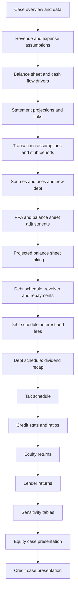

Two loops run through the middle of the model. Interest depends on debt balances, and debt balances depend on cash flow after interest. The model handles this with a circularity toggle or average-balance logic, which is covered in the debt lessons.

## Lessons

### 13.1 Case Overview and Data Gathering

- The case is a divestiture: a utility group sells the waste-management arm of its business to a private equity firm, so the buyer gets a carve-out with no clean standalone financial statements.
- The target runs about 7 million tons of waste a year across roughly 300-plus sites, from simple collection points up to energy recovery plants that burn waste to generate power.
- The story is a shift from legacy landfill and collection toward energy recovery facilities (ERFs). Those plants process far more tonnage and sell electricity, but they need heavy growth capex.
- The price is high for a mature business, roughly 18 to 20 times EBITDA. The range exists because EBITDA can be defined several ways (statutory versus adjusted, lease treatment).
- The three questions to answer: (1) Can the sponsor hit a 20%-plus IRR if growth capex lifts EBITDA? (2) Can the exit multiple hold up, given the entry price? (3) Do lenders, from senior notes down to mezzanine, get a good risk-return from the same deal?
- Data is messy. Historical income statement data came from the parent's annual report. Balance sheets were patched from data-provider history. Cash flow had to be rebuilt, and two plug lines were added so the cash balance reconciles.
- Lease liabilities were labeled "borrowings" in the filing. Read the footnotes before you treat any line as debt.
- The debt package is invented for practice. Six times total leverage is split across a revolver, two term loans, senior unsecured notes, subordinated notes and mezzanine. Real deals rarely use this many tranches.
- Simplifications to accept: debt that matures before exit is ignored, except where prepayment penalties apply.

> [!TIP]
> **Beyond the model:** In a real diligence, the first task is a quality-of-earnings review. Divestiture models usually start with "carve-out" adjustments, such as shared-service costs, transfer pricing and stranded costs left at the parent. Ask whether EBITDA includes leases on an IFRS 16 basis or a US GAAP basis, because that moves EBITDA and leverage by a lot.

> [!WARNING]
> **Common mistake:** Taking a 6x leverage figure from the headline without checking whether it uses gross or net debt, and whether leases are included.

| Item | Your practice numbers |
|---|---|
| Entry EBITDA (illustrative) | 100 |
| Entry multiple | 18x |
| Enterprise value | 1,800 |
| Total debt at 6x | 600 |
| Equity check | 1,200 + fees |

### 13.2 Revenue Assumptions

The revenue build is a volume times price model, split into two groups of sites: the existing and newly leased small facilities, and the large energy recovery plants that come online after a construction lag.

- **Average facilities:** the count grows by a fixed number of small leased sites each year.
- **Existing throughput per facility:** total tonnes from the historical base divided by the facility count, then grown by a fixed tonnes step per year.
- **New ERF plants:** each has a tonnage that depends on the scenario. Plants start construction in a year and come online after the construction lag (three years here).
- **Cumulative ERF capacity:** running total of plants online. Use an absolute reference on the per-plant tonnage so it copies across.
- **Price per tonne:** last year's price times (1 + growth). Growth comes from the scenario table.
- **Revenue:** price per tonne times total tonnes. Watch the units. Millions of tonnes times pounds per tonne gives millions of pounds directly.

Scenario selection uses a named cell with a dropdown (data validation). INDEX and MATCH pull the right row for the chosen case. Test each case before moving on, and set the file back to base.

```text
Total tonnes(t) = Avg facilities(t) x Tonnes per facility(t)
                + Cumulative ERF plants online(t) x Tonnes per ERF plant
Revenue(t)      = Price per tonne(t) x Total tonnes(t)
Price(t)        = Price(t-1) x (1 + growth(t))
```

Worked example with made-up numbers (base case):

| Year | Small sites | Tonnes per small site (000) | ERF online (cum.) | Tonnes per ERF (000) | Total tonnes (M) | Price per tonne (GBP) | Revenue (GBP M) |
|---|---|---|---|---|---|---|---|
| Y0 | 100 | 21.0 | 0 | 0 | 2.10 | 40.0 | 84.0 |
| Y1 | 105 | 21.2 | 2 | 300 | 2.82 | 41.6 | 117.3 |
| Y2 | 110 | 21.4 | 4 | 300 | 3.55 | 43.3 | 153.7 |

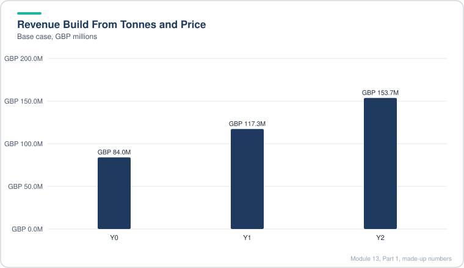

*New plants and price growth together lift revenue by about 83 percent in two years.*

> [!TIP]
> **Beyond the model:** Revenue for waste businesses is usually a mix of gate fees (paid to take waste), commodity sales (recycled materials and electricity), and landfill tax pass-through. A single price-per-tonne line hides that mix. A model that ties revenue to a power price and a gate fee separately is easier to defend in a committee.

> [!WARNING]
> **Common mistake:** Forgetting that new plants add revenue only after the construction lag. Also, the growth in tonnes is a big share of the revenue uplift, so check that tonnes and price are not both growing without a reason.

Scenario growth rates in this case, summarized: upside has price growth in the mid single digits falling over time, base is close to inflation, downside is near or below inflation, and extreme downside has price declines in the first years before recovery. The lesson's point is that even the downside still shows revenue growth, because of the large capex going into new plants. Whether that is reasonable is a judgment call you should write down.

### 13.3 Expense, Lease and Capex Assumptions

This lesson sets up the cost side. The key idea is to tie each cost to the right driver so that the scenarios flow through correctly.

- **Historical ratios first.** Compute per-employee cost, tonnes per employee, raw materials per tonne and other operating cost per tonne. Use consistent units (millions of pounds against millions of tonnes, then multiply by 1 million where needed).
- **Headcount is driven by volume.** Employees = tonnes processed divided by tonnes per employee. Tonnes per employee are held flat, so efficiency comes only from bigger plants processing more tonnes.
- **Cost per unit of volume.** Raw materials and other operating costs are forecast per tonne, not as a percentage of revenue. This separates volume effects from price effects.
- **Facility-driven items.** Depreciation, lease depreciation, lease interest and lease payments per average facility are forecast per facility, then multiplied by the facility count. Owned versus leased split is unknown, so the model spreads these per site.
- **Growth capex.** Each new plant costs a fixed amount spread evenly over its construction period. A MIN formula stops spending once a plant's full cost is recorded.
- **Growth depreciation.** Straight-line over the asset life, but capped so cumulative depreciation never exceeds cumulative growth capex. This is a shortcut for a full waterfall.

```text
Capex(t) = MIN(new starts up to t x cost per plant / build years,
               new starts cumulative x cost per plant - capex already recorded)
Dep(t)   = MIN(cum capex - cum dep so far, cum capex / useful life)
```

Worked example with made-up numbers (cost per plant 80, build time 2 years):

| Year | New starts | Capex spent | Cumulative capex | Dep (cum capex / life 10) |
|---|---|---|---|---|
| 1 | 2 | 80 (2 plants x 80 / 2) | 80 | 8.0 |
| 2 | 1 | 120 (80 from year-1 starts + 40 from new start) | 200 | 20.0 |
| 3 | 0 | 40 (second half of year-2 start) | 240 | 24.0 |

Total capex ends at 240, which equals 3 plants x 80. Depreciation is capped so that cumulative depreciation never exceeds cumulative capex. Check this total before you trust the schedule.

> [!TIP]
> **Beyond the model:** Maintenance capex and growth capex should be separated on purpose. Maintenance capex is what you need to keep current volume running. Growth capex is discretionary. Sponsors often value a business on EBITDA less maintenance capex, not less total capex. If the model lumps them together, the valuation will be wrong.

> [!WARNING]
> **Common mistake:** Hard-coding a depreciation rate that does not match the useful life assumption. Each tie should be traceable.

### 13.4 Balance Sheet and Cash Flow Drivers

Most balance sheet lines are driven by a simple ratio. The choice of base matters more than the ratio itself.

- **Receivables** as a percent of revenue. Inventory as a percent of raw materials used (cost-based, not sales-based).
- **Payables and other long-term liabilities** tied to cash operating expenses. Leave out lease costs and depreciation, because those do not drive day-to-day payables.
- **Stable lines** (other assets, other operating items) use a simple historical average.
- **Non-operating items** such as share issuance, dividends and old debt repayments are set to zero. The leveraged buyout replaces the capital structure, so the historical values stop mattering.
- **Minimum cash** is a percent of cash operating costs. This is a floor the company must hold.
- **Revolver draws** are the most important formula here. Compute cash before any new borrowing, compare it with minimum cash, and draw only the shortfall.

```text
Pre-draw cash = Beginning cash + CFO + CFI + financing excluding new debt
Debt issued   = -MIN(Pre-draw cash - Minimum cash, 0)
```

If the pre-draw cash is above the minimum, the MIN returns zero and nothing is drawn. If it is short, the MIN returns the negative shortfall and the minus sign makes it a positive draw.

Worked example with made-up numbers:

| Item | Year 1 |
|---|---|
| Beginning cash | 20 |
| CFO | 35 |
| CFI | -60 |
| Other financing (excluding new debt) | -5 |
| Pre-draw cash | -10 |
| Minimum cash | 15 |
| Shortfall (pre-draw minus minimum) | -25 |
| Debt issued | 25 |
| Ending cash | 15 |

> [!TIP]
> **Beyond the model:** The minimum cash balance is a policy choice, often a percent of cash costs or a fixed amount. In a leveraged deal, the sponsor usually wants to keep it low, because excess cash is the first thing that gets swept to pay down debt. Note that circularity appears here: the draw changes interest, which changes cash flow, which changes the draw. The debt lessons deal with that.

> [!WARNING]
> **Common mistake:** Linking payables to total costs including depreciation and lease costs. That inflates the working capital balance and makes the cash flow look better than it is.

### 13.5 Projecting and Linking the Three Statements

This lesson is mechanical, but it is where most model errors hide. The rule is simple: every balance sheet movement must appear once on the cash flow statement, and every cash flow item must trace to a balance sheet line or to the income statement.

- **Income statement:** EBITDA is revenue less cash operating costs. Then subtract depreciation (owned plus growth), amortization, lease depreciation, lease interest and debt interest. Taxes are applied year by year, so a change in the tax rate flows through correctly.
- **Joint venture income:** prior-year JV balance times a yield. It is non-cash, so it is reversed on the cash flow statement and then shown as dividends received.
- **Cash flow statement:** start from net income, add back non-cash items (depreciation, amortization, lease depreciation, goodwill impairment, deferred taxes), then subtract the change in working capital. Investing picks up both growth and maintenance capex, other investing items and lease asset additions. Financing picks up debt flows, lease liability additions and payments.
- **Balance sheet:** each asset and liability is rolled forward from the prior year with its flows. The JV balance is a mini equity account: prior balance plus net income minus dividends.
- **Check:** assets minus liabilities and equity must equal zero in every year and every case.

```text
Net change in cash = CFO + CFI + CFF
Cash(t)            = Cash(t-1) + Net change in cash(t)
JV(t)              = JV(t-1) + JV income(t) - JV dividends(t)
Balance check      = Total assets(t) - Total liabilities and equity(t) = 0
```

Worked example with made-up numbers:

| Line | Year 0 | Year 1 | Movement | Cash flow effect |
|---|---|---|---|---|
| Receivables | 30 | 33 | +3 | -3 |
| Payables | 20 | 22 | +2 | +2 |
| Net PP&E | 200 | 193 | -7 (dep 10, capex 3) | +10 dep add-back, -3 capex |
| Equity | 150 | 158 | +8 (net income 8) | in CFO through net income |

Check that each row's cash effect is counted exactly once.

> [!TIP]
> **Beyond the model:** A balance sheet that balances can still be wrong. Common hidden errors are: sign flips on a deferred tax item, capex that appears in the cash flow statement but not on PP&E, and a lease liability that is paid down but never reduced on the balance sheet. Write one test per line that compares its cash effect with its balance sheet change.

> [!WARNING]
> **Common mistake:** Forgetting that impairment is non-cash, so it must be reversed in CFO and reduce goodwill, otherwise the check will show a gap.

### 13.6 Transaction Assumptions

This lesson sets the price, the close date, the exit range and the revolver cap. Most inputs come from the case brief, but the logic behind each one is what matters.

- **Purchase multiple and EV.** Purchase EV equals the entry multiple times LTM EBITDA. Different sources define LTM EBITDA differently (statutory versus adjusted), so the same headline price can show up as two different multiples. Pick a definition, state it, and use it everywhere, including the exit.
- **Goal Seek** can tie the model's EV exactly to a target number when a rounded input leaves a small gap.
- **Purchase equity value.** In a cash-free, debt-free deal, equity value is EV plus cash minus debt, minus any other claims you choose to include. This case leaves some items out of the bridge (JVs, leases, pensions) and writes them to zero in the balance sheet adjustments, so goodwill still balances. Keep the exit bridge built the same way, or the returns will not match the entry.
- **Close date.** The deal can close on any month-end in a window. A data validation list holds all valid dates (built with EOMONTH). The model then needs a stub period for the part of the first fiscal year after close.
- **Stub fraction.** Days from close to the end of the next fiscal year, divided by the days in that full year. The pre-close fraction is one minus that.
- **Revolver cap.** Set as a multiple of LTM EBITDA (here 1x).
- **Exit multiple.** Set by scenario. Use a base-case multiple near the entry multiple, a higher one in the upside, and a lower one in downsides, stepping down over time for slower growth. Refine later once return on invested capital is known.

```text
Stub fraction (post-close) = (EOMONTH(FY end, 12) - close date) / (EOMONTH(FY end, 12) - FY end)
Pre-close fraction         = 1 - Stub fraction
```

Worked example with made-up numbers:

| Item | Value |
|---|---|
| LTM EBITDA | 100 |
| Entry multiple | 20x |
| Purchase EV | 2,000 |
| Close date | 30 Sep (fiscal year ends 31 Mar) |
| Days from close to next FYE | 182 |
| Days in the full year | 365 |
| Post-close stub fraction | 0.499 |
| Revolver cap (1x EBITDA) | 100 |

> [!TIP]
> **Beyond the model:** The exit multiple is where most LBO returns come from or disappear. The usual check is to ask what multiple the company would trade at if its growth had slowed as modeled. A business growing 2 to 3 percent a year rarely earns a 20x EBITDA multiple on exit, so an exit at entry multiple is a bet that the market keeps paying up. Write that bet down.

> [!WARNING]
> **Common mistake:** Changing the close date but leaving the opening cash and debt at the fiscal year-end values. The balance sheet at close must match the close date, which is what the next lesson fixes.

### 13.7 Stub Periods

A deal that closes mid-year splits the first fiscal year into two pieces: the part before close (owned by the old owners) and the part after close (owned by the new capital structure). The model needs both pieces on the income statement and cash flow statement, and a balance sheet exactly at close.

- **Pre-close stub** = full-year figure times the pre-close fraction. It is used for the historical-style period and for the balance sheet roll-forward.
- **Post-close stub** = full-year figure times the post-close fraction, for the first projected year.
- **Full years after that** link straight to the projections, with no fraction.
- **Income statement lines** that depend on the new debt (interest, taxes) are recalculated after the deal, not scaled, because the capital structure changes.
- **Balance sheet at close** is built differently from the income statement. Working capital lines are interpolated: prior year-end plus (next year-end minus prior year-end) times the pre-close fraction. Cash, PP&E and other lines roll forward with the stub cash flows.
- **Check.** Move the close date through several months and in each case confirm the balance sheet still balances. Also check the balance sheet in each scenario.

```text
Pre-close fraction  = (close date - prior FYE) / 365
Interpolated AR     = AR(prior FYE) + (AR(next FYE) - AR(prior FYE)) x pre-close fraction
Post-close stub P&L = Full-year FY1 P&L x (1 - pre-close fraction)
```

Worked example with made-up numbers (close at 75 percent of the year):

| Line | Prior FYE | Next FYE | Interpolated at close |
|---|---|---|---|
| Receivables | 40 | 50 | 47.5 |
| Inventory | 20 | 24 | 23.0 |
| Payables | 25 | 29 | 28.0 |

A close 75 percent of the way through the year gives 75 percent of the way to the next year-end value. The interpolated value sits between the two anchors, which is what you want.

> [!TIP]
> **Beyond the model:** Real deals often use a locked-box or a completion-accounts mechanism, which fixes the balance sheet at a known date rather than rolling it forward. A locked-box date sets the price on a historical balance sheet, and the buyer keeps the cash generated since. That changes who owns the stub cash flow. Know both mechanisms for interviews.

> [!WARNING]
> **Common mistake:** Scaling interest and tax by the stub fraction when the debt only exists after close. Pre-close interest should reflect the old capital structure.

### 13.8 Sources and Uses, and Debt Assumptions

Sources and uses is the funding table for the deal. In a cash-free, debt-free private deal, uses start from enterprise value, and the sponsor equity is the plug.

- **Uses:** purchase enterprise value, transaction fees (advisory fee as a percent of purchase equity value, plus fixed legal and other fees), financing fees and original issue discount (OID), and any funding needed to reach minimum working capital.
- **Sources:** each debt tranche at face value, the sponsor equity as the plug (total uses minus other sources), and any other funding.
- **Minimum working capital** is defined as receivables plus inventory plus other long-term assets, minus payables and other long-term liabilities. It is a floor, not a target. If the business closes with working capital above the floor, the buyer gets no credit. If it closes below, the buyer funds the gap as an extra use. The MAX(0, floor minus actual) wrapper does this.
- **OID** means the lender pays less than face value. The sponsor must fund the gap, so the discount is a use. Amortize it with the financing fees.
- **Weighted amortization period** for fees: SUMPRODUCT of each tranche's face value and maturity, divided by total face value. This replaces a tranche-by-tranche schedule.
- **Dividend recap** sizing is set as a multiple of trailing EBITDA, with a year chosen from a list.

```text
Working capital gap = MAX(0, Minimum WC - (AR + Inventory + Other LT assets - AP - Other LT liabilities))
Equity plug         = Total uses - (Debt + other sources)
Weighted period     = SUMPRODUCT(face, maturity) / SUM(face)
```

Worked example with made-up numbers (multiples of LTM EBITDA of 100):

| Uses | Amount | Sources | Amount | x EBITDA |
|---|---|---|---|---|
| Purchase EV | 2,000 | Revolver (drawn at close) | 0 | 0.0x |
| Advisory and other fees | 40 | Term loan | 350 | 3.5x |
| Financing fees and OID | 35 | Senior notes | 150 | 1.5x |
| WC top-up | 10 | Sponsor equity (plug) | 1,585 | 15.85x |
| Total | 2,085 | Total | 2,085 | 20.85x |

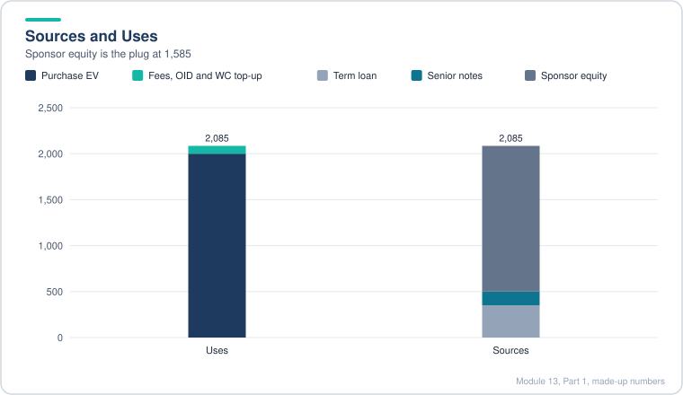

*The sponsor writes the largest check, because the debt covers under a quarter of the uses.*

> [!TIP]
> **Beyond the model:** A working capital peg in a real SPA is usually a target with a true-up after close, and the adjustment can go either way. The minimum-only version here is a simplification that is common in models but less common in contracts. Know both, because interviewers ask which one you have modeled.

> [!WARNING]
> **Common mistake:** Putting OID or fees on the sources side as a reduction in debt. They belong on the uses side, and the debt sources stay at face value.

### 13.9 Purchase Price Allocation and Balance Sheet Adjustments

Even in an asset deal or a cash-free, debt-free deal, the buyer pays more than the book value of net assets, and the gap has to be assigned. The process has three steps: allocate to write-ups, create goodwill for the rest, and post the closing balance sheet.

- **Equity purchase price** is the bridge figure from lesson 13.6.
- **Adjusted book value** is the seller's common equity less its existing goodwill. Existing goodwill has no fair value in this framework, so it is always written off.
- **Excess purchase price** = equity purchase price minus adjusted book value.
- **Write-ups:** PP&E is written up by a percent of net PP&E and depreciated over the asset life. Identifiable intangibles are split between indefinite-lived (not amortized) and definite-lived (amortized over a set period).
- **Goodwill** = excess purchase price minus write-ups, plus any new deferred tax liability. In an asset deal, the write-ups are tax-deductible, so no new DTL is created.
- **Closing balance sheet:** cash goes to zero (cash-free), debt is replaced by new debt at face value less capitalized fees and OID, the old goodwill is replaced by new goodwill, write-ups are added, extra working capital is added to inventory, and common equity is replaced by sponsor equity less transaction fees.

```text
Excess purchase price = Equity purchase price - (Seller common equity - Seller goodwill)
Goodwill              = Excess - PP&E write-up - Intangible write-ups + New DTL
New debt on balance   = Face value - Financing fees - OID
New common equity     = Sponsor equity - Transaction fees
```

Worked example with made-up numbers:

| Item | Amount |
|---|---|
| Equity purchase price | 1,500 |
| Seller common equity | 400 |
| Less seller goodwill | -50 |
| Adjusted book value | 350 |
| Excess purchase price | 1,150 |
| PP&E write-up (5% of 200) | 10 |
| Indefinite intangibles (5%) | 57.5 |
| Definite intangibles (5%, life 10 years) | 57.5 |
| New goodwill | 1,025 |

Check: 1,150 minus 10, minus 115, equals 1,025.

> [!TIP]
> **Beyond the model:** Real purchase accounting values intangibles (customer contracts, licenses, permits, brands) with a valuation firm, rather than a fixed percent. For a waste business, landfill permits and long-term contracts can be large. The fixed-percent method here is a placeholder. Amortization of intangibles reduces book earnings but not cash tax if the deal is structured as an asset purchase, which is why buyers like asset deals.

> [!WARNING]
> **Common mistake:** Writing new debt on the balance sheet at face value. Capitalized fees and OID reduce the book value of debt, and then accrete back toward face as they amortize.

### 13.10 Projecting and Linking the Post-Transaction Balance Sheet

This is the wrap-up of the statements before the debt schedule. The aim is to get everything linked except the debt-driven lines, so that the debt schedule can be tested against a working balance sheet.

- **Deal amortization on the income statement.** Financing fees, OID, intangible write-ups and PP&E write-ups are each amortized with a MIN function. The MIN stops amortization once the remaining balance is used up.
- **Stub adjustment.** The first post-close period covers only part of a year, so the fee amortization in that period is multiplied by the post-close fraction. Later full years are not.
- **Definite-lived versus indefinite-lived intangibles.** Only definite-lived intangibles amortize. Indefinite-lived ones stay on the balance sheet until an impairment test.
- **Balance sheet is a snapshot.** Do not apply stub fractions to balance sheet items. They are the year-end figure.
- **Debt on the balance sheet** = prior balance, plus new issuance, minus repayments, plus PIK interest, plus amortization of fees and OID, minus revolver paydowns. The book value rises toward face as fees amortize.
- **Ordinary dividends** must be linked into equity even when they are zero, because the dividend recap later flows through this line.
- **Cash** starts at zero after close (cash-free), and is then set by the cash flow statement.

```text
Fee amortization(t) = MIN(remaining balance, annual amount) x stub fraction (first period only)
Debt book value(t)  = Debt(t-1) + issuances - repayments + PIK + fee and OID amortization
```

Worked example with made-up numbers:

| Item | Full-year amount | First stub (25 percent) | Balance after stub |
|---|---|---|---|
| Financing fees (total 40, 10-year life) | 4.0 per year | 1.0 | 39.0 |
| OID (total 10, 10-year life) | 1.0 per year | 0.25 | 9.75 |
| Definite intangibles (total 60, 10-year life) | 6.0 per year | 1.5 | 58.5 |

The stub amount is one-quarter of a full year, and the MIN keeps each balance from going negative.

> [!TIP]
> **Beyond the model:** Simplifying away early repayments of fees and OID is a common model shortcut. In a real model with a refinancing or a prepayment, the unamortized balance is written off immediately as a loss on extinguishment. Flag that if the exit could come earlier than the maturity.

> [!WARNING]
> **Common mistake:** Forgetting to add non-cash fee amortization back in the cash flow statement. It shows up as an expense in net income but is not a cash cost, so omitting the add-back understates cash flow and the balance sheet will not balance.

### 13.11 Debt Schedule Part 1: Revolver, Mandatory and Optional Repayments

The debt schedule is the hardest part of an LBO. This lesson sets up the balances, the sources of cash for debt service, the revolver draw, and the two repayment blocks. Interest is added in the next lesson.

- **Opening balances** = face value of each tranche from sources and uses. Fees and OID do not change the principal the company repays or the interest it pays.
- **Balance roll-forward.** Revolver: prior balance plus draws, minus repayments. Term Loan A: prior balance plus dividend-recap issuance, minus repayments. Other tranches: prior balance minus repayments. Subordinated and mezzanine also add PIK interest (interest that accrues to principal).
- **Mandatory repayment** = MIN(remaining balance, scheduled percent times original balance). In a stub period, the scheduled percent is multiplied by the stub fraction.
- **Cash available for debt repayment** = opening cash, plus free cash flow after dividends, minus mandatory repayments, minus minimum cash. Mandatory repayments come first because they are contractual.
- **Revolver draw** = the shortfall below minimum cash, using MAX or MIN with zero, so the revolver only draws when cash is short.
- **Optional repayment** = MIN(remaining balance after mandatory, sweep percent times cash left after revolver and prior optional repayments). The sweep percent sets how much of excess cash goes to each tranche in order.
- **Anchoring.** The original balance and the sweep percentage are absolute references so they do not shift as formulas copy across.

```text
Revolver draw         = MAX(0, minimum cash - cash before revolver)
Mandatory(tranche)    = MIN(balance, scheduled % x original balance x stub fraction)
Cash for sweep        = cash before revolver + revolver draw - prior optional repayments
Optional(tranche)     = MIN(balance after mandatory, sweep % x cash for sweep)
```

Worked example with made-up numbers (sweep 100 percent for revolver, 50 percent for each term loan):

| Step | Amount |
|---|---|
| Cash available after mandatory and before revolver | 60 |
| Revolver balance | 20 |
| Revolver repaid (100 percent sweep) | 20 |
| Cash left | 40 |
| Term Loan A balance (balance 80) | 50 percent x 40 = 20 repaid |
| Cash left | 20 |
| Term Loan B repaid (50 percent x 20) | 10 |
| Cash unused | 10 |

Cash unused stays on the balance sheet. A sweep below 100 percent means the company keeps some cash, which is why cash builds up in the base case.

> [!TIP]
> **Beyond the model:** Sweep percentages in real deals are set by the credit agreement and often step down with leverage. Note the circularity: optional repayments depend on cash flow, which depends on interest, which depends on balances. Most banks run the model with an interest toggle that uses opening balances to break the loop, then switch to average balances once it is stable.

> [!WARNING]
> **Common mistake:** Applying a revolver draw in the same period as an optional repayment. If the revolver draws, there is no cash left to sweep, so optional repayments must be zero that year.

### 13.12 Debt Schedule Part 2: Interest, Revolver Fees and Circularity

This lesson builds the interest engine. It also introduces revolver fees, which charge the company for using too little of the revolver (undrawn fee) or too much (overdrawn fee), and a switch for circular references.

- **Benchmark rate.** A government yield that rises over the hold, with a floor on floating tranches. Floating rate = MAX(benchmark, floor) plus spread. Fixed tranches just use their coupon.
- **Interest income on cash** uses a benchmark plus a spread and has no floor. It is subtracted, so net interest is interest expense minus interest income.
- **Circularity switch.** If on, interest uses the average of opening and closing balances (more accurate, since payments happen through the year). If off, it uses the opening balance (no loop). Build with the switch off, then turn it on last.
- **PIK interest** accrues to the principal instead of being paid in cash. It is a non-cash expense on the income statement, added back on the cash flow statement, and added to the debt balance.
- **Revolver fees.** Let u be drawn percent of the maximum revolver. Undrawn fee = MAX(0, 1 minus u) times maximum size times undrawn rate. Overdrawn fee = MAX(0, u minus 1) times maximum size times overdrawn rate.
- **Stub adjustment.** Multiply by the stub fraction only in the first period.

```text
Floating rate     = MAX(benchmark, floor) + spread
Interest(t)       = rate x IF(circ, average(open, close), open)
Undrawn fee       = MAX(0, 1 - draw %) x max revolver x undrawn rate
Overdrawn fee     = MAX(0, draw % - 1) x max revolver x overdrawn rate
Net interest      = interest expense + fees - interest income on cash
```

Worked example with made-up numbers (maximum revolver 200, undrawn fee 0.5 percent, overdrawn fee 2 percent):

| Revolver draw | Draw % | Undrawn fee | Overdrawn fee |
|---|---|---|---|
| 150 | 75% | 0.5% x 200 x 0.25 = 0.25 | 0 |
| 220 | 110% | 0 | 2% x 200 x 0.10 = 0.40 |

The fee is not a rate on the drawn amount. It is a rate on the unused slice (or excess slice), which is why it goes to zero at exactly 100 percent drawn.

> [!TIP]
> **Beyond the model:** Real revolvers do not usually go over their commitment. An "overdrawn" revolver is a breach. In practice, the model should flag it as a covenant or liquidity problem, not a fee. Treat the overdrawn fee as a stress-test signal, not a normal case.

> [!WARNING]
> **Common mistake:** Turning on circularity before the rest of the model is correct. Errors then propagate and the model can blow up with #VALUE or drift without an obvious cause. Keep a circuit breaker cell.

### 13.13 Debt Schedule Part 3: Dividend Recap

A dividend recapitalization borrows new money and pays it to the sponsor as a dividend during the hold. The sponsor gets cash back early, which lifts IRR, but the company carries more debt and more interest.

- **Size** = recap multiple times EBITDA in the chosen year. The year must be one of the allowed years, or the formula returns zero.
- **Source of debt.** The extra debt is added as a new Term Loan A issuance, because Term Loan A is repaid first and fastest.
- **Issuance fees** are a cash cost, so they reduce the net proceeds that reach the sponsor.
- **Mandatory amortization** on Term Loan A must include the recap issuance. A 10 percent schedule on the original balance should also apply to the recap amount, so the formula adds the cumulative recap issuance to the base.
- **Interest** goes up automatically because the Term Loan A balance rises.
- **Cash flow statement.** Ordinary dividends are shown as a negative equal to the recap proceeds, net of issuance fees. The debt issuance itself is an inflow in financing, so the net cash effect is close to zero.
- **Simplification.** Issuance fees on the recap are not amortized over time. For a two-year tail this is immaterial.

```text
Recap size(t)       = Recap multiple x EBITDA(t) if t = chosen year, else 0
Dividend paid(t)    = -(Recap issuance(t) - Issuance fees(t))
Mandatory TLA(t)    = MIN(balance, 10% x (original TLA + cumulative recap issuance))
```

Worked example with made-up numbers (recap 1.0x EBITDA, EBITDA 100, fee 2 percent):

| Line | Amount |
|---|---|
| Recap size (1.0 x 100) | 100 |
| Issuance fees (2%) | 2 |
| Dividend paid to sponsor | 98 |
| Original TLA mandatory (10% x 300) | 30 |
| Recap mandatory (10% x 100) | 10 |
| Total TLA mandatory after recap | 40 |

The recap raises mandatory payments by a third in this example, which squeezes cash flow in the following years.

> [!TIP]
> **Beyond the model:** Dividend recaps are a leverage-and-timing trade. Rating agencies and lenders watch the leverage after the recap, and a recap in a weak year can push the company into a covenant breach. Also check whether the recap is allowed under the restricted payments covenant in the credit agreement. Most deals allow it only if leverage falls under a set level.

> [!WARNING]
> **Common mistake:** Forgetting that the dividend sits in equity on the balance sheet. The recap reduces common equity and raises debt by the same amount, minus fees paid in cash.

### 13.14 Tax Schedule and NOLs in an Asset Purchase

The tax schedule turns book pre-tax income into cash taxes. In an asset purchase, the buyer can deduct the goodwill it creates over time for tax, which can wipe out taxable income for years. The result is a large gap between book tax and cash tax, which the model carries as deferred taxes.

- **Start from book pre-tax income.** Add back non-deductible items, such as goodwill impairment.
- **Goodwill tax amortization.** A fixed percent of the goodwill balance (the case quotes 6.5 percent a year; the lesson's formula input is 6 percent, so check which cell drives the model) is deducted each year. Cap it at the remaining balance, and scale it by the stub fraction in the first period.
- **Asset write-up D&A** is also tax-deductible in this structure, so it is not added back. The tax schedule starts from pre-tax income and deducts only goodwill amortization.
- **NOLs.** Created when taxable income is negative. Used when taxable income is positive, limited to the lower of taxable income and the NOL balance.
- **Cash taxes** = tax rate times the MAX of (taxable income after NOL use) and zero.
- **Deferred taxes** = cash taxes minus book taxes, with the sign convention kept consistent. A large positive deferred tax means cash taxes are below book taxes.
- **Effect.** The cash saved goes to optional debt repayment, which lowers interest and raises equity returns.

```text
Taxable income     = Pre-tax income + goodwill impairment - goodwill amortization
NOL created        = MAX(0, -taxable income)
NOL used           = MIN(NOL balance + created, MAX(0, taxable income))
Cash taxes         = tax rate x MAX(0, taxable income - NOL used)
Deferred taxes     = cash taxes - book taxes
```

Worked example with made-up numbers (tax rate 25 percent, goodwill 1,000 amortized at 6.5 percent):

| Line | Year 1 | Year 2 (turns positive) |
|---|---|---|
| Book pre-tax income | 20 | 90 |
| Goodwill amortization | -65 | -65 |
| Taxable income | -45 | 25 |
| NOL created | 45 | 0 |
| NOL used | 0 | 25 |
| Cash taxes | 0 | 0 |
| Book taxes (25% of 20 and 90) | 5 | 22.5 |
| Deferred taxes | -5 | -22.5 |

Negative deferred taxes here mean the cash taxes are below book taxes. The sign convention should be checked against the cash flow statement so that a deferred tax benefit adds cash.

> [!TIP]
> **Beyond the model:** Asset deal step-ups are valuable to buyers and costly to sellers, because the seller may face tax on the gain. That is why divestitures often include a gross-up or a price negotiated around tax. In the US, the same effect comes from a Section 338 election or a 338(h)(10) election. The tax benefit is real, but a deal team should check the buyer's ability to use the losses, since NOLs in some jurisdictions are capped as a share of income.

> [!WARNING]
> **Common mistake:** Deducting depreciation and amortization of write-ups in the tax schedule and also keeping it in book income. Pick one treatment, because double counting overstates the NOL.

### 13.15 Credit Stats, ROIC and Setting Exit Multiples

This lesson checks whether the debt is sensible and whether the exit multiple assumption fits the business. The main tool is return on invested capital (ROIC), compared across cases, and then used to adjust the exit multiple.

- **Stub handling.** Balance sheet items are snapshots and need no adjustment. Flow items (EBITDA, revenue, interest) in the first post-close year must add the pre-close and post-close stubs together to form a full year before ratios are computed.
- **Leverage ratios.** Senior debt, total debt and total debt including leases, each divided by EBITDA. Use face value of debt, not book value, because face value is what must be repaid.
- **Coverage ratios.** EBITDA divided by total interest expense, and EBITDA divided by cash interest. Cash interest excludes non-cash items: PIK interest, fee amortization and OID amortization.
- **Cumulative debt paydown** = sum of mandatory and optional repayments. Percent of initial debt should include any revolver draws and recap issuances in the base.
- **NOPAT** = (EBITDA minus D&A minus lease interest and lease depreciation, minus write-up D&A) times (1 minus tax rate). The write-up D&A is deducted because it reduces operating income. Interest, fee amortization and goodwill impairment are excluded.
- **Invested capital** = common equity plus face value of debt, measured at year-end. ROIC = NOPAT divided by average invested capital.
- **Exit multiple logic.** Compare the change in ROIC with the entry multiple. A rising ROIC supports holding or expanding the multiple. A falling ROIC means a lower multiple, and the downside should fall by more than the percentage ROIC drop, to be conservative.

```text
Leverage        = Debt (face) / EBITDA
Interest cover  = EBITDA / total interest expense
Cash cover      = EBITDA / cash interest expense
NOPAT           = (EBITDA - D&A - lease interest - lease depreciation - write-up D&A) x (1 - tax rate)
ROIC            = NOPAT / average (equity + debt)
```

Worked example with made-up numbers:

| Case | Avg ROIC | Change vs history (3.0%) | Entry multiple | Exit multiple set |
|---|---|---|---|---|
| Upside | 4.8% | +60% | 20x | 24x |
| Base | 3.3% | +10% | 20x | 20x |
| Downside | 2.5% | -17% | 20x | 17x |

The downside cut (20x to 17x, a 15 percent drop) is a little larger than the ROIC drop, which is the conservative direction.

> [!TIP]
> **Beyond the model:** ROIC as a multiple driver is a rough link. The stronger link is the growth-adjusted EV to NOPAT or EV to EBITDA regression for comparable companies. Use a comps check to test whether 17x or 20x matches what listed peers trade at under similar growth. Lenders also look at fixed-charge coverage, which deducts capex and taxes from cash flow.

> [!WARNING]
> **Common mistake:** Dividing the first post-close year's EBITDA by a debt balance at year end, without first combining the two stub periods. That overstates leverage in that year.

### 13.16 Equity Returns to the Sponsor

The returns to the sponsor (the private equity owner) come from the exit equity value, dividends received during the hold, and any management earn-out. The lesson builds an exit waterfall that pays debt in order of seniority and handles the case where the exit value does not cover everything.

- **Exit year** is chosen from a short list (here the last three years). Exit enterprise value = EBITDA times the exit multiple, with the multiple falling 1x a year in the base.
- **Exit equity value** = exit EV, plus cash, plus tax-effected NOLs, minus debt repaid in the waterfall. NOLs are tax-effected because the buyer gets tax savings, not the NOL face amount.
- **Debt waterfall.** Each tranche takes the MIN of its remaining balance and the proceeds left. MAX(0, ...) stops a negative proceeds value from creating a fake repayment. Prepayment penalties are paid only if the exit comes before maturity, and only from proceeds left after the principal.
- **Equity grants to lenders.** Some tranches receive a small share of the equity as a sweetener. That share comes out of the remaining proceeds.
- **Management earn-outs** are tiers based on exit equity relative to the sponsor equity check. Tier 1 pays a percent of the value between two thresholds (capped at the Tier 2 threshold). Tier 2 pays a higher percent of the value above Tier 2.
- **Sponsor cash flows.** Negative investment at close, dividends received up to and including the exit year, earn-out paid in the exit year (as a negative), and exit proceeds in the exit year.
- **Returns.** Multiple = sum of positive flows divided by the investment. IRR uses XIRR because the dates are irregular.

```text
Exit equity = Exit EV + cash + NOL x tax rate - debt repaid (waterfall)
Tier 1 earn-out = pct1 x MAX(0, MIN(exit equity, T2) - T1)
Tier 2 earn-out = pct2 x MAX(0, exit equity - T2)
Multiple        = SUM(positive flows) / investment
```

Worked example with made-up numbers (investment 1,000, exit in year 3):

| Item | Amount |
|---|---|
| Exit EBITDA x multiple (120 x 16x) | 1,920 |
| Plus cash | 40 |
| Less debt repaid (waterfall) | -1,200 |
| Exit equity value | 760 |
| Dividend received in year 2 | 150 |
| Earn-out (Tier 1: 5% of 760 minus 2,000 threshold, floored at 0) | 0 |
| Sponsor exit proceeds | 760 |
| Total proceeds | 910 |
| Multiple | 0.91x |

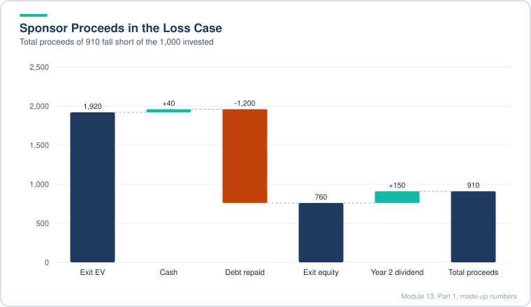

*The debt repayment absorbs most of the exit value, so even with the dividend the sponsor gets back less than it put in.*

The example shows a loss, which is common when the exit multiple falls and the debt is large.

> [!TIP]
> **Beyond the model:** Earn-outs in management equity are usually tied to a sponsor MOIC threshold, and the thresholds are usually set so that management only gets paid when the sponsor makes a good return. Check that the earn-out is paid on proceeds after the dividend, not only the exit, or the incentives are off. Also, a 1x a year exit multiple decline is a conservative assumption; many models hold it flat for comparison.

> [!WARNING]
> **Common mistake:** Forgetting that the dividend recap is a second cash flow to the sponsor, and so counts toward the multiple and IRR. Leaving it out understates returns.

### 13.17 Lender Returns: Senior Notes, Subordinated Notes and Mezzanine

Lender returns use the same cash flow and IRR machinery as the sponsor, but the cash flows are different. Lenders get coupons, fees and OID up front, principal and penalties on the way out, and, for mezzanine, an equity kicker.

- **Cash flow items for each tranche:** the initial investment (negative), issuance fees and OID received at close (positive for the lender, because the lender pays less than face), cash interest in or before the exit year, scheduled principal, the prepayment penalty and principal repaid at exit (exit year only), and any equity granted (exit year only).
- **PIK interest is not a cash flow to the lender.** It accrues to principal and comes back at exit, so it is excluded from cash interest and captured in the principal repaid at exit.
- **Recovery** = principal actually repaid (scheduled, optional and at exit) divided by the face value at the time of repayment. Get it right: the denominator must be the ending face balance including PIK, not the original face value.
- **IRR and multiple** are computed the same way as the sponsor, with XIRR for irregular dates.
- **Downside test.** Lowering the exit multiple until a tranche's recovery falls below 100 percent shows the true cushion under each tranche.

```text
Lender cash flow(t) = -initial investment (t=0)
                    + fees and OID received (t=0)
                    + cash interest (t <= exit year)
                    + scheduled principal (t <= exit year)
                    + prepayment penalty (t = exit year)
                    + principal repaid at exit (t = exit year)
                    + equity granted (t = exit year)
Recovery = total principal repaid / ending face value
```

Worked example with made-up numbers (mezzanine, face 100, 5 percent OID, 2 percent fee, 12 percent fixed coupon with 3 percent PIK, exit after 4 years):

| Item | Year 0 | Years 1 to 4 | Year 4 exit |
|---|---|---|---|
| Lender pays (face less OID) | -95 | | |
| Fee received | +2 | | |
| Cash interest (coupon 12% less PIK 3% = 9% of face) | | +9 a year | |
| Face value at exit (100 grown by PIK at 3%) | | | |
| Principal repaid at exit | | | +112.6 |
| Equity kicker | | | +2.0 |

Face value grows at 3 percent a year (100 times 1.03 to the power 4 is about 112.6). Recovery is about 100 percent when the exit value covers that balance.

> [!TIP]
> **Beyond the model:** Real mezzanine often has a PIK toggle, a call protection schedule, and warrants instead of a fixed equity grant. The sensitivity to exit multiple is what matters to a credit committee. A 100 percent recovery at a 6x exit is a strong statement about asset coverage. Ask what the unlevered value per dollar of EBITDA is, because that is the true floor.

> [!WARNING]
> **Common mistake:** Counting PIK interest as cash coupon received, which inflates the lender IRR in years before exit while the principal is not yet paid.

### 13.18 Sensitivity Tables for Sponsor and Lenders

Sensitivity tables show how returns move when one or two inputs change. In this module there are two-variable data tables, with scenario on one axis in every table, plus purchase multiple, exit multiple or exit year on the other.

- **Pick variables that matter.** Scenario moves almost everything (cash flow, debt paydown, growth, ROIC, exit multiple), so it appears in every table. Entry multiple and exit year matter for the sponsor. Lenders care mostly about scenario and exit year.
- **Ranges.** Exit multiples step by one turn across a range that covers the trading history. Entry multiples are set in a narrower band around the actual price.
- **Anchoring.** Scenario and exit-year axes are pasted as values and linked back, so the data table does not depend on a moving model input.
- **Input cells.** A two-variable data table needs a row input cell and a column input cell that feed the model. Pointing the row input at the wrong cell is the most common error. A quick check: the base case cell in the table should equal the model output.
- **Calculation mode.** Data tables need automatic recalculation, not "automatic except for data tables", or they will not refresh.
- **Readout.** Sponsor IRR for the main tables; subordinated and mezzanine IRR and recovery for lenders. Senior notes are skipped because their returns barely move.
- **Findings from the case.** The sponsor needs an earlier exit or a lower price to reach its targets. Lenders look well covered, and the mezzanine is the most sensitive tranche.

```text
Data table check: base-case cell of the table = model output for base case
Table axes: row = exit multiple or entry multiple; column = scenario (1 to 4)
Exit year axis: FY2024, FY2025, FY2026
```

Worked example with made-up numbers (sponsor IRR, scenario by exit year):

| Scenario | Exit 2024 | Exit 2025 | Exit 2026 |
|---|---|---|---|
| Upside | 27% | 26% | 24% |
| Base | 19% | 17% | 16% |
| Downside | 10% | 9% | 7% |

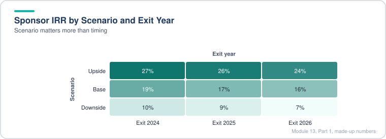

*Moving across scenarios changes IRR far more than moving across exit years.*

Read it across: a shorter hold can raise IRR when the business is growing slowly and the multiple is falling. Read it down: the scenario matters far more than the exit year.

> [!TIP]
> **Beyond the model:** IRR rises with a shorter hold, but multiple of money (MOIC) can fall, so always show both. A sponsor that wants to return cash to its own investors may prefer a faster IRR even at lower MOIC. Also check whether the entry price in the table is a real negotiating range. A price cut of 10 percent may be unrealistic in a competitive auction.

> [!WARNING]
> **Common mistake:** Pointing a data table at the initial exit multiple cell instead of the year-specific exit multiple. The base case then does not match the model output, which is the clue to look for.

### 13.19 Investment Recommendation: Equity Case

The Excel work ends with a short investment memo (about ten slides) for the sponsor. This lesson shows how to structure it and what conclusion the model supports. The memo itself is the deliverable, so the lesson is really about how to argue from the model.

- **Slide structure.** Slide 1 gives the verdict (for or against). Slides 2 and 3 cover qualitative factors such as the market, competition and growth. Slides 4 to 8 carry the numbers: valuation, model output by scenario, sensitivities. Slide 9 gives the risks (for a yes) or what would change your mind (for a no). Slide 10 restates the verdict with more visual support.
- **Verdict in this case: against.** The price is too high for a mature business. The business plan leans on a capex cliff in the last two years that makes cash flow look better than the growth supports. The base-case IRR falls short of the target, and the upside only just gets close.
- **Valuation check.** Compare entry and exit multiples with comparable companies. A quick comps table with LTM multiples from public peers shows how far the deal sits from market norms.
- **Market check.** Compare the model's volume growth with the market growth rate. A volume CAGR near the market rate is credible; far above it needs a reason.
- **Counterfactuals.** To say what would change your mind, run the model with a lower entry multiple, a more realistic plant size, or add-on acquisitions funded with debt instead of a dividend recap. Note the limits of each quick check.
- **Scaling exit multiples.** If the entry multiple falls, do not keep the same exit multiple assumption unless you can justify it. Scale the scenario exit multiples down with the entry price.

```text
Add-on test: exit EBITDA + (add-on revenue x margin); exit debt + add-on debt
IRR effect is approximate because it ignores interest and repayments during the hold
```

Worked example with made-up numbers (illustrative only):

| Test | Exit EBITDA | Exit debt | Sponsor IRR |
|---|---|---|---|
| Model as built | 120 | 1,200 | 16% |
| Add-on: +30 EBITDA, +225 debt | 150 | 1,425 | 19% (approx.) |
| Lower entry, 1 turn cheaper | 120 | 1,150 | 18% (approx.) |

The add-on and price tests are back-of-envelope. The memo should say so and point to a full rebuild before any real decision.

> [!TIP]
> **Beyond the model:** Real IC memos lead with the thesis and the one or two numbers that decide it, then the detail. A good test of the memo is whether a managing director can read slide 1 and slide 10 and know the answer. Also cite where each external number came from, since web data from a few searches is weak support for a final call.

> [!WARNING]
> **Common mistake:** Presenting a 1 or 2 percent IRR change from a rough adjustment as precise. Use ranges, and label quick tests as directional.

### 13.20 Investment Recommendation: Credit Case

The credit memo is written for the lenders (senior unsecured, subordinated and mezzanine). Lenders have capped upside, so the memo focuses on the downside: how much the exit value could fall before a tranche loses principal, and whether the cash flows can service the debt along the way.

- **Targets.** Each tranche has a target IRR (around 8, 9 and 15 percent in this case) and a goal of full recovery. Mezzanine is judged mainly on IRR, since its equity kicker can make up for partial principal loss.
- **Structure.** Same skeleton as the equity memo: verdict, qualitative factors (what protects revenue, such as long-term contracts and essential services), numbers (downside focus, plausible but pessimistic), risks and mitigants, and a restated verdict.
- **Stress tests.** Go beyond the model's extreme downside. Here the author adds a "super extreme" case with a declining legacy business, higher plant capex and lower throughput, then checks the leverage and coverage ratios.
- **Break-even analysis.** For each tranche, find the exit multiple at which recovery falls below 100 percent. The answer is the cushion. A tranche that stays at full recovery until the multiple falls by more than half is well covered.
- **Mitigants.** Lenders can shape the terms: a higher cash coupon or fees in exchange for less PIK, prepayment penalties or equity; or an earlier exit to rely less on the debt being serviced over time. These trade off against each other.
- **Verdict in this case: for**, because the downside cases that would hurt lenders need several bad outcomes to happen at the same time.

```text
Cushion(tranche) = 1 - (exit multiple at which recovery hits 100% / base exit multiple)
Coverage check    = EBITDA / cash interest; flag if below about 2x
Leverage check    = total debt / EBITDA; flag if above about 8x
```

Worked example with made-up numbers (mezzanine, base exit 16x):

| Exit multiple | Mezz recovery | Mezz IRR |
|---|---|---|
| 16x | 100% | 18% |
| 10x | 100% | 15% |
| 6x | 88% | 9% |
| 4x | 40% | 3% |

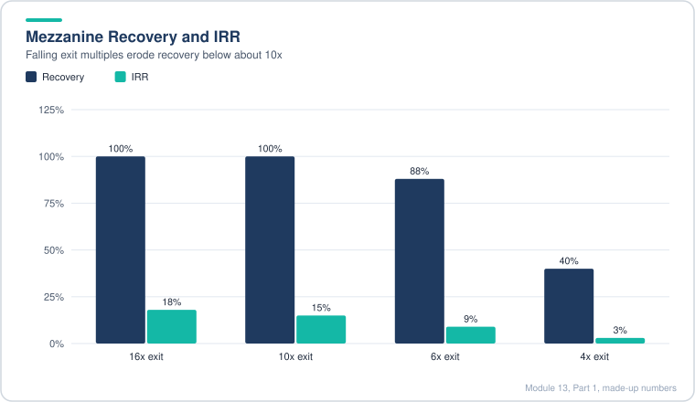

*Recovery holds at 100% down to 10x but drops sharply by 4x.*

Break-even for full recovery is somewhere between 6x and 10x, so the multiple can fall roughly 40 to 60 percent before full recovery is lost.

> [!TIP]
> **Beyond the model:** Real credit committees ask for loss-given-default and expected loss, not just a recovery percent. Loss-given-default is one minus recovery in the stressed case, and expected loss multiplies it by the probability of default. Attaching rough probabilities turns a memo from "unlikely" into a number a committee can challenge.

> [!WARNING]
> **Common mistake:** Calling a downside case "extreme" when revenue still grows. Stress tests should include a case where the core cash flow falls, because that is the scenario that defaults.

## Diagrams and Charts

**How the cash waterfall works each year.** Cash flow pays for itself first, then mandatory debt, then the revolver, then optional sweeps.

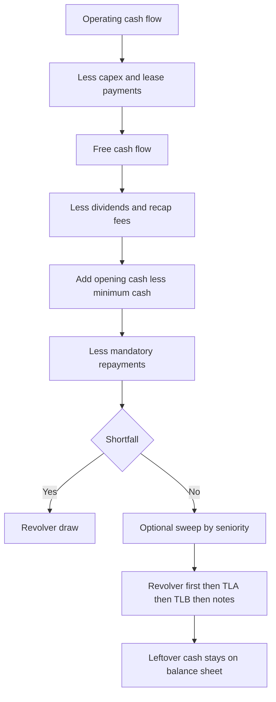

**Sponsor IRR across scenarios (illustrative numbers, not the case output).**

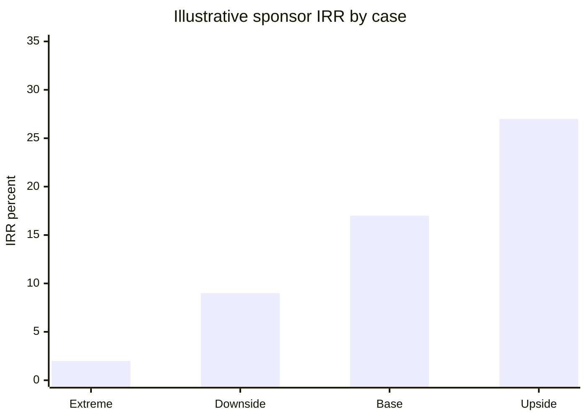

**Illustrative sources of funds at close (made-up mix).**

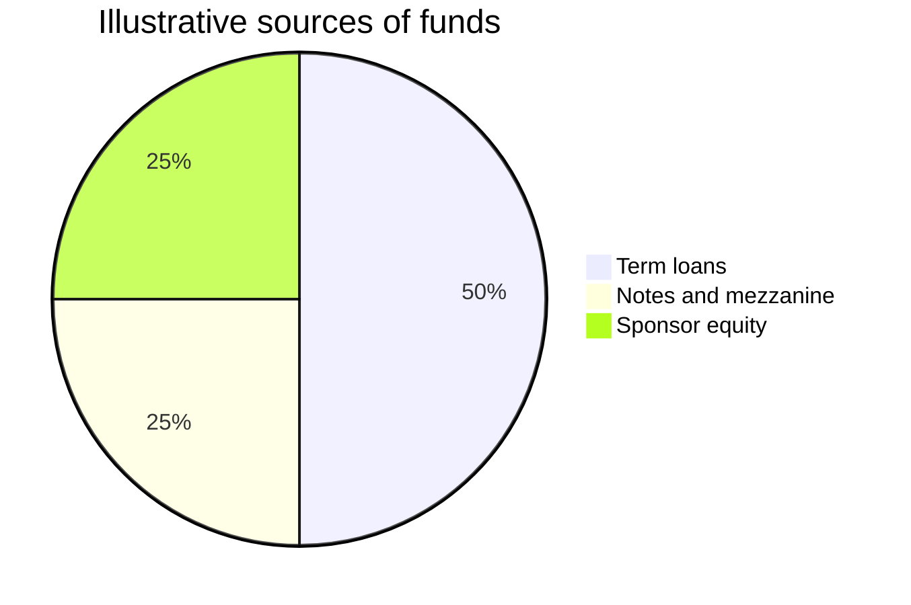

**Circular reference loop, and how the switch breaks it.**

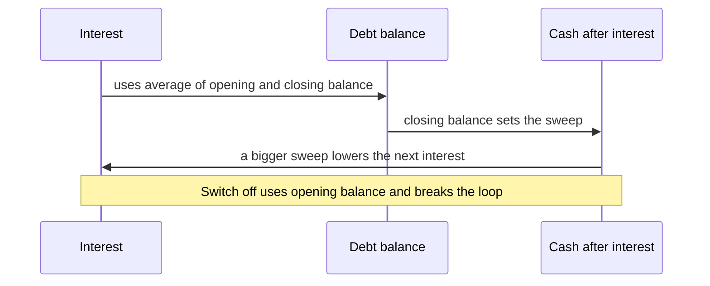

**Leverage path through the hold (illustrative).**

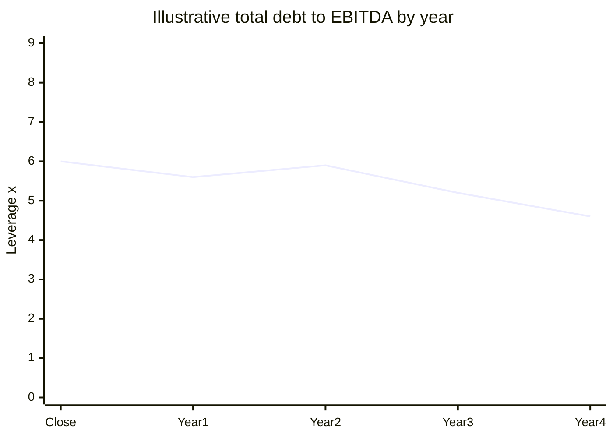

## Excel Model Walkthrough

The workbook has two working tabs plus a blank template. The complete version is the reference, and the blank version is the one you build from.

**Tab 1: LBO_4_Hours (deal tab).** Sections, top to bottom:

| Section | What it holds | Key links |
|---|---|---|
| Transaction assumptions | Scenario dropdown, close date list, stub fractions, purchase multiple, LTM EBITDA, purchase EV and equity bridge, fee percentages, management earn-out tiers, exit multiples by case | Named cells such as Scenario, Close_Date, Purchase_Multiple, LTM_EBITDA, Exit_Multiple |
| Sources and uses | Tranche face values, investor equity plug, working capital gap, fees and OID, percent of EBITDA column | Debt face values feed the debt schedule; equity plug feeds the closing balance sheet |
| Debt assumptions | Benchmark, floors, spreads, fixed coupons, PIK rates, amortization, sweep percents, revolver fees, circularity switch, dividend recap year and size | Feeds interest and repayment formulas |
| Goodwill and PPA | Equity purchase price, adjusted book, write-ups, goodwill, annual amortization | Feeds closing balance sheet and deal amortization |
| Income statement, balance sheet, cash flow | Post-close statements with stub columns (pre-close, post-close, then full years) | Balance sheet check row must be zero |
| Debt schedule | Balances, mandatory and optional repayments, revolver, interest, fees, PIK, recap | Repayments flow to cash flow financing |
| Tax schedule | Taxable income, goodwill tax deduction, NOL roll, cash taxes, deferred taxes | Deferred tax flows to cash flow |
| Credit stats | Leverage, coverage, cumulative paydown, NOPAT, ROIC | Used to set exit multiples |
| Returns | Sponsor and lender cash flows by year, waterfall with MAX and MIN, earn-outs, IRR and multiple | Outputs for the sensitivity tables |
| Sensitivity tables | Data tables on sponsor IRR, lender IRR and recovery | Need automatic calculation |

**Tab 2: Fin_Projections (operating tab).** Revenue build (facilities, plants, tonnes, price); expense and capex drivers; balance sheet and cash drivers; pre-deal three statements; the operating scenario is picked on the deal tab and flows here through INDEX and MATCH.

Key formulas, described: revenue is tonnes times price; costs are per tonne or per employee; growth capex is spread across build years; depreciation on growth capex is capped at cumulative spend; the revolver draw is a MAX with minimum cash; the optional sweep is a MIN of balance and sweep share of remaining cash; the tax schedule deducts goodwill amortization and carries NOLs forward; the returns waterfall pays tranches in seniority with MIN and MAX guards.

## Interview Questions

<details>
<summary><b>1. Walk me through an LBO at a high level.</b></summary>

Buy a company with a mix of debt and sponsor equity, run it for three to seven years with cash paying down debt, then sell it. Returns come from EBITDA growth, multiple change and debt paydown.

</details>

<details>
<summary><b>2. What makes a good LBO candidate?</b></summary>

Stable, predictable cash flow, low capex needs, a clear cost lever or growth path, a moderate starting leverage, and room to exit through a sale or IPO.

</details>

<details>
<summary><b>3. Why does the exit multiple matter so much?</b></summary>

It is applied to a larger number than the entry EBITDA, so a small change in multiple moves the exit value a lot. A sponsor that needs multiple expansion is taking a bet.

</details>

<details>
<summary><b>4. What is the difference between IRR and MOIC?</b></summary>

MOIC is total money back over money in. IRR accounts for timing. A fast return can have a high IRR and a low MOIC.

</details>

<details>
<summary><b>5. How does a dividend recap affect returns?</b></summary>

It returns cash early, which lifts IRR, but it adds debt and interest and can lower MOIC. Lenders also watch the added leverage.

</details>

<details>
<summary><b>6. What is the difference between a revolver and a term loan?</b></summary>

A revolver is a committed credit line you can draw and repay, usually for liquidity. A term loan is funded once and amortizes on a schedule.

</details>

<details>
<summary><b>7. Why are fees and OID treated as a use of funds, not a reduction of debt?</b></summary>

The sponsor funds them. Debt is at face value in sources, and the fees amortize through the income statement over the debt life.

</details>

<details>
<summary><b>8. What is a cash sweep?</b></summary>

A share of excess cash that must repay debt, often by seniority. A 50 percent sweep leaves half of excess cash on the balance sheet.

</details>

<details>
<summary><b>9. What is PIK interest?</b></summary>

Interest that accrues to principal instead of being paid in cash. It raises leverage over time and is a non-cash item.

</details>

<details>
<summary><b>10. What is a circularity and how do you handle it?</b></summary>

Interest uses average debt, which depends on the sweep, which depends on interest. Handle it with a circularity switch, iterative calculation and a circuit breaker.

</details>

<details>
<summary><b>11. What is a stub period?</b></summary>

The partial year between the last fiscal year end and the close date. Income statement items are prorated, and the balance sheet is set at the close date.

</details>

<details>
<summary><b>12. In an asset purchase, what is the tax benefit?</b></summary>

The buyer gets a step-up in asset basis, so write-ups and goodwill are deductible over time, which lowers cash taxes.

</details>

<details>
<summary><b>13. Why is goodwill written off in a deal?</b></summary>

The seller's existing goodwill has no fair value to the buyer, so the buyer creates new goodwill as the residual of the purchase price over identifiable net assets.

</details>

<details>
<summary><b>14. What is a minimum working capital peg?</b></summary>

A level of operating working capital the seller must leave in the business. Below it, the buyer is compensated; above it, usually nothing changes in a minimum-only design.

</details>

<details>
<summary><b>15. How do you test that a model is right?</b></summary>

Balance sheet balances in every year and case, cash ties to the cash flow statement, debt ties to the schedule, sources equal uses, and base-case sensitivity cells match the model output.

</details>

<details>
<summary><b>16. What is recovery for a lender?</b></summary>

The share of principal repaid at exit or through the hold. Full recovery at a given exit multiple shows how much value covers the debt.

</details>

<details>
<summary><b>17. What drives mezzanine returns?</b></summary>

Cash coupon, PIK, fees and OID, plus an equity kicker. It sits near equity, so its IRR moves a lot with exit value.

</details>

<details>
<summary><b>18. How would you stress test a credit?</b></summary>

Lower volumes or prices, raise capex, cut the exit multiple, and check leverage, coverage and recovery in each case. Find the multiple at which recovery drops below 100 percent.

</details>

<details>
<summary><b>19. What is ROIC and why use it for the exit?</b></summary>

NOPAT over invested capital. A rising ROIC supports a higher multiple, and a falling one argues for lower.

</details>

<details>
<summary><b>20. When would you say no to a deal?</b></summary>

When the price needs multiple expansion or heroic growth, when the downside wipes out the sponsor, or when the business needs capex the model does not fund.

</details>

## Career Angle

**Where this maps to real work.** Analyst roles in valuation, FP&A and reporting already use the same ideas, on the valuation and reporting side of the business rather than the deal side.

- For a capital markets pricing and valuation analyst, fair-valuing a very large book of mortgage and debt assets each month-end is the same discipline as a valuation model: cash flows, discounting, sensitivity to rates and scenarios, and a review trail. This is the best way to explain why LBO skills transfer.
- For an FP&A analyst, forecasting and variance work is the operating-model side of an LBO. Driver-based forecasts, scenario switches and balance sheet checks are the same skills.
- For a CFO reporting analyst, credit metrics and portfolio performance (delinquency, board materials) are the lender-side view, which is what the credit memo asks for.

**Target roles.** Valuation and capital markets (buy-side valuation, corporate development), leveraged finance or private credit (the credit side of this module), and FP&A or strategy roles that build three-statement models.

**Truthful talking points (framed as coursework, never as deal experience).**

1. "I worked through a full four-hour LBO case as self-study: a three-statement model with stub periods, a debt schedule with a revolver, a dividend recap, a tax schedule with NOLs, and sponsor and lender returns. I then wrote a recommendation for both equity and credit."
2. "In my valuation work I apply the same discipline the LBO case teaches: driver-based projections, scenario switches and a balance check. The downside case is the one I focus on."
3. "I can explain why debt covenants and cash sweeps change equity returns and why lender recovery is a better downside test than an average IRR."

**Never claim.** A deal, a transaction, a live LBO or any sponsor-side experience. Do not claim a certificate, since none was earned from this material.

## Cheat Sheet

- **Entry:** Purchase EV = multiple x LTM EBITDA. Uses = EV + fees + OID + any working capital top-up. Sponsor equity = uses minus debt.
- **Fees:** financing fees and OID amortize over the weighted period; use MIN so the balance never goes negative.
- **Stub:** post-close fraction = (EOMONTH(FYE, 12) minus close) / (EOMONTH(FYE, 12) minus FYE). Pre-close = 1 minus that.
- **Working capital floor:** gap = MAX(0, floor minus (AR + inventory + other LT assets minus AP minus other LT liabilities)).
- **Cash and revolver:** draw = MAX(0, minimum cash minus cash before revolver).
- **Mandatory:** MIN(balance, schedule % x original x stub fraction).
- **Optional:** MIN(balance after mandatory, sweep % x cash left).
- **Interest:** rate = MAX(benchmark, floor) plus spread for floating; average balance if circularity on, opening if off.
- **Revolver fees:** undrawn = MAX(0, 1 minus draw %) x size x rate; overdrawn = MAX(0, draw % minus 1) x size x rate.
- **Dividend recap:** size = multiple x EBITDA in chosen year; fees reduce proceeds; add recap amount to TLA amortization base.
- **Taxes:** taxable = pre-tax + impairment add-back minus goodwill tax amortization; NOLs created if negative, used if positive; cash tax = rate x MAX(0, taxable after NOL); deferred = cash minus book.
- **Goodwill:** equity price minus (seller common equity minus seller goodwill) minus write-ups plus new DTL.
- **Exit equity:** exit EV + cash + tax-effected NOLs minus debt repaid by waterfall.
- **Sponsor returns:** MOIC = positive flows over investment; IRR by XIRR on dated flows.
- **Lender returns:** include fees and OID at close, cash interest (not PIK), principal and penalties at exit, equity granted at exit. Recovery = principal repaid over ending face.
- **ROIC:** (EBITDA minus D&A minus lease costs minus write-up D&A) x (1 minus tax) over average (equity plus debt).
- **Rules of thumb:** exit multiple near entry is a bet on the market; leverage above 8x and coverage below 2x means the cushion is thin; a 1x sweep leaves no cash build; check every case before trusting a number.

---

[← Previous: Module 12, Part 2](12-lbo-concepts-and-simple-models-part-2.md) · [Contents](../README.md) · [Next: Module 13, Part 2 →](13-advanced-lbos-part-2.md)
