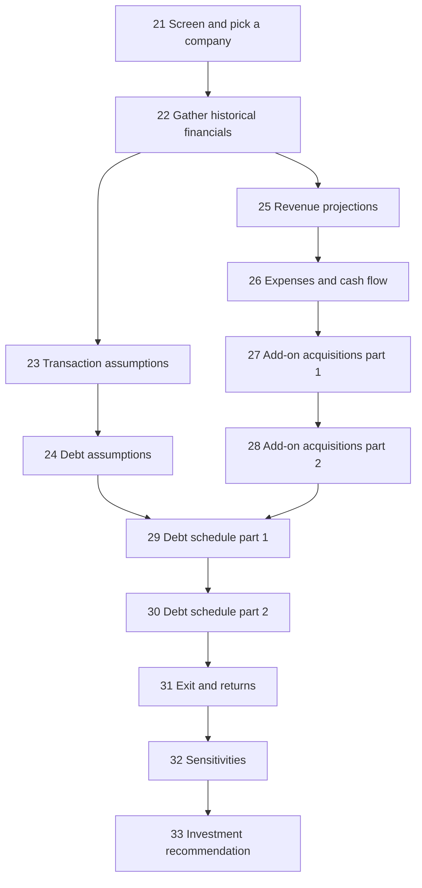
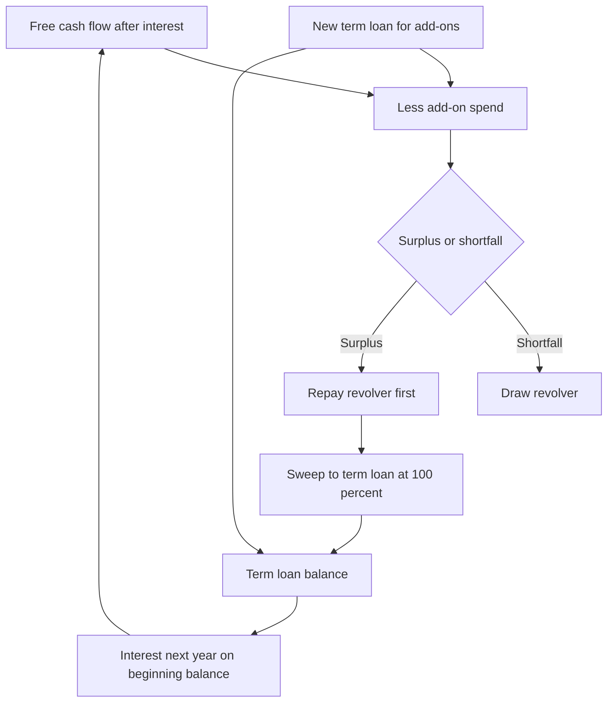
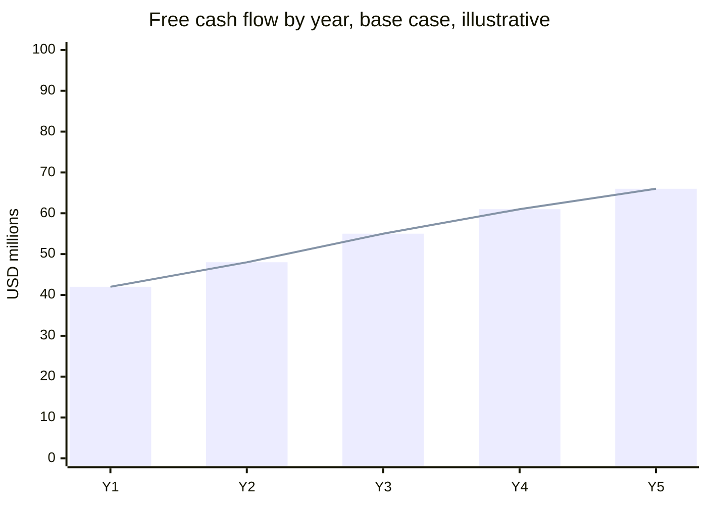
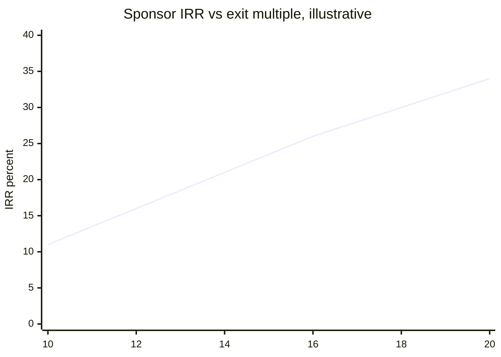
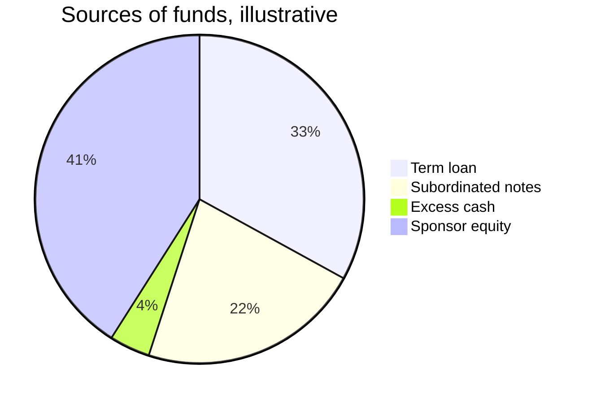
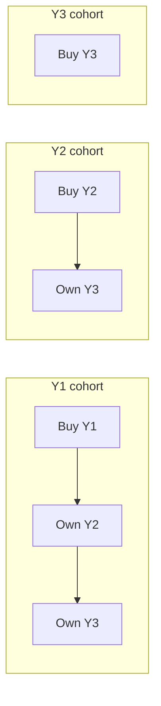

# Module 13, Part 2: Advanced LBOs

[← Previous: Module 13, Part 1](13-advanced-lbos-part-1.md) · [Contents](../README.md) · [Next: Module 14, Part 1 →](14-private-companies-and-ipos-part-1.md)

<details>
<summary><b>Contents</b></summary>

- [Overview](#overview)
- [Module Map](#module-map)
- [Lessons](#lessons)
  - [13.21 Case Overview and Company Selection](#1321-case-overview-and-company-selection)
  - [13.22 Financial Statements and Data Gathering](#1322-financial-statements-and-data-gathering)
  - [13.23 Transaction Assumptions](#1323-transaction-assumptions)
  - [13.24 Debt Assumptions](#1324-debt-assumptions)
  - [13.25 Revenue Projections](#1325-revenue-projections)
  - [13.26 Expense and Cash Flow Projections](#1326-expense-and-cash-flow-projections)
  - [13.27 Add-on Acquisitions, Part 1: Finding and Sizing the Targets](#1327-add-on-acquisitions-part-1-finding-and-sizing-the-targets)
  - [13.28 Add-on Acquisitions, Part 2: Revenue, EBITDA and Statement Impact](#1328-add-on-acquisitions-part-2-revenue-ebitda-and-statement-impact)
  - [13.29 Debt Schedule, Part 1: Cash, Term Loan, Subordinated Notes and Revolver](#1329-debt-schedule-part-1-cash-term-loan-subordinated-notes-and-revolver)
  - [13.30 Debt Schedule, Part 2: Interest, Statements and Credit Metrics](#1330-debt-schedule-part-2-interest-statements-and-credit-metrics)
  - [13.31 Exit Multiples and Returns](#1331-exit-multiples-and-returns)
  - [13.32 Sensitivities](#1332-sensitivities)
  - [13.33 Investment Recommendation Presentation](#1333-investment-recommendation-presentation)
- [Diagrams and Charts](#diagrams-and-charts)
- [Excel Model Walkthrough](#excel-model-walkthrough)
- [Interview Questions](#interview-questions)
- [Career Angle](#career-angle)
- [Cheat Sheet](#cheat-sheet)

</details>

## Overview

Part 2 walks through a full take-home LBO case from start to finish: screen for a target, gather its financials, set deal and debt terms, project revenue and cash flow, layer in add-on acquisitions, run the debt schedule and returns, stress the answer with sensitivities, and turn it all into an investment recommendation.

## Module Map



The earlier lessons set the stage (screening, data, assumptions). Lessons 27 and 28 change the model's shape, because each acquisition adds revenue, EBITDA, cost and debt. Lessons 29 and 30 link the cash flow to the debt. Lessons 31 to 33 turn the outputs into returns, a range of outcomes and a written case.

## Lessons

### 13.21 Case Overview and Company Selection

- **The test is about judgment, not model size.** A take-home case gives a few days to a week. It is usually a short document that describes the sponsor, its deal size and its sector preferences, plus a list of deliverables. The Excel model is simple, roughly the size of a 90-minute LBO exercise. Most of the time goes to research, and the write-up is what gets scored.
- **Outside data matters.** Real take-home work assumes access to a terminal such as Capital IQ or FactSet, plus filings and industry reports. Without a terminal, a free screener can do a rough job, though the unit economics take more manual reading.
- **The sponsor's mandate sets the screen.** The firm in this case wanted US companies with a stagnant or declining core business, enterprise value between about $500M and $2B, and an angle such as a turnaround, restructuring, divestiture or add-on acquisitions. Sector preferences were consumer or retail, media or telecom, and software.
- **Our own filters go further than the sponsor's.**
  - Free cash flow yield (free cash flow divided by market value of equity, or by enterprise value for an unlevered view) of roughly 10% or more, so the business can fund its own plan.
  - Entry EV/EBITDA of about 5x to 10x. Up to 15x is workable if there is growth. Above that, leverage covers too small a share of the price and the downside widens.
  - Clean financials with a driver you can forecast, such as stores times sales per store, or subscribers times revenue per user, not just a growth rate.

**Screening steps**

1. Filter the universe by sector, geography and enterprise value. Here that left about 200 names.
2. Check each sector for quality. Software had many names with no meaningful EBITDA or multiples above 30x, so it was dropped. Consumer names were cheap but thin-margined with erratic cash flow. Media and telecom had cheaper names with heavy capital spending, which is a real drag on free cash flow.
3. Shortlist about 7 names and screen out those with negative EBITDA, very high multiples, heavy capex or no unit data.
4. Pick the best one or two and dig into their filings.

> [!TIP]
> Two extra checks before committing to a candidate: (a) does the business have a plausible exit buyer, meaning a strategic or a sponsor with a reason to pay a similar multiple? (b) is the stock price depressed for a fixable reason, or for a broken business? Those questions decide whether the LBO thesis is worth writing.

**Worked example (made-up numbers)**

| Screen item | Candidate A | Candidate B | Candidate C |
|---|---|---|---|
| Enterprise value | $900M | $1.4B | $600M |
| EV / EBITDA | 9.0x | 13.5x | 6.2x |
| Revenue growth (3 yr) | -4% | +12% | -1% |
| FCF yield on EV | 11% | 3% | 8% |
| Unit data available | Yes | Partial | No |
| Result | Shortlist | Drop | Drop |

Candidate A wins on value and cash yield, and has the unit data to model. Candidate B is a growth story, which the sponsor does not want. Candidate C is cheap, but without unit data the projections would be guesswork.

**Common mistakes**

- Picking a high-growth company because it is interesting, when the firm wants turnarounds.
- Using P/E as if it were EV/EBITDA. P/E ignores debt and capex. Use it only as a rough proxy when you cannot get EV data.
- Choosing a company with no unit economics, then trying to forecast revenue with a single growth rate.

### 13.22 Financial Statements and Data Gathering

**The four-step loop for any case**

1. Skim the latest annual report and the investor deck. Find the statements, then look for a revenue and cost breakout that carries drivers (units, customers, price per customer, traffic, stores, and so on). Ignore decks that only repeat the filing.
2. Decide how each driver will be projected and list the outside data it needs, such as market size, share, or a growth rate for the end market.
3. Gather the outside data and write down the source for each number. Aim for two or three drivers per revenue line, not one growth rate.
4. Simplify the statements. You usually do not need the full balance sheet or the full working capital detail if the model is a cash flow and debt model. Keep the income statement close to the filing, and collapse the small items in the cash flow statement.

**What to look for in the filing**

- Operating metrics are often in the MD&A or a footnote, not the statements. Customer counts, revenue per customer, website traffic and segment breakouts are the good ones.
- Revenue can be reported in a way that hides the economics. Look for the note on revenue recognition, which sometimes splits revenue by type (for example, advertising vs subscriptions vs pay-per-action). The split that depends on different drivers is the one to model.
- Expenses often come only as percentages of revenue. That is fine for a case, but say so.
- Financing and most investing items are irrelevant once the deal is modeled, because the capital structure will change. Keep acquisitions and capex, and drop the rest.

**Projecting a shrinking customer base**

Customers that fall year after year do not always mean a shrinking market. Compare the company's count with the industry count. If the industry is flat and the company is falling, the company's share is falling by roughly the gap between the two growth rates. That is a better thing to forecast than the raw count.

**Per-customer revenue**

Divide the revenue line by the customer count and by the period length to get monthly revenue per customer. If that number barely moves across years, do not spend effort forecasting it. Hold it flat or grow it with inflation, and put your effort into share and market size.

> [!TIP]
> Check that the unit economics reconcile to the reported totals. Units times price should equal the revenue line within rounding. If it does not, you are probably mixing a period-end count with an average count, or using a metric that a footnote defines differently. A quick reconciliation catches most early mistakes.

**Worked example (made-up numbers)**

| Year | Dealer count (company) | Industry dealers | Company share | Monthly revenue per dealer |
|---|---|---|---|---|
| Y1 | 10,000 | 40,000 | 25.0% | $1,800 |
| Y2 | 9,400 | 40,400 | 23.3% | $1,810 |
| Y3 | 8,850 | 40,800 | 21.7% | $1,805 |

The count falls about 6% a year, but the industry grows about 1%. So the share falls about 1.5 points a year. Revenue per dealer is nearly flat, so forecast it with a small inflation factor and let share drive the rest.

**Common mistakes**

- Forecasting the company's count directly without asking what the market is doing.
- Taking a company deck number as fact without matching it to the filing.
- Spending time on the balance sheet that no output uses.

### 13.23 Transaction Assumptions

**Pick the reference share price on purpose**

For a public target, start from a reference price and add a premium. The spot price is one choice. A trailing average, often six months, is better when the stock has been jumping around or had a big drop that you do not want to bake into the price. Your premium then needs a story. If the stock fell for a reason the buyer thinks is fixable, a premium over the average is more defensible than a premium over a crashed spot price. Do not assume the buyer pays back to the old peak. A buyout price is usually a modest premium to the recent market, not a return to a level the stock traded at years earlier.

- Offer price per share = reference price x (1 + premium). A 30% premium is a common starting point. Sensitivity tables later test the premium.

**Diluted shares with the treasury stock method**

- Basic shares come from the cover page of the annual report.
- Options: if the exercise price is above the offer price, they are out of the money and add nothing. Otherwise add the options less the shares the proceeds would buy back, where the proceeds are options times exercise price divided by the offer price.
- Restricted stock units and performance share units add straight to the count, since they carry no exercise price. (Performance units can be haircut if the targets are unlikely, but the case did not need that).

```text
Diluted shares = basic + TSM option dilution + RSUs + PSUs
Option dilution = IF(strike > offer, 0, options - options x strike / offer)
Purchase equity value = offer price x diluted shares
```

**Enterprise value bridge**

Purchase EV = purchase equity value + debt - cash - cash-like investments (+ pensions, minorities, preferred, and other claims if they exist). Check each one. Here, there were no pensions, minority interests or equity stakes, and the tax loss carryforward was tiny, so only cash and debt mattered.

- Book value of debt is the only figure available without a market quote. Use the carrying amount, note that it omits unamortized issuance costs, and move on. Companies rarely publish a fair value of their bonds in the main filing.

> [!TIP]
> Two reasons the book value of debt can mislead: if rates have moved since the bonds were issued, the market value of fixed-rate debt differs from book. And some debt sits off the balance sheet (operating leases, for example). For a case, flag both and move on.

**Minimum cash and excess cash**

- Look at the cash balance over several years. Take an average and round to a sensible operating floor. Most of the rest is excess and can fund the deal.
- Excess cash = current cash - minimum cash. It is a source of funds.

**Fees**

| Item | Rule of thumb |
|---|---|
| Financing fees | About 2% of new debt raised |
| Transaction (advisory) fees | About 1% of purchase equity value |
| Legal and other | A fixed dollar amount, tied to deal size |

Divide each fee by LTM EBITDA to see the multiple it adds. Fees are a use of funds, so they push up the equity check.

**Scenarios to set up now**

- Operating case (base, upside, downside) that drives revenue and cost.
- Acquisition case, for add-ons, which we do not fill in yet.
- Exit route, which can be a sale to a strategic or another sponsor (M&A), or an IPO. Some firms can only sell to a sponsor if they have a logical buyer. When there is none, an IPO is the back-up route.
- Minimum cash, which feeds both the excess-cash source and the cash the model must keep on hand each year.

> [!TIP]
> A common interview question is why the case needs scenarios when the sponsor only asked for outcomes. Answer: the outcome depends on operations, the exit route and the entry price, and the write-up must show what happens if the business keeps declining.

**Worked example (made-up numbers)**

| Line | Value |
|---|---|
| Six-month average price | $20.00 |
| Premium | 30% |
| Offer price | $26.00 |
| Diluted shares | 50.0M |
| Purchase equity value | $1,300M |
| Plus debt | $600M |
| Less cash | ($80M) |
| Less cash-like investments | ($20M) |
| Purchase EV | $1,800M |
| LTM EBITDA | $150M |
| EV / LTM EBITDA | 12.0x |
| Excess cash used | $60M (cash $80M less minimum $20M) |

**Common mistakes**

- Using the sum of all option shares without the treasury stock method.
- Forgetting cash-like investments in the bridge, which makes the entry price look higher than it is.
- Setting minimum cash at zero. A business needs cash to run, so the model should never sweep it all into debt paydown.
- Mixing an LTM EBITDA with a stale annual figure. A stub-period adjustment is ideal. A take-home can skip it, but say so.

### 13.24 Debt Assumptions

**Where the debt terms come from**

1. If the target already has debt, read the debt note in its filing. It usually lists each tranche with its balance, rate, floating or fixed basis, maturity, amortization and covenants. Use similar structures for the new deal, but raise the rates a little, because leverage goes up after the buyout.
2. If the target has no debt, find one or two listed peers from its competitor section and borrow their terms. You do not need an average of ten peers. One sensible comparable is enough for a case.
3. Use recent LBO press releases to set total leverage. For a deal of this type in a normal market, total leverage of around 5x to 6x EBITDA is a common range. It moves with the market, the sector and the company's cash flow.

**Reading the note**

- Effective interest rate in the note is the easiest starting rate, but it is historical. Check whether the rate is fixed or floats over a benchmark, and add the spread.
- Maturity dates are often in the table of principal repayments. Add up the scheduled amounts by year to check the balance ties.
- Covenants limit the structure. A maximum senior secured leverage test caps how much secured term debt you can add. A minimum interest coverage test limits how much cash interest the business can carry. A maximum net leverage test caps total debt after cash. Even if you do not model covenant tests for every year, they tell you the ceiling on leverage.

**Designing the new structure**

| Tranche | Role in the model | Typical terms used |
|---|---|---|
| Revolver | Liquidity line, undrawn at close | Floating, low spread, no maturity in the model |
| Term loan | Main acquisition debt, amortizes | Floating (floor plus spread), about 1% floor, 3% to 4% spread, 10% a year amortization, sweep of excess cash |
| Subordinated notes | Expensive junior debt, can accrue | Fixed, part cash and part paid-in-kind, about 8% total, 8-year maturity |
| Cash | Earns a small interest | Small rate tied to a Treasury benchmark |

- **Why a 100% cash sweep?** When the plan depends on acquisitions, the company should use every spare dollar to pay the term loan. That keeps the balance low. Here the sweep makes sense because the term loan is also the source for add-ons and needs to be re-drawable.
- **Why paid-in-kind interest?** Paid-in-kind interest is added to the principal instead of paid in cash. It lifts the free cash flow available for the sweep and for acquisitions in the early years. The cost is that the principal grows, so the exit has to clear a bigger claim.
- **Why draw more term loan and less junior debt?** Term debt can be paid down and redrawn, while junior notes usually cannot. A structure that keeps the term loan flexible is better for a company that plans to buy more businesses.

**Sources and uses**

- Debt at close is set as a multiple of LTM EBITDA for each tranche. Here: revolver 0x, term loan 3x, junior notes 2x. The sponsor equity is the plug, which means total uses less total non-equity sources.
- Face value of existing debt is slightly more than book value because unamortized issuance costs are netted against the carrying amount. Add them back to approximate face value. Refinancing has to repay face, not book.

> [!TIP]
> Two things a reviewer may ask about: (a) Is 6x total leverage defensible for a shrinking business? The honest answer is that it is aggressive, and it works only with a strong cash yield and a sweep. (b) Are the rates right? Check against the current yield on the company's own bonds or on a comparable rated loan. Fixed-rate and floating-rate debt react differently to rate changes.

**Worked example (made-up numbers)**

| Source | x LTM EBITDA | Amount | % of sources |
|---|---|---|---|
| Revolver | 0.0x | $0 | 0% |
| Term loan | 3.0x | $450M | 33% |
| Subordinated notes | 2.0x | $300M | 22% |
| Excess cash | n/a | $60M | 4% |
| Sponsor equity (plug) | n/a | $560M | 41% |
| Total sources | | $1,370M | 100% |

With LTM EBITDA of $150M, term loan plus notes is 5.0x, inside the 5x to 6x range. Equity is 41% of sources, which is a normal range for a deal in this market.

**Common mistakes**

- Copying the target's old rates without adding a risk premium for higher leverage.
- Leaving the revolver at a large drawn balance. It should start undrawn and act as a backstop.
- Forgetting that paid-in-kind interest grows the principal. Models that accrue it but never add it to the balance break.
- Using book debt when the note gives you the face value.

### 13.25 Revenue Projections

**Build revenue from drivers, one line at a time**

Each revenue stream gets its own driver, and the streams sum to total revenue. Here there were three streams and three drivers:

- **Subscription-type revenue from customers** = customer count x monthly revenue per customer x 12, converted to the model's units.
- **Advertising tied to traffic** = website visitors (millions) x revenue per visitor (dollars). Because visitors are already in millions and revenue per visitor is in dollars, the product comes out in millions of dollars with no extra unit conversion.
- **Total revenue** = sum of the streams.

**Customer count = addressable market x share**

- Market growth (the addressable market) comes from outside research. Here it was a low single-digit rate that fades over time. A compound annual growth rate over the historical window is a quick sanity check on your assumed path.
- Market share is the lever that carries scenarios. Forecast it as a list of yearly values for each case, not as one number. Each case should have a story:
  - Downside: share falls close to the worst recent pace.
  - Base: share falls at a moderate pace, nearer to the most recent, less severe decline.
  - Upside: share falls very slowly, roughly flat.
- Pull the scenario values with INDEX and MATCH (or XLOOKUP) keyed on the active case name. Anchor the lookup column so it does not shift when you copy the formula across. Test each case by switching the selector and checking the output moves.

**Revenue per customer**

- Historically flat, with a small drift. Grow it at about inflation, and flag that the company has little pricing power if the historical rate sits below inflation.

**Traffic and revenue per visitor**

- Traffic grew fast historically. Be less aggressive: start with the recent growth rate, then fade it each year by a fixed step. This is a judgment call, so say why.
- Revenue per visitor has been falling sharply. Decline it at a slower pace than the recent trend, and justify that with a reason, such as bigger advertisers willing to pay more for growing traffic.

> [!TIP]
> Traffic is a leading indicator, not a result. Traffic growth can mean more people looking but less commercial value per person, which is what happened here. When a model shows traffic rising and revenue falling, the answer is almost always yield per visitor, not traffic itself.

**Results by case (made-up numbers)**

| Case | Year 0 revenue | Year 5 revenue | Annual growth |
|---|---|---|---|
| Upside | $500M | $550M | about +2% |
| Base | $500M | $490M | about -0.4% |
| Downside | $500M | $420M | about -3.4% |

The point of the table is the spread. Even the upside case should not assume double-digit growth for a shrinking industry. The downside case must stay honest about the worst observed trend.

**Common mistakes**

- Setting one growth rate and calling it a driver model.
- Multiplying the wrong units. Millions of visitors times dollars per visitor already gives millions of dollars. Customer count times monthly revenue times 12 needs a divide by one million.
- Forgetting the annualization factor on monthly revenue per customer.
- Choosing scenario numbers that do not match the story. If the write-up says the downside is the worst historical pace, the number should match that pace.

### 13.26 Expense and Cash Flow Projections

**Two questions decide every line**

1. Should this item link to standalone revenue (the core business) or to total revenue (core plus acquired)? The rule used here: operating costs of the core business link to standalone revenue, and acquired businesses carry their own cost lines. Capex and working capital link to total revenue, because acquired businesses also need equipment and receivables.
2. What if there is no clear trend? Use a simple average of the historical ratio. For the tax rate, use a standard statutory-plus-state rate, not a noisy effective rate.

A third rule: keep margins in a sensible band across cases. A spread of a few points between cases is reasonable. A spread of 30 points is a sign of a broken assumption, especially for a mature business.

**Line-by-line method**

| Line | Driver | Method |
|---|---|---|
| Cost of revenue | Standalone revenue | Trend up gently (about 1 point a year) |
| Product and technology | Standalone revenue | Historical average |
| Marketing and sales | Website visitors | Cost per visitor falls at a slowing pace |
| G&A | Standalone revenue | Historical average |
| Affiliate revenue share | Display and lead revenue | Historical average ratio |
| Depreciation | Standalone revenue | Historical average |
| Amortization of existing intangibles | Fixed schedule | Use the company's published amortization schedule |
| Goodwill impairment | None | Zero going forward, since it is non-recurring |
| Tax | Pre-tax income | Flat rate (25% used here) |
| Stock comp | None | Set to zero, treat as a cash cost |
| Other operating items | Standalone revenue | Simple average |
| Working capital change | Change in total revenue | Simple average percentage |
| Capex | Total revenue | Simple average percentage |

**EBITDA definition used**

EBITDA = operating income, plus depreciation, plus amortization of existing intangibles, plus acquired-company D&A, plus any goodwill impairment (added back because it is non-cash and non-recurring). Stock comp is not added back.

> [!TIP]
> The choice to not add back stock comp is a judgment. Public companies often report "adjusted EBITDA" that adds it back. In a private equity model, the sponsor's ownership is fixed, so a stock-comp add-back implies new share issuance, which dilutes the sponsor. Treating it as cash is the cleaner choice. Say which one you used.

**Cash flow build**

- Net income, plus non-cash items (depreciation, amortization, impairment, stock comp set to zero), plus other items, plus or minus working capital, equals cash flow from operations.
- Free cash flow = cash flow from operations - capex (and any other investing outflows such as acquisitions, added later).
- Items that need a debt schedule first (paid-in-kind interest, debt fee amortization, deferred taxes) stay blank until that schedule exists.

**Worked example (made-up numbers)**

| Item | Year 1 | Year 2 | Year 3 |
|---|---|---|---|
| Standalone revenue | $500M | $495M | $490M |
| Cost of revenue (% of revenue) | 19.0% | 20.0% | 21.0% |
| Cost of revenue | $95.0M | $99.0M | $102.9M |
| Other operating costs | $150.0M | $148.0M | $147.0M |
| EBITDA (revenue less cash costs) | $255.0M | $248.0M | $240.1M |
| EBITDA margin | 51.0% | 50.1% | 49.0% |
| Depreciation and amortization | $70.0M | $68.0M | $65.0M |
| Operating income (EBIT) | $185.0M | $180.0M | $175.1M |

Here EBITDA is revenue less the cash costs. D&A sits below it, so it is subtracted to reach EBIT and is only added back when you rebuild EBITDA from operating income. Note the margin falls slowly because the cost of revenue ratio rises each year. Check that the margin lands in the range your history supports before moving on.

**Common mistakes**

- Using a total revenue base for core cost lines before any acquisitions exist, which double counts later.
- Picking a trend that is noise. A sign flip between years is a sign of noise, not a trend.
- Adding back stock comp without a plan for share count.
- Forgetting that a non-cash add-back still has to reverse on the cash flow statement.

### 13.27 Add-on Acquisitions, Part 1: Finding and Sizing the Targets

**Why add-ons instead of a turnaround**

- A turnaround and an add-on program do the same thing mechanically: you spend cash up front, and revenue and EBITDA rise later. The difference is evidence. Acquired businesses have public numbers (filings, multiples, comps). A turnaround of a mature core needs a story you cannot easily prove.
- A five-year turnaround that makes a stagnant company into a market leader in a crowded market is hard to defend. A platform strategy, where a company buys several smaller firms in adjacent niches, is easier to test and to sensitize.

**Categories of add-on targets**

Think about what the target sells and to whom. In this case the core sold subscriptions and advertising to car dealers, so the candidates fell into four buckets:

1. Software that dealers buy (for example, finance and leasing tools).
2. Media and services that dealers buy (for example, lead and listing services).
3. Dealership groups or franchise owners, where the economics are retail.
4. Direct competitors selling the same products.

Growth and multiple move in opposite directions. Software and internet services grow faster and deserve a higher multiple. Dealership groups and mature media grow slowly, with better margins, and trade at lower multiples.

**Using two representative archetypes**

Rather than model 15 or 20 targets one by one, group them:

| Archetype | Entry EV/EBITDA | Revenue growth | EBITDA margin | D&A % revenue |
|---|---|---|---|---|
| Growth (software and services) | about 15x | 10% in year 1, fading | about 3%, rising | about 3% |
| Value (dealer groups and mature media) | about 5x | about 3%, flat | about 10% | about 4% |

Each archetype has its own starting point and its own annual change. The model picks the row by the active acquisition scenario, using INDEX and MATCH, so the same schedule runs both stories.

**Sizing the program**

- The annual acquisition spend is a number of dollars, not a count of deals. Anchor it to what the business can fund from free cash flow before any new debt. Here, that was roughly $100M of enterprise value per year, close to the unlevered free cash flow.
- If the sponsor is willing to lever up, the number can rise. The baseline should stay self-funded so the case is easy to defend.

> [!TIP]
> Two things to check on acquisition multiples: (a) the sponsor's blended entry multiple will be a mix of the archetypes, so check that the mix is consistent with the program. (b) Acquirers rarely get the target's trailing EBITDA for free. Small companies often trade at a size discount, but a buyer also pays a control premium. Build both into the multiple, or the program will look cheaper than it is.

**Worked example (made-up numbers)**

| Item | Growth archetype | Value archetype |
|---|---|---|
| Entry multiple | 15.0x | 5.0x |
| Starting revenue growth | 10% | 3% |
| Yearly change in growth | -2 points | 0 points |
| Starting EBITDA margin | 3% | 10% |
| Yearly change in margin | +2 points | 0 points |
| Annual spend (EV) | $100M | $100M |

With $100M of spend at 15x, the growth archetype buys about $6.7M of EBITDA. The same $100M at 5x buys $20M of EBITDA. The cheap, mature business gives far more EBITDA per dollar on day one, but grows more slowly. That trade-off is the heart of the decision, and the write-up should say which way the sponsor should lean.

**Common mistakes**

- Modeling a specific named target without evidence for its numbers, then treating those numbers as typical.
- Forgetting the acquired company's D&A line, which is needed later for the tax and EBITDA bridge.
- Setting the annual spend above what the business can fund without a clear source. Either cash or debt has to pay for it.

### 13.28 Add-on Acquisitions, Part 2: Revenue, EBITDA and Statement Impact

**The cohort (waterfall) method**

Each year's acquisitions form a cohort. A cohort is a row that starts in the year bought and then evolves each year it is owned. Stack the cohorts and you get a triangle: each new row begins one column to the right of the row above.

Steps for one cohort:

1. Spend in the year = EBITDA bought. Divide the spend by the entry multiple. Here, $100M at 5x buys $20M of EBITDA.
2. Revenue at purchase = acquired EBITDA divided by the target's margin in that year.
3. Revenue in later years = prior revenue x (1 + that year's growth rate for the cohort's age).
4. EBITDA in each year = revenue x margin for the cohort's age.
5. EBIT = EBITDA - (D&A % of revenue x revenue). D&A from acquisitions is the gap between EBITDA and EBIT.

**Age matters, not the calendar year**

A cohort bought in year 2 should use "year 1 of ownership" rates in year 2, not the year-2 rate from the calendar. In this case the first year of ownership used the stated first-year growth. That keeps the rate curve attached to the acquisition's age. Anchor the cell references so the formulas copy cleanly across each row. Check the result by hand for one cohort.

> [!WARNING]
> Getting the age offset wrong is the most common error in this structure. A quick test: set every growth rate to zero and confirm each cohort's revenue stays flat from the day you bought it. Then set one year's growth to a distinctive number and confirm it only shows up for the right cohort age.

**Feeding the statements**

- Revenue from acquisitions is added to standalone revenue to get total revenue.
- Cash cost from acquisitions = revenue from acquisitions minus EBITDA from acquisitions, shown as a negative expense.
- D&A from acquisitions = EBITDA minus EBIT, shown as a negative expense on the income statement and reversed on the cash flow statement.
- Acquisition spend is an investing outflow on the cash flow statement, which lowers free cash flow in the year bought.

**Worked example (made-up numbers, one cohort at 5x, $100M spend)**

| Item | Year 0 (buy) | Year 1 | Year 2 |
|---|---|---|---|
| EBITDA bought | $20.0M | | |
| Margin | 10.0% | 10.5% | 11.0% |
| Revenue | $200.0M | $210.0M | $220.5M |
| EBITDA | $20.0M | $22.1M | $24.3M |
| D&A (4% of revenue) | $8.0M | $8.4M | $8.8M |
| EBIT | $12.0M | $13.7M | $15.4M |

Revenue grows 5% a year in this illustration, and margin grows half a point a year. Note that the EBITDA margin rises while the EBIT margin is far lower because the D&A is a large share of revenue.

**Growth vs value in the cohort method**

Value cohorts bring EBITDA on day one. Growth cohorts show little or no EBIT early on, because low margins and high purchase multiples take years to pay off. Over a five-year hold, value usually gives more cash in the window. A growth cohort may only pay off after a decade, so the sponsor should not count on it for exit value.

**Common mistakes**

- Setting the cohort's first year on the calendar year's rate, not the ownership year.
- Subtracting D&A from revenue instead of EBITDA.
- Forgetting to reverse acquisition D&A on the cash flow statement, which understates cash flow.
- Expecting the scenario selector to change the acquisition economics when it only changes the mix of archetypes.

### 13.29 Debt Schedule, Part 1: Cash, Term Loan, Subordinated Notes and Revolver

**Why fund add-ons with debt**

If free cash flow paid for every acquisition, the program size would change with each scenario. A bad downside year could mean no deals, and the model would stop being comparable across cases. Fixing the spend at a set dollar amount and funding it with new term loan keeps the program the same in every case. The free cash flow then goes to repay debt through the sweep.

Free cash flow in this model is also overstated before interest. Once interest is deducted, early-year cash flow may be near zero. So the spend cannot be assumed to come from operations.

Equity is a poor choice for this. Each equity injection lowers sponsor returns and complicates the IRR math, which is why sponsors prefer debt for bolt-ons.

**Cash build**

- Opening cash at close = cash on the balance sheet, less the excess cash used in the deal, which leaves the minimum cash balance.
- Ending cash = beginning cash + free cash flow + debt drawn - debt repaid - acquisition fees - minimum cash held back.
- The model always keeps the minimum cash on hand.

**Cash surplus or shortfall**

Cash available for debt service = free cash flow plus new debt from add-ons, less acquisition spend and fees, less the minimum cash. A positive number is a surplus for repayments. A negative number is a shortfall that the revolver must cover.

**Term loan**

- Beginning balance = last year's ending balance. The deal closes with the term loan from the sources and uses.
- Issuance = the add-on spend, net of cash acquired, each year.
- Mandatory amortization = the lesser of the scheduled amount and the beginning balance. The scheduled amount here is 10% of the balance from the prior years' issuances. New issuance made at year-end is not amortized until the following year, which is a convention you should state.
- Cash sweep = the lesser of (cash available after revolver flows) x sweep percentage and the remaining balance, but only if the cash available is positive. At 100%, every spare dollar pays down the term loan.

**Subordinated notes**

- Beginning balance = last year's ending balance. Paid-in-kind interest is added to the principal. Cash interest is charged on the beginning balance.
- Because the balance keeps growing with paid-in-kind interest, the notes do not get repaid in the window.

**Revolver**

- If cash available is a surplus, repay the lesser of the surplus and the drawn balance.
- If it is a shortfall, draw the amount needed.
- In the base case it stays at zero. A downside case may need it.

**Worked example (made-up numbers)**

| Item | Year 1 |
|---|---|
| Beginning term loan | $450.0M |
| Add-on spend, debt funded | $100.0M |
| Mandatory amortization (10% of prior issuance-based balance) | ($45.0M) |
| Free cash flow after interest | $40.0M |
| Fees on new debt (2%) | ($2.0M) |
| Cash available for sweep | $40.0M |
| Sweep (100%) | ($40.0M) |
| Ending term loan | $465.0M |

The loop: issuance of $100M, amortization of $45M, sweep of $40M, so the balance rises by $15M. The sweep is the lever: it only shrinks the loan when free cash flow beats the new borrowing.

**Common mistakes**

- Mixing up the sign on repayments, so the revolver draws on a surplus.
- Ignoring year-end issuance timing in amortization, which overstates the early paydown.
- Forgetting the 2% fee on each new term loan, which should flow through cash.
- Letting cash fall below the minimum, which a sweep can cause if the minimum is not subtracted first.

### 13.30 Debt Schedule, Part 2: Interest, Statements and Credit Metrics

**Interest rates**

- Fixed-rate tranches (paid-in-kind and cash on the subordinated notes) use their stated rates.
- Floating tranches (revolver and term loan) use: rate = MAX(floor, benchmark) + spread. The floor matters when the benchmark is very low. Here the benchmark was a 10-year Treasury yield assumed to rise gently over time, and the floor on the term loan was 1%.
- Interest income on cash uses a small rate on the beginning cash balance.

**Avoid circularity**

Interest is calculated on the beginning balance of each tranche, not the average. Average-balance interest makes the model circular (interest affects cash, which affects debt, which affects interest). A circular model can break in sensitivity tables. Beginning-balance interest is a simplification. Say so in the write-up.

**Summary block**

Build a small summary at the bottom: debt drawn and repaid by tranche, cash interest by tranche, and total interest expense. Total interest = cash interest + paid-in-kind interest (or cash interest less paid-in-kind, depending on the sign convention you chose). Pick one sign convention and check it.

**Linking to the statements**

- Interest expense on the income statement = total interest. Interest income is shown separately.
- Debt issuance fees: the fee on the opening debt is amortized over a weighted average term. Each new term loan adds its own fee, which is amortized over its own maturity. The formula is the opening fee divided by its weighted term, plus new fees divided by the term loan maturity, capped at the remaining unamortized balance. This is the hardest formula in the module.
- On the cash flow statement, add back paid-in-kind interest and fee amortization (both non-cash). Fees on new debt are paid in cash when the debt is raised.
- Deferred taxes: some non-cash charges are not tax-deductible. Their book tax benefit is not a cash benefit, so cash taxes end up higher than book taxes. Multiply the non-deductible amounts by the tax rate to get the adjustment. The case assumed the amortization of existing intangibles, impairment and stock comp were non-deductible, and that the split of acquisition D&A was not known, so it was ignored.

**Credit and return metrics**

| Metric | Formula | What it tells you |
|---|---|---|
| Total debt / EBITDA | Ending total debt / EBITDA | Leverage |
| Senior debt / EBITDA | (Revolver + term loans) / EBITDA | Secured leverage |
| EBITDA / total interest | EBITDA / total interest | Coverage |
| EBITDA / cash interest | EBITDA / cash interest | Cash coverage |
| FCF conversion | FCF / EBITDA | Quality of EBITDA |
| FCF yield on sponsor equity | FCF / sponsor equity | What the sponsor earns in cash |
| ROIC | NOPAT / average invested capital | Efficiency of capital |

Invested capital = debt + sponsor equity + cumulative net income and stock comp since close. NOPAT = operating income (adding back impairment) x (1 - tax rate).

**Worked example (made-up numbers, year 3)**

| Metric | Value |
|---|---|
| Ending debt | $820M |
| EBITDA | $170M |
| Total debt / EBITDA | 4.8x |
| Total interest | $68M |
| EBITDA / interest | 2.5x |
| Free cash flow | $45M |
| FCF conversion | 26% |
| Sponsor equity | $560M |
| FCF yield on equity | 8.0% |

Read the numbers together. Leverage is falling, coverage is rising, cash yield is above what the sponsor would earn from bonds at this point in the cycle, and conversion is modest because capex, interest and taxes take most of EBITDA.

> [!TIP]
> A coverage of 2.5x and a total leverage above 4x is tight for a business with flat revenue. Lenders would watch the covenant. In a stress case, a small EBITDA miss could breach it, which is why the downside case matters.

**Common mistakes**

- Using average balances and creating circularity without an iterative setting or a switch.
- Forgetting the non-cash add-backs and double counting interest in free cash flow.
- Updating the fee amortization for the opening debt but not for new term loan fees.
- Reporting ROIC on a pre-tax operating income line.

### 13.31 Exit Multiples and Returns

**One exit year, two exit routes**

- Exit year: the model uses one exit year (the end of year five here). Testing many exit years multiplies the scenarios and adds little. For an add-on program, a short hold cuts the payoff, because the value builds up over time as return on capital rises and debt falls.
- Exit route: a sale to a strategic buyer or another sponsor (M&A) is usually a single cash event. An IPO is a sale of the stake over several years, which can add a small valuation premium but takes longer and carries market risk. The model handles it by a percent-sold schedule: 100% in one year for M&A, and about one third each year for three years for IPO.

**Choosing the exit multiple**

Triangulate three anchors and then pick a value per case:

1. The company's own trading history (its range over several years, and where the entry multiple sits within it).
2. Comparable companies (use the median or a tight band, and throw out outliers that are not meaningful).
3. Fundamentals: if return on invested capital has risen, a higher multiple is defensible. If it has not, do not assume expansion.

A practical rule: keep the base case near entry, allow modest expansion only when the fundamentals improve, and apply contraction in the downside. Comparable multiples for online marketplaces were far higher than the target's, so they were a weak anchor here. The target's own history and its returns carried more weight.

> [!TIP]
> Multiple expansion is a return source that is easy to overstate. A simple check is to show returns with the exit multiple equal to the entry multiple. If the deal only works with expansion, say so in the write-up.

**IPO premium**

Public markets value a stake at a premium to a control sale. Model this as a percentage uplift on the M&A multiple for the IPO case, not a separate guess. Here it was about 10%.

**Exit equity and sponsor cash flows**

```text
Exit enterprise value = exit EBITDA x exit multiple
Net debt at exit = revolver + term loans + subordinated notes - ending cash
Exit equity value = exit EV - net debt
Sponsor proceeds in year t = exit equity value x percent sold in year t
```

The cash flow row is: initial equity (negative, in year 0), then the proceeds row. For M&A the proceeds are all in the exit year. For IPO they are spread over three years.

**Returns**

- MOIC = total positive cash flows / total negative cash flows.
- IRR = the rate that sets the net present value of the cash flow row to zero. With one entry and one exit, the IRR and MOIC are linked by MOIC = (1 + IRR) to the power of the hold period.

**Worked example (made-up numbers)**

| Item | Base M&A |
|---|---|
| Year 5 EBITDA | $190M |
| Exit multiple | 14.0x |
| Exit EV | $2,660M |
| Net debt at exit | $1,050M |
| Exit equity | $1,610M |
| Sponsor equity at entry | $560M |
| MOIC | 2.9x |
| IRR (5 years) | about 24% |

Check: 2.9x over 5 years is (2.9)^(1/5) - 1, about 24%. That agrees with the IRR.

**Common mistakes**

- Using the trailing comparables average without checking whether those multiples are meaningful.
- Forgetting cash when computing net debt, or subtracting only part of the debt.
- Mixing the percent sold with the wrong year, so the IPO returns land in the wrong period.
- Applying an IPO premium and also expansion without checking that the total is defensible.

### 13.32 Sensitivities

**What to flex**

- Standard levers: purchase premium, exit multiple, operating case, exit route (M&A vs IPO), acquisition case (growth vs value).
- Add-on levers: average size of each year's acquisition program and average entry multiple. These are the real swing factors when add-ons drive the outcome. Margin and growth of the targets matter less, but changing them means changing the multiple too, so pick a few and keep the rest as they are.

**Ranges**

Set each axis from evidence, not from a formula. Exit multiples came from the earlier triangulation (roughly 10x to 20x). Purchase premium is centered on the base case (30%), with rows stepping down from a higher starting figure, so the base sits in the middle. Acquisition size runs from about half the base to well above it. Entry multiple for add-ons runs from the value archetype to the growth archetype.

**Reading the tables**

- Purchase premium moved IRR only a few points across its range, because the buyer pays some premium no matter what.
- Exit multiple moved IRR more than any standard input. The spread between about 10x and 20x was very wide, and the reasonable band was the useful part.
- Value-style add-ons beat growth-style add-ons in every operating case.
- M&A exit beat IPO in most cases, with the downside as the exception, which is a result to explain rather than hide.
- Bigger acquisition programs raised IRR, even in the downside, because the extra purchases bought EBITDA cheaply. But they also needed more debt, which the leverage and coverage metrics must still support.
- Higher average add-on multiples lowered IRR steadily. The base case crossed a 20% target at a surprisingly low multiple, which is the key risk.

> [!TIP]
> Two useful checks. First, a two-way table of acquisition size vs multiple makes the trade-off visible: a bigger program can offset a higher price, but only up to a point. Second, sensitivity output should be cross-checked by spot-testing one cell by hand. Data tables can silently fail to refresh, so set calculation to automatic after building them, or use an explicit recalc before you copy numbers into a deck.

**Worked example (made-up numbers, base operating case)**

| Avg add-on multiple | $75M per year | $100M per year | $150M per year |
|---|---|---|---|
| 5x | 17% | 20% | 24% |
| 8x | 14% | 17% | 21% |
| 12x | 10% | 13% | 17% |

Reading across: at a fixed price, bigger programs lift IRR. Reading down: higher prices cut IRR. A 20% hurdle is met only in the cheap, large-program corner, which tells you where the deal is fragile.

**Common mistakes**

- Using a two-way table where one input has no real range, which wastes the reader's time.
- Sensitizing purchase premium more than it deserves, while leaving the add-on multiple out.
- Choosing ranges that do not match the cases (for example, an exit multiple range that does not include the entry multiple).
- Forgetting to reset the model to the base case after building tables.

### 13.33 Investment Recommendation Presentation

**The outline that worked**

1. Recommendation and reasons, with the targeted returns next to the likely returns in each case, so the reader sees the answer first.
2. Company selection: why this name beat the other shortlisted names. Keep it to the one-line reasons (multiple too high, lumpy cash flow, no unit data, too similar to a case already studied).
3. The company: its history, a picture of what is stable and what is declining (for example, traffic up while revenue per visitor falls), and the turnaround levers. Competitors can be short, because the value is in the levers and the acquisition pipeline.
4. Market: total market growth is low, but even a small market gain can hold revenue flat while share falls. That point needs a chart.
5. Valuation: offer price against the company's own trading range, peer multiples and any precedent deals.
6. Numbers: assumptions by case, the revenue and EBITDA paths, returns, and the sensitivity outputs with a plain reading of each.
7. Risks and mitigants, then a summary and recommendation.

**Growth levers, sized simply**

Even a small lift in revenue per customer can add a lot of revenue across a large base. Lifting revenue per customer by a few hundred dollars a month across thousands of customers adds tens of millions a year. Show the math as one line in the deck, and say what it would cost in people and marketing, because the lever is not free.

**Risks the reader should see**

- Add-on prices come in higher than assumed.
- Share keeps falling faster than the base case.
- Margins do not return to their old range on a standalone basis.
- Traffic does not convert to higher revenue per visitor.

Mitigants should be specific: bigger deals, growth-style deals at a higher price with a 20% return check, or a cost program. Test each mitigant in the model and show the result, rather than asserting it.

> [!TIP]
> A reviewer will press on evidence. Every mitigant needs a benchmark or a test. "Monetize traffic better" without a peer benchmark is an opinion. The stronger version names two or three comparable sites with higher revenue per visitor and shows that the gap is real.

**Self-critique worth copying**

The strongest parts were the model structure and the reasoning for the company. The weakest part was the evidence behind the add-on multiples. The assumed 5x value multiple did not match the multiples the research actually showed, which were closer to 6x to 12x. The fix is to either find cheaper targets with support or to use one blended case with a multiple between the two archetypes. A reviewer will catch a gap between the assumption and the comps before anything else.

**Worked example: a one-line recommendation (made-up figures)**

| Case | Likely IRR | Target | Hits target |
|---|---|---|---|
| Upside | 27% | 30% | Close |
| Base | 21% | 20% | Yes |
| Downside | 4% | Capital preserved | Yes |

Lead the deck with this table. Then say what has to be true for the base case to hold, which is what the sensitivities answer.

**Common mistakes**

- Recommending against the deal when the brief was open-ended. A reviewer usually expects a reasoned yes with conditions.
- Pasting a large spreadsheet into the deck rather than a clean summary.
- Presenting a single IRR without the downside.
- Claiming a benefit (traffic monetization, cost cuts) that the model does not actually include.

## Diagrams and Charts

**How the debt and cash loop connects**



**Free cash flow by year (illustrative, made-up figures)**



**Sponsor IRR against exit multiple (illustrative, made-up figures)**



**Where the sources of funds come from (illustrative mix)**



**Cohort triangle for add-on spend**



The cohort diagram is a reminder that each row starts one step to the right. Ages, not calendar years, pick the growth and margin.

## Excel Model Walkthrough

The model has two tabs and a set of named ranges.

- **LBO_Cars (main tab).** Long single sheet, stacked in blocks from top to bottom:
  1. Transaction assumptions: share price, premium, offer price, diluted shares (treasury stock method for options, straight add for restricted and performance units), purchase equity value, bridge to enterprise value, LTM EBITDA and multiples, scenario selectors (operating, acquisition, exit), minimum cash, and the add-on and exit input panels with INDEX and MATCH pulls.
  2. Sources and uses: uses are equity purchase, refinancing of existing debt at face, fees and minimum cash; sources are revolver, term loan, subordinated notes, excess cash and sponsor equity as the plug.
  3. Debt and cash assumptions: floors, spreads, fixed rates, amortization, sweep percent, PIK share, fee percent and maturity for each tranche.
  4. Revenue, expenses and cash flow drivers: market size, share, revenue per customer, traffic, revenue per visitor, and the expense ratios, each with its scenario row.
  5. Acquisition projections: spend, cohort EBITDA, cohort revenue, EBIT, and the link to statements.
  6. Income statement, then cash flow projections (operating and investing sections).
  7. Debt schedule: cash flow surplus, term loan, subordinated notes, revolver, interest, summary, fee amortization, and credit metrics.
  8. Returns: exit EBITDA, exit multiple, net debt, equity value, percent sold by year, sponsor cash flows, IRR and MOIC.
  9. Sensitivity tables built as Excel data tables, on premium, exit multiple, scenarios and add-on size and multiple.
- **Graphs.** Charts that link to the main tab: visitors vs display revenue, per-customer metrics, and a price and volume view of the share price.

Key formulas, described: the scenario pulls use INDEX with MATCH on the active case name; the sweep takes the lesser of available cash and the balance after revolver flows; fee amortization is the opening fee over its weighted term plus new fees over their own term, capped at the remaining balance; IRR uses the sponsor cash flow row, and MOIC is positive flows over negative flows.

Modeling habits worth keeping: keep all rates and scenario inputs in one panel, anchor references before copying across, color inputs differently from formulas, and put a check on sources equal uses.

## Interview Questions

<details>
<summary><b>1. Walk me through an LBO in five minutes.</b></summary>

Buy a company at a premium, fund it with debt and equity, use its cash flow to repay debt and grow, then sell it. Returns come from EBITDA growth, debt paydown and multiple change.

</details>

<details>
<summary><b>2. What is the sponsor's IRR in a simple case?</b></summary>

Solve for the rate that sets the net present value of the equity cash flows to zero. With one entry and one exit, it is MOIC to the power of one over the hold, minus one.

</details>

<details>
<summary><b>3. Why does a high multiple hurt LBO returns?</b></summary>

Leverage covers a smaller share of the price, so the sponsor puts in more equity, and the returns depend more on growth and multiple expansion.

</details>

<details>
<summary><b>4. Why use the six-month average price rather than the spot price?</b></summary>

It smooths a volatile stock and avoids anchoring on a one-off price. The premium is then measured against a more stable base.

</details>

<details>
<summary><b>5. How do you compute diluted shares?</b></summary>

Basic shares plus in-the-money options using the treasury stock method, plus restricted and performance units. Out-of-the-money options add nothing.

</details>

<details>
<summary><b>6. What goes into an enterprise value bridge?</b></summary>

Equity value plus debt and debt-like items, less cash and cash-like investments, plus minority interest, preferred and pensions if they exist.

</details>

<details>
<summary><b>7. Why would you add a cash sweep?</b></summary>

It applies spare cash to repay debt, which lowers interest and raises equity value at exit. Sweeps are common where the business generates cash and lenders allow prepayment.

</details>

<details>
<summary><b>8. What is paid-in-kind interest and why use it?</b></summary>

Interest added to principal rather than paid in cash. It preserves cash for the business and for acquisitions, at the cost of a larger claim at exit.

</details>

<details>
<summary><b>9. How do you amortize debt issuance fees?</b></summary>

Spread the fee over the debt's term. For a changing balance, use a weighted term for the opening debt and add each new fee over its own term.

</details>

<details>
<summary><b>10. Why avoid circular interest in a model?</b></summary>

Average-balance interest makes interest depend on cash, which depends on interest. Circularity can break sensitivity tables, so beginning-balance interest is a common simplification.

</details>

<details>
<summary><b>11. How do you choose an exit multiple?</b></summary>

Triangulate the company's own trading range, comparable companies, and the change in fundamentals such as return on invested capital. Default to near entry, and justify any expansion or contraction.

</details>

<details>
<summary><b>12. What is the difference between an M&A exit and an IPO exit?</b></summary>

An M&A exit is usually a single sale. An IPO sells the stake over several years, often at a modest premium but with longer timing and market risk.

</details>

<details>
<summary><b>13. How do you test whether a deal can lose money?</b></summary>

Run a downside case, check the equity value at exit against net debt, and show the MOIC under a range of exit multiples. If the MOIC is below one, the deal can lose money.

</details>

<details>
<summary><b>14. What are the main credit metrics?</b></summary>

Total and senior debt to EBITDA, EBITDA to interest, and free cash flow conversion. Covenants set the ceiling for each.

</details>

<details>
<summary><b>15. Why would a sponsor prefer debt to equity for add-on acquisitions?</b></summary>

Equity injections reduce returns and complicate the IRR. Debt, repaid from cash flow, keeps the sponsor's equity at its initial amount.

</details>

<details>
<summary><b>16. What makes a good take-home case?</b></summary>

A defensible target, a simple model tied to real drivers, honest ranges, and a clear investment view with risks. Depth of research beats model complexity.

</details>

<details>
<summary><b>17. How do you pick an add-on acquisition strategy?</b></summary>

Compare a growth archetype (higher multiple, faster growth, lower margin) with a value archetype (lower multiple, slower growth, higher margin) and test both over the hold period.

</details>

<details>
<summary><b>18. Why does FCF yield matter for a buyout?</b></summary>

It shows how much cash the business can produce relative to the price paid, which determines how much debt it can carry and fund its own growth.

</details>

<details>
<summary><b>19. What is the cohort method?</b></summary>

Each year's acquisitions form a row that evolves by age, not calendar year. The triangle of rows gives revenue and EBITDA from acquisitions without a full three-statement model.

</details>

<details>
<summary><b>20. What would you do with more time?</b></summary>

Find better add-on comps with real multiples, benchmark the traffic monetization claim against peers, and cut the scenarios to one or two clearer cases.

</details>

## Career Angle

**Where this maps to real work.**

- **Fair value work.** For a pricing and valuation analyst, valuing a large book of mortgage-linked and rate instruments for trading, risk and reporting is a discounting and scenario exercise. The LBO build's discipline of sourcing assumptions, tying them to filings and running downside cases lines up with the way fair value is reviewed.
- **FP&A forecasting and CFO reporting.** Driver-based revenue (customers times revenue per customer, share times market) and expense ratios are the same tools used in forecasting. The lesson's habit of asking "does this line move with standalone or total revenue" is the same as separating core and new-business cost in a forecast.
- **Data work.** Pulling figures from filings, reconciling units and checking totals is close to the reconciliation and automation work that already appears on many analyst resumes (forecast-file automation and data-prep pipelines).

**Target roles.** Valuation and capital markets (valuation, pricing, debt modeling), corporate development (add-on and acquisition modeling), and private equity or credit (LBO and debt schedule work).

**Truthful talking points (framed as studied or built in coursework).**

1. "In coursework, I studied and rebuilt a take-home LBO on a public auto-marketplace company. It had a driver-based revenue build, a three-tranche debt structure with a cash sweep and paid-in-kind notes, and a five-year add-on program, with sensitivities on exit multiple and add-on pricing."
2. "In that exercise, the sensitivities showed the add-on purchase multiple was a bigger risk than the purchase premium, so I framed the recommendation around that risk and tested bigger deals as a mitigant."
3. "I used the same forecasting logic I use at work (drivers, scenarios, and checks that totals tie) to project revenue and cost by case, and to test how margin changes flow to cash and debt."

**Never claim.** Keep the wording to "studied" or "coursework" unless a live deal was actually done. Do not say you have built LBOs professionally, led an acquisition or owned an add-on program.

## Cheat Sheet

- **Offer price** = reference price x (1 + premium). Typical premium 30%.
- **Diluted shares** = basic + options via treasury stock method (0 if strike is above offer) + RSUs + PSUs.
- **Purchase EV** = equity value + debt - cash - cash-like investments.
- **Fees**: financing about 2% of debt, advisory about 1% of equity value, legal a fixed sum.
- **Debt sizing**: total leverage about 5x to 6x LTM EBITDA in a normal market. Revolver undrawn at close.
- **Term loan**: floor plus spread, about 10% annual amortization, 100% sweep.
- **Sub notes**: fixed cash plus PIK. PIK adds to principal. Interest on beginning balance.
- **Excess cash** = current cash - minimum cash. A source of funds.
- **Standalone vs total revenue**: core costs on standalone, capex and working capital on total.
- **Tax** = flat statutory-plus-state rate (25% in the case), not a noisy effective rate.
- **EBITDA** = operating income + D&A (+ non-recurring impairment add-back). Stock comp treated as cash.
- **Add-on cohort**: spend / entry multiple = acquired EBITDA. Revenue = EBITDA / margin. Grow revenue by age. EBIT = EBITDA - D&A.
- **Fee amortization**: opening fee / weighted term + new fees / their term, capped at remaining balance.
- **Exit EV** = exit EBITDA x exit multiple. Exit equity = EV - (debt - ending cash).
- **Exit multiple** = triangulate own history, comps and ROIC change. Default near entry. IPO premium about 10%.
- **MOIC** = total proceeds / equity invested. **IRR** = rate that makes NPV zero. One-in, one-out: IRR = MOIC^(1/years) - 1.
- **Credit stats**: total debt / EBITDA, senior debt / EBITDA, EBITDA / interest, FCF conversion = FCF / EBITDA.
- **Sensitivity rule**: exit multiple moves IRR the most. Purchase premium moves it least. Add-on size and multiple matter most among deal levers.
- **Red flags**: IRR relies on multiple expansion; margins swing by more than a few points across cases; a shortfall in the downside is covered only by a revolver with no plan.

---

[← Previous: Module 13, Part 1](13-advanced-lbos-part-1.md) · [Contents](../README.md) · [Next: Module 14, Part 1 →](14-private-companies-and-ipos-part-1.md)
