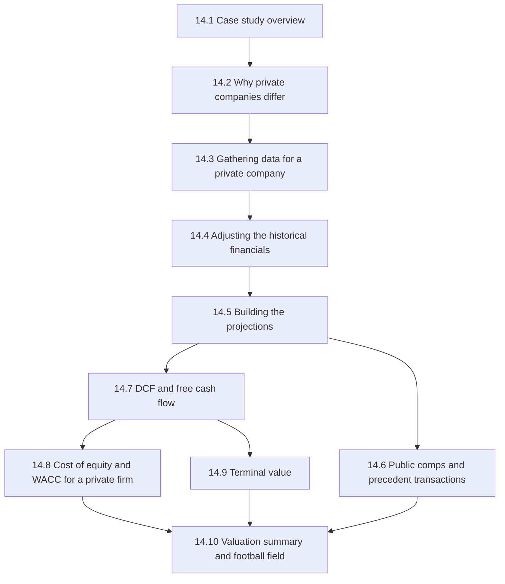
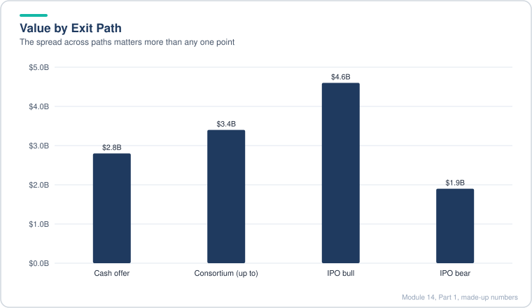
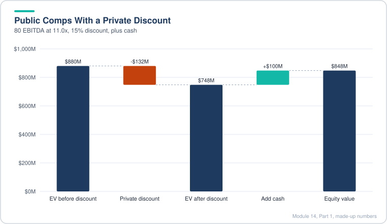
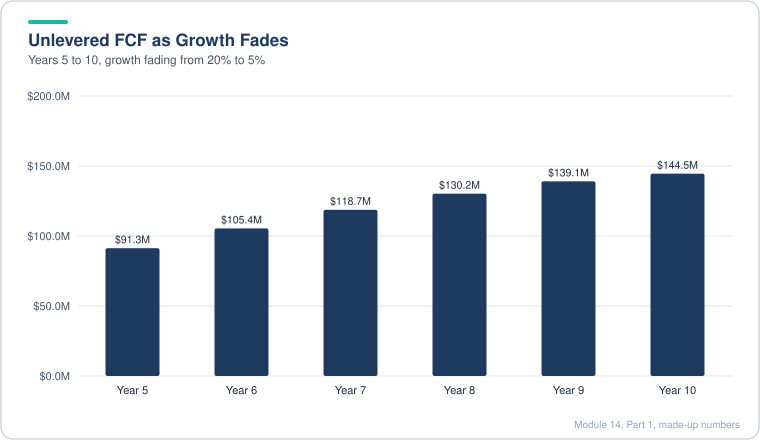
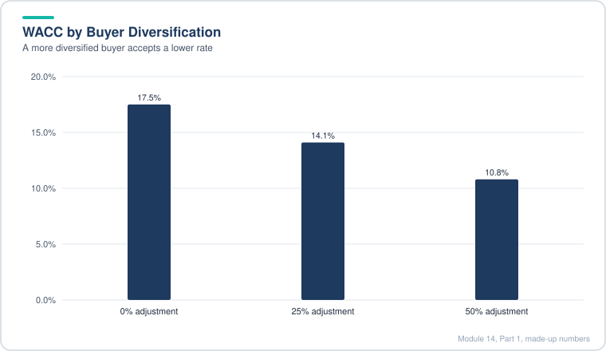
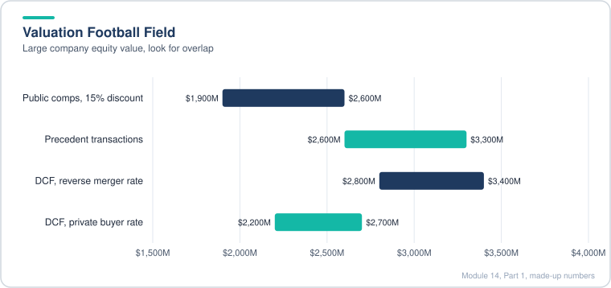
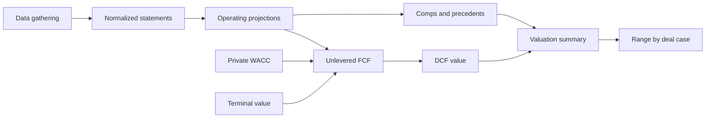
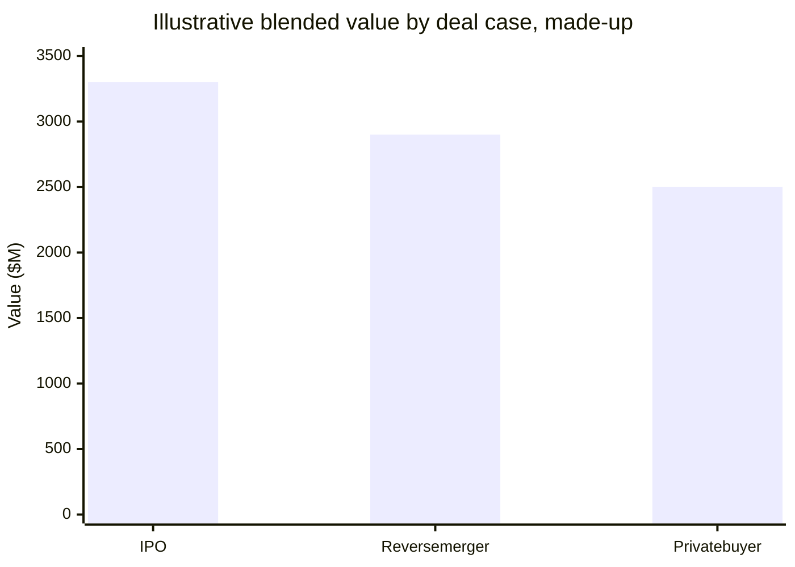
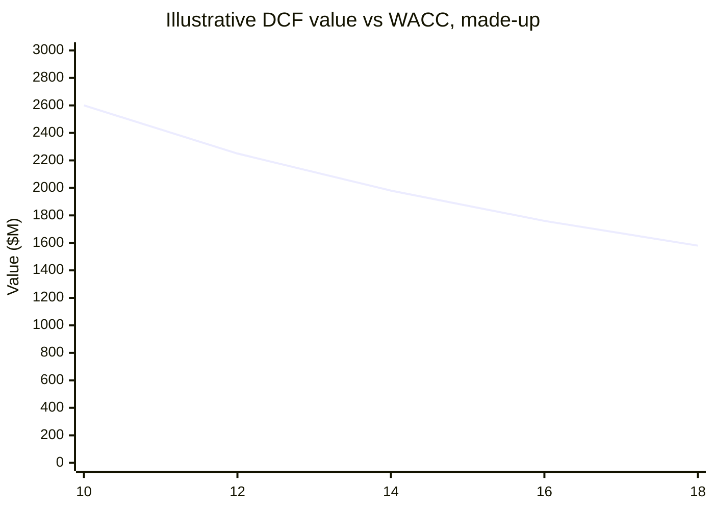
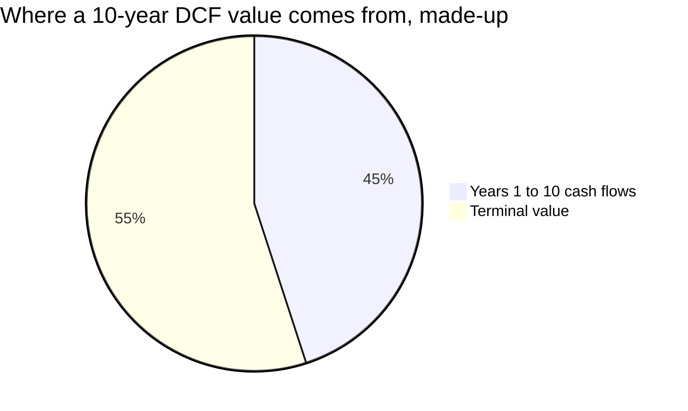

# Module 14, Part 1: Private Companies and IPOs

[← Previous: Module 13, Part 2](13-advanced-lbos-part-2.md) · [Contents](../README.md) · [Next: Module 14, Part 2 →](14-private-companies-and-ipos-part-2.md)

<b>Contents</b>

- [Overview](#overview)
- [Module Map](#module-map)
- [Lessons](#lessons)
  - [14.1 Case Study Overview](#141-case-study-overview)
  - [14.2 Private Company Differences](#142-private-company-differences)
  - [14.3 Data Gathering for Private Companies](#143-data-gathering-for-private-companies)
  - [14.4 Financial Adjustments for Private Companies](#144-financial-adjustments-for-private-companies)
  - [14.5 Financial Projections for a Venture-Backed Company](#145-financial-projections-for-a-venture-backed-company)
  - [14.6 Public Comps and Precedent Transactions](#146-public-comps-and-precedent-transactions)
  - [14.7 DCF: Projecting Free Cash Flow for Private Companies](#147-dcf-projecting-free-cash-flow-for-private-companies)
  - [14.8 Private Company Cost of Equity and WACC](#148-private-company-cost-of-equity-and-wacc)
  - [14.9 Private Company Terminal Value](#149-private-company-terminal-value)
  - [14.10 Private Company Valuation Summary](#1410-private-company-valuation-summary)
- [Diagrams and Charts](#diagrams-and-charts)
- [Excel Model Walkthrough](#excel-model-walkthrough)
- [Interview Questions](#interview-questions)
- [Career Angle](#career-angle)
- [Cheat Sheet](#cheat-sheet)

## Overview

Valuing a private company means fixing its financials, then using public comps, a DCF and a private-company cost of capital to reach a defensible value range, which is the foundation before any IPO or reverse-merger work.

## Module Map

Part 1 covers the valuation side of the module, from the case setup through to the final valuation summary. Part 2 moves on to deal and listing questions.

Read it as a left-to-right build. Adjusted historicals (lesson 14.4) feed the projections (14.5). Projections feed both the market approach (14.6, comps) and the income approach (14.7 to 14.9, DCF). The valuation summary (14.10) pulls the ranges together.

## Lessons

### 14.1 Case Study Overview

- The module is built around one case: a fast-growing, venture-backed mobile messaging app with huge user numbers but a relatively young business model. The company is weighing four paths: an IPO, a reverse merger into a listed portal, a sale to a private buyer, or staying independent.
- A reverse merger looks like a normal merger, except that the seller ends up owning the majority of the combined company. The private firm gets a listing without running a full IPO.
- The valuation puts a rough number on each path. Here the offers and IPO scenarios cluster in a band of a few billion dollars, and the job is to find which is most likely and what the company is really worth.
- The model is quarterly. The deal is assumed to be announced mid-year and to close about a quarter later, so the projections have to start from the latest reported quarter and step forward quarter by quarter.
- The case also uses a small private business as a contrast. A business like that is often run by one or two people, has little formal reporting, and needs much bigger adjustments than a large venture-backed company.

> [!TIP]
> Why this matters outside the case: most real private-company valuations are closer to the small-business end than to the venture-backed end. Before you model anything, decide which kind of private company you have, because the adjustments you need are very different.

**Quick setup, made-up numbers**

| Path | Illustrative value | Note |
|---|---|---|
| Firm cash offer from a listed buyer | $2.8B | Fixed terms, on the table |
| Offer from a private consortium | up to $3.4B | Higher but less certain |
| IPO, bull case | $4.6B | Depends on market |
| IPO, bear case | $1.9B | Depends on market |

*The paths span from 1.9 to 4.6 billion, so the range matters more than one point.*

Values are illustrative only. They show why the range matters more than one point estimate.

### 14.2 Private Company Differences

- Start by classifying the company. There are three rough types: (1) owner-dependent businesses such as a family firm or a single-location restaurant or law practice, where the business is the person; (2) venture-backed startups heading for an exit, which often have a board and a management team but may have little revenue; (3) very large companies that stay private or were taken private, which look and run much like public companies.
- Revenue size does not decide the type. A firm with tens of millions in sales can still be owner-dependent. The question is whether the business survives if one or two key people leave.
- Most of the big differences hit owner-dependent firms. For type 2 the differences are mostly in the discount rate and the cap table. For type 3 there are few differences.
- The purpose of the valuation matters as much as the type. A sale to a financial buyer, a sale to a strategic buyer, a fundraise, a stake sale and an IPO can each give a different answer for the same company.
- Private companies are worth different amounts to different buyers, because synergies and financing differ. Public shares have one price, but a private company's value depends on who is buying.
- Financial statements are often not in GAAP or IFRS form, and owners often take money out as "draws" or dividends rather than salary. You have to rebuild the statements before comparing them to anything.
- Owner-related and personal spending mixed into the business (travel, vehicles, home costs) must be removed or reclassified for any buyer who wants a company that runs without the owner.
- Discounts: many practitioners apply an illiquidity discount for private stakes, often in a wide range. The discount should shrink for larger, steadier and more diversified firms. It is often applied to public comps but not always to precedent deals, which were frequently private targets themselves.
- Discount rate: with no market price or observed capital structure, you need a substitute. Options are the peer median capital structure, an optimal target structure, a circular link from the DCF equity value, or volatility of earnings relative to a market index as a beta proxy.
- Cost of debt for a private firm: use coverage ratios to infer a rating and a spread, or use the yield on any recent debt issue.
- Terminal value is debatable for an owner-dependent business. If the business ends when the owner leaves, a perpetuity may overstate value. A finite life, a liquidation value, or a probability of survival can be more honest.

> [!TIP]
> Key takeaway: the framework for a private company is the same as for a public one. Most of the change is in the inputs (cash flow cleanup, discount rate, terminal value), not in the methods.

**Worked example (made-up): the same firm, two buyers**

| Buyer | Synergies ($M/yr) | Illiquidity discount | Implied value ($M) |
|---|---|---|---|
| Financial buyer | 0 | 20% | 80 |
| Strategic buyer | 10 | 10% | 115 |

Same firm, same base value of $100M before discount and synergies. The gap of $35M is about who gets to use the cash flows, not about the company itself.

> [!WARNING]
> Common mistake: applying a generic 25% private discount to every private company. A large, diversified, well-run firm might need almost none, while a single-owner shop might need a lot, and adding the same blanket discount everywhere hides the real reasons.

### 14.3 Data Gathering for Private Companies

- Data quality sets the ceiling for everything after it. If you do not know revenue, profit and key operating metrics, no valuation method will work. This is the first gate.
- Ideal case: you are an advisor, lender or investor, and the company hands over audited statements, KPIs (users, customers, subscribers, locations), segment and product splits, headcount and governance documents. Ask for all of it, and expect to get less from anyone who is not paying you for a view.
- Realistic case: you are not a client, and the owner has no reason to share anything. Small firms are often poorly organized and keep numbers mostly with their tax accountant.
- Where to look, in order of usefulness for larger private firms and funded startups:
  1. Investor relations pages and public debt filings. A private company that still has public bonds or preferred stock keeps filing full statements.
  2. Business registries in countries that publish financial reports for a small fee.
  3. Retroactive checks: once a company is bought or files for an IPO, the acquirer's filings and any S-1 style prospectus usually contain audited financials and user metrics.
  4. Press releases, interviews, equity research notes and industry databases for rough revenue and user figures.
  5. Paid databases as a last resort. They are expensive and often thin on financials, so check a free or cheap source first.
- The US SEC's EDGAR database mostly shows securities sales for private firms, not financial statements.
- For true small businesses (a restaurant, a salon, a local practice), public data is almost never enough. Interviews with the owner or press coverage may give a revenue hint or location count. Using industry-average margins to invent the numbers is a poor substitute, because it assumes all firms in an industry look the same.
- Emerging markets often need local networking, since online coverage is thin.
- Last-resort method: value a company on a simple operating metric such as revenue or monthly active users, using EV per user or EV per revenue multiples from comparable deals. This is common for tech startups and is less useful for service businesses.
- Build a source log with each data point, where you found it and how much you trust it.

> [!TIP]
> Practical note: "I can't find the financials" is an answer, not a dead end. Say what you could and could not get, then value the company with ranges and explain how much weight each input can bear.

**Worked example (made-up): a crude per-user check**

| Input | Value |
|---|---|
| Monthly active users (assumed, from a press release) | 40M |
| Comparable deal EV per MAU | $25 |
| Implied EV | $1.0B |

If the only source is a single press release, treat the $1.0B as a sanity check, not a point estimate. Widen the range, for example $25 to $40 per user, to show the uncertainty.

> [!WARNING]
> Common mistake: mixing a user metric from one time period with a deal multiple from another, or from a different user definition (daily versus monthly active). Match definitions before you divide.

### 14.4 Financial Adjustments for Private Companies

- The goal is to turn an owner-run set of statements into a version a buyer could accept as a going concern: standard presentation, owner pay made explicit, personal costs removed, a realistic tax rate, and a balance sheet that still ties.
- Five problems to fix, in order:
  1. Presentation. Gross sales, commissions and refunds are often listed in a non-standard way. Rebuild revenue as net sales and group costs into G&A, Sales and Marketing, and R&D.
  2. Owner pay. Owners often take "draws" or dividends instead of salary. Those draws do not appear as an expense, which inflates margins. Reclassify the draw as an operating cost and allocate it across functions based on how the owner spends time.
  3. Intermingled spending. Travel, moving, family payroll and similar items may be personal. Remove what is personal.
  4. Tax rate. The owner's tax rate is not the rate a buyer pays. Use the acquirer's rate for projection years, and leave historical tax as reported.
  5. Re-linking the statements. Once the P&L changes, cash and equity must change with it, or the balance sheet will not balance.
- Judgment calls to flag: capitalizing versus expensing R&D or content costs (keep it simple unless you have the data), and how to split owner time across functions.
- After the changes, the margin falls and the tax line moves, while growth rates often stay similar. Cash and equity can end up different because the reclassified owner pay now carries a tax deduction at the buyer's level.
- Historical tax is usually left alone. Changing past tax would distort the cash balance and is not what a buyer prices.

**Worked example (made-up)**

Reported year: net sales $1,000k, operating expenses $500k excluding owner draw, owner draw $400k. The draw is not in operating expenses, so reported operating margin is 50%.

| Line ($k) | Reported | Adjusted |
|---|---|---|
| Net sales | 1,000 | 1,000 |
| Operating expenses (ex owner) | (500) | (500) |
| Owner pay allocated | 0 | (400) |
| Operating income | 500 | 100 |
| Operating margin | 50% | 10% |

Allocation of the $400k owner pay, using the owner's rough time split: G&A 40%, Sales and Marketing 40%, R&D 20%. That gives G&A $160k, S&M $160k, R&D $80k.

**Balance sheet check (made-up)**

A $30k personal travel expense is removed from the P&L. Removing the expense raises pre-tax income by $30k, so the year-one ending equity rises by the same amount. The cash and equity lines both have to reflect that, or the balance sheet breaks in year one. The fix is to carry the removed expense through the opening equity adjustment, then check that assets equal liabilities plus equity every year.

| Check | Year 1 |
|---|---|
| Total assets | 500 |
| Total liabilities | 80 |
| Equity (as adjusted) | 420 |
| Balance check | 0 |

> [!WARNING]
> Common mistake: changing the income statement and forgetting that cash and equity move with it. Every adjustment should be traced through to the balance sheet before you trust any ratio.

> [!TIP]
> Interview angle: "Why did margins fall when you made the statements more accurate?" Because the owner was earning the margin as pay. Once that pay is an expense, the business margin reflects what it costs to run without the owner.

### 14.5 Financial Projections for a Venture-Backed Company

- This is the big-company version of the same job. The target is a fast-growing mobile messaging business with hundreds of millions of revenue, not a small shop. The tricky parts are getting the historical data and choosing sensible assumptions when management has given no guidance.
- Data source: the history came from the buyer's later financial statements and investor decks, which were released after the deal. Expense categories were left as reported because they were consistent with the country's reporting style and with the buyer's own filings.
- No cash flow statement was disclosed for the target. You have to build a simple one from the balance sheet changes. This is common for private targets.
- Timing: the deal was announced after one quarter had closed and closed after a further two quarters. Pretend the later quarters are unknown and project them. Historical data stops at the last reported quarter.
- Revenue build: the driver is monthly active users (MAU) times revenue per MAU, by revenue line (advertising, games, commerce). Annualize quarterly figures by multiplying by four before comparing to annual numbers, then divide back when you post to the quarterly statements.
- Other revenue is too small to be worth a driver. A simple growth rate is enough.
- Users versus spend: in a saturated home market, growth in revenue per user matters more than growth in user count. Test the assumptions against history. A large jump in spend per user that has already doubled in the last year is aggressive, so use toggles to flex it.
- Expenses: tie employee-driven costs to headcount, using revenue per employee. Headcount = annualized revenue / revenue per employee. As revenue per employee rises slowly, headcount grows more slowly than revenue. Commission paid to content developers is a percent of game revenue.
- Balance sheet and cash flow: working capital change is a percent of the change in annualized revenue. Capex runs a little above D&A. Short-term investments absorb excess cash.
- Interest income: if circular references are on, average the balances. Otherwise use opening balances. Divide the annual rate by four for quarters.
- Outputs: growth falls from high double digits toward the 20s, with operating margins near 50% and EBITDA margins around 52% to 53%. Cash and short-term investments pile up because the business is so cash generative.
- Things the model simplifies: non-controlling interests set to zero; equity-method income ignored in the cash flow. Both are small. Say so if you use the model.

> [!TIP]
> Interview angle: "How do you project a company with no guidance?" Anchor on the operating drivers (users, spend per user, headcount), check each one against the company's own history, and flex them with toggles. Do not anchor on a single margin guess.

**Worked example (made-up)**

| Driver | Q1 | Q2 | Annualized |
|---|---|---|---|
| Monthly active users (M) | 50.0 | 52.0 | |
| Ad revenue per MAU per quarter ($) | 0.40 | 0.44 | |
| Ad revenue in quarter ($M) | 20.0 | 22.9 | |
| Ad revenue per MAU, annualized ($) | 1.60 | 1.76 | |

Annualized revenue per MAU is quarterly x 4. Divide annual revenue by annual average MAU, not by one quarter's MAU, or the number is off by four.

**Headcount (made-up)**

| Year | Annualized revenue ($M) | Revenue per employee ($k) | Headcount |
|---|---|---|---|
| Y1 | 400 | 470 | 851 |
| Y2 | 520 | 490 | 1,061 |

Revenue per employee rises a little, so headcount grows slower than revenue.

> [!WARNING]
> Common mistake: forgetting that a balance sheet item is a point-in-time number. Annualizing a balance (for example, receivables) by multiplying by four is wrong. Only flows get annualized.

### 14.6 Public Comps and Precedent Transactions

- Choosing the peer set is a story decision. The same company can sit in three different peer groups (gaming, internet portals, social networks), and each group trades at very different multiples. Pick the group that best matches how the business will be presented and how a buyer will see it.
- Test the story against the revenue mix. A business with most revenue from games but a large user network can be argued as a game company or as a social network. A seller will want the higher-multiple story. A buyer will want the lower one. Say which side you are on.
- Do not force a national or regional screen when the market is small. Look across several regions and convert everything to one currency at a single date.
- Public comps: the set should be screened by segment, then reviewed by hand. A size screen (for example, under a revenue cap) can be useless when the target is much smaller than any listed peer. If you use one, say why.
- Precedent transactions: list deals in one currency, with the announcement date, the control stake, and the metrics the market actually uses. For user-driven businesses, add enterprise value per monthly active user and per registered user alongside revenue and EBITDA.
- Many user metrics are hard to find. A regression of EV per user against user growth often has a very low R-squared. If the data is patchy, say so and rely on the metrics that you can check.
- On this kind of company, a revenue and EBITDA view often lands well below a user-based view. The gap is a positioning question, not a math error. Positioning matters: the story that gives the higher value is the one you would tell in a sale process, but you need to defend it.
- Public comps for the small business in the module came from a different sector (education services), with a revenue cap and mixed online and offline models. Peers fall into three groups: strong growers with high margins, steady but slow firms, and declining firms. Group them and value the company against the group that fits its profile.
- Private company discount: apply one to public comps where the target is much smaller and less liquid than the peers, often in the 10% to 30% range. Use a lower rate, or none, when the precedent deals were themselves private firms of similar size, because applying a discount on top would double count.
- The rule: a discount should reflect the difference between your company and the set, not a habit. Look at what is actually in your set before you decide.

> [!WARNING]
> Common mistake: applying the same blanket discount to public comps and to precedent deals. Precedents already include a control premium and often private targets, so the right treatment is usually different for each.

**Worked example (made-up)**

Target EBITDA is $80M. Three peer groups give EV/EBITDA of 6x, 11x and 16x. Picking the middle group (11x) gives EV of $880M. Applying a 15% private discount gives $748M, and adding $100M of cash gives equity value of $848M.

| Step | Value ($M) |
|---|---|
| Target EBITDA | 80 |
| Peer multiple used (middle group) | 11.0x |
| Enterprise value before discount | 880 |
| Private discount 15% | (132) |
| Enterprise value after discount | 748 |
| Add cash | 100 |
| Equity value | 848 |

*The 15% private discount takes 132 off the peer-based value before cash is added back.*

| Peer group | EV/EBITDA | Story it supports |
|---|---|---|
| Online gaming | 6x | Downside view for a buyer |
| Internet portals | 11x | Middle view |
| Social networks | 16x | Seller view |

> [!TIP]
> Interview angle: "Which comps do you use?" Name the three peer groups, explain why one fits the business model and the audience, and say what would change your choice.

### 14.7 DCF: Projecting Free Cash Flow for Private Companies

- The mechanics do not change for a private company. Build unlevered free cash flow the normal way: NOPAT, plus D&A, minus capex, minus the increase in working capital. Only the inputs and the horizon change.
- Extend the projection to 10 to 15 years. A five-year forecast often leaves year-5 cash flow growing much faster than any sensible terminal growth rate, and it leaves the terminal value at 75% to 80% of total value. Both signal that the forecast stopped too early.
- Use a fade, not a single normalized year. Project the operating model until the explicit forecast ends, then step down revenue growth by a fixed amount each year until it reaches a floor. Let the EBIT margin decline slowly toward a floor too.
- Floors and fades are built with MAX(). For a growth rate: next growth = MAX(prior growth minus the fade, floor). For a margin: next margin = MAX(prior margin minus the step, floor).
- Stub periods: if the valuation date falls mid-year, only part of the year's cash flow belongs to the buyer. Use the fraction of the year remaining, and set the discount periods using the mid-point of that remaining period.
- Growth rates across a stub are not comparable with full years. Compare the stub with the full prior year, not with a partial year.
- Check the end state: final-year FCF growth should sit near long-run GDP or inflation (2% to 4%). If it is still 10% to 20%, the horizon is too short or the fade is too slow.
- Capex versus D&A: keep capex a bit above D&A in the steady state, and keep working capital tied to the change in revenue, not to the level.
- Exclude optional items such as buying securities, non-controlling interest changes and one-off items from unlevered free cash flow.

> [!TIP]
> Discount rate is a separate question. This lesson leaves the rate open (a placeholder of 10% for the venture case and 15% for the small business). The next lessons pick the real WACC.

**Worked example (made-up)**

Year 5 revenue growth is 20% and the terminal growth is 3%. The fade is 3 points a year with a 4% floor.

| Year | Growth | EBIT margin | Revenue ($M) | Unlevered FCF ($M) |
|---|---|---|---|---|
| 5 | 20.0% | 45% | 300.0 | 91.3 |
| 6 | 17.0% | 44% | 351.0 | 105.4 |
| 7 | 14.0% | 43% | 400.1 | 118.7 |
| 8 | 11.0% | 42% | 444.1 | 130.2 |
| 9 | 8.0% | 41% | 479.6 | 139.1 |
| 10 | 5.0% | 40% | 503.6 | 144.5 |

*Cash flow keeps rising but at a slowing pace as growth fades toward a terminal rate.*

Assumptions behind the FCF column: 25% tax on EBIT, D&A 3% of revenue, capex 3.5% of revenue, and a working capital outflow of 17% of the revenue increase. Year-10 FCF growth is about 4%, close to the revenue growth.

Final-year growth of 5% is much closer to a sensible terminal rate than the 20% you would have had by stopping at year 5. Next step would be to fade the growth to 3% over the following years, or to show the step-down in the terminal value.

> [!WARNING]
> Common mistake: using MIN where you need MAX, or applying the floor to the margin when you meant the growth rate. Check each fade formula against what happens in the last year before you copy it across.

> [!TIP]
> Interview angle: "Why not just grow the last year's cash flow at a constant rate?" Because the explicit forecast is where you see when the company's growth actually slows. A short forecast hides that and pushes too much value into the terminal value.

### 14.8 Private Company Cost of Equity and WACC

- The WACC recipe is the same as for public companies: unlever peer betas, take the median, relever at the target's capital structure, get cost of equity from CAPM, then blend it with the after-tax cost of debt and any preferred stock.
- The hard part is the weights. A private company has no market cap, so you cannot compute the actual debt-to-equity mix. Common fixes:
  1. Use the median or average capital structure of the public peers (the usual choice).
  2. Use an optimal or target structure if you know where the company is heading.
  3. Circular: feed the DCF equity value back into the weights. It works but adds circular references, so avoid it unless there is no other option.
  4. Operating or accounting beta: compare the company's earnings changes with the market's earnings changes. Academic, rarely used in practice.
- Risk-free rate: use the government bond yield of the country where the company operates, not where its shares trade. Match the bond's maturity to the cash flow horizon (10, 20 or 30 years).
- Equity risk premium: where peers sit in different countries, a simple mid-range figure (around 7% in this case) is often more honest than a complicated build-up. A country default spread can be added when the country risk is clearly different.
- Cost of debt: start from the risk-free rate and add a credit spread that matches an implied rating. Coverage ratios and size bands give a rating range. A small or unrated borrower often pays more than the table says.
- Preferred stock: zero if none exists, and say so.
- Diversification: a public company's investors are diversified, so CAPM works. A private buyer may not be. The concept of "total beta" captures that. If the market correlation is R, total beta = unlevered beta / R. If the buyer is well diversified, apply a diversification factor to reduce it.
- For a large venture-backed company that is about to list or merge with a listed firm, the discount rate can stay close to the public-company level. A small firm bought by one wealthy individual or a closely held buyer needs more.
- A range check: if your WACC is 10% to 20%, the answer is plausible for a small private firm. If it is near 2% or near 25%, your inputs are off.

> [!WARNING]
> Common mistake: using a total beta on a diversified buyer, or leaving the diversification factor at 0% and calling the result "the" WACC. Show the sensitivity to the factor instead.

**Worked example (made-up): small private company with a non-diversified buyer**

| Input | Value |
|---|---|
| Median unlevered beta (peers) | 1.00 |
| Market correlation R (R squared = 25%) | 0.50 |
| Total unlevered beta = 1.00 / 0.50 | 2.00 |
| Diversification adjustment (buyer holds other assets) | 25% |
| Adjusted unlevered beta = 2.00 x (1 - 25%) | 1.50 |
| Target debt / equity (peer median, 15% debt) | 17.6% |
| Relevered beta = 1.50 x (1 + 0.75 x 17.6%) | 1.70 |
| Risk-free rate | 4.0% |
| Equity risk premium | 7.0% |
| Cost of equity = 4.0% + 1.70 x 7.0% | 15.9% |
| Pre-tax cost of debt (risk-free + 1.5% spread) | 5.5% |
| After-tax cost of debt (25% tax) | 4.1% |
| Equity weight 85%, debt weight 15% | |
| WACC = 85% x 15.9% + 15% x 4.1% | 14.1% |

Sensitivity to the diversification adjustment (same inputs):

| Diversification adjustment | WACC (approx.) |
|---|---|
| 0% (fully undiversified buyer) | about 17.5% |
| 25% | about 14.1% |
| 50% | about 10.8% |

*A fully undiversified buyer needs a discount rate several points higher than a diversified one.*

> [!TIP]
> Interview angle: "Why does the buyer's diversification change the discount rate?" Because beta measures only the extra risk a stock adds to a diversified portfolio. A concentrated owner feels the full risk, so the right rate for that owner is higher.

### 14.9 Private Company Terminal Value

- Two groups of companies. A large, professionally managed private company can use the standard terminal value tools: the perpetuity growth (Gordon) method and the exit multiple method. Check each against the other by computing the implied growth rate from the multiple and the implied multiple from the growth rate.
- For a large private company, the implied value is an enterprise value and an equity value. There is no per-share value to compute unless you need one for a deal.
- Sensitivity tables: discount rate against terminal growth is the standard pair. For a user-driven business, also flex revenue per user and user growth.
- Pick the exit multiple with care. Public peer multiples can be far too high for a slow-growing terminal period. A multiple that implies 5% to 7% perpetual growth is too rich for a company whose cash flows are already slowing. The implied growth and the multiple must agree.
- Small owner-dependent businesses are different. The terminal value assumes the business goes on forever, which requires a successor who can run it. That often fails. Three alternative approaches:
  1. Going-concern discount: take the standard terminal value and cut it by a judgment-based percentage (for example 25%) to reflect the risk the business stops when the owner leaves. Sanity-check the discount by seeing how much value comes from the years after the owner would plausibly leave.
  2. Cease-operations: project cash flows further (for example to year 25) with a steady decline rate, then stop. Use MAX(prior cash flow times (1 - decline), 0) so cash flows never go negative. Sum their discounted values as the terminal value.
  3. Liquidation value: net tangible assets (total assets less intangibles and goodwill, less liabilities), rolled forward to the end of the forecast by adding cumulative cash flows, then discounted with a further haircut.
- Show all three side by side. The range across methods is more useful than a single number, and you can say what the assumptions have to be for each one.

> [!TIP]
> A point worth keeping: if a business cannot be run without its founder, the terminal value question is really a succession question. Value the cash flows that exist without the owner, and treat the rest as a separate, risky option.

**Worked example (made-up, large private company)**

| Input | Value |
|---|---|
| Final-year unlevered FCF ($M) | 40 |
| Terminal growth | 2.0% |
| WACC | 11.0% |
| Gordon TV = 40 x 1.02 / (11% - 2%) | 453 |
| Final-year EBITDA ($M) | 60 |
| Implied exit multiple = 453 / 60 | 7.6x |

If the peer exit multiple were 14x, the implied EV would be 840, implying about 6% perpetual growth. That gap is a warning sign that the multiple or the growth assumption is off.

**Worked example (made-up, owner-dependent business, $M)**

| Method | Value |
|---|---|
| Gordon TV, no discount | 300 |
| Gordon TV, 25% going-concern discount | 225 |
| Gordon TV, 100% discount (no terminal value at all) | 0 |
| Cease-operations value (10% annual decline to year 25) | 160 |
| Liquidation value: net tangible assets 1.4 plus cumulative cash years 11 to 15 of 1.6, less a 20% haircut | 2.4 |

The total business value sits in a fairly narrow range across methods, because the explicit forecast carries most of the value. That is the point of checking all three.

> [!WARNING]
> Common mistake: taking a liquidation value at year 10 and treating it as the year-15 terminal value without rolling it forward and discounting it.

### 14.10 Private Company Valuation Summary

- The summary page looks like any other: public comps, precedent transactions and the DCF, each shown as a low-to-high range, with the football field to compare them. Private-company differences are these:
  1. No per-share value. Stop at enterprise value and equity value.
  2. A private company discount column. Use it selectively, not everywhere.
  3. Results by deal case. The same company is worth different amounts to an IPO, a sale to a listed buyer and a sale to a private buyer.
- Where to apply the private discount:
  - Public comps: yes, when the target is smaller and less liquid than the peers. A mid-range discount (around 10% to 30% is common) is typical. For a listed-company outcome, such as an IPO, the discount can be zero.
  - Precedent transactions: usually no, when the precedent targets were themselves large or private. The control premium is already in the multiple. Apply a discount only when the precedent set is clearly bigger and more liquid than your target, as with the small business case.
  - DCF: usually no extra discount. The higher discount rate for a private, non-diversified buyer already does that job. Adding a discount on top would count the same risk twice.
- Range width is a warning. If the revenue multiple range runs from 1.5x to 85x, the set or the metric is wrong. Look at the 25th to 75th percentile, not only the min and max, and ask whether the metric fits the business.
- User-based metrics (EV per monthly active user) can give a higher and more useful answer when the market values the business on users. Convert currency at one FX rate and state it.
- Net debt bridge: enterprise value to equity value means adding cash and subtracting debt, preferred stock and non-controlling interest. For a P/E multiple, go to equity value directly and back into EV if you need it.
- Conclusions: derive the range from where the methods overlap. Show the midpoint and a rationale, and say which method you lean on. Then compare the answer across buyers and say which buyer pays the most, and why.
- For a single-owner business, the summary is a decision aid as well as a value. Compare the present value of the cash the business can produce within the owner's planned horizon with the price a buyer would pay now. If the owner plans to stay only a few years, a sale can beat running it. If the owner plans to stay for decades, growing the business may beat selling it.

> [!TIP]
> Interview angle: "Why is the IPO value higher than the private buyer value for the same company?" Because the IPO investor base is broad and diversified, so the discount rate is lower and no illiquidity discount is needed for the DCF. A private, concentrated buyer needs a higher return and pays less.

**Worked example (made-up, large company, $M equity value)**

| Method | Low | High | Note |
|---|---|---|---|
| Public comps, 15% private discount | 1,900 | 2,600 | Discount applied |
| Precedent transactions, no discount | 2,600 | 3,300 | Control premium included |
| DCF, reverse merger discount rate | 2,800 | 3,400 | Lower discount rate |
| DCF, private buyer discount rate | 2,200 | 2,700 | Higher discount rate |

*The reverse merger overlap sits around 2,800 to 3,000, and the highest bar is not the answer.*

Read across the methods: the overlap for a reverse merger case is about 2,800 to 3,000, and the blended midpoint is around 2,900. Under a private buyer case the DCF drops, so the blended answer falls to about 2,400 to 2,600.

**Worked example (made-up, small owner-run business, $M)**

| Method | Low | High |
|---|---|---|
| Public comps with 30% discount | 1.0 | 1.6 |
| Precedent transactions with 30% discount | 1.1 | 1.7 |
| DCF with cease-operations and going-concern checks | 1.7 | 2.5 |

Overlap is about 1.5 to 2.0. A reasonable point estimate is the middle, about 1.75.

**Owner's sell-or-hold check (made-up)**

| Option | Value ($M) |
|---|---|
| PV of cash flows through year 15 | 1.3 |
| Price a buyer might pay now | 1.5 to 2.0 |

If the owner does not plan to run the business for another 10 years, a sale at the top of that range beats holding. If the owner plans to run it for 20 or more years, growing it first (for example, to a revenue level where a normal EBITDA multiple applies) can add more value than selling now.

> [!WARNING]
> Common mistake: showing one blended number without the ranges, or using the highest method as the answer. A football field is for seeing where methods disagree, not for picking the biggest bar.

## Diagrams and Charts

### How the Lessons Feed the Valuation

### Value by Deal Case, Illustrative (Made-Up $M)

### Discount Rate Versus Value, Illustrative (Made-Up)

### Share of DCF Value from Terminal Value, Illustrative (Made-Up)

## Excel Model Walkthrough

The Excel files come in pairs: a "Before" file (the starting shell with the logic to build) and an "After" file (the finished model). Each lesson has its own pair, plus one combined case workbook that holds the whole case analysis.

**Case workbook tabs (reverse-merger model)**

| Tab | What it does |
|---|---|
| NOTES | Errors found in the source case, and private-company differences |
| Inputs | Toggles: buyer choice, valuation case (IPO, reverse merger, private consortium), private discount, discount rate, terminal growth |
| Seller | The target's financials: quarterly and annual, adjusted |
| Acquirer | The buyer's financials, used for the merger model |
| Merger-Model | Purchase price, new shares, pro forma EPS |
| BS-Combination | Balance sheet combination with the purchase adjustments |
| Synergies | Revenue and cost synergies with phase-in |
| Contribution | Relative contribution of each side to revenue, EBITDA, net income and equity value |
| Exchange-Ratios | Exchange ratio and implied ownership |
| WACC | Peer unlevered beta, median capital structure, total beta option, cost of equity, WACC |
| Public Comps | Trading multiples by peer group, with the private discount applied |
| MA-Comps | Precedent deals with EV per user, EV/revenue and EV/EBITDA |
| IPO-Model | Offer price, share count, proceeds and post-IPO ownership |
| ValSum | Valuation summary table with min, 25th, median, 75th, max |
| ValGraph | Football field chart |

**Key links**

- Inputs drive everything. The valuation case switch changes the discount rate, the private discount and which sensitivity table is shown.
- Seller pulls quarterly history and projects forward quarters. Annual figures are sums of quarters, with a stub for the part-year after the announcement.
- Projections use drivers, not plugs: users times revenue per user for revenue, headcount from revenue per employee for costs, working capital as a percent of the change in revenue, and cash as the balancing item.
- WACC uses the peer median weights, and the private-buyer case adds a total-beta step.
- ValSum takes the multiples from comps and precedents, applies the discount where the case calls for it, and converts enterprise value to equity value by adding cash and subtracting debt.

**Key formulas (described)**

- Unlevered FCF = (EBIT x (1 - tax)) + D&A - capex - increase in working capital. Tax uses the buyer's rate in projection years.
- Revenue per user, annualized = quarterly revenue x 4 / average MAU for the year. Divide by the same basis when you go back.
- Headcount = annualized revenue / revenue per employee.
- Terminal value (Gordon) = final FCF x (1 + g) / (WACC - g), with a mid-year adjustment as the model uses it.
- Growth fade = MAX(prior growth - step, floor). Margin fade = MAX(prior margin - step, floor).
- Total beta = unlevered beta / correlation R, then reduced by the diversification factor for a non-diversified buyer.
- Equity value = enterprise value + cash - debt - preferred - non-controlling interest.

> [!TIP]
> The "Before" and "After" files are the best way to practise. Build the Before file from the notes, then compare it cell by cell with the After file.

## Interview Questions

<b>1. How is valuing a private company different from a public one?</b>

The method is the same. The inputs change: there is no market price or observed capital structure, the financials often need restating, owner pay and personal costs must be cleaned up, and the discount rate and terminal value need judgment.

<b>2. How do you set the capital structure for a private company's WACC?</b>

Use the peer median (or an industry or target structure). Avoid a circular link to the DCF output unless you have no other choice.

<b>3. What is a private company or illiquidity discount, and when do you apply it?</b>

It reflects that the shares cannot be sold easily. Apply it to public comps where the target is smaller and less liquid. Usually skip it on precedent deals and on a DCF that already uses a higher discount rate for a private buyer.

<b>4. Why would a precedent transaction multiple not need a discount?</b>

It already includes a control premium and often reflects private targets of similar size. A discount on top would double count.

<b>5. Why extend the DCF to 10 to 15 years for a private company?</b>

A short forecast leaves growth too high in the last year and puts 75% or more of value in the terminal value. A longer fade gives a more defensible final year.

<b>6. How do you handle owner salary in a small business's statements?</b>

Reclassify owner draws as an operating expense, allocate it across functions, and remove personal costs. Then check whether margins look realistic.

<b>7. What is total beta and when do you use it?</b>

Total beta = unlevered beta divided by the market correlation R. It captures the risk a non-diversified owner bears. Use it for a concentrated buyer, and adjust for any other holdings the buyer has.

<b>8. What is a going-concern discount?</b>

A haircut to terminal value to reflect the risk the business stops when the owner leaves.

<b>9. What are the alternatives to a Gordon terminal value for an owner-run business?</b>

A cease-operations value (cash flows that decline to zero), and a liquidation value (net tangible assets rolled forward and discounted).

<b>10. How do you check a terminal value?</b>

Compare the implied exit multiple with the growth rate. If the multiple implies growth above long-run GDP or inflation, one of them is wrong.

<b>11. Why can a public comp set have a very wide multiple range?</b>

The peers may not share a business model, the metric may not fit, or the set may mix growth stories. Narrow the set or change the metric.

<b>12. How do you choose between peer groups?</b>

Pick the group that matches how the business is presented and how buyers see it. Test the revenue mix against each group, and say what would change your view.

<b>13. Why is the IPO value often the highest?</b>

It sells to a broad, diversified investor base, so the discount rate is lower and no illiquidity discount is needed for the DCF.

<b>14. What do you do when a company's history is incomplete?</b>

Work from the drivers you can check, build a range, say which inputs are weakest, and do a sanity check with a crude metric such as EV per user.

<b>15. Why might a small business owner sell now rather than hold?</b>

If the cash flows within the owner's planned horizon are worth less than a buyer would pay now, selling beats holding. If the owner plans a long run, growth can beat a sale.

<b>16. Why do you adjust the tax rate for a private company?</b>

The owner's personal rate is not the rate a buyer pays. Projection years use the buyer's rate, and historical tax stays as reported.

<b>17. What does a balance sheet check tell you after restating the P&L?</b>

That the cash and equity lines moved with the restated net income. If the balance sheet breaks, the restatement is incomplete.

<b>18. What is a football field?</b>

A chart with one horizontal bar per valuation method, showing its low and high range. The overlap is where the value is most defensible.

## Career Angle

**Skills this module builds, mapped to real analyst work.**

| Module skill | Where it shows up in analyst work |
|---|---|
| Normalizing statements and removing one-offs | Fair-value work and monthly pricing reviews rest on clean inputs |
| Projection drivers and quarterly-to-annual logic | FP&A forecasting (for example, cutting a forecast file from about 45 to 10 minutes) and CFO reporting data prep |
| Discount rate and risk premia | Pricing and valuing a large MBS and whole-loan book with spreads and discount curves |
| Terminal value checks and sensitivity tables | Scenario analysis for product valuations and how sensitive a result is to one input |
| Comps and precedents | Market context for capital markets, corporate development and private-credit work |
| Football field and ranges | Presenting value ranges to a pricing review audience |

**Talking points that can truthfully be used (framed as studied or built in coursework).**

1. "I studied a full private-company valuation case, including normalizing owner-run statements, a 10-year DCF with a fade, a private discount rate and a football field. I can walk through each step and explain where the value is most sensitive."
2. "I worked through why a private buyer's diversification changes the discount rate, and how that changes value across IPO, reverse merger and private sale cases."
3. "On the job I have used the same habits: separate recurring from one-time items, check the implied multiple against the growth rate, and show value as a range. The case study gave me a structure for doing this on valuation work, which I apply to my fair-value and pricing reviews."

> [!WARNING]
> Keep it honest: this material is coursework. Do not describe it as deal experience, and do not claim to have valued a private company professionally unless a real engagement says so. Fair-value work on MBS and loans is not private equity or company valuation.

**Target-role fit.** Valuation, capital markets and corporate development. For corporate development and valuation interviews, lead with the normalization and DCF-range story, then tie it back to the MBS valuation experience.

## Cheat Sheet

| Topic | Rule of thumb |
|---|---|
| Company type | Owner-dependent, venture-backed, or large and professionally run |
| Restating | Owner pay is an expense. Remove personal costs. Use the buyer's tax rate in projections |
| Balance check | Restated P&L must flow into cash and equity, or the balance sheet breaks |
| Data gaps | Use the best source you can, build a range, and say which inputs are weakest |
| Unlevered FCF | EBIT x (1 - t) + D&A - capex - increase in NWC |
| Horizon | 10 to 15 years for private companies, so the final-year growth is near 2% to 4% |
| Fade | Growth = MAX(prior - step, floor). Margin = MAX(prior - step, floor) |
| Capital structure | Use the peer median when the company has no market cap |
| Risk-free rate | Government bond of the country where the company operates |
| Total beta | Unlevered beta / R. Then reduce for buyer diversification |
| Private discount, public comps | Often 10% to 30%, based on size and liquidity. Zero for a listed outcome |
| Private discount, precedents | Usually none, because the control premium and private targets are already in the set |
| Private discount, DCF | Usually none extra. Use a higher discount rate for a concentrated buyer |
| Terminal value | Gordon: FCF x (1 + g) / (r - g). Check the implied exit multiple |
| Owner-run terminal value | Going-concern discount, cease-operations value, or liquidation value |
| Cross-check | Multiple implies growth. Growth implies multiple. Both should agree |
| Football field | Look for overlap, not the highest bar |
| Owner decision | Compare PV of cash flows within the owner's horizon with today's sale price |

---

[← Previous: Module 13, Part 2](13-advanced-lbos-part-2.md) · [Contents](../README.md) · [Next: Module 14, Part 2 →](14-private-companies-and-ipos-part-2.md)
