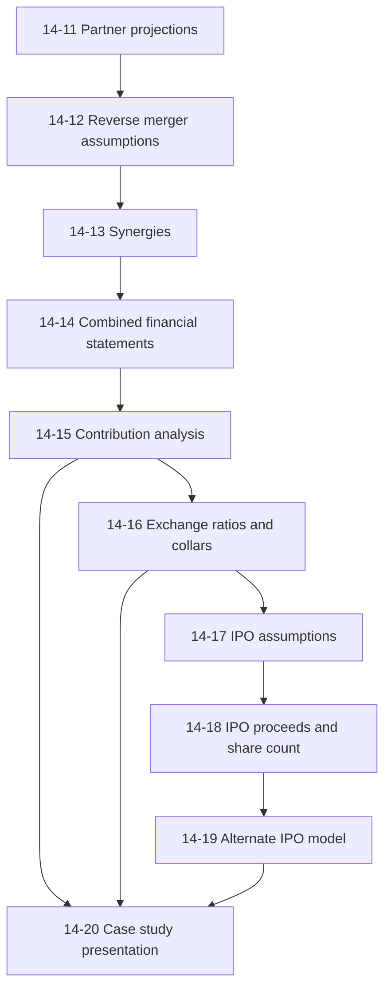
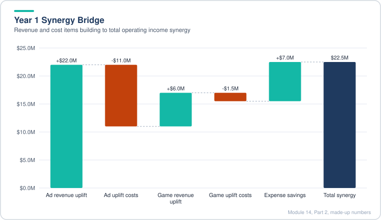
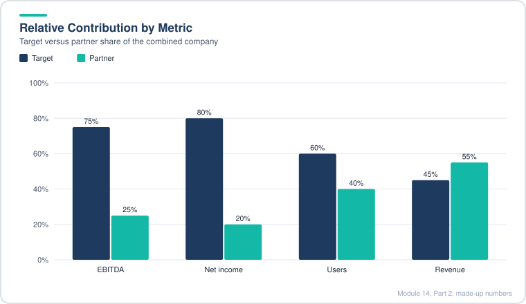
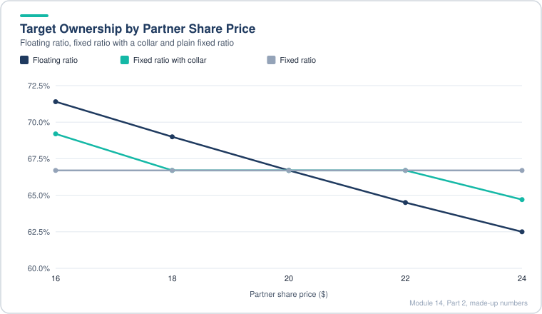
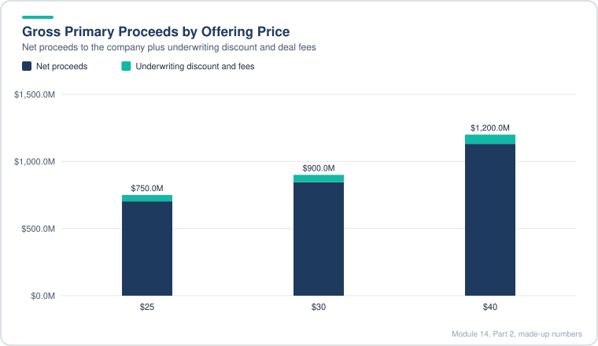
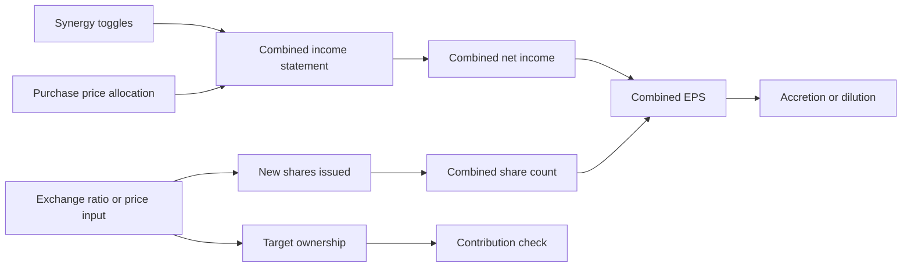
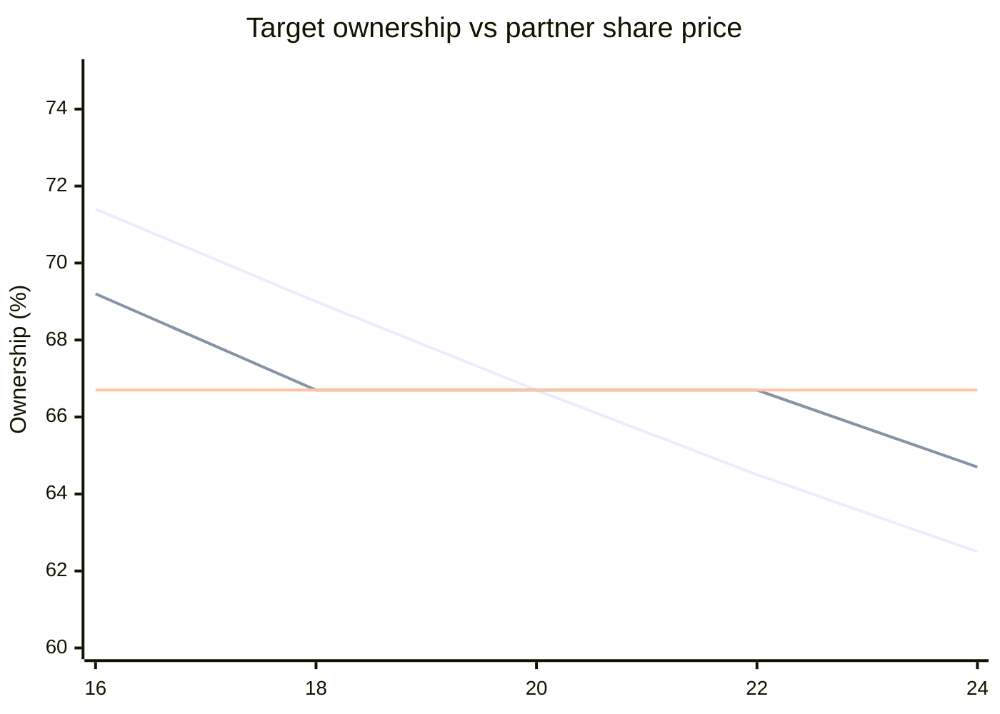
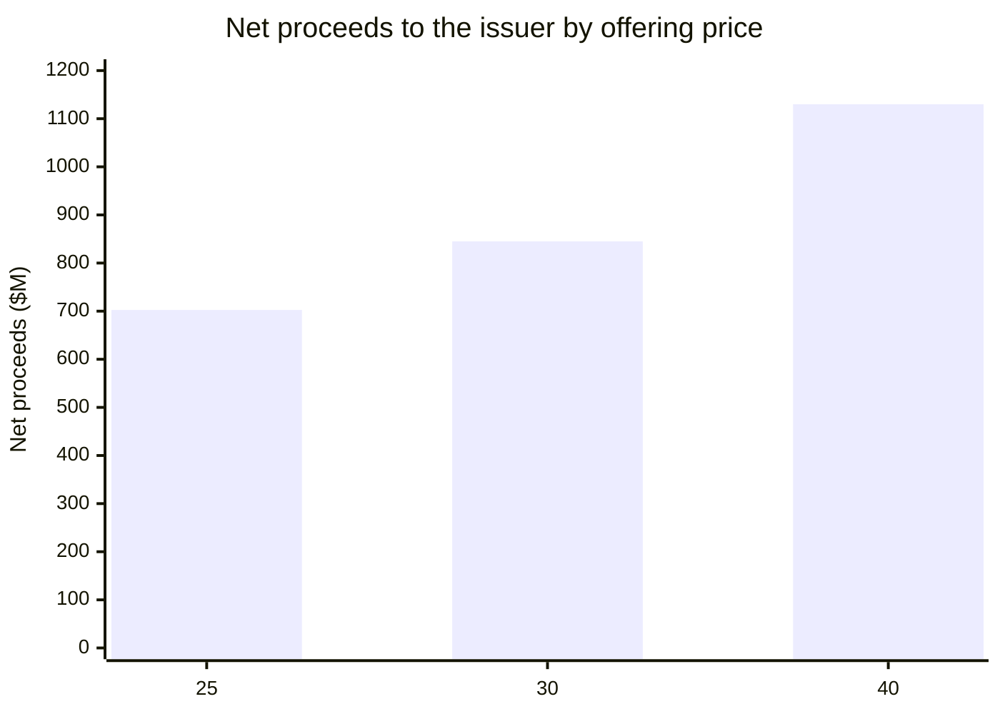

# Module 14, Part 2: Private Companies and IPOs

[← Previous: Module 14, Part 1](14-private-companies-and-ipos-part-1.md) · [Contents](../README.md) · [Next: Module 15, Part 1 →](15-equity-debt-and-convertibles-part-1.md)

<b>Contents</b>

- [Overview](#overview)
- [Module Map](#module-map)
- [Lessons](#lessons)
  - [14.11 Financial Projections for the Listed Partner](#1411-financial-projections-for-the-listed-partner)
  - [14.12 Reverse Merger Transaction Assumptions](#1412-reverse-merger-transaction-assumptions)
  - [14.13 Synergies](#1413-synergies)
  - [14.14 Financial Statement Combination and Accretion / Dilution](#1414-financial-statement-combination-and-accretion--dilution)
  - [14.15 Relative Contribution Analysis](#1415-relative-contribution-analysis)
  - [14.16 Exchange Ratios and Collar Analysis](#1416-exchange-ratios-and-collar-analysis)
  - [14.17 IPO Model Assumptions](#1417-ipo-model-assumptions)
  - [14.18 IPO Proceeds and Implied Valuation Multiples](#1418-ipo-proceeds-and-implied-valuation-multiples)
  - [14.19 Alternate IPO Model (Fixed Shares, Offering Price Driven)](#1419-alternate-ipo-model-fixed-shares-offering-price-driven)
  - [14.20 Case Study Presentation](#1420-case-study-presentation)
- [Diagrams and Charts](#diagrams-and-charts)
- [Excel Model Walkthrough](#excel-model-walkthrough)
- [Interview Questions](#interview-questions)
- [Career Angle](#career-angle)
- [Cheat Sheet](#cheat-sheet)

## Overview

Once you know what a private company is worth, the next questions are how it gets to the public market: through a reverse merger with a listed partner (with exchange ratios, collars and synergies deciding who owns what) or through an IPO (where the proceeds, the share price and the dilution decide what the deal is worth to existing owners).

Part 2 covers lessons 14.11 to 14.20. Part 1 valued the target on its own. Part 2 puts the target next to a listed partner, builds the combined company, and then tests the two ways of going public.

## Module Map

Read it as two branches that meet at the end. Lessons 11 to 16 follow the reverse merger: forecast the partner, set the deal terms, add synergies, combine the statements, check who contributes what, then convert it into an ownership split. Lessons 17 to 19 follow the IPO path. Lesson 20 brings both into one recommendation.

## Lessons

### 14.11 Financial Projections for the Listed Partner

- The reverse-merger partner is a listed company, so its projections matter for two reasons. You need its numbers to build the combined company, and you need its earnings to judge the deal. The fact that the partner issues the new shares does not automatically make it the economic buyer.
- In a reverse merger the target's owners usually end up with most of the combined company, often 75% to 80% in this case, while the listed partner's holders keep 20% to 25%. Legal form and economic control can point in different directions. Keep that gap in mind for the rest of the module.
- The data is thin. The partner's audited annual reports are useful mainly for the share count, the options outstanding and their exercise prices. Its income statement is presented differently from the target's, so the audited statements cannot simply be lined up with the target's numbers.
- Build from the best available pieces: quarterly statements in the consolidated and separate formats, the most recent earnings presentation (for headcount and key metrics), and third-party estimates such as an industry article giving the number of monthly users.
- Only the historical periods up to the last reported quarter count as actual. Anything after that is a projection, even if it happened in real life. This is a deliberate choice to model the deal as if it had not yet been agreed, so do not peek at later results.
- The banks advising the partner supply a few assumptions: revenue lines, some expenses and a short run of projected balance sheets. Entering those assumptions by hand is good practice, but keep the balance sheet simple if the deal only needs a few quarters.

**How the forecast is built, in outline**

| Driver | How it is set | Why |
|---|---|---|
| Users | Falls by a fixed amount each quarter | Used later for synergy uplift, not for revenue |
| Advertising revenue | Quarter-by-quarter growth rates, with the weak quarters kept weak | Follows the historical seasonality |
| Other revenue lines | Flat or small changes | Small share of revenue |
| Headcount | Revenue divided by annualized revenue per employee | Ties staffing to output |
| Labor cost | Headcount times cost per head, rising slowly | Keeps costs rising with pay |
| Other expenses | Average of the last five quarters as a percent of revenue | Their history is too noisy to trust a trend |
| Commissions | Trend upward as a percent of revenue | Clear, steady rise in history |

**Worked example (made-up numbers, $M per quarter)**

| Line | Q1 | Q2 | Q3 |
|---|---|---|---|
| Advertising | 400 | 420 | 395 |
| Games | 90 | 80 | 75 |
| Other revenue | 60 | 61 | 62 |
| Total revenue | 550 | 561 | 532 |
| Revenue per employee, annualized ($K) | 340 | 325 | 330 |
| Headcount | 1,617 | 1,726 | 1,612 |

Notice that revenue per employee and headcount move in opposite directions by design. Headcount is an output of the revenue assumption, not a separate guess.

> [!WARNING]
> Common mistake: letting a small line item drive the model with a huge percentage swing. If a line jumps from 3% to 300% in a typed formula, it is a typing error, and it will flow straight to the totals. Check every growth input for the decimal point before you trust the output.

> [!TIP]
> Real-world note: when a partner's margins fall while its revenue rises, the cause is usually rising operating expenses. Find the expense line that is growing fastest before you accept any margin assumption.

### 14.12 Reverse Merger Transaction Assumptions

- A reverse merger is a faster, cheaper way to get listed. A public shell (or, as here, a real public company) issues new shares to buy the private company, and the private owners end up with all or most of the combined company. Because no new money is raised from outside investors, the regulatory process is much lighter than a full IPO. Real deals take months rather than the 30 days often quoted, because a real operating company still needs audits, filings and sign-offs.
- Why private owners want a listing: a public stock is easier to value, so it is easier to pay employees in shares; it is easier to raise capital later; the company can use its own shares to buy other companies; and the private-company discount (for lack of liquidity and information) goes away, so the multiples a market applies can rise.
- A real public partner changes the picture. The partner keeps a stake in the combined company, but the ownership flips so that the partner ends up the minority. That is why the deal is called a reverse merger even though the partner is nominally the acquirer.
- The deal is all stock. The model still keeps switches for cash and debt so the structure can be changed later, but the base case uses no excess cash, no new debt and no refinancing of the target's debt.
- Purchase price metrics: because the target has no share price, you cannot read its market value. Instead you value the deal at the purchase price and compute implied multiples: purchase enterprise value divided by a point-in-time user count (not a cumulative monthly figure), EV to trailing EBITDA, EV to trailing revenue, equity value to trailing net income, and the same measures on forward numbers.
- Funds required: the equity purchase price, plus advisory fees (a percentage of equity purchase price), legal and other fixed fees, and financing fees (a percentage of debt actually issued). Refinancing and excess cash are optional lines that are zero in the base case.
- Cash available: take the combined cash balance at the latest balance sheet date and subtract a minimum operating cash balance. The minimum is a judgment call; you can benchmark it against peers as a percent of revenue or market cap. Only cash above that line can fund the deal.
- The funding waterfall: use cash first, up to the maximum available; then debt; then stock. A MIN formula caps the cash used so the model never spends more than is available. If fees exceed the available cash, the model must raise more debt or find another source, and the sources and uses should show that.
- Cost of each source: the cost of cash is the interest income earned on average cash, annualized. The cost of debt is interest expense on the financial liabilities, annualized and then after tax. The cost of stock is a rough earnings yield, the acquirer's net income divided by its equity value. Weight each cost by its share of funding. Compare that blended cost with the target's own earnings yield (target net income divided by purchase equity value). If the blended cost is far below the target's yield, the deal looks accretive on paper.
- Known weak spots: the balance sheet projections only run a couple of quarters ahead, so the cost of cash and debt is based on quarterly figures, and the net income yield mixes periods. These are rough estimates, fine for a first look but not for a fairness opinion. The more important open question is which side is the economic buyer.

**Worked example (made-up, $M)**

| Step | Value |
|---|---|
| Equity purchase price | 3,000 |
| Advisory fee at 1% | 30 |
| Legal and other fixed fees | 3 |
| Financing fees (no debt issued) | 0 |
| Total funds required | 3,033 |
| Combined cash, latest quarter | 1,200 |
| Minimum operating cash | 400 |
| Maximum cash available | 800 |
| Cash used (MIN of need and available) | 33 |
| Debt issued | 0 |
| Stock issued | 3,000 |

Total sources equal total uses (33 plus 3,000 of stock). The 800 of available cash is a ceiling, not a target.

**Quick cost-of-funding check (made-up)**

| Source | Pre-tax cost | Tax rate | After-tax cost | Weight |
|---|---|---|---|---|
| Cash (interest income) | 3.5% | 25% | 2.6% | 1% |
| Debt | 8.0% | 25% | 6.0% | 0% |
| Stock (earnings yield) | 9.0% | n/a | 9.0% | 99% |

Target earnings yield: target net income of 150 divided by purchase equity value of 3,000 is 5.0%. Here the blended cost (about 9%) sits above the target's yield (5%), so the simple test points the other way from a typical "cheap stock" deal. The numbers are invented to show the mechanics. Read the result as "the test depends on inputs you have not yet verified", not as a verdict.

> [!WARNING]
> Common mistake: treating the implied multiples as a valuation. They are a check on the price you are paying, not an independent value of the target. Compare them with the public comps and the earlier valuation range from Part 1.

> [!WARNING]
> Common mistake: mixing a point-in-time user count with a cumulative monthly figure. Users are a stock (a count at a date), not a flow, so use the number at the date, not the sum of monthly figures.

> [!TIP]
> Intuition on the buyer question: the legal acquirer writes the check on paper, but the owner of the majority of shares is the economic buyer. Before you judge accretion or value, decide which side controls the combined company, because that side's cost of capital and share count set the test.

#### 14.12, Part 2: Sources, Uses, and Purchase Price Allocation

- Uses of funds: equity purchase price, advisory and legal fees, capitalized financing fees, and the target's debt assumed. Assumed debt should come from the balance sheet at the closing date, minus any debt refinanced at closing. Using a different quarter from the purchase multiples creates a timing mismatch. You cannot remove it fully, and you should say so in the model.
- Sources of funds: excess cash, cash used, new debt, new stock, target debt assumed, and additional cash for fees (capped by the maximum cash available). The sources must equal the uses. Ownership is then the buyer's diluted shares divided by the combined count. Here the partner keeps about 24% and the target holders own about 76%.
- Purchase price allocation starts with the equity purchase price and subtracts the target's common book value. Only common shareholders' equity is written off when a company is more than half acquired, so non-controlling interests and preferred stock are handled separately. Existing goodwill is written off, then assets are written up, a deferred tax liability is added on the write-ups, and the residual is goodwill.
- Write-ups: the case assumes a small PP&E write-up depreciated over about five years (servers and computers have short lives), and an intangible write-up of about 10% to 15% of the excess purchase price, based on comparable mobile-messaging deals. Intangibles are amortized over about eight years, the midpoint of the comparables' 7 and 9 year lives.
- Deferred tax liability equals the total write-up times the buyer's tax rate. Goodwill is the residual, which here comes to roughly 84% of total consideration, consistent with comparable deals.
- These PPA choices rarely change the answer. The deal does not hinge on whether intangibles are 10% or 15% of the price. Spend your time on the exchange ratio, relative contribution and accretion, which decide the outcome.

> [!WARNING]
> Common mistake: writing off the target's preferred stock or non-controlling interests in the same way as common equity. The treatment differs, and the base case only writes off common equity in a deal this size.

> [!TIP]
> Real-world note: the PPA is the part of a merger model that changes the reported earnings most through amortization, but it has no cash effect. Separate the cash view from the GAAP view in your interview answer.

### 14.13 Synergies

- The lesson is moved up in the sequence on purpose. The combined income statement needs the synergy lines, so they have to be built first.
- The core problem is that there is almost no hard data on synergies. Press releases are mostly vague, and a few news articles give only the strategic story. Treat any synergy number as a judgment, then show it as a range.
- Read the strategic logic before the numbers. The partner (the weaker company, struggling with the move from desktop to mobile, with falling users and falling ad revenue) gets most of the short-term benefit: it can route its users onto the target's mobile platform and borrow the target's monetization skills. The target gets less in the short run. That is the reverse of a normal acquisition, and it explains why the buyer on paper is not the economic winner.
- The brief gave guardrails: revenue synergies should come from ad revenue per user and game revenue per user, cost savings should come from rent, advertising and outsourced services, and the net effect in the first full year should be well below a set ceiling. Use the ceiling as a sanity check on your output.
- Timing: synergies start only after the deal closes. A deal closing in the third quarter means the first synergy quarter is the fourth quarter. Do not include synergies before the close date.
- Annualize carefully. Per-user figures are usually annual, but the model is quarterly. Annualize the quarterly revenue with a periods-per-year multiplier, then divide back to a quarter when you add the synergy to the quarterly statements. Mixing the two is the most common error in this lesson.

**Revenue synergies**

- Advertising: assume a small uplift to the partner's ad revenue per user, starting at about 3% and rising to about 5% over the next few quarters. Multiply the uplift by the partner's annualized ad revenue per user and by its user count, then divide by four for the quarter.
- Margin on the extra ad revenue: the partner's own operating margin is low, and much of its cost base (rent, most advertising, other overhead) has nothing to do with extra monetization. The case uses a higher margin of about 50% on the uplift, with the cost as the remainder. That is a judgment call and should be flagged as one.
- Games: the target earns far more game revenue per monthly active user than the partner earns per unique visitor. Assume the partner can capture a percentage of the target's annualized game revenue per user, not a percentage increase on its own figure. The percentages are small (about 5% rising to 7.5%). The margin on this uplift is higher, about 75%, because it mostly needs commissions and no extra headcount.

**Expense synergies**

- Building consolidation: the two companies are in distant locations, so the case assumes zero savings from closing buildings. Be explicit about this. If the locations were close, you would list the leases and model each one.
- Headcount: a growth deal like this rarely cuts many jobs. Consolidation savings matter more when both companies are in a shrinking industry trying to get more efficient. Here, the case leans on small savings in outsourced services (agency fees and contractors), starting around 2% and rising to about 4% a year.

**Worked example (made-up, $M per year)**

| Line | Year 1 |
|---|---|
| Ad revenue uplift | 22 |
| Operating cost on ad uplift at 50% margin | (11) |
| Game revenue uplift | 6 |
| Operating cost on game uplift at 75% margin | (1.5) |
| Net revenue synergy operating income | 15.5 |
| Rent savings | 0 |
| Outsourced services and advertising savings | 7 |
| Net expense synergy | 7 |
| Total operating income synergy | 22.5 |

The total is far below an assumed ceiling of 100, which tells you the deal's logic does not depend on heroic synergies.

*Only the margin on each revenue uplift reaches operating income, so the revenue and cost steps largely offset.*

> [!WARNING]
> Common mistake: adding the synergy revenue straight to operating income. The uplift is revenue. Only the margin on that revenue reaches operating income, so model the costs.

> [!WARNING]
> Common mistake: using a revenue synergy percentage that sits on the partner's own metric without checking the metric is comparable. Unique visitors and monthly active users measure different things (a visitor counts once a month, but engagement differs widely), so use the gap as a directional guide, not a precise target.

> [!TIP]
> Intuition: revenue synergies are speculative because they depend on user behavior you cannot observe before the deal. Cost synergies are easier to defend because you can list them. In an interview, say the revenue case needs the biggest haircut and the cost case needs the most diligence.

### 14.14 Financial Statement Combination and Accretion / Dilution

- Combining the statements is mostly the same routine as in earlier M&A lessons. The differences here are the deal-specific links: the synergy toggles, the new amortization and depreciation, the cost of the cash and debt used, the financing fee amortization, and the shares issued.
- Sign discipline comes first. Operating expenses are shown as positive numbers, so an expense synergy must be negative to reduce them, and a revenue synergy's associated costs must be positive. Foregone interest on cash and interest on new debt are expenses, so they carry negative signs in a net interest line that is positive for income.
- Watch quarterly versus annual figures. The model is quarterly, but the write-up depreciation, the intangible amortization, the financing fee amortization and the interest rates are all quoted annually. Divide each one by four before it goes into a quarter.
- Toggles: the revenue and expense synergy switches multiply the synergy lines, so you can run the combined company with and without them. The 5% toggle example shows the scale: a 5% synergy adds 5% of its base to revenue and the matching costs.
- Income statement flow: combined operating income includes the new depreciation and amortization, then net interest (foregone interest, new debt interest, financing fee amortization, and any interest saved from refinanced debt), then tax at the buyer rate, then discontinued operations and the equity and minority items. Net income attributable to the parent is the line used for EPS.
- Shares: the combined diluted count is the partner's diluted shares plus the new shares. Use the number the press release or the market data report gives for shares actually issued, rather than a computed estimate.

**Quarterly sign and conversion checks (made-up, $M per quarter)**

| Item | Annual rate or amount | Quarterly line | Sign in the model |
|---|---|---|---|
| Revenue synergy | 40 | 10 | positive (revenue) |
| Costs on revenue synergy | 20 | 5 | positive (expense) |
| Expense synergy | 8 | 2 | negative (reduces expense) |
| Intangible amortization | 80 per year over 8 years | 2.5 | negative |
| Foregone interest on cash | 3.5% on 300 used | 2.6 | negative |
| Financing fee amortization | 6 over 5 years | 0.3 | negative |

**Balance sheet adjustments (made-up, $M)**

| Line | Adjustment | Reason |
|---|---|---|
| Cash | minus cash used, minus fees | Cash leaves the company |
| Deferred tax assets | minus write-off | Written down in the purchase accounting |
| PP&E | plus write-up | Fair value step-up |
| Goodwill | plus residual | Purchase price less identifiable net assets |
| Intangibles | plus write-up | Acquired users and similar assets |
| Capitalized financing fees | plus | Amortized over time |
| Non-current financial liabilities | minus the target debt refinanced | Only if refinanced |
| Target equity | written off in full | The target is more than 50% acquired |
| Retained earnings | minus advisory and legal fees | Expensed at close |
| Shareholders equity | plus stock issued | The new shares |

The balance sheet still balances after these entries, which is the check that the goodwill and purchase accounting are right. The side of the deal that is "buyer" does not change the combined balance sheet much, because whichever side's equity is written down is replaced by the new shares.

**Accretion and dilution, done two ways**

- Standard EPS accretion: combined EPS minus the acquirer's standalone EPS, divided by standalone EPS. In a reverse merger the partner's standalone EPS is low, so the percentage looks huge (over 100% in the model's early periods). In the first full year the deal is dilutive, and in the second year it is very accretive.
- Excluding non-cash acquisition effects: add back the new depreciation, amortization and financing fee amortization to pre-tax income, apply the tax rate, and divide by the diluted shares. This version is larger still, because the cash earnings of the combined company are higher than its GAAP earnings.

**Seller's view (made-up)**

The target was private, so it has no reported EPS. Estimate its share count from its net income and any known share data, then compute its EPS before and after the deal. Here the target gains about 20% to 25% in EPS, and about 40% to 50% if you exclude the non-cash effects. With all synergies removed, the target still gains. That means the partner could pay a higher price or offer a better exchange ratio and the target would still accept.

> [!WARNING]
> Common mistake: taking the partner's large accretion percentage at face value. A company with a low P/E and a high-P/E target can look dilutive at first, and a company with a high P/E can look accretive on almost any deal. The percentage is a function of relative P/E ratios, not a measure of value created.

> [!WARNING]
> Common mistake: forgetting that the target is often the economic buyer in a reverse merger. The target owns most of the combined company, so its per-share result matters more than the partner's. Run the test from both sides.

> [!TIP]
> Intuition: when the buyer's P/E is high, its cost of stock (the earnings yield, which is the inverse of P/E) is low, so issuing stock looks cheaper than using cash or debt. That is the reverse of a normal deal and is a warning sign, not a reason to proceed. Accretion alone cannot capture integration risk, culture and execution.

### 14.15 Relative Contribution Analysis

- The question: if one side contributes 75% of the combined company's EBITDA, should it own about 75% of the combined company afterward? If the deal gives it much less, the price or the exchange ratio is too low for that side. If it gives much more, the other side has grounds to push back.
- When it applies: the analysis is about ownership, so it matters most when the deal is all stock (or mostly stock), in a merger of equals, and in private-company deals where the buyer issues shares. For a cash-and-debt deal, ownership does not change, so the analysis has little to say. Private companies still have share counts and EPS, but they care less about EPS, so this analysis often replaces EPS accretion as the main test.
- Inputs: the same metrics for both sides, usually projected rather than historical. In a fast-growing company, historical growth rates distort the contribution percentages, so use forward years. Common metrics are revenue, EBITDA, EBIT, net income, users and free cash flow.
- Step 1: contribution percentage for each metric, which is each side's metric divided by the combined total.
- Step 2: combined pro-forma enterprise value and equity value. There are two ways. You can apply an assumed multiple to combined metrics, which is hard when the two companies have different growth and margins. Or you can take one side's purchase enterprise value and divide by its contribution percentage, which needs no multiple. The second method is preferred here.
- Which side's numbers to use: normally you use the bigger company's numbers. In this reverse merger the target is the economic buyer because it is worth more and has higher EBITDA, EBIT, users and net income. Using the partner's numbers gives nonsense, such as a combined value below the target's own purchase value. So use the target's contribution percentages and purchase value.
- Step 3: convert between enterprise and equity value. For net income you start from equity value, and for EBITDA, EBIT and user-based metrics you start from enterprise value. Adjust for net debt and cash on each side to move between the two.
- Step 4: the other side's implied value is the combined value minus the buyer's own value (on the same basis).
- Step 5: implied ownership is the other side's implied equity value divided by combined pro-forma equity value, and the buyer keeps one minus that.
- Step 6: implied share price is implied equity value divided by the share count (the case divides by basic shares here, because the data does not cover options and convertibles; a full analysis would iterate on diluted shares). Compare it with the offer price for a premium or discount, and convert it to an implied exchange ratio using the buyer's share price divided by the effective offer price.

**Worked example (made-up, $M)**

| Metric | Target share | Partner share |
|---|---|---|
| EBITDA, next year | 75% | 25% |
| Net income, next year | 80% | 20% |
| Users | 60% | 40% |
| Revenue, next year | 45% | 55% |

Target purchase equity value 3,000, so combined pro-forma equity value from the net income line is 3,000 divided by 0.80, or 3,750. Partner equity value 750. Implied target equity value is 3,750 minus 750, or 3,000. Implied ownership 3,000 divided by 3,750, or 80%. Implied share price and exchange ratio follow from the share count.

Reading the table: profit metrics point to about 75% to 80% for the target. Revenue points the other way, and it is treated as a weak guide here because the target is the profitable company. Users are in between.

*Profit metrics point to about 75% to 80% for the target while revenue points the other way.*

> [!WARNING]
> Common mistake: expecting implied ownership to match contribution exactly. Equity-based metrics match by construction. Enterprise-based metrics differ once you net out cash and debt, which is why ownership can land a few points away from the contribution percentage.

> [!WARNING]
> Common mistake: mixing levels, such as dividing an enterprise value by an equity-based contribution. Keep each metric on its own basis, and convert at the end.

> [!TIP]
> Recommendation logic: if the target's profit metrics support about 75% and the deal gives about 76%, the deal is reasonable and there is little room to push. The real risk is what the analysis does not cover: a fixed number of shares means that if the partner's share price falls sharply, the value received by the target falls with it. That leads to the collar and IPO questions in the next lessons.

### 14.16 Exchange Ratios and Collar Analysis

- All-stock deals are risky for both sides because the value received depends on the buyer's share price on the closing date, which can be months after the price is agreed. The way the deal is written decides who carries that risk.
- The simple merger-model shortcut of "percent stock times purchase price, divided by the buyer's share price" hides the real term that matters, which is the exchange ratio. The parties agree on a number of buyer shares per target share, and the rest follows from it.
- Fixed exchange ratio: the target always receives the same number of shares, so its ownership is fixed, and its purchase price moves with the buyer's share price. The buyer likes this when it expects its price to rise, because it gives up no extra ownership. The seller likes it when it is much smaller and mainly wants the highest possible price.
- Floating exchange ratio: the target always receives the same dollar value, so the number of shares changes with the buyer's price. Ownership moves in the opposite direction to the buyer's price. The seller likes this when it expects the buyer's price to fall, because it will receive more shares and more ownership. The buyer likes it when it worries about dilution and expects its price to rise.
- Collars combine the two. A collar is a term in the purchase agreement, not a separate security. Two variants:
  - Fixed exchange ratio with a collar: the ratio is fixed inside a price band, so ownership is fixed there. Outside the band, the purchase price is capped or floored and the ownership moves.
  - Floating exchange ratio with a collar: inside a band of buyer prices the purchase price stays fixed and ownership moves. Outside the band the exchange ratio stops moving at its floor or cap, so ownership is locked and the purchase price moves again.
- When collars make sense: the target is moderately sized relative to the buyer (roughly 10% to 20% of its size is the sweet spot). Tiny deals do not need one, and merger-of-equals deals do not benefit much because both share prices move. Collars also help when the buyer's share price is volatile, when the deal takes many months to close, when the two sides disagree about the buyer's future price, in cross-border deals with currency risk, and in competitive auctions.
- Tax point: an all-cash deal triggers tax at closing, while a stock deal defers tax until the new shares are sold. A collar can lock in a price range while keeping the deferral benefit.

**Worked example (made-up, all numbers in $M except per share)**

Target shares 60M. The ratio here is defined as target shares divided into new shares, so new shares equal target shares divided by the ratio: 60M divided by 0.5 gives 120M new shares. Offer price per target share equals partner price divided by the ratio. Partner diluted shares 60M. Reference partner price $20.

| Partner price ($) | Fixed ratio: value | Fixed ratio: ownership | Floating ratio: value | Floating ratio: ownership |
|---|---|---|---|---|
| 16 | 1,920 | 66.7% | 2,400 | 71.4% |
| 20 | 2,400 | 66.7% | 2,400 | 66.7% |
| 24 | 2,880 | 66.7% | 2,400 | 62.5% |

Floating case: the ratio changes with the price, so the offer stays at $40 per target share and the number of new shares moves from 150M at $16 to 100M at $24.

Fixed ratio with a collar (price band $18 to $22): inside the band the table above applies. Below $18 the value is held at 2,160 (floor), so at $16 the ownership is 135 divided by 195, or 69.2%. Above $22 the value is held at 2,640, so at $24 the ownership is 110 divided by 170, or 64.7%. Ownership is fixed inside the band and moves outside it.

*Ownership is flat for a fixed ratio, falls steadily for a floating ratio, and is held flat inside the collar band.*

> [!WARNING]
> Common mistake: assuming the buyer always prefers the fixed ratio or the seller always prefers the floating one. The right answer depends on expectations about the buyer's price and on which side cares more about ownership or about price.

> [!TIP]
> Modeling tip: when you build a floating ratio, link the exchange ratio to a calculated cell, not to the headline input. Otherwise the copied formulas will point at the wrong row, which is an easy error. For a collar, the floor and cap should sit on rows that exist in your share-price table, otherwise the lookup logic breaks.

> [!TIP]
> Reverse merger angle: the target is the economic buyer and cares more about ownership than about a precise price. The recommendation here was a floating exchange ratio with a narrow collar, which locks ownership between two bounds regardless of how the partner's price moves. If the target only wanted a quick cash exit, the answer would flip toward protecting price.

### 14.17 IPO Model Assumptions

- An IPO model is less about valuation than about what happens before and after listing: what the company is worth at each stage, how many shares it issues, whether extra shares are added when demand is strong, how much of the money raised reaches the company after fees, and what the valuation multiples look like afterward.
- Key drivers: the capital the company wants to raise and the public multiple it can be priced at. Public comps set the multiple. A DCF can be used as a sanity check, but IPO pricing is almost always set by comparable multiples.
- Make sure the model is set to the IPO case, so no private-company or liquidity discount is applied to the public comps. A company that is about to list should be valued like a listed company.
- Pick the metric and multiple. A P/E on forward earnings is common. If a company is not profitable (common for biotech or early pharma), you use other metrics, such as pipeline value. Here the company is profitable with growing net income, so P/E is appropriate.
- Forward multiples: a one-year-forward P/E points to the next fiscal year's earnings. Public comps may not have that year's numbers yet, so you estimate them from current multiples and apply a discount, because multiples fall as earnings grow while the value itself stays fixed.
- Show a range of multiples, not a single number, and choose the middle of the range with a step size (for example 17.5x, 20x, 22.5x, 25x).
- Capital raised: companies often sell roughly 20% to 40% of their equity in an IPO, and a quarter to a third is common. Larger offerings usually sell a smaller share. Use the use of proceeds to decide: aggressive expansion needs more capital than paying down debt or letting insiders sell.
- Demand a sanity check on the valuation before you trust the answer. The result is only as good as the multiples, and the lesson stresses that you need recent comparable IPOs to confirm them.

**Worked example (made-up, $M except per share)**

| Input | Value |
|---|---|
| Next-year net income attributable to parent | 1,000 |
| Multiple range tested (P/E) | 17.5x, 20x, 22.5x, 25x |
| Implied post-money equity value at trading, at 20x | 20,000 |
| Capital raised | 1,000 |
| Share of company sold | about 5% |

The raise is small relative to the equity value here, so the offering is a small slice. Changing the target raise changes the share sold and the dilution.

> [!WARNING]
> Common mistake: applying a private-company discount to an IPO valuation. Once the company is listed, the comps' multiples are the right yardstick, and a liquidity discount double-counts the risk.

> [!WARNING]
> Common mistake: using a current-year multiple on a forward-year earnings number. Match the multiple's year to the earnings year.

> [!TIP]
> Intuition: an IPO is a balancing act between management (wants a high price and little dilution), existing investors (want a high price for shares they may sell), new investors (want a discount), and the bank (wants a stock that holds its price and rises slowly). Those tensions drive every assumption in the model.

#### 14.17, Part 2: Trading vs Pricing, Primary vs Secondary, and the Greenshoe

- Trading value versus pricing value: the post-money equity value at trading is what the company should be worth once it is listed and the new cash is in the bank. The pricing value is what new investors pay before listing, which is that trading value less a pricing discount. The discount is usually around 15%, and it compensates early investors for taking risk before the stock trades.
- Check how the discount is applied. Modelers often apply 15% to the pricing value, which makes the discount about 13% of the trading value. Be explicit about the base you use.
- Offering price per share: the naive approach divides post-money equity value by existing shares, but that mixes new investors' value with existing shares. Subtract the new capital from the numerator and keep only existing shares in the denominator.
- Primary shares are brand-new shares, and they bring cash into the company. Secondary shares are existing holders selling to new investors, and the company gets nothing from them. A high secondary share signals doubt about the company, so banks keep it moderate. Use a split (for example 75% primary) to derive the total shares issued, then the secondary count.
- Greenshoe (over-allotment option): if demand is strong, the company can sell extra shares at the same price, usually about 15% of the base deal. Compute the base shares as the total divided by one plus the greenshoe percentage, then the over-allotment shares as the remainder. Here the model is driven by valuation, so the greenshoe is a presentation step. If the model were driven by share count and price instead, the greenshoe would change the capital raised.

**Worked example (made-up, $M)**

| Step | Value |
|---|---|
| Post-money equity value at trading | 20,000 |
| Pricing discount 15% of pricing value | about 2,600 |
| Post-money equity value at pricing | 17,400 |
| Capital raised | 1,000 |
| Existing shares (M) | 500 |
| Offering price ($): (17,400 less 1,000) divided by 500 | 32.80 |
| Total new shares at 17,400 divided by 32.80, less 500 | 30.5M |
| Primary share of total issued (75%) | 22.9M |
| Secondary shares | 7.6M |
| Base deal shares (total divided by 1.15) | 26.5M |
| Greenshoe shares | 4.0M |

The numbers are invented to show the mechanics. The greenshoe count is 15% of the base deal, not 15% of the total.

> [!WARNING]
> Common mistake: dividing the trading equity value by existing shares to get an offering price. That ignores the new shares and overstates the price.

> [!WARNING]
> Common mistake: treating secondary shares as capital raised. They change who owns the stock, not the company's cash.

> [!TIP]
> Interview angle: "what is a greenshoe" has a crisp answer. It is an option for the underwriters to sell about 15% more shares at the offer price if the book is oversubscribed, and it lets the company raise more capital without a re-pricing.

### 14.18 IPO Proceeds and Implied Valuation Multiples

- Part 2 of the IPO model takes the share structure from Part 1 and works out the money: the deal size, the gross and net proceeds to the company, and the valuation multiples at pricing and at trading.
- Deal size is the total shares sold (primary plus secondary, plus any over-allotment) times the offering price. It is money changing hands, not money the company keeps. Much of it can be secondary. Under the valuation-driven setup, the deal size stays the same whatever multiple you test, because the model holds the capital raised constant.
- Gross primary proceeds are only the primary shares times the offering price. That is the cash that reaches the company before costs.
- Underwriting discount: the bank's fee, a percentage of the gross primary proceeds. The fee percentage falls as offering size grows. A billion-dollar IPO might carry about 5%, a multi-billion offering a few percent, and a small offering can carry 7% or more. Historically banks bought shares outright to take on risk, which is why the fee exists. Today it is mostly a fee for the distribution service, but fees on IPOs remain high.
- Net proceeds: gross primary proceeds less the underwriting discount and other deal fees (legal, accounting, printing, the SEC, roadshow). Typically the company keeps about 90% to 95% of the headline amount. Use net proceeds in any valuation that adds the cash to the balance sheet.
- Pre-money and post-money: the post-money equity value at pricing minus the gross primary proceeds gives the pre-money value. The raise lifts equity value by the cash put in.
- Percent of company sold: divide gross primary proceeds by the post-money value at pricing, not the pre-money value. Example: a company worth 300 after the raise, selling 100 of new stock, sold 33% of itself, not 100 divided by 200.
- Multiples at pricing and at trading: for each, take the equity value and convert it to enterprise value by subtracting cash (including the net new cash from the IPO) and adding debt and other claims. Because the new cash lowers enterprise value, EV multiples look much less stretched than P/E multiples after a raise. Then compute P/E on net income, EV/EBITDA and EV/revenue on the forecast year. Converting from won to dollars needs the exchange rate, and the forecast numbers are linked in the same way throughout.
- Cross-check the P/E range against EV/EBITDA and EV/revenue. A P/E can be unreliable (it may be over 100x or negative for some peers), so use the other multiples to check whether the range is sensible compared with peers, after allowing for growth.

**Worked example (made-up, $M except per share)**

| Line | Value |
|---|---|
| Base offering, shares sold (M) | 40 |
| Offering price ($) | 25 |
| Deal size (total changing hands) | 1,000 |
| Gross primary proceeds (primary shares 30M x $25) | 750 |
| Underwriting discount at 5% | (37.5) |
| Other offering costs | (12.5) |
| Net proceeds to the company | 700 |
| Post-money equity value at pricing | 3,000 |
| Pre-money equity value | 2,250 |
| Percent of company sold (750 divided by 3,000) | 25% |

Read the last line carefully. The raise sells a quarter of the company even though the pre-money value is 2,250.

> [!WARNING]
> Common mistake: adding gross proceeds to cash in an enterprise value bridge. Only net proceeds reach the balance sheet.

> [!WARNING]
> Common mistake: judging the offering price only by P/E. If P/E is distorted by a few outliers, cross-check with EV/EBITDA and EV/revenue and make sure the implied multiples sit inside a reasonable range for the peer set.

> [!TIP]
> Intuition: a lower valuation sells a bigger share of the company for the same cash, so management wants a high valuation. Bankers also want a price that holds up after listing, because an overpriced IPO that falls hurts everyone. The lesson cites a well-known IPO that priced too high and traded poorly as an example of that failure.

### 14.19 Alternate IPO Model (Fixed Shares, Offering Price Driven)

- This version flips the logic of the previous two lessons. Instead of picking a valuation multiple and working back to shares and proceeds, you pick an offering price range and a fixed share count, then compute everything else.
- Inputs: a range of offering prices (here $25 to $40) and hard-coded primary and secondary share counts (here 30M primary, 10M secondary). The company has about 66M to 67M shares, so 30M primary is roughly a third of the post-deal count. The idea behind fixing shares is that companies often think about the percent of the company they sell, so holding the share count fixed holds that percentage closer to steady.
- Greenshoe in this setup: the over-allotment is an add-on to the base deal. Multiply the base shares by the greenshoe percentage and by the primary allocation to get extra primary shares, and do the same for secondary. Set the greenshoe to zero and primary shares fall back to the base number. With the greenshoe in, primary shares rise to about 34.5M in the example.
- Post-money equity value at pricing is simple here: offering price times pro-forma shares after the IPO. You start from pricing and work back to trading, the reverse of the previous version. Trading value equals pricing value times one plus the 15% pricing discount.
- The pricing discount is still 15% of the pricing value, not of the trading value, because the bank controls the pricing value and does not control the market afterward.
- Deal size and proceeds now move with the offering price: deal size is total shares sold times the price, and gross primary proceeds are primary shares times the price. The underwriting discount applies only to primary shares, since secondary sales carry no underwriting risk for the bank. Fixed deal fees (here $10M) are subtracted to reach net proceeds.
- Percent of company sold is gross primary proceeds divided by post-money equity value at pricing. Because the share count is fixed, the percent sold stays constant across prices, which is the opposite of the valuation-driven model, where the percent sold moves and the raise stays fixed.
- Valuation multiples at pricing and trading are calculated the same way as before. Net proceeds and trading equity value no longer move in step, so the implied multiples differ somewhat from the first model.

**Worked example (made-up, $M except per share)**

| Offering price ($) | Shares sold, base (M) | Deal size | Gross primary proceeds | Net proceeds | Percent sold |
|---|---|---|---|---|---|
| 25 | 40 | 1,000 | 750 | 702.5 | 25% |
| 30 | 40 | 1,200 | 900 | 845 | 25% |
| 40 | 40 | 1,600 | 1,200 | 1,130 | 25% |

Here the share count is fixed at 40M sold (30M primary, 10M secondary), so the deal size and the proceeds rise with price, and the percent sold stays at 25%. Net proceeds deduct a 5% underwriting discount on primary shares only and a fixed deal fee of 10.

*With shares fixed, proceeds rise in step with the offering price and the fees take a small, steady slice.*

> [!WARNING]
> Common mistake: assuming the offering price range comes from thin air. This model only makes sense after you have a valuation. Pick the price range from comparable multiples first, then fix the share count.

> [!WARNING]
> Common mistake: applying the underwriting discount to secondary shares. The bank takes no underwriting risk on shares it does not issue, so the fee base is primary shares only.

> [!TIP]
> Interview angle: two IPO models are equally valid. The valuation-driven model fixes the capital raised and lets the percent sold float. The price-driven model fixes the shares and lets the proceeds float. Pick the one that matches what the client cares about: the amount of capital, or the percent of ownership sold.

### 14.20 Case Study Presentation

- The last lesson turns the model into a client presentation. The audience is the company's board, and the job is to answer one question: which path should it take? The options are to accept the reverse merger, accept a cash offer from a private buyer, go public through an IPO, or pursue a different acquisition.
- Slide order used in the case study: the executive summary and deal terms first, then the company's financial strengths and weaknesses, then valuation by path, then the reverse merger in detail (assumptions, synergies, contribution, exchange ratio and collar, accretion), then the private-company discount, then the IPO, then the recommendation and process. The case study also adds a note on what actually happened, which a real pitch would usually leave out.
- Summary first. Lead with the recommendation and the valuation range, and say why the top option is or is not the best. Keep the detail for later slides.
- Show each path on the same basis, and let the bar charts do the talking. If a chart shows valuation falling from IPO to reverse merger to private buyer, the order of the slides should make that visible.
- Financial strengths and weaknesses: a fast-growing company with high margins can still face questions about user growth in a saturated home market, about whether the global user numbers are real, and about disclosure. Investors will ask for revenue per user by country or domestic versus global, and the presentation should anticipate that.
- Valuation section: the case argues that the IPO gives the highest value because no private-company discount applies, the discount rate is lower with a broader investor base, and the public comps' multiples apply in full. A reverse merger with a listed partner carries a discount, and a private buyer with less diversification and no synergies pays least. Use the DCF and sensitivity tables to show the range, and test whether the DCF is so far above the other methods that its discount rate or growth assumptions need a second look.
- Reverse merger section: restate the mechanics, then show that the headline ownership is fixed but the value of the deal is not, because a fixed share count means the purchase price moves with the partner's stock price. That is the case for a floating exchange ratio with a collar.
- Recommendation logic: rank the options against the client's goal. If speed and a listing matter most, the reverse merger wins. If capital, valuation and future acquisition currency matter most, an IPO wins, ideally on a US exchange for liquidity. Turn down the private cash offer if it lacks synergies and strategic fit, since its headline price is likely to fall after diligence.
- Name the risks and the answers. For the reverse merger: partner share price, integration of two teams, and limited strategic fit. For the IPO: market appetite, a 6 to 9 month process, and the cost of fees. For an alternative acquisition: the number and availability of targets.

**Summary table (made-up, illustrative)**

| Path | Indicative value ($B) | Who keeps the company | Main risk |
|---|---|---|---|
| IPO on a US exchange | 3.5 to 4.5 | Existing holders keep most of it | Market appetite and timing |
| Reverse merger with listed partner | about 3.1 | Target holders keep about 76% | Partner share price and fit |
| Private cash buyer | 2.5 to 3.0 | Sold for cash | Price cut after diligence |

> [!WARNING]
> Common mistake: presenting only the upside case. Show the downside (a falling partner price, a lower IPO price, a slower integration) for each option, or the client will not trust the recommendation.

> [!WARNING]
> Common mistake: treating accretion as a reason to proceed. Accretion can look excellent in a reverse merger even when the deal is weak strategically. Pair it with contribution, the exchange ratio, the collar and the qualitative risks.

> [!TIP]
> Interview angle: the whole arc of the case is a useful interview story. The question is not "what is the company worth" but "which path gets the owners the most value for the risk they accept, given what they want". Answer that in three steps: valuation by path, risk by path, and the recommendation with a fallback.

## Diagrams and Charts

**How a deal change flows through the model** (flowchart)

**Target ownership under three structures** (xychart-beta, made-up numbers from the 14.16 example)

The first line is a floating exchange ratio (ownership falls as the partner price rises). The second is a fixed ratio with a collar (flat inside the band, moving outside it). The third is a plain fixed ratio (flat everywhere).

**Net proceeds by offering price** (xychart-beta, from the 14.19 example)

The chart shows why the share count matters. With shares fixed, proceeds rise in step with price, while the percent sold stays constant.

## Excel Model Walkthrough

The models are built as one workbook with separate tabs for each stage. The layout is described here, not copied.

| Tab or area | What it holds | How it links |
|---|---|---|
| Inputs | Deal terms, toggles (revenue synergy, expense synergy), exchange ratio, offer price, IPO case switch, named cells such as the buyer tax rate and the IPO spread | Every other tab reads from here |
| Buyer and seller projections | Quarterly income statements, headcount and per-user drivers, with annual roll-ups on the side | Feed the contribution analysis, the synergies and the combined statements |
| Synergies | Revenue synergies from per-user uplifts with their own margins, expense synergies from rent and outsourced services | Pulled into the combined income statement at the close quarter, multiplied by the toggles |
| Merger model: assumptions | Implied multiples at the purchase price, funds required, fee assumptions, cash available, cost of each funding source | Drives sources and uses |
| Merger model: sources and uses | Uses (equity price, fees, debt assumed) and sources (cash, debt, stock), with a MIN cap on cash used | Sets new shares and the ownership split |
| Merger model: purchase price allocation | Write-offs, write-ups, deferred tax liability, goodwill as the residual | Feeds the combined balance sheet and new amortization |
| Combined statements and accretion | Combined income statement and balance sheet, EPS accretion on a GAAP-style basis and an excluding-non-cash basis, seller-side EPS estimate | Checks that the balance sheet balances |
| Contribution analysis | Contribution percentage per metric, combined pro-forma value, implied ownership, implied share price, implied exchange ratio, charts | Uses the target's purchase value and the partner's value |
| Exchange ratio and collar | Fixed ratio, floating ratio, fixed ratio with a collar, floating ratio with a collar, side by side at a range of partner prices | Drives the exchange ratio and ownership tables |
| IPO model, part 1 | Multiples applied to forward net income, pricing discount, offering price, primary and secondary shares, greenshoe | Starts from valuation and works back to shares |
| IPO model, part 2 | Deal size, gross and net proceeds, percent sold, multiples at pricing and trading | Uses part 1 share counts |
| Alternate IPO model | Offering price range and fixed share counts; proceeds and multiples move with price | Same output set as part 2, from the other direction |
| Presentation workbook | Charts and summary tables used for the client deck | Reads from the model tabs |

**Key formulas, described**

- Implied multiple at purchase: purchase enterprise value divided by a point-in-time metric.
- Funds required: equity purchase price plus advisory fee (percent of equity price) plus fixed legal fees plus financing fee (percent of debt issued).
- Cash used: the lower of the funding need and the maximum cash available, so the model never overspends.
- Goodwill: equity purchase price minus target common book value, plus write-offs of existing goodwill, minus write-ups, plus the deferred tax liability on write-ups.
- Quarterly conversion: annual amortization, depreciation and interest divided by the number of periods in the year.
- Fixed ratio: value equals partner price times new shares. Floating ratio: ratio equals partner price divided by (purchase equity value divided by target shares).
- Pricing value: trading value divided by one plus the pricing discount. Offering price: (pricing value minus new capital) divided by existing shares.
- Percent sold: gross primary proceeds divided by post-money equity value at pricing.

## Interview Questions

1. Why would a private company do a reverse merger instead of an IPO?

It is faster and cheaper because no new capital is raised from outside investors, so the registration process is lighter. It also gives the owners a listed currency for stock awards and acquisitions, and it removes the private-company discount. The trade-off is that the owners give up control of the majority, and integration with the partner can be slow.

2. Who is the buyer in a reverse merger?

Legally, the listed partner issues the shares. Economically, the party that owns most of the combined company, usually the private target, is the buyer. Test accretion and contribution from both sides.

3. What is a fixed exchange ratio?

The target always receives the same number of shares. Ownership is fixed and the dollar value moves with the buyer's share price.

4. What is a floating exchange ratio?

The target always receives the same dollar value. The number of shares changes with the buyer's price, so ownership moves inversely.

5. What is a collar and when do you use one?

A collar is a band in the purchase agreement that stops the exchange ratio or the purchase price from moving outside set limits. Use it when the target is moderately sized, the buyer's price is volatile, the close is far off, or the two sides disagree about the future price.

6. How does a contribution analysis work?

Compute each side's share of key metrics, use the target's purchase value and its contribution percentage to find the combined value, subtract the buyer's value to get the target's implied value, and convert that to ownership. Compare the implied ownership with the offered ownership.

7. Why is EPS accretion misleading in a reverse merger?

A company with a low P/E that buys a high-P/E target looks dilutive, and the reverse can look accretive for almost any deal. The percentage reflects relative P/E, not value created. Pair it with contribution analysis and risk.

8. What is a purchase price allocation?

It splits the purchase price between the target's identifiable net assets at fair value and goodwill. It creates write-ups, new amortization and a deferred tax liability. It has no cash effect.

9. What do the synergy toggles do in a merger model?

They switch the revenue and expense synergy lines on or off so you can run the combined company with and without them. Sign conventions must be right so expense synergies reduce costs.

10. What is the difference between pricing and trading value in an IPO?

Trading value is what the company should be worth once it is listed, with the new cash in the balance sheet. Pricing value is what new investors pay before listing. The gap is the pricing discount, usually about 15%, applied to the pricing value.

11. What is a greenshoe?

An over-allotment option that lets the underwriters sell about 15% more shares at the offer price if demand is strong. It lets the company raise more capital without repricing.

12. Primary versus secondary shares?

Primary shares are new and bring cash to the company. Secondary shares are sold by existing holders and bring no cash to the company. Heavy secondary selling signals doubt, so banks keep it moderate.

13. Why does the percent sold use post-money value?

Because after the raise, the company is worth pre-money plus the cash. Dividing the cash by the pre-money value overstates the share sold.

14. Why do you apply the underwriting discount only to primary shares?

The bank takes underwriting risk only on shares it issues and places. Secondary shares were already owned by others, so no fee base applies.

15. Why is a private-company discount not applied to an IPO valuation?

After listing, the company trades in a liquid market, so public comps' multiples are the right yardstick. Applying a liquidity discount double-counts the risk.

16. Why might an EV multiple look less stretched than a P/E multiple after an IPO?

The new cash lowers enterprise value, so EV multiples move less than equity multiples.

17. What are the two IPO model setups, and when do you pick each?

The valuation-driven model fixes the capital raised and lets the percent sold float. The price-driven model fixes the share count and lets proceeds float. Pick the one that matches the client's priority.

18. Why do you sometimes see a cash-based acquisition preferred over stock?

Stock is preferred when the buyer's P/E is high, because its earnings yield (the cost of stock) is low. Cash or debt costs more when rates are high. Check the cost of each source before deciding.

## Career Angle

For a capital markets, valuation or corporate development analyst, this module connects to real work in several ways:

- **Fair value and pricing.** Fair-valuing a large book each month-end, running a monthly pricing review and investigating pricing exceptions line up with how this module values a target and tests its share price assumptions.
- **FP&A forecasting and CFO reporting.** The quarterly projection work, driver-based headcount and cost logic, and the annual roll-ups mirror the forecasting and reporting work done in finance rotations.
- **MBS and fixed income.** The collar and exchange ratio logic is a useful analogy for thinking about bounded exposure to a moving price. Use it carefully and only as an analogy.
- **Target roles.** Valuation (capital markets and valuation), corporate development (reverse mergers, synergies and deal terms), and capital markets (IPO mechanics and pricing).

Truthful talking points, framed as studied or built in coursework:

1. "I built a reverse-merger model in a case study, including sources and uses, a purchase price allocation, combined statements and an accretion test. I can explain why accretion alone is not enough and which tests I would add."
2. "I studied fixed and floating exchange ratios and collars, and I can explain who prefers which structure and why a collar can lock ownership or price inside a band."
3. "I modeled IPO pricing mechanics, including the pricing discount, primary versus secondary shares, the greenshoe and fee drag on net proceeds."

A candidate should not claim deal experience, a completed IPO, or a deal valuation. This material is study, not work.

## Cheat Sheet

| Topic | Rule of thumb |
|---|---|
| Reverse merger | Public shell or listed partner issues stock; private owners get most of the combined company; no new capital raised |
| Ownership | Target ownership equals target new shares divided by combined diluted shares |
| Funding waterfall | Cash first (capped by available cash), then debt, then stock |
| Cost of stock | Acquirer earnings yield, the inverse of P/E; low when P/E is high |
| Cost of cash and debt | Interest rate after tax; annualize quarterly figures |
| PPA | Goodwill equals purchase price minus book value, plus write-ups, minus DTL on write-ups; goodwill usually about 85% to 90% of price in mobile deals |
| Intangible amortization | Write-up divided by useful life; mid-life around 7 to 9 years for user bases |
| Quarterly model | Divide annual amortization, depreciation, interest by four |
| Synergies | Start after close; use margins on revenue synergies; cost synergies need diligence |
| Contribution analysis | Use the economic buyer's numbers; ownership should match contribution, after cash and debt |
| Fixed exchange ratio | Ownership fixed; value moves with buyer price |
| Floating exchange ratio | Value fixed; ownership moves inversely with buyer price |
| Collar | Band that limits movement; fixed price inside, fixed ownership outside (floating case) |
| EPS accretion | Combined EPS versus standalone; excluding non-cash adds back new D and A |
| IPO valuation | Public comps P/E on forward earnings, no private discount |
| Pricing discount | About 15% of pricing value; trading equals pricing times 1.15 |
| Offering price | (Pricing equity minus new capital) divided by existing shares |
| Primary and secondary | Primary brings cash; secondary does not; banks keep secondary moderate |
| Greenshoe | About 15% of base deal, added at the same price |
| Underwriting discount | Percent of primary gross proceeds; falls as deal size rises (5% at about $1B) |
| Percent sold | Gross primary proceeds divided by post-money equity at pricing |
| Net proceeds | Gross primary less underwriting and deal fees; company keeps about 90% to 95% |
| Multiples | Cross-check P/E against EV/EBITDA and EV/revenue; some P/E values are not meaningful |

---

[← Previous: Module 14, Part 1](14-private-companies-and-ipos-part-1.md) · [Contents](../README.md) · [Next: Module 15, Part 1 →](15-equity-debt-and-convertibles-part-1.md)
