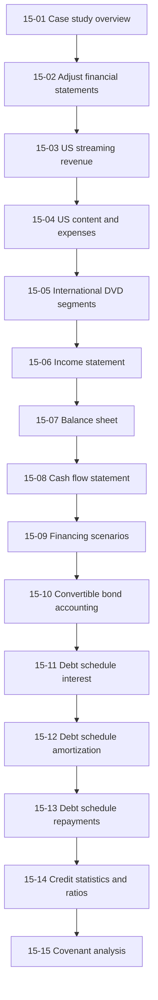
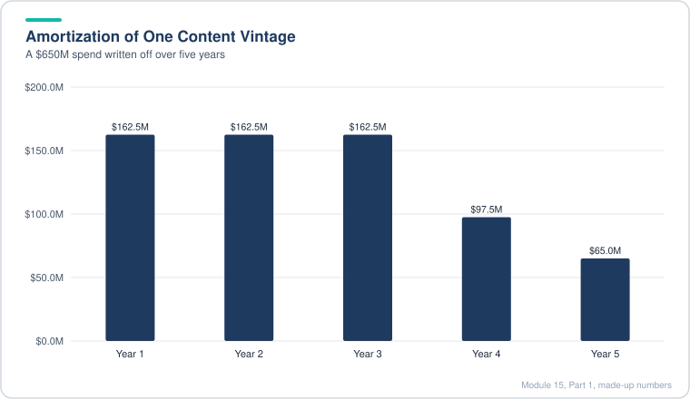
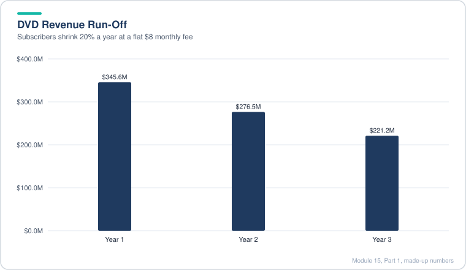
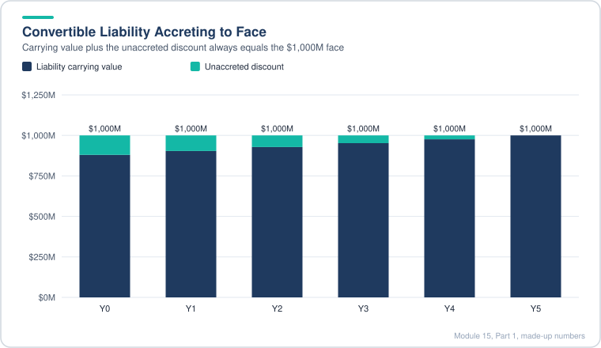
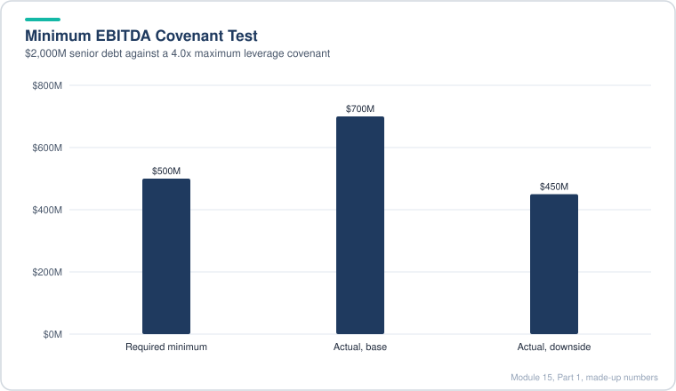
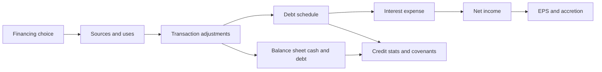
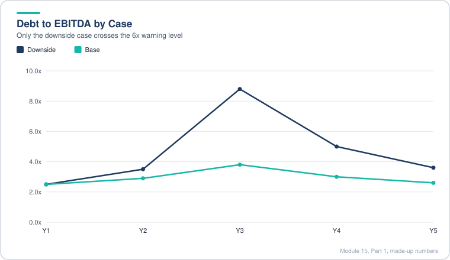
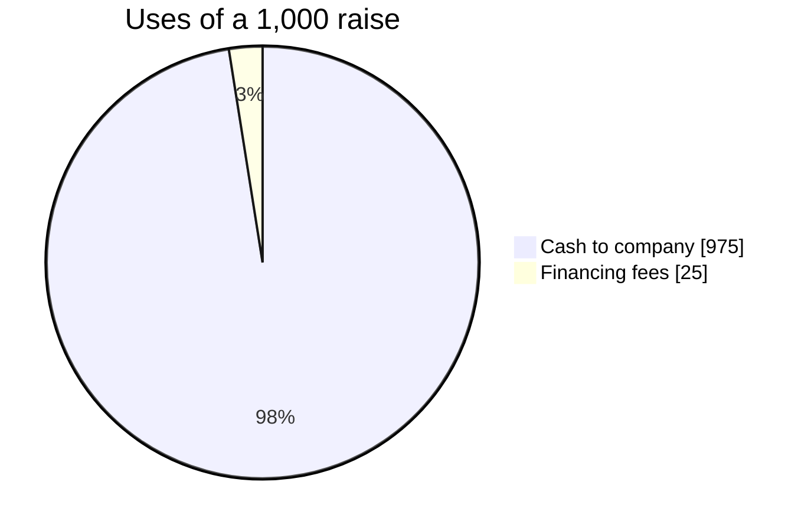
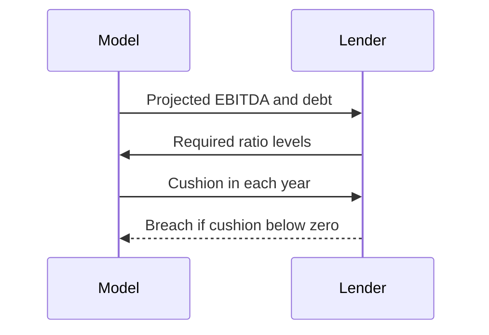

# Module 15, Part 1: Equity, Debt, and Convertibles

[← Previous: Module 14, Part 2](14-private-companies-and-ipos-part-2.md) · [Contents](../README.md) · [Next: Module 15, Part 2 →](15-equity-debt-and-convertibles-part-2.md)

<details>
<summary><b>Contents</b></summary>

- [Overview](#overview)
- [Module Map](#module-map)
- [Lessons](#lessons)
  - [15.1 Case Study Overview and the Funding Decision](#151-case-study-overview-and-the-funding-decision)
  - [15.2 Adjusting the Financial Statements Before Modeling](#152-adjusting-the-financial-statements-before-modeling)
  - [15.3 Projecting Subscription Revenue](#153-projecting-subscription-revenue)
  - [15.4 Content Spending, Amortization and Contribution Margin](#154-content-spending-amortization-and-contribution-margin)
  - [15.5 International Streaming, the DVD Run-Off and Linking Revenue](#155-international-streaming-the-dvd-run-off-and-linking-revenue)
  - [15.6 Income Statement Projections](#156-income-statement-projections)
  - [15.7 Balance Sheet Projections and Linking](#157-balance-sheet-projections-and-linking)
  - [15.8 Cash Flow Statement and the Share Count](#158-cash-flow-statement-and-the-share-count)
  - [15.9 Financing Scenarios, Sources and Uses, and Transaction Adjustments](#159-financing-scenarios-sources-and-uses-and-transaction-adjustments)
  - [15.10 Convertible Bond Accounting](#1510-convertible-bond-accounting)
  - [15.11 Debt Schedule: Interest Rates, Interest Expense and Revolver Fees](#1511-debt-schedule-interest-rates-interest-expense-and-revolver-fees)
  - [15.12 Debt Schedule: Amortization, Sources of Funds and Mandatory Repayments](#1512-debt-schedule-amortization-sources-of-funds-and-mandatory-repayments)
  - [15.13 Debt Schedule: Optional Repayments, Linking and Testing](#1513-debt-schedule-optional-repayments-linking-and-testing)
  - [15.14 Credit Statistics and Ratios](#1514-credit-statistics-and-ratios)
  - [15.15 Covenant Analysis](#1515-covenant-analysis)
- [Diagrams and Charts](#diagrams-and-charts)
- [Excel Model Walkthrough](#excel-model-walkthrough)
- [Interview Questions](#interview-questions)
- [Career Angle](#career-angle)
- [Cheat Sheet](#cheat-sheet)

</details>

## Overview

Before you can value a company's debt or its convertible securities, you have to rebuild its financial statements, see how a financing choice flows through them, and then model the debt schedule, credit ratios and covenants that decide whether the company can keep borrowing.

Part 1 (lessons 15.1 to 15.15) works through a single streaming-media case study. It starts by fixing the company's financial statements for off-balance-sheet items, then moves through the operating model, the three statements, the financing decision, and the debt schedule. It ends with credit statistics and covenants. Part 2 (later lessons) covers bond pricing, call and put features, refinancing, indenture terms, convertible bond valuation and the credit memo.

## Module Map



## Lessons

### 15.1 Case Study Overview and the Funding Decision

- **The problem.** A fast-growing streaming company needs a large chunk of new money (the case uses about $1.5 billion) to keep growing. The company plans to borrow it, but the analyst's job is to ask whether debt, new equity or a convertible bond is really the best choice, and on what terms.
- **Why cash flow lags profit.** Streaming companies pay for content up front and only collect cash from subscribers as the service is delivered. The content spend behaves like a capital expenditure, even though it sits in operating working capital on the balance sheet. Content spend can run around 70% of revenue, so operating income and EBITDA look far better than free cash flow.
- **Minimum cash.** The case assumes the company needs a cash floor of about 10% of annual operating expenses. Even the base case dips below that floor in a middle year when there is no revolver, so the company needs outside money.
- **The decision framework.** Compare the after-tax cost of each source. Cash is usually cheapest, then debt, then equity. A company with a very high P/E can find equity cheaper than debt, because the earnings yield (1 divided by P/E) may be lower than the after-tax interest rate. Most companies have P/E multiples in the 10x to 20x range, which gives an earnings yield of 5% to 10%, so debt is usually cheaper.
- **Debt has a capacity limit.** Cheap debt is only available if the company can pay interest and repay principal, and stay inside its covenants (for example a maximum debt to EBITDA or a minimum EBITDA to interest). A company already near those limits may only get debt from more expensive sources, often 9% to 10%.
- **Where convertibles fit.** A convertible bond is debt with an equity call option attached. The coupon is low because the buyer gets the option to convert into shares if the stock rises past a set premium, often 20% to 30% above the issue price. The issuer can also add a call feature to cap the upside investors can get.
- **Accounting benefit.** Under the accounting used in the case, a convertible is split into a debt piece (the present value of the bond cash flows at a normal rate) and an equity piece (the leftover). Only the debt piece counts toward leverage, so leverage ratios look better, and conversion later removes the debt too.
- **Who issues converts.** Converts suit volatile, high-growth companies. Volatility makes the option more valuable, which lowers the coupon the issuer must pay. Mature, low-volatility industries (industrials, utilities, energy, business services) rarely attract convert buyers, because a 3% coupon with a 20% premium is just cheap debt with little upside.

**Decision flow in the case (simplified):**

1. Compare after-tax cost of equity and after-tax cost of debt.
2. If equity is cheaper (very high P/E), issue equity.
3. If debt is cheaper, test whether the company can afford the interest and stay inside likely covenants.
4. If yes, issue straight debt. If borderline, consider a convert, but only if the company's growth and volatility suit one.
5. If neither debt nor a convert fits, go back to equity.

> [!TIP]
> In practice this is a screen, not a final answer. Real decisions also weigh ratings agencies, investor base, deal size, market windows, signaling (issuing equity can signal the stock is overvalued), the share count the board can approve, and how much management wants to avoid dilution. Converts also come with hedging and dilution costs that the simple cost comparison hides. Good candidates often end up with a mix, such as a small convert plus a term loan.

**Worked example (made-up numbers).** A company has a P/E of 12x, so the earnings yield is 1/12, or about 8.3%. Its pre-tax debt cost is 5% and the tax rate is 25%, so after-tax debt cost is 3.75%. Debt is cheaper, so the next test is coverage. If its interest coverage is 6x against a covenant of 3x, it can afford the debt and should issue it. If coverage were 2.2x, the bank would price a higher spread, and a convert with a 2.5% coupon could be the better choice.

| Source | Cost basis | Rough cost | Notes |
|---|---|---|---|
| Cash on hand | Foregone interest | Low | Cheapest, but limited by the minimum cash floor |
| Straight debt | Pre-tax rate x (1 - tax) | 3.75% to 10% | Needs coverage and leverage headroom |
| Convertible | Low coupon plus a hidden equity option | 1% to 3% coupon | Dilution if converted, call feature can cap it |
| Equity | Earnings yield (1 / P/E) | 5% to 10% for most | Cheapest only at very high P/E |

### 15.2 Adjusting the Financial Statements Before Modeling

- **Stock splits break old prices.** If a company splits its stock, historical share prices and option strike prices stay on the old basis. Multiply the old price by the split ratio (for example 7x after a seven-for-one split) before using it, or option strikes will look far above the share price and the dilution math will be wrong.
- **Options that vest at once.** When options are exercisable immediately, outstanding and exercisable counts are the same. Treat them as dilutive in the share count using the treasury stock method.
- **Rebuild the statements around the question.** The model keeps the income statement close to the filing, but splits revenue into segments so each one can be projected. It adds new lines for interest on new debt, revolver fees, convert discount amortization and financing fee amortization, so later scenarios slot in without manual edits.
- **Group items that do not drive the answer.** Current and non-current content assets are merged into one line, and so are the content liabilities. The reason is that the filing does not disclose enough to split them accurately, and the split adds no value. The same logic applies to common stock and APIC.
- **Split items you need to link.** Tranches of debt get separate rows because each has its own rate and repayment terms. Lease financing obligations get their own row because the cash flow statement has a principal payment line for them and the balance sheet needs something to link to. Capital and operating leases are kept apart because later credit ratios capitalize operating leases.
- **Cash flow simplifications.** Operating cash flow stays close to the filing, with a few new lines for paid-in-kind interest that new financing can create. Investing items are merged into minor buckets, because they do not change the core business. Financing items are merged into a single stock issuance line and a single debt line, and the model treats the financing as a one-time event rather than an ongoing program.
- **Off-balance-sheet obligations are not debt.** The company discloses a large amount of future content commitments that are not on the balance sheet. Under the company's policy, a content asset and its matching liability only appear once a title is available to stream. Until then the commitment is an operating obligation, not a borrowing. The case therefore enters zero for off-balance-sheet liabilities in enterprise value, unlike an unfunded pension, which is a true debt-like item.

> [!TIP]
> The distinction matters in interviews. Some analysts count all disclosed purchase commitments as debt-like, which can make leverage look two or three times worse. Good practice is to state which definition you used, show the sensitivity, and explain why. Rating agencies often make their own adjustments, such as capitalizing operating leases (under the old rules) or certain commitments, so the same company can have different leverage figures in different reports.

**Quick checklist from this lesson**

| Item | What to check | Why |
|---|---|---|
| Share price | Adjust for any split after the valuation date | Otherwise options and EPS are wrong |
| Share count | Use basic plus dilutive options | Needed for equity value and EPS |
| Off-balance-sheet items | Decide what counts as debt-like | Changes leverage and EV |
| Statement mapping | Map each new financing item to a balance sheet line | So the three statements link |
| Cash change | Check cash with and without the new financing | Shows whether outside money is really needed |

### 15.3 Projecting Subscription Revenue

- **Three drivers.** (1) The existing subscriber base, which for a mature service is most of revenue. (2) Gross additions, expressed as a percent of the existing base, and how many of those new customers stay. (3) Price per subscriber and how often it rises.
- **Split retention by tenure.** New subscribers churn faster than long-tenured ones. Model two renewal rates: one for the people who joined this year, and one for everyone older. Each year, a cohort moves from the "new" rate to the "existing" rate once it has survived a year.
- **Why gross adds, not net adds.** Disclosed numbers are often net adds (gross adds minus cancellations). If you project net adds, you hide the churn that drives how much spending is needed to keep the base flat. Project gross adds and renewal rates separately, and the cancellation math becomes visible.
- **Use a cancellation estimate with humility.** Companies often do not disclose churn. A useful sanity check: if net adds are about 20% of the base each year, the cancellation rate cannot be very high in a saturated market, because gross adds would then need to be far above the base. Third-party surveys and equity research can anchor the number, but treat it as a range.
- **Price increases.** Look at the historical percentage increases and set cases around them. Real price changes are lumpy (a jump every two years, for example), but a smooth rate is a fair simplification in a model.
- **Scenarios matter for credit.** A lender wants the downside. The base case follows consensus, the upside has faster growth and better margins, and the downside and extreme downside move key drivers toward industry norms.

**Mechanics in the model (described, not copied):**

1. Put renewal rates for existing and new subscribers in a scenario table, using INDEX and MATCH keyed on the selected case.
2. Build a waterfall. Each year's existing base = prior year's base x existing renewal rate, plus the survivors of last year's new adds at the new-subscriber rate, and the survivors of earlier adds at the existing rate.
3. Gross adds = prior year-end base x gross add percent (scenario driven).
4. Year-end subscribers = surviving base + surviving new adds.
5. Average subscribers = average of opening and closing.
6. Revenue = average subscribers x monthly fee x 12.
7. Blended renewal rate = SUMPRODUCT of cohort size and renewal rate, divided by the total existing base. It is a useful check that churn is not too low.
8. Test every scenario, then compare the base case with outside equity research.

**Worked example (made-up numbers).**

Start: 20.0 million subscribers. Existing renewal rate 90%, new renewal rate 80%, gross adds 15% of the opening base, monthly fee $10.

| Year | Opening subs (M) | Survivors of base (x 90%) | Gross adds (15%) | Survivors of adds | Year-end subs (M) | Average subs (M) | Revenue ($M) |
|---|---|---|---|---|---|---|---|
| 1 | 20.00 | 18.00 | 3.00 | 2.40 | 20.40 | 20.20 | 2,424 |
| 2 | 20.40 | 18.36 | 3.06 | 2.45 | 20.81 | 20.61 | 2,473 |

Year 1 revenue is 20.20 x $10 x 12 = $2,424 million. The blended renewal rate in year 1 is about 90% (all existing). Notice that gross adds are 3.00 million but the base still grows only about 2% a year. If renewal falls to 85%, the base shrinks unless gross adds rise.

> [!TIP]
> Industry tip: when you present subscriber models, show the implied churn (1 minus the blended renewal rate) next to the revenue line. Investors and lenders immediately ask whether the company is buying growth. Also check the implied penetration against the company's own stated market size. A base that ends far outside the disclosed addressable market is usually wrong, even if the arithmetic is right.

> [!WARNING]
> Common mistakes: applying the new-subscriber renewal rate to every cohort forever, forgetting to use average (not year-end) subscribers for revenue, and forgetting to multiply the monthly fee by 12.

### 15.4 Content Spending, Amortization and Contribution Margin

- **Back into a hidden number with algebra.** The company reports the content library balance and its amortization but not cash spending on content. Use one identity: ending library = beginning library + additions - amortization. Rearranged, additions = ending - beginning + amortization. One equation, one unknown, solved every year.
- **Estimate the opening balance.** When an opening split between segments is missing, make a stated assumption (the lesson assumes most of the library sat in the domestic segment back then). Write the assumption down, because it moves every later number.
- **Express spend as a percent of revenue.** Divide additions and amortization by segment revenue. A falling ratio says revenue is outrunning content spend, which is what a maturing service should look like. It does not prove causation either way, so treat it as a pattern, not a law.
- **Amortization is a waterfall.** Each year's spending is written off over several years, using a schedule of percentages (for example 25%, 25%, 25%, 15%, 10%). Each vintage gets its own row. Cap each row so cumulative amortization can never exceed the original spend. Add a check that each vintage's percentages sum to 100%.
- **Existing library runs off faster.** The library already on the balance sheet is mostly older content, so it amortizes faster in the early years. Give it its own percentage schedule (for example 35%, 30%, 20%, 10%, 5%).
- **Straight-line versus accelerated.** Licensed content is usually amortized in a straight line over a window of months to several years. Original content is often amortized faster, because viewing is front-loaded. As original content grows as a share of spend, the blended pattern shifts toward accelerated.
- **Non-amortization costs.** Cost of revenue excluding amortization (delivery, bandwidth, customer service) and marketing are modeled as a percent of revenue. Use the scenario table to set them, with better margins in the upside and worse in the downside.
- **Contribution profit.** Revenue minus cost of revenue (including amortization) minus marketing. Contribution margin is that profit divided by revenue.
- **CAGR for the whole row.** The compound annual growth rate (CAGR) is the constant yearly growth that would take a starting value to the ending value. Formula: (ending / beginning)^(1 / years) - 1. It is a quick way to compare scenarios on one line.

**Sanity checks used in the lesson (described, not copied):**

- Does the contribution margin reach a public target in the right year, or is it far off?
- Do the scenarios differ by a reasonable amount? Revenue can diverge a lot. Margins should stay within a band (for example, 30% to 40%), because a 10% spread against a 50% spread means the cases no longer tell a coherent story.
- Does the subscriber count land inside the company's stated market size?
- Is the equity research consensus believable? Be careful: analysts often hold spending flat in their models, which is unlikely for a company that is still growing.

**Worked example (made-up numbers).**

Suppose the segment has a beginning library of $800M, ending library of $950M, and amortization of $500M this year.

Additions = 950 - 800 + 500 = $650M.

If revenue is $2,000M, additions are 32.5% of revenue. Next year, use the amortization schedule for the vintage: $650M spent this year, amortized 25% in year 1, so $162.5M hits cost of revenue in year 1, then $162.5M in year 2, $162.5M in year 3, $97.5M in year 4 and $65M in year 5. Add the existing library's run-off on top to get total amortization.



*Amortization is spread across years, which is why it is not a proxy for cash spend.*

| Item | Year 1 | Year 2 | Notes |
|---|---|---|---|
| Revenue | 2,000 | 2,200 | |
| Content additions (% rev) | 32.5% | 30.0% | Falling ratio |
| Amortization (total) | 500 | 520 | Existing run-off + new vintages |
| Cost of revenue ex amort (% rev) | 15.5% | 15.5% | Scenario input |
| Marketing (% rev) | 8.3% | 8.3% | Scenario input |
| Contribution margin | about 51% | about 53% | Revenue less cost of revenue (incl. amortization) and marketing |

> [!WARNING]
> Watch for this trap: the amortization line is not the same as cash spend. A company can cut cash content spend this year and still see amortization rise, because older, larger vintages are still running off. In a credit model, the cash number drives debt capacity, so the amortization line must not be used as a proxy for it.

> [!WARNING]
> Another trap: if the company does not disclose a number, say so in the model. Label back-solved and assumed inputs clearly so a reviewer knows which numbers are estimates.

### 15.5 International Streaming, the DVD Run-Off and Linking Revenue

- **International is the growth engine.** Most growth in the plan comes from new countries. Its subscriber additions run far above the domestic rate, and the growth rate fades each year, but it starts from a smaller base. Model it with the same tenure split as the domestic segment, with renewal rates a few points lower across the board.
- **No disclosed churn is fine.** When a segment's retention is not disclosed and there is no third-party data, say so and set a range. Pick a base that is consistent with the segment's losses and the company's own timing for breakeven.
- **Pricing differs by country.** Fees vary market to market, so a single fee line is a simplification. Where history is unreliable, borrow the domestic fee path and state that you did so, which is a conservative choice.
- **Margins as an S-curve.** Marketing as a share of revenue is high at the start (heavy launch spending) and falls as the revenue base grows. Cost of revenue excluding amortization drifts down slowly.
- **Content spend above revenue.** The segment can spend more on content than it earns, and the ratio can start above 100%. What matters is that the ratio falls each year. As long as spend growth slows relative to revenue, contribution margin eventually turns positive.
- **Faster amortization.** Here amortization is more front-loaded than in the domestic segment, because content may fade faster in markets with more competing options. The choice is a judgment, and the test of it is whether the segment's contribution margin turns positive at the timing management has guided to.
- **Check against company plans.** Add the domestic and international content additions together and compare the total with the company's public spending plans for the next two years.
- **DVD is a cash cow in decline.** A shrinking, profitable business is modeled with net subscriber losses as a percent of the base instead of renewal and gross adds, because it no longer wins new customers. Fees can stay flat or fall in a downside case. Content and marketing are close to zero for DVD, so they barely matter, but they stay in the model for completeness.
- **Revenue linking and total checks.** Link each segment's revenue into the income statement. Watch for transaction adjustment columns that break the column alignment between the segment build and the statements. Then compare total revenue with consensus for the base case, and check subscriber totals against the company's market size.

**Mechanics (described):**

1. Use the same renewal waterfall as the domestic segment, but with lower renewal inputs.
2. Set international gross adds as a percent of the base, starting high and declining.
3. Set content additions as a percent of revenue, starting above 100% and declining.
4. For DVD, replace the waterfall with a single line: subscribers = prior year x (1 + net loss rate), where the loss rate is negative.
5. For DVD amortization, use a two-year run-off, which means 80% in year 1 and 20% in year 2 for the existing base, and 2/3 and 1/3 for each new vintage. Check each row sums to 100%.
6. Link segment revenue to the income statement, and recheck growth rates after the link.

**Worked example (made-up numbers).**

A DVD business starts with 4.0 million subscribers and a net loss rate of -20% a year. Monthly fee is $8.

| Year | Subscribers (M) | Average subs (M) | Revenue ($M) |
|---|---|---|---|
| 0 | 4.00 | | |
| 1 | 3.20 | 3.60 | 345.6 |
| 2 | 2.56 | 2.88 | 276.5 |
| 3 | 2.05 | 2.30 | 221.2 |

Revenue falls by about 20% a year, which is a fair way to show a shrinking base with flat fees. Compare that with a case where fees also fall 3% a year: the downside revenue line bends down faster, so the same rule can give a wide range of outcomes from two simple inputs.



*A flat fee on a shrinking base gives a steady decline in revenue.*

> [!TIP]
> Real-world note: cash cows like this often fund growth, so the consolidated company can look weaker on a cash basis than the healthy segment really is. When you value or lend against a company like this, value the segments separately and ask whether the cash from the cow is committed to growth or can be used to service debt. Also ask how fast the cow is declining, because that decline rate sets how long the cash flow lasts.

> [!WARNING]
> Common mistakes: applying the streaming renewal logic to a shrinking business, using average subscribers for a DVD line that is too small to move the answer, and forgetting that a segment can look profitable on contribution margin while the consolidated company is still burning cash.

### 15.6 Income Statement Projections

- **Link first, project second.** Items that already exist in the segment schedules (cost of revenue, marketing) are linked, not retyped. Keep the same formula across every column so the model can be audited.
- **Keep the financing lines empty until the debt exists.** Interest expense, debt fees, convertible discount amortization and the convertible share count depend on schedules built later. Leave those cells as links to be filled in, and do not guess at them now.
- **Percent of revenue for overhead.** Technology and development (R&D) and general and administrative are projected as a percent of revenue, with a gentle trend that follows the history.
- **Tax rate.** A reported effective rate can swing because of one-time items (for example, releasing tax reserves). Use a normalized rate built from the statutory federal rate plus state and foreign effects, and put it in a single named input.
- **Two EPS lines.** Basic EPS uses basic shares. Diluted EPS adds shares from options (treasury method) and any convertible shares. EPS matters here because it is the test used to compare financing choices.
- **Growth in every line.** CAGR works on any line, not just revenue. Apply it to operating income and net income to see whether the scenario shape looks right.
- **Negative taxes are a warning.** When the pre-tax line goes negative in a downside case, the tax formula can return a benefit that the company may not be able to use. Flag it and come back once deferred taxes are modeled.

**Mechanics (described):**

1. Link cost of revenue and marketing from the segment builds (sum across segments, and keep the total cost of revenue consistent).
2. Project R&D and G&A as a percent of revenue.
3. Operating income (EBIT) = gross profit - R&D - G&A.
4. Pre-tax income = EBIT + other income - interest (interest comes from the debt schedule later).
5. Net income = pre-tax income - tax, where tax = pre-tax x tax rate.
6. Shares: basic shares = prior + new follow-on shares. Diluted = basic + option shares + convertible shares.
7. EPS = net income / shares, for both basic and diluted.

**Worked example (made-up numbers).**

Revenue $10,000M, gross profit $3,000M, R&D at 8.5% ($850M), G&A at 5% ($500M).

EBIT = 3,000 - 850 - 500 = $1,650M (16.5% margin).

Interest (later) $200M, other income $0. Pre-tax = $1,450M. Tax at 34% = $493M. Net income = $957M.

Basic shares 500M, so basic EPS = $1.91. Diluted shares 520M, so diluted EPS = $1.84.

Now imagine a new equity raise of 50M shares at a price that brings in $1,000M. Shares rise to 550M basic, and EPS falls even though net income is the same, unless the cash raised earns enough to offset. This is the dilution test the lesson builds up to.

| Line | Value ($M) | Source |
|---|---|---|
| Revenue | 10,000 | Segment build |
| Gross profit | 3,000 | Revenue less cost of revenue |
| R&D (8.5%) | 850 | % of revenue input |
| G&A (5%) | 500 | % of revenue input |
| EBIT | 1,650 | Formula |
| Interest | 200 | Debt schedule (later) |
| Tax (34%) | 493 | Pre-tax x tax rate |
| Net income | 957 | Formula |

> [!TIP]
> Why this matters beyond the case: EPS accretion and dilution is the first test of a financing choice in practice, but it ignores risk. A deal can be accretive on EPS and still raise leverage to a level that rating agencies punish. Pair the EPS test with credit stats before you recommend anything.

> [!WARNING]
> Common mistake: assuming debt is always the EPS-friendly choice. Debt adds to EPS when the after-tax interest rate is below the company's earnings yield (1 / P/E). Stock issuance adds to EPS only when the company's earnings yield is higher than the after-tax cost of the debt it could have used. This is the same comparison as in lesson 15.1, shown through EPS.

### 15.7 Balance Sheet Projections and Linking

- **Think about cash first.** Before projecting a balance sheet line, ask whether growth consumes cash or releases it. A growing company usually funds more receivables and inventory, but gets cash from payables, accrued expenses and deferred revenue. Those are the lines that move with the business.
- **Pick a driver for each line.** Items that trend with the income statement get a ratio: other current and non-current assets to revenue, payables to cost of revenue, accrued expenses to operating expenses, deferred revenue to revenue, and other non-current liabilities to operating expenses. If a line has no clear trend, use the average of its history.
- **Content liabilities as a share of content assets.** A streaming company records a liability for the future cost of delivering each title at the same time as the asset. The ratio must stay below 100%, or the title would cost more to deliver than it earns. Its trend (declining over time) is a useful check on the cash flow side.
- **Link to the cash flow statement with the right sign.** For assets, use the negative of the cash flow line, because a cash outflow raises the asset. For liabilities and equity, use the cash flow line as is. Every balance sheet change must appear once, and only once, on the cash flow statement.
- **Content library rolls forward.** Ending library = prior library + additions - amortization. Because the cash flow shows spending as negative, the asset-side link subtracts those cash flow lines, which gives the same result. DVD library lines are included in the same way.
- **Park what depends on financing.** Convertible bonds, the transaction adjustments and the new debt tranches are left as blank links until the financing scenarios and convertible schedule exist. A full balance check is pointless until everything is linked.
- **Unknown items go to retained earnings.** If an item must hit the balance sheet but has no obvious home, put it in an equity line so the statements still balance. Document it.
- **Stock compensation and tax benefits.** Excess tax benefits from stock compensation net to zero across operating and financing cash flows, so you do not link them to the balance sheet. Stock comp itself goes to common stock and APIC.

**Linking principles to keep in view:**

1. Every balance sheet change has exactly one matching cash flow line (or a P&L line that flows to retained earnings).
2. Asset-side links use a negative sign against the cash flow line. Liability and equity links use a positive sign.
3. Each debt tranche gets its own row, its own opening balance and its own cash flow link.
4. Paid-in-kind interest adds to the loan principal instead of being paid in cash, so it needs a link that raises the debt balance.

**Worked example (made-up numbers).**

Revenue grows from $10,000M to $11,000M. Deferred revenue is 2.0% of revenue, so it goes from $200M to $220M, a $20M cash inflow. Accounts payable is 5.0% of cost of revenue. If cost of revenue goes from $6,000M to $6,600M, payables go from $300M to $330M, another $30M inflow.

| Line | Prior | Current | Driver | Cash flow effect |
|---|---|---|---|---|
| Deferred revenue | 200 | 220 | 2.0% x revenue | +20 (source) |
| Accounts payable | 300 | 330 | 5.0% x cost of revenue | +30 (source) |
| Other current assets | 150 | 165 | 1.5% x revenue | -15 (use) |
| Accrued expenses | 180 | 189 | 4.5% x opex | +9 (source) |

Net working capital from these lines is a source of about $44M, so growth is partly self-funding. Compare that with a content library that consumes far more cash than the working capital lines provide, and the streaming problem in lesson 15.1 becomes clear.

> [!TIP]
> Model hygiene: when you project a ratio that the history shows falling (for example content liabilities over content assets), tie the assumption to a second check. Here that check is the cash flow statement, where the change in content assets and the change in content liabilities should reconcile. If they do not, the ratio is wrong even if it looks plausible on its own.

> [!WARNING]
> Common mistake: linking the balance sheet line to the cash flow with the wrong sign. A quick test: if the cash flow line is a use of cash and the balance is an asset, the balance should go up. Sign checks like this catch most early balance sheet errors.

### 15.8 Cash Flow Statement and the Share Count

- **The cash flow statement is the real story.** For a content business, the biggest spending item (content additions) appears only here. The income statement shows its cost only later, through amortization. So the cash flow statement is the best place to test whether the company can pay for growth.
- **Small items get simple rules.** Depreciation, capex and short-term investments are small percentages of revenue. Non-cash items use a flat average. Each simplification should be stated, and each should be too small to change the answer.
- **Excess tax benefits from stock compensation.** When the share price rises between grant and exercise, the company gets a larger tax deduction. That benefit is subtracted in operating cash flow and added back in financing cash flow, so it nets to zero. A simple rule is to tie it to stock comp as a percent.
- **Deferred taxes.** When pre-tax income is negative, the tax line can go negative, but no cash tax is paid. A proper model tracks net operating losses in a deferred tax asset that unwinds later. A simpler approach ties deferred taxes to total tax with a declining percentage. Note the limitation: it can turn positive in loss years, which is a shortcut, not a rule.
- **Debt and convertibles stay blank until built.** Debt issuance, repayment, fees and convertible lines wait for the debt and convertible schedules. Leaving them at zero is a valid first pass, as long as you remember to come back.
- **Sign rules for the statement.** Asset changes subtract (an increase in an asset is a use of cash). Liability changes add. An increase in a liability is a source of cash.
- **Cash flow available for debt repayment.** Operating + investing + financing + FX. In this case it is negative early and turns positive only late, which is the central funding problem.
- **Balance check.** The model balances when every balance sheet change is matched on the cash flow statement. Test it in each scenario, not just the base case, because a link that works in one case can fail in another (negative taxes are one example).
- **Share count schedule.** Basic shares increase with common stock issued divided by an average issue price. Diluted shares add options granted, with the treasury stock method applied to each batch. The lesson uses a simple approximation, and it flags that a real model tracks each tranche of options separately, since each tranche has its own strike.

**Share count mechanics (described):**

1. Average issue price: current share price (a placeholder for now).
2. New basic shares = common stock issued / average issue price.
3. Options granted = stock comp / average issue price (a crude proxy).
4. Option strike = a percent of the issue price (a test assumption, later made realistic).
5. Treasury stock method: incremental diluted shares = options x (1 - strike / share price), and zero if the strike is above the share price.
6. Feed basic and diluted shares back into the income statement for EPS.

**Worked example (made-up numbers).**

Stock comp is $300M, the average issue price is $50, so options granted are 6.0M. Strike is $45 (90% of issue price). If the share price is $50, the treasury stock method gives 6.0 x (1 - 45/50) = 0.6M incremental diluted shares.

If the share price is $40 instead, the strike is above the price, so the incremental shares are zero. That is the point of the test: options out of the money add nothing to diluted EPS.

| Year | Stock comp ($M) | Issue price ($) | Options granted (M) | Strike ($) | Price ($) | Incremental diluted (M) |
|---|---|---|---|---|---|---|
| 1 | 300 | 50 | 6.0 | 45 | 50 | 0.6 |
| 2 | 330 | 50 | 6.6 | 45 | 40 | 0.0 |

> [!TIP]
> Why the crude method is risky: granting options at a fixed fraction of the share price and using today's share price for future strikes can make dilution look smooth when it is really lumpy. Real option grants come at a strike set on the grant date, and their dilution depends on the price path. Treat the simplified version as a placeholder and check it against the 10-K's diluted share disclosure.

> [!WARNING]
> Common mistake: forgetting that a deferred tax asset is a real asset. If the model lets deferred taxes turn positive in loss years, the balance sheet still needs to balance, and the cash flow statement must match. A quick check is to confirm that the net change in each balance sheet line equals its cash flow line.

### 15.9 Financing Scenarios, Sources and Uses, and Transaction Adjustments

- **Build a scenario switch first.** Compare the choices by building one schedule that holds every option side by side: do nothing, equity, each debt type, and a convertible. A single drop-down picks the active case, and INDEX and MATCH pull the right column into the statements. Build the switch before any single deal, so every later schedule works for all cases.
- **Test with dummy values.** Enter a number for every term (amortization, prepayment, fees, maturities) even where a real deal would not have it. The goal is to exercise every link. A real deal can then be dropped in later. Note which inputs are dummies so nobody reads them as market terms.
- **Refinancing switch.** Include a yes or no for refinancing existing debt, even if the brief does not ask for it. When refinancing is on, the old balance is paid from the new proceeds, so cash falls and new debt sits in its place.
- **Sources and uses.** Sources are the new money (equity, debt, converts) plus existing cash if used. Uses are fees, any refinanced debt, assumed debt and the cash that goes to the company. The cash to the company is the plug, as in an LBO. Check that sources equal uses in every scenario.
- **Fee types.** Equity issuance has a percentage transaction fee. Debt and converts have financing fees by tranche, applied with a SUMPRODUCT across the tranche list.
- **EBITDA definition.** Define it once and say what you did. The lesson adds back normal depreciation and amortization plus the DVD library amortization (treated like capex), but not streaming content amortization, because that would make EBITDA far above operating cash flow. Stock comp is not added back.
- **Share price and convertible terms.** A convert's conversion price is today's price times (1 + premium). The conversion ratio is par divided by conversion price. Shares count toward diluted EPS only if the share price is above the conversion price (the if-converted method).
- **Follow-on offering discount.** New shares are priced at a discount to the current price. Shares issued = proceeds / (price x (1 - discount)). A bigger discount means more shares.
- **Transaction adjustments.** Cash goes up by the net proceeds. Debt goes up by the face amount, less financing fees booked against it. Common equity goes up by the equity raised, less equity fees, which go to retained earnings. Balance check in the first period after the deal.
- **Financing fees are no longer capitalized in the U.S.** Under the newer standard, debt issuance costs reduce the debt balance rather than sit as an asset. The lesson therefore drops the capitalized fee line.

**Mechanics (described):**

1. Scenario table: rows = line items (equity, each tranche, converts), columns = scenarios. Fill each column with percentages of the amount raised.
2. Pick the active scenario with a drop-down, and use INDEX and MATCH to return that column.
3. Sources = selected amounts for each tranche + cash used. Uses = fees + refinanced debt + assumed debt + cash to company (plug).
4. Financing terms: rate, amortization, prepayment flag, maturity, fee percentage. Rates from real filings where available, placeholders elsewhere.
5. Transaction adjustments: change cash, change debt (less fees), change equity, change retained earnings (equity fees).
6. Check the balance sheet in the transaction period.

**Worked example (made-up numbers).**

Need $1,000M. Scenario "Debt 1": 60% senior notes, 40% subordinated, with a 2% financing fee on each.

| Item | Amount ($M) | Calculation |
|---|---|---|
| Senior notes | 600 | 60% x 1,000 |
| Subordinated | 400 | 40% x 1,000 |
| Financing fees | 20 | 2% x 1,000 |
| Cash to company | 980 | Sources less fees (plug) |

Balance sheet after the deal: cash +980, debt +1,000 less 20 of fees (net debt +980). Net assets rise by 980 and the balance sheet still balances.

Now the equity version: $1,000M at a 5% discount to a $100 price with a 3% transaction fee. Shares = 1,000 / (100 x 0.95) = 10.53M shares. Fees = 30, so cash to company = 970. Retained earnings falls by the fee.

> [!WARNING]
> Common mistake: changing the scenario and forgetting that the balance sheet check only works if every row in the scenario table sums to 100%. Add a check row that flags any column not equal to the amount raised.

> [!TIP]
> Real-world point: a company with a very high P/E can find equity cheaper than debt on a simple cost measure. The lesson notes this paradox. The usual answers are that the cheap equity is not a low cost in a true sense (it dilutes the owners), that the market may be pricing growth that may not arrive, and that a company may prefer debt to keep control or to signal confidence. Good answers name a trade-off, not a single reason.

### 15.10 Convertible Bond Accounting

- **Split at issue (IFRS style).** Value the liability as the present value of the bond's coupons and principal, discounted at the rate a similar straight bond would carry. The equity component is the leftover: proceeds less that liability. The equity piece is the value of the embedded call option, and it stays fixed in equity.
- **U.S. GAAP is different.** Under U.S. GAAP the whole instrument is usually a liability, unless the issuer has a cash settlement option. The lesson follows the split treatment throughout, and flags the difference.
- **Discount amortization.** The gap between face value and the liability carrying amount is accreted to face over the bond's life. Each year's accretion is interest expense (non-cash), added back on the cash flow statement, and it raises the liability. Straight-line amortization is a simplification of the effective interest method.
- **Stop accreting when the bond is gone.** Accretion stops in the year of conversion or early repurchase. Conversion is checked first, because a bond that converts cannot also mature.
- **Conversion.** On conversion, the liability and equity components are both removed and credited to common stock and APIC. Total equity is unchanged in the sense that the same amount moves between lines.
- **Maturity.** At maturity with no conversion, the liability (now equal to face) is paid in cash. The equity component is moved to common stock and APIC, so the maturity and conversion treatments match.
- **Early repurchase.** Recompute the liability as the present value of remaining cash flows at the original rate. The difference from the carrying value is a gain or loss on extinguishment. The equity component absorbs the rest of the gap between the repurchase price and the liability value. Cash paid equals the repurchase price.
- **Scope.** Repurchase modeling needs a forecast of the bond's market value, which is a guess. The lesson skips it in the base model and says so.

**Worked example (made-up numbers).** A $1,000M bond, five years, coupon 2%, split as a liability of $880M and equity of $120M.

- Accretion per year = 120 / 5 = $24M. Liability goes 880, 904, 928, 952, 976, 1,000 over five years.
- Interest expense each year = coupon $20M plus accretion $24M = $44M of total interest cost, of which $24M is non-cash.
- If the bond converts at the end of year 3 (liability 928, equity 120), the company debits both (1,048 in total) and credits common stock and APIC by the same amount.
- If instead it is repurchased at the end of year 3 for $1,030M when the remaining value is $940M, the loss is 1,030 - 940 = $90M, hitting the income statement.



*The unaccreted discount shrinks by $24M a year until the liability reaches face value.*

> [!WARNING]
> Common mistake: forgetting that accretion adds to the liability and to interest expense together. Also watch the test ordering (conversion, then maturity, then repurchase) so the same year is not counted twice.

> [!TIP]
> Why the split matters for lenders: under the split approach, less of the instrument shows as debt, so leverage looks lower on day one. Rating agencies often reverse this and treat the convert at face value, so always check which basis a ratio uses.

### 15.11 Debt Schedule: Interest Rates, Interest Expense and Revolver Fees

- **Fixed or floating.** A fixed-rate tranche uses its coupon every year. A floating tranche uses a base rate (such as LIBOR or a policy rate) plus a spread, with a floor on the base. Use MAX(base, floor) + spread for floating. Build one rate row per tranche, and let an IF test choose the method.
- **Interest on average or opening balances.** Interest = rate x average balance when circularity is allowed, or x opening balance when it is not. The opening-balance version avoids a circular reference, at a small cost in accuracy.
- **Convert interest includes accretion.** The convertible's interest line includes the non-cash discount accretion from lesson 15.10, and it falls to a lower amount in the year the bond converts.
- **Revolver fees need a state test.** Charge nothing when no new financing is raised. Otherwise there are two fees: an undrawn commitment fee on the unused part of the facility, and an overdrawn fee if the draw exceeds the commitment.
- **Use one signed number, then split it.** Compute the available amount = commitment - drawn. If positive, multiply by the undrawn fee. If negative, use ABS to turn the excess into a positive amount and multiply by the overdrawn fee. Keep all fees as positive expense figures.

**Worked example (made-up numbers).**

- Floating tranche: base rate 0.4%, floor 1.0%, spread 4.0%. Rate = MAX(0.4%, 1.0%) + 4.0% = 5.0%.
- Next year the base rate is 2.5%, so the rate = 2.5% + 4.0% = 6.5%.
- Fixed tranche: coupon 7.0%, opening balance $500M, so interest = $35M without circularity.
- Revolver: commitment $200M, drawn $150M, undrawn fee 0.5%. Undrawn = 50, fee = 0.25M. If drawn $230M instead, the overdrawn amount is 30 and the overdrawn fee (say 2.0%) gives 0.6M.

| Case | Commitment | Drawn | Available | Fee charged |
|---|---|---|---|---|
| Underdrawn | 200 | 150 | +50 | 0.5% x 50 = 0.25 |
| Overdrawn | 200 | 230 | -30 | 2.0% x 30 = 0.60 |

> [!WARNING]
> Common mistake: letting the floor apply to fixed-rate tranches, or forgetting that a rising base rate changes the revolver interest every year while fixed coupons stay put. Also remember that the base-rate benchmark has been replaced in practice by other reference rates, so check the current convention in the indenture or credit agreement.

### 15.12 Debt Schedule: Amortization, Sources of Funds and Mandatory Repayments

- **Amortization is a percent of the original balance.** Each year, repay the lesser of (original balance x annual amortization %) and whatever is still outstanding. In the maturity year, repay all of the remaining balance.
- **Guard against over-repayment.** Track cumulative repayment percentages so the schedule never repays more than 100% of the original amount, even if the inputs are odd. Wrap year tests in error handling so a blank maturity (like a revolver) returns zero.
- **Revolvers do not amortize.** A revolver is drawn and repaid as cash allows, so it has no scheduled amortization.
- **Sources of funds.** Start with opening cash, subtract the minimum cash balance, and add the cash flow available for debt repayment. The shortfall against mandatory repayments is what the revolver must fund, floored at zero. Turn the revolver off for equity-only and no-financing cases.
- **Minimum cash is a judgment.** Pick a proxy and say why. The lesson uses a small percent of cost of revenue plus operating expenses, which is less volatile than a cash flow line that is near zero for a company like this. It also notes that short-term investments should be treated carefully when they are part of the cash picture.
- **Mandatory repayments include accreting items.** Balances that grow (PIK interest on a mezzanine note, or convert accretion) must be added to the balance before the repayment test, or the schedule will drift from the balance sheet.

**Worked example (made-up numbers).**

Tranche: original $1,000M, amortization 20% a year, maturity in year 4.

| Year | Opening | Scheduled repayment | Closing |
|---|---|---|---|
| 1 | 1,000 | 200 | 800 |
| 2 | 800 | 200 | 600 |
| 3 | 600 | 200 | 400 |
| 4 (maturity) | 400 | 400 (all remaining) | 0 |

Sources test: opening cash 300, minimum cash 150, cash flow available 40. Cash available = 300 - 150 + 40 = 190. Mandatory repayment in year 4 is 400, so the revolver must draw 400 - 190 = 210 (floored at zero if the number came out negative).

> [!WARNING]
> Common mistake: using the original balance times the percent in every year without comparing to the remaining balance. This over-repays once the tranche is nearly paid off, and the balance sheet goes negative.

### 15.13 Debt Schedule: Optional Repayments, Linking and Testing

- **Optional repayment is capped two ways.** It is the lesser of (a) what is still owed and (b) the cash left after mandatory payments and any earlier optional payments, floored at zero. Multiply by a prepayment flag first, so a non-prepayable tranche returns zero.
- **Prepayment rarely exists for these tranches.** Senior notes, subordinated notes, mezzanine and converts usually cannot be prepaid, or only in full. The lesson keeps the flag so term loans can be tested, and it warns that a schedule that prepays everything is a stress test, not a plan.
- **Excess cash and the revolver.** Excess cash = subtotal before revolver - mandatory - optional, floored at zero when a revolver is in play. Revolver borrowing covers any mandatory shortfall.
- **Linking order.** Build the bottom of the debt schedule first, then the cash flow statement (repayments as negatives, revolver draws as positives), then balance sheet balances, and link interest to the income statement last. Interest on new debt, existing debt and revolver fees should go on separate lines.
- **Accrual items.** PIK interest adds to the mezzanine principal only during the years it is paid in kind, so the test compares the PIK period to the year number. Convert accretion adds to the convert liability.
- **Circularity.** Interest on average balances creates a loop, so iterative calculation must be switched on with a sensible iteration cap and tolerance. The opening-balance option avoids the loop.
- **Stress test each scenario.** Check the balance sheet balances and cash never goes negative in every financing and operating case. A convert that converts should not also be shown as repaid, which is an issue the lesson flags as an open fix.

**Worked check (made-up numbers).**

| Item | Year 3 |
|---|---|
| Subtotal before revolver | 520 |
| Mandatory repayments | 400 |
| Optional repayments (prepay flag = 1) | MIN(remaining 300, MAX(0, 520 - 400)) = 120 |
| Excess cash generated | MAX(0, 520 - 400 - 120) = 0 |
| Revolver draw | 0 |

Here the optional payment uses all the spare cash and leaves none for the balance sheet. If the flag were 0, the optional line would be 0 and excess cash would be 120.

> [!TIP]
> Testing advice: when a model balances in the base case, that proves little. Switch scenarios, switch the financing type, zero out the amortization, and force a revolver draw. Each switch exposes a link that the base case hides. A balance check that is off by a tiny decimal in later years usually means a rounding or circularity setting, not a conceptual error, but confirm it.

### 15.14 Credit Statistics and Ratios

- **Why ratios decide the financing.** Lenders look at leverage (debt to EBITDA) and coverage (EBITDA to interest) and ask whether the company can pay in bad years, not just good ones. Ratios also feed the credit rating, which sets the rate. A single ratio in a single year is not a verdict. Read the set together.
- **Pair numerators and denominators.** If the denominator excludes rent (EBITDAR), the numerator must include capitalized operating leases. Many lenders capitalize operating leases at a multiple of annual rent (the lesson uses 7x). Show ratios with and without that, to see how sensitive the answer is.
- **EBITDA variants for content-heavy businesses.** Plain EBITDA can look strong while cash flow is weak, because content spend shows up only partly in EBITDA through amortization. Variants that subtract content additions, capex and working capital show the cash picture. Define each one and name it.
- **Free cash flow definition.** Here it is operating cash flow less both capex lines, and short-term investment purchases are excluded because they are not core operations. State your definition in every model.
- **Net debt is weak for this kind of company.** When cash is large, net debt turns negative and is not meaningful. Also, if the debt cannot be prepaid, the cash does not reduce what the lender can count on.
- **Interest for coverage.** Include revolver fees and discount amortization in interest expense. Leaving out convert discount accretion makes the convert look cheaper than it is.
- **Debt service coverage.** (Free cash flow + net interest) / (mandatory repayments + net interest + finance lease payments). Below 1x means the company cannot meet its scheduled debt costs from cash flow.
- **Reading the scenarios.** The same structure can pass in the base case and fail in the downside. Leverage above about 6x to 7x, or coverage under about 2x, was treated as a warning. Negative EBITDA in a stress case means debt is not realistic.

**Worked example (made-up numbers).** EBITDA $1,000M, operating lease rent $100M, total debt $3,500M, net interest $300M.

- Capitalized operating leases = 7 x 100 = $700M.
- Debt plus leases = 4,200. Debt to EBITDAR = 4,200 / (1,000 + 100) = 3.8x.
- Debt to EBITDA without leases = 3,500 / 1,000 = 3.5x (numerator and denominator must match in each ratio).
- EBITDA to interest = 1,000 / 300 = 3.3x.

If a downside year cuts EBITDA to 400 and interest is still 300, coverage falls to 1.3x. That is the kind of number a lender uses to say no.

| Ratio | Base year | Downside year | Read |
|---|---|---|---|
| Debt to EBITDA | 3.5x | 8.8x | Too high for senior unsecured |
| EBITDA to interest | 3.3x | 1.3x | Below 2x is a warning |
| Debt service coverage | 1.2x | negative | Cannot meet debt costs from cash flow |

> [!TIP]
> Industry point: covenants and ratings do not follow a single rule. Investment-grade issuers have looser thresholds than high-yield issuers, and sector norms differ a lot. Pull the rating agency's typical ranges for the sector before you judge a ratio as good or bad.

### 15.15 Covenant Analysis

- **Two families.** Maintenance covenants are tested every period on ratios (minimum EBITDA, maximum leverage, minimum interest coverage, fixed charge coverage). They are typical of senior bank debt such as revolvers and term loans. Incurrence covenants restrict actions (new debt, dividends, acquisitions) and are typical of junior bonds. Incurrence tests cannot be modeled in a spreadsheet, only the maintenance ones can.
- **The trade-off.** Senior debt is cheaper but tighter on covenants. Junior debt costs more but gives the company room to spend through a bad year. Lenders are protecting against a company that does something risky while cash is tight.
- **Cushion.** The cushion is how far actual EBITDA can fall before a covenant is breached: (actual - required) / actual. Cushions under roughly 10% to 15% are a warning sign.
- **Lines have blurred.** Covenant-lite term loans and high-yield-style loans now look a lot like bonds, and many have a floor on the base rate that makes the coupon effectively fixed. Check the actual documents, not the label.
- **Fixed charge coverage.** Typically (EBITDA - capex - cash taxes - other fixed items) / (interest + mandatory principal + lease payments). Junior debt with no amortization can pass this test even when senior debt fails, because the principal line is what breaks it.
- **Stress tests decide.** A covenant that is met in the base case can fail in the downside. When EBITDA turns negative, no reasonable covenant level can be met.

**Worked example (made-up numbers).** Senior debt $2,000M, covenant max senior debt / EBITDA 4.0x.

- Required minimum EBITDA = 2,000 / 4.0 = $500M.
- If actual EBITDA is $700M, cushion = (700 - 500) / 700 = 29%. Fine.
- In a downside year EBITDA is $450M, which is below $500M, so the covenant is breached and the cushion is -11%.

Interest coverage: covenant minimum 2.5x, interest $200M, so required EBITDA = $500M. The same test shows where the pinch point is.

| Test | Required | Actual (base) | Actual (downside) | Result downside |
|---|---|---|---|---|
| Senior debt / EBITDA | 4.0x max | 2.9x | 4.4x | Breach |
| EBITDA / interest | 2.5x min | 3.5x | 2.3x | Breach |
| Fixed charge coverage | 1.5x min | 1.6x | 0.9x | Breach |



*Base-case EBITDA clears the $500M requirement with room to spare, but the downside year falls below it.*

> [!TIP]
> Practical advice: when you present covenant headroom to a client or interviewer, show the cushion, not just pass or fail. Then say which year is the tightest. A cushion that looks fine in the base case but falls under 10% in the year of cash trough is a risk the lender will price in.

## Diagrams and Charts

**How a financing choice flows through the model**



**Convertible bond: liability accretes toward face, equity stays flat**

```mermaid
xychart-beta
    title "Convert liability toward face (illustrative, $M)"
    x-axis [Y0, Y1, Y2, Y3, Y4, Y5]
    y-axis "Liability carrying value" 850 1000
    line [880, 904, 928, 952, 976, 1000]
```

**Downside stress on leverage (illustrative, debt to EBITDA)**

```mermaid
xychart-beta
    title "Debt to EBITDA by case (illustrative)"
    x-axis [Y1, Y2, Y3, Y4, Y5]
    y-axis "Times" 0 12
    line [2.5, 3.5, 8.8, 5.0, 3.6]
    line [2.5, 2.9, 3.8, 3.0, 2.6]
```

The first line is the downside case and the second is the base case. Only the downside line crosses the 6x warning level, in year 3. The base case stays inside it, which is the point of showing both.



*Only the downside line crosses the 6x warning level, in year 3.*

**Where the funding need comes from (illustrative split of uses, $M)**



**Covenant check sequence**



## Excel Model Walkthrough

The model is one workbook that grows tab by tab across the lessons:

| Tab or area | What it holds | Key links |
|---|---|---|
| Model (main) | Income statement, balance sheet, cash flow, share schedule, EPS, accretion/dilution | Pulls segment revenue and content costs; receives interest and convert shares |
| US streaming | Subscriber waterfall, renewal and gross add rates, price path, content additions and amortization vintages | Feeds segment revenue and cost of revenue |
| International streaming | Same structure with lower renewal rates and a front-loaded amortization curve | Feeds total revenue and content additions |
| DVD | Net subscriber loss rate, fee path, two-year amortization run-off | Small; feeds revenue and content lines |
| Financing scenarios | Scenario table (none, equity, each debt type, convert), drop-down selector, financing terms | Drives sources and uses, transaction adjustments and the debt schedule |
| Sources and uses | Raised amount, refinancing, fees, cash to company as plug | Feeds transaction adjustments |
| Convertible | Share price path, conversion test, maturity test, liability and equity split, accretion | Feeds the balance sheet convert lines and interest expense |
| Debt schedule | Rates (fixed or floating), amortization, mandatory and optional repayments, revolver draw and fees | Feeds cash flow repayments and the income statement interest lines |
| Credit stats | Leverage, coverage, cash flow variants, debt service coverage | Reads from statements and the debt schedule |
| Covenants | Minimum EBITDA, leverage, interest coverage, fixed charge coverage, cushions | Reads from credit stats |

**Key formulas (described):**

- Scenario selector: INDEX on the scenario table, MATCH on the selected case name.
- Renewal waterfall: prior base x renewal rate for each cohort, with new adds moving to the existing rate after one year.
- Amortization vintage: each year's spend times its percentage schedule, with a cap so cumulative amortization never exceeds the original spend.
- Balance sheet to cash flow: asset changes use a negative sign, liability and equity changes a positive sign, each change used once.
- Revolver draw: MAX(0, mandatory repayments - cash available before revolver).
- Optional repayment: MIN(balance remaining, cash left after mandatory and prior optional payments), times a prepay flag, floored at zero.
- Convert: conversion flag, then maturity flag (only if no conversion), then accretion (only if neither has happened), then balance and equity roll-forward.

**Model conventions worth keeping:** green font for links to other tabs, black for formulas on the same tab, named cells for key inputs (tax rate, minimum cash percent, circularity switch), and a balance check row on every statement.

## Interview Questions

<details>
<summary>1. When would you issue equity instead of debt?</summary>

When the after-tax cost of equity (roughly the earnings yield, 1 / P/E) is lower than the after-tax cost of debt, and the company cannot comfortably carry more debt. Name the trade-off: dilution and signaling.

</details>

<details>
<summary>2. Why are convertible bonds cheaper than straight debt?</summary>

The buyer gives up coupon for a call option on the stock. Higher volatility makes the option worth more, so the coupon can be lower.

</details>

<details>
<summary>3. How do you split a convertible into debt and equity?</summary>

Discount the bond's cash flows at the rate of a similar straight bond. That PV is the liability. The leftover is the equity component (the option value).

</details>

<details>
<summary>4. What happens to the equity component over the bond's life?</summary>

It stays flat in equity until conversion or repurchase. On conversion, both components move to common stock and APIC.

</details>

<details>
<summary>5. How are debt issuance costs treated now?</summary>

Under the newer U.S. standard they reduce the carrying amount of the debt rather than sitting as an asset, and they are amortized into interest expense.

</details>

<details>
<summary>6. How does a follow-on offering affect EPS?</summary>

New shares are issued at a discount, so share count rises. EPS is accretive only if the earnings yield on the new capital exceeds the after-tax cost of the funds.

</details>

<details>
<summary>7. Why does a streaming company's EBITDA look better than its cash flow?</summary>

Content is paid for up front (cash spend) and expensed over time (amortization). EBITDA only sees the amortization piece.

</details>

<details>
<summary>8. How do you set a minimum cash balance?</summary>

Use a percent of a cost base (for example cost of revenue plus opex) or a number of months of outflows. State the method and test it against a stress case.

</details>

<details>
<summary>9. How do you handle circularity in interest?</summary>

Either use the opening balance, or average balances with iterative calculation switched on and a sensible cap and tolerance.

</details>

<details>
<summary>10. What is the difference between maintenance and incurrence covenants?</summary>

Maintenance covenants test ratios every period (typical of revolvers and term loans). Incurrence covenants restrict specific actions when the company takes them (typical of bonds).

</details>

<details>
<summary>11. How do you calculate covenant cushion?</summary>

(Actual - required) / actual. A small cushion, say under about 10%, is a warning.

</details>

<details>
<summary>12. Why match numerators and denominators in leverage ratios?</summary>

If rent is excluded from EBITDA (EBITDAR), the leases must be capitalized into debt. Otherwise the ratio mixes two definitions.

</details>

<details>
<summary>13. Why might junior debt pass a fixed charge test that senior debt fails?</summary>

Junior debt often has no scheduled amortization, so the principal line that drives the fixed charge is zero.

</details>

<details>
<summary>14. How do you treat PIK interest in a debt schedule?</summary>

It accrues to principal during the PIK period, so the balance rises and the cash flow shows it as a non-cash add-back.

</details>

<details>
<summary>15. What does a revolver draw do in the model?</summary>

It funds any mandatory repayment that the cash on hand cannot cover, and it is the only tranche that can increase on the cash flow statement in this setup. Fees are charged on undrawn and overdrawn amounts.

</details>

<details>
<summary>16. Why not add back stock-based compensation to EBITDA?</summary>

It is a recurring cost that dilutes shareholders, so most lenders treat it as a real expense.

</details>

<details>
<summary>17. What is the difference between a make-whole and a call?</summary>

(Beyond this lesson material.) A call lets the issuer repay early at set prices. A make-whole pays the present value of remaining coupons (discounted at a benchmark rate plus a spread), so the holder is kept whole.

</details>

<details>
<summary>18. When would a credit memo recommend against new debt?</summary>

When leverage or coverage breaches a threshold in the downside case, or when cash flow cannot cover mandatory debt costs in the trough year.

</details>

## Career Angle

These are coursework skills built on a streaming-company case study. Describe them as "studied" or "built in coursework", never as work done at an employer.

**Where the skills connect to real work:**

- **Fair value and valuation.** For a capital markets pricing analyst who fair-values a large book (for example, roughly $550B of assets and liabilities at month-end), the discounting and cash flow logic in this module (present value of cash flows, discount rates, sensitivity to rates) is the same language used on the job.
- **Forecasting and FP&A.** Subscriber waterfalls, scenario tables and driver-based forecasts are the same tools used in rotation forecasting work. Automating a recurring forecast file from about 45 minutes to 10 minutes is a real example of building models that run faster.
- **CFO reporting.** Credit stats, leverage and coverage ratios connect to mortgage portfolio and CFO reporting work, such as serious delinquency reporting.

**Truthful talking points (2 to 3):**

1. "In coursework I built a three-statement model for a streaming company with a scenario switch that compared equity, debt and convertible financing. I tested each case for balance and cash shortfalls."
2. "I studied how convertible bonds are split into liability and equity under IFRS and U.S. GAAP, and how discount accretion and conversion flow through the statements."
3. "In a credit analysis exercise I built leverage, coverage and covenant cushion tests and showed how a base-case pass can become a downside breach. That is the same kind of stress thinking I use on fair-value and pricing reviews at work."

**Target-role fit.** Valuation and capital markets roles value this module most for the financing decision framework, the debt schedule and covenant logic. For corporate development, the sources and uses and EPS accretion work is the relevant part. For a debt capital markets or leveraged finance interview, the credit stats and covenant sections are the core.

**Gap to close honestly.** This is a case study, not a live deal. A CFA Level I plan (for example, sitting in Feb 2027) covers fixed income and corporate finance, which would support the convertible and bond material here.

## Cheat Sheet

| Topic | Rule or formula |
|---|---|
| Cheapest financing | Cash, then debt, then equity; equity wins only at very high P/E |
| Cost of equity proxy | Earnings yield = 1 / P/E |
| After-tax cost of debt | Pre-tax rate x (1 - tax rate) |
| Split of convert (IFRS) | Liability = PV of coupons and face at straight-bond rate; equity = proceeds - liability |
| Accretion per year | (Face - liability at issue) / term (straight line) |
| Conversion price | Issue price x (1 + premium) |
| Conversion ratio | Par / conversion price |
| If-converted dilution | Shares if share price > conversion price, else zero |
| Treasury stock method | New shares = options x (1 - strike / price), zero if strike above price |
| Follow-on shares | Proceeds / (price x (1 - discount)) |
| Sources and uses | Cash to company = sources - fees - refinanced debt (the plug) |
| Revolver draw | MAX(0, mandatory repayments - cash available before revolver) |
| Optional repayment | MIN(balance left, cash left) x prepay flag, floored at 0 |
| Floating rate | MAX(base, floor) + spread |
| Overdrawn fee sign | Use ABS, charge undrawn fee if positive, overdrawn fee if negative |
| Capitalized operating leases | Annual rent x 7 (lesson convention) |
| Leverage | Debt / EBITDA; match EBITDAR with debt plus capitalized leases |
| Coverage | EBITDA / interest; below 2x is a warning |
| Debt service coverage | (FCF + net interest) / (mandatory repayments + net interest + lease payments) |
| Covenant cushion | (Actual - required) / actual |
| CAGR | (ending / beginning)^(1 / years) - 1 |
| Balance sheet link sign | Asset change uses negative cash flow; liability and equity use positive |

**Rules of thumb:**

- Every balance sheet change appears once and only once on the cash flow statement.
- Test each scenario, not only the base case. A pass in one case proves little.
- Stock splits: multiply old prices and strikes by the split ratio.
- A high P/E makes equity look cheap, but dilution and signaling still cost something.
- Converts suit volatile, high-growth companies. Mature, low-volatility companies rarely attract convert buyers.
- Keep operating amortization and cash spend separate. They are not the same number.

---

[← Previous: Module 14, Part 2](14-private-companies-and-ipos-part-2.md) · [Contents](../README.md) · [Next: Module 15, Part 2 →](15-equity-debt-and-convertibles-part-2.md)
