# Module 15, Part 2: Equity, Debt, and Convertibles

[← Previous: Module 15, Part 1](15-equity-debt-and-convertibles-part-1.md) · [Contents](../README.md) · [Next: Quick Reference and Quiz Bank →](16-quick-reference-and-quiz-bank.md)

<b>Contents</b>

- [Overview](#overview)
- [Module Map](#module-map)
- [Lessons](#lessons)
  - [15.16 Quick Valuation for the Follow-On Offering](#1516-quick-valuation-for-the-follow-on-offering)
  - [15.17 Follow-On Offering Comparables](#1517-follow-on-offering-comparables)
  - [15.18 Follow-On Offering Proceeds Analysis](#1518-follow-on-offering-proceeds-analysis)
  - [15.19 Bond Yields and Pricing](#1519-bond-yields-and-pricing)
  - [15.20 Key Bond Relationships: Rates, Prices, Duration and Convexity](#1520-key-bond-relationships-rates-prices-duration-and-convexity)
  - [15.21 Timing of Bond Payments and Accrued Interest](#1521-timing-of-bond-payments-and-accrued-interest)
  - [15.22 Call and Put Options and Redemption Premiums](#1522-call-and-put-options-and-redemption-premiums)
  - [15.23 Make-Whole Calls](#1523-make-whole-calls)
  - [15.24 Refinancing a Distressed Company's Bond](#1524-refinancing-a-distressed-companys-bond)
  - [15.25 Debt Comparables](#1525-debt-comparables)
  - [15.26 Bond Indenture Analysis](#1526-bond-indenture-analysis)
  - [15.27 Convertible Bond Valuation with Black-Scholes](#1527-convertible-bond-valuation-with-black-scholes)
  - [15.28 Convertible Payoff Diagrams, Premiums, Term Sheets and Call Spreads](#1528-convertible-payoff-diagrams-premiums-term-sheets-and-call-spreads)
  - [15.29 Credit Ratings and the Credit Memo](#1529-credit-ratings-and-the-credit-memo)
  - [15.30 Pitch Book: Recommending a Convertible](#1530-pitch-book-recommending-a-convertible)
- [Diagrams and Charts](#diagrams-and-charts)
- [Excel Model Walkthrough](#excel-model-walkthrough)
- [Interview Questions](#interview-questions)
- [Career Angle](#career-angle)
- [Cheat Sheet](#cheat-sheet)

## Overview

Part 2 of this module (lessons 15.16 to 15.30) takes one streaming company through every way it could raise money: a follow-on stock sale, plain bonds (pricing, call and make-whole terms, refinancing, indentures), and convertible bonds, then ends with a credit memo and a pitch.

**Part 1** covers lessons 15.1 to 15.15 (case setup, financial statements, financing scenarios, debt schedules, credit statistics and covenants). This file only covers Part 2.

## Module Map

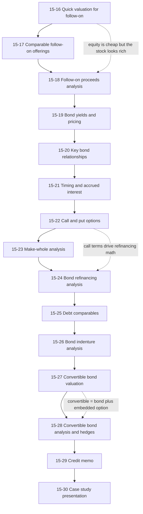

The big picture: the first half asks whether the company should issue stock (equity looks cheap only because the stock is priced high). The second half asks how to price and manage debt, then how a convertible splits between a bond and an option, and finally how a credit analyst would rate the company.

## Lessons

### 15.16 Quick Valuation for the Follow-On Offering

- **Why valuation matters here.** A follow-on offering is a public company selling new shares. The question is what price, premium or discount it can get. Like an IPO, it comes down to valuation and the multiple the market is paying.
- **The cost-of-equity shortcut.** Net income divided by equity value (the inverse of P/E, also called earnings yield) gives a quick "cost" of issuing stock. In the case it was about 1.2%, which is lower than the cost of any debt or convertible option in the case.
- **The trap.** A low earnings yield does not mean equity is a bargain. It means the stock is priced richly. A company issuing stock when its shares look expensive gets a lot of cash per share sold, but the market may later correct. You have to test the shortcut with a valuation before you rely on it.
- **What to skip.** Precedent transactions tell you what buyers paid for companies, which has no bearing on the price a public company can sell new stock at. Skip them. Use trading comparables and a DCF.
- **Comparable companies.** The screen was broad: US internet companies with more than $1 billion in trailing revenue. Many of the names have only a small video business, so the set is imperfect. A pure-play comparable existed but was too small to pass the screen. A broader set is the honest fallback, and you should say so.
- **What the comps showed.** The company grew revenue about twice as fast as the median comp, but grew EBITDA more slowly and had much lower margins. Yet it traded at roughly double the median EV/EBITDA and about three times the median forward P/E. The growth premium does not explain the whole gap.
- **WACC.** The method repeats the valuation case study. Unlever each comp's beta using its D/E and tax rate, take the median, then relever it at the company's current structure and at the optimal (peer median) structure. Almost all the comps were about 97% equity financed, so the structure choice barely matters.
- **The real decision is beta.** The company's own regression beta was far above the peer set (around 1.8 versus about 1.0 relevered). Using the peer beta gave a cost of equity near 8.7%. Using the company's own beta gave about 14%. WACC moved from about 8.6% to about 13.7%. The analyst averaged the two and explained why.

> [!TIP]
> Averaging is a judgment call, not a method. Say so when you present it, and show both ends as a sensitivity.

#### Worked Example (Made-Up Numbers)

| Input | Peer beta case | Own beta case |
|---|---|---|
| Risk-free rate | 3.0% | 3.0% |
| Equity risk premium | 5.0% | 5.0% |
| Levered beta | 1.10 | 2.00 |
| Cost of equity = rf + beta x ERP | 8.5% | 13.0% |

- Unlevering: beta_u = beta_L / (1 + (1 - t) x D/E). Relevering reverses it.
- Keep the D/E near zero for an equity-heavy peer set and the relevering barely moves the beta. The only big swing comes from which beta you believe.

- **DCF design.** Scenarios (base, upside, downside, extreme downside) change revenue growth and margins. Content-related items were not scenario-linked because their percentages were stable. Free cash flow was built the usual way, but the content library spending was treated as capital expenditure, because it works like capex for this company. Stock-based compensation was left out, because it dilutes owners rather than being a true non-cash charge.
- **Terminal value.** Terminal growth was set at 3%, which implied a terminal EBITDA multiple around 12x against a peer median near 15x. The analyst took a moderate discount to the peers and justified it. A 10-year projection was used instead of 5 because the company's margins and spending were still changing a lot, and a 5-year model would put too much of the value in the terminal value.
- **Result.** Base case implied share price about 16% below market. Upside case about 30% above. Downside about 40 to 45% below market. Extreme downside about 70 to 75% below. The overall message is overvalued in every case except the most aggressive one.
- **Client framing.** The lesson's own aside: when presenting to a rich-valued company's board, you would say the stock is "valued at a premium reflecting growth expectations", not "overvalued".
- **Conclusion.** Equity is the sensible route for a company trading this rich. Investors buying growth stories will overlook a lot of reality if they believe in the growth, which is the opportunity the company has.
- **Watch out for.** Scenario-dependent assumptions, the WACC swing from beta, and free cash flow definitions that must add back content spending properly.

> [!TIP]
> Saying "valued at a premium" is fine diplomacy with a client, but keep the internal memo blunt. Your own conclusion should not change with the audience.

> [!TIP]
> Real-world link: sell-side analysts do the same thing when they say a stock trades at a premium "for growth". The useful habit is to ask what growth the price already assumes. A reverse DCF, which solves for the growth rate the price implies, is a good way to make that concrete.

### 15.17 Follow-On Offering Comparables

- **Vocabulary.** A follow-on public offering (FPO) is a second or later sale of stock by a company that is already public. It is either **primary** (new shares, cash goes to the company), **secondary** (existing holders sell, the company gets nothing), or a **mix**. The primary/secondary split is the first thing to pin down.
- **Why investors like them.** A follow-on lets an investor buy a large block at once without moving the market. The offer price is usually set at a modest discount to the last trade, so buyers get an immediate gain on paper.
- **Why companies issue.** Companies usually issue when the stock is high, because a high share price means a low cost of equity. In the case, the after-tax cost of equity was low enough to be cheaper than debt. Primary money is typically used for expansion, debt paydown or an acquisition. "General corporate purposes" usually means one of those three.
- **Signals.** Mostly primary deals read as confidence. Mostly secondary deals read as insiders cashing out, which is a weaker signal: if they believed the price would rise, they would hold. Use of proceeds that says "to repay debt" or "to let holders sell" lands worse than "to grow".
- **Key terms to pull from every deal.**
  - Shares offered and total deal value
  - Deal size as a percent of market cap (the most useful sizing metric, since pre- and post-money do not mean much for a public company)
  - Discount to last trade, and also to the 30-day and one-year averages
  - Primary versus secondary split
  - Price performance from the offer to today
- **Sizing benchmarks.** Deal size as a percent of market cap averaged about 10 to 15% in the comp set, with outliers at 25 to 35%. Very large offers relative to the market are hard to place, and heavy dilution makes new buyers nervous.
- **Discounts.** The median discount to last trade was about 2 to 3%, with a mean near 5%. Big discounts (20% or more) are rare.
- **Screening.** Capital IQ or FactSet is the right tool: filter by date, geography, deal type (follow-on equity), deal size and industry. Aim for 10 to 20 deals in the final set. Lists from research reports are the fallback, and Google searches for "follow-on equity offerings" plus the sector and year usually find those lists. Do not hunt deals one by one.
- **Filings.** US deals use S-3 shelf or prospectus supplements (S-1 is for IPOs). The final prospectus gives shares offered, price, greenshoe, last trade price, use of proceeds and whether there are selling stockholders. Read the "we will not receive any proceeds from selling stockholders" language to spot secondaries. If the split is not explicit, compute it from share counts.
- **Greenshoe.** An over-allotment option (usually about 15% of base shares) that the underwriter can exercise if demand is strong. Treat base plus greenshoe as one deal size when comparing.

#### Worked Example (Made-Up Numbers)

| Item | Value |
|---|---|
| Shares outstanding before | 200 million |
| Last trade price | $50.00 |
| Shares offered (all primary) | 10 million |
| Offer price | $46.00 |
| Discount to last trade | 8.0% |
| Deal value | $460 million |
| Deal size as % of market cap | 10 million / 200 million = 5.0% |
| Primary share | 100% |

- Market cap before the deal is 200M x $50 = $10.0B. The deal is $460M, or 4.6% of pre-deal market cap, and the 5.0% share count figure is the same idea on a per-share basis.
- Post-deal share count is 210 million. Existing holders own 95.2% of the new company, so dilution is 4.8%.

#### Reading the Comps (the Method, Not the Numbers)

1. Is the timing right? Look at the sector's equity market: IPO filings, the follow-on count over several years, and how the sector's index has moved. A rising sector with a rising count of deals is an open window.
2. Is the size right? Compare the company's planned raise to the peer median deal size as a percent of market cap. Too small may not move the needle, too big may not sell.
3. Is the discount right? Compare the planned discount with the peer median. A stock that has run up sharply usually needs a larger discount, because buyers worry about the price giving back gains. An overvalued stock also needs a bigger discount, because buyers see more downside.
4. Did past buyers do well? Price performance since the offer tells you the pattern. A wide range (a 40% gain and a 40% loss in the same set) means the answer depends a lot on the company.

> [!WARNING]
> Common mistake: judging a deal's discount by the last trade alone. If the stock spiked or dropped right before the deal, the 30-day and one-year averages show whether the discount is really a discount.

> [!TIP]
> Real-world link: follow-on offerings usually price in one night after the marketing period, and the whole process is much shorter than an IPO because the company already has audited financials on file with the SEC. That is also why the banks' fee percentage is lower.

### 15.18 Follow-On Offering Proceeds Analysis

This lesson builds a one-tab model that answers five questions: how much of the company gets sold at each discount, how much dilution the EPS takes, what each form of funding costs after tax, how the valuation multiples change, and what to recommend. The layout is close to the IPO proceeds model from the prior module, with one twist: the company already trades, so the offer price is a discount to the market price rather than a valuation target.

- **Size the deal from the cash need, not the share count.** The company needs a fixed dollar amount (the case used a round $1.5B) because it runs short of cash partway through the forecast. So you set the dollar target, then let the share count fall out of the offer price. Lower discount means fewer shares for the same cash.
- **Primary versus secondary.** Only primary shares put cash in the company's pocket. Secondary shares are sold by existing holders. In the case, 90% of the offering was primary, so 10% of the target was never going to the company.
- **Fees.** The underwriting spread applies only to primary shares, because the banks do most of their work marketing new stock. Secondary sellers pay their own fees. Other deal costs (registration, legal, printing) are added as a flat dollar amount.
- **Greenshoe.** Usually about 15% of base shares, and it is allocated between primary and secondary the same way as the base.
- **Discount range.** The model ran from 0% to 25%, wider than the comp set's median, because a richly valued stock needs a bigger incentive.
- **Two prices, two equity values.** Offer price drives the share count. Current trading price drives the diluted share base. The post-money equity value "at pricing" uses the offer price times post-deal shares. "At trading" uses the current price times the same shares. The gap between the two is the discount, and it should equal the discount percentage.
- **Enterprise value can move.** In theory, new cash offsets new shares. In practice, the cash raised is fixed while the share count rises with the discount, so the equity value at trading rises. That is a sign the deal is being priced too cheaply relative to the market.
- **Multiples converge.** At a big discount, the trading multiples are much higher than the pricing multiples. As the discount shrinks to zero they become the same.
- **EPS accretion or dilution.** Compare post-deal EPS with the pre-deal figure. Set the financing scenario to "nothing" first so the comparison is clean.
- **Cost of each source.** Equity cost is pre-deal net income divided by the post-money equity value at pricing (the value at the discounted price, not the market price). Debt and convertible cost are the interest rate times one minus the tax rate, since interest is tax-deductible.
- **Known flaw.** The convertible's cash coupon ignores the amortization of the bond discount, which is a non-cash cost that makes the convertible more expensive than its coupon suggests. Fix this by switching to the convertible scenario and modeling the split. Even with that fix, the convertible was still cheaper than straight debt in the case.

#### Worked Example (Made-Up Numbers)

Target: $1.0B raised, 90% primary, 2.0% spread on primary, $5M other fees. Pre-deal price $80, diluted shares 250M, pre-deal net income $400M.

| Discount | Offer price | Base shares | Primary shares | Primary % of post-deal shares | Net cash to company | Post-money equity at offer | Post-money equity at market | After-tax cost of equity |
|---|---|---|---|---|---|---|---|---|
| 0% | $80.00 | 12.50M | 11.25M | 4.3% | $877M | $20.9B | $20.9B | 1.9% |
| 10% | $72.00 | 13.89M | 12.50M | 4.8% | $877M | $18.9B | $21.0B | 2.1% |
| 20% | $64.00 | 15.63M | 14.06M | 5.3% | $877M | $16.9B | $21.1B | 2.4% |

- Cash to the company is the same in every row (the 90% primary slice of the target), while the shares sold rise with the discount.
- The 10% row: 12.50M primary shares at $72 = $900M gross, less $18M spread (2% x 900) and $5M other fees = $877M net.
- If pre-deal EPS is $400M / 250M = $1.60, and net income is unchanged, post-deal EPS is $400M divided by the new diluted count. At 20% it is about $1.515, a 5.3% dilution, which equals the primary share percentage. This simplified model ignores the interest the cash would earn, so dilution equals the new-share percentage.
- Debt at a 6% coupon with a 25% tax rate costs 4.5% after tax. A convertible at a 2% coupon costs about 1.5% in cash terms before the discount amortization.

> [!TIP]
> Real models include interest on the cash, which softens dilution a little.

The equity cost climbs with the discount, but in this example it stays under the cost of debt. That is the kind of comparison the lesson uses to recommend equity or a convertible over straight debt.

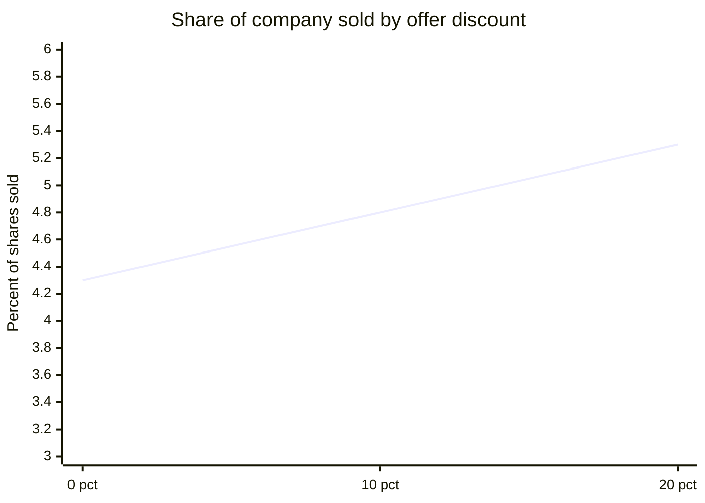

> [!TIP]
> The method to remember: pick the cash target, then size shares from price, then check dilution, then compare after-tax costs. Most bankers' first pass stops at the share count. The useful output is the pair of numbers the client cares about: cash raised, and how much of the company they gave up to get it.

### 15.19 Bond Yields and Pricing

- **Why bonds are harder than they look.** Issuing a plain bond is simple: the company pays a fixed coupon and returns par at maturity. The price of the bond is the present value of those cash flows, which is the same DCF logic used everywhere else. The complexity comes from five things:
  1. **Market price.** Once a bond trades, its price is set by the market, not by par.
  2. **Timing.** Coupons can be annual, semi-annual or quarterly. Compounding frequency changes every yield number.
  3. **Accrued interest.** A buyer mid-period pays the seller the interest that has built up since the last coupon. Some quoted prices include it and some do not, so always check which price you have.
  4. **Embedded options.** Calls (the issuer can repay early, usually at a premium such as 102 to 105% of par), puts (the holder can force repayment) and conversion rights each change the expected cash flows.
  5. **Equity kickers.** Warrants and equity options attached to debt, common in distressed or junior debt. The bond's yield then depends on the stock price.
- **Two uses in banking.** (a) Compare financing alternatives and recommend the best one. (b) Help a company refinance existing debt by choosing the right mix of debt, equity and other securities. A typical question: a company has 8% bonds with a callable premium. Rates have fallen. What is the yield to maturity, what is the bond worth, and what terms would investors accept on a new deal?
- **Pricing in Excel.** Build the cash flow line first: coupon each year while the bond is outstanding, then par times the redemption percentage at maturity. Then discount each flow. Excel's NPV function returns present values of a row of cash flows, despite its name. Wrap the range in OFFSET so the model starts at the year you buy the bond.
- **Excel quirk.** Several bond functions take percentages as whole numbers (98 for 98% of par), so divide or multiply by 100 to match.
- **Price drivers.** Prevailing rates, the coupon, credit risk (a lower expected recovery cuts price) and the expected path of future rates. A downgrade from investment grade to just below it might cut the redemption expectation from 100% to 99% of par, which shaves a few dollars off the price. Healthy issuers usually trade within about 5 to 10% of par. Gaps of 20 to 50% signal distress.
- **Yield definitions.**
  - *Nominal yield*: the coupon rate.
  - *Current yield*: annual coupon divided by market price.
  - *Yield to maturity (YTM)*: the IRR from buying at today's price, holding to maturity and receiving every payment on time. It assumes coupons are reinvested at the same yield.
- **Three ways to compute YTM.** Excel's YIELD function (needs settlement date, maturity, coupon, price per 100, redemption per 100 and frequency), IRR on an annual cash flow row (works only for annual periods), or a quick approximation.

#### Worked Example (Made-Up Numbers)

A 10-year, $1,000 par bond with a 6% annual coupon, bought at par on the issue date.

| Market rate | Bond price | Current yield | Note |
|---|---|---|---|
| 5.0% | $1,077 | 5.6% | Premium |
| 5.5% | $1,038 | 5.8% | Premium |
| 6.0% | $1,000 | 6.0% | At par |
| 6.5% | $964 | 6.2% | Discount |
| 7.0% | $930 | 6.5% | Discount |
| 7.5% | $897 | 6.7% | Discount |

- Price at 6.5%: coupons of $60 a year for 10 years have a PV of about $431. Principal of $1,000 has a PV of about $533. Total about $964.
- YTM when you buy at $964 is the rate that sets that price to the cash flows. It is 6.5%, the market rate. This is the rule that the YTM equals the market rate when the bond is priced fairly.
- Quick approximation: (coupon + (par - price) / years) / ((par + price) / 2) = (60 + 3.6) / 982 = about 6.5%. The shortcut matches the exact answer closely.
- Redemption at 99% of par instead of 100% lowers the price by about $5, from $964 to $959.

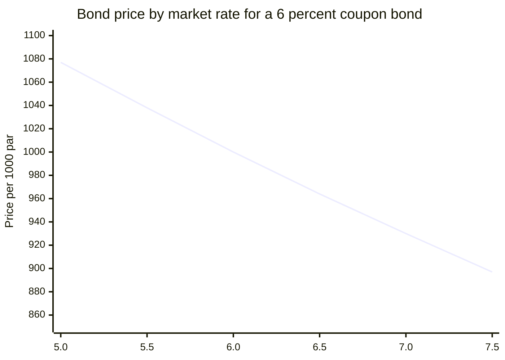

> [!WARNING]
> Common mistakes: (1) using a par price as if it were the market price; (2) forgetting accrued interest when comparing a quote to a model price; (3) treating YTM as a promise when it assumes no default, no early call and reinvestment at the same rate; (4) using current yield as if it were a return. Current yield ignores the pull to par.

> [!TIP]
> Real-world link: when a bank's debt capital markets desk prices a new bond, it starts from where comparable bonds yield today, then adds or subtracts a spread for size, credit and the call features. The YTM math here is the same mechanic the desk uses to convert a yield into a price.

### 15.20 Key Bond Relationships: Rates, Prices, Duration and Convexity

This lesson is mostly interview material for debt capital markets, leveraged finance, restructuring and credit funds. The core ideas are simple, but you should be able to say them crisply and show them on a sketch.

- **Price and rate are inversely related.** When the market discount rate rises, the bond price falls, and vice versa.
- **The price-yield curve is convex.** Prices rise more when yields fall than they fall when yields rise by the same amount. A 2% move down adds more value than a 2% move up takes away. The discount factor itself is convex in the rate, which is why this happens.
- **Coupon and price.** Higher coupons mean higher prices. The effect is closer to linear than the rate effect, because the coupon changes the cash flows themselves, while the market rate only changes how they are discounted.
- **Yield ordering.** At a discount: YTM > current yield > coupon. At par: all three are equal. At a premium: coupon > current yield > YTM. Memorize this, because it comes up in interviews.
- **Higher coupons are less rate-sensitive.** More of the value comes back early, so less of it sits far in the future. A distressed issuer paying 15% or 20% therefore has bonds that move less with rates than a healthy issuer's low-coupon bonds, but its credit risk dominates anyway.
- **Longer maturities are more rate-sensitive.** More cash flows are discounted at a higher exponent, so each rate change moves more terms. Exceptions appear with very low coupons and very long maturities.
- **Pull to par.** A premium or discount bond drifts toward par as maturity nears, because there are fewer payments left and less compounding to change the price.

#### Duration

- **Definition.** Macaulay duration is the present-value-weighted average time to receive the cash flows, divided by the price. A zero-coupon bond's duration equals its maturity. Any coupon makes duration shorter.
- **Direction.** Duration rises with lower coupons, longer maturities and lower market rates. The intuition: when the bond pays more cash early, you get your money back sooner on average.
- **Modified duration.** Macaulay duration divided by (1 + YTM / payments per year). It gives the approximate percent price change for a 1 point change in yield. The price change is approximately -modified duration x change in yield.
- **Comparing bonds.** Duration lets you compare a 10-year zero with a 7-year 6% bond on the same scale. In the lesson's example, the 7-year 6% bond had about 60% of the rate exposure of the 10-year zero.

#### Convexity

- **Why duration is not enough.** Duration is a straight-line tangent to a curved price-yield line. It misses the error, which grows as the yield move gets bigger and is larger on the way down than on the way up.
- **The fix.** Add a convexity term. The adjusted price change is roughly -modified duration x change in yield plus convexity x (change in yield)^2 / 2. With both terms the prediction is much closer.
- **Convexity drivers.** Convexity falls as yields rise and rises as yields fall. Lower-coupon bonds have higher convexity. Zero-coupon bonds have the highest convexity of plain bonds, because all their value sits at maturity.
- **Practical view.** Nobody predicts price with a formula in 2020s practice. You use the Excel price, the YIELD function and the DURATION and MDURATION functions. The useful thing is knowing that a higher-convexity bond gains more when rates fall than it loses when rates rise, which is generally viewed favorably.

#### Worked Example (Made-Up Numbers)

A 10-year, 6% annual-pay bond priced at par ($1,000) with a 6.0% YTM.

| Measure | Value | Meaning |
|---|---|---|
| Macaulay duration | about 7.8 years | Time to recover the price, weighted by cash flow timing |
| Modified duration | about 7.4 | About 7.4% price move per 1 point of yield |
| Price change for +1 point (approx.) | about -7.4% | Duration only; about $926 |
| Price change for +1 point (with convexity) | about -7.0% | Adds back the curve term; about $930 |

- Actual price at 7.0% is about $930, so the duration-plus-convexity estimate lands within a few dollars, while duration alone misses by more on large moves.
- A rule of thumb from the lesson: if the company refinances at a lower coupon and a longer maturity, its modified duration rises and investors may refuse. A 9-year deal can keep duration close to the original bond's duration.

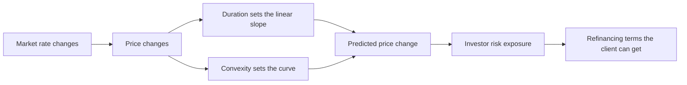

#### Interview Questions to Be Ready For

- Why does a bond fall more when rates rise 1% than it rises when rates fall 1%? (Convexity: the price-yield curve bends, so the same move is worth more on the downside of yield.)
- Is a bond trading at a premium more or less rate-sensitive than one at par? (Lower yield means higher duration and convexity, so usually more sensitive. Check the coupon and maturity before you answer.)
- Which bond has higher duration: 5-year 8% or 5-year 4%? (The 4% bond, because less cash comes early.)

> [!WARNING]
> Common mistake: saying "duration is the years to maturity". Duration is a weighted average time, so it is always shorter than maturity for a coupon bond. And modified duration is not the same as Macaulay duration; check which one the question means.

> [!TIP]
> Real-world link: portfolio managers quote duration in their risk reports. A rate move of 50 basis points on a book with modified duration of 6 changes the book value by about 3%. That single number is why they care about the duration of a new bond, not only its coupon.

### 15.21 Timing of Bond Payments and Accrued Interest

This lesson adds real-world timing to the bond model from 15.19 and 15.20. It is less about new theory and more about the details that break a model when you use real dates.

- **Coupon frequency.** The earlier model assumed one coupon per year, paid at period end. Most US and Asian bonds pay semi-annually, some pay quarterly, and many European bonds pay annually. The coupon per period is the annual rate divided by the number of payments per year.
- **Real maturity dates are messy.** A bond can mature on any day, not just December 31. Issuers often pick dates that suit their funding calendar, so a model needs to handle settlement and maturity in the middle of a period.
- **Built-in functions handle frequency.** Excel's PRICE, YIELD and DURATION functions take a frequency argument (1, 2 or 4). Use them once you understand the mechanics, because they do not need a visible cash-flow row for every period.
- **Manual model changes if you build your own.** Period counts change from years to periods; date steps move from 12 months to 12 divided by the frequency; NPV (which assumes annual periods) is replaced with a discount factor of (1 + rate / frequency) raised to the period number; duration weights are scaled by the period length in years; and the zero-check against the built-in price should still match.
- **Irregular dates break the simplifying assumptions.** When settlement falls mid-period, the discount factors and periods no longer line up with a clean timeline, and the built-in price and your manual price drift apart. Approximations such as the quick yield-to-maturity formula also get less accurate.
- **Accrued interest.** A buyer between coupon dates pays the seller the interest that has built up since the last payment. The clean price is the quoted price without that interest. The dirty price (also called all-in or gross) is clean price plus accrued interest. The buyer gets the full next coupon, so accrued interest is effectively a refund of the seller's share.
- **Clean versus dirty.** US quotes on the major data services are usually clean. European quotes are usually dirty, because annual coupons create a larger accrued amount. Always ask which one you are looking at before you compute a yield.
- **Excel approach to accrued interest.** Do not rely on the built-in accrued interest function, which the lesson describes as unhelpful. Instead, use COUPPCD to find the last coupon date before settlement, then YEARFRAC between that date and settlement. Multiply by the annual coupon and par. Pick one day-count convention and state it.

#### Worked Example (Made-Up Numbers)

A $1,000 bond with a 6% coupon paid semi-annually, so each coupon is $30. Last coupon April 1, next coupon October 1 (182 days in the period). You buy on June 1, which is 61 days after the last coupon.

| Item | Calculation | Value |
|---|---|---|
| Coupon per period | 6% / 2 x $1,000 | $30.00 |
| Days accrued | June 1 minus April 1 | 61 |
| Days in period | April 1 to October 1 | 182 |
| Accrued interest | $30 x 61 / 182 | $10.05 |
| Clean price (quoted) | assumed | $1,050.00 |
| Dirty price (you pay) | clean + accrued | $1,060.05 |

- On October 1 the full $30 coupon is paid to the holder of record. The accrued amount you paid in June is not deducted from that payment. You are paying the seller for the seller's share.
- The dirty price is the amount you wire. The clean price is the number you would use in the yield formula if you follow the quoted convention.

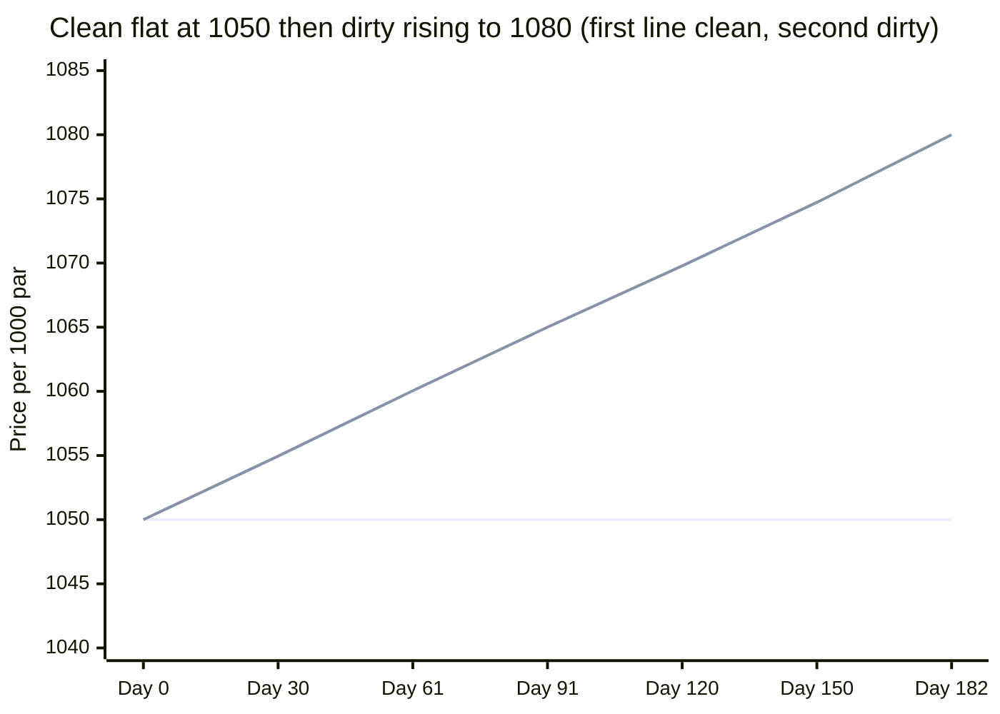

Dirty price climbs in a straight line as interest accrues, then drops by the $30 coupon on the payment date. The clean price stays flat, which is why quoted prices look like step functions over time.

> [!WARNING]
> Common mistake: adding accrued interest to the price when the question is about the holder's return from a coupon date onward, or forgetting it when comparing a model price to a quote. Check the convention before you compare numbers.

> [!TIP]
> Practical note: the accrued interest concept matters for trade settlement, fund NAV calculations and bond desks, which price in clean terms and then add accrued interest at settlement. A small error in day count can cause a reconciliation break, so teams fix one convention and document it.

### 15.22 Call and Put Options and Redemption Premiums

- **Why embedded options exist.** A bond fixes the coupon, the maturity and the covenants up front, so both sides can trade risk through options. A call lets the issuer repay early, usually at a premium over par. A put lets the investor force early repayment, usually at par. Each option is paid for in the coupon: callable bonds must pay more, putable bonds accept less.
- **Who uses calls.** The issuer, after rates fall or its credit improves, to refinance cheaper. The investor gives up some upside when the bond is called.
- **Who uses puts.** The investor, when rates rise or credit weakens, to get cash back and reinvest. The issuer carries the risk that its funding disappears.
- **Where they show up.** Calls and puts are common in high-yield and non-investment-grade debt. Investment-grade bonds are often non-callable or carry high premiums that make calling uneconomic. A 101 call premium on a modest rate drop may make sense; a 110 or 115 premium usually does not.
- **Typical call schedule.** A lockout (for example, the first three years of a ten-year bond), then a premium that steps down each year (105, 104, and so on) until it reaches par. Call styles are European (one date), Bermudan (a set of dates) and American (any time in a window). Some calls only allow redeeming a percentage of the principal, and some require paying accrued interest.
- **Yield to call (YTC).** Same YIELD function as yield to maturity, but the maturity input is the call date and the redemption input is the call price.
- **Yield to worst (YTW).** The minimum of the yield to maturity and every yield to call. It is the lowest return the investor can get without a default, and it is the conservative number to quote for return expectations.
- **Accrued interest in yield to call.** Most market quotes use clean prices. A more exact version uses the dirty price for the purchase and adds accrued interest to the call redemption. The direction of the difference depends on timing, so check both.
- **Puts.** Yield to put is computed the same way with the put date as the maturity. Puts are usually at par. Because the investor holds the put, putable bonds usually yield less than otherwise identical bonds. A put is only worth exercising when rates have risen above the coupon, so at a low coupon the yield to put looks very low (the investor would never put a bond paying above market).
- **Valuing embedded options.** Callable bond = straight bond minus call option. Putable bond = straight bond plus put option. Valuing the option properly needs a rate tree with probabilities, which sales and trading teams do. A banker mainly needs to know which way the value moves.

#### Worked Example (Made-Up Numbers)

A 10-year, $1,000 bond with a 6% coupon paid semi-annually ($30 per half year). Clean price today $1,020. Call schedule: no calls in years 0 to 4; the call price is 104 in year 5, then 103, 102, 101, and 100 from year 8 onward.

| Yield measure | Assumption | Approximate annual yield |
|---|---|---|
| Yield to call, year 5 | Called at 104 in year 5 | about 6.2% |
| Yield to maturity | Repaid at 100 at year 10 | about 5.7% |
| Yield to worst | Minimum of the above | about 5.7% (equals YTM) |

- Buying at $1,020 and getting $1,040 in five years is a gain over five years, which pushes the call yield up. Getting $1,000 at year 10 spreads the $20 loss over ten years, which keeps YTM lower.
- Yield to worst is the number you quote to the client as the "worst case" return: the bond will not be worth less than this if it is held or called on schedule, barring default.
- Flip the example: if the bond traded at $1,060, above the $1,040 call price, the call yield would fall below YTM, and YTW would become the call yield. The rule is that the bond's price relative to the call price decides which yield is lowest.

#### Practice-Style Question (Method)

A client has a callable 7%, 10-year bond with a 2-year lockout, a call premium stepping down from 105, and prevailing rates at 6%. If the client wants a non-callable bond instead, what coupon should they expect? Method: compute YTC at each call date using the premium schedule, find YTW, and note that YTM equals the market rate by construction. The non-callable coupon should land between YTW and YTM, since the issuer may or may not call. In the lesson, that gave a range near 5.7% to 6%. Your answer should give a range, not a point.

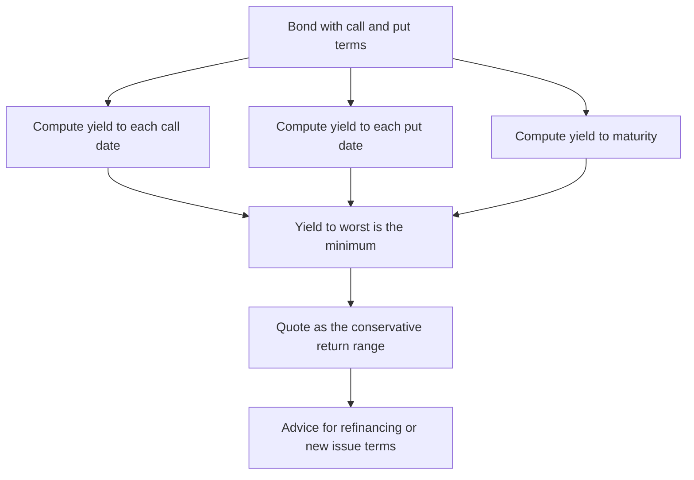

> [!WARNING]
> Common mistake: using yield to maturity for a callable bond that trades above par. The call date is the real risk, and YTW is the figure that should drive the advice.

> [!TIP]
> Real-world link: high-yield investors look at yield to worst on every bond they buy and often price bonds to the worst-case call date. When a company says it will refinance at "the current rate", it usually means rates compared with its existing callable bonds, which is why calling terms matter so much in a refinancing decision.

### 15.23 Make-Whole Calls

- **The idea.** A make-whole provision lets the issuer redeem early, but the price is set so the investor is made whole: the redemption amount equals the present value of the principal and all required interest through a set date, discounted at a Treasury rate plus a spread. The result is a price that moves with interest rates, unlike a fixed call schedule.
- **Why it matters.** It discourages early calls because the price is high when rates are low. In practice it can also make a bond look non-callable when it is technically callable during a lockout period. Data vendors sometimes classify these bonds wrongly, so read the indenture rather than the database field.
- **Fixed versus make-whole.** A fixed schedule says the call price is 105, 103 and so on. A make-whole says the price is the greater of par and the present value of remaining payments through a set date, at a Treasury-plus-spread discount rate. A common spread is 50 basis points for US corporate bonds.
- **Accrued interest.** The make-whole value usually excludes accrued interest. The issuer pays accrued interest on top of the make-whole price.
- **Key terms to find in the indenture.** Coupon, maturity, coupon frequency, par amount, the call date, the end date of the discounting window (it may be maturity, the end of the lockout, or another date), the spread and which Treasury benchmark to use.

#### Calculation Steps

1. Enter the bond terms and the call date.
2. Find the last coupon date before the call (COUPPCD) and project the remaining coupon dates forward (EDATE, moving 12 divided by the frequency months each time).
3. Find a Treasury yield with a maturity close to the time from the call date to the window end. If the filing gives only a 3-year or 5-year rate, use the average of the two nearest points.
4. Project the coupons and principal inside the discounting window. Subtract accrued interest from the first period only if the model needs it for the investor's position.
5. Compute the discount time for each payment in years (YEARFRAC from the call date, then steps of 1 divided by the frequency).
6. Build a table of discount rates across spreads, so the client can see the cost of each spread choice.
7. Discount each payment at each rate.
8. Sum the present values and divide by par to get the make-whole price as a percent of par.
9. Compare the make-whole price with the fixed call schedule and with par.
10. Recommend. A high make-whole price (110 to 120) means the call is expensive, so the company will not call. A price near 102 to 103 may make early redemption worth considering.

#### Worked Example (Made-Up Numbers)

A $500M bond with a 6% coupon, paid semi-annually (a $15M coupon every half year, which is 3% of par per period). Four years to maturity. The call is at the start of the window. The discounting window ends two years later, which means four coupon dates. Discount rate is a Treasury yield of 3.0% plus a 0.50% spread, which is 3.50% a year, or 1.75% per half-year.

| Spread over Treasury | Discount rate (annual) | Make-whole price (% of par) | Cost to call $500M |
|---|---|---|---|
| 0.00% | 3.00% | 105.78 | $528.9M |
| 0.25% | 3.25% | 105.30 | $526.5M |
| 0.50% | 3.50% | 104.78 | $523.9M |
| 1.00% | 4.00% | 103.81 | $519.0M |

- At a 0.50% spread, the present value of the four $15M coupons is about $57.5M, and the present value of the $500M principal at the window end is about $466.5M. Total about $523.9M, or 104.78% of par.
- Lowering the spread raises the make-whole price, because the discount rate is smaller. Widening the spread lowers it.
- If the spread between corporate bonds and Treasuries collapses toward zero, as it did in a crisis, the make-whole price falls toward par and the company may call. Investors who assumed the call was too expensive can be surprised.

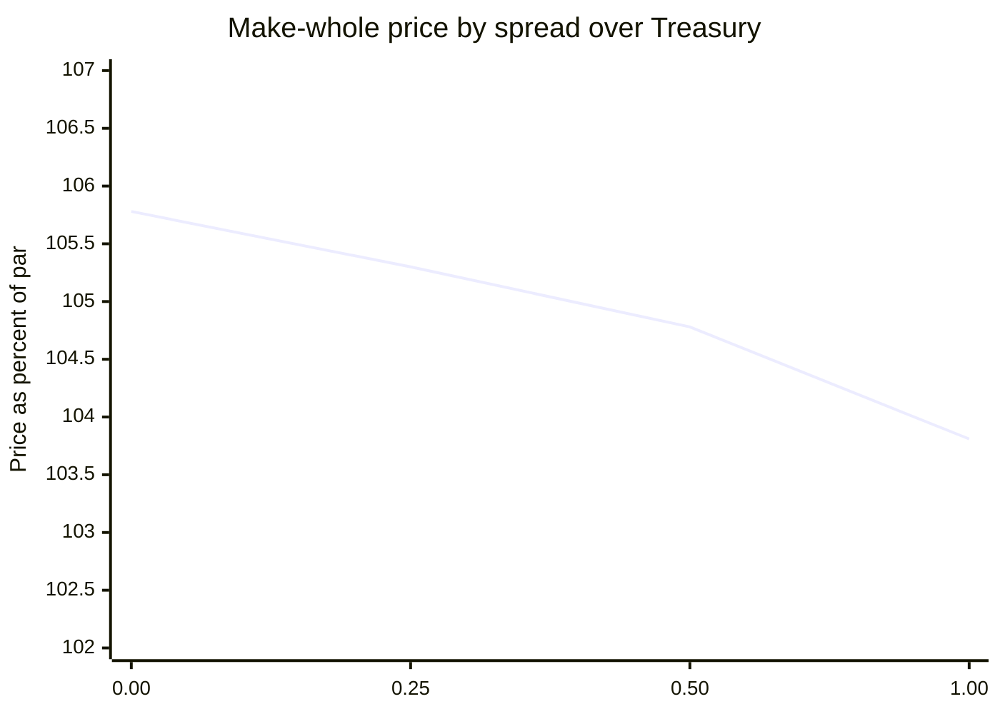

> [!WARNING]
> Common mistake: using the full maturity to discount the cash flows, when the indenture stops the window earlier. The text of the indenture decides the end date, and a shorter window gives a much lower price.

> [!TIP]
> Real-world link: when an issuer is refinancing, the make-whole price is the number on the cover page of the refinancing memo. Bankers compare it with the coupon the company would pay on a new bond to see whether the savings justify calling.

### 15.24 Refinancing a Distressed Company's Bond

This is the wrap-up exercise for the bond segment. It is a practice case in which you test a restructuring proposal against what the bondholders would actually earn. The lesson's own message: there is rarely one right answer, but the numbers should show whether investors would accept the deal.

- **The situation.** A distressed issuer has a bond coming due in about two years and cannot repay the principal. It wants an extension, a slightly higher coupon, a call schedule and equity for investors. A hedge fund has bought the bonds at a deep discount, so its return depends on the terms.
- **Why longer is riskier.** A longer maturity adds duration (more interest rate risk) and gives the company more time to run into trouble. Distressed investors want compensation for both.
- **The levers.** The coupon is limited because the company cannot afford a large increase. The other levers are a redemption price above par, the timing of calls, and an equity grant at maturity or call. Equity grants are common in distressed and mezzanine debt, rare in healthy companies.
- **The core metric: yield to exit.** Treat it as yield to call, but with three changes: use the dirty price (the buyer pays accrued interest), include any redemption premium, and include the value of any equity granted. It is the return investors actually expect from the whole package.
- **Step-by-step approach.**
  1. Project the cash flows of the existing bond, and compute its yield to maturity and yield to exit.
  2. Project the cash flows of the proposed bond, including any redemption premium and equity grant.
  3. Compute the same metrics for the proposal, and compare the yields.
  4. Check duration. Higher duration means investors need a higher yield.
  5. Adjust the terms (redemption premium, equity share, timing) until the yield is in a range that makes sense for the risk.
  6. Recommend a package and explain the reasoning.
- **Design logic.** An equity grant that rises over time pushes the company to redeem early (less dilution) and pushes investors' yield up when it does, so both sides are aligned.

#### Worked Example (Made-Up Numbers, Annual Coupons for Simplicity)

Existing bond: $200M face, 12% annual coupon, two years left. Investors buy at 75% of face, so they pay $150M. Payments: $24M at year 1, $224M at year 2 (coupon plus principal).

Proposal: four-year maturity, 13% coupon ($26M a year), no call for two years, and an equity grant of 15% of the company at maturity, which the company values at $200M, so the grant is $30M.

| Scenario | Cash at year 4 (plus coupons) | Yield to exit (approx.) | Verdict |
|---|---|---|---|
| Existing bond, paid at par at year 2 | $224M at year 2 | 30.2% | Baseline |
| Proposal as drafted (15% equity, $30M) | $230M principal and equity, plus $26M coupon | 28.9% | Too low |
| Revised: 25% equity ($50M) | $250M principal and equity, plus $26M coupon | 30.8% | Matches or beats baseline |

- The proposal yields less than the existing bond even though it has more risk and longer duration. Investors would refuse it.
- Increasing the equity grant from 15% to 25% lifts the yield back to about 30.8%. That is above the baseline and reflects the extra time and risk.
- The sensible structure would be a flat redemption price (for example 110) with an equity share that steps up each six months, from 10% to 25%. That gives the company a reason to call early and gives investors a rising yield if it waits.

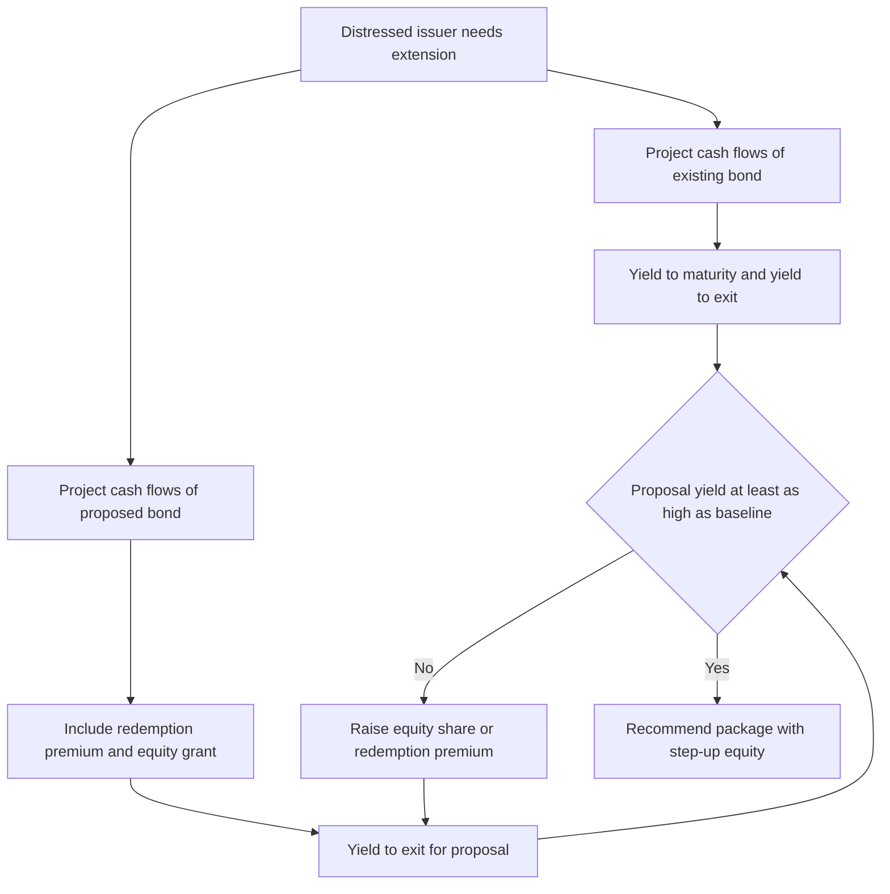

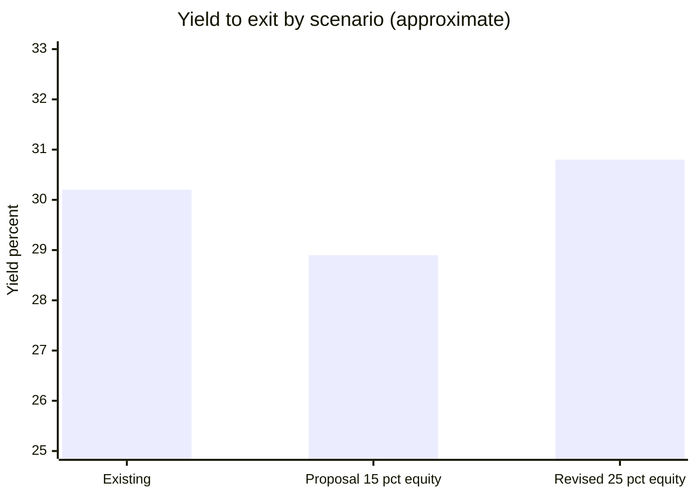

> [!WARNING]
> Common mistake: comparing the proposal's coupon with the old coupon. The coupon is the smallest part of the return for a distressed bond. The price paid, the timing of the principal and any equity decide the yield.

> [!TIP]
> Real-world link: restructuring advisors run this exact comparison when a creditor group is offered a new note plus equity. The advice is usually "the yield to exit must at least match the claim value you would get in a bankruptcy plan", and the equity valuation is the most uncertain input.

### 15.25 Debt Comparables

- **Purpose.** Public comps tell you whether a stock is rich or cheap. Debt comps tell you whether a proposed bond (its size, coupon, tenor and conversion terms) is in line with what similar issuers have sold. Any group that advises a company on raising debt, or on an LBO, needs this.
- **Screening criteria.** Industry, geography, time window, issue size, and credit rating. The rating screen is the one people skip, and it matters most. Two companies in the same sector can have very different default risk because of cash flow and size.
- **Credit ratings and default.** Historical default rates rise steeply as ratings fall. Keep the comp set in a narrow band around the issuer's own rating. For a non-investment-grade issuer, that band is roughly BB+ to BB- (Ba1 to Ba3), and you can widen it to the highly speculative group if you must. Do not mix investment-grade and non-investment-grade issuers.
- **Practical sourcing.** Capital IQ or a similar terminal gives the coupon, offering date, maturity, size, duration, convexity and yield to worst in one export. Without it, a screener such as Google Finance is possible but time-consuming, because filings must be read one at a time. With 100-plus issues, cut to unique issuers (repeat issuers often sell similar deals) and aim for 5 to 10 names.
- **Key stats for a debt comp.**
  - Offering date and amount
  - Bond price, and whether it trades at a discount or premium to par
  - Coupon, yield to maturity and yield to worst
  - Remaining years to maturity and original tenor (a simple day-count with 360 days a year is fine)
  - Issuer credit rating (use the issuer's rating, not the issue's rating, where possible)
  - Coverage (EBITDA to interest) and leverage (debt to EBITDA)
- **Convertible comps.** Add conversion price, conversion ratio (1,000 divided by the conversion price, which gives shares per bond) and the conversion premium on the offering date (conversion price relative to the stock price then).
- **Reading coupon against yield.** A bond at a premium to par has yield below coupon, which usually means rates fell after it was issued. A convertible at a deep discount to par can have a yield far above its coupon, which is why convertible coupons look low.
- **Term loans and covenants.** Term loans float off a benchmark, so compare spreads, not coupons. Maintenance covenant levels (such as maximum debt to EBITDA) can be used as market benchmarks when the comps have them. Junior debt usually has incurrence covenants or none.

#### Worked Example (Made-Up Numbers)

A set of six senior unsecured notes from issuers in the same rating band:

| Stat | Median of comps | Our proposal |
|---|---|---|
| Coupon | 5.13% | 5.50% |
| Yield to maturity | 5.15% | not set |
| Tenor | 7.5 to 8.5 years | 10 years |
| Debt to EBITDA | 4.8x | 3.0x (base case) |
| EBITDA to interest | 6.0x | 4.5x |

- Leverage is well inside the comp median, so the size of the issue is likely acceptable in the base case, but not in the downside case.
- The coupon is slightly above the median, and the yield to maturity sits below the coupon. This suggests the proposed coupon is too high, so lower it to around 5.5% for a 10-year note, or shorten the tenor to around 8 years.
- For the convertible comps, the coupon median was about 1.25% but yield to worst was about 2%. That suggests the coupon may be fine if the yield is what investors actually earn, and the conversion premium should be near the comp median (roughly 45% in the lesson's example, instead of 50%).

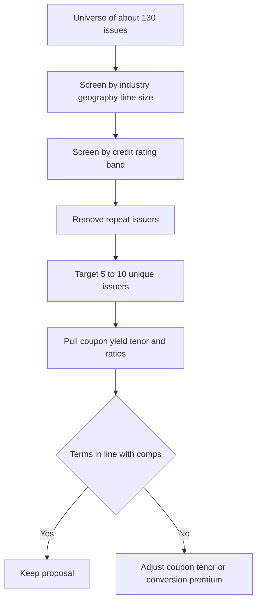

**Two questions to answer with the comps:**

1. Is the amount reasonable for the company's size, industry and rating? Check leverage and coverage in the base case, and see whether the downside case breaks the comp ranges.
2. Are the terms realistic? Compare coupon, yield, tenor and, for convertibles, the conversion premium.

> [!WARNING]
> Common mistake: using the coupon as the market price of debt. For bonds trading away from par, yield to maturity or yield to worst is the better number to compare, and for convertibles the coupon can understate the real cost of the deal.

> [!TIP]
> Real-world link: in a real pricing meeting, the banker shows the comp table and the client decides. A useful tip is to show the range, not just the median, and to explain which comps you dropped and why. Clients question a comp set more than they question the medians.

### 15.26 Bond Indenture Analysis

An indenture is the legal contract between the issuer and the bondholders. It sets every term that a spreadsheet can't easily capture: who guarantees the debt, where it ranks, when it can be redeemed, what happens on a sale of the company, how much more debt is allowed, and how far asset sales can go. This lesson is about extracting those terms into a one-page summary that a colleague can use.

- **Where to look.** The annual report or 10-Q often gives the amount outstanding, the fair value (a price proxy when no terminal is available), the coupon and the payment dates. The indenture is needed for guarantors, ranking, the detailed call terms, covenants and the trustee. Expect to use both. Many indentures are mostly template text, so once you know the boilerplate, you can skim quickly.
- **Terms to capture** (one row each in the analysis):
  - Amount issued and amount still outstanding
  - Current price (or fair value as a percent of par)
  - Coupon and payment dates
  - Maturity
  - Guarantors: which parent and subsidiaries stand behind the debt, domestic, foreign or both
  - Ranking: senior secured, senior unsecured, subordinated; and how it ranks against existing and future debt
  - Optional redemption: call schedule, make-whole terms, any partial call limits
  - Change of control: usually a put at 101% of par if the company is sold
  - Permitted indebtedness: caps on bank debt, subsidiary debt, refinancing limits and any leverage or coverage tests
  - Asset sales: limits on selling substantially all assets, and any mandatory repayment from sale proceeds
  - Trustee: the bank that administers the issue
- **Search keywords that work.** "Optional redemption", "change of control", "Indebtedness", "Aggregate debt", "Consolidated" (for EBITDA definitions), "times" (ratio covenants are usually written out, e.g. "three times"), "Sale of assets" and "Trustee". Keyword search finds most terms in five to ten minutes.
- **Reading the language.** A phrase such as "greater of $X and Y times consolidated EBITDA" is a basket with a dollar floor and a leverage-based limit. The company can use whichever is larger. A phrase such as "secured debt not to exceed 15% of net tangible assets" is a lien basket.
- **Ranking matters most in distress.** In a restructuring or liquidation, ranking decides who gets paid first. A note that "ranks equally with all existing and future senior unsecured debt" is pari passu with that group.
- **Why the practical summary matters.** Before recommending a new debt package, you must confirm the new debt is allowed under the current indentures. If existing covenants block a $2 billion bank loan, the advice fails before the pricing discussion starts.

#### Worked Example (Made-Up Numbers)

A sample $400M senior unsecured note issued 2013, maturing 2024, coupon 5.75% paid semi-annually on March 1 and September 1.

| Term | Source | What it says (summary) |
|---|---|---|
| Amount outstanding | 10-K | $400M, same as original issue |
| Price | 10-K fair value | $416M, so about 104% of par |
| Guarantors | Indenture | Not named in the filings; general language only |
| Ranking | Indenture | Pari passu with other senior unsecured notes; further notes can be issued with the same rank |
| Optional redemption | 10-K and indenture | Make-whole (PV of remaining payments at Treasury plus 50 bp) |
| Change of control | 10-K | 101% of par |
| Debt basket | Indenture | Greater of $750M and 1.5x consolidated EBITDA |
| Asset sales | Indenture | No sale of substantially all assets unless the buyer assumes the notes |
| Trustee | Indenture | Named at the top of the indenture |

- The 104% price is found by dividing fair value by principal ($416M / $400M). It is a fair value estimate, so treat it as a rough quote rather than a traded price.
- The debt basket is the most useful term for a new issue. If the company's EBITDA is $1.0B, the greater of $750M and 1.5x EBITDA gives $1.5B of headroom in total. If it has $900M already, a new $700M issue would breach the basket.

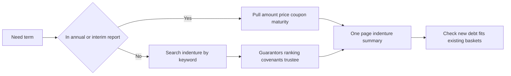

> [!WARNING]
> Common mistake: relying on the filings alone. Ranking, guarantors and debt baskets often appear only in the indenture, and missing a basket can invalidate a financing plan.

> [!TIP]
> Real-world link: leveraged finance teams keep a standard "indenture summary" for each issuer in the coverage universe. It is the first thing read when a client asks whether it can add debt, and the baskets are often the reason a deal is restructured.

### 15.27 Convertible Bond Valuation with Black-Scholes

- **Why value a convertible.** The accounting split at issue (bond plus equity piece) is a starting point, not a market value. Over time the market value moves with the stock, rates and volatility. A banker uses the valuation to judge how much investors will want the deal, what terms make it sell, and how much a change in dividends or volatility would move value. An investor uses it to test whether the instrument has an attractive asymmetric payoff.
- **Split into components.**
  - *Debt piece*: present value of coupons and principal at the yield on a similar straight bond. That yield is a government rate for a similar tenor plus a credit spread for the issuer's rating. Use PRICE in Excel so you can flex coupon frequency.
  - *Option piece*: the embedded call on the stock, valued with Black-Scholes. Value of the option = bond value minus debt piece, or valued directly.
- **The option value.** It is only positive if the stock ends above the conversion price. Black-Scholes gives a probability-weighted value of that payoff. The inputs are the stock price S, the conversion price K, the risk-free rate r, the time to maturity T, the volatility sigma and the dividend yield q.
- **Key formulas.**
  - d1 = [ln(S/K) + (r - q + sigma^2 / 2) x T] / (sigma x sqrt(T))
  - d2 = d1 - sigma x sqrt(T)
  - Call value = S x e^(-qT) x N(d1) - K x e^(-rT) x N(d2)
  - Excel: NORMSDIST for N(), EXP for e, and LN for the natural log.
- **Intuition.** Higher volatility raises the value of the option, because the stock is more likely to end far above the conversion price. A higher stock price raises value, a higher conversion price lowers it, and a higher dividend yield lowers the call because the holder of the option misses the dividend.
- **Dilution adjustment (Optional).** Some analysts divide the option value by one plus the dilution from conversion.
- **Volatility is the big judgment call.** Historical, implied, weighted or ten-day measures all give different answers. The lesson used the company's own disclosed volatility and picked a middle value. Show the answer across a range.
- **Limits of the method.** Black-Scholes assumes a European option (exercise only at expiry), constant volatility, constant rates and normal price moves. Convertibles usually can convert over many dates, and real volatility and rates change over six or ten years. The model is much better for a short-dated option. For a long convertible, use it for sensitivity, not as a fair-value answer.
- **Better mental model.** A convertible is a bond (a floor) plus a call on the stock (upside), with possible caps on the upside. Far above the conversion price it behaves like a bond. Near the conversion price it behaves more like equity.

#### Worked Example (Made-Up Numbers, per $100 of Face Value)

Six-year, 2% annual coupon convertible issued at par. Yield on a similar straight bond is 5.5% (3.0% risk-free plus 2.5% credit spread). Stock price $50, conversion price $60, so each $100 bond converts into 100/60 = 1.667 shares. Dividend yield 0%, risk-free rate 3.0% continuous.

Debt piece: coupons of $2 a year and $100 at year six, discounted at 5.5%, give a present value of about $82.5.

Option piece, using Black-Scholes on one share:

| Volatility | d1 | d2 | Call per share | Option value per $100 bond | Implied bond value |
|---|---|---|---|---|---|
| 20% | 0.24 | -0.25 | $9.62 | $16.0 | $98.6 |
| 30% | 0.36 | -0.37 | $14.29 | $23.8 | $106.3 |
| 45% | 0.55 | -0.55 | $20.89 | $34.8 | $117.3 |

- At 30% volatility the implied value is about $106, which says the investors are getting more than they paid for at par. The issuer may have priced the terms too generously for itself, or it may have set the conversion premium too low.
- A 30% stock volatility reduces the option cost but does not remove the gap, so the conversion premium is a lever to test. A larger premium lowers the option value and makes the deal cheaper for the issuer.
- The sensitivity to volatility is the main message: the same instrument can look fairly priced or very rich depending on the volatility assumption.

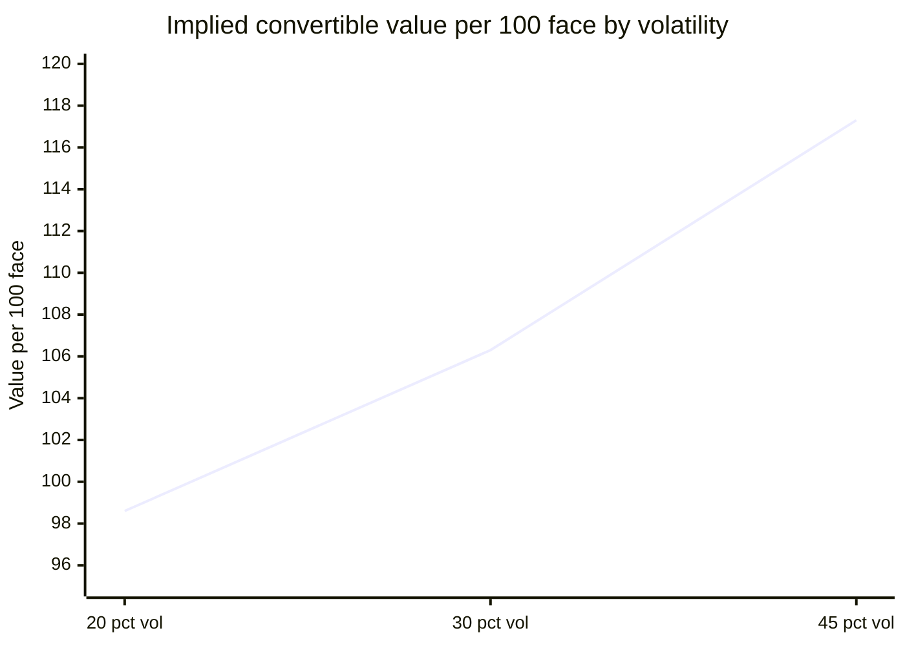

> [!WARNING]
> Common mistake: treating the Black-Scholes output as the market price. It is an estimate under strong assumptions. Compare it with the traded price and the volatility you actually believe.

> [!TIP]
> Real-world link: convertible arbitrage desks buy the bond and short the stock to isolate the option. They look for convertibles priced cheap relative to implied volatility, which is the same comparison this lesson sets up.

### 15.28 Convertible Payoff Diagrams, Premiums, Term Sheets and Call Spreads

- **Payoff versus theoretical value.** Two lines matter. The theoretical value (bond math plus the option from 15.27) is what the bond should trade at. The payoff is what the holder receives at maturity or conversion for each stock price. Plot both against the stock price. Below the conversion price the payoff is par (the floor, assuming no default). Above it, the payoff is the number of shares times the stock price, so it moves one-for-one with the stock.
- **Why the bond can trade above its conversion value.** A bond converted into stock at a high price still carries downside protection while the holder has not converted. Buying shares directly gives no floor. The holder of the bond keeps the par floor if the stock falls, so the bond is worth more than its conversion value until the stock climbs well past the conversion price.
- **Market conversion price.** Use the bond's market price, not par. If a $1,000 bond trades at 105, the effective conversion price is the original conversion price times 1.05. This is what a new buyer really pays per share.
- **Market conversion premium.** Market conversion price minus current stock price, and as a percent of the stock price. This is the extra the buyer pays for a convertible rather than the shares.
- **Payback period.** Premium per share divided by the extra income per share. Extra income is the bond's coupon per share minus the dividend per share the bond holder gives up. A long payback (decades) means the bond is a hedged equity play, not a bond substitute.
- **Premium over straight value (downside).** Market price divided by the straight-bond value, minus one. Warning: that premium is not the fall to the floor. The fall to the floor is 1 minus (straight value / market price), which is smaller in size than the premium. Use the correct formula when you tell a client the downside.
- **Term sheet features.**
  - Reference share price: often a volume-weighted average over a window, not the spot price.
  - Anti-dilution and dividend protection: conversion price adjusts if the company pays large dividends or issues shares cheaply.
  - Issuer soft call: the company can call once the stock has been above a set percentage of the conversion price (for example 130%) for a set number of days.
  - Clean-up call: the company can redeem the rest when only a small share (for example 15% or less) remains outstanding.
  - Make-whole and change-of-control puts: as in 15.22 and 15.23.
  - Cash settlement option: the company can pay cash instead of shares, which avoids dilution and still requires the liability and equity split under US GAAP.
- **Call spreads (capped calls).** To avoid dilution, the company buys call options on its own stock with a strike equal to the conversion price. It sells warrants at a higher strike to the same bank to offset the cost. Dilution then starts only above the warrant strike. Cost is the net premium paid, which is added to interest cost over the tenor.
- **Accounting trap.** The purchased calls are anti-dilutive and cannot be counted in diluted EPS. Diluted shares use the treasury stock method on the convertible and on the warrants. The economic dilution is lower than the reported dilution.

#### Worked Example (Made-Up Numbers)

- Conversion price $40, so each $1,000 bond converts into 25 shares.
- Bond trades at 105. Effective conversion price is $42.00. Stock at $35, so the market conversion premium is $7 per share, or 20%.
- Coupon 1.5% on $1,000 = $15 a year, or $0.60 per share. Dividend forgone $0.40 per share. Extra income is $0.20 per share.
- Payback period is $7.00 / $0.20 = 35 years, well beyond a 6-year tenor. The bond is best marketed to equity investors.

**Payoff per $1,000 bond at maturity (25 shares, par floor):**

| Stock price | Payoff (greater of par or 25 x stock) |
|---|---|
| $30 | $1,000 (floor) |
| $40 | $1,000 (at conversion price) |
| $50 | $1,250 |
| $60 | $1,500 |

**Call spread example (made-up numbers):**

- Principal $250M, 1.0M shares underlying the bond.
- Buy 1.0M calls at a $40 strike for $12 each, costing $12M.
- Sell 1.0M warrants at a $50 strike for $5 each, bringing in $5M.
- Net cost $7M over a 5-year tenor, or $1.4M a year. Divided by $250M, that adds about 0.56% a year.
- Coupon 1.5% plus 0.56% gives an all-in pre-tax cost of about 2.1%. Dilution starts only above $50.

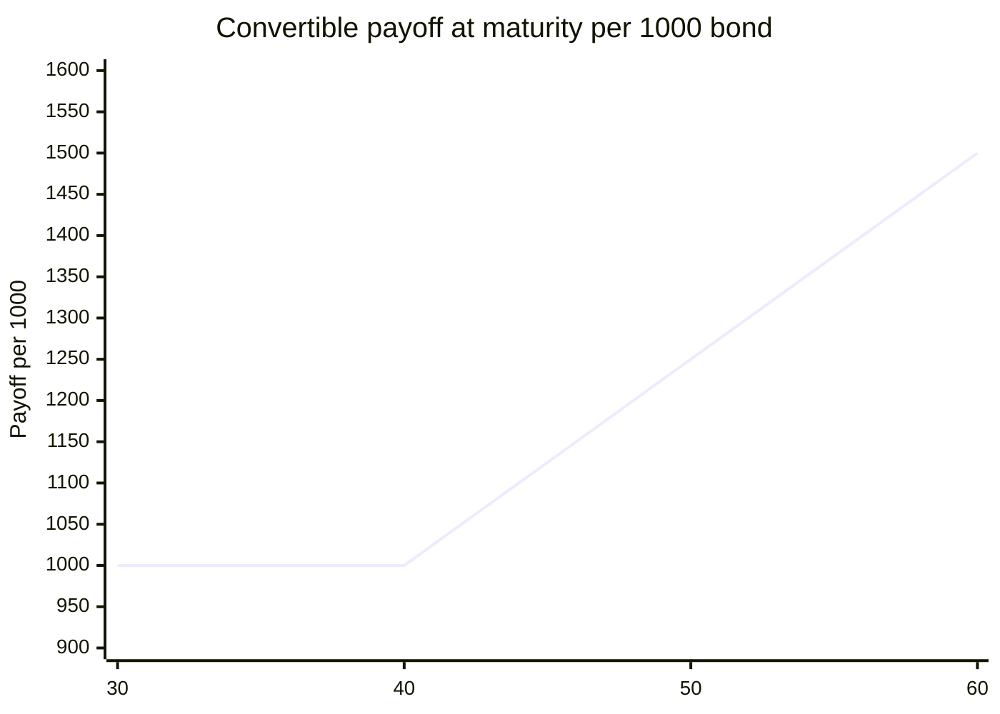

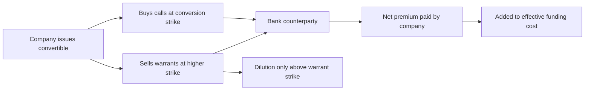

> [!WARNING]
> Common mistake: quoting the premium over straight value as the drop to the floor. The fall to the floor is 1 minus 1 divided by (1 plus premium). A 28% premium means about a 22% fall, not 28%.

> [!TIP]
> Real-world link: convertible term sheets are negotiated line by line. Anti-dilution, soft-call and clean-up clauses are the first things a holder's lawyers check, and the capped call is often what makes a high conversion premium saleable.

### 15.29 Credit Ratings and the Credit Memo

- **Purpose.** A credit rating is an opinion on the probability of default and the recovery if default happens. Rating agencies publish medians by rating band for leverage, coverage, margins and capital structure, so you can place a company in a band by comparing its numbers.
- **Step 1: pro-forma stats.** Compute the credit statistics after the deal (debt to EBITDA, EBITDA to interest, debt to capital, debt to equity, operating margin, free cash flow) and compare them with the median for the current rating band.
- **Step 2: qualitative check.** Market position, competition, barriers to entry, liquidity and disclosure. If these have not changed, and the stats still fit the current band, keep the rating. If the qualitative picture is weaker, consider a one-notch cut. If stronger, consider a one-notch lift.
- **Step 3: new band.** If the stats no longer fit the current band, find the band whose medians match, then adjust one notch for qualitative factors.
- **Rating scale.** Agencies use letters that differ slightly by agency. Moody's uses a numeric style (Ba1, Ba2, Ba3 for the BB area). For the case, the issuer went from BB- to B+ after the debt.
- **Credit memo structure.**
  1. Rating and outlook (the new rating, whether it changed, and the expected direction)
  2. Key indicators (the stats that drive the decision, highlighted)
  3. Rating drivers (four or five top quantitative and qualitative reasons)
  4. Corporate profile and financial summary (short)
  5. Rating rationale (positives and negatives, like a stock thesis)
  6. Detailed analysis (base case and especially downside case numbers)
  7. Liquidity (cash and short-term investments against the next 12 months of cash costs)
  8. Outlook and triggers (what would cause an upgrade or downgrade, in numbers)
  9. Other considerations
- **Downside cases matter most.** Lenders care about how bad things get and how long the ratios take to recover, not the best case.
- **Liquidity coverage.** Cash and short-term investments divided by the next 12 months of cash costs (operating, capex, interest, maturities, planned acquisitions). Full coverage is rare. The closer to 100%, the safer. Compare the level with the rating band rather than using a fixed cut-off.
- **Triggers.** A good memo states specific thresholds for an upgrade and a downgrade, such as operating margin above or below a level, debt to EBITDA above or below a level, and free cash flow above or below a level. The triggers should match the base, upside and downside cases.

#### Worked Example (Made-Up Numbers)

Pro-forma after a $1.5B debt raise:

| Metric | Before | After | Band median (current BB-) | Band median (B) |
|---|---|---|---|---|
| Debt to EBITDA | 1.5x | 4.2x | about 3.5x | about 5.0x |
| Debt to total capital | 30% | 55% | about 50% | about 65% |
| Operating margin | 8% | 7% | about 12% | about 8% |
| Liquidity coverage (cash vs next 12 months) | n/a | 40% | | |

- Leverage and capital ratios sit near the B median, and margins match the B median, so the call is a one-notch cut from BB- to B+. Stable outlook, because leverage is expected to fall back within a year or two.
- The downgrade is driven by leverage and capital ratios and by weak free cash flow, not by coverage (which stays healthy).
- Triggers: a downgrade if operating margin stays below 5%, debt to EBITDA stays above 5.0x, or free cash flow falls below negative $500M. An upgrade if margin tops 10%, debt to EBITDA falls below 3.5x and free cash flow turns positive.

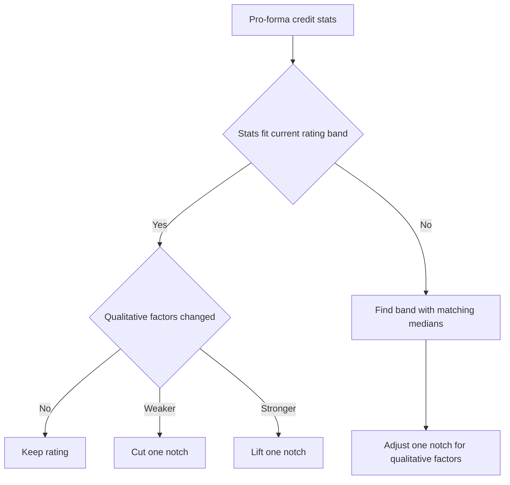

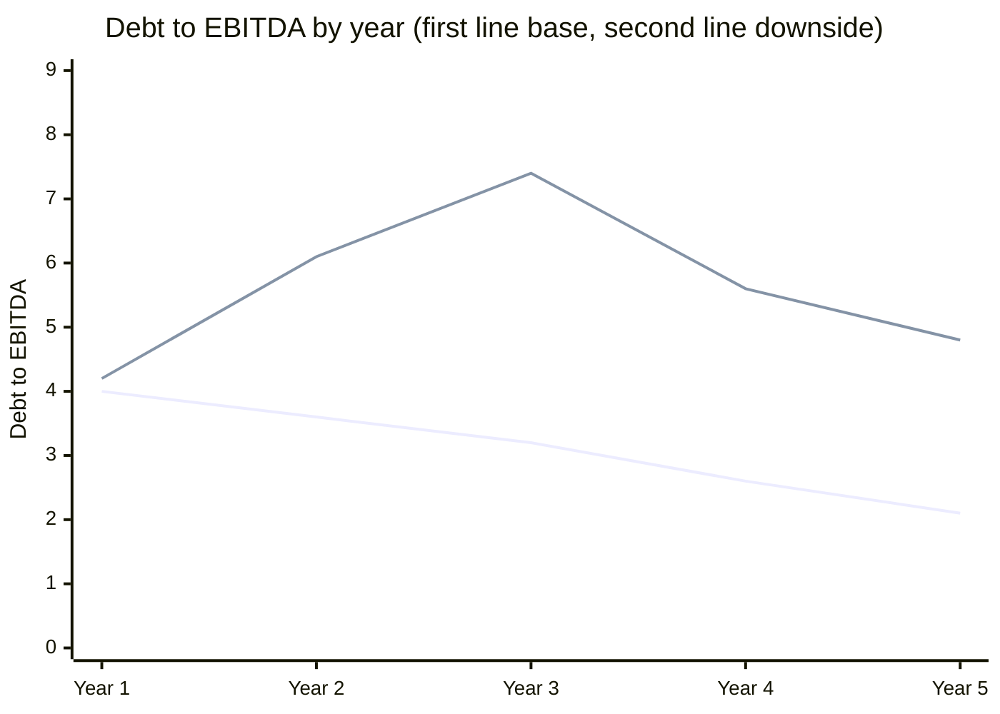

> [!WARNING]
> Common mistake: writing a memo that describes the base case only. The downside case and the time to recover are what move a rating, and the memo must say how long the ratios take to return to pre-deal levels.

> [!TIP]
> Real-world link: when a company wants to add debt, the first call from a banker is often "what does this do to our rating?" A quick version of this three-step check answers that in an hour, and the full memo is what the rating agencies and lenders read.

### 15.30 Pitch Book: Recommending a Convertible

This lesson walks through a full investment-banking pitch book for the case company (shown under a code name). It is a template for how the earlier analysis gets packaged for a client.

- **Pitch structure.**
  1. Executive summary: the recommendation up front (instrument, size, terms, and why)
  2. Why the company needs funding (operations summary and the cash shortfall)
  3. Each alternative in turn: follow-on equity, senior notes, convertible
  4. Credit stats and ratios for each path
  5. Conclusion and a summary table of pros and cons
  6. Appendix: detailed models, comps, WACC and cash flow projections
- **Keep the deck summarized.** Do not paste the raw model. Show the handful of metrics that matter (here, international and domestic revenue, subscribers and segment contribution), and move the detail to the appendix.
- **The key slide is the funding need.** The base case looked healthy on leverage, but the minimum cash balance was breached in the downside cases, and went negative in the extreme downside. That is what establishes the need for money, which is more persuasive than any valuation argument.
- **Equity option.** High multiples argue for equity, but a share price that has risen several-fold forces a bigger discount, and investors will ask what happens if the stock falls back. The deck must show the price history and the proposed discount range together.
- **Debt option.** Senior notes are simple and well understood, but they raise leverage, make future borrowing more expensive, and are the most visible hit to credit ratings. The deck should show the downside credit stats, not only the base.
- **Convertible option.** Lowest after-tax cost in the analysis, a capped-call overlay to limit dilution, and a balance sheet split between debt and equity that softens the leverage ratios. The deck should say clearly that the capped call adds cost, and that a very high conversion price with a full call spread can push the all-in cost above the cost of equity. A credible pitch states the trade-off rather than hiding it.
- **The honesty point.** The lesson openly says the pitch "spins" the numbers a little. The fair version: state the strongest case for the recommendation and name the weakest point (here, the cost of the call spread and the lenders' questions on the content-spending story), then say how you would address it.
- **Proposed terms.** Size near the amount needed, a conversion premium near the comp median, a coupon in line with the debt comps, a maturity matched to the investment horizon, and the call spread as an optional overlay.

#### Worked Example (Made-Up Numbers): The Summary Table

| Option | After-tax cost (approx.) | Dilution | Effect on leverage | Main risk |
|---|---|---|---|---|
| Follow-on equity | 2% to 3% (near the earnings yield) | High, and a big discount | None | Share price falls after the deal |
| Senior notes | about 4% | None | Raises debt to EBITDA to about 4x or more | Future borrowing costs more; likely rating cut |
| Convertible, no overlay | about 1.5% pre-tax coupon | Dilution above conversion price | Smaller, because the liability piece is recorded separately | Dilution if the stock rallies |
| Convertible with call spread | about 2% all-in | Limited to above the warrant strike | Same as above | Overlay cost makes it dearer than a plain convertible |

> [!TIP]
> The pitch is only as good as the weakest slide it hides. When you present a recommendation, list the cost of the overlay and the stock-price risk next to the upside.

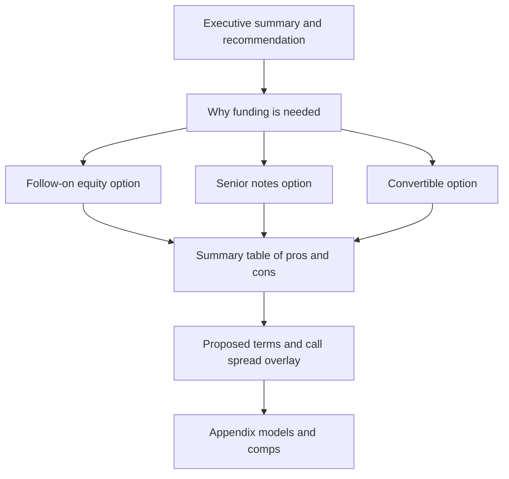

> [!TIP]
> Real-world link: bank pitch books for a convertible are usually 20 to 40 pages, with the terms and the overlay costed out in the back. The structure in this lesson is the standard order most banks use.

## Diagrams and Charts

The lessons above already carry their own charts. This section gathers the three view types the module leans on most, plus a deal-structure flow.

**Deal structure for a capped-call convertible** (flowchart of how cash and shares move):

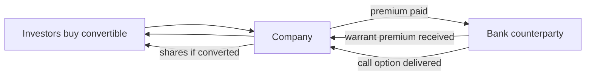

**How a convertible's value splits** (pie of the 30% volatility example in 15.27, per 100 face):

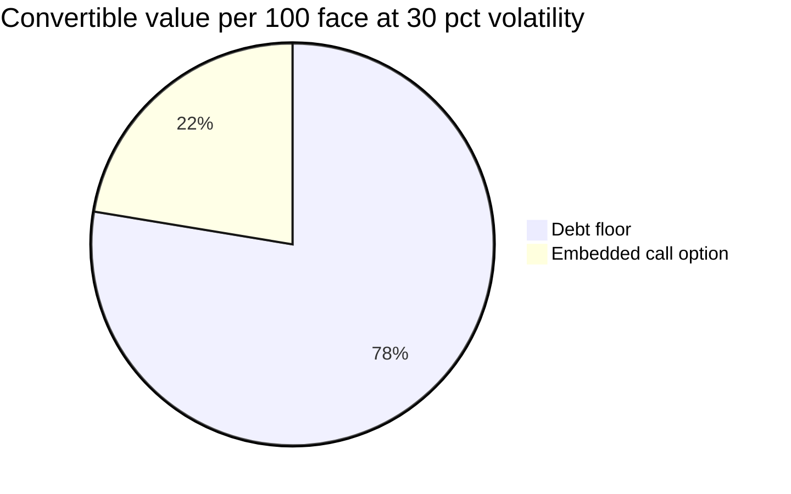

**Timeline of a follow-on and a convertible issue** (sequence of who does what):

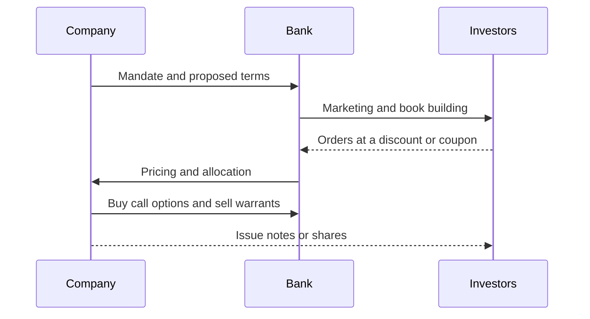

## Excel Model Walkthrough

The Part 2 models sit in one workbook with a tab per topic. The layouts are described here, not copied.

- **Follow-on comps and proceeds.** A comps tab lists each deal (size, percent of market cap, discount to last trade, primary share, and later price performance). A separate model tab takes a target raise, a primary percentage, an underwriting spread, a greenshoe percentage and a discount range. Share counts for base and greenshoe are computed separately, and the primary portion drives the cash to the company. Dilution, EPS effect and after-tax cost of each source sit below, with the financing scenario set to nothing for a clean baseline.
- **Public comps, DCF and WACC.** Standard layout from the valuation module: comparables with unlevered betas, a WACC block with two beta cases side by side, and a DCF with a scenario selector that changes growth and margin rows.
- **Single bond pricing tab.** Inputs at the top (settlement date, maturity, coupon, market rate, redemption percent, frequency). Below, a timeline of period dates and a cash-flow row that checks settlement and maturity. Price comes from discounting the coupon and principal rows. Yield, duration and modified duration use the built-in functions, with a manual IRR and an approximation as cross-checks.
- **Yield to call and yield to worst.** A schedule of call dates and call prices. The yield formula is repeated per call date with the call date as the maturity and the call price as the redemption. Yield to worst is a MIN across the row. A parallel block adds accrued interest to the purchase and redemption.
- **Make-whole tab.** A term block from the indenture, a projected cash-flow block cut off at the window end, and a grid of discount rates (Treasury plus several spreads). The output is the make-whole price per spread.
- **Refinancing tab.** Two cash-flow blocks (existing bond and proposal), each with a yield-to-exit row. The proposal includes an equity-grant row tied to a projected equity value. A scenario row shows yields side by side.
- **Debt comps tabs.** A tab for unsecured notes and a tab for convertibles, one row per deal, with columns for date, size, price, coupon, yield to maturity, yield to worst, tenor, remaining years, ratios and (for convertibles) conversion price, ratio and premium. Medians sit at the bottom.
- **Indenture summary.** A one-page grid with one row per term and a source column (filing or indenture), used as the input to any later debt analysis.
- **Convertible valuation tab.** The debt piece is a PRICE calculation. The option piece has d1 and d2 cells, NORMSDIST cells for the normal values, and an EXP-based call value, then a multiplier for shares per bond. A data table flexes volatility, stock price, conversion price and maturity.
- **Payoff and call spread tabs.** A stock-price column in steps, with a bond value (theoretical) and a payoff column using the conversion ratio. The call spread block lists calls bought, warrants sold, net premium, annual cost and the adjusted pre-tax funding cost. A treasury-stock-method block shows reported diluted shares.
- **Credit memo model.** Pro-forma credit stats before and after the deal, base and downside cases side by side, a liquidity block (cash against next 12 months of cash costs), and a triggers block for upgrade and downgrade thresholds.
- **Pitch book model.** Summaries pulled from the other tabs, with an appendix of the full income statement, comps and cash flow projections.

Key formulas to recognize across tabs: the proceeds (primary shares times offer price, less spread and fees), the after-tax cost of equity (net income over equity value at pricing), the after-tax cost of debt (coupon times one minus the tax rate), the dirty price (clean plus accrued), the yield to worst (minimum of yield to maturity and yield to each call), and the Black-Scholes call value.

## Interview Questions

1. Why is a follow-on offering priced at a discount?

To attract buyers to a large block of new shares. Companies with rich multiples often need a bigger discount, because buyers worry about a price pullback.

2. Why is the earnings yield a poor measure of equity cost for a richly valued stock?

A high P/E makes the earnings yield look cheap, but that reflects a high price. Test it with a valuation before using it.

3. How do you tell primary from secondary in a filing?

Look for the statement on proceeds to selling stockholders. If the company gets nothing from the sale, it is secondary. Otherwise compute the split from share counts.

4. What is the difference between yield to maturity and current yield?

Current yield is coupon over price. YTM is the IRR if you buy at the price, hold to maturity and get every payment on time.

5. If rates rise 1%, does a bond fall 1%?

No. Duration gives the linear estimate, and convexity corrects for the curve bending, so the price change is not symmetric.

6. Why does a bond at a premium have yield below its coupon?

You pay more than par for the same coupon and get par back at maturity, so the return is lower than the coupon.

7. What is accrued interest and why does it matter?

Interest earned since the last coupon, paid by the buyer to the seller. Dirty price equals clean plus accrued. Quotes can be either, so confirm.

8. What is yield to worst?

The lowest yield across maturity and every call date. It is the conservative return, assuming no default.

9. What is a make-whole call?

An early redemption at the present value of remaining payments through a window, discounted at a Treasury rate plus a spread. It makes early calls expensive.

10. Why might a bond be called despite a lockout?

If a make-whole provision allows a call during lockout at a high price, the issuer may still choose to call if rates have fallen.

11. How do you check whether a debt package fits existing covenants?

Read the indenture for debt baskets, lien limits and refinancing caps, and compare the new amount with each.

12. What is the convertible's downside protection?

The bond floor (straight bond value). Above the conversion price, the bond behaves like equity.

13. What do you put in the Black-Scholes inputs for a convertible?

Stock price, conversion price, risk-free rate over the same tenor, time to maturity, volatility and dividend yield. Volatility is the biggest judgment call.

14. What is a capped call and why use one?

Company buys calls at the conversion strike and sells warrants at a higher strike. It shifts the dilution threshold up at a net cost.

15. Why can a capped call not be shown as an offset in diluted EPS?

Anti-dilutive instruments are excluded under accounting rules, so the reported diluted count uses the treasury stock method for the convertible and warrants.

16. What does a credit rating downgrade typically follow?

Leverage and capital ratios moving outside the band median, weaker margins or free cash flow, and weaker qualitative factors.

## Career Angle

**How the module maps to real work.** For a fixed income analyst on a capital markets pricing team, fair-valuing a large book of mortgage-related and debt instruments each month uses the same vocabulary as the bond concepts here (price versus rate, yield to maturity, duration, accrued interest, call risk). FP&A and CFO reporting roles sit closer to the company-side analysis: forecasting, credit ratios and what a financing does to leverage. The valuation and WACC material ties to target roles in valuation, capital markets and corporate development.

**Target roles.** Valuation and capital markets (pricing, debt and equity issuance), leveraged finance and credit, and corporate development (financing a deal).

**Talking points (truthful, framed as coursework).**

1. "I completed a module on bond pricing and yield analysis covering yield to worst, duration and convexity, accrued interest and make-whole calls, and I can walk through how a make-whole price is built."
2. "In coursework I modeled a follow-on equity offering across discount levels, and showed that the cheapest-looking funding source can change once dilution and the richness of the stock are included."
3. "I worked through a distressed refinancing exercise where the proposed terms gave investors a lower yield than the old bond despite more risk, and I showed what equity-grant change would fix it."

**Caution.** Do not list this material as job experience or put these exercises on a resume as work. Keep the framing as "studied" or "built in coursework". Black-Scholes and convertible valuation should not be connected to day-to-day pricing work unless the candidate actually did that work. Resume bullets should stay on verified work, such as a monthly pricing review and documented fair-value responsibilities.

## Cheat Sheet

| Topic | Rule or formula |
|---|---|
| Follow-on proceeds | Primary shares x offer price, less spread on primary, less other fees |
| Follow-on size | Deal value as percent of market cap; median about 10 to 15% in comps |
| Discount | Offer price = last price x (1 minus discount) |
| After-tax cost of equity (quick) | Net income / post-money equity value at pricing |
| After-tax cost of debt | Coupon x (1 minus tax rate) |
| Bond price | Sum of PV of coupons plus PV of redemption |
| Price rule | Rate up, price down; coupon above market rate means premium |
| Yield ordering | Discount: YTM > current > coupon. Premium: coupon > current > YTM |
| Current yield | Annual coupon / clean price |
| Approx YTM | (coupon + (par - price)/years) / ((par + price)/2) |
| Duration | Price-weighted average time; zero coupon equals maturity |
| Modified duration | Macaulay / (1 + YTM / payments per year) |
| Price change | About -modified duration x change in yield + convexity x change^2 / 2 |
| Dirty price | Clean price + accrued interest |
| Accrued interest | Coupon x days since last coupon / days in period |
| Yield to call | YTM formula with call date as maturity and call price as redemption |
| Yield to worst | Minimum of YTM and all yields to call (or put) |
| Make-whole price | PV of remaining payments through window end at Treasury plus spread, as % of par |
| Yield to exit | Yield to call using dirty price, plus equity granted at exit |
| Debt comp stats | Coupon, YTM, YTW, tenor, rating, debt/EBITDA, EBITDA/interest, conversion premium |
| Indenture checks | Guarantors, ranking, optional redemption, change of control (101 typical), debt baskets, asset sales |
| Convertible split | Debt piece = PV at straight-bond yield; option piece = bond value less debt piece |
| Black-Scholes | d1 = [ln(S/K) + (r - q + sigma^2/2) T] / (sigma sqrt T); d2 = d1 - sigma sqrt T |
| Convertible shares per bond | Face / conversion price |
| Market conversion price | Conversion price x (bond price / par) |
| Payback period | Market conversion premium per share / (coupon per share minus dividend per share) |
| Floor drop | 1 minus 1/(1 + premium over straight value) |
| Capped call cost | Net premium paid, amortized over tenor, added to coupon |
| Credit rating test | Stats vs band medians; adjust one notch for qualitative factors |
| Liquidity coverage | Cash and short-term investments / next 12 months of cash costs |

---

[← Previous: Module 15, Part 1](15-equity-debt-and-convertibles-part-1.md) · [Contents](../README.md) · [Next: Quick Reference and Quiz Bank →](16-quick-reference-and-quiz-bank.md)
