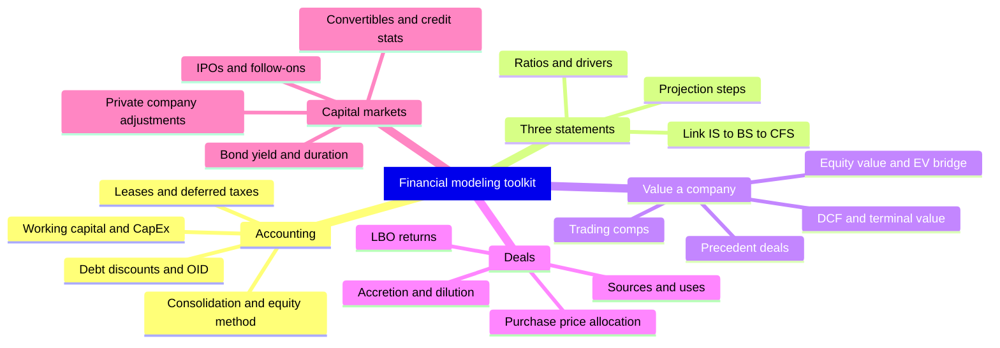
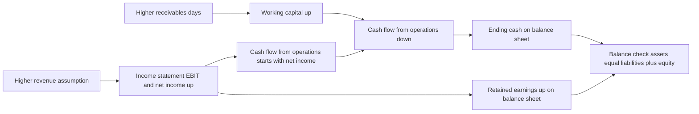
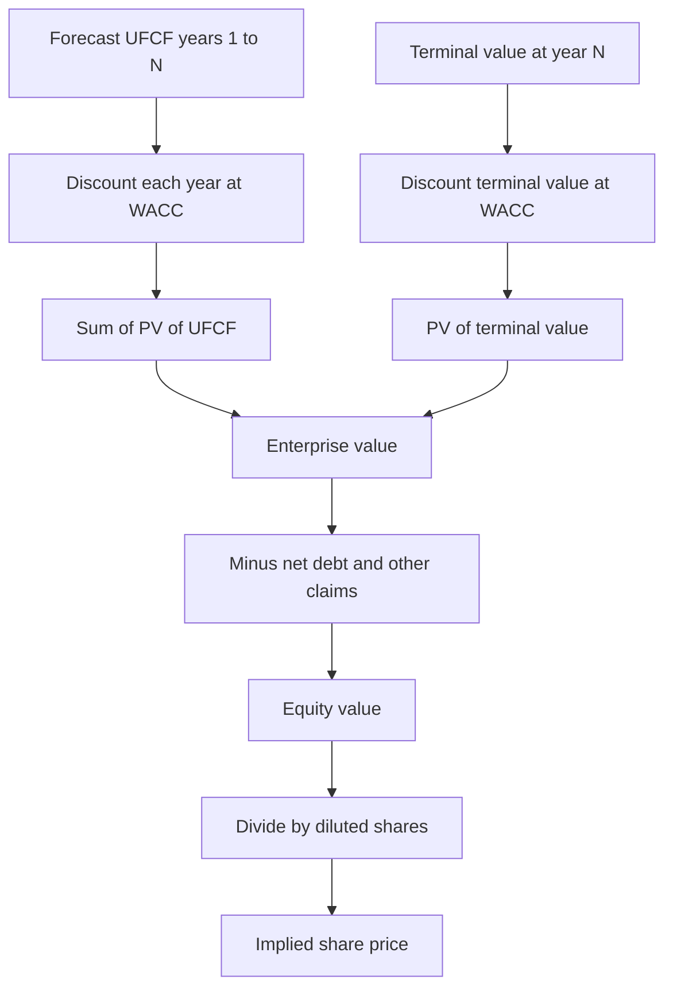
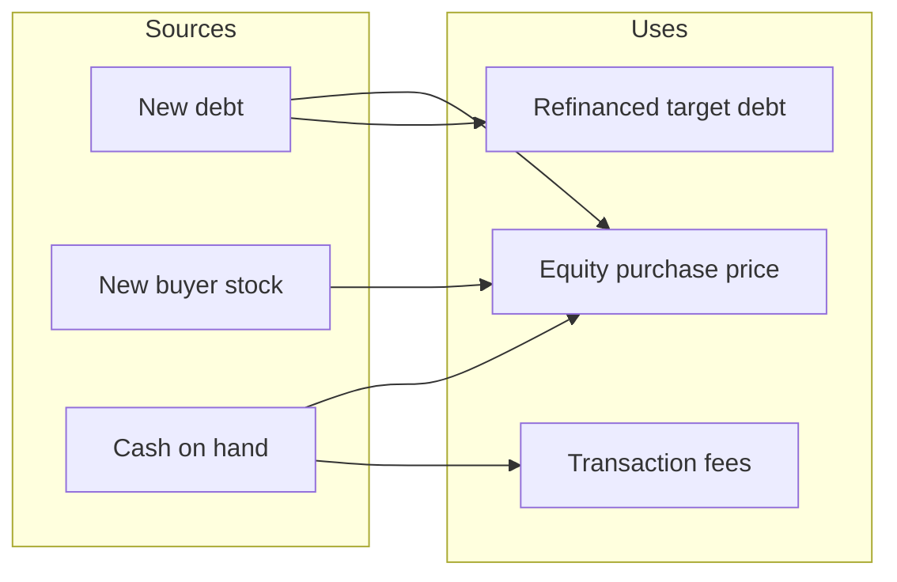
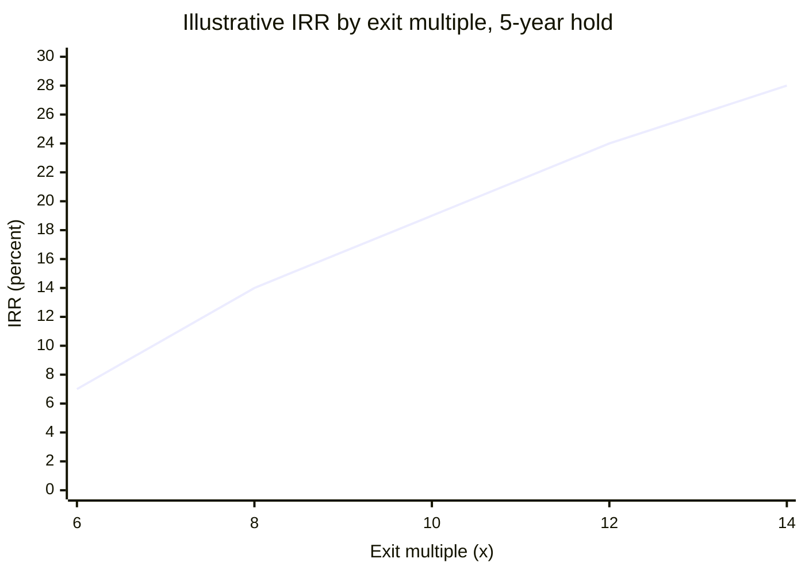
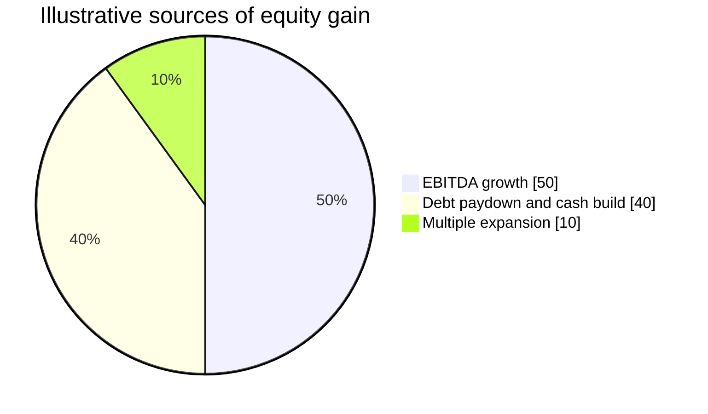

# Quick Reference and Quiz Bank

[← Previous: Module 15, Part 2](15-equity-debt-and-convertibles-part-2.md) · [Contents](../README.md)

<b>Contents</b>

- [Overview](#overview)
- [Module Map](#module-map)
- [1. Core Rules That Show Up Everywhere](#1-core-rules-that-show-up-everywhere)
- [2. Accounting Essentials](#2-accounting-essentials)
- [3. Three-Statement Linking](#3-three-statement-linking)
- [4. Three-Statement Projections](#4-three-statement-projections)
- [5. Equity Value and Enterprise Value](#5-equity-value-and-enterprise-value)
- [6. DCF](#6-dcf)
- [7. Comparable Companies (Public Comps)](#7-comparable-companies-public-comps)
- [8. Precedent Transactions](#8-precedent-transactions)
- [9. M&A and Merger Models](#9-ma-and-merger-models)
- [10. LBO](#10-lbo)
- [11. IPOs, Follow-Ons and Private Companies](#11-ipos-follow-ons-and-private-companies)
- [12. Bonds, Debt and Convertibles](#12-bonds-debt-and-convertibles)
- [13. Common Interview Math (Quick Mental Checks)](#13-common-interview-math-quick-mental-checks)
- [Quiz Bank](#quiz-bank)
- [Diagrams and Charts](#diagrams-and-charts)
- [Career Angle](#career-angle)
- [Cheat Sheet](#cheat-sheet)

## Overview

A one-stop study sheet for the whole guide: the core formulas grouped by topic, then a 60-plus question bank with hidden answers to test yourself before an interview or a model review.

**How to use this guide.** Read the formula reference once, then work through the quiz bank with the answers folded. Open each answer only after you have written your own version. Every number in the examples is made up, so the arithmetic is easy to check in your head.

## Module Map

## 1. Core Rules That Show Up Everywhere

- **Universal value formula:** Value = Cash flow / (discount rate - growth rate). It only works for a stable, steadily growing business. Real models use it in the terminal period.
- **Time value of money:** PV = FV / (1 + r)^n. FV = PV x (1 + r)^n.
- **NPV at a rate:** sum of each cash flow divided by (1 + r)^t, minus the price paid.
- **IRR:** the rate that makes NPV equal zero. It is the rate at which you can compare a deal with a cost of capital.
- **WACC:** the blended cost of all capital. Weights use market values where you can get them.
- **Golden rule:** unlevered items pair with enterprise value and WACC. Levered items pair with equity value and cost of equity.

## 2. Accounting Essentials

### Income Statement and Working Capital

- Working capital = operating current assets - operating current liabilities. Exclude cash and debt.
- Change in working capital (cash effect) = prior NWC - current NWC. A rise in NWC uses cash.
- Days metrics:
  - DSO = Accounts receivable / Revenue x Days in year
  - DIO = Inventory / COGS x Days in year
  - DPO = Accounts payable / COGS x Days in year
- Returns:
  - ROE = Net income to common / average common equity
  - ROA = Net income to common / average total assets
  - ROIC = NOPAT / average invested capital

### CapEx and Depreciation

- Straight-line depreciation = (Cost - salvage) / useful life.
- Depreciation is non-cash. It lowers taxes through the tax shield, so the cash effect of D&A is Depreciation x Tax rate.
- Gain on sale of PP&E adds to cash only as (Book value + Gain x (1 - t)) when the gain is taxed. A loss works the same way with the sign flipped.

### Leases

- **Operating lease:** expense is one straight-line cost each year, booked above EBIT. Under U.S. GAAP the lease asset and liability sit on the balance sheet but the income statement shows one lease cost.
- **Finance lease:** split the cost into an interest piece and a depreciation piece.
  - Interest expense = discount rate x lease liability (opening balance)
  - Depreciation (asset amortization) = cash lease cost minus interest, in a level-payment case
  - Principal repayment = cash lease cost minus interest
- IFRS 16 puts most leases on the balance sheet like finance leases. Under IFRS, EBIT goes up because the lease cost moves below it.

### Deferred Taxes and NOLs

- Deferred tax liability (DTL) appears when book taxes are higher than cash taxes (book income ahead of taxable income).
- Deferred tax asset (DTA) is the reverse. Net DTL = DTL - DTA.
- Cash taxes = book taxes - increase in DTL + increase in DTA.
- NOL use is capped by the ownership-change limits after an acquisition (Section 382 type rules).

### Stock-Based Compensation

- SBC is an expense that is not cash. It reduces net income, and the same amount goes back into equity.
- Cash taxes can differ from book taxes when SBC is deductible on a different schedule. Track the difference as a deferred tax item.

### Goodwill and Intangibles from Deals

- Goodwill = purchase equity price - (target book equity - existing goodwill) - asset write-ups + DTL on write-ups.
- Write-ups are amortized over time. The amortization hits book income but may not be tax deductible in a stock deal, which creates a DTL.

### Debt Accounting

- **Book value of debt** starts at face value less any discount or plus any premium, then moves with amortization.
- **OID (original issue discount):** if the bond issues at 90 for a face of 100, the discount of 10 is amortized into interest expense over the life of the bond. Cash interest is still coupon x face.
- **Issuance fees** work the same way as the OID. Capitalize them and amortize them over the term.
- **Loss on extinguishment:** unamortized OID or fees left over at early repayment are expensed at repayment.
- **Convertible bond accounting:** the debt is split into a debt piece and an equity piece at issue. The debt piece accretes up to face through extra interest expense.

### Equity Investments and Consolidation

- **Less than 20% stake, or no significant influence:** record at cost or fair value. Dividends are income.
- **20% to under 50% (equity method):** record your share of the investee's net income as income, and reduce the carrying value by dividends received. Equity income is not cash.
- **50% or more (consolidation):** add 100% of the subsidiary's line items. Show the part you do not own as noncontrolling interest (NCI) on the balance sheet and in net income.
  - Net income to common = consolidated net income - NCI share
- Buying more of a subsidiary you already control is an equity transaction. Goodwill does not change.

### Inventory and Pensions

- LIFO vs FIFO: in rising prices LIFO gives higher COGS, lower taxable income and lower reported inventory on the balance sheet.
- Pension: unfunded status = pension obligation - plan assets. Only the unfunded part sits as a liability.

### Unrealized Gains

- Trading securities: unrealized gains go through income.
- Available-for-sale securities: unrealized gains go to other comprehensive income (OCI), a separate equity line.

## 3. Three-Statement Linking

Order of the linking checks:

1. Net income from the income statement flows to retained earnings on the balance sheet.
2. Net income plus non-cash items plus working-capital changes gives cash from operations.
3. CapEx and asset sales give cash from investing.
4. Debt issued or repaid, equity issued or bought back, and dividends give cash from financing.
5. Net change in cash = CFO + CFI + CFF. Ending cash flows back to the balance sheet.
6. Assets must equal liabilities plus equity. If not, a linking error exists.

Common sign rules:

- Increase in an asset: cash goes down (use of cash).
- Increase in a liability or equity: cash goes up (source of cash).
- Non-cash expenses (D&A, SBC, amortization of OID) are added back on the cash flow statement.

## 4. Three-Statement Projections

Standard steps:

1. Project revenue. Use growth rates or a driver (units times price, subscribers times ARPU) that you can defend.
2. Project costs. Use margins for simple models, and fixed versus variable splits for more detail.
3. Project operating balance sheet items with drivers: DSO, DIO, DPO, and other percentage-of-revenue items.
4. Project CapEx and D&A. Tie CapEx to revenue or to the asset base. Keep D&A consistent with the existing asset schedule.
5. Project debt and interest. Interest should use average or opening balances, and you must check for circularity.
6. Calculate summary statistics: margins, growth, ratios and credit stats, then check they make sense.

Quality checks: the balance sheet balances, the cash flow ties to the balance sheet cash, the ratios look sensible over time, and any sudden jump has a written reason.

## 5. Equity Value and Enterprise Value

- **Equity value** = share price x diluted shares.
- **Diluted shares** use the treasury stock method for options and warrants (new shares = options - options x strike / share price, if in the money). Convertibles dilute only if in the money, and the share count depends on the conversion ratio.
- **Enterprise value** = equity value + debt + preferred stock + noncontrolling interest - cash and equivalents - non-operating assets (for example equity stakes that the income statement does not capture).
- **Net debt** = debt - cash.
- Shortcut: EV = equity value + net debt + other claims.
- Market value of assets - market value of liabilities = equity value. Non-operating assets come out of EV.
- **Changes in EV and equity value:**
  - Issuing stock: cash and equity rise together. EV is unchanged.
  - Buying back shares: cash and equity fall. EV is unchanged.
  - Issuing debt and holding the cash: cash and debt both rise, so net debt, EV and equity value do not change. Spending the cash on operations changes net operating assets, which is the only way EV moves.
  - Paying a dividend: cash and equity both fall. EV is unchanged.

Multiples:

| Multiple | Numerator | Denominator |
|---|---|---|
| TEV / Revenue | Enterprise value | Revenue |
| TEV / EBITDA | Enterprise value | EBITDA |
| TEV / EBIT | Enterprise value | EBIT |
| P / E | Price per share (or equity value) | EPS (or net income) |
| Price / Book | Equity value | Book equity |

Pairing rule: enterprise value pairs with pre-interest metrics. Equity value pairs with post-interest metrics.

## 6. DCF

### Unlevered Free Cash Flow

UFCF = NOPAT + D&A + other non-cash items - change in net working capital - CapEx

where NOPAT = EBIT x (1 - tax rate).

Common checks: deduct the full operating lease expense if the company has operating leases (do not add back the lease principal), take out one-time gains and losses, and make sure SBC is treated the same way you think it should be (as a real cost or as a non-cash add-back).

### WACC

WACC = Cost of equity x E / (D + E + P) + After-tax cost of debt x D / (D + E + P) + Cost of preferred x P / (D + E + P)

After-tax cost of debt = cost of debt x (1 - tax rate).

Cost of equity (CAPM) = risk-free rate + levered beta x equity risk premium.

### Beta Conversions

- Unlevered beta = Levered beta / (1 + D/E x (1 - t) + P/E)
- Levered beta = Unlevered beta x (1 + D/E x (1 - t) + P/E)

Use the median or average unlevered beta from comps, then relever at the target's capital structure.

### Terminal Value

- **Perpetuity growth method:** TV = final-year UFCF x (1 + g) / (WACC - g)
- **Exit multiple method:** TV = final-year EBITDA (or EBIT, NOPAT, UFCF) x exit multiple
- **Implied growth from a multiple:** g = (TV x WACC - UFCF) / (TV + UFCF)
- **Implied multiple from growth:** TV / final-year EBITDA

Discounting:

- PV of TV = TV / (1 + WACC)^N, where N is the final forecast year.
- With the mid-year convention, discount periods are 0.5, 1.5, 2.5 and so on for the cash flows. The perpetuity-growth TV is discounted at N - 0.5 because the cash flows it captures arrive half a year early. An exit-multiple TV is discounted at N, because the multiple prices the business at year end.
- Sanity check: the terminal value usually makes up 50 to 80 percent or more of total enterprise value. If it is much higher, the forecast period may be too short or the growth rate too high.

### Equity Value from DCF

Enterprise value = sum of PV of UFCF + PV of TV.
Equity value = enterprise value - net debt - other claims.
Implied share price = equity value / diluted shares.

### Sensitivity Tables

Run WACC against terminal growth (or exit multiple). Run operating assumptions (margin or revenue growth) against WACC. The output that matters is usually implied share price or implied enterprise value.

### Levered DCF and Alternatives

- Levered DCF discounts levered FCF at the cost of equity and gives equity value directly. To get enterprise value, add net debt back.
- Dividend discount model: discount dividends and a terminal value at the cost of equity.
- NAV model: a DCF with no terminal value, used when assets run out (for example, oil reserves).

## 7. Comparable Companies (Public Comps)

- Pick peers with similar growth, margins, risk and business mix. Screen on the operating metrics first, then on size.
- Calculate the multiples for each peer on a consistent basis (LTM vs forward, calendarized year-end).
- Apply the median or mean of the peer range to the target's metric. Use the 25th to 75th percentile as the range.
- Check the trading range against the DCF. Big gaps mean at least one assumption needs attention.
- Keep metrics and enterprise value consistent. If leases are included in enterprise value for one, include them for all, and adjust the EBITDA and the UFCF to match.

## 8. Precedent Transactions

- Use the same metrics as comps, but the multiples include a control premium. That makes deal multiples higher than trading multiples on average.
- Look at deals within the last few years and at similar size and sector.
- Transaction value = offer price per share x diluted shares + net debt.

## 9. M&A and Merger Models

### Purchase Price and Sources and Uses

- Equity purchase price = offer price per share x target diluted shares.
- Purchase enterprise value = equity purchase price + target net debt.
- Uses = equity purchase price + refinanced debt + fees.
- Sources = new debt + new stock + cash from the balance sheet + existing cash used.

### Purchase Price Allocation (PPA)

1. Start with the equity purchase price.
2. Subtract the target's book value of equity.
3. Add back existing goodwill that will be written off (so the net goes to new goodwill).
4. Subtract the asset write-ups (inventory, PP&E, intangibles).
5. Add the deferred tax liability on the write-ups (write-up x tax rate, in a stock deal).
6. The result is new goodwill. Negative goodwill is not allowed under U.S. GAAP or IFRS.

Worked example with made-up numbers: purchase equity price 1,000. Target book equity 700. Write-ups 100. DTL = 100 x 25 percent = 25. Goodwill = 1,000 - 700 - 100 + 25 = 225.

### Accretion and Dilution

Pro forma net income = buyer net income + target net income + after-tax synergies - after-tax new interest - after-tax foregone interest on cash - after-tax lost interest income of target - after-tax amortization of write-ups.

Pro forma EPS = pro forma net income / (buyer shares + new shares issued).

Accretive if pro forma EPS > standalone buyer EPS.

Fast test: compare the weighted cost of acquisition with the seller's yield at the purchase price.

- Cost of cash = foregone interest on cash x (1 - buyer tax rate)
- Cost of debt = interest rate on new debt x (1 - buyer tax rate)
- Cost of stock = buyer net income / buyer equity value (inverse of the buyer P/E)
- Seller's yield = seller net income / purchase equity value (inverse of the seller P/E at the offer)
- Weighted cost = % cash x cost of cash + % debt x cost of debt + % stock x cost of stock
- Weighted cost below seller's yield = accretive. Above = dilutive.

Pure stock deal rule: if the buyer's P/E is higher than the seller's P/E at the offer price, the deal is accretive. Equal means neutral.

### Break-Even Synergies

Synergies needed to break even = the dilution amount divided by (1 - tax rate). Use it to check whether the cost savings in the deal case are realistic.

### Other M&A Points

- Contribution analysis: the share of revenue, EBITDA and net income each side brings, compared with the ownership split.
- Synergies are a cost or revenue benefit. Revenue synergies are harder to believe than cost synergies.
- Ownership step-ups: moving from a minority stake to control triggers a remeasurement of the old stake to fair value, with a gain or loss in income.

## 10. LBO

### Basic Structure

- Equity check = total uses - debt raised.
- Entry leverage is measured as total debt / EBITDA. Stable businesses often carry roughly 4x to 6x at entry; cyclical businesses get less.
- The cash flow that repays debt is levered FCF = EBITDA - cash interest - cash taxes - CapEx - change in NWC.

### Returns

- Money-on-money multiple (MoM) = exit equity proceeds / initial equity invested.
- IRR (no interim cash) = MoM^(1 / years) - 1.
- Exit equity = exit enterprise value - net debt at exit.
- Exit enterprise value = exit EBITDA x exit multiple.

### Quick IRR Math (Rules of Thumb)

| Multiple | Holding period | Approx IRR |
|---|---|---|
| 2.0x | 3 years | about 25 percent |
| 2.0x | 5 years | about 15 percent |
| 3.0x | 3 years | about 45 percent |
| 3.0x | 5 years | about 25 percent |

Rule of 72: years to double = 72 / rate. Rule of 115 for tripling.

Other approximations: IRR for 2x = 100% / years x 75%. IRR for 3x = 200% / years x 65%.

### Value Creation Split

- EBITDA growth: (exit EBITDA - entry EBITDA) x entry multiple.
- Multiple expansion: (exit multiple - entry multiple) x exit EBITDA.
- Debt paydown and cash build: reduction in net debt over the hold.
- Total equity gain = sum of the three, adjusted for fees.

### Leverage Amplifies Outcomes

Leverage does not create returns by itself. It magnifies the equity outcome. A deal that loses value without leverage can lose most of the equity with leverage. Downside cases matter as much as the base case.

### Debt Schedule and Covenants

- Cash sweep: the cash left after mandatory payments repays the most senior debt first.
- Mezzanine and subordinated notes charge higher rates and may include PIK interest that adds to principal.
- Revolver: draws when cash is short and is repaid first when cash is available.
- Typical covenants: maximum total debt / EBITDA, minimum interest coverage (EBITDA / interest), minimum fixed charge coverage (DSCR type).

## 11. IPOs, Follow-Ons and Private Companies

### IPO Basics

- Primary shares raise cash for the company. Secondary shares go to existing holders.
- Deal size as a percent of market cap is a common screen for typical IPOs.
- Pricing uses comparable companies on forward multiples, with an IPO discount to make the deal sell.
- Lock-up periods usually last about 180 days.

### Private Company Adjustments

- Owner salary and personal expenses must be normalized before you value a business.
- Illiquidity discount: a private stake is worth less than a public one with the same cash flows.
- Key-person discount: the business is worth less if one person drives all the value.
- Control premium: a buyer of a whole company pays more than a minority price. Precedent deals already include it, so do not add it again.
- Private beta: estimate from comps, then relever at a target capital structure. A simple adjustment divides the comps' unlevered beta by the square root of the target's correlation with the market, then multiplies by (1 minus the buyer's diversification factor).
- Earn-outs and seller notes are common in private deals.

## 12. Bonds, Debt and Convertibles

### Bond Math

- Current yield = annual coupon / market price.
- Yield to maturity (YTM) = the discount rate that sets the present value of all coupons and the face value equal to the price.
- Premium bond: coupon > current yield > YTM.
- Discount bond: YTM > current yield > coupon.
- Par bond: YTM = current yield = coupon.
- Rates up means price down, and the reverse.

### Duration and Convexity

- Modified duration is roughly the percent price change for a one percent change in yield, with the sign flipped.
- Price change ~ -Duration x change in yield + 0.5 x Convexity x (change in yield)^2.
- Zero-coupon bond duration equals its maturity.
- Higher coupon, shorter duration.

### Calls, Puts and Make-Whole

- Call premium schedules: the issuer pays a premium above par to redeem early. The premium falls each year toward par.
- Make-whole: the issuer pays the present value of remaining coupons discounted at a Treasury rate plus a spread, which can be very expensive.
- Put: the holder can force repayment at par on set dates.

### Convertible Bonds

- Conversion price = stock price x (1 + conversion premium).
- Conversion ratio = par value / conversion price.
- Shares from conversion = number of bonds x conversion ratio.
- If the stock is above the conversion price, bondholders convert. Below, they keep the bond and its floor value.
- Downside protection: the bond is worth at least its value as plain debt (the bond floor), as long as the issuer can pay.
- Cheap financing: convertibles carry lower coupons because holders get the equity option.

### Credit Analysis

- Compare after-tax cost of equity, after-tax cost of debt and the convertible option when deciding how to raise money.
- Build downside cases to test covenants. Count how much headroom remains.
- Common ratios: debt / EBITDA, net debt / EBITDA, EBITDA / interest, DSCR, debt / (EBITDA - CapEx), and cash as a share of total expenses.
- Ratings fall as leverage rises and coverage falls.

## 13. Common Interview Math (Quick Mental Checks)

- Rule of 72 for doubling time.
- EV to equity bridge: subtract net debt, add non-operating assets, subtract preferred and noncontrolling interest.
- EPS accretion: compare buyer P/E with seller P/E at offer.
- Terminal value share: if the terminal value is 80 percent of the enterprise value, the forecast only explains 20 percent of value. Push back on the assumptions.

## Quiz Bank

Each question is a collapsible block. Try the answer in your head first, then expand the block to check it.

### Accounting (Questions 1 to 14)

Q1. A company buys inventory on credit for 200 and pays cash later. What happens to working capital, and what is the cash effect in the year of purchase?

Inventory goes up 200 and accounts payable goes up 200, so net working capital is unchanged. There is no cash effect in the purchase year.

Q2. A company sells equipment with a book value of 300 for 380 in cash, and the gain is taxed at 25 percent. How much cash does the sale bring in?

Gross proceeds are 380. The gain is 380 - 300 = 80, so tax at 25 percent is 20. After tax, the company keeps 380 - 20 = 360 of cash. The sale shows up as 380 in investing cash flow, and the 20 of tax runs through operating cash flow, which is why the net effect is 360.

Q3. Why does D&A appear as a positive add-back in cash flow from operations even though it lowers net income?

D&A is a non-cash expense. Net income is reduced by it, but no cash leaves the company, so it is added back to reach cash flow. Its real cash benefit is the tax shield, which is D&A x tax rate.

Q4. A bond has a face value of 100 and is issued at 90. What is the annual interest expense in year one if the coupon is 5 percent and the discount is amortized straight line over 10 years?

Cash coupon is 5. Discount amortization is 10 / 10 = 1 per year. Total book interest expense is 6 per year. Cash paid is still 5, and the difference of 1 is non-cash.

Q5. A company has a deferred tax liability that grows from 40 to 55 in a year. Are cash taxes higher or lower than book taxes?

Cash taxes are lower than book taxes by the 15 increase. The company booked more tax expense than it paid in cash, and the difference is a liability to pay later.

Q6. Under U.S. GAAP, what does a single operating lease do to the income statement compared with a finance lease?

An operating lease shows one straight-line lease cost in operating expense, above EBIT. A finance lease splits the cost into interest expense and amortization, so EBIT is higher than under an operating lease with the same cash payments.

Q7. A company owns 25 percent of an affiliate and uses the equity method. The affiliate earns 80 and pays 20 in dividends. What happens to the investment balance and to the parent's income?

The parent records 25% x 80 = 20 of equity income, which goes into net income. It receives 25% x 20 = 5 in dividends. The investment balance rises by 20 minus 5, which is 15.

Q8. A parent owns 70 percent of a subsidiary. The subsidiary earns 100 of net income. How much net income belongs to the parent's common shareholders?

Consolidated net income includes the full 100. Noncontrolling interest takes 30 percent, which is 30. Net income to common is 70.

Q9. A parent buys an extra 20 percent of a subsidiary it already controls for 50 in cash. Does goodwill change?

No. Buying more of an already-controlled subsidiary is an equity transaction. The 50 reduces cash and moves value between parent equity and noncontrolling interest. No new goodwill is created.

Q10. In a period of rising input prices, which inventory method usually gives a higher COGS and a lower tax bill: LIFO or FIFO?

LIFO. The most recent, higher costs go to COGS first, so COGS is higher, pre-tax income is lower, and taxes are lower. This is why LIFO is used for tax in some countries.

Q11. Stock-based compensation of 40 is expensed this year. The company gets no tax deduction until the shares vest. What happens to net income, cash and the balance sheet?

Pre-tax income falls by 40, so net income falls by 40 less any tax benefit recorded. Cash is unchanged because SBC is non-cash. Equity goes up by the same amount through paid-in capital, so the balance sheet still balances. A deferred tax asset builds if a future deduction is expected.

Q12. A company's days sales outstanding rises from 40 to 55 while revenue is flat. What does that do to operating cash flow?

Receivables grow faster in relative terms, so cash collected falls and working capital absorbs cash. Operating cash flow is lower even though net income is unchanged.

Q13. Your company owns an asset with a 4-year remaining life and 100 of net book value. It is sold for 100. What is the gain or loss and the cash effect?

There is no gain or loss, because proceeds equal book value. Cash in is 100, and the asset leaves the balance sheet at 100.

Q14. What is the difference between a book value of debt and a face value of debt, and when do they differ?

Face value is the principal the company owes and pays interest on. Book value is what the balance sheet shows, and it differs when there are unamortized discounts, premiums or issuance fees. Those are amortized, so book value moves toward face value over time.

### Three Statements and Projections (Questions 15 to 21)

Q15. When you link the statements, where does a cash flow number from the cash flow statement go on the balance sheet?

The ending cash from the cash flow statement becomes the cash line on the balance sheet. Balance sheet changes in working capital, PP&E and debt are the inputs that generated the cash flows, so the two statements must tie.

Q16. Your balance sheet is off by 12. Name three places you would check first.

Check whether net income flows to retained earnings, whether ending cash on the cash flow statement matches balance sheet cash, and whether each change in a balance sheet item is picked up once on the cash flow statement. A missing or doubled non-cash add-back is a common cause.

Q17. Why should interest expense be calculated on average or opening debt balances rather than on the ending balance when projecting?

Interest depends on the debt outstanding during the year. Using the ending balance can create circularity and can understate or overstate interest when debt moves a lot. Using an opening balance avoids circularity; an average balance is more accurate but usually needs a circularity switch.

Q18. You project revenue to grow 12 percent a year, but receivables are fixed at 45 days of sales. What happens to cash flow over time?

Receivables grow with revenue, so each year working capital absorbs more cash. With the days assumption held constant, the cash absorbed rises as revenue grows, and free cash flow is lower than the net income suggests.

Q19. Name two sanity checks on a projection beyond the balance sheet balancing.

Margins should trend in a believable way, and the growth in CapEx should match the growth in the asset base or revenue. Other good checks include cash taking on a reasonable value, ratios like DSO or inventory days staying in a normal range, and any sudden jump having a written reason.

Q20. What does a revolver do in a projection, and when is it drawn?

A revolver is a credit line that is drawn when cash falls below the minimum balance. It is repaid first when excess cash appears. Modeling it prevents negative cash balances.

Q21. Why is cash flow from financing usually not part of unlevered free cash flow?

Unlevered FCF measures cash flow available to all capital providers before financing choices. Debt issuance, repayment, dividends and buybacks are decisions about how the business is funded, so they belong to the financing section and not to the value of operations.

### Equity Value and Enterprise Value (Questions 22 to 27)

Q22. A company has 100 of equity value, 40 of debt, 10 of cash and 15 of preferred stock. What is its enterprise value?

Enterprise value = equity value + debt + preferred - cash = 100 + 40 + 15 - 10 = 145.

Q23. A company issues 100 of stock and holds the cash. What happens to enterprise value?

Nothing. Cash and equity value both rise by 100. Net debt does not change, so enterprise value is unchanged.

Q24. A company pays a 50 dividend from cash. Does enterprise value change?

No. Cash and equity value both fall by 50. Net debt and net operating assets do not change.

Q25. Why do you divide enterprise value by EBITDA, but equity value by net income?

Enterprise value belongs to all capital providers, so it pairs with metrics before interest payments to them, such as EBITDA. Equity value belongs only to common holders, so it pairs with what is left after interest, such as net income.

Q26. How many new shares are created by options with 1,000 units at a 10 strike when the share price is 25, using the treasury stock method?

Cash from exercise is 1,000 x 10 = 10,000. Shares repurchased at 25 are 10,000 / 25 = 400. Net new shares are 1,000 - 400 = 600.

Q27. A company has a convertible bond that is out of the money. Should you add its conversion shares to the diluted share count?

Generally no. An out-of-the-money convertible is treated as debt, and it only dilutes if the share price is above the conversion price.

### DCF and WACC (Questions 28 to 37)

Q28. What is unlevered free cash flow built from?

NOPAT (EBIT x (1 minus tax rate)) plus D&A and other non-cash items, minus the increase in net working capital and minus CapEx.

Q29. A company has a 2.0 levered beta, 40 percent debt to equity, and a 25 percent tax rate, with no preferred stock. What is the unlevered beta?

Unlevered beta = 2.0 / (1 + 0.40 x 0.75) = 2.0 / 1.30 = about 1.54.

Q30. Using 5 percent risk-free rate, 6 percent equity risk premium and a levered beta of 1.2, what is the cost of equity?

Cost of equity = 5% + 1.2 x 6% = 5% + 7.2% = 12.2%.

Q31. The company has 12.2 percent cost of equity, 7 percent pre-tax cost of debt and 25 percent tax rate. Debt is 30 percent of capital. What is WACC?

After-tax cost of debt = 7% x 0.75 = 5.25%. WACC = 70% x 12.2% + 30% x 5.25% = 8.54% + 1.575% = about 10.1%.

Q32. Why do you not multiply the cost of equity by (1 minus the tax rate)?

Interest is tax deductible, which lowers the cost of debt. Dividends and equity returns are paid out of after-tax income and get no tax deduction, so the cost of equity is not adjusted.

Q33. The final forecast year UFCF is 100, WACC is 10 percent and growth is 3 percent. What is the terminal value by perpetuity growth?

TV = 100 x 1.03 / (0.10 - 0.03) = 103 / 0.07 = about 1,471.

Q34. Using the same terminal value of 1,471 and final-year EBITDA of 150, what exit multiple does it imply?

Implied multiple = 1,471 / 150 = about 9.8x.

Q35. A terminal value of 1,500 is discounted from year 5 at a 10 percent WACC. What is its present value?

PV = 1,500 / 1.10^5 = 1,500 / 1.6105 = about 931.4.

Q36. Why is the terminal value often the largest part of DCF value, and what do you do about it?

The terminal value captures all cash flows after the forecast, so it is often 50 to 80 percent or more of enterprise value. To check it, compare the implied exit multiple with peer multiples and the implied perpetual growth with long-run GDP growth. Sensitivity tables on WACC and growth show how fragile the answer is.

Q37. Your DCF says the company is worth 800 of enterprise value but the stock price implies 500. Give two first steps.

First, check whether the DCF uses the right cash flow, such as lease treatment, SBC and one-time items. Second, check the terminal value assumptions and WACC inputs against peer data. Then rebuild the sensitivity table to see which assumptions matter most.

### Comps, Precedents and M&A (Questions 38 to 48)

Q38. A peer trades at 8x EBITDA. The target's EBITDA is 50. What is the implied enterprise value from this single peer multiple?

Implied EV = 8 x 50 = 400.

Q39. Why do precedent transaction multiples usually run higher than trading comps multiples?

Acquisition prices include a control premium, the value of owning the whole company and its synergies. Trading multiples reflect minority stakes only.

Q40. An acquirer pays an equity purchase price of 1,000 for a target with book equity of 700, existing goodwill of 50, write-ups of 100 and a 25 percent tax rate. What is new goodwill?

Net identifiable book value excluding old goodwill = 700 - 50 = 650. Goodwill = 1,000 - 650 - 100 + DTL of 25 = 275.

Q41. In a stock deal, why does a write-up of intangible assets create a deferred tax liability?

The higher book value of the assets is not deductible for tax, so book taxes are lower than cash taxes later. The gap is recorded as a DTL, which unwinds as the write-up amortizes.

Q42. A buyer with a 20x P/E buys a target at an offer that implies an 18x P/E, using stock only. Is the deal accretive or dilutive?

Accretive. In an all-stock deal, buying earnings at a lower P/E than your own raises EPS.

Q43. The buyer uses 50 percent cash at a 4 percent foregone interest rate and 50 percent debt at 6 percent. The buyer tax rate is 25 percent. The seller yield at the purchase price is 8 percent. Is the deal accretive?

Cost of cash = 4% x 0.75 = 3%. Cost of debt = 6% x 0.75 = 4.5%. Weighted cost = 50% x 3% + 50% x 4.5% = 3.75%. Since 3.75 percent is below the 8 percent seller yield, the deal is accretive.

Q44. A deal creates 100 of after-tax dilution. Synergies are taxed at 25 percent. How much pre-tax synergy is needed to break even?

Pre-tax synergy = 100 / (1 - 0.25) = about 133.

Q45. What is contribution analysis used for?

It compares each company's share of revenue, EBITDA and net income with the ownership split in the combined company. A party contributing 60 percent of EBITDA but getting 40 percent ownership is the basis for a negotiation point.

Q46. Why are revenue synergies riskier than cost synergies in a merger model?

Cost synergies are within management control, such as cutting duplicate staff or facilities. Revenue synergies depend on customer behavior and on cross-selling working out, so they are less certain and are often discounted or phased in later.

Q47. A buyer moves from a 30 percent stake to 60 percent control in one step. What happens to the old stake under GAAP?

The old stake is remeasured to fair value at the date control is gained, with the difference recorded as a gain or loss in income. Goodwill is then measured on the full purchase.

Q48. What is the fastest way to tell if a deal is accretive without building the full model?

Compare the weighted cost of acquisition (cash, debt and stock costs after tax, weighted by mix) with the seller's yield at the offer price. Below the yield means accretive, above means dilutive.

### LBO and Returns (Questions 49 to 57)

Q49. An LBO has a 3x money-on-money multiple over 5 years. Roughly what IRR does that imply?

About 25 percent, using the quick rule for 3x over 5 years.

Q50. An LBO invests 400 of equity and returns 1,000 at exit in year 3. What is the MoM and approximate IRR?

MoM = 1,000 / 400 = 2.5x. For 2.5x, the IRR sits between 2x at 3 years (about 25 percent) and 3x at 3 years (about 45 percent), so about 36 percent. The exact figure is 2.5^(1/3) - 1 = 35.7 percent.

Q51. The sponsor's exit proceeds are 1,000 and the IRR is 35 percent over 3 years. Roughly what was the initial equity?

35 percent over 3 years is about 2.5x. Initial equity = 1,000 / 2.5 = 400.

Q52. How do you split value creation in an LBO into its main drivers?

Split it into EBITDA growth (change in EBITDA x entry multiple), multiple expansion (change in multiple x exit EBITDA), and debt paydown plus cash build (reduction in net debt). Fees are a drag on the total.

Q53. Why does high leverage make a mediocre deal much worse in a downside case?

Debt payments are fixed, so when cash flow falls, the equity cushion shrinks quickly. Without leverage the equity might still return 1.0x, but with heavy debt the equity can lose most of its value.

Q54. What is a cash sweep?

A cash sweep applies all cash left after mandatory payments and minimum cash to prepay debt, usually the most senior tranche first. It reduces interest and increases equity value at exit.

Q55. What is PIK interest and why would a lender accept it?

PIK (payment in kind) interest is added to the loan principal instead of paid in cash. Lenders accept it for a higher yield on a loan the borrower cannot service in cash, such as mezzanine debt in a leveraged buyout.

Q56. What are the typical credit covenants in a leveraged buyout?

Maximum debt to EBITDA, maximum net debt to EBITDA, minimum EBITDA to interest, and minimum fixed charge or debt service coverage. Breaching one can trigger default even when the company is still paying interest.

Q57. The sponsor exits through an IPO and sells one third of its stake a year for three years. Why is the IRR lower than in a single sale at year three with the same total proceeds?

The cash comes back later on average, so the time-weighted return falls even though the money multiple is the same. Staged exits lower the IRR for the same MoM.

### IPOs, Private Companies and Deal Structure (Questions 58 to 62)

Q58. What is the difference between a primary and a secondary share sale in an IPO?

Primary shares are new shares, and the proceeds go to the company. Secondary shares are existing shares sold by current holders, and the proceeds go to them.

Q59. A private company's owner pays himself 400 a year in salary and the market rate for a manager is 150. How would you normalize earnings for a valuation?

Add back the excess 250 of owner pay, so that the business is charged a market manager salary. Also remove personal expenses run through the company and any one-time items.

Q60. Why should a private company valuation often include an illiquidity or key-person discount?

A private stake cannot be sold quickly at a market price, so buyers demand a discount. If one person generates most of the value, a buyer also faces the risk of losing that person, and the value falls accordingly.

Q61. Why are earn-outs common in private company sales?

The buyer and seller disagree about future performance. An earn-out pays part of the price later, based on results, which bridges the gap and shifts some risk to the seller.

Q62. Why is stock a less common currency in private company deals?

Private sellers often do not want shares in an illiquid company, and a private buyer's stock may not have a market price. Cash, debt and earn-outs are used more often, which also makes EPS accretion less relevant.

### Bonds, Debt and Convertibles (Questions 63 to 67)

Q63. A bond with a 6 percent coupon trades at 950 on a 1,000 par. What is the current yield?

Current yield = 60 / 950 = about 6.3 percent. The bond trades at a discount, so current yield is above the coupon, and yield to maturity is higher still.

Q64. Rates rise by one percentage point. Which bond falls more, a 2-year or a 10-year bond with the same coupon?

The 10-year bond. It has longer duration, so its price is more sensitive to a change in rates.

Q65. A convertible bond has a 100 stock price, a 30 percent conversion premium and 1,000 par. How many shares does each bond convert into?

Conversion price = 100 x 1.30 = 130. Conversion ratio = 1,000 / 130 = about 7.7 shares per bond.

Q66. A convertible has a bond floor of 880, and the stock is well below the conversion price. What might the bond trade at, and why?

It should trade near the bond floor, around 880 or somewhat above, because the equity option is far out of the money and the bond still pays its coupon. Its value is driven by the straight debt value and credit quality.

Q67. A company's interest coverage falls from 7.0x to 2.5x after a new borrowing. What does this tell a credit analyst, and what should they check next?

The company now earns much less than its interest bill covers, so default risk has risen and the rating is likely to fall. Next, check covenants against the new numbers, look at downside cases for cash flow, and check how much liquidity and debt maturity runway the company has.

## Diagrams and Charts

### How a Change Flows Through the Three Statements

### From Forecast to Share Price in a DCF

### Deal Structure: Where the Money Comes from and Goes

### Illustrative Chart: LBO IRR vs Exit Multiple (Made-Up Numbers, 5-Year Hold)

The MoM values behind this chart are invented for illustration. IRR = MoM^(1/5) - 1, rounded.

### Illustrative Split of LBO Equity Gain (Made-Up Numbers)

## Career Angle

For a capital markets or valuation analyst, this material maps to real work as follows:

- **Fair value and pricing.** A pricing team that values hundreds of billions of dollars of assets and liabilities each month-end (for example, about $550B) relies on the discounting, yield and spread concepts in this guide.
- **Rate sensitivity.** Duration and convexity match the MBS and rate-driven pricing questions that come up in capital markets work.
- **FP&A forecasting and CFO reporting.** Three-statement linking, driver-based projections and sensitivity checks are the same habits used in forecasts.

Truthful talking points (framed as coursework, not as deal experience):

1. "I worked through a full financial modeling curriculum, covering three-statement builds, DCF with terminal value checks, comps, merger models with accretion and dilution, and LBO returns." A candidate should confirm which modules were actually finished before saying this.
2. "On my own model, I check that the terminal value is no more than about 80 percent of enterprise value and I test the answer with WACC and growth sensitivities." This is a method a candidate can describe, not a result.
3. "I can explain accretion using the cost-of-acquisition test: weighted after-tax cost of cash, debt and stock against the seller's yield at the offer price." This works for interviews at valuation and corporate development roles.

A candidate should not claim any LBO, M&A or merger model built for a real deal, any deal experience, or any results from the practice models. A CFA Level I plan (for example, sitting in Feb 2027) is separate from the modeling practice itself.

## Cheat Sheet

| Topic | Formula or rule |
|---|---|
| Universal value | Value = CF / (r - g) |
| Unlevered FCF | NOPAT + D&A + non-cash items - change in NWC - CapEx |
| NOPAT | EBIT x (1 - t) |
| Cost of equity | Rf + levered beta x ERP |
| Levered to unlevered beta | Bu = BL / (1 + D/E x (1 - t) + P/E) |
| WACC | Ke x E/V + Kd x (1 - t) x D/V + Kp x P/V |
| Perpetuity TV | UFCF(N) x (1 + g) / (WACC - g) |
| Exit TV | EBITDA(N) x exit multiple |
| Implied g | (TV x WACC - UFCF) / (TV + UFCF) |
| PV of TV | TV / (1 + WACC)^N |
| EV | Equity value + debt + preferred + NCI - cash - non-operating assets |
| Diluted shares (TSM) | Options - options x strike / price, if in the money |
| Goodwill | Purchase equity price - (book equity - old goodwill) - write-ups + DTL |
| DTL on write-up | Write-up x tax rate (stock deal) |
| Accretion test | Weighted cost of acquisition below seller yield = accretive |
| Cost of cash / debt | Rate x (1 - buyer tax rate) |
| Break-even synergies | Dilution / (1 - t) |
| MoM | Exit equity / initial equity |
| IRR, no interim cash | MoM^(1/years) - 1 |
| Quick IRR | 2x in 3 yrs ~25%; 2x in 5 yrs ~15%; 3x in 3 yrs ~45%; 3x in 5 yrs ~25% |
| Rule of 72 | Years to double = 72 / rate |
| Current yield | Coupon / price |
| Conversion price | Stock price x (1 + conversion premium) |
| Conversion ratio | Par / conversion price |
| Operating lease | One straight-line cost above EBIT (U.S. GAAP) |
| Finance lease | Interest = rate x liability; remainder reduces the liability |
| Days metrics | DSO = AR / revenue x days; DIO = inventory / COGS x days; DPO = AP / COGS x days |

Rules of thumb:

- Enterprise value pairs with EBITDA, revenue and UFCF. Equity value pairs with net income and levered FCF.
- Terminal value is often 50 to 80 percent or more of DCF value. Test it against exit multiples and growth.
- Buying back or issuing stock, or paying dividends, does not change enterprise value.
- Leverage amplifies outcomes in both directions. Always check the downside case.
- Negative goodwill is not allowed. A bargain purchase is a gain.
- Convertibles below the conversion price trade like straight debt. Above it, they trade like stock.

---

[← Previous: Module 15, Part 2](15-equity-debt-and-convertibles-part-2.md) · [Contents](../README.md)
